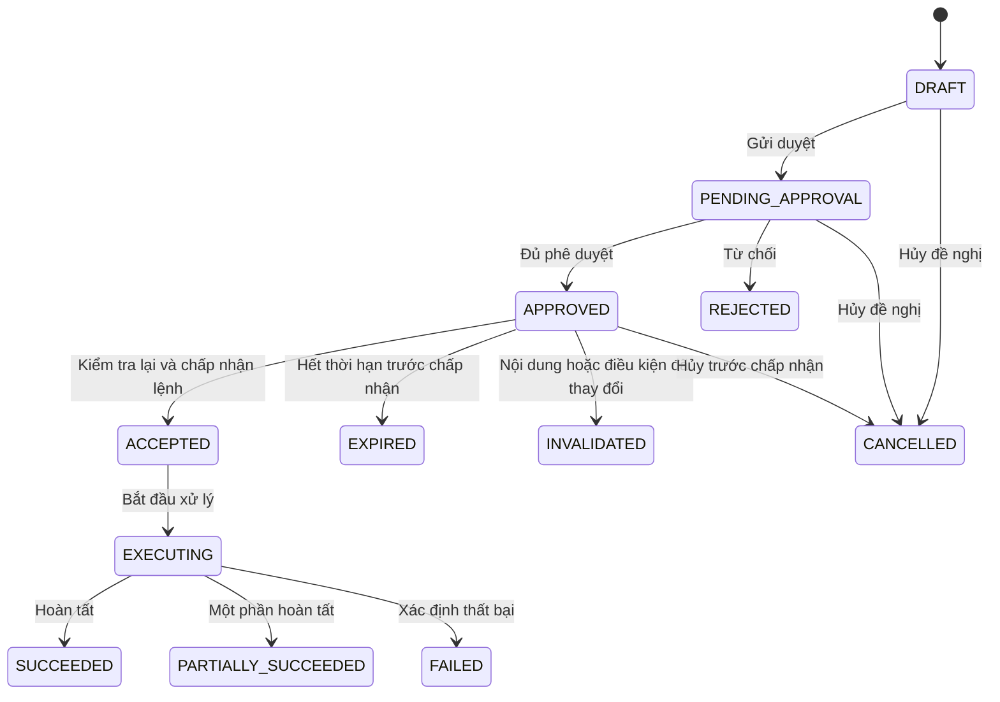

# Administrator action scope — Phạm vi hành động của quản trị viên

## 1. Quyền quản trị phải có giới hạn nghiệp vụ

Một quản trị viên có thể cần khóa tài khoản, sửa cấu hình vận hành, hủy đơn hàng hoặc cấp quyền cho đồng nghiệp. Tuy nhiên, tên vai trò `ADMIN` không trả lời được họ được phép làm gì, trên dữ liệu của ai và trong trạng thái nào. Nếu một endpoint chỉ kiểm tra `isAdmin()`, tài khoản quản trị của một cửa hàng có thể sửa dữ liệu cửa hàng khác, hoặc tài khoản chuyên vận hành có thể tự thay chính sách để hợp thức hóa thao tác bị cấm.

**Administrator action scope** là phạm vi mà một hành động quản trị được phép tác động. Phạm vi này bao gồm hành động cụ thể, tenant, đối tượng, trường dữ liệu, trạng thái, giới hạn tác động và thời gian hiệu lực. Nó cũng xác định quản trị viên có thể đề nghị, phê duyệt, thực thi hay ủy quyền hành động đó.

Trong bảo vệ logic nghiệp vụ, quyền quản trị là một đầu vào của quyết định cho phép. Nó không tự xóa bỏ business invariants: đơn đã thanh toán không được âm thầm đổi giá gốc, một phê duyệt không được dùng cho nội dung khác và một lệnh gửi lại không được tạo hiệu ứng thứ hai.

Sau bài này, bạn có thể:

- Mô tả quyền quản trị bằng hành động và phạm vi cụ thể thay vì chỉ bằng vai trò.
- Tách quản trị nền tảng, quản trị tenant và quyền trên dữ liệu nghiệp vụ.
- Thiết kế việc cấp quyền, phê duyệt và ủy quyền không cho phép tự nâng quyền.
- Bảo vệ cùng một phạm vi tại API đơn lẻ, batch, worker và công cụ vận hành.
- Xử lý việc thay đổi quyền đồng thời với thực thi lệnh bằng transaction và chính sách hiệu lực rõ ràng.
- Kiểm thử các cách vượt phạm vi thông qua tham số, trạng thái, retry và thay đổi chính sách.

Các vai trò, trạng thái, hạn mức và tình huống dưới đây thuộc một hệ thống thương mại nhiều tenant giả định. Chúng minh họa cách thiết kế, không phải cấu hình dùng chung cho mọi tổ chức.

## 2. Phạm vi quản trị gồm những chiều nào?

### 2.1. Đừng gộp mọi khả năng vào một cờ admin

Xét yêu cầu: “Cho quản trị viên vùng miền Nam hủy đơn chưa thanh toán của tenant A trong thời gian trực ca.” Câu này chứa nhiều điều kiện độc lập:

| Chiều phạm vi | Câu hỏi cần trả lời | Ví dụ |
| --- | --- | --- |
| Danh tính | Ai đang thực sự thao tác? | Nhân viên `admin-17` |
| Hành động | Được làm việc gì? | `admin.order.cancel_unpaid` |
| Tenant | Tổ chức nào sở hữu dữ liệu? | `tenant-A` |
| Đối tượng | Được tác động đến nhóm đối tượng nào? | Đơn thuộc khu vực được giao |
| Trường dữ liệu | Được thay giá trị nào? | Lý do hủy; không gồm giá hoặc tenant |
| Trạng thái | Được thực hiện ở giai đoạn nào? | Đơn chờ thanh toán, thanh toán chưa bắt đầu |
| Tác động | Giới hạn từng lần và cộng dồn là gì? | Hạn mức số đơn trong một tác vụ và trong ca |
| Quy trình | Đề nghị, duyệt hay thực thi? | Hủy hàng loạt cần duyệt riêng |
| Thời gian | Quyền có hiệu lực khi nào? | Trong thời gian được cấp grant |
| Điều kiện xác thực | Phiên có đáp ứng yêu cầu không? | Hành động nhạy cảm yêu cầu xác thực bổ sung |

Những chiều này phải được kiểm tra trên dữ liệu đáng tin cậy. Ví dụ, vùng của đơn hàng lấy từ bản ghi phía máy chủ; trình duyệt không thể tự gửi `region=South` để biến một đơn khác thành đơn thuộc phạm vi.

### 2.2. Kết hợp quyền và điều kiện đúng cách

Một quyết định cho phép có thể được diễn đạt:

```text
ALLOW(actor, action, target, command, context) khi:
  actor đang hoạt động và phiên hợp lệ
  có grant hiệu lực cho hành động và phạm vi đích
  các thuộc tính đối tượng hiện tại thuộc phạm vi đó
  các trường yêu cầu thay đổi đều được phép
  chuyển trạng thái và tham số đáp ứng quy tắc nghiệp vụ
  không vượt hạn mức hoặc hạn chế đang áp dụng
  phê duyệt cần thiết còn hiệu lực và khớp lệnh
  không vi phạm quy tắc phân tách nhiệm vụ
```

Thiếu điều kiện thì từ chối. Với hành động nhạy cảm, cần xác định rõ cách kết hợp nhiều grant. Ví dụ, một grant cho phép hủy đơn của tenant A và một grant cho phép đọc tenant B không được ghép thành quyền hủy đơn của B. Permission và phạm vi phải đi cùng nhau trong cùng một grant hoặc trong cơ chế kết hợp được chính sách định nghĩa rõ.

Các hạn chế bắt buộc như tài khoản đã bị đình chỉ, đối tượng đang bị giữ để điều tra hoặc chuyển trạng thái bị cấm vẫn phải được xét. Nếu có ngoại lệ hợp lệ, ngoại lệ phải là một luồng nghiệp vụ được mô tả riêng, không phải quy tắc ngầm “admin luôn được phép”.

## 3. Tách quản trị nền tảng, tenant và dữ liệu nghiệp vụ

### 3.1. Quyền kỹ thuật không đồng nghĩa quyền nghiệp vụ

Một người vận hành có thể cần triển khai dịch vụ hoặc xem chỉ số sức khỏe hệ thống. Họ không mặc nhiên cần quyền đổi thông tin nhận tiền của khách hàng. Ngược lại, người quản trị cửa hàng có thể quản lý nhân viên của cửa hàng nhưng không được sửa chính sách xác thực toàn nền tảng.

Có thể phân biệt:

- **Quản trị nền tảng:** quản lý vòng đời tenant, cấu hình dùng chung hoặc hoạt động của hệ thống.
- **Quản trị tenant:** quản lý những khả năng được giao trong một tenant cụ thể.
- **Quản trị nghiệp vụ:** thực hiện các thao tác như hủy đơn, tạo điều chỉnh hoặc duyệt hoàn tiền trong phạm vi đã cấp.
- **Quản trị quyền:** đề nghị, phê duyệt, thu hồi các grant theo một mô hình ủy quyền riêng.

Các nhóm này có thể được giao cho những người khác nhau. Nếu một người cần nhiều nhóm quyền, vẫn lưu và kiểm tra từng khả năng; không chuyển tất cả thành một cờ toàn năng.

### 3.2. Ma trận phạm vi minh họa

| Hành động | Quản trị tenant | Quản trị tài chính | Quản trị bảo mật | Vận hành nền tảng |
| --- | --- | --- | --- | --- |
| Xem đơn thuộc tenant được giao | Có điều kiện | Theo nhiệm vụ | Không mặc định | Không mặc định |
| Hủy đơn chưa thanh toán | Có điều kiện | Không mặc định | Không mặc định | Không mặc định |
| Tạo điều chỉnh tài chính | Chỉ đề nghị nếu được cấp | Có điều kiện, cần duyệt theo mức rủi ro | Không mặc định | Không mặc định |
| Đề nghị quyền cho nhân viên | Trong miền quyền được ủy quyền | Trong miền quyền được ủy quyền | Theo chính sách cấp quyền | Không mặc định |
| Phê duyệt grant nhạy cảm | Không mặc định | Theo miền tài chính | Theo miền bảo mật | Không mặc định |
| Đổi cấu hình triển khai | Không | Không | Không mặc định | Theo phạm vi hệ thống |
| Truy cập dữ liệu tenant để xử lý sự cố | Không ngoài tenant được giao | Không ngoài phạm vi được giao | Theo grant cụ thể | Cần grant dữ liệu riêng |
| Sửa trực tiếp giá của đơn đã chốt | Không | Không; dùng điều chỉnh nghiệp vụ | Không | Không |
| Xóa audit log để che thao tác | Không | Không | Không | Không qua khả năng quản trị ứng dụng |

Ma trận thể hiện quyền mặc định trong ví dụ. Nó không tự thay thế kiểm tra đối tượng, trạng thái hay phê duyệt tại thời điểm sử dụng.

Tài khoản hạ tầng có đặc quyền trên cơ sở dữ liệu hoặc máy chủ có thể tác động ngoài lớp phân quyền ứng dụng. Vì vậy cần giới hạn thông tin xác thực hạ tầng, tách tài khoản và giám sát ở lớp vận hành. Chính sách ứng dụng không thể tự ngăn một người vốn đã có toàn quyền sửa nơi lưu trữ của chính nó.

## 4. Biểu diễn grant có phạm vi rõ ràng

### 4.1. Mẫu dữ liệu minh họa

```yaml
grantId: grant-731
actorId: admin-17
permission: admin.order.cancel_unpaid
tenantIds:
  - tenant-A
regionIds:
  - region-south
allowedInputFields:
  - reasonCode
  - operatorNote
allowedOrderStates:
  - AWAITING_PAYMENT
maxTargetsPerCommand: 20
validFrom: "2026-11-22T01:00:00Z"
expiresAt: "2026-11-22T09:00:00Z"
parentGrantId: delegation-root-9
delegationAllowed: false
revokedAt: null
```

Đây là ví dụ về mô hình grant, không phải một tệp cấu hình cần tạo trong dự án. Máy chủ quản lý các trường cấp quyền. Client chỉ được gửi những trường thuộc hợp đồng của hành động.

`allowedInputFields` áp dụng cho các trường nghiệp vụ được sửa. Những trường như command ID, expected version hoặc khóa idempotency là dữ liệu điều khiển riêng, vẫn cần kiểm tra định dạng và ý nghĩa nhưng không phải quyền sửa thuộc tính của đơn hàng.

Các ràng buộc trong grant chỉ được thu hẹp điều kiện nghiệp vụ chung. Nếu grant vô tình chứa `COMPLETED` trong `allowedOrderStates`, dịch vụ hủy đơn vẫn phải chặn khi state machine không cho phép hủy trực tiếp từ trạng thái đó.

### 4.2. Quy ước phải tránh mơ hồ

Không dùng danh sách rỗng với ý nghĩa “mọi tenant” ở nơi khác lại hiểu là “không tenant nào”. Nên có biểu diễn riêng cho phạm vi toàn nền tảng, chỉ được cấp qua chính sách đặc biệt. Thiếu scope hoặc không phân tích được scope thì từ chối, không tự chuyển thành wildcard.

Nếu có cây tổ chức, cần xác định grant trên tổ chức cha có bao gồm tenant được tạo sau đó không. Phạm vi động có thể làm quyền tăng lên mà không cần cấp lại. Hệ thống phải chọn rõ phạm vi theo danh sách cố định hay theo quan hệ hiện tại, đồng thời đánh giá tác động khi tổ chức thay đổi.

Với các giới hạn liên quan nhau, không nên biểu diễn thành các danh sách độc lập nếu sẽ làm mất quan hệ. Ví dụ, quyền trên `(tenant-A, region-south)` và `(tenant-B, region-north)` không được chuyển thành mọi kết hợp giữa hai tenant và hai vùng. Hãy lưu các cặp hoặc predicate có ngữ nghĩa chính xác.

## 5. Cấp quyền và ủy quyền không tạo đường tự nâng quyền

### 5.1. Quyền thực thi khác quyền cấp quyền

Một quản trị viên được hủy đơn không tự có quyền cấp khả năng đó cho người khác. Muốn ủy quyền, họ cần một quyền quản lý grant với giới hạn rõ về người nhận, loại permission, phạm vi, thời hạn và số tầng ủy quyền.

Grant con phải là tập con của miền mà người cấp được phép ủy quyền, chứ không chỉ là tập con của những gì họ đang được thực thi. Ví dụ, một người có quyền vận hành rộng do trực sự cố nhưng không có quyền ủy quyền không được tạo grant lâu dài cho tài khoản khác.

Các kiểm tra cần thiết khi tạo grant con gồm:

1. Permission con thuộc tập permission có thể ủy quyền.
2. Tenant và predicate đối tượng của grant con không rộng hơn phạm vi được ủy quyền.
3. Giới hạn tác động không cao hơn, các yêu cầu phê duyệt không yếu hơn.
4. Thời hạn không vượt thời hạn cha và hạn mức cấp quyền của chính sách.
5. Người nhận đủ điều kiện, không vi phạm xung đột nhiệm vụ.
6. Chuỗi cha còn hiệu lực và không vượt số tầng được cho phép.

Việc chứng minh tập con dễ hơn nếu scope dùng những cấu trúc có giới hạn như tập ID, khoảng giá trị hoặc các cặp phạm vi rõ ràng. Với predicate tùy ý, không nên giả định việc so sánh hai chuỗi chính sách chứng minh được quan hệ bao hàm. Có thể giới hạn ngôn ngữ chính sách hoặc yêu cầu phê duyệt chuyên biệt cho những phạm vi không thể tự kiểm chứng.

### 5.2. Thu hồi phải tác động đến chuỗi ủy quyền

Nếu grant gốc bị thu hồi mà grant con vẫn tiếp tục hoạt động, thu hồi không còn đạt mục tiêu. Có thể kiểm tra chuỗi hiệu lực khi sử dụng hoặc vô hiệu hóa các grant con qua một cơ chế có bảo đảm nhất quán. Cache phải tuân theo yêu cầu thu hồi đã chọn, không tiếp tục cho phép chỉ vì dữ liệu cũ chưa hết TTL.

Ví dụ, nếu chính sách yêu cầu thu hồi có hiệu lực ngay với lệnh mới, chỉ dựa vào token chứa quyền đã ký và thời hạn dài là không đủ. Cần khả năng kiểm tra phiên bản quyền, trạng thái grant hoặc cơ chế thu hồi tương ứng.

### 5.3. Ngăn tự thay luật để vượt quyền

Các quyền sau có thể gián tiếp tạo ảnh hưởng lớn hơn một hành động trực tiếp:

- Hạ ngưỡng bắt buộc phê duyệt hoặc tự đặt mình làm người phê duyệt.
- Sửa mẫu vai trò để mọi quản trị tenant có thêm quyền toàn nền tảng.
- Di chuyển khách hàng sang nhóm đối tượng do mình phụ trách.
- Đổi chủ sở hữu hoặc tenant của đối tượng trước khi thao tác.
- Tắt ghi log, cảnh báo hoặc các giới hạn giao dịch.

Do đó, thay đổi chính sách và thay đổi quan hệ xác định scope cũng là hành động nhạy cảm. Chúng cần permission riêng, phiên bản chính sách, kiểm tra tác động và phê duyệt độc lập khi cần. Người chỉ được thực hiện nghiệp vụ không mặc nhiên được sửa điều kiện cấp phép cho chính nghiệp vụ đó.

## 6. Ràng buộc lệnh quản trị với nội dung được duyệt

### 6.1. Phê duyệt một ý định cụ thể

Một dòng ghi “đã duyệt quyền admin” không đủ cho lệnh hủy hàng loạt hoặc điều chỉnh tài chính. Người duyệt phải biết họ đang chấp nhận hành động gì, trên những đối tượng nào và với tham số nào.

Một lệnh có thể lưu:

```text
command_id, command_revision
actor_id, requester_id
action, tenant_id
target_ids hoặc định danh snapshot tập đối tượng
normalized_parameters và request_fingerprint
expected_target_versions hoặc điều kiện thay đổi được cho phép
reason_code, incident_or_change_reference
requested_at, expires_at
approval_id, approver_id
policy_version
state, execution_result
```

Fingerprint được tính từ nội dung có biểu diễn chuẩn hóa để phát hiện thay đổi; nó không thay thế dữ liệu người duyệt cần đọc. Đổi hành động, tenant, tập đối tượng hoặc tham số nhạy cảm phải tạo revision mới và đánh giá lại phê duyệt.

Với nghiệp vụ yêu cầu hai người độc lập, requester không được tự phê duyệt. Người duyệt cũng phải có thẩm quyền trên chính phạm vi và mức tác động của lệnh, không chỉ có một permission approve chung.

### 6.2. Vòng đời lệnh minh họa



`PARTIALLY_SUCCEEDED` chỉ áp dụng cho các hành động mà chính sách cho phép xử lý một phần, chẳng hạn batch gồm nhiều đơn độc lập. Với một hành động phải nguyên tử trong cùng cơ sở dữ liệu, không dùng trạng thái này để che việc đã ghi dở một transaction.

Lệnh đã tạo hiệu ứng bên ngoài có thể cần đối soát trước khi xác định kết quả cuối. Không kết luận `FAILED` chỉ từ timeout, rồi cho chạy lại với một định danh mới. Hủy một đề nghị chưa thực hiện và bù trừ một hiệu ứng đã xảy ra là hai hành động khác nhau.

## 7. Bảo vệ phạm vi tại thời điểm ghi dữ liệu

### 7.1. Ví dụ API hủy đơn chưa thanh toán

```http
POST /admin/tenants/tenant-A/orders/order-501/cancel-unpaid
Idempotency-Key: cancel-order-501-example
Content-Type: application/json

{
  "expectedOrderVersion": 12,
  "reasonCode": "DUPLICATE_ORDER",
  "operatorNote": "Đã đối chiếu với yêu cầu gốc"
}
```

Trong ví dụ, hành động này chỉ hợp lệ khi đơn ở trạng thái `AWAITING_PAYMENT` và thanh toán ở trạng thái `NOT_STARTED`. Đơn đang thanh toán, đã được ủy quyền thanh toán hoặc đã thu tiền phải đi qua quy trình tương ứng; không được ép sang nhánh hủy chưa thanh toán.

Máy chủ phải:

- Lấy actor từ phiên đã xác thực, không nhận `actorId` hoặc `isAdmin` từ payload.
- Xác định tenant được phép từ grant; `tenant-A` trong URL vẫn chỉ là đích yêu cầu.
- Tải đơn bằng cả ID và tenant được phép, rồi kiểm tra phạm vi vùng hoặc nhóm đối tượng trên bản ghi thực tế.
- Chỉ nhận những trường thuộc hợp đồng; không ánh xạ trực tiếp payload vào toàn bộ entity.
- Kiểm tra phiên bản, trạng thái hiện tại và các điều kiện nghiệp vụ trước khi thay đổi.

Các trường như `tenantId`, `ownerId`, `price`, `paymentState`, `approvedBy` và `state` không được sửa qua endpoint này. Một thuộc tính có setter trong Java không đồng nghĩa nó là thuộc tính được phép cập nhật từ request quản trị.

### 7.2. Giữ quyết định và thay đổi nhất quán

Quy trình khái niệm trong cùng transaction cục bộ:

```text
authenticate actor
validate command schema

begin transaction
  claim idempotency record for the scoped command
  load and synchronize effective grant and relevant policy version
  load order with authorized tenant scope and concurrency control
  verify object scope, permitted fields, current state and expected version
  verify approval when required
  reserve relevant administrative impact quota when required
  perform the permitted state transition
  record command result, audit event and durable outbox event
commit

return accepted or completed result according to the action contract
```

Đây là mô tả thuật toán, không phải code có thể chạy độc lập. Nó nhấn mạnh rằng kiểm tra scope và cập nhật không nên tách thành hai thời điểm không được bảo vệ. Nếu đơn được chuyển vùng, chuyển tenant hoặc bắt đầu thanh toán giữa lúc kiểm tra và lúc ghi, quyết định cũ có thể không còn đúng.

Có thể dùng khóa bản ghi, cập nhật có điều kiện theo version hoặc cơ chế tương đương. Ví dụ, cập nhật phải ràng buộc đồng thời ID, tenant đã xác định, version mong đợi và trạng thái cho phép. Nếu cập nhật không tác động đúng số dòng mong đợi, không trả kết quả thành công; phải xử lý xung đột hoặc từ chối theo hợp đồng.

Optimistic locking trên đơn chỉ bảo vệ các thay đổi có tham gia cập nhật version đó. Nó không tự bảo vệ grant bị thu hồi ở bảng khác, cấu hình chính sách thay đổi hoặc hạn mức cộng dồn qua nhiều đơn. Những dữ liệu liên quan cần có cơ chế đồng bộ riêng và thứ tự khóa nhất quán khi dùng khóa.

Với ví dụ hủy đơn, luồng thanh toán cũng phải phối hợp trên cùng trạng thái hoặc phiên bản thích hợp. Chỉ luồng hủy tuân thủ khóa, trong khi luồng thanh toán bỏ qua nó, thì vẫn có thể xuất hiện kết quả xung đột.

### 7.3. Xác định thời điểm hiệu lực của thu hồi

Cần trả lời chính xác câu hỏi: “Quyền bị thu hồi cùng lúc lệnh được gửi thì điều gì xảy ra?” Một chính sách minh họa là:

- Việc chấp nhận lệnh và việc thu hồi grant được tuần tự hóa trên một trạng thái quyền có thẩm quyền.
- Nếu thu hồi có hiệu lực trước khi lệnh được chấp nhận, lệnh bị từ chối.
- Nếu lệnh đã được chấp nhận trước, nó tiếp tục theo chính sách dành cho lệnh đang chờ; các lệnh mới bị chặn.
- Với lệnh đặc biệt nhạy cảm, chính sách có thể yêu cầu kiểm tra lại trước hiệu ứng bên ngoài và cho phép hủy an toàn nếu chưa thực hiện.

Mốc hiệu lực phải phù hợp với thiết kế lưu trữ và thực thi thực tế. Việc ghi một `policyVersion` vào log hữu ích cho truy vết nhưng tự nó không ngăn được quyết định dựa trên quyền cũ. Cache hoặc dịch vụ phân quyền từ xa phải đáp ứng mức nhất quán mà nghiệp vụ yêu cầu.

## 8. Batch, tìm kiếm và tác vụ nền không được mở rộng scope

### 8.1. Quyền trên một đối tượng không tự cho phép thao tác hàng loạt

Hủy một đơn và hủy mười nghìn đơn khác nhau về mức tác động. Có thể dùng permission hoặc capability riêng cho batch, giới hạn kích thước từng lệnh, hạn mức cộng dồn và phê duyệt theo mức rủi ro.

Lệnh batch không được kiểm tra quyền trên phần tử đầu tiên rồi mặc định các phần tử còn lại hợp lệ. Cần kiểm tra từng đích hoặc dùng phép kiểm tra tập đối tượng tương đương có bảo đảm đầy đủ. Batch trộn ID của nhiều tenant phải bị xử lý theo chính sách rõ ràng; không được có phần tử ngoài quyền bị thay đổi.

Với xử lý một phần, kết quả phải cho biết từng đích đã thành công, bị từ chối, xung đột hay còn đang xử lý, trong giới hạn thông tin actor được xem. Retry chỉ được tiếp tục phần chưa có hiệu ứng theo định danh cũ, không chạy lại cả batch như lệnh mới.

### 8.2. Tránh tập đối tượng tự nở sau khi được duyệt

Giả sử người duyệt xem trước 50 đơn theo bộ lọc “chưa thanh toán”, nhưng worker chạy sau một giờ và truy vấn lại cùng bộ lọc được 5.000 đơn. Nếu phê duyệt chỉ dành cho 50 đơn, chạy trên tập mới đã vượt nội dung được duyệt.

Có hai lựa chọn thiết kế cần phân biệt:

1. **Snapshot cố định:** chốt danh sách ID hoặc snapshot có định danh; phê duyệt ràng buộc với tập đó. Khi chạy vẫn kiểm tra trạng thái và scope hiện tại của từng đối tượng.
2. **Tập động được cho phép rõ ràng:** người duyệt chấp thuận predicate, khoảng thời gian, giới hạn số lượng và giới hạn tác động; worker thực thi đúng những ràng buộc này.

Một màn hình preview không tự tạo snapshot. Nếu đối tượng thay đổi sau preview, phải có chính sách kiểm tra version, loại bỏ hoặc yêu cầu duyệt lại. Không dùng preview làm bằng chứng rằng mọi trạng thái về sau đều hợp lệ.

### 8.3. Giữ ngữ cảnh khi chạy nền

Worker cần định danh lệnh, actor khởi tạo, tenant, tập đích hoặc snapshot, tham số đã chốt, căn cứ cấp quyền và phê duyệt. Dữ liệu này phải được lưu ở nơi đáng tin cậy và bảo vệ khỏi thay đổi trái phép. Worker nên tải lệnh đã được chấp nhận thay vì nhận nội dung tùy ý rồi thực thi bằng quyền service account rộng.

Outbox ghi cùng transaction với lệnh giúp không mất sự kiện sau commit. Consumer vẫn cần chống nhận trùng. Nếu có hiệu ứng ngoài cơ sở dữ liệu, dùng định danh nghiệp vụ ổn định cho retry và đối soát; outbox không tự ngăn bên ngoài tạo hai hiệu ứng.

Trước khi worker chạy, phải áp dụng chính sách hiệu lực đã xác định: kiểm tra lại quyền nếu đó là yêu cầu, hoặc thực thi đúng phạm vi cam kết đã chấp nhận. Không để service account vô tình cho phép những tham số mà actor gốc không được quyền đề nghị.

### 8.4. Quyền đọc cũng có phạm vi tác động

Tìm kiếm, báo cáo, xuất dữ liệu và tải kết quả batch phải giới hạn tenant, đối tượng và trường dữ liệu như các API đơn lẻ. Người được thấy danh sách tổng hợp chưa chắc được tải bản xuất chứa dữ liệu gốc.

Một đường dẫn tải file có thể tồn tại sau khi quyền bị thu hồi. Cần xác định thời hạn, cơ chế xác thực và kiểm tra quyền phù hợp khi tải; không chỉ kiểm tra ở lúc tạo báo cáo. Kết quả idempotency có dữ liệu nhạy cảm cũng phải được bảo vệ khi đọc lại.

## 9. Idempotency và hạn mức tác động

### 9.1. Phân biệt retry với một ý định mới

Khóa idempotency giúp nhận diện việc gửi lại cùng lệnh. Phạm vi khóa có thể gồm tenant, actor và hành động; bản ghi lưu fingerprint của nội dung chuẩn hóa, command ID và kết quả theo hợp đồng API.

- Cùng khóa và cùng nội dung: trả trạng thái hoặc kết quả của lệnh cũ sau khi kiểm tra quyền xem hiện tại.
- Cùng khóa nhưng khác nội dung: báo xung đột, không thay đổi ý nghĩa của lệnh đã nhận.
- Lệnh đang chạy: trả trạng thái đang xử lý, không tạo thêm tác vụ độc lập.

Hai quản trị viên có thể dùng hai khóa khác nhau cho cùng đề nghị đã duyệt. Vì vậy cần ràng buộc nghiệp vụ bổ sung, chẳng hạn một revision của đề nghị chỉ được gắn với một command thực thi. Chuyển trạng thái và tiêu thụ phê duyệt phải nguyên tử để hai request cạnh tranh không cùng thành công.

Đối với batch, cần lưu trạng thái từng đích và định danh đủ ổn định để tiếp tục sau gián đoạn. Chỉ lưu một cờ “batch đã bắt đầu” không đủ để biết phần tử nào đã tạo hiệu ứng.

### 9.2. Hạn mức phải chống được chia nhỏ

Nếu mỗi lệnh cho phép hủy tối đa 20 đơn, người dùng vẫn có thể gửi 100 lệnh. Để kiểm soát tác động, có thể bổ sung giới hạn theo actor, tenant, ca trực hoặc cửa sổ thời gian phù hợp.

Các giới hạn cộng dồn phải được kiểm tra và giữ chỗ nguyên tử trên tài nguyên dùng chung. Đếm số lệnh bằng một truy vấn rồi ghi lệnh mới riêng rẽ có thể cho nhiều transaction đồng thời vượt hạn mức. Khi lệnh thất bại hoặc bị hủy, việc trả lại hạn mức cũng phải theo chính sách và chỉ thực hiện một lần.

Rate limit giới hạn tốc độ; idempotency hạn chế hiệu ứng lặp của cùng ý định; quota tác động giới hạn tổng quy mô nghiệp vụ. Ba cơ chế giải quyết những vấn đề khác nhau và cần phối hợp.

## 10. Quyền khẩn cấp và công cụ vận hành

Khi xử lý sự cố, một quản trị viên có thể cần quyền tạm thời rộng hơn. Luồng khẩn cấp nên chỉ rõ:

- Ai được đề nghị, ai phê duyệt hoặc căn cứ nào cho phép ngoại lệ khẩn cấp.
- Hành động, tenant, đối tượng, thời hạn và mức tác động tối đa.
- Yêu cầu xác thực bổ sung và mã sự cố liên quan.
- Những điều kiện được thay thế và những bất biến vẫn bắt buộc.
- Cách thu hồi, thông báo cho bên giám sát và kiểm tra sau sự kiện.

Ví dụ, quyền khẩn cấp có thể cho phép xem chẩn đoán của tenant ngoài lịch phân công. Nó không mặc nhiên cho sửa số dư, đổi tài khoản nhận tiền hay xóa audit log. Nếu có một ngoại lệ nghiệp vụ đặc biệt, phải biểu diễn nó như một hành động riêng có kiểm soát.

Công cụ dòng lệnh và runbook nên gọi các lệnh nghiệp vụ đã được bảo vệ, ghi nhận actor cá nhân và command ID. Một script chạy bằng tài khoản dùng chung có toàn quyền nhưng không lưu người yêu cầu sẽ làm yếu cả phân quyền lẫn điều tra.

Trường hợp bắt buộc sửa dữ liệu trực tiếp cần một quy trình vận hành riêng: xác định chính xác tập dữ liệu, hiệu ứng phụ, phê duyệt, cách kiểm chứng và phục hồi. Với ứng dụng có outbox, cache hoặc dữ liệu dẫn xuất, sửa một dòng trong database chưa chắc tạo ra trạng thái nghiệp vụ nhất quán. Không biến đường sửa ngoại lệ thành API quản trị thông thường.

## 11. Audit phải giải thích được cả quyền và kết quả

Một audit event hữu ích cho hành động quản trị nên liên kết:

| Nhóm dữ liệu | Nội dung |
| --- | --- |
| Chủ thể | Actor thực, tài khoản thực thi, phiên quản trị hoặc delegation |
| Phạm vi | Tenant, loại đối tượng, ID hoặc snapshot tập đích |
| Ý định | Hành động, command ID, revision, mã lý do, tham chiếu thay đổi hoặc sự cố |
| Cấp quyền | Grant ID, chuỗi ủy quyền liên quan, phiên bản chính sách, approval ID |
| Thay đổi | Các trường nghiệp vụ được đổi, trạng thái trước và sau khi phù hợp |
| Kết quả | Từ chối, chấp nhận, đang chạy, hoàn tất, một phần hoặc thất bại đã xác định |
| Truy vết | Correlation ID, bản ghi idempotency, thời điểm và định danh hiệu ứng bên ngoài |

Không ghi mật khẩu, token, mã xác thực hoặc toàn bộ hồ sơ khách hàng vào log. Với dữ liệu thay đổi nhạy cảm, có thể ghi loại trường, giá trị đã che hoặc tham chiếu đến bản ghi được bảo vệ thay vì sao chép nguyên văn.

Sự kiện “đã chấp nhận lệnh” và “đã hoàn tất hiệu ứng” phải phân biệt. Audit của thay đổi đã commit nên được ghi bền vững cùng transaction hoặc qua outbox bền vững. Sự kiện từ chối cần đường ghi phù hợp để không mất theo rollback của transaction nghiệp vụ.

Ứng dụng không cấp cho cùng người quyền xóa dấu vết của thao tác họ vừa làm. Việc bảo vệ kho audit trước quản trị hạ tầng cần thêm kiểm soát ở lớp lưu trữ và vận hành, không chỉ một permission trong ứng dụng.

Các dấu hiệu đáng điều tra gồm nhiều lần thử tenant ngoài phạm vi, tạo grant sát trước thao tác nhạy cảm, nhiều lệnh nhỏ ngay dưới ngưỡng duyệt, thay chính sách rồi thực thi ngay và sử dụng quyền khẩn cấp lặp lại. Cảnh báo cần gắn với căn cứ và ngữ cảnh, không tự kết luận ý đồ từ một chỉ số đơn lẻ.

## 12. Kiểm thử vượt phạm vi và các lỗi thường gặp

### 12.1. Ma trận kiểm thử tấn công logic

| Tình huống | Cách thử | Điều cần khẳng định |
| --- | --- | --- |
| Admin sai tenant | Dùng grant A với URL hoặc ID của B | Không đọc, sửa hay phát tác vụ tác động đến B |
| Sai vùng trong cùng tenant | Chọn đơn ngoài vùng được giao | Bị từ chối theo thuộc tính thật của đối tượng |
| Ghép nhầm hai grant | Có quyền hủy ở A và quyền đọc ở B | Không suy ra quyền hủy ở B |
| Mass assignment | Thêm `tenantId`, `state`, `price` vào payload | Không cập nhật trường ngoài hợp đồng; nên từ chối input ngoài schema |
| Vượt state machine | Hủy trực tiếp đơn đang hoặc đã thanh toán | Không đi vào nhánh hủy chưa thanh toán |
| Tự cấp quyền | Gọi API grant để thêm quyền cho chính mình | Không thành công ngoài luồng được chính sách cho phép |
| Ủy quyền quá phạm vi | Tạo grant con rộng hơn tenant, tác động hoặc thời hạn cha | Bị từ chối; không có grant có hiệu lực |
| Thu hồi grant cha | Sử dụng grant con sau thu hồi | Bị chặn theo chính sách hiệu lực đã xác định |
| Sửa sau phê duyệt | Đổi tập đích hoặc tham số của lệnh đã duyệt | Phê duyệt cũ không cho phép nội dung mới |
| Tự phê duyệt | Requester duyệt đề nghị yêu cầu hai người | Không tạo phê duyệt hợp lệ |
| Lạm dụng sửa chính sách | Hạ ngưỡng duyệt rồi chạy nghiệp vụ | Thay đổi chính sách chịu quyền và phê duyệt riêng |
| Đối tượng đổi scope | Chuyển vùng hoặc tenant trong lúc lệnh đang chờ | Áp dụng kiểm tra hiện tại; không dùng quyết định cũ một cách vô điều kiện |
| Quyền bị thu hồi đồng thời | Đồng bộ hai transaction thu hồi và chấp nhận lệnh | Kết quả tuân theo mốc hiệu lực đã thiết kế |
| Thanh toán cạnh tranh với hủy | Cho hai luồng cùng tác động một đơn | Không có kết quả vi phạm state machine hoặc bất biến thanh toán |
| Batch trộn scope | Trộn ID hợp lệ với ID ngoài quyền | Không có phần tử trái phép bị thay đổi |
| Tập đích thay đổi sau preview | Tăng số đối tượng khớp filter trước khi worker chạy | Snapshot hoặc giới hạn động đã duyệt được giữ đúng |
| Retry cùng khóa | Gửi lại cùng lệnh nhiều lần | Một command và số hiệu ứng đúng theo nghiệp vụ |
| Khác khóa, cùng đề nghị | Hai actor thực thi cùng revision đã duyệt | Chỉ một lần tiêu thụ phê duyệt và một lệnh hợp lệ |
| Chia nhỏ tác động | Nhiều lệnh nhỏ chạy đồng thời | Không vượt quota cộng dồn |
| Worker nhận trùng | Phát lại message đã xử lý | Không lặp hiệu ứng đã hoàn tất |
| Đọc kết quả sau thu hồi | Tải báo cáo hoặc kết quả idempotency cũ | Không tiết lộ dữ liệu ngoài quyền hiện tại |

Kiểm thử phải kiểm tra cả dữ liệu cuối, trạng thái lệnh, phê duyệt, quota, outbox và hiệu ứng ở dịch vụ giả lập nếu có. Một HTTP 403 không chứng minh hệ thống an toàn nếu worker vẫn nhận được lệnh thay đổi.

Với tình huống cạnh tranh, chủ động tạo thời điểm chồng lấn bằng barrier hoặc công cụ đồng bộ kiểm thử. Hai request chạy tuần tự không kiểm chứng được ranh giới giữa kiểm tra quyền và cập nhật dữ liệu.

### 12.2. Những lỗi thiết kế cần nhận ra

**`isAdmin()` là điều kiện duy nhất.** Vai trò quá rộng làm mất giới hạn hành động và đối tượng. Dịch vụ nghiệp vụ cần đánh giá permission có scope cùng các điều kiện trạng thái.

**Tin tenant từ header hoặc URL.** Đây là dữ liệu yêu cầu. Phải đối chiếu với grant và đối tượng được tải từ nguồn đáng tin cậy.

**Kiểm tra ở giao diện hoặc gateway rồi bỏ qua trong dịch vụ.** Các đường gọi khác vẫn có thể đến cùng logic. Quy tắc cốt lõi phải bảo vệ nơi thực hiện thay đổi.

**Dùng cùng tài khoản quản trị cho nhiều người.** Mất actor thực, khó thu hồi theo cá nhân và khó phân tách nhiệm vụ. Dùng danh tính cá nhân và lưu ngữ cảnh delegation nếu cần.

**Chỉ duyệt tên tác vụ.** “Đồng ý chạy batch” không ràng buộc tenant, tập đích và tham số. Phê duyệt cần gắn với nội dung cụ thể và thời hạn.

**Coi dry-run là cấp quyền.** Dry-run chỉ phản ánh dữ liệu tại thời điểm xem trước. Lúc ghi vẫn phải kiểm tra scope, trạng thái và giới hạn.

**Cho worker toàn quyền vì chạy nội bộ.** Nguồn nội bộ không chứng minh ý định hợp lệ. Worker phải thực thi lệnh đã ràng buộc, theo chính sách về quyền đang chờ.

**Ghi log để thay thế kiểm soát trước thao tác.** Audit giúp điều tra, nhưng không bảo vệ tiền hoặc trạng thái đã bị sửa sai. Chặn vi phạm bất biến trước khi commit.

## 13. Bài tập thiết kế

Một nền tảng có nhiều tenant muốn cung cấp chức năng “quản trị viên hủy đơn chưa thanh toán theo vùng được phân công”. Một lệnh có thể chứa nhiều đơn và chạy nền. Đơn có thể bắt đầu thanh toán trong lúc lệnh đang chờ; grant của quản trị viên cũng có thể bị thu hồi bất kỳ lúc nào.

Hãy thiết kế:

1. Permission và schema scope, gồm tenant, vùng, trường được nhập, trạng thái và thời hạn.
2. Chính sách tách quyền hủy đơn đơn lẻ, hủy hàng loạt, cấp grant và phê duyệt.
3. Cách ràng buộc snapshot tập đích với phê duyệt; cách xử lý đối tượng thay đổi sau khi duyệt.
4. Ranh giới transaction phối hợp hủy đơn, thanh toán, quota, kết quả lệnh và outbox.
5. Khóa idempotency, định danh nghiệp vụ chống trùng và cơ chế retry từng đích.
6. Mốc hiệu lực khi thu hồi grant cha hoặc grant của actor trong lúc chấp nhận lệnh.
7. Các sự kiện audit cho từ chối, chấp nhận, thực thi và hoàn tất.
8. Ít nhất tám kiểm thử phủ truy cập chéo tenant, tự nâng quyền, sửa nội dung đã duyệt, cạnh tranh và nhận message trùng.

Thiết kế cần giải thích được tại sao một quản trị viên có tài khoản hợp lệ vẫn không thể mở rộng tenant, thay giá đơn đã chốt, ủy quyền quá phạm vi hoặc tạo tác động vượt nội dung được duyệt. Đồng thời, mỗi thao tác hợp lệ phải có đường thực hiện rõ ràng, giữ đúng bất biến và để lại bằng chứng đủ cho vận hành.
