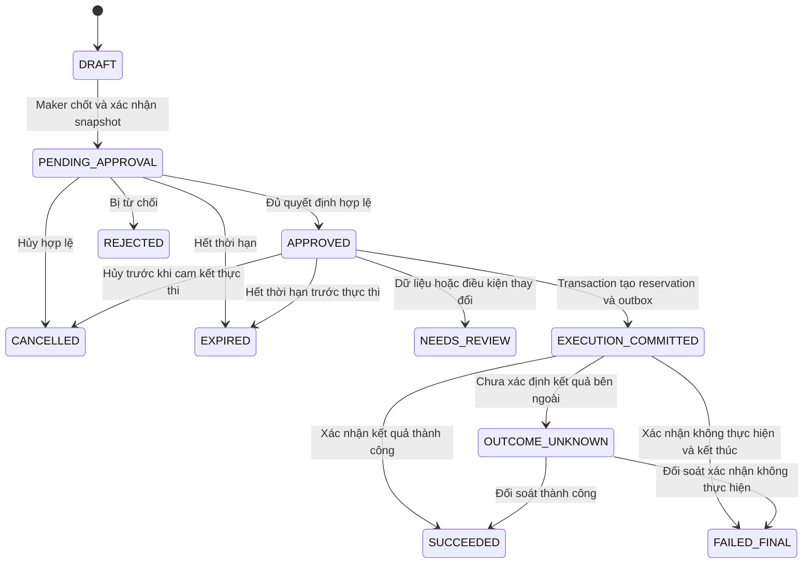

# Administrative dual control — Kiểm soát thao tác quản trị bằng hai người

## 1. Mục tiêu và phạm vi

Trong chương **Administrative Controls**, *administrative dual control* là cơ chế yêu cầu sự tham gia có thẩm quyền của ít nhất hai người độc lập trước khi một thao tác quản trị nhạy cảm được thực hiện. Mục đích là giảm khả năng một người tự đề xuất, tự cho phép và tự gây ra thay đổi có ảnh hưởng lớn.

Trong bảo mật logic nghiệp vụ, một quản trị viên đăng nhập hợp lệ vẫn có thể làm sai quy tắc: hoàn tiền vượt số được phép, sửa giá không có căn cứ, cấp quyền cho tài khoản mình kiểm soát hoặc vô hiệu hóa cơ chế chống gửi trùng. Dual control đưa quyết định cho phép thay đổi vào một quy trình có thể kiểm tra và cưỡng chế ở backend.

Sau bài học, người học có thể:

- Chọn thao tác cần kiểm soát nhiều người theo ảnh hưởng nghiệp vụ.
- Phân biệt hai người độc lập với hai tài khoản, hai vai trò hoặc hai lần xác thực.
- Ràng buộc quyết định duyệt với đúng hành động, đối tượng, phiên bản và dữ liệu.
- Thiết kế state machine, kiểm tra quyền theo đối tượng và transaction cho việc duyệt, thực thi.
- Kết hợp idempotency với kiểm tra bất biến để chống thực hiện lặp.
- Kiểm thử đường vòng qua API quản trị, xử lý bất đồng bộ và ngoại lệ khẩn cấp.

NIST mô tả dual authorization trong AC-3(2) và separation of duties trong AC-5. Bài này chuyển các nguyên tắc đó thành một mô hình ứng dụng minh họa; ngưỡng tiền, vai trò và số người cụ thể phải do chính sách của hệ thống xác định. Xem [NIST SP 800-53 Rev. 5, AC-3(2) và AC-5](https://nvlpubs.nist.gov/nistpubs/SpecialPublications/NIST.SP.800-53r5.pdf).

## 2. Hai người kiểm soát một hành động như thế nào?

### 2.1. Mô hình maker–checker

Mô hình xuyên suốt bài học gồm:

- **Maker — người tạo:** chuẩn bị đề xuất, chốt dữ liệu và xác nhận gửi đề xuất đó vào quy trình.
- **Checker — người kiểm tra và duyệt:** một người khác, có quyền phù hợp, xem xét đề xuất rồi chấp thuận hoặc từ chối.
- **Executor — thành phần thực thi:** dịch vụ hoặc người có quyền thực thi, chỉ được thực hiện đúng hành động đã được cho phép.

Trong mô hình này, thao tác gửi đề xuất của maker phải là một quyết định được ghi nhận trên nội dung đã chốt. Một bản nháp tự động tạo hoặc một tài khoản chỉ nhập dữ liệu không đương nhiên được tính là một người đã cho phép giao dịch.

Cần mô tả rõ cách đếm người trong chính sách:

| Cấu hình | Người tham gia tối thiểu | Ý nghĩa |
| --- | --- | --- |
| Maker xác nhận và một checker độc lập duyệt | Hai người | Mô hình maker–checker của bài |
| Maker và hai checker độc lập ngoài maker | Ba người | Quy trình có hai lượt duyệt bổ sung |
| Một người dùng hai tài khoản quản trị | Một người | Không đáp ứng yêu cầu độc lập |
| Một người đăng nhập rồi xác nhận bằng MFA | Một người | Tăng bảo đảm danh tính, chưa tạo kiểm soát hai người |
| Maker và một bot tự bấm duyệt bằng cùng quyền của maker | Một người và tự động hóa | Chưa tạo quyết định độc lập của người thứ hai |

Nếu một yêu cầu cụ thể bắt buộc hai người phê duyệt ngoài người tạo, phải cấu hình đủ hai checker. Tên gọi “dual control” trên giao diện không quyết định được hệ thống thực sự đáp ứng chính sách nào.

Executor là dịch vụ tự động không được tính thêm là một người duyệt. Việc executor có cần là một người thứ ba hay không là một điều kiện chính sách riêng.

### 2.2. Separation of duties và dual control

*Separation of duties* phân chia các nhiệm vụ xung đột, chẳng hạn người quản lý quyền không đồng thời quản lý toàn bộ bằng chứng kiểm toán. *Dual control* yêu cầu nhiều người tham gia cho phép một hành động cụ thể.

Có thể áp dụng phân tách tĩnh: một người không được đồng thời giữ vai trò maker và checker cho cùng nhóm nghiệp vụ. Hoặc áp dụng phân tách động: một người có thể có cả hai vai trò, nhưng không được duyệt chính yêu cầu mình đã tạo.

Ngay cả khi phân vai tĩnh, backend vẫn phải kiểm tra từng yêu cầu. Cấu hình vai trò có thể thay đổi, người dùng có thể có nhiều tài khoản và quyền từ nhiều nhóm có thể cộng dồn.

## 3. Tình huống xuyên suốt: hoàn tiền thủ công

Giả sử một nền tảng bán hàng cho phép đội vận hành tạo yêu cầu hoàn tiền thủ công. Dữ liệu minh họa:

```text
Tenant: TENANT-DEMO-A
Đơn hàng: ORDER-DEMO-17
Hạn mức hoàn tiền hợp lệ do server tính: 10.000.000 VND
Đã hoàn tiền thành công: 2.000.000 VND
Đang giữ chỗ cho các lệnh hoàn tiền khác: 1.000.000 VND
Đề xuất mới: 6.000.000 VND
```

Về khả năng chi trả, đề xuất thỏa mãn:

```text
2.000.000 + 1.000.000 + 6.000.000 <= 10.000.000
```

Tuy nhiên, điều đó chưa đủ để thực thi. Server còn phải xác nhận người tạo có quyền trên đơn, số tiền và phương thức hoàn hợp lệ, yêu cầu đã được chốt, có đủ người duyệt độc lập và chưa có lần thực thi tương ứng.

Một chính sách giả định cho bài:

| Thao tác | Yêu cầu cho phép |
| --- | --- |
| Hoàn tiền thủ công đến 5.000.000 VND | Maker xác nhận và một checker thuộc bộ phận tài chính |
| Hoàn tiền thủ công trên 5.000.000 VND | Maker xác nhận, một checker tài chính và một checker kiểm soát rủi ro; cả ba là người khác nhau |
| Đổi đích nhận tiền trong trường hợp được nghiệp vụ cho phép | Quy trình riêng có kiểm tra chủ thể nhận và mức duyệt phù hợp |
| Cấp quyền quản trị nhạy cảm | Người yêu cầu, người duyệt và người được cấp phải thỏa mãn quy tắc tránh xung đột lợi ích |
| Tạm tắt kiểm tra chống hoàn tiền trùng | Quyền thay đổi kiểm soát bảo mật và quy trình duyệt riêng có thời hạn |

Các con số là ví dụ học tập. Với đề xuất 6.000.000 VND, một checker chưa đủ theo chính sách giả định này. Nếu muốn minh họa mô hình hai người, có thể xét đề xuất 4.000.000 VND với cùng các điều kiện còn lại.

Dual control không làm một giao dịch vốn sai trở thành hợp lệ. Dù đủ người duyệt, tổng hoàn tiền vẫn không được vượt hạn mức nghiệp vụ, tenant vẫn phải đúng và đích nhận tiền vẫn phải được phép.

## 4. Viết bất biến trước khi thiết kế API

### 4.1. Độc lập về người

Với mô hình maker và một checker:

```text
makerHumanId != checkerHumanId
```

Với nhiều checker, mọi checker được tính vào số lượng yêu cầu phải khác maker và khác nhau theo danh tính người đáng tin cậy.

Không so sánh riêng `username`, địa chỉ email hoặc ID phiên đăng nhập. Một người có thể sở hữu nhiều tài khoản hoặc dùng SSO và tài khoản cục bộ. Cần ánh xạ từ danh tính xác thực đến định danh nhân sự hoặc chủ thể tương đương do hệ thống quản lý danh tính cung cấp.

Nếu hệ thống không có khả năng liên kết nhiều tài khoản của cùng người, phải ghi nhận giới hạn đó và xử lý theo chính sách rủi ro; không tuyên bố đã bảo đảm độc lập chỉ vì hai `userId` khác nhau. Tài khoản dùng chung và chia sẻ thông tin xác thực làm mất khả năng chứng minh người tham gia.

Danh tính maker và checker lấy từ ngữ cảnh xác thực ở server. Các trường `createdBy`, `approvedBy` hoặc `humanId` do client gửi không phải nguồn quyết định.

### 4.2. Đúng quyền trên đúng đối tượng

Quyền cần được xét theo tổ hợp:

```text
actor + action + tenant + target + scope + current policy
```

Quyền duyệt hoàn tiền cho tenant A không cho phép duyệt yêu cầu tenant B. Quyền duyệt đến một hạn mức không cho phép duyệt mọi khoản tiền. Quyền xem chi tiết không đồng nghĩa với quyền phê duyệt hoặc thực thi.

Mọi đường vào nghiệp vụ cần dùng cùng quy tắc: giao diện quản trị, API nội bộ, batch job, công cụ hỗ trợ, tác vụ hàng đợi và tích hợp tự động.

OWASP khuyến nghị mặc định từ chối và kiểm tra quyền trên mỗi yêu cầu. Áp dụng nguyên tắc này cả với người đã có vai trò quản trị. Xem [OWASP Authorization Cheat Sheet](https://cheatsheetseries.owasp.org/cheatsheets/Authorization_Cheat_Sheet.html).

### 4.3. Đúng nội dung đã được cho phép

Một quyết định duyệt có ý nghĩa đối với một hành động cụ thể, không phải một “vé thông hành” cho mọi thay đổi sau đó.

Snapshot dùng để duyệt trong ví dụ có thể chứa:

```text
{
  tenantId,
  requestId,
  revision,
  operationType,
  orderId,
  relevantOrderVersion,
  paymentId,
  refundAmountMinor,
  currency,
  refundDestinationRef,
  reasonCode,
  evidenceManifestHash,
  makerHumanId,
  policyVersion,
  submittedAt,
  expiresAt
}
```

Tiền được biểu diễn bằng số nguyên ở đơn vị nhỏ nhất mà hệ thống quy định cho đồng tiền đó, hoặc bằng kiểu thập phân chính xác có quy tắc scale và làm tròn. Không dùng `double` để quyết định hạn mức tài chính. Không mặc định mọi đồng tiền có hai chữ số thập phân.

Server tạo biểu diễn chuẩn của snapshot rồi tính fingerprint. Mỗi quyết định duyệt ràng buộc với `requestId`, `revision` và fingerprint đó. Số tiền, đối tượng, đích nhận hoặc bằng chứng có ý nghĩa thay đổi thì tạo revision mới và thu lại quyết định duyệt.

Hash chỉ giúp đối chiếu dữ liệu. Quyền ghi, lịch sử quyết định và ranh giới tin cậy mới bảo vệ việc một người không được sửa cả snapshot lẫn hash để giả mạo phê duyệt.

### 4.4. Đủ quyết định hợp lệ tại thời điểm thực thi

Điều kiện thực thi có thể mô tả:

```text
canExecute =
    requestIsApproved
    AND makerConfirmationMatchesSnapshot
    AND requiredIndependentApprovalsAreValid
    AND authorizationIsCurrent
    AND policyStillAllowsExecution
    AND now < expiresAt
    AND targetPreconditionsStillHold
    AND businessLimitsStillHold
    AND requestHasNotBeenCancelled
```

Chính sách của bài yêu cầu quyền của những người cho phép giao dịch còn hợp lệ tại cổng thực thi. Quyết định cũ vẫn là bằng chứng lịch sử nếu một người sau đó bị thu hồi quyền, nhưng không được tiếp tục tính là quyết định đủ điều kiện cho lần thực thi mới.

Nếu tổ chức dùng chính sách khác về hiệu lực quyết định sau khi thay đổi nhân sự, phải mô tả rõ. Không để thời gian sống của cache quyền vô tình quyết định quy tắc nghiệp vụ.

### 4.5. Chỉ thực thi một lần cho một ý định

Một request và revision chỉ có tối đa một bản ghi thực thi nghiệp vụ tương ứng. Việc client đổi idempotency key không tạo quyền thực hiện lại.

Bất biến tài chính trong ví dụ:

```text
settledRefunds + activeRefundReservations + proposedRefund
    <= refundableLimit
```

`refundableLimit` do server tính từ dữ liệu thanh toán và quy tắc sản phẩm. Kiểm tra này cần được giữ nguyên tử với việc tạo reservation; hai request khác nhau vẫn có thể tranh chấp cùng số tiền còn lại.

## 5. State machine cho yêu cầu quản trị



Các trạng thái thể hiện quyết định nghiệp vụ. Một triển khai có thể có thêm trạng thái vận hành cho lần thử, nhưng không được dùng lỗi mạng để tự quay về `APPROVED` rồi tạo lần thực thi mới.

Những quy tắc quan trọng:

- `DRAFT` được chỉnh sửa. Khi submit, server chốt snapshot và ghi xác nhận của maker.
- Quyết định duyệt chỉ được tạo cho revision đang chờ, với quyền và danh tính phù hợp.
- Yêu cầu bị từ chối không tự chuyển thành đã duyệt chỉ vì có lượt duyệt đến muộn.
- Muốn sửa đề xuất đã submit thì tạo revision mới; revision cũ và lịch sử quyết định được giữ nguyên.
- `NEEDS_REVIEW`, `REJECTED` và `EXPIRED` dẫn tới một vòng đề xuất mới khi muốn tiếp tục, không tái sử dụng ngầm các quyết định cũ.
- Sau `EXECUTION_COMMITTED`, hủy yêu cầu không đồng nghĩa với đảo tác động đã phát sinh. Cần quy trình hủy tác vụ hoặc bù trừ phù hợp với trạng thái thực tế.

OWASP nhấn mạnh kiểm soát thứ tự bước, bảo vệ dữ liệu giao dịch và có cổng kiểm tra trước thực thi. State machine này là cách áp dụng vào thao tác quản trị. Xem [OWASP Transaction Authorization Cheat Sheet](https://cheatsheetseries.owasp.org/cheatsheets/Transaction_Authorization_Cheat_Sheet.html).

## 6. Thiết kế quy trình duyệt có thể cưỡng chế

### 6.1. API thể hiện hành động, không nhận trạng thái tùy ý

Một bộ API minh họa:

```text
POST /admin/change-requests
POST /admin/change-requests/{id}/submit
POST /admin/change-requests/{id}/approve
POST /admin/change-requests/{id}/reject
POST /admin/change-requests/{id}/cancel
POST /admin/change-requests/{id}/execute
GET  /admin/change-requests/{id}
```

Mỗi endpoint kiểm tra danh tính, quyền theo đối tượng và trạng thái hiện tại. Body của lệnh approve có thể chứa revision kỳ vọng, fingerprint mà người duyệt đã xem và ghi chú. Server tự lấy danh tính checker, thời điểm và chính sách từ nguồn tin cậy.

Không cho phép mass assignment những trường như:

```json
{
  "status": "APPROVED",
  "approvedBy": "other-admin",
  "requiredApprovals": 0,
  "skipApproval": true,
  "executed": false
}
```

Ví dụ trên là dữ liệu phải bị từ chối hoặc loại bỏ theo hợp đồng DTO; nó không được làm thay đổi quyết định bảo mật. Endpoint PATCH chung cũng không được mở lại những trường này.

API approve không nhận một bộ số tiền, đơn hàng và tài khoản nhận mới để đem thực thi. Nếu client hiển thị revision 3 nhưng bản hiện hành đã là revision 4, server báo xung đột để người duyệt xem lại.

### 6.2. Luồng submit

Trong một transaction phù hợp, server:

1. Tải yêu cầu đúng tenant và kiểm tra quyền tạo trên đối tượng.
2. Xác thực loại hành động, tiền tệ, đích nhận và dữ liệu nghiệp vụ từ nguồn chuẩn.
3. Tính yêu cầu duyệt theo chính sách, gồm các nhóm vai trò và giới hạn cộng dồn.
4. Chốt snapshot, revision và fingerprint.
5. Ghi nhận xác nhận của maker trên snapshot đó.
6. Chuyển sang `PENDING_APPROVAL` và lưu audit.

Client không được tự quyết định rằng yêu cầu “rủi ro thấp”. Một trường `riskLevel=LOW` hoặc số tiền hiển thị bị sửa trong trình duyệt không được hạ yêu cầu duyệt.

Việc kiểm tra hạn mức ở bước submit giúp phát hiện sớm yêu cầu không hợp lệ. Nó chưa giữ chỗ tài chính trừ khi hệ thống thiết kế riêng việc đó; bước thực thi vẫn phải kiểm tra lại khả năng còn lại.

### 6.3. Luồng approve

Server khóa hoặc dùng cơ chế kiểm soát đồng thời tương đương đối với request, rồi xác nhận:

- Revision và fingerprint khớp với nội dung đã submit.
- Request còn đang chờ, chưa hết hạn, chưa bị hủy hoặc từ chối.
- Checker có quyền đúng tenant, hành động, đối tượng và mức tiền.
- Checker khác maker theo định danh người.
- Quyết định của checker chưa bị tính lặp.
- Yêu cầu xác thực tăng cường, nếu có, đã được đáp ứng cho hành động này.

Sau đó ghi quyết định và tính lại số người duyệt hợp lệ trong cùng ranh giới transaction.

Đối với yêu cầu cần checker tài chính và checker rủi ro, phải tìm được hai người khác nhau đáp ứng hai vị trí. Một người có cả hai vai trò không được chiếm đồng thời hai vị trí để làm đủ số lượng.

Có thể mô tả việc tính đủ điều kiện như sau:

```text
Required slots: [FINANCE_REVIEWER, RISK_REVIEWER]

Find a distinct eligible human for each slot.
Exclude maker and any conflicted participant.
Count only decisions for the exact submitted revision.
```

Một phép `COUNT(*) >= 2` không thể thay thế các kiểm tra này.

### 6.4. Bảo đảm người duyệt hiểu hành động

Giao diện duyệt cần hiển thị tenant, loại thao tác, đối tượng, giá trị trước và sau, số tiền cùng tiền tệ, đích nhận, lý do, bằng chứng và thời hạn. Dữ liệu do người tạo nhập cần được đánh dấu nguồn; không trình bày một lời giải thích tự khai như kết quả kiểm tra tự động.

Ví dụ, người duyệt cần thấy “hoàn 6.000.000 VND cho thanh toán PAYMENT-DEMO-9” thay vì một nút “Approve request #817” không có ngữ cảnh.

Xác thực tăng cường giúp giảm nguy cơ phiên quản trị bị sử dụng trái phép. Nếu dùng challenge phê duyệt, cần ràng buộc nó với người duyệt, request, revision, fingerprint, mục đích và thời hạn; không tái sử dụng một xác nhận cho nhiều yêu cầu khác nhau.

Một lần đăng nhập MFA từ đầu ca làm việc không tự chứng minh rằng người đó đã xem và đồng ý với giao dịch cụ thể. Đồng thời, MFA vẫn không thay thế yêu cầu người thứ hai.

## 7. Dữ liệu và ràng buộc lưu trữ

Một mô hình tối thiểu:

| Thực thể | Nội dung | Ràng buộc cần chú ý |
| --- | --- | --- |
| `admin_request_revision` | Tenant, request ID, revision, snapshot, fingerprint, maker, trạng thái, hạn hiệu lực | Snapshot đã submit bất biến; duy nhất theo tenant, request và revision |
| `maker_confirmation` | Người xác nhận, revision, fingerprint, thời điểm | Gắn với đúng đề xuất; không suy ra từ việc bản nháp tồn tại |
| `approval_decision` | Người duyệt, nhóm quyền được dùng, revision, fingerprint, kết quả | Không tính một người nhiều lần cho cùng revision |
| `approval_revocation` | Quyết định bị thu hồi, người thực hiện, lý do, thời điểm | Giữ lịch sử; loại quyết định bị thu hồi khi xét thực thi |
| `admin_execution` | Request, revision, loại thao tác, snapshot, kết quả | Unique theo danh tính thực thi nghiệp vụ |
| `refund_reservation` | Thanh toán, số tiền, execution ID, trạng thái | Không tạo hai reservation cho cùng execution |
| `outbox_event` | Event ID, execution ID, loại sự kiện | Ghi cùng transaction với cam kết thực thi |
| `audit_event` | Chủ thể, đối tượng, chuyển trạng thái, kết quả, lý do | Bảo vệ truy cập và lịch sử thay đổi |

Nếu thiết kế chỉ cho một quyết định duyệt của một người trên mỗi revision, có thể dùng unique key `(tenant_id, request_id, revision, reviewer_human_id)`. Retry trả lại quyết định đã có; muốn thực hiện vòng duyệt mới sau khi thu hồi thì tạo revision mới. Nếu hỗ trợ nhiều lần quyết định trên cùng revision, cần mô hình lịch sử và quyết định hiệu lực rõ ràng, không cộng mọi dòng lịch sử.

Quan hệ giữa request, đơn hàng, thanh toán và execution phải giữ đúng tenant. UUID khó đoán giúp giảm khả năng đoán ID, nhưng không thay thế kiểm tra quan hệ.

Fingerprint và các trường danh tính không được ghi tùy ý bởi client. Tài khoản dịch vụ thực thi chỉ có quyền cần thiết; không nên đồng thời có khả năng tự tạo quyết định của con người và sửa lịch sử kiểm toán.

## 8. Transaction thực thi và bảo toàn bất biến

### 8.1. Kiểm tra và ghi tác động trong cùng ranh giới

Một lỗi phổ biến là:

```text
1. Đọc request: đã duyệt.
2. Đọc số tiền còn hoàn được: đủ.
3. Chờ hoặc gọi dịch vụ khác.
4. Tạo lệnh hoàn tiền.
```

Trong khoảng giữa các bước, request có thể bị hủy, quyền bị thu hồi hoặc một lệnh khác đã sử dụng phần tiền còn lại. Đây là bài toán time-of-check to time-of-use, thường viết tắt là TOCTOU.

Với các dữ liệu nằm trong cùng cơ sở dữ liệu, transaction cần phối hợp việc kiểm tra trạng thái, kiểm tra điều kiện, giữ chỗ tài chính và ghi ý định thực thi. Có thể dùng khóa hàng, cập nhật có điều kiện hoặc mức cô lập phù hợp với thiết kế.

Khóa riêng request chưa đủ: hai request khác nhau có thể cùng hoàn tiền trên một thanh toán. Cần bảo vệ cả dữ liệu tổng hợp quyết định hạn mức của thanh toán đó.

### 8.2. Mã giả Java cho bước cam kết thực thi

Mã dưới đây minh họa nghiệp vụ, không phải một triển khai có thể chạy trực tiếp. Các hàm transaction, repository và policy biểu diễn những kiểm tra bắt buộc; chúng cần được hiện thực phù hợp với kiến trúc cụ thể.

```java
ExecutionReceipt executeRefund(
        Actor executor,
        RequestId requestId,
        long expectedRevision) {

    return transactions.required(() -> {
        var request = requests.lockForTenant(
                executor.tenantId(), requestId);

        authorization.requireCanExecute(executor, request);
        request.requireRevision(expectedRevision);

        var key = ExecutionKey.forRequest(
                request.tenantId(), request.id(), request.revision());

        var previous = executions.findByBusinessKey(key);
        if (previous.isPresent()) {
            // Trả kết quả hiện có; không tạo tác động mới.
            return ExecutionReceipt.from(previous.get());
        }

        request.requireState(APPROVED);
        request.requireNotExpired(clock.instant());

        var snapshot = request.submittedSnapshot();
        confirmations.requireValidMakerConfirmation(snapshot);

        var currentPolicy = policies.forExecution(snapshot);
        currentPolicy.requireSnapshotAcceptable(snapshot);

        // Kiểm tra lại độc lập về người, quyền và các vị trí duyệt.
        approvals.requireCurrentEligibleQuorum(
                snapshot, currentPolicy);

        var ledger = refundLedgers.lockForPayment(
                snapshot.tenantId(), snapshot.paymentId());

        ledger.requireTargetPreconditions(snapshot);
        ledger.requireRefundCapacity(snapshot.amount());
        currentPolicy.requireAggregateLimits(
                snapshot, ledger.currentExposure());

        var execution = executions.createUnique(
                key, snapshot.fingerprint());

        ledger.reserve(execution.id(), snapshot.amount());

        outbox.addUnique(new RefundExecutionRequested(
                execution.id(), snapshot.reference()));

        request.markExecutionCommitted(execution.id());
        audit.recordExecutionCommit(executor, request, execution);

        return ExecutionReceipt.from(execution);
    });
}
```

Việc trả lại `previous` xảy ra sau khi kiểm tra quyền truy cập và revision. Nó không tạo lần thực thi mới, kể cả khi kết quả trước đó đang chờ hoặc chưa xác định. Hệ thống không cho người không có quyền đoán request ID để xem receipt.

Tất cả các thay đổi tạo execution, reservation, outbox, trạng thái và audit bền vững trong ví dụ cùng commit hoặc cùng rollback. Nếu không ghi được bằng chứng cho phép theo yêu cầu của thiết kế, transaction không được báo thành công rồi thực thi thiếu dấu vết.

Các dữ liệu về quyền hoặc chính sách ở dịch vụ khác không tự nằm trong transaction cơ sở dữ liệu này. Hàm `requireCurrentEligibleQuorum` không phải phép màu tạo tính nhất quán giữa mọi hệ thống; phần tiếp theo nêu ranh giới cần thiết.

### 8.3. Hai request tranh chấp cùng hạn mức

Giả sử thanh toán chỉ còn hoàn được 7.000.000 VND. Hai request khác nhau, mỗi request đã đủ người duyệt, cùng đề nghị hoàn 6.000.000 VND.

| Thời điểm | Request A | Request B |
| --- | --- | --- |
| T1 | Khóa dữ liệu hạn mức thanh toán | Chờ cùng tài nguyên hoặc gặp xung đột cần retry |
| T2 | Kiểm tra đủ 6.000.000 và tạo reservation | Chưa được quyết định dựa trên số dư cũ |
| T3 | Commit, phần còn lại là 1.000.000 | Đọc lại trạng thái mới |
| T4 | Tiếp tục theo execution đã tạo | Bị từ chối vì không còn đủ hạn mức |

Đủ phê duyệt chỉ cho phép hệ thống xem xét thực hiện; không dành riêng số dư từ thời điểm phê duyệt nếu chưa có reservation.

Với nhiều đối tượng cần khóa, dùng thứ tự khóa nhất quán để giảm deadlock. Khi transaction phải retry do deadlock hoặc xung đột, phải chạy lại các kiểm tra liên quan và giữ nguyên danh tính ý định thực thi.

### 8.4. Không tách nhỏ để vượt ngưỡng

Nếu yêu cầu trên 5.000.000 VND cần mức duyệt cao hơn, một người có thể chia 6.000.000 thành hai yêu cầu 3.000.000. Trong ví dụ, mỗi phần vẫn cần maker–checker, nhưng có thể né bộ phận kiểm soát rủi ro.

Do đó, chính sách có thể xét tổng theo thanh toán, khách hàng, người thụ hưởng hoặc cửa sổ thời gian. Các khoản đang giữ chỗ cũng cần được tính nếu chúng đã tiêu thụ hạn mức tương ứng.

Nếu tổng hiện tại khiến yêu cầu cần thêm checker, bước execute phải dừng để bổ sung vòng duyệt phù hợp. Không tự dùng mức duyệt cũ vì từng request riêng lẻ nhỏ.

Khi có nhiều tiền tệ, quy tắc quy đổi, nguồn tỷ giá, thời điểm chốt và cách làm tròn phải được định nghĩa tại server. So sánh trực tiếp số nguyên của hai đồng tiền khác nhau không tạo ra một kiểm tra hạn mức có ý nghĩa.

## 9. Thực thi bất đồng bộ và idempotency

### 9.1. Transactional outbox giữ ý định thực thi

Sau commit, một tiến trình đọc outbox và gửi yêu cầu đến dịch vụ thanh toán. Outbox giúp tránh hai lỗi:

- Cơ sở dữ liệu ghi nhận đã cho phép nhưng sự kiện thực thi bị mất trước khi gửi.
- Sự kiện được gửi dù transaction tạo lệnh đã rollback.

Sự kiện có thể được phát lại. Dịch vụ nhận cần tải execution và snapshot đáng tin cậy, không nhận số tiền mới từ một payload có thể thay đổi ngoài quy trình.

Kết quả “đã tạo outbox” chỉ có nghĩa là ý định đã được ghi bền vững. Nó không chứng minh tiền đã hoàn thành công.

### 9.2. Idempotency ở cả API và nghiệp vụ

Nên phân biệt:

| Lớp | Khóa minh họa | Điều được bảo vệ |
| --- | --- | --- |
| Retry request HTTP | Khóa do client cung cấp, có scope và payload binding | Cùng một lời gọi không tạo kết quả mới khi retry |
| Thực thi nghiệp vụ | Tenant + request ID + revision + operation | Đổi khóa HTTP vẫn không thực thi lại cùng đề xuất |
| Tác động ở nhà cung cấp | Khóa ổn định suy ra từ execution ID | Retry giao tiếp không tạo thêm hoàn tiền nếu nhà cung cấp hỗ trợ đúng hợp đồng |

Cùng idempotency key với payload khác phải bị từ chối theo hợp đồng API. Một khóa mới cho cùng request đã có execution phải dẫn tới execution cũ, không tạo reservation thứ hai.

Thời gian lưu khóa, phạm vi chống trùng và giới hạn retry của nhà cung cấp phải được kiểm tra theo tài liệu của chính nhà cung cấp. Unique constraint nội bộ không bảo đảm tác động bên ngoài xảy ra chính xác một lần.

### 9.3. Kết quả không xác định phải giữ nguyên bảo vệ tài chính

Nếu nhà cung cấp đã nhận yêu cầu nhưng phản hồi bị mất, hệ thống không được coi đó là “chắc chắn chưa hoàn tiền”.

Trong trạng thái `OUTCOME_UNKNOWN`:

1. Giữ execution và khóa idempotency cũ.
2. Giữ reservation hoặc nghĩa vụ tương đương để tránh dùng lại cùng hạn mức.
3. Tra cứu theo mã giao dịch hoặc đối soát với nhà cung cấp.
4. Chỉ chuyển sang kết quả cuối khi có bằng chứng đủ tin cậy.
5. Ghi nhận mọi quyết định can thiệp thủ công qua quy trình được phép.

Khi xác nhận thành công, chuyển số tiền từ đang giữ chỗ sang đã hoàn trong cập nhật nhất quán. Khi xác nhận không phát sinh và kết thúc lệnh, mới giải phóng phần giữ chỗ. Timeout đơn thuần không đủ để giải phóng tiền.

Nếu nhà cung cấp không có idempotency hoặc cách tra cứu đáng tin cậy, cần quy trình xử lý mơ hồ được xác định trước. Tự tạo execution mới sau mỗi timeout có thể gây hoàn tiền lặp dù hệ thống có đủ hai người duyệt.

## 10. Quyền thay đổi, hủy yêu cầu và điểm cam kết

### 10.1. Xác định thời điểm quyết định có hiệu lực

Trong mã giả ở trên, điểm cam kết là transaction chuyển request sang `EXECUTION_COMMITTED` và tạo execution bền vững. Các điều kiện cho phép phải hợp lệ tại điểm đó theo mô hình nhất quán đã chọn.

Nếu yêu cầu hủy được ghi nhận trước điểm cam kết, transaction execute phải thấy trạng thái hủy và dừng. Nếu execute đã commit, một thao tác đổi trạng thái request không thể tự xóa lệnh ở nhà cung cấp.

Sau commit, execution có thể được xem là một ủy nhiệm có phạm vi: đúng thao tác, snapshot và số lần thực hiện đã xác định. Việc người duyệt nghỉ việc sau đó không tự biến lịch sử phê duyệt thành giả mạo, nhưng hệ thống vẫn cần quy tắc rõ về các execution chưa bàn giao ra ngoài.

Một chính sách nghiêm ngặt hơn có thể yêu cầu tái kiểm tra quyền hoặc tín hiệu thu hồi tại cổng gửi đến nhà cung cấp. Khi áp dụng, phải quản lý cả trạng thái dừng, reservation và cuộc đua với lúc bàn giao. Không được giải phóng reservation nếu chưa xác nhận lệnh chưa phát sinh hoặc đã được hủy thành công.

### 10.2. Nhất quán giữa kho quyền và kho nghiệp vụ

Nếu quyền nằm trong cùng cơ sở dữ liệu, có thể phối hợp phiên bản hoặc khóa theo thiết kế để sắp thứ tự giữa thu hồi quyền và cam kết thực thi. Nếu quyền nằm ở dịch vụ riêng, cần xác định cơ chế kiểm tra độ mới, phiên bản quyền, thời hạn quyết định và xử lý khi không thể xác minh.

Một lần đọc cache trước transaction không bảo đảm việc thu hồi đồng thời sẽ được thấy. Tương tự, gọi dịch vụ quyền hai lần chỉ thu hẹp khoảng trống, không tự tạo transaction nguyên tử giữa các hệ thống.

Với thao tác rủi ro cao, khi không lấy được bằng chứng quyền đủ mới theo chính sách, yêu cầu cần dừng chờ hoặc bị từ chối. Không hạ số người duyệt chỉ vì dịch vụ quyền hoặc bộ phận kiểm tra đang gián đoạn.

### 10.3. Thay đổi dữ liệu hoặc chính sách

Đích nhận tiền, loại thao tác và số tiền thay đổi thì phải tạo revision mới. Nếu đối tượng mất điều kiện nghiệp vụ, đủ người duyệt vẫn không được thực thi.

Đối với thay đổi chính sách, hệ thống cần biết bản đã duyệt còn được chấp nhận hay phải chuyển về vòng xem xét. Cách bảo thủ là yêu cầu duyệt lại khi điều kiện an toàn có ý nghĩa thay đổi. Không để client chọn phiên bản chính sách cũ hoặc mới tùy phiên bản nào dễ vượt qua hơn.

Các biến động bình thường như một khoản hoàn tiền khác đã dùng bớt hạn mức cần được xử lý bằng kiểm tra và reservation hiện hành. Không phải mọi thay đổi metadata đều cần làm mất phê duyệt; phải xác định rõ trường nào có ý nghĩa đối với quyết định và precondition.

## 11. Ngoại lệ khẩn cấp và bảo vệ chính quy trình quản trị

### 11.1. Thiết kế break-glass có phạm vi

Một số tình huống cần xử lý khẩn cấp, chẳng hạn chặn luồng đang gây thiệt hại. Luồng khẩn cấp nên xác định trước:

- Những hành động nào được phép thực hiện.
- Ai có quyền kích hoạt và căn cứ nào cần được ghi nhận.
- Còn yêu cầu người thứ hai hay có ngoại lệ một người được cấp riêng.
- Thời gian hiệu lực, đối tượng và giới hạn tác động.
- Cách cảnh báo, giám sát và rà soát sau khi dùng.
- Cách thu hồi quyền tạm thời và xử lý phần thay đổi cần hoàn nguyên.

Nếu chính sách cho phép một người thực hiện trong ngoại lệ cụ thể, đó là ngoại lệ đối với kiểm soát hai người, phải được nhận diện như vậy. Rà soát sau sự kiện giúp phát hiện và xử lý sai lệch, nhưng không tạo lại sự tham gia độc lập trước hành động đã xảy ra.

Không chuyển một trường hợp khẩn cấp thành endpoint công khai nhận `force=true`. Quyền ngoại lệ phải được kiểm tra ở backend, giới hạn theo hành động và ghi nhận riêng.

### 11.2. Không để người quản trị tự xóa ràng buộc

Một thiết kế có hai người duyệt hoàn tiền vẫn yếu nếu maker có thể tự:

- Tạo một tài khoản checker thứ hai cho mình.
- Gán vai trò duyệt cho người hoặc tài khoản mình kiểm soát.
- Hạ ngưỡng hoặc giảm số checker trong cấu hình.
- Sửa trực tiếp trạng thái request trong cơ sở dữ liệu.
- Thay mã hoặc job thực thi để bỏ qua cổng kiểm tra.
- Xóa dấu vết duyệt và lịch sử execution.

Cần áp dụng kiểm soát tương xứng cho việc cấp quyền, sửa chính sách, thay đổi mã và truy cập dữ liệu đặc quyền. Phân tách quyền vận hành ứng dụng với quyền sửa bằng chứng; hạn chế quyền ghi trực tiếp và đưa các thao tác đặc quyền còn lại vào quy trình có truy vết.

Với luồng hỗ trợ giả danh người dùng, phải giữ được người thao tác gốc và chủ thể đang được đại diện. Chế độ “xem như khách hàng” không được biến nhân viên hỗ trợ thành một con người độc lập khác để tự duyệt.

Giai đoạn khởi tạo hệ thống chưa có checker cũng cần quy trình bootstrap được kiểm soát riêng. Không giữ vĩnh viễn một tài khoản toàn quyền bỏ qua mọi bước chỉ vì nó từng cần cho khởi tạo.

### 11.3. Giới hạn trước thông đồng

Dual control làm khó hành vi đơn lẻ và giúp người thứ hai phát hiện sai sót. Nó không loại bỏ thông đồng, việc cả hai tài khoản bị chiếm quyền hoặc một văn hóa duyệt cho xong.

Các biện pháp bổ sung có thể gồm lựa chọn checker theo nhóm phù hợp, luân chuyển nhiệm vụ, đánh giá xung đột lợi ích, cảnh báo cặp maker–checker bất thường và rà soát độc lập theo mức rủi ro. Hệ thống vẫn phải giữ bất biến tài chính dù các bên đều đồng ý.

## 12. Audit và chỉ số vận hành

Một bản ghi cho phép cần truy được:

```text
Ai đề xuất và xác nhận?
Ai duyệt, bằng vai trò và phạm vi nào?
Những người đó có độc lập theo chính sách không?
Họ đã xem và cho phép revision nào?
Quy tắc nào xác định số checker cần có?
Ai hoặc dịch vụ nào cam kết thực thi?
Execution nào giữ chỗ và gây ra tác động?
Kết quả nào đã được xác nhận?
```

Dữ liệu audit minh họa:

```json
{
  "event": "ADMIN_APPROVAL_GRANTED",
  "tenantId": "TENANT-DEMO-A",
  "requestId": "REQ-DEMO-81",
  "revision": 3,
  "makerHumanId": "HUMAN-DEMO-11",
  "reviewerHumanId": "HUMAN-DEMO-28",
  "reviewerSlot": "FINANCE_REVIEWER",
  "policyVersion": "REFUND-POLICY-DEMO-7",
  "result": "RECORDED",
  "correlationId": "CORR-DEMO-92"
}
```

Triển khai thực tế bổ sung thời điểm server, tham chiếu snapshot hoặc fingerprint, ngữ cảnh xác thực cần thiết và liên kết execution. Không cần đưa bí mật, OTP, token truy cập hoặc toàn bộ chứng từ vào log vận hành. Snapshot và bằng chứng được lưu ở nơi có quyền truy cập phù hợp.

OWASP hướng dẫn bảo vệ log và tránh ghi dữ liệu nhạy cảm không cần thiết. Xem [OWASP Logging Cheat Sheet](https://cheatsheetseries.owasp.org/cheatsheets/Logging_Cheat_Sheet.html).

Bằng chứng thay đổi thành công cần được lưu bền vững cùng tác động nội bộ hoặc bằng cơ chế bảo đảm tương đương. Sự kiện bị từ chối cần đường ghi nhận thích hợp để không mất theo transaction rollback; không tạo tác động nghiệp vụ chỉ để có audit thất bại.

Các tín hiệu giám sát hữu ích:

- Cố tự duyệt, dùng tài khoản khác nhưng cùng danh tính người hoặc đổi tenant.
- Sửa dữ liệu sau duyệt, gọi execute từ trạng thái không hợp lệ.
- Nhiều request nhỏ gần ngưỡng hoặc cùng người thụ hưởng trong thời gian ngắn.
- Cặp maker–checker có tần suất bất thường hoặc thời gian xem xét quá ngắn.
- Dùng ngoại lệ khẩn cấp lặp lại, thay đổi chính sách gần thời điểm giao dịch lớn.
- Request đã duyệt nhưng hết hạn, execution chưa xác định và reservation chưa được giải quyết.

Thời gian duyệt ngắn là tín hiệu để xem xét, không tự chứng minh gian lận. Cũng cần theo dõi thời gian chờ hợp lệ và tải công việc để quy trình đủ khả năng phục vụ vận hành, tránh tạo áp lực bỏ qua kiểm soát.

## 13. Ma trận kiểm thử tình huống tấn công logic

Các tình huống dưới đây hướng dẫn kiểm thử thiết kế. Kiểm thử thất bại cần kiểm tra cả kết quả API và tác động: không có quyết định giả, execution, reservation hoặc outbox trái phép.

| Tình huống | Cách thử | Kết quả mong đợi |
| --- | --- | --- |
| Tự duyệt | Maker gọi approve cho yêu cầu mình tạo | Từ chối theo danh tính người |
| Hai tài khoản cùng người | Dùng tài khoản thứ hai đã liên kết cùng human ID | Không được tính là checker độc lập |
| Giả danh checker | Gửi `approvedBy` của người khác trong body | Không dùng trường đó làm danh tính quyết định |
| Khác tenant | Dùng quyền tenant A với request tenant B | Từ chối, không lộ chi tiết ngoài phạm vi |
| Duyệt vượt hạn mức | Checker có giới hạn thấp duyệt khoản lớn | Không tính là quyết định đủ điều kiện |
| Một người chiếm hai vị trí | Checker có cả vai trò tài chính và rủi ro | Chỉ được dùng cho tối đa một vị trí cần người độc lập |
| Thiếu một nhóm checker | Hai checker cùng chỉ có quyền tài chính | Chưa đủ yêu cầu có nhóm rủi ro |
| Bỏ bước | Gọi execute khi còn `DRAFT` hoặc chưa đủ duyệt | Từ chối, không tạo execution |
| Sửa sau duyệt | Đổi số tiền, đích nhận hoặc đối tượng | Revision hoặc fingerprint không còn hợp lệ; cần xem xét mới |
| Duyệt phiên bản cũ | Trang đang mở revision 2, server đã có revision 3 | Báo xung đột, không chuyển quyết định sang revision mới |
| Duyệt lặp đồng thời | Cùng checker gửi hai request approve song song | Chỉ một quyết định hiệu lực được tính |
| Duyệt và từ chối tranh chấp | Hai giao dịch cạnh tranh trên request đang chờ | Trạng thái được tuần tự hóa; không có kết quả vừa từ chối vừa đủ duyệt |
| Thu hồi trước cam kết | Thu hồi quyền theo cơ chế nhất quán đã chọn trước execute commit | Quyết định không còn được tính để thực thi |
| Biên hết hạn | Thử ở trước, đúng và sau `expiresAt` bằng đồng hồ server có kiểm soát | Quy tắc `now < expiresAt` được áp dụng nhất quán |
| Execute lặp với khóa mới | Đổi idempotency key HTTP cho cùng request và revision | Trả execution hiện có, không giữ chỗ thêm |
| Cùng khóa, payload khác | Tái dùng khóa nhưng đổi dữ liệu | Từ chối xung đột; không ghi đè ý định cũ |
| Hai request vượt tổng tiền | Mỗi request riêng hợp lệ nhưng tổng vượt phần còn lại | Chỉ phần hợp lệ được giữ chỗ; tổng bất biến không bị phá |
| Chia nhỏ để hạ mức duyệt | Tạo nhiều khoản dưới ngưỡng trên cùng phạm vi cộng dồn | Phát hiện hoặc nâng yêu cầu theo chính sách server |
| Hủy và execute đồng thời | Đặt điểm tranh chấp trước commit | Ghi nhận thứ tự rõ; hủy trước cam kết ngăn thực thi |
| Lỗi sau commit trước publish | Dừng tiến trình sau khi ghi execution và outbox | Có thể tiếp tục từ outbox; không tạo execution khác |
| Timeout sau khi nhà cung cấp nhận | Mất phản hồi của lệnh đã được tiếp nhận | Giữ kết quả chưa xác định và bảo vệ hạn mức; không tạo lệnh mới tùy ý |
| Webhook lặp hoặc giả mạo | Gửi callback lặp, sai nguồn hoặc sai execution | Xác minh nguồn và đối chiếu; không cộng hoàn tiền nhiều lần |
| Hạ chính sách từ client | Gửi `requiredApprovals=0`, `riskLevel=LOW` hoặc `force=true` | Không thay đổi yêu cầu kiểm soát |
| Sửa policy để tự vượt qua | Maker thử thay ngưỡng hoặc cấp vai trò checker | Bị kiểm soát bởi quyền và quy trình quản trị tương ứng |

Đối với kiểm thử cạnh tranh, cần cho hai transaction gặp nhau tại điểm kiểm tra hoặc cập nhật chung. Hai lời gọi chạy nối tiếp có thể kiểm tra retry, nhưng chưa chứng minh cơ chế khóa và bất biến chịu được tranh chấp.

Với tích hợp thanh toán, mô phỏng riêng lỗi trước khi tiếp nhận và lỗi sau khi tiếp nhận nhưng mất phản hồi. Cần kiểm tra số execution, reservation, sự kiện và tác động ở phía giả lập nhà cung cấp, không chỉ mã phản hồi HTTP.

## 14. Các sai lầm thiết kế thường gặp

**Chỉ ẩn nút duyệt trên giao diện.** Người dùng vẫn có thể gọi API trực tiếp hoặc dùng một công cụ khác. Quy tắc độc lập và trạng thái phải được backend áp dụng.

**Chỉ kiểm tra hai user ID khác nhau.** Điều này bỏ sót nhiều tài khoản của cùng người, tài khoản dùng chung và phiên giả danh. Cần mô hình danh tính phù hợp với mức bảo đảm mong muốn.

**Đếm đủ dòng quyết định là cho qua.** Dữ liệu có thể gồm retry, quyết định đã thu hồi, revision cũ hoặc người không đủ phạm vi. Phải tính đủ người hợp lệ cho đúng các vị trí của chính sách.

**Duyệt một số tiền, thực thi số tiền khác.** Đọc lại trường có thể sửa hoặc cho worker nhận payload mới làm mất ý nghĩa phê duyệt. Thực thi phải bám snapshot đã được cho phép.

**Cho rằng đã duyệt thì hạn mức luôn còn.** Nhiều yêu cầu khác có thể sử dụng số dư trong lúc chờ. Kiểm tra và giữ chỗ tại bước cam kết mới bảo vệ tổng tài chính.

**Tự động bỏ qua khi quyền hoặc chính sách không tải được.** Sự gián đoạn không phải bằng chứng cho phép. Cần trạng thái chờ, lỗi rõ ràng hoặc luồng ngoại lệ được cấp riêng.

**Rollback cơ sở dữ liệu để xử lý tác động bên ngoài.** Hoàn tiền đã được nhà cung cấp nhận không biến mất khi transaction khác rollback. Cần idempotency, đối soát và nghiệp vụ bù trừ phù hợp.

**Xem rà soát sau hành động là phê duyệt trước hành động.** Hai thời điểm có tác dụng khác nhau. Nếu có ngoại lệ, cần ghi nhận đúng loại và quản lý giới hạn của nó.

## 15. Áp dụng vào các thao tác quản trị khác

Mô hình không chỉ dành cho hoàn tiền. Có thể thay snapshot và bất biến theo hành động:

| Hành động | Dữ liệu phải ràng buộc khi duyệt | Bất biến cần kiểm tra lại |
| --- | --- | --- |
| Sửa giá sản phẩm | SKU, tenant, giá cũ, giá mới, tiền tệ, thời gian hiệu lực | Không vượt phạm vi được cấp; đúng quy tắc giá và lịch áp dụng |
| Cấp quyền quản trị | Người được cấp, vai trò, phạm vi, thời hạn | Không tự nâng quyền qua tài khoản liên quan; đúng phân tách nhiệm vụ |
| Đổi giới hạn giao dịch | Đối tượng, giới hạn cũ và mới, đơn vị, thời gian | Không vượt chính sách tổng; không áp dụng nhầm tenant |
| Bỏ chặn một đối tượng | Đối tượng, lý do chặn, căn cứ bỏ chặn, phạm vi | Người duyệt có quyền; không mở lại đối tượng vẫn thuộc diện cấm |
| Tắt tạm một kiểm soát | Kiểm soát, phạm vi, thời hạn, biện pháp bù | Không mở rộng ngoài phạm vi; có cơ chế khôi phục và giám sát |

Mỗi thao tác cần chọn rõ ý định nghiệp vụ, dữ liệu được phép thay đổi và thời điểm cam kết. Hai người kiểm soát phát huy tác dụng khi quyết định của họ ràng buộc với chính thay đổi sẽ xảy ra, và toàn bộ đường thực thi vẫn giữ được quyền theo đối tượng, trạng thái hợp lệ, bất biến nghiệp vụ và khả năng chống lặp.
