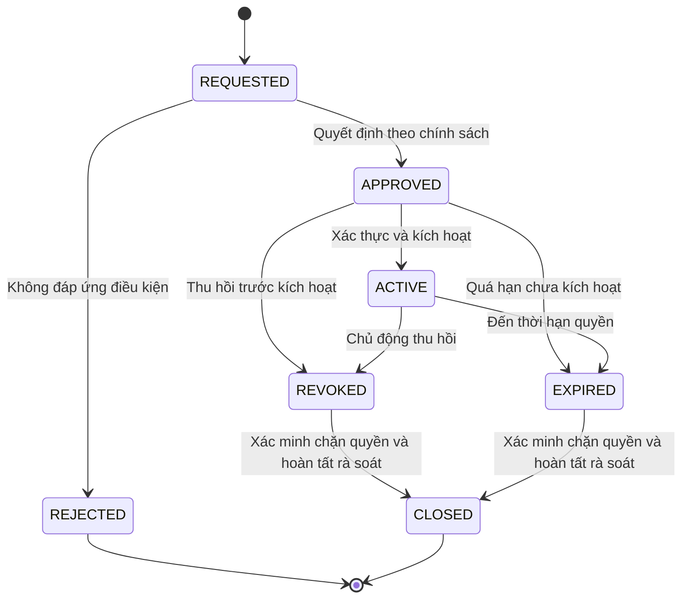
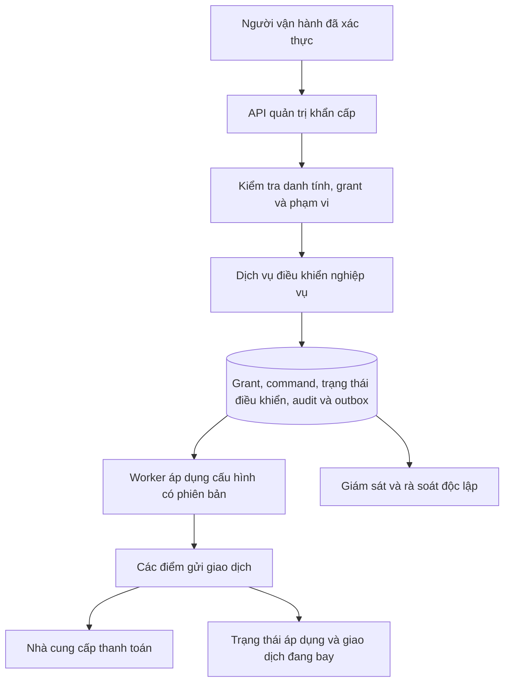

# Administrative emergency path: đường quản trị khẩn cấp an toàn

## 1. Mục tiêu và phạm vi

Administrative emergency path là đường thao tác quản trị được chuẩn bị trước để ứng phó khi xảy ra sự cố nghiêm trọng hoặc khi đường quản trị thông thường không sử dụng được. Nó bao gồm điều kiện kích hoạt, cách xác thực người vận hành, phạm vi quyền, cách thực thi, giám sát và kết thúc sử dụng quyền khẩn cấp.

Bài học thuộc chương **Administrative Controls** của module `SECURITY_APPLICATION_SECURITY_BUSINESS_LOGIC_SECURITY`. Trọng tâm là bảo vệ quy tắc nghiệp vụ trong thời điểm áp lực vận hành cao: tránh bỏ qua phê duyệt, sửa giá hoặc sổ giao dịch tùy ý, thao tác ngoài đối tượng được giao và thực hiện trùng một yêu cầu.

Sau bài học, người học có thể:

- Phân loại hành động khẩn cấp và xác định điều kiện được phép sử dụng.
- Thiết kế quyền tạm thời theo người, hành động, tenant, tài nguyên và thời hạn.
- Giữ business invariants khi đi qua đường quản trị dự phòng.
- Xây dựng vòng đời kích hoạt, thực thi, thu hồi và rà soát có thể kiểm chứng.
- Xử lý transaction, idempotency và trạng thái áp dụng trong hệ thống nhiều worker.
- Kiểm thử việc lạm dụng đường khẩn cấp và các lỗi xảy ra khi thành phần phụ thuộc bị sự cố.

Các tên vai trò, mã định danh, thời hạn và kiến trúc dưới đây là giả định minh họa cho một nền tảng thương mại điện tử. Tổ chức phải quyết định chính sách cụ thể theo sản phẩm và mô hình vận hành của mình.

## 2. Tình huống dẫn nhập: cần ngăn hoàn tiền trùng

Hệ thống phát hiện một nhóm worker có nguy cơ gửi lại yêu cầu hoàn tiền bằng khóa chống trùng mới. Nhóm trực muốn tạm dừng gửi yêu cầu hoàn của `TENANT-A`, bảo toàn hàng đợi và đối soát các giao dịch đã gửi. Đồng thời, dịch vụ đăng nhập quản trị thông thường đang gặp lỗi.

Một đường khẩn cấp phù hợp phải giúp người có trách nhiệm thực hiện nhanh hành động `refund.dispatch.suspend` trên đúng kênh xử lý. Hệ thống cần tiếp tục giữ lịch sử, phân biệt giao dịch chưa gửi với giao dịch chưa rõ kết quả và ghi nhận ai đã thay đổi trạng thái điều khiển.

Những việc khác như cấp hoàn tiền mới, đổi đích nhận tiền, đánh dấu tất cả giao dịch thành công hoặc xóa dữ liệu trùng cần quy trình riêng với điều kiện nghiệp vụ tương ứng. Chúng không tự trở thành quyền đi kèm với thao tác tạm dừng.

Ba kết quả cần phân biệt trong tình huống này:

| Kết quả | Ý nghĩa | Bằng chứng cần có |
| --- | --- | --- |
| Lệnh tạm dừng đã được chấp nhận | Backend đã lưu quyết định điều khiển | Bản ghi command, phiên bản trạng thái và audit bền vững |
| Các thành phần đã áp dụng tạm dừng | Các thành phần gửi lệnh đã nhận và thi hành chính sách mới | Xác nhận theo phiên bản, tình trạng worker và quyền gửi ra ngoài |
| Các giao dịch đang bay đã được xử lý rõ | Những lệnh có thể đã ra nhà cung cấp đều được theo dõi | Danh sách execution và kết quả đối soát |

Một phản hồi HTTP thành công cho yêu cầu tạm dừng chỉ chứng minh được kết quả mà API định nghĩa. Nếu hệ thống mới lưu ý định tạm dừng, giao diện phải hiển thị đang áp dụng, thay vì khẳng định mọi giao dịch đã ngừng ngay lập tức.

## 3. Phân loại hành động và điều kiện kích hoạt

### 3.1. Danh mục hành động được chuẩn bị trước

Một đường quản trị khẩn cấp dễ kiểm soát khi nó cung cấp các hành động có nghĩa rõ ràng và điều kiện cụ thể. Ví dụ:

| Nhóm hành động | Ví dụ | Điều kiện minh họa |
| --- | --- | --- |
| Hạn chế tác động | Tạm dừng gửi hoàn tiền cho một kênh thuộc một tenant | Có dấu hiệu lỗi gửi trùng; giữ nguyên bản ghi đang chờ |
| Khôi phục quyền quản trị nền tảng | Sửa cấu hình đăng nhập bị khóa sai | Có bằng chứng mất đường quản trị thường; dùng danh tính dự phòng được chuẩn bị |
| Phục hồi cấu hình | Quay về phiên bản cấu hình đã xác minh | Biết phiên bản đích, phạm vi ảnh hưởng và khả năng tương thích |
| Thay đổi dữ liệu nghiệp vụ | Tạo bút toán điều chỉnh hoặc khoản hoàn | Đi qua dịch vụ nghiệp vụ, hạn mức và phê duyệt riêng |
| Thao tác diện rộng | Thay cấu hình nhiều tenant hoặc nhiều kênh | Phê duyệt phạm vi, giới hạn số đối tượng và kiểm tra kết quả từng phần |

Chức năng sửa mọi bảng hoặc chạy câu lệnh tùy ý làm phạm vi tác động trở nên khó chứng minh. Với nhu cầu phục hồi lặp lại, nên xây dựng một hành động có đầu vào, tiền điều kiện và hậu điều kiện rõ ràng.

Một hành động hạn chế vẫn có thể gây thiệt hại nếu bị lạm dụng: tạm dừng thanh toán có thể làm gián đoạn dịch vụ. Vì vậy, quyền tạm dừng cũng cần giới hạn đối tượng và khả năng theo dõi.

### 3.2. Điều kiện kích hoạt có thể kiểm chứng

Chính sách cần xác định:

- Loại sự cố hoặc trạng thái mất khả dụng nào cho phép dùng đường khẩn cấp.
- Ai được đề nghị, ai được kích hoạt và ai chịu trách nhiệm theo dõi.
- Các hành động có thể dùng, phạm vi tối đa và điều kiện phải phê duyệt trước.
- Thời hạn quyền, điều kiện gia hạn và tuyến xử lý nếu không có người duyệt.
- Bằng chứng tối thiểu và cách ghi nhận trong lúc công cụ quản lý sự cố bị gián đoạn.

Một trường `emergency=true`, một tiêu đề HTTP hoặc một tin nhắn nói “đã được quản lý đồng ý” không đủ để kích hoạt quyền. Backend phải xác thực quyết định từ nguồn có thẩm quyền. Mã sự cố giúp liên kết bằng chứng, nhưng chỉ biết mã sự cố không tạo ra quyền truy cập.

## 4. Mô hình đe dọa của đường quản trị khẩn cấp

Áp lực khôi phục nhanh có thể khiến cả nhân viên hợp lệ và kẻ tấn công tìm cách mở rộng quyền. Cần xem xét đồng thời hành vi ác ý, nhầm lẫn thao tác và lỗi hệ thống.

| Nguy cơ | Cách phát sinh | Kiểm soát cần thiết |
| --- | --- | --- |
| Giả mạo tình trạng khẩn cấp | Client tự gửi tham số kích hoạt | Xác thực grant và trạng thái sự cố từ nguồn có thẩm quyền |
| Mượn quyền của quản trị viên | Người có quyền nhận yêu cầu rồi thao tác hộ ngoài phạm vi | Ghi danh tính thực tế; ràng buộc hành động với quyết định được cấp |
| Mở rộng sang tenant khác | Thay mã tài nguyên trong request | Kiểm tra quan hệ tenant–tài nguyên và danh sách đối tượng được phép |
| Tự cấp rồi tự sử dụng quyền rộng | Một người sửa chính sách và tạo grant cho mình | Tách quyền quản lý chính sách khỏi quyền dùng năng lực khẩn cấp |
| Duyệt một việc, thực hiện việc khác | Thay hành động, tham số hoặc phiên bản sau phê duyệt | Phê duyệt gắn với nội dung chuẩn hóa và phiên bản cụ thể |
| Quyền sống lâu hơn sự cố | Grant hết hạn trên giao diện nhưng token vẫn có quyền | Kiểm tra hiệu lực ở backend và thu hồi tại các điểm thực thi |
| Thao tác trùng | Client gửi lại sau timeout hoặc đổi khóa yêu cầu | Idempotency, quota nguyên tử và ràng buộc nghiệp vụ |
| Dấu vết bị xóa | Người vận hành có quyền sửa kho audit | Tách quyền ghi nghiệp vụ khỏi quyền quản trị bằng chứng |
| Đường dự phòng cùng hỏng với đường chính | Cùng phụ thuộc một IdP, kho bí mật hoặc máy trạm | Phân tích phụ thuộc và diễn tập tình huống mất từng thành phần |
| Tạm dừng giả thành công | Một worker dùng cấu hình cũ vẫn gửi giao dịch | Theo dõi mức áp dụng, phiên bản và các quyền gửi còn tồn tại |

Đường khẩn cấp còn có thể bị dùng để gây từ chối dịch vụ. Do đó, hệ thống phải ghi nhận cả việc kích hoạt, các lần bị từ chối và những thay đổi làm giảm khả năng phục vụ.

## 5. Các bất biến nghiệp vụ phải tiếp tục được bảo vệ

### 5.1. Quyền đi cùng đúng đối tượng

Quyền khẩn cấp phải trả lời được các câu hỏi: người nào, hành động nào, tenant nào, tài nguyên nào, trong thời gian nào và với giới hạn gì. Vai trò tổng quát như `ADMIN` không diễn tả đầy đủ phạm vi này.

Nếu một grant cho phép dừng `CHANNEL-12` của `TENANT-A`, backend phải xác minh kênh đó thực sự thuộc tenant A. Các quan hệ này được đọc từ dữ liệu có thẩm quyền; không chỉ dựa vào cặp giá trị do client khai báo.

### 5.2. Dữ liệu tài chính vẫn tuân theo quy tắc của sản phẩm

Một khoản hoàn vẫn cần có nguồn tiền hợp lệ, tiền tệ đúng và hạn mức còn lại. Trong mô hình đơn giản, bất biến có thể là:

```text
số tiền đã hoàn + số tiền đang giữ chỗ + số tiền hoàn mới
    <= số tiền được phép hoàn theo sổ giao dịch
```

Hành động tạm dừng gửi không được tự giải phóng các khoản giữ chỗ của giao dịch chưa rõ kết quả. Đánh dấu một lần gọi timeout thành thất bại rồi tạo giao dịch bù có thể gây hoàn trùng.

Các trường hợp điều chỉnh hoặc bồi hoàn phải được biểu diễn bằng nghiệp vụ có hạch toán tương ứng. Sửa giá của đơn hàng cũ để làm số liệu “khớp lại” sẽ phá khả năng giải thích lịch sử giao dịch.

### 5.3. Thay đổi dữ liệu quan trọng làm mất hiệu lực phê duyệt cũ

Quyết định cho phép cần gắn với hành động, đối tượng, tham số và điều kiện đã được xem xét. Nếu mở rộng từ một tenant sang nhiều tenant hoặc đổi từ tạm dừng sang tiếp tục gửi, phải có quyết định mới theo chính sách.

OWASP hướng dẫn giữ đúng thứ tự cấp phép giao dịch, bảo vệ dữ liệu đã được cấp phép và có bước kiểm tra trước thực thi trong [Transaction Authorization Cheat Sheet](https://cheatsheetseries.owasp.org/cheatsheets/Transaction_Authorization_Cheat_Sheet.html). Trong bài này, các nguyên tắc đó được áp dụng cho command quản trị có ảnh hưởng đến nghiệp vụ.

### 5.4. Gửi lại không tạo thêm hiệu ứng ngoài quyết định

Cùng một yêu cầu hợp lệ phải có định danh ổn định. Việc gửi lại chỉ được trả về trạng thái đã có hoặc tiếp tục phần xử lý của chính yêu cầu đó. Thay khóa yêu cầu không được vượt giới hạn số lệnh hoặc mở rộng quyền.

### 5.5. Hành động quan trọng luôn có thể truy nguyên

Cần liên kết được người thao tác, grant, sự cố, phiên bản chính sách, tài nguyên, command và kết quả. Những bản ghi này phải tồn tại sau khi phiên đăng nhập kết thúc hoặc sự cố đã đóng.

Các bảo đảm trên phụ thuộc vào ranh giới quyền thực tế. Một tài khoản đồng thời có quyền sửa mã thực thi, ghi thẳng database và xóa audit có thể vượt qua các kiểm tra trong ứng dụng. Thiết kế triển khai phải giới hạn các quyền đó và ghi nhận phần quyền nền tảng còn có khả năng vượt kiểm soát nghiệp vụ.

## 6. Chuẩn bị danh tính và phụ thuộc trước khi có sự cố

### 6.1. Phân biệt tài khoản khôi phục với grant theo sự cố

Có hai đối tượng cần quản lý riêng:

| Đối tượng | Mục đích | Vòng đời |
| --- | --- | --- |
| Danh tính khôi phục nền tảng đã chuẩn bị | Giúp khôi phục quản trị khi đường chính hỏng | Có thể được duy trì lâu dài theo thiết kế của nền tảng |
| Grant khẩn cấp cho một sự cố | Cho phép một người dùng một tập hành động giới hạn | Ngắn hạn, có thể thu hồi, được kiểm tra khi sử dụng |

Hết hạn grant theo sự cố không nhất thiết đồng nghĩa xóa danh tính khôi phục nền tảng. Ngược lại, một danh tính dự phòng còn tồn tại không có nghĩa người vận hành được sử dụng mọi năng lực ứng dụng bất cứ lúc nào.

Kiểm soát AC-2(2) trong [NIST SP 800-53 Revision 5](https://nvlpubs.nist.gov/nistpubs/SpecialPublications/NIST.SP.800-53r5.pdf) đề cập việc tự động xóa hoặc vô hiệu hóa tài khoản tạm thời và tài khoản khẩn cấp sau thời gian do tổ chức xác định. Khi áp dụng, cần xác định đúng loại tài khoản và vòng đời; không suy diễn cùng một quy tắc cho mọi danh tính khôi phục của mọi sản phẩm.

### 6.2. Đường dự phòng phải có gốc tin cậy rõ ràng

Nếu IdP thông thường đang ngừng hoạt động, đường dự phòng vẫn cần một cơ chế xác thực được chuẩn bị, chẳng hạn danh tính độc lập trên nền tảng đích với xác thực mạnh. Không chuyển sang tin một tên người dùng hoặc một địa chỉ IP do request khai báo.

Cần kiểm kê phụ thuộc của toàn bộ đường khẩn cấp:

- Dịch vụ định danh, thiết bị xác thực và nguồn thời gian.
- Kho chứa bí mật, khóa ký và quy trình tiếp cận chúng.
- Máy trạm quản trị và đường mạng đến hệ thống đích.
- Kho chính sách, trạng thái grant và bộ kiểm tra quyền.
- Nơi lưu audit, công cụ cảnh báo và kênh liên lạc điều phối.

Tài liệu [Microsoft Entra về tài khoản truy cập khẩn cấp](https://learn.microsoft.com/en-us/entra/identity/role-based-access-control/security-emergency-access) minh họa việc tránh phụ thuộc vào đường liên kết danh tính đang hỏng, sử dụng xác thực mạnh, theo dõi hoạt động và kiểm tra tài khoản định kỳ. Các cấu hình tài khoản và vai trò trong tài liệu đó dành cho Entra; mô hình ứng dụng trong bài phải được thiết kế theo hệ thống cụ thể.

### 6.3. Xác định hành vi khi mất từng thành phần

| Thành phần bị sự cố | Hành vi cần quyết định trước |
| --- | --- |
| IdP thông thường | Dùng đường xác thực dự phòng đã được đăng ký và kiểm thử |
| Công cụ duyệt thông thường | Dùng người duyệt trực hoặc cơ chế thay thế được chính sách cho phép |
| Kho trạng thái grant | Từ chối hành động cần grant nếu không kiểm chứng được hiệu lực; chỉ dùng cơ chế dự phòng nếu đã thiết kế rõ |
| Bộ thu log tập trung | Có thể lưu audit bền vững tại nơi dự phòng rồi đồng bộ theo chính sách |
| Database nghiệp vụ | Không khẳng định đã thay đổi dữ liệu khi chưa có commit; cân nhắc biện pháp hạn chế ở tầng khác đã chuẩn bị |
| Nhà cung cấp thanh toán | Theo dõi các yêu cầu chưa rõ kết quả; giữ cơ chế chống trùng và đối soát |

Một cơ chế cấp quyền offline, nếu cần, phải định nghĩa nguồn ký tin cậy, phạm vi, thời hạn, chống phát lại và cách xử lý thu hồi. Không tự phát minh chế độ offline trong lúc xử lý sự cố rồi coi request có chữ ký bất kỳ là hợp lệ.

## 7. Cấp grant khẩn cấp có giới hạn

### 7.1. Nội dung grant minh họa

Grant là bản ghi quyết định cấp quyền từ nguồn có thẩm quyền. Client có thể gửi mã grant để tham chiếu, nhưng không được tự quyết định nội dung grant.

```json
{
  "grantId": "EGR-027",
  "incidentId": "INC-2026-1122-07",
  "subjectStaffId": "STAFF-17",
  "tenantIds": ["TENANT-A"],
  "resourceIds": ["CHANNEL-12"],
  "actions": ["refund.dispatch.suspend"],
  "approvedPayloadDigest": "SERVER_COMPUTED_DIGEST",
  "maxNewCommands": 1,
  "notBefore": "2026-11-22T10:00:00Z",
  "expiresAt": "2026-11-22T10:15:00Z",
  "policyVersion": "emergency-policy-8",
  "state": "ACTIVE"
}
```

Thời hạn 15 phút và giới hạn một command chỉ dùng để minh họa. Backend dùng đồng hồ đáng tin cậy và kiểm tra `notBefore <= now < expiresAt`. Không dùng giờ do trình duyệt gửi.

Digest phải được tạo từ hành động và dữ liệu đã chuẩn hóa, bao gồm những trường quan trọng như tenant, tài nguyên và tiền điều kiện. Backend đối chiếu digest từ bản ghi được bảo vệ; chỉ so sánh hai hash đều do client cung cấp không tạo được bảo đảm.

### 7.2. Tách quyền đề nghị, cho phép và thực thi

Chính sách thông thường cho thao tác rủi ro cao có thể yêu cầu người duyệt độc lập với người đề nghị. Việc độc lập nên dựa trên định danh nhân sự, tránh hai tài khoản của cùng một người tự duyệt cho nhau.

Đối với một số hành động hạn chế tác động đã được định nghĩa, chính sách có thể cho phép người trực kích hoạt trước rồi rà soát độc lập sau. Ví dụ là tạm dừng một kênh đang phát sinh nguy cơ lỗi, với phạm vi cụ thể và thời hạn rà soát đã được quy định.

Ngoại lệ này phải được xây dựng trước trong danh mục hành động. Nó không tự áp dụng cho hoàn tiền mới, đổi người nhận tiền hoặc sửa sổ giao dịch. Nếu hành động cần phê duyệt trước mà không có người đủ thẩm quyền, phải chuyển đến tuyến dự phòng đã định nghĩa hoặc tiếp tục biện pháp hạn chế được phép.

Người sử dụng grant không được tự mở rộng danh mục năng lực, đổi chính sách hoặc tăng hạn mức của grant đó. Thay đổi chính sách khẩn cấp cũng là một hành động quản trị nhạy cảm cần kiểm soát riêng.

## 8. Vòng đời kích hoạt, thu hồi và kết thúc

State machine sau mô tả grant theo sự cố, không mô tả danh tính khôi phục nền tảng:



Nếu chính sách cho phép kích hoạt trực tiếp một hành động hạn chế đã được phê duyệt trước về mặt chính sách, hệ thống vẫn cần lưu cơ sở của quyết định đó. Không ghi một người duyệt giả để làm cho dữ liệu giống luồng thông thường.

Quy trình kích hoạt có thể gồm:

1. Xác định sự cố và hành động tối thiểu cần thực hiện.
2. Xác thực người vận hành qua đường còn tin cậy.
3. Kiểm tra thẩm quyền kích hoạt và quyết định phê duyệt tương ứng.
4. Chụp nội dung, phạm vi và tiền điều kiện của hành động.
5. Tạo grant ngắn hạn, ghi audit và phát tín hiệu giám sát.
6. Cho phép thực thi qua điểm kiểm tra quyền tại dịch vụ đích.

Gia hạn cần một quyết định mới hoặc một phiên bản grant mới theo chính sách; không tự cộng thêm thời gian mỗi khi người vận hành gửi request. Grant đã hết hạn không được hồi sinh chỉ bằng việc sửa đồng hồ phía client.

Đánh dấu `REVOKED` trong kho trung tâm mới là một phần của thu hồi. Cần tính đến cache quyền, token đã phát hành, phiên đăng nhập và tác vụ nền đã được chấp nhận. Trạng thái `CLOSED` chỉ dùng khi đã xác minh hành vi thu hồi theo phạm vi bảo đảm của hệ thống và hoàn tất các nghĩa vụ rà soát.

## 9. Kiến trúc thực thi: kiểm tra quyền gần tài nguyên

Một kiến trúc minh họa:



API khẩn cấp có thể dùng một đường xác thực dự phòng, nhưng dịch vụ đích vẫn cần kiểm tra grant, quan hệ đối tượng và tiền điều kiện nghiệp vụ. Chỉ đặt kiểm tra ở giao diện hoặc gateway có thể để sót những lời gọi nội bộ khác.

Điểm thực thi cần nhận được danh tính người khởi tạo từ ngữ cảnh đáng tin cậy. Trong lời gọi giữa dịch vụ, ghi nhận cả danh tính workload lẫn nhân viên thực tế. Không dùng `actorId`, `role` hoặc `approvedBy` do client tự khai làm căn cứ cấp quyền.

Một service account cũng phải có quyền theo hành động và tài nguyên. Quyền truy cập mạng vào endpoint khẩn cấp giúp thu hẹp bề mặt tiếp cận, nhưng không thay thế được kiểm tra nghiệp vụ.

Nếu dùng token có chữ ký chứa grant, cần xác minh bên phát hành, đối tượng nhận, thời hạn và nội dung. Với yêu cầu thu hồi ngay tại điểm chấp nhận lệnh, phải kiểm tra trạng thái grant có thẩm quyền hoặc dùng cơ chế thu hồi được chứng minh tương đương. Token còn hạn chưa chắc grant còn được phép dùng.

## 10. Transaction và idempotency tại điểm chấp nhận command

### 10.1. Những thay đổi cần đi cùng nhau

Với lệnh tạm dừng trong ví dụ, transaction ngắn cần gắn kết:

- Kiểm tra grant còn hiệu lực và đúng phạm vi.
- Kiểm tra nội dung đã được cho phép và phiên bản tài nguyên hiện tại.
- Tiêu thụ quota tạo command của grant.
- Lưu command duy nhất theo định danh yêu cầu.
- Cập nhật trạng thái điều khiển mong muốn và tăng phiên bản.
- Lưu audit cùng sự kiện outbox để áp dụng thay đổi.

Không mở transaction rồi chờ một người duyệt trong nhiều phút. Phê duyệt và grant phải được lưu trước; transaction chấp nhận lệnh chỉ đọc lại và kiểm tra trạng thái hiện tại.

### 10.2. Mã giả Java

Đoạn mã dưới đây minh họa trách nhiệm, không phải chương trình chạy độc lập. Các hàm repository, khóa, quota và uniqueness phải có triển khai thực tế tương ứng trong cơ sở dữ liệu.

```java
CommandReceipt acceptSuspend(
        UUID grantId,
        SuspendRequest request,
        StaffPrincipal actor) {

    return transactions.required(() -> {
        // Áp dụng thứ tự khóa nhất quán giữa mọi luồng liên quan.
        EmergencyContext ctx = repository.lockGrantAndChannel(
                grantId, request.channelId());
        Instant now = clock.instant();

        authorization.requireActiveEmergencyScope(
                actor, ctx, "refund.dispatch.suspend", now);

        ActionPayload payload = canonicalizeOnServer(ctx, request);
        ctx.grant().requireApprovedPayload(payload);

        Command previous = commands.findByRequestId(
                ctx.grant().id(), request.requestId());
        if (previous != null) {
            previous.requireSamePayload(payload);
            return previous.currentReceipt();
        }

        ctx.channel().requireVersion(request.expectedVersion());
        domainRules.requireSuspendAllowed(ctx);
        ctx.grant().consumeNewCommandQuota(1);

        long nextVersion = ctx.channel().requestSuspension();
        Command command = commands.createUnique(
                ctx.grant(), request.requestId(), payload, nextVersion);

        audit.appendEmergencyCommandAccepted(actor, ctx, command, now);
        outbox.appendControlStateChanged(ctx.channel(), command);

        return CommandReceipt.accepted(command.id(), nextVersion);
    });
}
```

Các điểm cần hiểu:

- `request.channelId()` là đầu vào chưa được tin cậy. Sau khi nạp dữ liệu, kiểm tra quyền phải xác minh quan hệ tenant, tài nguyên và người được cấp grant.
- Cùng `requestId` nhưng khác nội dung phải bị từ chối. Khóa duy nhất có thể là `(grant_id, request_id)` cho mô hình này.
- Grant bị khóa hoặc quota được cập nhật có điều kiện để hai request có mã khác nhau không cùng vượt `maxNewCommands`.
- Kiểm tra phiên bản ngăn dùng quyết định dựa trên trạng thái tài nguyên đã thay đổi. Xung đột phiên bản cần được đánh giá lại, thay vì tự động sửa tiền điều kiện rồi thực thi.
- Audit và outbox cùng commit với command và trạng thái điều khiển trong kiến trúc minh họa.

Mã giả kiểm tra grant trước khi trả lại command cũ. Khi grant đã hết hạn, người vận hành có thể dùng endpoint xem trạng thái với quyền xem riêng; việc xem kết quả không cấp lại quyền thực thi.

Nếu transaction rollback, quota và thay đổi trạng thái cũng phải rollback. Khi retry vì tranh chấp hoặc lỗi transaction, thực hiện lại các kiểm tra trên trạng thái mới. Không lấy phần quota đã kiểm tra trong lần thất bại làm căn cứ cho lần tiếp theo.

### 10.3. Tách ý định bền vững khỏi xử lý bên ngoài

Outbox giúp bảo đảm rằng ý định áp dụng thay đổi được lưu cùng trạng thái nội bộ. Worker có thể nhận lại sự kiện nhiều lần, nên phải xử lý lặp một cách an toàn.

Sự kiện cấu hình nên chứa mã tài nguyên và phiên bản điều khiển. Nếu trạng thái phiên bản 43 đã được áp dụng, một bản sao sự kiện cấu hình phiên bản 42 đến muộn không được ghi đè trạng thái mới hơn. Quy tắc này áp dụng cho luồng cấu hình đã thiết kế; không tự ý bỏ các sự kiện kết quả giao dịch tài chính chỉ vì chúng đến muộn.

## 11. Tạm dừng trong hệ thống phân tán và giao dịch đang bay

### 11.1. Xác định mốc tạm dừng

Đổi một cờ trong database không chứng minh mọi worker đã dừng. Worker có thể đã đọc cấu hình cũ, đã nhận quyền gửi hoặc đang chờ phản hồi từ nhà cung cấp.

Một mô hình cần phân biệt:

| Thuộc tính | Ví dụ | Ý nghĩa |
| --- | --- | --- |
| Trạng thái mong muốn | `SUSPENDED` | Chính sách mới yêu cầu ngừng cấp thêm quyền gửi |
| Phiên bản điều khiển | `42` | Dùng để xác định thay đổi mới nhất |
| Trạng thái áp dụng | `APPLYING` | Chưa có đủ xác nhận từ các thành phần liên quan |
| Trạng thái đã áp dụng | `SUSPENDED_CONFIRMED` | Đã chứng minh chặn việc gửi mới theo định nghĩa của hệ thống |
| Giao dịch chưa rõ kết quả | Danh sách execution | Vẫn cần đối soát dù đã chặn gửi mới |

Tại điểm chấp nhận tạm dừng, hệ thống có thể chặn các lần cấp quyền gửi mới bằng một cơ chế điều phối có tính nguyên tử. Những lần gửi đã được chấp nhận trước mốc đó vẫn cần theo dõi. Việc chúng hoàn thành sau mốc tạm dừng không tự chứng minh rằng chính sách bị bỏ qua.

Nếu yêu cầu nghiệp vụ là không phát sinh bất kỳ lần gửi nào sau một mốc xác nhận, cần có điểm kiểm soát outbound đủ mạnh và bằng chứng rằng mọi nguồn gửi đều bị chặn hoặc đã hết quyền gửi. Một lần kiểm tra cờ trước khi gọi mạng có thể có khoảng đua giữa kiểm tra và gửi.

### 11.2. Worker mất liên lạc không được tính như đã xác nhận

Nếu một worker bị chia mạng nhưng vẫn còn khả năng gửi đến nhà cung cấp, việc không nhận được tín hiệu từ worker đó không chứng minh nó đã dừng. Hệ thống phải giữ trạng thái chưa xác nhận và dùng biện pháp hạn chế bổ sung đã được chuẩn bị nếu cần.

Các biện pháp có thể bao gồm kiểm soát ở điểm gửi tập trung, thu hồi năng lực gửi hoặc chặn egress theo phạm vi. Khả năng thực hiện và mức bảo đảm phụ thuộc kiến trúc; phải được kiểm tra trước khi hứa hẹn một thời điểm ngừng tuyệt đối.

### 11.3. Xử lý giao dịch chưa rõ kết quả

Một yêu cầu đã đến nhà cung cấp nhưng bị mất phản hồi cần được đối soát theo execution hoặc tham chiếu ổn định. Không tạo khóa idempotency mới để “thử lại cho chắc”. Nếu nhà cung cấp có cơ chế chống trùng, phải hiểu phạm vi và thời gian lưu khóa của họ.

Không xóa hàng đợi hoặc lịch sử để làm bảng điều khiển trở về màu xanh. Cần giữ danh sách các command chưa gửi, các execution có thể đã gửi và các giao dịch đã xác nhận. Việc giải phóng giữ chỗ, ghi nhận hoàn tiền hay tạo bút toán điều chỉnh phải theo kết quả có thẩm quyền.

## 12. Quyền hết hạn, tác động tồn tại và khôi phục dịch vụ

Quyền khẩn cấp và tác động của lệnh có vòng đời khác nhau. Nếu grant hết hạn lúc 10:15 nhưng kênh hoàn tiền vẫn đang bị tạm dừng để điều tra, hệ thống cần giữ trạng thái tạm dừng theo chính sách. Hết quyền vận hành không tự tạo quyết định tiếp tục gửi.

Cơ chế tự hết hạn tác động, nếu có, phải là một phần được xem xét của hành động cụ thể. Với biện pháp ngăn nguy cơ mất tiền trong ví dụ, không nên mặc định tự mở lại chỉ vì thời gian cấp quyền đã kết thúc.

Khôi phục cần một command có điều kiện riêng:

1. Xác minh lỗi gốc đã được xử lý hoặc có biện pháp kiểm soát đủ hiệu lực.
2. Xác định các giao dịch chưa rõ và cách tiếp tục theo dõi chúng.
3. Kiểm tra phiên bản cấu hình hiện tại và danh sách worker đang hoạt động.
4. Phê duyệt quyền `refund.dispatch.resume` cho đúng phạm vi.
5. Mở lại theo phạm vi được kiểm soát, quan sát kết quả và mở rộng nếu đạt tiêu chí.

Grant chỉ có `refund.dispatch.suspend` không được suy rộng thành quyền `resume`. Tương tự, quyền khôi phục một cấu hình không tự bao gồm quyền hoàn tiền hàng loạt.

Khi hoàn tác cấu hình, cần kiểm tra phiên bản hiện tại để tránh ghi đè một thay đổi hợp lệ xảy ra sau đó. Khi một giao dịch bên ngoài đã có hiệu ứng, rollback database nội bộ không đảo ngược được giao dịch ấy. Cần nghiệp vụ bù trừ hoặc đối soát tương ứng.

## 13. Audit, giám sát và thu hồi thực tế

### 13.1. Sự kiện audit tối thiểu

Cần ghi các sự kiện đề nghị quyền, quyết định cho phép, kích hoạt, thực thi, từ chối, gia hạn, thu hồi, hết hạn và rà soát. Với command, ghi cả việc chấp nhận lẫn kết quả áp dụng.

Ví dụ giả lập:

```json
{
  "eventType": "EMERGENCY_COMMAND_ACCEPTED",
  "occurredAt": "2026-11-22T10:02:00Z",
  "incidentId": "INC-2026-1122-07",
  "grantId": "EGR-027",
  "actorStaffId": "STAFF-17",
  "workloadId": "ADMIN-CONTROL-SERVICE",
  "tenantId": "TENANT-A",
  "resourceId": "CHANNEL-12",
  "action": "refund.dispatch.suspend",
  "commandId": "ECMD-91",
  "controlVersionBefore": 41,
  "controlVersionAfter": 42,
  "policyVersion": "emergency-policy-8",
  "outcome": "ACCEPTED",
  "correlationId": "CORR-902"
}
```

Không ghi mật khẩu, khóa riêng, token truy cập hoặc toàn bộ nội dung nhạy cảm vào audit. Tham chiếu bằng chứng nên có quyền truy cập riêng. Các trường nhập tự do như lý do phải được chuẩn hóa và xử lý an toàn khi ghi hoặc hiển thị.

Audit cần được bảo vệ khỏi sửa/xóa bởi người dùng năng lực khẩn cấp. Nếu thiết kế dùng một kho ghi bền vững cục bộ rồi chuyển sang hệ thống tập trung, phải theo dõi việc chuyển bị chậm hoặc ngừng.

Trong kiến trúc minh họa, nếu không lưu được audit bắt buộc cùng command thì transaction chấp nhận thất bại. Mất kết nối đến công cụ phân tích tập trung có thể được xử lý khác nếu audit nội bộ vẫn bền vững. Hành vi này phải được quyết định trước cho từng loại hành động.

Sự kiện từ chối không được đặt duy nhất trong một transaction sau đó rollback. Cần cơ chế lưu riêng để giữ bằng chứng về các lần cố dùng grant sai phạm vi hoặc đã hết hạn.

### 13.2. Cảnh báo có người chịu trách nhiệm nhận

Các tín hiệu cần theo dõi có thể gồm:

- Mỗi lần sử dụng danh tính khôi phục hoặc kích hoạt grant khẩn cấp.
- Thay đổi danh mục năng lực, thời hạn, hạn mức hoặc chính sách cấp grant.
- Dùng grant ngoài phạm vi, sau khi hết hạn hoặc từ một ngữ cảnh bất thường.
- Trạng thái áp dụng bị treo, worker chưa xác nhận hoặc giao dịch chưa rõ kéo dài.
- Audit ngừng ghi hoặc quyền quản trị kho bằng chứng bị thay đổi.

Người sử dụng quyền khẩn cấp không nên có thể tắt toàn bộ giám sát hoạt động của mình. Khi kênh cảnh báo chính hỏng, người điều phối cần dùng kênh dự phòng và hoàn tất đối chiếu sau khi kênh chính phục hồi.

### 13.3. Kết thúc sử dụng quyền

Quy trình kết thúc cần kiểm kê và thu hồi grant, phiên hoặc thông tin xác thực tạm đã cấp. Xác minh các điểm thực thi đã nhận trạng thái thu hồi hoặc đã hết thời hạn theo bảo đảm được thiết kế.

Đối với tác vụ nền đã được chấp nhận, cần quyết định rõ tiếp tục, dừng hay đối soát. Không giả định rằng thu hồi grant sẽ hủy được một giao dịch đã gửi ra ngoài.

Nếu bí mật đã bị lộ hoặc được lấy ra sử dụng theo cơ chế cần thay sau dùng, thực hiện thay và cập nhật nơi lưu theo quy trình. Danh tính khôi phục nền tảng vẫn cần ở trạng thái sẵn sàng theo thiết kế, có chủ sở hữu và được kiểm tra định kỳ.

## 14. Kiểm thử các tình huống lạm dụng và lỗi phụ thuộc

Các kiểm thử dưới đây dành cho môi trường kiểm soát với dữ liệu giả lập. Cần quan sát dữ liệu đã commit, quota, outbox, audit, worker và nhà cung cấp giả lập; mã HTTP đơn lẻ không đủ chứng minh đúng nghiệp vụ.

| Tình huống | Kết quả cần chứng minh |
| --- | --- |
| Gửi `emergency=true` khi không có grant | Không nhận thêm quyền; không có command được chấp nhận |
| Dùng grant của nhân viên khác | Bị từ chối theo danh tính đã xác thực |
| Thay resource sang tenant khác | Backend chặn quan hệ đối tượng sai, không làm lộ dữ liệu ngoài phạm vi |
| Dùng quyền suspend để gọi resume | Bị từ chối vì khác hành động được cấp |
| Đổi tham số hoặc phiên bản sau khi duyệt | Nội dung đã cấp phép không còn khớp; cần xem xét lại |
| Gọi trước `notBefore` hoặc đúng mốc `expiresAt` | Quyền không được coi là có hiệu lực |
| Thu hồi grant khi client còn token hợp lệ | Yêu cầu mới tuân theo trạng thái thu hồi tại điểm kiểm tra được thiết kế |
| Gửi lại cùng request và cùng nội dung | Trả command đã có; không tiêu thụ quota lần hai |
| Cùng request ID nhưng khác nội dung | Từ chối xung đột nội dung |
| Hai request ID cùng tranh quota một command | Tối đa một command mới được commit |
| Hai quản trị viên thao tác trên cùng phiên bản kênh | Phát hiện xung đột; không ghi đè quyết định bằng trạng thái cũ |
| Transaction lỗi sau khi trừ quota | Quota, command, trạng thái và outbox không commit dở dang |
| Sự kiện cấu hình cũ đến sau sự kiện mới | Trạng thái điều khiển mới hơn được giữ nguyên |
| Một worker chưa nhận tạm dừng | Màn hình không khẳng định đã dừng toàn bộ khi chưa có bằng chứng |
| Worker mất liên lạc nhưng còn quyền gửi | Hệ thống giữ trạng thái chưa xác nhận và kích hoạt xử lý phù hợp |
| Nhà cung cấp xử lý nhưng response bị mất | Theo dõi cùng execution và đối soát; không tạo giao dịch bù trùng |
| Grant hết hạn trong khi kênh đang dừng | Không tự mở lại chỉ vì grant hết hạn |
| Bộ thu log tập trung ngừng nhưng audit nội bộ còn ghi được | Hành vi đúng chính sách dự phòng và có theo dõi tồn đọng |
| Audit bắt buộc không thể lưu | Không commit command trong kiến trúc minh họa |
| IdP thông thường và công cụ duyệt cùng gián đoạn | Đường dự phòng hoạt động trong phạm vi đã chuẩn bị; không tự nới điều kiện |

Với kiểm thử đồng thời, dùng điểm đồng bộ để tạo tranh chấp thật và kiểm tra hậu điều kiện sau commit. Với kiểm thử timeout, phân biệt chưa gửi được yêu cầu với đã gửi nhưng mất phản hồi.

Diễn tập định kỳ nên bao gồm đăng nhập dự phòng, kích hoạt một năng lực vô hại trong phạm vi thử nghiệm, kiểm tra audit/cảnh báo, thu hồi và xác minh không còn quyền. Ghi nhận những phụ thuộc bất ngờ như kho bí mật cần đăng nhập bằng chính IdP đang bị giả lập ngừng hoạt động.

## 15. Runbook cho một lần sử dụng đường khẩn cấp

1. **Xác nhận sự cố:** ghi tác động, người điều phối, phạm vi tài nguyên và lý do đường thông thường không đáp ứng được.
2. **Chọn hành động tối thiểu:** ưu tiên năng lực đã được định nghĩa với điều kiện và kết quả có thể kiểm chứng.
3. **Xác thực và cấp quyền:** dùng gốc tin cậy còn hoạt động, quyết định theo chính sách, thời hạn và giới hạn rõ ràng.
4. **Chấp nhận command:** kiểm tra grant, phạm vi, nội dung, phiên bản và quota trong transaction; lưu audit và outbox.
5. **Xác minh áp dụng:** theo dõi từng thành phần, các quyền gửi còn tồn tại và danh sách giao dịch đang bay.
6. **Duy trì đối soát:** giữ bằng chứng, định danh thực thi và hạn mức đang giữ chỗ cho kết quả chưa rõ.
7. **Khôi phục có kiểm soát:** dùng quyết định mới cho hành động tiếp tục hoặc hoàn tác; kiểm tra phiên bản và ảnh hưởng thực tế.
8. **Thu hồi và rà soát:** xác minh quyền đã hết, kiểm kê tác động, đối chiếu audit và cập nhật quy trình từ các điểm còn thiếu.

Các chỉ số vận hành hữu ích gồm thời gian từ phát hiện đến hạn chế tác động, thời gian đạt đủ xác nhận áp dụng, số worker chưa xác nhận, số giao dịch còn phải đối soát, số grant chưa được xác minh thu hồi và số lần sử dụng quyền chưa hoàn tất rà soát.

Một lần xử lý chỉ được coi là hoàn tất theo tiêu chí đã định nghĩa khi quyền truy cập, trạng thái điều khiển và các giao dịch liên quan đều đã có người chịu trách nhiệm cùng bằng chứng theo dõi. Tắt một cảnh báo hoặc đóng hồ sơ sự cố không thay thế được việc xác minh các kết quả đó.
