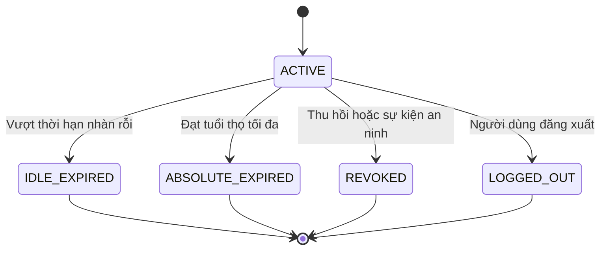

# Administrative session limits — Giới hạn phiên quản trị

## 1. Phiên quản trị không nên duy trì đặc quyền vô thời hạn

Một quản trị viên đăng nhập vào đầu ca, mở nhiều tab và để trình duyệt hoạt động suốt ngày. Một tab tự tải dữ liệu mỗi phút; một tab khác giữ màn hình phê duyệt giao dịch. Nếu hệ thống chỉ kiểm tra có cookie đăng nhập hay không, đặc quyền có thể tồn tại lâu hơn nhu cầu thực tế. Máy tính bị bỏ quên, cookie bị đánh cắp hoặc tài khoản vừa bị thu hồi quyền đều có thể trở thành nguồn phát lệnh nghiệp vụ nguy hiểm.

**Administrative session limits** là các giới hạn do máy chủ áp dụng lên thời gian, mức đặc quyền và số lượng phiên quản trị. Chúng xác định khi nào một phiên còn được gửi hành động quản trị, khi nào cần xác thực lại và khi nào phải bị vô hiệu hóa.

Trong bảo vệ logic nghiệp vụ, giới hạn phiên giúp thu hẹp thời gian có thể lạm dụng quyền. Tuy nhiên, một phiên còn hiệu lực vẫn phải tuân theo quyền theo đối tượng, state machine, phê duyệt, hạn mức và idempotency. Không được coi “vừa xác thực MFA” là bằng chứng rằng mọi lệnh quản trị đều hợp lệ.

Sau bài này, bạn có thể:

- Phân biệt thời hạn nhàn rỗi, thời hạn tuyệt đối, thời hạn nâng quyền và độ mới của xác thực.
- Thiết kế thu hồi phiên, giới hạn phiên đồng thời và xử lý thay đổi quyền.
- Đặt điểm kiểm tra hiệu lực tại nơi chấp nhận lệnh nghiệp vụ, kể cả khi có cạnh tranh đồng thời.
- Tách vòng đời phiên người dùng khỏi vòng đời tác vụ nền đã được chấp nhận.
- Kiểm thử các cách kéo dài phiên, dùng phiên cũ và gửi lại yêu cầu nhạy cảm.

Các con số trong bài là chính sách minh họa cho một hệ thống nhiều tenant. Chúng không phải khuyến nghị thời hạn áp dụng cho mọi ứng dụng.

## 2. Phân biệt các loại thời hạn

### 2.1. Bốn đồng hồ có mục đích khác nhau

| Giới hạn | Đo từ mốc nào? | Điều kiện kết thúc | Ví dụ minh họa |
| --- | --- | --- | --- |
| Idle timeout | Lần tương tác được chính sách chấp nhận gần nhất | Không có tương tác đủ điều kiện trong khoảng cho phép | Hết hạn sau 10 phút nhàn rỗi |
| Absolute timeout | Thời điểm tạo phiên quản trị | Đạt tuổi thọ tối đa dù vẫn có hoạt động | Phiên tối đa 8 giờ |
| Elevation timeout | Lần cấp mức đặc quyền tạm thời | Cửa sổ nâng quyền kết thúc | Nâng quyền trong 5 phút |
| Authentication freshness | Lần xác thực đáp ứng mức yêu cầu | Bằng chứng xác thực đã quá cũ cho hành động cụ thể | Thao tác nhạy cảm cần xác thực trong 2 phút gần nhất |

**Idle timeout** giảm rủi ro từ phiên bị bỏ quên. **Absolute timeout** đặt trần thời gian tồn tại, kể cả khi có tương tác liên tục. **Elevation timeout** giới hạn khoảng thời gian dùng đặc quyền cao hơn. **Authentication freshness** kiểm tra mức độ gần đây của bước xác thực cho một thao tác cụ thể.

Không đồng nhất những giới hạn này với thời hạn của access token, thời gian mở tab, thời hạn phê duyệt hoặc thời hạn grant. Một access token vừa được cấp lại không chứng minh người dùng vừa thực hiện xác thực bổ sung. Một phê duyệt còn hạn cũng không làm phiên của người thực thi tự hết hạn muộn hơn.

### 2.2. Điều kiện hiệu lực là phép giao

Với một hành động cần nâng quyền và xác thực mới, tại thời điểm kiểm tra phải đồng thời có:

```text
now < idle_expires_at
now < absolute_expires_at
now < elevation_expires_at
now < action_authentication_fresh_until
phiên chưa bị thu hồi
actor và grant liên quan còn hiệu lực
phạm vi nâng quyền bao phủ đúng hành động và đối tượng
```

Nếu grant hoặc phê duyệt có thời hạn riêng, chúng cũng phải còn hiệu lực. Không phải hành động nào cũng cần elevation hoặc phê duyệt; máy chủ xác định yêu cầu theo chính sách của hành động, không để client chọn bỏ qua.

Quy ước của ví dụ là tại đúng thời điểm hết hạn thì từ chối: `now >= expires_at` có nghĩa hết hiệu lực. Quy ước rõ ràng tránh việc các dịch vụ diễn giải khác nhau ở ranh giới thời gian.

### 2.3. Minh họa theo dòng thời gian

Giả sử một phiên bắt đầu lúc 08:00, hết hạn tuyệt đối lúc 16:00, idle timeout là 10 phút. Quản trị viên xác thực bổ sung lúc 09:00, được nâng quyền đến 09:05; hành động đổi chính sách yêu cầu bằng chứng xác thực không quá 2 phút.

| Thời điểm | Tình huống | Kết quả theo chính sách ví dụ |
| --- | --- | --- |
| 09:01 | Đổi chính sách đúng phạm vi, đủ phê duyệt | Có thể tiếp tục kiểm tra nghiệp vụ |
| 09:03 | Chưa xác thực bổ sung lại | Từ chối hành động cần xác thực trong 2 phút gần nhất |
| 09:06 | Phiên cơ sở vẫn có tương tác | Có thể đọc dữ liệu trong quyền cơ sở; đặc quyền tạm thời đã hết |
| 11:10 | Không có tương tác đủ điều kiện từ 11:00 | Phiên quản trị đã idle timeout |
| 16:00 | Một phiên khác cùng chính sách hoạt động liên tục từ 08:00 | Vẫn hết hạn tuyệt đối |

Nếu phiên đã hết hạn nhàn rỗi lúc 11:10, không chờ đến 16:00 mới vô hiệu hóa. Mỗi giới hạn tự có khả năng chặn hành động khi điều kiện của nó không còn thỏa mãn.

## 3. Xác định điều gì được tính là hoạt động

### 3.1. Polling và heartbeat không nên giữ đặc quyền mãi

Một giao diện quản trị có thể tự gửi heartbeat, làm mới danh sách, nhận WebSocket hoặc gia hạn access token. Nếu mọi request đều cập nhật `last_activity_at`, trình duyệt bị bỏ quên vẫn duy trì phiên vô hạn theo idle timeout.

Chính sách nên phân biệt:

- Tương tác mà hệ thống lựa chọn để cập nhật thời gian hoạt động, chẳng hạn một thao tác tra cứu hoặc gửi lệnh hợp lệ do người dùng khởi tạo.
- Lưu lượng nền như heartbeat, tải trước dữ liệu, đồng bộ thông báo hoặc refresh token.
- Yêu cầu bị từ chối hoặc không xác thực được, vốn không được dùng để hồi sinh hay kéo dài phiên.

Client có thể khai báo nguồn tương tác để hỗ trợ giao diện, nhưng đó không phải bằng chứng chắc chắn có người ngồi trước máy. Kẻ giữ token bị đánh cắp có thể tạo request trông giống thao tác thật. Vì vậy, idle timeout không thay thế absolute timeout, xác thực lại hoặc phát hiện rủi ro.

Không dùng chuyển động chuột hay một cờ `userActive=true` làm căn cứ duy nhất để cấp thêm thời gian đặc quyền. Nếu có nút “tiếp tục phiên”, máy chủ vẫn phải kiểm tra phiên chưa hết hạn và chính sách có yêu cầu xác thực lại hay không.

### 3.2. Không cập nhật hoạt động trước khi kiểm tra hạn

Một lỗi thường gặp là nhận request rồi lập tức ghi `last_activity_at = now`, sau đó mới tính idle timeout. Request đầu tiên sau nhiều giờ bỏ quên có thể tự làm phiên sống lại.

Thứ tự đúng trong ví dụ là:

1. Tải trạng thái phiên từ nguồn có thẩm quyền.
2. Đọc thời gian hiện tại của máy chủ theo cơ chế thời gian đã chọn.
3. Kiểm tra các thời hạn và trạng thái thu hồi trên giá trị cũ.
4. Kiểm tra điều kiện tương tác, quyền và hành động tương ứng.
5. Chỉ cập nhật hoạt động nếu request đủ điều kiện và phiên vẫn hợp lệ.

Khi nhiều request chạy đồng thời, thời gian hoạt động không được lùi do một request cũ ghi sau request mới. Có thể dùng cập nhật đơn điệu, điều kiện theo version hoặc khóa phù hợp. Việc cập nhật idle cũng phải giữ nguyên trần tuyệt đối của phiên.

## 4. Mô hình phiên và đặc quyền tạm thời

### 4.1. Dữ liệu phía máy chủ

Một mô hình minh họa tách phiên quản trị và lần nâng quyền:

```text
AdministrativeSession
  session_id
  session_secret_hash
  actor_id
  state
  created_at
  last_qualifying_activity_at
  absolute_expires_at
  actor_security_epoch_at_issue
  revoked_at
  version

AdministrativeElevation
  elevation_id
  session_id
  actor_id
  permission_scope
  tenant_and_object_scope
  verified_at
  expires_at
  consumed_at, nếu chỉ dùng một lần
  revoked_at
  version
```

`session_secret_hash` đại diện cho cách lưu giá trị kiểm tra bí mật phiên dạng opaque phía máy chủ. Bí mật phiên phải được sinh bằng nguồn ngẫu nhiên mật mã đủ mạnh, không dự đoán được; không lấy từ actor ID, timestamp hay số tăng dần. Nếu triển khai dùng token có chữ ký, mô hình kiểm tra và thu hồi sẽ khác nhưng vẫn phải đáp ứng các bất biến về thời hạn và hiệu lực.

`actor_security_epoch_at_issue` là phiên bản an ninh của actor tại lúc cấp phiên. Ví dụ, khi cần đăng xuất mọi phiên, hệ thống tăng epoch hiện tại của actor. Phiên mang epoch cũ bị từ chối khi đối chiếu. Epoch không tự thay thế việc kiểm tra permission và scope hiện tại; một thay đổi quyền chỉ có hiệu lực đúng yêu cầu nếu cơ chế kiểm tra và cache cũng phản ánh nó.

Elevation gắn với actor, phiên và phạm vi cụ thể. Một lần nâng quyền để đọc chẩn đoán của tenant A không mặc nhiên cho đổi thông tin thanh toán của tenant B. Nếu chính sách yêu cầu xác thực gắn với một lệnh nhạy cảm, cần ràng buộc thêm command ID hoặc fingerprint của nội dung đã chuẩn hóa.

### 4.2. Tách trạng thái phiên và trạng thái nâng quyền



Elevation có vòng đời riêng: chưa có, có hiệu lực, hết hạn, đã dùng hoặc bị thu hồi. Elevation hết hạn có thể chỉ hạ phiên về quyền cơ sở; phiên hết hạn hoặc bị thu hồi thì mọi elevation con đều không còn sử dụng được.

Không chuyển phiên đã hết hạn trở lại `ACTIVE` chỉ bằng refresh hoặc heartbeat. Xác thực lại để mở một phiên mới là một sự kiện cấp phiên rõ ràng, với định danh và mốc thời gian mới theo chính sách; không được vô tình hồi sinh phiên cũ.

## 5. Refresh token và xác thực bổ sung không được xóa các giới hạn

### 5.1. Token mới không đồng nghĩa phiên mới

Một access token có thể hết hạn trước phiên quản trị và được cấp lại thông qua refresh token. Khi cấp lại, máy chủ phải kiểm tra phiên gốc còn hiệu lực, chưa bị thu hồi và chưa vượt absolute timeout. Thời hạn token mới không được cho phép thực hiện hành động sau giới hạn của phiên gốc.

Ví dụ, phiên hết hạn tuyệt đối lúc 16:00. Một token được làm mới lúc 15:59 không được tự cho phép thao tác đến 16:14 chỉ vì cấu hình access token có thời hạn 15 phút. Có thể giới hạn thời hạn token và vẫn đối chiếu phiên khi sử dụng, tùy kiến trúc đã chọn.

Việc xoay refresh token giúp kiểm soát việc dùng lại token theo mô hình triển khai, nhưng không tự đặt lại `created_at`, không tự làm mới bằng chứng MFA và không tự vượt thời hạn grant. Phải xử lý nhất quán cả họ refresh token khi thu hồi phiên; chỉ xóa access token khỏi trình duyệt không ngăn một refresh token còn hợp lệ tiếp tục cấp quyền.

Với token tự chứa có chữ ký, xác minh chữ ký và thời hạn chỉ chứng minh token thỏa những điều kiện được kiểm tra. Nếu yêu cầu thu hồi trước khi token hết hạn, cần thêm đối chiếu trạng thái, epoch, danh sách thu hồi hoặc cơ chế tương ứng. Nếu hệ thống chấp nhận một độ trễ thu hồi có giới hạn, phải xác định rõ độ trễ đó; không mô tả nó như thu hồi tức thời.

### 5.2. Xác thực bổ sung cần gắn đúng phiên và hành động

Bằng chứng xác thực bổ sung nên xác định actor, phiên, thời điểm kiểm chứng, mức xác thực đã đạt và phạm vi được dùng. Máy chủ xác minh bằng chứng từ nguồn đáng tin cậy; một trường `mfaPassed=true` trong JSON không có giá trị cấp quyền.

Cần phân biệt các quyết định sau:

- Xác thực lại để tiếp tục phiên còn hiệu lực theo chính sách.
- Cấp elevation có thời hạn ngắn cho một nhóm hành động.
- Xác nhận một lệnh cụ thể có tham số đã chốt.
- Tạo một phiên quản trị mới sau khi phiên cũ đã hết hạn.

Không để endpoint cấp elevation vô tình gia hạn tuổi thọ tuyệt đối. Cũng không dùng một bằng chứng xác thực lại cũ để liên tục tạo elevation mới. Với bằng chứng chỉ dùng một lần, việc tiêu thụ phải nguyên tử để hai request không cùng sử dụng thành công.

Nếu một lệnh đã được xác nhận rồi bị sửa số tiền, tenant, đối tượng hoặc tập đích, cần đánh giá lại các ràng buộc xác nhận và phê duyệt. Xác thực đúng người không có nghĩa người đó đã xác nhận mọi biến thể của payload.

## 6. Thu hồi phiên và thay đổi quyền

### 6.1. Những sự kiện cần chính sách rõ ràng

| Sự kiện | Cách xử lý minh họa | Điều cần tránh |
| --- | --- | --- |
| Người dùng đăng xuất | Vô hiệu phiên và khả năng refresh liên quan ở máy chủ | Chỉ xóa cookie phía client |
| Đình chỉ tài khoản quản trị | Chặn phiên và elevation theo actor | Chờ đến lần đăng nhập tiếp theo mới kiểm tra |
| Nghi lộ bí mật xác thực | Thu hồi các phiên thuộc phạm vi sự cố, yêu cầu xác thực lại | Cho phiên cũ tiếp tục nâng quyền |
| Thay đổi MFA hoặc phục hồi tài khoản | Áp dụng quy trình thu hồi và xác minh đã định nghĩa | Tin rằng đang có phiên là đủ để bỏ qua kiểm tra |
| Thu hồi grant hoặc đổi phạm vi tenant | Kiểm tra quyền hiện tại hoặc vô hiệu hóa phiên liên quan theo chính sách | Tiếp tục dùng role snapshot cũ vô thời hạn |
| Hết ca hoặc hết grant tạm thời | Chặn hành động mới dùng quyền đó | Gia hạn grant bằng hoạt động của phiên |
| Phát hiện phiên đáng ngờ | Chấm dứt hoặc yêu cầu xác thực lại theo mức rủi ro | Tự cấp thêm thời gian để phiên đáng ngờ tiếp tục |

Không phải mọi thay đổi hồ sơ đều cần đăng xuất toàn bộ; điều quan trọng là chính sách chỉ rõ sự kiện nào ảnh hưởng đến phiên, grant, elevation và tác vụ đang chờ. Thay đổi dữ liệu cấp quyền phải phản ánh được ở thời điểm kiểm tra, không bị che bởi cache quá cũ.

### 6.2. Khi nhiều dịch vụ cùng kiểm tra phiên

Một dịch vụ kiểm tra cơ sở dữ liệu nhưng dịch vụ khác chỉ tin token cũ sẽ tạo ra đường vượt thu hồi. Cần xác định nguồn trạng thái có thẩm quyền, yêu cầu nhất quán và cách lan truyền sự kiện vô hiệu hóa.

TTL của bản ghi cache hoặc thời gian dọn dữ liệu không nên được coi là cơ chế duy nhất xác định hết hạn. Một bản ghi hết hạn vẫn có thể chưa bị xóa; máy chủ phải kiểm tra timestamp trong bản ghi. Ngược lại, mất bản ghi phiên không được hiểu là phiên có quyền mặc định.

Với hành động quản trị thay đổi dữ liệu, nếu không thể xác minh trạng thái phiên theo yêu cầu của chính sách, không chấp nhận lệnh nhạy cảm dựa trên giả định rằng phiên chắc còn hợp lệ. Cách phản hồi khi dịch vụ phiên tạm thời không sẵn sàng cần phân biệt lỗi hạ tầng với việc thông tin xác thực bị từ chối, nhưng cả hai không được dẫn đến ghi dữ liệu trái phép.

## 7. Ranh giới transaction và cuộc đua với thu hồi

### 7.1. Kiểm tra ở middleware là chưa đủ cho mọi bảo đảm

Xét chuỗi sự kiện:

```text
T1: Request A vượt kiểm tra phiên ở middleware.
T2: Nhân viên an ninh thu hồi phiên của A; thay đổi đã commit.
T3: A bắt đầu transaction để phê duyệt thay đổi chính sách.
T4: A ghi phê duyệt thành công mà không kiểm tra lại phiên.
```

Nếu chính sách nói “thu hồi chặn mọi lệnh chưa được chấp nhận”, kết quả T4 vi phạm chính sách. Cần đặt kiểm tra có thẩm quyền ở điểm chấp nhận lệnh, đồng thời bảo vệ nó trước thay đổi cạnh tranh.

Một quy ước khả thi là tuần tự hóa việc thu hồi và việc chấp nhận lệnh trên cùng trạng thái an ninh liên quan:

- Thu hồi có hiệu lực trước điểm chấp nhận: lệnh bị từ chối.
- Lệnh đã được chấp nhận trước thu hồi: xử lý theo chính sách cho lệnh đang chờ.
- Lệnh mới sau thu hồi: bị từ chối, kể cả khi giữ access token còn hạn theo timestamp của token.

Phải định nghĩa điểm chấp nhận cụ thể, chẳng hạn bước kiểm tra có khóa trước khi ghi command trong transaction. Không hứa rằng mọi transaction sẽ bị ngắt ngay đúng microsecond hết hạn nếu thiết kế thực tế chỉ kiểm tra ở một điểm. Giữ transaction ngắn và kiểm tra lại tại ranh giới cần bảo vệ giúp giới hạn khoảng chênh giữa quyết định và hiệu ứng.

### 7.2. Thuật toán chấp nhận lệnh minh họa

```text
resolve actor and session from verified credentials
validate command schema

begin local transaction
  synchronize actor security state
  synchronize session and required elevation
  read authoritative current time after relevant waits
  reject revoked, idle-expired or absolute-expired session
  reject missing or stale elevation and authentication proof
  verify current permission, tenant and object scope
  claim idempotency and check immutable command content
  verify approval, business state and impact limits
  accept exactly one command or perform the local transition
  consume one-use evidence when required
  update qualifying activity without extending absolute expiry
  persist command result, audit event and outbox event
commit
```

Các bước phải được điều chỉnh theo cơ chế khóa và kho dữ liệu thực tế. Ví dụ đơn giản có thể khóa trạng thái an ninh actor trước, rồi phiên, elevation, command và đối tượng theo một thứ tự thống nhất. Luồng thu hồi, cấp phiên và cập nhật epoch cũng phải tuân theo quy tắc đồng bộ tương ứng. Chỉ khóa phiên trong một luồng không đủ nếu luồng thu hồi toàn bộ chỉ đổi epoch ở một nơi khác mà không phối hợp.

Khóa rộng theo actor có thể làm giảm thông lượng. Hệ thống có thể dùng phiên bản, cập nhật có điều kiện hoặc dịch vụ phân quyền có bảo đảm phù hợp thay thế. Điều cần chứng minh là quyết định chấp nhận không dựa trên trạng thái đã bị vô hiệu trước mốc hiệu lực đã công bố.

Không giữ transaction mở trong lúc chờ người nhập MFA, người duyệt hoặc phản hồi thanh toán. Các bước đó diễn ra trước hoặc sau transaction ngắn; khi quay lại điểm chấp nhận lệnh, kiểm tra lại điều kiện hiện tại.

### 7.3. Minh họa phép kiểm tra thời hạn trong Java

```java
// Trích đoạn minh họa: dữ liệu đầu vào phải đến từ nguồn đáng tin cậy.
static boolean beforeAllDeadlines(
        Instant now,
        Instant lastQualifyingActivityAt,
        Duration idleTimeout,
        Instant absoluteExpiresAt,
        Instant elevationExpiresAt,
        Instant authenticationFreshUntil) {
    Instant idleExpiresAt = lastQualifyingActivityAt.plus(idleTimeout);
    return now.isBefore(idleExpiresAt)
            && now.isBefore(absoluteExpiresAt)
            && now.isBefore(elevationExpiresAt)
            && now.isBefore(authenticationFreshUntil);
}
```

Ví dụ giả định các mốc bắt buộc đều có giá trị, thời lượng đã được kiểm tra hợp lệ và nằm trong miền biểu diễn. Nó chỉ minh họa phép giao các thời hạn. Nó không tự kiểm tra thu hồi, epoch, quyền đối tượng, tính toàn vẹn bằng chứng, phê duyệt hoặc transaction. Không biến helper này thành toàn bộ cơ chế bảo vệ phiên quản trị.

Dùng thời gian máy chủ từ cơ chế đáng tin cậy đã chọn, không dùng timestamp do trình duyệt gửi. Trong cụm nhiều máy, cần đồng bộ đồng hồ và xác định cách xử lý sai lệch. Nếu có dung sai cho kiểm tra token, không được để dung sai vô tình trở thành thời gian gia hạn đặc quyền vượt chính sách. Sau khi chờ khóa lâu, không dùng lại một giá trị `now` đã lấy từ trước thời điểm chờ để kết luận phiên vẫn còn hạn.

## 8. Giới hạn số phiên quản trị đồng thời

### 8.1. Đếm đúng đơn vị phiên

Có thể đặt chính sách minh họa: mỗi actor có tối đa hai phiên quản trị cơ sở và chỉ một phiên đang nâng quyền. Đây là hai hạn mức khác nhau. Nhiều tab dùng chung một cookie thường thuộc cùng một phiên; không nên đếm mỗi tab là một lần đăng nhập độc lập.

Khi đạt giới hạn, hệ thống phải chọn rõ một hành vi: từ chối phiên mới, yêu cầu người dùng kết thúc phiên khác hoặc thu hồi một phiên cũ theo quy tắc đã công bố. Không âm thầm đẩy một phiên đang phê duyệt ra khỏi hệ thống mà giao diện vẫn hiển thị như thể phê duyệt đã thành công.

Việc kiểm tra và cấp phiên cần nguyên tử. Nếu hai yêu cầu đăng nhập đồng thời đều thấy số phiên dưới ngưỡng rồi cùng tạo bản ghi, giới hạn sẽ bị vượt. Có thể dùng khóa theo actor, các slot phiên có ràng buộc duy nhất hoặc cơ chế tương đương.

Phiên hết hạn nhưng chưa được dọn khỏi kho không nên chiếm slot mãi. Ngược lại, không giải phóng slot của phiên vẫn hợp lệ chỉ vì một heartbeat bị mất. Nguồn quyết định là trạng thái và thời hạn phía máy chủ.

### 8.2. Không coi giới hạn phiên là chống chia sẻ danh tính hoàn chỉnh

Một cookie có thể bị sao chép sang thiết bị khác mà vẫn dùng cùng session ID. Đếm phiên không tự phát hiện được mọi trường hợp này. Có thể bổ sung xác thực mạnh, tín hiệu rủi ro hoặc cơ chế ràng buộc thiết bị phù hợp, nhưng phải hiểu giới hạn của từng biện pháp.

Địa chỉ IP và chuỗi User-Agent có thể thay đổi hợp lệ hoặc bị mô phỏng. Chúng hữu ích như tín hiệu quan sát; ràng buộc cứng cần được cân nhắc trong chính sách vận hành, không xem như bằng chứng duy nhất về danh tính thiết bị.

Không dùng tài khoản quản trị chung để né hạn mức phiên. Danh tính cá nhân giúp thu hồi đúng người, phân tách requester với approver và truy vết khi có sự cố.

## 9. Tách vòng đời phiên khỏi vòng đời lệnh nghiệp vụ

### 9.1. Phiên hết hạn không tự đảo ngược lệnh đã được nhận

Giả sử một quản trị viên gửi lệnh xuất báo cáo hoặc xử lý hàng loạt khi phiên và elevation còn hiệu lực. Máy chủ đã kiểm tra scope, chốt tập đối tượng và chấp nhận command. Một phút sau, phiên hết hạn nhưng worker vẫn đang xử lý.

Cần xác định chính sách cho lệnh đang chờ thay vì suy luận rằng mọi tác vụ phải dùng mãi phiên của người gửi. Hai lựa chọn có thể áp dụng cho những loại hành động khác nhau:

- **Cam kết tại lúc chấp nhận:** worker tiếp tục thực hiện đúng command bất biến đã được chấp nhận, trong hạn mức và phạm vi đã chốt.
- **Tái kiểm tra trước hiệu ứng:** command chỉ được thực hiện nếu điều kiện quyền hoặc phiên bắt buộc vẫn còn thỏa mãn; nếu không, chuyển sang tạm dừng, hủy an toàn hoặc chờ xác nhận mới theo state machine.

Không để worker tự gia hạn phiên hoặc elevation để làm cho điều kiện thứ hai luôn đúng. Nếu lệnh đã thực hiện một phần, cần trạng thái từng phần tử và cách xử lý phần còn lại. Một sự kiện đăng xuất không thể tự thu hồi hiệu ứng bên ngoài đã xảy ra; xử lý bù là một nghiệp vụ riêng.

Phiên người thao tác và danh tính dịch vụ thực thi phải được lưu riêng. Service account có quyền kỹ thuật rộng không được mở rộng tenant, số lượng đối tượng hoặc tham số so với command đã được chấp nhận.

### 9.2. Hết phiên giữa lúc gửi không có nghĩa yêu cầu chưa chạy

Một tình huống thường gặp:

```text
1. Client gửi lệnh với khóa idempotency K.
2. Máy chủ chấp nhận command C và commit.
3. Phản hồi bị mất; phiên hết hạn trước lần thử lại.
4. Client đăng nhập lại rồi định gửi thêm một lệnh mới.
```

Nếu bước 4 dùng ý định mới không có liên kết với C, hiệu ứng có thể bị lặp. Sau khi xác thực lại, client nên truy vấn hoặc thử lại ý định cũ theo hợp đồng idempotency. Máy chủ xác thực phiên mới, kiểm tra quyền xem hoặc tiếp tục hiện tại và trả trạng thái của C; không vì phiên cũ hết hạn mà quên lệnh đã nhận.

Phạm vi idempotency cần được thiết kế theo danh tính và ý định nghiệp vụ. Nếu chỉ gắn khóa với session ID rồi bỏ toàn bộ bản ghi khi đăng xuất, một phiên mới có thể gửi lại cùng ý định thành lệnh mới. Có thể dùng phạm vi actor, tenant, action và khóa, kết hợp ràng buộc một đề nghị đã duyệt chỉ được thực thi một lần. Cách chọn phải phù hợp mô hình nghiệp vụ, không chỉ vòng đời cookie.

Nếu cùng khóa nhưng nội dung khác, từ chối xung đột. Nếu lệnh đang chạy, trả trạng thái hiện có theo quyền hiện tại. Nếu phiên mới không còn quyền xem đối tượng, không tiết lộ nội dung phản hồi nhạy cảm đã lưu chỉ vì biết khóa cũ.

Giao diện không nên tự phát lại một hành động nguy hiểm ngay sau đăng nhập mà không xác định kết quả cũ và ý định hiện tại. Với các trường hợp cần xác nhận lại nội dung, giữ bản nháp phù hợp nhưng yêu cầu bước xác nhận mới; không lưu token hoặc bí mật xác thực trong bản nháp.

## 10. Bảo vệ đường sử dụng phiên

### 10.1. Giới hạn thời gian không thay thế bảo vệ token

Với ứng dụng web dùng cookie, cần bảo vệ việc truyền và sử dụng cookie theo kiến trúc: HTTPS, thuộc tính `Secure`, `HttpOnly` khi phù hợp, phạm vi cookie được giới hạn và chính sách `SameSite` thích hợp. Các request thay đổi dữ liệu cần biện pháp chống CSRF phù hợp; không biến một URL đọc dữ liệu thành thao tác thay đổi trạng thái.

Cookie có thời hạn phía trình duyệt không đủ làm nguồn quyết định. Client có thể giữ cookie cũ hoặc gửi lại giá trị đã sao chép. Máy chủ phải kiểm tra trạng thái và thời hạn của phiên theo chính sách.

Khi chuyển từ đăng nhập thông thường sang ngữ cảnh quản trị hoặc nâng đặc quyền, cần cơ chế chống session fixation, chẳng hạn xoay định danh phiên và vô hiệu giá trị cũ theo thiết kế. Đừng chỉ thêm cờ admin vào một định danh mà kẻ khác có thể đã biết. Nếu có khoảng chuyển tiếp giữa hai định danh để xử lý request đang bay, phải giới hạn rõ và không để định danh cũ có thêm thời gian đặc quyền.

Không ghi token vào URL, audit log hoặc thông báo lỗi. Không gửi token của người dùng sang worker để worker lưu và sử dụng lâu dài. Worker thực hiện command đã chấp nhận bằng danh tính dịch vụ và ngữ cảnh được lưu có kiểm soát.

### 10.2. Kết nối dài vẫn phải kiểm tra hiệu lực

WebSocket, kết nối stream hoặc tab mở lâu không nên duy trì quyền chỉ vì handshake đầu tiên hợp lệ. Kiểm tra mỗi thông điệp có khả năng thay đổi dữ liệu và áp dụng cơ chế ngừng cung cấp dữ liệu nhạy cảm khi phiên hết hạn hoặc bị thu hồi.

Một timer ở giao diện có thể giúp cảnh báo trước khi hết phiên, nhưng nó không cấp hoặc thu hồi quyền. Máy người dùng có thể sai giờ, tab bị treo hoặc JavaScript bị sửa. Phản hồi có thẩm quyền vẫn thuộc máy chủ.

Các endpoint gia hạn, introspection, tải báo cáo và khôi phục kết nối cũng cần kiểm tra phù hợp. Nếu một đường tải file bỏ qua giới hạn phiên trong khi giao diện chính đã đăng xuất, dữ liệu vẫn có thể bị lộ qua đường đó.

## 11. Chính sách vận hành và dấu vết kiểm toán

### 11.1. Viết chính sách có thể kiểm chứng

Một chính sách mẫu có thể mô tả như sau:

| Quy tắc | Giá trị minh họa | Điều kiện thực thi |
| --- | --- | --- |
| Idle timeout | 10 phút | Chỉ tương tác đủ điều kiện cập nhật mốc hoạt động |
| Absolute timeout | 8 giờ | Refresh và heartbeat không đặt lại mốc bắt đầu |
| Elevation | 5 phút | Ràng buộc actor, phiên, permission và scope |
| Xác thực mới cho hành động nhạy cảm | Trong 2 phút gần nhất | Kiểm tra tại điểm chấp nhận lệnh |
| Phiên quản trị cơ sở đồng thời | Tối đa 2 | Cấp slot nguyên tử theo actor |
| Phiên đang nâng quyền | Tối đa 1 | Kiểm tra riêng với giới hạn phiên cơ sở |
| Thu hồi | Chặn lệnh chưa được chấp nhận theo mốc đã định nghĩa | Các dịch vụ dùng cùng nguồn hiệu lực hoặc bảo đảm tương đương |
| Lệnh chạy nền đã nhận | Theo chính sách từng loại lệnh | Không tự kéo dài phiên để duy trì tác vụ |

Cần định nghĩa hành vi khi chính sách thay đổi. Ví dụ, giảm absolute timeout có áp dụng ngay cho phiên đang mở hay chỉ cho phiên mới? Nếu áp dụng ngay, hạn hiệu lực phải được tính và kiểm tra theo phiên bản chính sách có thẩm quyền; không chỉ sửa giá trị mặc định ở màn hình đăng nhập.

Tăng giới hạn thời gian cũng là thay đổi nhạy cảm. Một quản trị viên không nên được tự kéo dài phiên của mình bằng cách sửa cấu hình mà không qua quyền và quy trình quản lý chính sách tương ứng. Truy cập khẩn cấp cũng cần thời hạn và phạm vi riêng, không phải chế độ bỏ hết timeout.

### 11.2. Những sự kiện cần liên kết

Nên ghi nhận các sự kiện có ý nghĩa:

- Tạo phiên, xác thực lại, kết thúc phiên, thu hồi và hết hạn khi được phát hiện.
- Cấp, từ chối, hết hạn, thu hồi hoặc tiêu thụ elevation.
- Từ chối do giới hạn phiên đồng thời hoặc bằng chứng xác thực quá cũ.
- Thay đổi epoch, grant hoặc chính sách có ảnh hưởng đến phiên.
- Chấp nhận và hoàn tất command nhạy cảm, có liên kết đến phiên và căn cứ cấp quyền lúc chấp nhận.

Dữ liệu hữu ích gồm actor thực, tham chiếu phiên không chứa bí mật, tenant, elevation ID, command ID, policy version, mốc xác thực, lý do kết thúc và correlation ID. Không cần log mọi heartbeat; cần đủ dữ liệu để phân biệt hoạt động nền, sử dụng đặc quyền và hiệu ứng nghiệp vụ.

Log “hết hạn” có thể chỉ xuất hiện khi hệ thống phát hiện phiên hết hạn hoặc khi tác vụ dọn chạy. Hiệu lực không được phụ thuộc việc event đó đã được phát hay chưa. Một request sau hạn vẫn bị từ chối ngay cả khi chưa có dòng log hết hạn trước đó.

Các dấu hiệu hữu ích để điều tra gồm nhiều lần nâng quyền liên tiếp, refresh sau khi bị thu hồi, hoạt động quản trị sát absolute timeout, dùng lại bằng chứng một lần và nhiều thiết bị có cùng tham chiếu phiên. Chúng là tín hiệu cần xem bối cảnh, không tự chứng minh có hành vi ác ý.

## 12. Kiểm thử giới hạn phiên bằng kết quả nghiệp vụ

Không chỉ kiểm tra thông báo “session expired”. Phải khẳng định request bị từ chối không tạo command trái phép, không tiêu thụ phê duyệt sai, không ghi một phần dữ liệu và không phát outbox event thực thi.

| Tình huống | Cách thử | Kết quả cần bảo đảm |
| --- | --- | --- |
| Đúng ranh giới idle | Gửi lệnh tại `now == idle_expires_at` | Bị từ chối theo quy ước thời gian |
| Hồi sinh bằng request | Gửi tương tác đầu tiên sau idle timeout | Không cập nhật hoạt động rồi cho phiên sống lại |
| Polling giữ phiên | Chỉ chạy heartbeat và tải nền | Không kéo dài idle theo chính sách đã chọn |
| Absolute timeout | Tạo tương tác liên tục đến tuổi thọ tối đa | Vẫn hết hạn tuyệt đối |
| Refresh sát hạn | Cấp token mới trước absolute timeout | Không cho quyền vượt trần phiên gốc |
| Refresh sau thu hồi | Dùng refresh token cũ sau đăng xuất | Không tạo token có quyền quản trị |
| Elevation hết hạn | Phiên cơ sở còn hạn nhưng elevation đã hết | Chỉ hành động trong quyền cơ sở còn được xét |
| Bằng chứng quá cũ | Elevation còn hạn nhưng xác thực không đủ mới | Chặn hành động yêu cầu độ mới cao hơn |
| Giả mạo thời gian | Gửi timestamp và cờ MFA từ client | Không thay đổi kết luận của máy chủ |
| Dùng lại bằng chứng | Hai request cùng tiêu thụ bằng chứng một lần | Tối đa một lần tiêu thụ thành công |
| Thay scope sau xác thực | Đổi tenant hoặc nội dung lệnh đã ràng buộc | Không dùng bằng chứng cũ để mở rộng tác động |
| Thu hồi cạnh tranh | Thu hồi commit trước điểm chấp nhận lệnh | Không có lệnh mới được chấp nhận bằng phiên cũ |
| Đăng xuất toàn bộ | Tăng epoch actor rồi dùng một phiên cũ khác | Phiên cũ bị từ chối theo chính sách |
| Grant bị thu hồi | Dùng phiên còn hạn với quyền vừa mất | Không thực hiện hành động dựa trên snapshot quyền cũ |
| Đăng nhập đồng thời | Hai yêu cầu tranh slot cuối | Không vượt số phiên đang có hiệu lực cho phép |
| Nhiều tab | Mở nhiều tab dùng cùng định danh phiên | Không đếm sai slot; hết hạn áp dụng nhất quán |
| Định danh cũ sau nâng quyền | Gửi lại cookie trước khi xoay ID | Không duy trì hoặc nhận thêm đặc quyền ngoài chính sách |
| WebSocket cũ | Gửi thông điệp quản trị sau thu hồi | Không tạo thay đổi dù kết nối vẫn mở |
| Dịch vụ phiên lỗi | Không xác minh được trạng thái có thẩm quyền | Không cho phép ghi nhạy cảm bằng giả định mặc định |
| Chờ khóa qua thời hạn | Lấy `now`, chờ lâu rồi kiểm tra | Không dùng thời gian cũ để chấp nhận phiên đã hết hạn |
| Lệnh nền sau hết phiên | Cho phiên hết hạn sau khi command được nhận | Tuân theo chính sách tác vụ đang chờ, không tự gia hạn phiên |
| Retry sau đăng nhập lại | Mất phản hồi rồi thử lại cùng ý định | Truy về command cũ; không tạo hiệu ứng trùng |
| Tải kết quả khi mất quyền | Đọc phản hồi idempotency hoặc báo cáo cũ | Không tiết lộ dữ liệu ngoài quyền hiện tại |

Dùng đồng hồ có thể điều khiển trong kiểm thử để kiểm tra trước hạn, đúng hạn và sau hạn mà không phải chờ thật nhiều phút. Với hệ thống phân tán, thêm tình huống sai lệch đồng hồ và cache chậm vô hiệu hóa theo giả định vận hành đã xác định.

Với cạnh tranh, tạo thời điểm chồng lấn bằng barrier hoặc cơ chế đồng bộ của bộ kiểm thử. Cho hai request chạy tuần tự không chứng minh việc cấp slot, thu hồi hay tiêu thụ bằng chứng là nguyên tử. Sau kiểm thử, kiểm tra trạng thái phiên, epoch, elevation, command, dữ liệu nghiệp vụ và các sự kiện thực thi liên quan.

## 13. Những lỗi thiết kế cần tránh

**Chỉ dựa vào countdown của giao diện.** Giao diện giúp người dùng biết cần lưu công việc và xác thực lại; máy chủ mới là nơi quyết định hiệu lực.

**Một timeout dùng cho mọi thứ.** Idle, absolute, elevation và độ mới xác thực bảo vệ những rủi ro khác nhau. Gộp chúng dễ tạo đường gia hạn ngoài ý muốn.

**Mỗi refresh đều là đăng nhập mới.** Cách này có thể xóa trần tuổi thọ mà người dùng không thực hiện xác thực lại tương ứng.

**Thu hồi bằng cách xóa cookie.** Giá trị bị sao chép hoặc refresh token còn sống vẫn có thể sử dụng nếu máy chủ không vô hiệu hóa.

**MFA thay cho phân quyền nghiệp vụ.** Xác thực đúng actor không cấp thêm tenant, không cho tự phê duyệt và không bỏ qua trạng thái đơn hàng.

**Worker giữ phiên người dùng để chạy cho xong.** Điều này biến tác vụ nền thành lý do kéo dài đặc quyền. Dùng command có phạm vi và chính sách xử lý riêng.

**Hết phiên thì coi lệnh trước đó chưa chạy.** Lệnh có thể đã commit trước khi phản hồi mất. Cần idempotency và truy vấn trạng thái, không gửi một ý định mới theo suy đoán.

**Cache cũ nhưng vẫn tuyên bố thu hồi ngay.** Bảo đảm hiệu lực phải phản ánh đúng thiết kế kiểm tra và lan truyền trạng thái. Nếu có độ trễ, phải mô tả và kiểm thử độ trễ đó.

## 14. Bài tập áp dụng

Thiết kế phiên cho một ứng dụng quản trị nhiều tenant, có khả năng đề nghị, phê duyệt và thực thi các lệnh thay đổi chính sách vận hành. Một số lệnh chạy nền; phiên và grant có thể bị thu hồi bất kỳ lúc nào.

Hãy tạo các đầu ra sau:

1. Chính sách idle timeout, absolute timeout, elevation, độ mới xác thực và số phiên đồng thời, kèm lý do chọn từng giới hạn.
2. Mô hình dữ liệu tách phiên, elevation, grant và command; chỉ rõ nguồn thời gian và nguồn trạng thái có thẩm quyền.
3. Danh sách request được tính là hoạt động và các request nền không kéo dài idle.
4. Luồng đăng nhập, xác thực bổ sung, refresh, đăng xuất một phiên và thu hồi toàn bộ.
5. Ranh giới chấp nhận lệnh và cách đồng bộ với thu hồi phiên, thay đổi epoch hoặc quyền.
6. Chính sách cho command đã chấp nhận khi phiên hết hạn, cùng cơ chế idempotency sau đăng nhập lại.
7. Audit event và tối thiểu tám kiểm thử bao phủ ranh giới thời gian, cạnh tranh, token cũ và tác vụ nền.

Một thiết kế đạt yêu cầu phải giải thích được vì sao polling không giữ đặc quyền mãi, refresh không xóa trần tuổi thọ, thu hồi không bị bỏ qua qua một đường gọi khác và phiên hết hạn không tạo ra yêu cầu nghiệp vụ trùng. Mọi lệnh còn được cho phép vẫn phải tuân theo scope, phê duyệt, state machine và các bất biến của nghiệp vụ.
