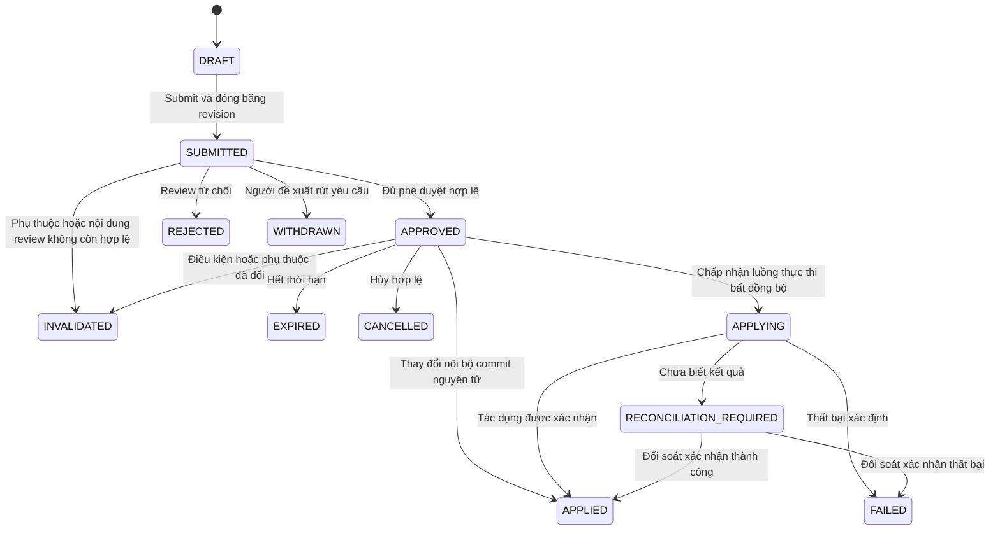

# Administrative change review — Rà soát thay đổi quản trị

## 1. Mục tiêu và phạm vi

Một thay đổi quản trị có thể làm hệ thống tiếp tục hoạt động bình thường nhưng mất đi một quy tắc bảo vệ quan trọng. Ví dụ, tăng ngưỡng bắt buộc phê duyệt hoàn tiền từ 5 triệu lên 20 triệu đồng khiến các khoản từ 5 triệu đến dưới 20 triệu không còn đi qua bước duyệt, nếu quy tắc là yêu cầu phê duyệt khi số tiền lớn hơn hoặc bằng ngưỡng.

**Administrative change review** là quá trình rà soát nội dung, phạm vi, điều kiện và tác động của thay đổi quản trị trước khi cho phép áp dụng, đồng thời kiểm chứng kết quả sau khi áp dụng. Nó liên kết quyết định của người review với đúng thay đổi được thực thi.

Bài học thuộc module `SECURITY_APPLICATION_SECURITY_BUSINESS_LOGIC_SECURITY`, trong chương **Administrative Controls**. Trọng tâm là bảo vệ business invariants, state machine, quyền theo đối tượng, transaction, idempotency và kiểm thử tình huống tấn công logic trong luồng thay đổi quản trị.

Sau bài học, bạn cần có khả năng:

- Xác định thay đổi nào có thể làm yếu kiểm soát nghiệp vụ dù không sửa mã nguồn.
- Xây dựng yêu cầu thay đổi có phiên bản, phạm vi và căn cứ đủ để review.
- Gắn phê duyệt với nội dung bất biến, ngăn tự duyệt và ngăn sửa nội dung sau khi được duyệt.
- Kiểm tra lại điều kiện tại thời điểm áp dụng, bao gồm quyền, cấu hình nền và thời hạn.
- Thiết kế áp dụng, audit, retry và phục hồi mà không ghi nhận thành công sai hoặc ghi đè thay đổi mới.

Các vai trò, trạng thái và ngưỡng tiền trong bài là ví dụ thiết kế. Số người duyệt và yêu cầu bổ sung phải được quyết định theo rủi ro thực tế của hệ thống.

## 2. Những thay đổi nào cần review?

Thay đổi quản trị không chỉ là cấp quyền `ADMIN`. Bất kỳ cấu hình hoặc dữ liệu điều khiển nào có thể thay đổi quyết định nghiệp vụ đều cần được đánh giá.

| Nhóm thay đổi | Ví dụ | Câu hỏi review quan trọng |
| --- | --- | --- |
| Quyền và phạm vi | Thêm quyền hoàn tiền, mở phạm vi từ một đội sang toàn tenant | Chủ thể có thêm khả năng nào khi kết hợp với quyền đã có? |
| Phê duyệt | Thay ngưỡng tiền, số người duyệt, vai trò được duyệt | Có tạo đường tự đề xuất rồi tự duyệt hoặc bỏ qua bước không? |
| Giới hạn nghiệp vụ | Tăng hạn mức hoàn tiền, số lượt khôi phục, hạn mức giao dịch | Invariant nào đang dựa vào giới hạn cũ? |
| Trạng thái và workflow | Cho phép mở lại giao dịch hoặc chuyển trực tiếp sang trạng thái hoàn tất | Có bỏ qua điều kiện của chuyển tiếp trung gian không? |
| Phạm vi dữ liệu | Đổi tenant mặc định, hàng đợi, bộ lọc dữ liệu hoặc nhóm được truy cập | Có mở quyền theo đối tượng ngoài dự kiến không? |
| Tích hợp | Đổi đích webhook, tài khoản nhận hoặc cấu hình dịch vụ thanh toán | Có đổi nơi dữ liệu/tiền được gửi đến không? |
| Kiểm soát vận hành | Thay thời hạn grant, cấu hình audit hoặc quy tắc cảnh báo | Có làm mất khả năng phát hiện và truy vết không? |

Tách **quyền đề xuất**, **quyền review/phê duyệt**, **quyền áp dụng** và **quyền quản trị chính sách review**. Không mặc nhiên gộp chúng vào một role quản trị toàn năng.

Review có thể dẫn đến chấp thuận, từ chối hoặc yêu cầu sửa đổi. Việc một người bấm nút “Approve” chỉ có giá trị khi họ đã có thông tin đủ, được cấp quyền đúng phạm vi và quyết định đó ràng buộc với thay đổi cụ thể.

## 3. Invariant phải giữ trong toàn bộ quy trình

| Mã | Invariant | Ví dụ vi phạm |
| --- | --- | --- |
| R1 | Mọi thao tác xét đúng tenant, môi trường và đối tượng được cấp quyền | Dùng quyền staging để áp dụng cấu hình production |
| R2 | Người đề xuất không tự phê duyệt yêu cầu của mình theo chính sách tách nhiệm vụ | Dùng tài khoản thứ hai của cùng người để duyệt |
| R3 | Phê duyệt gắn với đúng revision, nội dung và phạm vi đã review | Duyệt cho một tenant nhưng áp dụng cho mọi tenant |
| R4 | Nội dung đã submit không bị sửa âm thầm | Thêm quyền mới vào JSON sau khi có phê duyệt |
| R5 | Chính sách yêu cầu review được quyết định từ nguồn đáng tin cậy | Client tự khai `risk = LOW` để chỉ cần một người duyệt |
| R6 | Điều kiện áp dụng còn hợp lệ tại ranh giới thực thi | Dùng phê duyệt hết hạn hoặc ghi đè cấu hình đã đổi |
| R7 | Thay đổi nội bộ, kết quả lệnh và audit bắt buộc nhất quán khi commit | Cấu hình đã đổi nhưng audit không ghi được |
| R8 | Retry không tạo thêm lần áp dụng của cùng ý định | Timeout khiến một lệnh cấp quyền được thực hiện lặp |
| R9 | Không có đường quản trị khác bỏ qua cùng invariant | Bulk API hoặc tác vụ nền sửa trực tiếp cấu hình |
| R10 | Việc nới lỏng chính sách review không tự giảm yêu cầu duyệt cho chính thay đổi đó | Đề xuất bỏ người duyệt thứ hai rồi coi yêu cầu hiện tại đã đủ duyệt |

Tách nhiệm vụ cần dựa trên định danh chủ thể thực mà tổ chức có thể quản lý, không chỉ tên role hoặc chuỗi email khác nhau. Khi có nhiều tài khoản gắn với cùng một nhân sự, chính sách cần xét quan hệ đó. Với tài khoản dịch vụ, phải giữ danh tính dịch vụ và người khởi tạo hoặc bên được ủy quyền nếu có; không dùng tài khoản máy để che người đề xuất.

Một hash nội dung hay một bản ghi audit không tự thực thi các invariant trên. Chúng hỗ trợ kiểm tra tính nhất quán và truy vết; dịch vụ nghiệp vụ cùng tầng lưu trữ vẫn phải chặn các chuyển tiếp sai.

## 4. Hồ sơ thay đổi cần đủ để review

### 4.1. Cấu trúc một revision

Một yêu cầu có thể có nhiều revision. Mỗi revision đã submit là bất biến và có tập phê duyệt riêng.

```text
AdministrativeChangeRevision
  changeId
  revisionId
  revisionNumber
  tenantId
  environment
  targetResourceType
  targetResourceId
  expectedTargetVersion
  proposedOperation
  normalizedPayload
  payloadDigest
  proposerSubjectId
  governancePolicyVersion
  dependencyVersions
  riskAssessment
  reasonCode
  evidenceReferences
  executionWindow
  approvalExpiresAt
  state
  version
```

`expectedTargetVersion` mô tả cấu hình nền đã dùng để phân tích. `version` là phiên bản của chính workflow thay đổi. Hai giá trị phục vụ hai loại tranh chấp khác nhau và không được dùng thay thế cho nhau.

`dependencyVersions` có thể bao gồm phiên bản workflow phê duyệt, bộ vai trò hoặc chính sách liên quan. Không cần chụp toàn bộ hệ thống; cần nhận diện các phụ thuộc thực sự có thể làm thay đổi kết luận review.

Danh tính người đề xuất, tenant được phép và chính sách governance được lấy hoặc xác minh phía máy chủ. Những giá trị client gửi không tự trở thành căn cứ đáng tin cậy.

### 4.2. Ví dụ nội dung được submit

```json
{
  "changeId": "change-106",
  "revisionId": "change-106-r2",
  "tenantId": "tenant-01",
  "environment": "production",
  "target": {
    "type": "refund_policy",
    "id": "refund-policy-main",
    "expectedVersion": 42
  },
  "operation": "SET_APPROVAL_THRESHOLD",
  "payload": {
    "approvalRequiredFromVnd": "20000000"
  },
  "governancePolicyVersion": "admin-review-v7",
  "executionWindow": {
    "startsAt": "2026-11-23T02:00:00Z",
    "endsAt": "2026-11-23T03:00:00Z"
  },
  "reasonCode": "REFUND_PROCESS_ADJUSTMENT"
}
```

Trong ví dụ, cấu hình hiện hành ở phiên bản 42 có ngưỡng 5.000.000 VND. Giá trị tiền được biểu diễn chính xác bằng chuỗi số nguyên đồng cho cấu hình này. Cách biểu diễn và đơn vị phải được schema quy định rõ, không để nơi review hiểu là đồng còn nơi áp dụng hiểu là nghìn đồng.

Khi submit, máy chủ kiểm tra target thuộc tenant và môi trường phù hợp, đọc cấu hình nền, xác định diff và tính digest. Không nhận cờ như `approved = true`, `skipReview = true` hoặc số người duyệt bắt buộc trực tiếp từ request rồi tin chúng.

### 4.3. Những gì người review phải nhìn thấy

Một màn hình review hữu ích không chỉ hiển thị JSON mới. Nó cần cho thấy:

- Giá trị trước/sau và phiên bản cấu hình nền.
- Phạm vi tenant, môi trường, đối tượng cụ thể và phạm vi ảnh hưởng có thể xác định.
- Ý nghĩa hành vi: thay đổi nào trở nên được phép, bị cấm hoặc không còn cần phê duyệt.
- Người đề xuất, lý do, bằng chứng kiểm thử và các thay đổi liên quan.
- Chính sách yêu cầu duyệt, các phê duyệt hiện có, thời hạn và điều kiện thực thi.
- Phương án theo dõi kết quả và cách phục hồi nếu có tác động ngoài dự kiến.

Với ví dụ tăng ngưỡng, diff cần nêu rõ: “Các khoản hoàn tiền từ 5.000.000 đến dưới 20.000.000 VND không còn bắt buộc phê duyệt theo riêng quy tắc ngưỡng này.” Các kiểm soát khác vẫn phải được đánh giá riêng. Nhãn “tối ưu quy trình” không mô tả đủ tác động bảo mật.

## 5. State machine cho yêu cầu và revision

Một state machine cơ bản:



`APPROVED` có nghĩa đủ điều kiện review theo hồ sơ, chưa khẳng định đã áp dụng. Đường chuyển thẳng sang `APPLIED` dành cho thay đổi có thể commit nguyên tử trong cơ sở dữ liệu nội bộ. Đường qua `APPLYING` dành cho luồng có tác dụng bất đồng bộ hoặc ngoài hệ thống; không dùng một trạng thái để che hai loại bảo đảm khác nhau.

Sau submit, yêu cầu sửa nội dung phải tạo revision mới ở `DRAFT`. Revision cũ được rút hoặc đánh dấu không còn có thể áp dụng; phê duyệt của nó không tự chuyển sang revision mới. Revision mới cần diff và review tương ứng.

Việc lập lịch không miễn kiểm tra thời hạn hoặc điều kiện tại lúc chạy. Trong mô hình này, lịch thực thi là dữ liệu gắn với revision đã được review, không phải quyền để scheduler tự đổi nội dung.

Có thể phát hiện invalidation ngay khi một phụ thuộc thay đổi hoặc khi thử áp dụng. Dù nhãn giao diện chưa cập nhật, dịch vụ thực thi phải từ chối revision có điều kiện đã lỗi thời. Không coi trạng thái `APPROVED` lưu trong bảng là kiểm tra duy nhất.

## 6. Review ý nghĩa nghiệp vụ, không chỉ hình thức diff

### 6.1. Đánh giá tác động và ranh giới

Người review nên lần theo một chuỗi câu hỏi:

1. **Quy tắc nào đổi?** Xác định điều kiện trước/sau và trường hợp biên, kể cả toán tử lớn hơn hay lớn hơn hoặc bằng.
2. **Ai có khả năng mới?** Xét quyền hiện tại kết hợp quyền hoặc giới hạn sau thay đổi.
3. **Đối tượng nào chịu ảnh hưởng?** Tenant, môi trường, loại giao dịch, đội xử lý và tài nguyên liên quan.
4. **Bước kiểm soát nào bị giảm?** Phê duyệt, hạn mức, kiểm tra trạng thái, audit hoặc cảnh báo.
5. **Đường thực thi nào dùng cấu hình này?** API chính, tác vụ nền, batch và tích hợp có đọc cùng quy tắc không.
6. **Thay đổi khác đang tương tác thế nào?** Đừng coi hai đề xuất độc lập nếu kết hợp chúng tạo thêm quyền.
7. **Bằng chứng và phục hồi có đủ không?** Kiểm thử đúng revision, cách quan sát và phương án phục hồi cụ thể.

Ví dụ ngưỡng phê duyệt ở phần trước cần kiểm tra tối thiểu:

| Số tiền VND | Ngưỡng cũ 5.000.000: cần duyệt? | Ngưỡng mới 20.000.000: cần duyệt? |
| --- | --- | --- |
| 4.999.999 | Không theo riêng quy tắc ngưỡng | Không theo riêng quy tắc ngưỡng |
| 5.000.000 | Có | Không theo riêng quy tắc ngưỡng |
| 19.999.999 | Có | Không theo riêng quy tắc ngưỡng |
| 20.000.000 | Có | Có |

Tiếp tục xét tổng tiền hoàn trên cùng đơn hàng, khả năng chia một khoản thành nhiều yêu cầu nhỏ, quy tắc theo loại tiền và điều kiện phê duyệt khác. Kiểm tra bốn mốc trên giúp hiểu diff nhưng chưa chứng minh toàn bộ nghiệp vụ an toàn.

Một thay đổi cấp quyền đề xuất hoàn tiền và một thay đổi cho phép cùng nhóm phê duyệt có thể tạo xung đột nhiệm vụ dù mỗi đề xuất riêng trông hợp lệ. Cần review tác động tích lũy trên cùng chủ thể, không chỉ kiểm tra từng permission có tồn tại trong danh mục.

### 6.2. Phân loại rủi ro từ nguồn đáng tin cậy

Có thể phân tầng review theo phạm vi ảnh hưởng và mức nhạy cảm. Ví dụ, thay đổi mô tả hiển thị có thể yêu cầu ít kiểm soát hơn thay đổi ngưỡng phê duyệt production. Nhưng kết quả phân loại phải được máy chủ tính từ loại thao tác, đối tượng, dữ liệu trước/sau và chính sách governance.

Các trường `risk`, `requiredApprovals` hoặc `isEmergency` do client gửi chỉ là đề xuất đầu vào nếu hệ thống cho phép, không phải kết luận cuối cùng. Một thao tác giảm audit hoặc nới phê duyệt không được tự khai là thay đổi ít rủi ro để tránh review.

Chính sách kiểm soát việc thay đổi quy tắc review phải có nguồn quản trị độc lập với chính dữ liệu đang đề xuất sửa. Yêu cầu bỏ người duyệt thứ hai vẫn phải đáp ứng yêu cầu governance hiện hành dành cho loại thay đổi đó. Không đọc số người duyệt bắt buộc từ giá trị mới rồi áp dụng ngược cho yêu cầu đang xét.

Nếu thay đổi nằm ngoài tập thao tác quản trị được mô hình hóa, không biến nó thành một payload tùy ý để chạy SQL hoặc gọi phương thức bất kỳ. Cần một loại operation có schema, quyền và điều kiện cụ thể trước khi đưa vào luồng review.

### 6.3. Bằng chứng phải khớp revision

Kết quả kiểm thử, báo cáo đánh giá tác động và tài liệu phục hồi cần liên kết với revision hoặc digest tương ứng. Một báo cáo cho revision 1 không tự xác nhận revision 2 chỉ vì cùng `changeId`.

Nếu tài liệu ở kho ngoài có thể sửa, lưu phiên bản hoặc digest nội dung cần đối chiếu, cùng quyền truy cập phù hợp. Người review phải nhận biết thay đổi phụ lục có thể ảnh hưởng quyết định. Đường dẫn không đổi không có nghĩa nội dung không đổi.

Review tự động có thể kiểm tra schema, danh sách trường cấm, phạm vi tenant và kết quả test. Review con người bổ sung đánh giá mục đích, tác động và khả năng lạm dụng. Cả hai cần chỉ rõ những kiểm tra đã thực hiện; nhãn “đã kiểm tra” chung chung không đủ làm căn cứ.

## 7. Ràng buộc phê duyệt với nội dung bất biến

### 7.1. Review envelope và digest

Có thể tạo một **review envelope** gồm toàn bộ dữ liệu bất biến quyết định ý nghĩa thay đổi: tenant, môi trường, target, operation, payload chuẩn hóa, phiên bản nền, phụ thuộc, cửa sổ thực thi và chính sách governance đã chốt.

Máy chủ kiểm tra schema, chuẩn hóa rồi tính digest trên envelope đó. Các quyết định phê duyệt tham chiếu tới `revisionId` và digest. Trạng thái workflow hay danh sách phê duyệt phát sinh về sau không nằm trong nội dung cần hash theo cách gây tham chiếu vòng.

Cần quy định rõ:

- Kiểu dữ liệu, đơn vị tiền, múi giờ và cách biểu diễn giá trị thiếu/null.
- Từ chối trường không được hỗ trợ, khóa JSON trùng và dữ liệu không hợp lệ.
- Cách chuẩn hóa đối tượng; không sắp xếp lại mảng khi thứ tự mang ý nghĩa nghiệp vụ.
- Phạm vi đích được ràng buộc: một target cụ thể khác với toàn tenant hoặc mọi môi trường.
- Phiên bản thuật toán/định dạng envelope để có thể diễn giải về sau.

Không chỉ hash riêng trường tiền mới rồi để tenant, môi trường hoặc đích áp dụng ở ngoài. Nội dung đã duyệt có thể bị chuyển sang một phạm vi hoàn toàn khác mà hash vẫn giống nhau.

Digest giúp phát hiện không khớp nội dung; nó không chứng minh người duyệt có quyền và không tự xác thực nguồn gửi. Nếu dùng chữ ký, vẫn cần quản lý khóa, kiểm tra định danh, phạm vi và thời hạn. Nếu dùng bản ghi cơ sở dữ liệu, phải bảo vệ việc tạo/sửa quyết định và giới hạn đường quản trị.

### 7.2. Ghi nhận quyết định review

Một quyết định có thể chứa:

```text
ReviewDecision
  decisionId
  revisionId
  reviewedDigest
  reviewerSubjectId
  decision             // APPROVE hoặc REJECT
  reviewerScope
  governancePolicyVersion
  decidedAt
  expiresAt
  evidenceReferences
  reasonCode
```

Khi người review bấm duyệt, request phải chỉ rõ revision và digest họ đã xem. Máy chủ kiểm tra lại quyền reviewer, quan hệ với người đề xuất, trạng thái revision và phiên bản workflow. Nếu màn hình đã cũ, trả xung đột để họ xem lại; không âm thầm duyệt revision mới nhất.

Số lượng phê duyệt phải tính từ các quyết định còn hợp lệ của những chủ thể độc lập theo chính sách. Hai lần bấm của một người không phải hai người duyệt. Nếu yêu cầu có đại diện hai nhóm khác nhau, hai người cùng nhóm chưa chắc đáp ứng điều kiện.

Ràng buộc duy nhất phù hợp trên reviewer/revision và kiểm soát phiên bản hoặc khóa workflow giúp xử lý hai lần duyệt đồng thời. Không chỉ đếm số dòng quyết định mà bỏ qua quyết định đã thu hồi, hết hạn hoặc dành cho digest khác.

Trong mô hình của bài, lúc áp dụng còn kiểm tra reviewer đang hoạt động và còn đủ phạm vi; thay đổi liên quan làm mất điều kiện phải yêu cầu đánh giá lại. Một hệ thống có thể chọn semantics khác cho phê duyệt lịch sử, nhưng phải mô tả rõ cách thu hồi và thời điểm xác nhận quyền, không để hành vi tùy theo endpoint.

## 8. Áp dụng thay đổi: đóng khoảng trống giữa review và thực thi

### 8.1. Kiểm tra lại sau khi có phê duyệt

Từ lúc review đến lúc áp dụng, cấu hình nền, quyền nhân sự hoặc chính sách governance có thể thay đổi. Trạng thái `APPROVED` không làm những điều kiện này tự đóng băng.

Trước khi áp dụng cần xác nhận:

- Actor thực thi còn quyền trên tenant, môi trường và target cụ thể.
- Đúng revision đã được duyệt, digest khớp và chưa được áp dụng/hủy.
- Đủ quyết định hợp lệ, không tự duyệt hoặc xung đột nhiệm vụ.
- Thời hạn và cửa sổ thực thi còn thỏa hợp đồng.
- Phiên bản target và phụ thuộc vẫn khớp với nền đã review.
- Thao tác vẫn thỏa các ràng buộc nghiệp vụ bắt buộc, không chỉ yêu cầu review.

Định nghĩa rõ thời điểm đánh giá thời hạn. Ví dụ trong bài dùng thời điểm máy chủ chấp nhận thực thi sau khi đã giữ các khóa cần thiết và ngay trước khi thay đổi; lưu thời điểm quyết định đó. Với tác vụ chạy muộn, scheduler phải đánh giá lại tại bước này, không dựa vào thời điểm đã xếp lịch.

### 8.2. Giả mã transaction cho thay đổi nội bộ

Mã sau là giả mã gần với Java, mô tả trách nhiệm của các thành phần chứ không phải mã có thể biên dịch trực tiếp:

```java
ApplyReceipt apply(Principal actor, ApplyChangeCommand cmd) {
    Tenant tenant = tenantAccess.requireAuthorizedTenant(actor, cmd.tenantId());
    validateRequest(cmd);

    return transaction.execute(() -> {
        // Khóa theo giao thức/thứ tự thống nhất, sau đó đọc lại dữ liệu cần kiểm tra.
        LockedApplyContext ctx = applyLocks.loadAndLock(
            tenant.id(), cmd.changeId(), cmd.revisionId()
        );
        ChangeRevision revision = ctx.revision();
        policy.requireVisible(actor, revision);

        CommandEntry command = idempotency.reserveOrLoad(
            tenant.id(), actor.id(), "APPLY_ADMIN_CHANGE", revision.id(),
            cmd.idempotencyKey(), canonicalFingerprint(cmd)
        );
        if (command.isCompleted()) {
            policy.requireCanReadReceipt(actor, revision, command);
            return command.savedReceipt();
        }

        revision.requireVersion(cmd.expectedChangeVersion());
        revision.requireState(APPROVED);
        policy.requireCanApply(actor, ctx);
        governance.requireUnchangedAndValid(ctx);
        dependencies.requireReviewedVersions(ctx);
        approvals.requireValidForExactRevision(ctx);
        digestVerifier.requireMatchesReviewedEnvelope(revision);
        revision.requireExecutionAllowedAt(clock.instant());

        RefundPolicy target = ctx.refundPolicy();
        target.requireVersion(revision.expectedTargetVersion());
        target.applyAllowedOperation(revision.operation(), revision.normalizedPayload());
        refundPolicies.saveWithVersionCheck(target);

        revision.markApplied(target.version(), command.operationId());
        changes.saveWithVersionCheck(revision);
        AuditEvent applied = auditFactory.changeApplied(actor, ctx, command.operationId());
        auditRepository.append(applied);
        outbox.append(applied);

        ApplyReceipt receipt = ApplyReceipt.applied(revision, target.version());
        idempotency.complete(command, receipt);
        return receipt;
    });
}
```

Payload thực thi được lấy từ revision bất biến đã xác minh, không lấy một payload mới từ request `apply`. Chính sách/kiểm tra đầu vào vẫn cần giới hạn operation và các trường được sửa; revision đã được duyệt không phải giấy phép ghi bất kỳ thuộc tính nào.

`loadAndLock` phải được triển khai theo mô hình đồng thời thực tế, bao gồm các bản ghi target, governance hoặc quyền cần bảo vệ. Khóa riêng revision không tự ngăn một transaction khác thu hồi reviewer hoặc thay chính sách. Các đường thu hồi/cập nhật phải phối hợp cùng giao thức khóa hoặc cơ chế phiên bản có thể ngăn thay đổi xen kẽ tại ranh giới đã chọn.

Giữ transaction ngắn và có thứ tự khóa nhất quán. Không tải báo cáo từ URL, gửi email hoặc chờ một dịch vụ chậm trong lúc giữ khóa. Nếu bằng chứng nằm ngoài cơ sở dữ liệu, cần lấy và xác minh phiên bản bất biến bằng cơ chế phù hợp trước, rồi ràng buộc tham chiếu đã xác minh với revision.

### 8.3. Cập nhật có điều kiện

Ví dụ SQL dưới đây minh họa hàng rào chống ghi đè đối với cấu hình ngưỡng, sau khi đã kiểm tra quyền và phê duyệt trong transaction:

```sql
UPDATE refund_policy
SET approval_required_from_vnd = :approved_value,
    version = version + 1,
    updated_at = CURRENT_TIMESTAMP
WHERE tenant_id = :authorized_tenant_id
  AND environment = :reviewed_environment
  AND id = :reviewed_target_id
  AND version = :reviewed_target_version
RETURNING id, version, approval_required_from_vnd;
```

Các tham số `reviewed_*` và `approved_value` lấy từ hồ sơ đã xác minh. Nếu không có hàng được cập nhật, không ghi nhận `APPLIED` hoặc phát thông báo thành công. Trong transaction minh họa, thay đổi target, trạng thái revision, audit, outbox và kết quả idempotency cùng commit hoặc cùng rollback.

Nếu target đã từ phiên bản 42 lên 43, không tự lấy phiên bản 43 rồi áp dụng đề xuất cũ. Cần tạo hoặc đánh giá lại revision với nền mới. Hệ thống có thể dùng phiên bản theo từng phần cấu hình để giảm xung đột không liên quan, nhưng phải chứng minh phần được tách không ảnh hưởng kết luận review.

## 9. Retry, rollout và tác dụng phân tán

### 9.1. Idempotency của lệnh áp dụng

Scope của idempotency cần bao gồm tenant, actor, loại lệnh, revision và key. Fingerprint phản ánh nội dung lệnh đã chuẩn hóa. Cùng key nhưng nội dung khác bị từ chối; cùng key và nội dung phát lại biên nhận đã lưu nếu người gọi còn quyền xem.

Một thiết kế cần xử lý được:

- Client timeout sau commit: retry trả kết quả cũ, không áp dụng lần hai.
- Hai request cùng key đến đồng thời: uniqueness và transaction phối hợp để chỉ một lệnh có hiệu lực.
- Hai key khác nhau cùng cố áp dụng một revision: state machine và ràng buộc thực thi theo revision vẫn chặn lần thứ hai.
- Tiến trình chết trước commit: transaction chưa tạo kết quả thành công; retry đi theo trạng thái đã lưu thực tế.
- Key hết thời gian lưu: bảo vệ của key có thể hết, nhưng revision đã `APPLIED` vẫn không được áp dụng lại như mới.

Không dùng idempotency key làm bằng chứng cấp quyền. Cũng không dùng một key cố định theo target cho mọi thay đổi trong tương lai, vì target có thể có nhiều revision hợp lệ khác nhau.

### 9.2. Thay đổi nhiều đối tượng và cấu hình cache

Một đề xuất “áp dụng cho tất cả tenant hiện tại” có thể ảnh hưởng tập đích khác khi đến lúc chạy. Cần ràng buộc phạm vi được review bằng danh sách/manifest bất biến hoặc một quy tắc chọn có giới hạn và điều kiện kiểm tra được định nghĩa rõ. Không để bộ lọc client gửi lại ở bước apply tự mở rộng phạm vi.

Với một lô target, quyết định trước tính nguyên tử:

| Mô hình | Điều phải mô tả |
| --- | --- |
| Một transaction cho toàn lô | Khả năng khóa, thời gian xử lý và rollback khi một phần thất bại |
| Commit từng target | Trạng thái từng phần, thứ tự rollout, điểm dừng và retry đúng phần chưa hoàn tất |
| Staged configuration | Cách xuất bản phiên bản mới, chuyển phiên bản có hiệu lực và xử lý consumer chưa đồng bộ |

Không đánh dấu toàn lô thành công vì đã đưa đủ lệnh vào hàng đợi. Với thực thi ngoài hệ thống hoặc nhiều shard, `APPLYING` và trạng thái cần đối soát giúp biểu diễn tác dụng chưa thể kết luận. Việc hủy lịch không tự hoàn tác những target đã thay đổi.

Nếu cập nhật cơ sở dữ liệu cấu hình nhưng các node còn dùng cache cũ, cần phân biệt **phiên bản đã lưu** với **phiên bản đang có hiệu lực khi xử lý request**. Trong luồng nội bộ ở phần 8, `APPLIED` xác nhận commit trên target được mô hình hóa; nó không tự chứng minh mọi consumer đã chuyển phiên bản.

Với kiểm soát nhạy cảm như thu hồi quyền hoặc giảm hạn mức, cần cơ chế phân phối/kiểm tra phiên bản phù hợp và quy định hành vi của node đang dùng cấu hình lỗi thời. Có thể cần chặn thao tác nhạy cảm khi node không đáp ứng phiên bản tối thiểu. Không chỉ gửi thông báo cache invalidation rồi mặc định cả hệ thống đã đồng bộ.

### 9.3. Điều kiện áp dụng cho tác vụ nền

Scheduler hoặc worker phải có danh tính dịch vụ, phạm vi và quyền thực thi cụ thể. Nó chỉ áp dụng revision đã được phép, kiểm tra lại phiên bản và cửa sổ chạy, rồi ghi audit với cả actor dịch vụ và người khởi tạo liên quan.

Nếu việc cấp quyền được chốt lúc chấp nhận lệnh nhưng tác dụng xảy ra sau đó, phải mô tả khả năng hủy/thu hồi trong khoảng chờ. Nếu chính sách yêu cầu kiểm tra lại lúc thực thi, worker phải làm việc đó. Hai semantics có thể phù hợp với các nghiệp vụ khác nhau; không để chúng khác nhau ngẫu nhiên giữa giao diện và worker.

Nếu dịch vụ ngoài timeout, giữ trạng thái chưa xác định và định danh lệnh gốc để đối soát. Không gắn nhãn thất bại chắc chắn rồi gửi một lệnh mới có thể tạo tác dụng lần hai.

## 10. Thay đổi khẩn cấp và rollback

### 10.1. Ngoại lệ khẩn cấp phải có phạm vi

Sự cố có thể yêu cầu rút ngắn thời gian review hoặc dùng một nhóm reviewer khác theo chính sách. Cơ chế khẩn cấp cần quy định actor được dùng, loại thay đổi, tenant/môi trường, thời hạn, căn cứ sự cố và bước hậu kiểm.

Một cờ `emergency = true` trong request không đủ. Quyền khẩn cấp cần được cấp từ nguồn đáng tin cậy và kiểm tra trên từng lệnh. Grant cho phép giảm thời gian chờ không tự cho phép đổi tenant, tự cấp thêm quyền hoặc tắt audit.

Các điều kiện không được bỏ qua phải nêu rõ, như schema thao tác, ràng buộc phạm vi, bảo vệ chống ghi đè và audit bắt buộc. Nếu số reviewer được giảm, điều đó phải đến từ chính sách ngoại lệ đã được quản trị, không do payload thay đổi tự quyết.

Hậu kiểm cần đối chiếu nội dung đã thực hiện với phạm vi grant, tác động thực tế và trạng thái các biện pháp tạm thời. Hết hạn grant không tự hoàn tác cấu hình đã đổi; cấu hình tạm thời cần một kế hoạch kết thúc riêng.

### 10.2. Rollback là một thay đổi nghiệp vụ mới

Rollback thường có nghĩa tạo một revision mới để phục hồi hành vi mong muốn trên nền hiện tại. Nó cần quyền, review theo chính sách và audit tương ứng.

Ví dụ, revision r2 đổi ngưỡng từ 5 triệu lên 20 triệu ở target phiên bản 42 thành 43. Sau đó một thay đổi hợp lệ khác tạo phiên bản 44. Một lệnh rollback không được chép nguyên toàn bộ snapshot phiên bản 42 đè lên 44, vì có thể xóa thay đổi mới không liên quan.

Cần xác định trường nào phục hồi, đối chiếu nền hiện tại và đánh giá lại phụ thuộc. Giá trị cũ từng được chấp thuận không có nghĩa hiện tại vẫn an toàn. Việc phục hồi quyền hoặc cấu hình xác thực cũ có thể tái mở một khả năng đã bị thu hồi.

Một số tác dụng không thể hoàn tác bằng cấu hình: tiền đã chuyển, dữ liệu đã xuất hoặc quyền đã được dùng để tạo tài nguyên khác. Khi đó cần hành động bù trừ/đối soát riêng với điều kiện nghiệp vụ và review tương ứng. Không báo sự cố đã được giải quyết chỉ vì giá trị cấu hình đã trở về như cũ.

## 11. Audit và review sau áp dụng

Dấu vết cần nối được các giai đoạn: tạo revision, submit, từng quyết định review, invalidation/hết hạn, chấp nhận thực thi, commit hoặc xác nhận tác dụng, đối soát và rollback.

| Nhóm bằng chứng | Dữ liệu cần liên kết |
| --- | --- |
| Nội dung | `changeId`, `revisionId`, digest, operation, target và phạm vi |
| Chủ thể | Người đề xuất thực, reviewer thực, actor áp dụng, dịch vụ thực thi |
| Căn cứ | Governance policy, quyết định quyền, phê duyệt, grant ngoại lệ nếu có |
| Trạng thái | Phiên bản nền, phiên bản sau, các trạng thái và phụ thuộc đã kiểm tra |
| Nhân quả | `operationId`, `eventId`, correlation và tham chiếu lệnh ngoài hệ thống |
| Kết quả | Đã chấp nhận, đã commit, đã có hiệu lực theo phạm vi xác định hay còn cần đối soát |

Sự kiện commit bắt buộc được lưu nguyên tử với thay đổi nội bộ; outbox giúp chuyển tiếp sau commit. Relay/consumer cần chống lặp vì sự kiện có thể được giao nhiều lần. Một lần phát lại biên nhận không tạo thêm bằng chứng về một lần áp dụng mới.

Không ghi bí mật cấu hình, token hoặc dữ liệu xác thực vào diff/audit. Với thay đổi bí mật, ghi loại thay đổi và tham chiếu phiên bản bí mật phù hợp, không hiển thị toàn bộ giá trị cũ/mới cho reviewer không có nhu cầu biết. Quyền đọc hoặc xuất audit cũng phải giới hạn theo tenant và vai trò điều tra.

Review sau áp dụng nên đối chiếu:

- Target/phiên bản thực tế có khớp revision đã duyệt không.
- Cấu hình đã có hiệu lực tại những consumer nào và còn phần nào chưa đồng bộ.
- Các chỉ số nghiệp vụ thay đổi đúng kỳ vọng hay có dấu hiệu tăng lạm dụng.
- Có operation lỗi, target áp dụng một phần hoặc tác dụng ngoài hệ thống chưa xác định không.
- Quyền/grant tạm thời và lịch phục hồi có được kết thúc như dự kiến không.

Với ví dụ ngưỡng hoàn tiền, có thể theo dõi số lượng và tổng tiền của các khoản trong khoảng 5 triệu đến dưới 20 triệu, số ca chia nhỏ yêu cầu và những actor có hành vi bất thường. Số liệu cần được diễn giải theo lưu lượng và quy trình thực tế, không coi mọi khoản trong khoảng đó là gian lận.

Theo dõi cả sức khỏe của cơ chế review: thay đổi có hiệu lực nhưng thiếu revision/decision tương ứng, audit lỗi, outbox tồn đọng và đường quản trị ghi thẳng vào cấu hình. Nếu cùng mã sai tạo cả cấu hình lẫn audit sai, việc có đủ event vẫn chưa chứng minh review đúng; cần nguồn đối chiếu phù hợp với rủi ro.

## 12. Kiểm thử các đường bỏ qua logic

Các tình huống sau là gợi ý kiểm thử cho hệ thống thực hiện administrative change review. Kiểm tra cả quyết định API lẫn trạng thái lưu trữ và tác dụng thực tế.

| Tình huống | Kết quả cần chứng minh |
| --- | --- |
| Người đề xuất tự approve hoặc dùng tài khoản khác gắn cùng chủ thể thực | Chính sách tách nhiệm vụ chặn đúng trường hợp được định nghĩa |
| Reviewer có role nhưng sai tenant/môi trường/target | Không tạo được quyết định hợp lệ |
| Client tự khai rủi ro thấp hoặc số người duyệt bằng 0 | Máy chủ vẫn áp dụng chính sách governance đáng tin cậy |
| Sửa payload, môi trường hoặc tập target sau submit | Bị chặn hoặc tạo revision mới; approval cũ không áp dụng |
| Duyệt từ màn hình cũ khi revision đã đổi | Gặp xung đột; không tự duyệt bản mới nhất |
| Replay quyết định cho revision có digest khác | Không được tính vào tập phê duyệt hợp lệ |
| Một người gửi approve hai lần hoặc hai request đến đồng thời | Không được tính thành hai reviewer độc lập |
| Thu hồi quyền reviewer hoặc đổi governance trước lúc apply | Xử lý theo semantics đã chốt; trong bài phải kiểm tra lại và từ chối khi điều kiện mất hiệu lực |
| Target đổi từ phiên bản 42 lên 43 sau review | Revision dựa trên 42 không ghi đè; phải đánh giá lại nền mới |
| Thay chính sách/phụ thuộc đồng thời với apply | Giao thức đồng thời ngăn kiểm tra trên dữ liệu cũ rồi thực thi trên điều kiện đã đổi |
| Apply trước/sau cửa sổ hoặc sau hết hạn | Bị từ chối theo thời điểm đánh giá đã định nghĩa |
| Hai key khác nhau áp dụng cùng một revision | Tối đa một lần chuyển tiếp có hiệu lực |
| Timeout sau commit rồi retry cùng key | Trả biên nhận cũ nếu còn quyền xem; không đổi cấu hình lần hai |
| Gây lỗi audit/outbox trước commit | Transaction rollback; không có target mới hoặc trạng thái `APPLIED` giả |
| Cập nhật từng target rồi dừng giữa một lô | Hiển thị đúng phần đã áp dụng, phần chưa xong và retry không nhân đôi tác dụng |
| Node còn cache cấu hình cũ sau thay đổi hạn chế quyền | Hành vi tuân theo quy tắc phiên bản tối thiểu/đồng bộ đã thiết kế |
| Gọi bulk API, endpoint quản trị khác hoặc tác vụ nền | Cùng invariant và căn cứ review vẫn được yêu cầu |
| Gửi cờ khẩn cấp nhưng không có grant hợp lệ | Không được miễn quy trình |
| Đổi chính sách review để tự bỏ yêu cầu duyệt còn thiếu | Yêu cầu hiện tại vẫn bị ràng buộc bởi governance đáng tin cậy |
| Rollback trong lúc target đã có thay đổi mới | Không ghi đè phiên bản mới hoặc phục hồi toàn bộ snapshot một cách mù quáng |
| Bằng chứng test hoặc phụ lục thay nội dung sau review | Không âm thầm coi bằng chứng mới là nội dung đã được review |
| Nhà cung cấp có tác dụng nhưng phản hồi timeout | Giữ khả năng đối soát bằng định danh gốc; không kết luận và gửi lại tùy ý |

Để kiểm thử race condition, dùng barrier hoặc điểm đồng bộ cho các transaction thực sự chồng lấn. Hai request tuần tự không chứng minh được an toàn đồng thời. Kiểm thử khóa, uniqueness và rollback nên dùng hệ quản trị cơ sở dữ liệu tương ứng khi triển khai.

Đối chiếu target, phiên bản workflow, quyết định review, số operation thành công, audit, idempotency và outbox. Với tác dụng ngoài hệ thống, kiểm tra cả bằng chứng xác nhận hoặc trạng thái chưa xác định. Mã HTTP đúng chưa đủ chứng minh invariant được giữ.

Các mã giả và kịch bản trong bài mô tả thiết kế; chúng không phải kết quả kiểm thử của một hệ thống đã triển khai.

## 13. Checklist thiết kế

1. Mọi loại thay đổi nhạy cảm đã có operation/schema, target và điều kiện nghiệp vụ rõ ràng.
2. Người review nhìn thấy diff, ý nghĩa hành vi, phạm vi và bằng chứng của đúng revision.
3. Governance đáng tin cậy quyết định mức review; thay đổi không tự giảm yêu cầu cho chính nó.
4. Tách nhiệm vụ, phạm vi reviewer và phê duyệt đúng digest được kiểm tra tại các ranh giới phù hợp.
5. Nội dung submit bất biến; sửa đổi, thay nền hoặc mất điều kiện dẫn đến đánh giá lại theo chính sách.
6. Áp dụng có kiểm soát phiên bản, thời hạn, đồng thời, idempotency và audit nguyên tử tương ứng.
7. Rollout, cache và dịch vụ ngoài có định nghĩa kết quả, đối soát và phục hồi cụ thể.
8. Ngoại lệ khẩn cấp và rollback có quyền, phạm vi, dấu vết và review tương ứng.

Một quy trình review đáng tin cậy phải giữ được liên kết giữa nội dung đã xem, quyết định đã đưa ra và thay đổi thực sự có hiệu lực. Liên kết đó cần được bảo vệ bằng mô hình dữ liệu, quyền, state machine và transaction xuyên suốt mọi đường quản trị.
