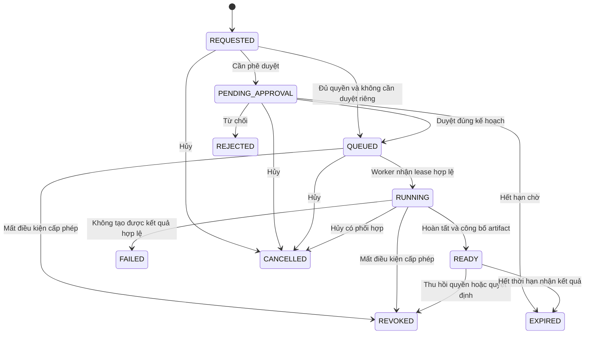

# Xuất nhật ký kiểm toán quản trị — Administrative audit export

Trong chương **Administrative Controls**, xuất nhật ký kiểm toán quản trị là quy trình tạo một bản dữ liệu phục vụ điều tra, đối soát hoặc xem xét các thao tác quản trị. Dữ liệu có thể liên quan đến thay đổi giá, cấp quyền, phê duyệt, hoàn tiền, điều chỉnh hạn mức và can thiệp ngoại lệ.

Bài học thuộc module `SECURITY_APPLICATION_SECURITY_BUSINESS_LOGIC_SECURITY`. Trọng tâm là bảo vệ quy tắc nghiệp vụ của chính chức năng xuất dữ liệu: người gọi được xuất những sự kiện nào, những trường nào, cho mục đích gì, tại thời điểm nào và ai được nhận kết quả. Một người được xem màn hình quản trị chưa chắc được phép tải toàn bộ lịch sử của hệ thống.

Sau bài này, bạn có thể:

- Xác định các bất biến về phạm vi, tính toàn vẹn và vòng đời của bản xuất.
- Thiết kế quyền theo tenant, đối tượng và trường dữ liệu tại từng bước xử lý.
- Tạo bản xuất có phạm vi thời gian, snapshot và giới hạn đầy đủ được mô tả rõ.
- Kết hợp state machine, transaction, idempotency và worker để ngăn xử lý sai hoặc trùng.
- Bảo vệ tệp, kiểm tra manifest và kiểm thử các tình huống lạm dụng logic.

Tên vai trò, định danh, giới hạn và thời hạn trong bài là ví dụ thiết kế. Chính sách lưu giữ, phân loại và chia sẻ dữ liệu cần được tổ chức xác định cho hệ thống cụ thể.

## 1. Vì sao chức năng xuất audit là một thao tác nhạy cảm?

Giả sử quản trị viên của `TENANT-A` được xem lịch sử điều chỉnh giá trong tenant của mình. Giao diện có bộ lọc tenant, nhưng API export chỉ kiểm tra vai trò `ADMIN`. Khi người đó bỏ tham số tenant hoặc thay bằng `TENANT-B`, worker truy vấn toàn bộ kho audit rồi tạo tệp tải xuống.

Giao diện có thể vẫn hiển thị đúng dữ liệu, trong khi chức năng xuất đã làm lộ lịch sử của tenant khác. Tệp còn có thể chứa giá trị trước và sau, thông tin cá nhân, lý do xử lý và các tham chiếu nội bộ không xuất hiện trên màn hình.

Các dạng lạm dụng thường gặp gồm:

- Mở rộng phạm vi qua bộ lọc, phân trang, endpoint cũ hoặc tác vụ nền.
- Xin xuất lúc còn quyền rồi tải tệp sau khi đã bị thu hồi quyền.
- Đoán `jobId` hoặc `artifactId` để tải bản xuất của người khác.
- Chèn nội dung vào log để công thức chạy khi người điều tra mở CSV.
- Làm tệp có vẻ đầy đủ dù đã bỏ trang lỗi hoặc bị giới hạn số dòng.
- Tạo nhiều job tương tự để gom dữ liệu hoặc làm cạn tài nguyên.
- Sửa tệp và manifest cùng lúc để che dấu vết.

Audit export cũng có thể ảnh hưởng điều tra theo hướng ngược lại: bản xuất thiếu hoặc sai phạm vi khiến người xem kết luận rằng một hành động chưa từng xảy ra. Vì vậy, cần bảo vệ cả dữ liệu được tiết lộ và ý nghĩa mà bản xuất thể hiện.

## 2. Các bất biến của quy trình xuất

| Bất biến | Ý nghĩa thực thi |
|---|---|
| Đúng phạm vi dữ liệu | Mọi bản ghi đều nằm trong tập sự kiện người nhận được phép truy cập |
| Đúng trường | Mỗi trường và dữ liệu lồng nhau đều được phép tiết lộ theo chính sách |
| Bộ lọc không mở rộng quyền | Điều kiện người dùng nhập chỉ thu hẹp tập được phép |
| Giữ nguồn gốc | Có thể liên kết dữ liệu xuất với sự kiện và nguồn ghi nhận |
| Mô tả đúng tính đầy đủ | Bản xuất cho biết cửa sổ thời gian, snapshot, nguồn và phần chưa có |
| Không sửa lịch sử | Export không cập nhật hoặc xóa sự kiện audit nguồn |
| Chỉ công bố kết quả hợp lệ | Tệp dở dang, hết hạn, bị thu hồi hoặc không đủ quyền không được tải |
| Chống xử lý lặp sai | Retry không tạo các kết quả mâu thuẫn dưới cùng một job |
| Có dấu vết của việc xuất | Tạo, phê duyệt, xử lý, công bố và tải đều có sự kiện phù hợp |
| Có giới hạn tài nguyên | Số job, thời gian truy vấn, dung lượng và vòng đời tệp được kiểm soát |

Có thể biểu diễn phạm vi dữ liệu bằng:

```text
eligibleEvents =
    authorizedAuditScope(principal, purpose, currentPolicy)
    INTERSECT requestedFilters
    INTERSECT frozenDatasetBoundary

exportedRecord = approvedFieldProjection(event)
```

Nếu người gọi yêu cầu một phạm vi không được phép, thiết kế cần quy định rõ từ chối hay thu hẹp có thông báo. Trong ví dụ của bài, yêu cầu vượt phạm vi bị từ chối để người dùng không nhầm rằng mình đã nhận toàn bộ dữ liệu yêu cầu.

Một tập kết quả rỗng chỉ chứng minh không tìm thấy sự kiện trong phạm vi truy vấn và snapshot đã mô tả. Nó không chứng minh mọi nguồn trong toàn hệ thống đều chưa từng có hành động đó.

## 3. Thiết kế quyền theo sự kiện, đối tượng và trường dữ liệu

### 3.1. Tách các năng lực

| Năng lực | Ví dụ | Phạm vi cần kiểm tra |
|---|---|---|
| Tạo yêu cầu xuất | Tạo job cho lịch sử thay đổi giá | Tenant, loại sự kiện, khoảng thời gian, mục đích |
| Phê duyệt xuất nhạy cảm | Duyệt thêm dữ liệu định danh trong một cuộc điều tra | Đề xuất cụ thể, người nhận, mức nhạy cảm |
| Xem trạng thái job | Xem tiến độ của yêu cầu được giao | Chủ sở hữu hoặc nhóm được chia sẻ |
| Tải kết quả | Nhận dữ liệu của một artifact đã sẵn sàng | Quyền hiện tại đối với toàn bộ phạm vi và trường trong tệp |
| Chia sẻ hoặc chuyển giao | Giao bản xuất cho nhóm điều tra | Người nhận, đích lưu và chính sách chia sẻ |
| Quản lý vòng đời | Hủy job hoặc dọn tệp hết hạn | Trạng thái, retention và thẩm quyền vận hành |

Quyền vận hành worker không tự biến thành quyền dữ liệu của người yêu cầu. Worker đọc dữ liệu thay mặt một công việc đã được cấp phép, với phạm vi được lưu và được kiểm tra lại.

OWASP khuyến nghị quyền tối thiểu, mặc định từ chối và kiểm tra quyền trên từng yêu cầu. Nguyên tắc này áp dụng cả khi yêu cầu được thực hiện qua API hoặc một luồng khác giao diện chính. Xem [OWASP Authorization Cheat Sheet](https://cheatsheetseries.owasp.org/cheatsheets/Authorization_Cheat_Sheet.html).

### 3.2. Không suy ra tenant từ tên người thực hiện

Một nhân viên nội bộ có thể thao tác trên nhiều tenant. Lọc `actorId` theo nhân viên đó rồi xuất mọi sự kiện sẽ làm lộ tenant khác. Phạm vi cần dựa trên ngữ cảnh tài nguyên và quy tắc hiển thị sự kiện, không chỉ danh tính actor.

Sự kiện liên quan nhiều tenant hoặc tài nguyên dùng chung cần quy tắc riêng: bản ghi nào được hiển thị, trường nào cần che và ai có quyền xem ngữ cảnh toàn cục. Không sao chép toàn bộ payload cho mọi tenant chỉ vì họ cùng liên quan.

Quyền audit cũng không nhất thiết giống quyền xem đối tượng hiện tại. Một đơn hàng đã bị xóa hoặc chuyển trạng thái vẫn có lịch sử cần xem. Hãy định nghĩa quyền truy cập lịch sử và metadata phạm vi tại thời điểm sự kiện, thay vì chỉ join vào bảng nghiệp vụ hiện tại rồi bỏ mất bản ghi.

### 3.3. Trường trước và sau là nguồn rò rỉ lớn

Các trường `before`, `after`, `metadata` hoặc `requestBody` có thể chứa dữ liệu nhiều mức nhạy cảm. Việc cho phép xuất tên trường `after` không đồng nghĩa cho phép xuất mọi thuộc tính bên trong.

Nên dùng schema và danh sách trường được phép theo loại sự kiện. Ví dụ `PRICE_OVERRIDE` có thể xuất giá trước, giá sau, loại tiền và lý do có cấu trúc; không cần kèm toàn bộ khách hàng hoặc payload thanh toán.

Nếu cần thay định danh bằng mã giả, cần xác định khả năng liên kết giữa các bản ghi và giữa các lần xuất. Mã giả vẫn có thể là dữ liệu nhạy cảm khi kết hợp với thông tin khác. Không coi việc thay email bằng một chuỗi ổn định là đã loại bỏ mọi rủi ro nhận diện.

## 4. Chốt một kế hoạch xuất có thể kiểm tra

Đừng để worker tự dựng phạm vi từ các tham số rời rạc trong message. Khi tạo job, máy chủ nên lưu một kế hoạch đã chuẩn hóa và được cấp phép.

```json
{
  "jobId": "EXP-7307",
  "requesterId": "ADMIN-17",
  "tenantScope": ["TENANT-A"],
  "purposeCode": "INVESTIGATE_PRICE_OVERRIDE",
  "caseRef": "INV-204",
  "eventTypes": ["PRICE_OVERRIDE", "ADMIN_APPROVAL_DECIDED"],
  "timeFilter": {
    "field": "occurredAt",
    "fromInclusive": "2026-11-20T00:00:00Z",
    "toExclusive": "2026-11-21T00:00:00Z"
  },
  "projectionVersion": "audit-export-price-v2",
  "policyVersion": "admin-audit-export-v4",
  "format": "JSONL",
  "schemaVersion": "audit-event-export-v3",
  "deliveryMode": "AUTHENTICATED_DOWNLOAD",
  "planVersion": 1,
  "artifactExpiresAt": "2026-11-23T03:00:00Z"
}
```

Đây là dữ liệu minh họa, chưa phải request mà client được quyền tự xác lập mọi trường. Máy chủ suy ra người yêu cầu, kiểm tra tenant, chọn projection hợp lệ và quyết định thời hạn theo chính sách.

Bộ lọc dùng khoảng nửa mở `[fromInclusive, toExclusive)` để ghép các kỳ liền nhau mà không tự trùng điểm biên. Giao diện cần hiển thị múi giờ và chuyển đổi rõ ràng; “ngày 20 theo giờ địa phương” có thể không trùng với ngày 20 theo UTC.

Các trường ảnh hưởng nội dung hoặc người nhận phải là một phần của kế hoạch. Nếu thay khoảng thời gian, tenant, loại sự kiện, projection, định dạng có mức tiết lộ khác hoặc đích nhận, cần tạo phiên bản mới và đánh giá lại quyền, hạn mức và phê duyệt nếu có.

Mã băm kế hoạch có thể hỗ trợ phát hiện thay đổi và so khớp idempotency. Nó không tự chứng minh kế hoạch được phép. Quyết định quyền và bản kế hoạch tham chiếu phải nằm trong dữ liệu được bảo vệ.

## 5. Snapshot, thời gian sự kiện và tính đầy đủ

### 5.1. Hai mốc thời gian phục vụ hai câu hỏi khác nhau

| Trường | Câu hỏi | Ví dụ |
|---|---|---|
| `occurredAt` | Sự kiện được nguồn ghi nhận là xảy ra khi nào? | Quản trị viên thay giá lúc 10:00 |
| `recordedAt` | Kho audit tiếp nhận hoặc ghi bền vững lúc nào? | Collector nhận lúc 10:03 |

Một sự kiện xảy ra trong cửa sổ điều tra có thể đến kho sau khi job đã bắt đầu. Ngoài ra, đồng hồ của nguồn có thể lệch. Bản xuất cần cho biết đang lọc theo mốc nào và đã bao phủ dữ liệu đến ranh giới tiếp nhận nào.

Ví dụ, một job xuất theo `occurredAt` của ngày 20, dùng snapshot tạo ngày 22, chưa bao gồm sự kiện ngày 20 đến kho ngày 23. Bản xuất bổ sung sau đó có thể có thêm bản ghi dù dữ liệu nguồn không bị sửa.

### 5.2. Tạo ranh giới dữ liệu ổn định

Có thể dùng snapshot của kho dữ liệu, bản kê các segment bất biến hoặc watermark theo từng nguồn nếu nền tảng có bảo đảm phù hợp. Cần hiểu cơ chế cụ thể thay vì chỉ lưu một timestamp rồi gọi đó là snapshot.

Với nhiều nguồn, tập offset hoặc ranh giới theo nguồn thường không tự tạo một thời điểm nguyên tử toàn hệ thống. Manifest cần mô tả giới hạn đó. Một số thứ tự chỉ dùng làm ranh giới an toàn khi hệ thống bảo đảm đúng quan hệ giữa cấp số, commit và khả năng nhìn thấy; `MAX(id)` đơn thuần có thể bỏ sót bản ghi commit muộn.

Nếu cần nhiều trang, dùng thứ tự ổn định cùng khóa phân biệt khi trùng thời gian, chẳng hạn `(occurredAt, eventId)`, trong cùng snapshot. Phân trang offset trên một tập đang đổi có thể làm bỏ hoặc lặp bản ghi.

### 5.3. Đếm dòng chưa chứng minh tính đầy đủ của lịch sử

Số dòng giúp kiểm tra artifact so với kế hoạch tạo tệp. Nó chưa chứng minh nguồn ứng dụng đã phát sinh đủ log, collector chưa bỏ sự kiện hay bộ lọc không có lỗi.

Nên phân biệt:

- **Đầy đủ trong snapshot:** Đã xuất mọi bản ghi phù hợp bộ lọc và projection trong ranh giới đã chốt.
- **Độ phủ nguồn:** Các dịch vụ hoặc phân vùng nào đã tham gia, nguồn nào lỗi hoặc đến trễ.
- **Độ đầy đủ của hoạt động thực tế:** Có thể cần đối soát với giao dịch nghiệp vụ hoặc nguồn độc lập.

Nếu một nguồn bắt buộc không sẵn sàng, ví dụ trong bài yêu cầu job thất bại hoặc chờ xử lý. Nếu sản phẩm cho phép bản xuất một phần, trạng thái và manifest phải thể hiện rõ phần thiếu; không gắn nhãn hoàn chỉnh một cách âm thầm.


## 6. Schema xuất cần phục vụ truy vết mà hạn chế tiết lộ

Một bản ghi audit quản trị có thể biểu diễn như sau:

```json
{
  "schemaVersion": "audit-event-export-v3",
  "eventId": "EVT-8821",
  "tenantId": "TENANT-A",
  "occurredAt": "2026-11-20T10:00:00Z",
  "recordedAt": "2026-11-20T10:00:02Z",
  "sourceService": "pricing-service",
  "actor": {
    "type": "HUMAN_ADMIN",
    "id": "ADMIN-23"
  },
  "action": "PRICE_OVERRIDE",
  "object": {
    "type": "ORDER_LINE",
    "id": "LINE-441"
  },
  "change": {
    "before": {"priceMinor": 100000},
    "after": {"priceMinor": 90000},
    "currency": "VND"
  },
  "result": "SUCCEEDED",
  "reasonCode": "APPROVED_PRICE_CORRECTION",
  "approvalRequestId": "APR-908",
  "operationId": "OP-661",
  "correlationId": "CORR-504"
}
```

Trong ví dụ này, quy ước đơn vị tiền là một đơn vị `Minor` tương ứng một đồng VND. Hệ thống thực tế phải có metadata đơn vị tiền tệ thống nhất.

Các định danh phục vụ những quan hệ khác nhau:

- `eventId` xác định sự kiện, giúp phát hiện trùng hoặc đối soát.
- `operationId` liên kết các bước của một tác động nghiệp vụ.
- `approvalRequestId` liên kết quyết định cấp phép với thao tác.
- `correlationId` hỗ trợ nối các sự kiện trong một tương tác hoặc quy trình.

Không suy ra kết quả hoàn tất từ một sự kiện “đã nhận yêu cầu”. Nếu xử lý bất đồng bộ, cần phân biệt `REQUESTED`, `ACCEPTED`, `SUCCEEDED`, `FAILED` hoặc các trạng thái được schema định nghĩa. Một bản ghi phê duyệt thành công cũng chưa chứng minh thao tác cuối đã thành công.

OWASP khuyến nghị log đủ ngữ cảnh về thời điểm, chủ thể, hành động và kết quả, bảo vệ quyền truy cập và tính toàn vẹn, đồng thời cân nhắc che hoặc loại dữ liệu nhạy cảm khi trích xuất. Xem [OWASP Logging Cheat Sheet](https://cheatsheetseries.owasp.org/cheatsheets/Logging_Cheat_Sheet.html).

Projection cần có phiên bản để người nhận hiểu dữ liệu nào đã được giữ, biến đổi hoặc bỏ. Nếu che một trường, nên mô tả quy tắc trong schema hoặc manifest; tránh để người đọc nhầm giá trị đã che với giá trị nguồn thực sự rỗng.

## 7. State machine của job xuất audit



`READY` có nghĩa artifact đã được hoàn thiện, xác minh và gắn với job theo kế hoạch. Nó chưa có nghĩa mọi người biết `jobId` đều được tải.

Lượt tải nên được lưu thành sự kiện hoặc bản ghi riêng. Một artifact có thể được tải nhiều lần theo chính sách, vì vậy không nên mặc định lần tải đầu chuyển cả job sang trạng thái kết thúc. Nếu nghiệp vụ chỉ cho tải một lần, cần định nghĩa một lần là cấp quyền truyền, bắt đầu truyền hay xác nhận nhận xong; mỗi lựa chọn có hệ quả khác nhau khi mất kết nối.

Lỗi có thể retry phải được tách khỏi lỗi không thể tiếp tục. Nếu tạo attempt mới, cần lưu attempt trước, giữ đúng kế hoạch và snapshot khi còn hợp lệ. Nếu snapshot đã hết hạn hoặc cần thay đổi phạm vi, tạo job mới thay vì âm thầm tạo dữ liệu khác dưới cùng kết quả.

Chuyển trạng thái phải do máy chủ kiểm soát. API không được cho phép client đặt `READY` hoặc tự gắn một object storage key làm artifact hợp lệ.

## 8. Transaction, idempotency và worker

### 8.1. Tạo job cùng thông điệp xử lý

Một transaction cục bộ có thể lưu:

- Kế hoạch chuẩn hóa và quyết định quyền tham chiếu.
- Job cùng trạng thái ban đầu.
- Idempotency record.
- Khoản giữ quota theo chính sách.
- Sự kiện audit và outbox để gửi hàng đợi.

Nếu transaction rollback, không có job được coi là đã tiếp nhận. Outbox giúp tránh tình huống lưu job thành công nhưng mất thông điệp gửi worker. Consumer vẫn phải xử lý khả năng nhận lặp.

Ràng buộc idempotency minh họa:

```text
UNIQUE(tenant_scope_owner, requester_id, action, idempotency_key)

Stored value:
  canonical_request_digest
  job_id
```

`tenant_scope_owner` là phạm vi quản lý đã xác định ở máy chủ, không phải chuỗi tenant tùy ý do client tự khai. Digest gồm các trường ảnh hưởng nội dung và người nhận, chẳng hạn bộ lọc, projection, định dạng và đích nhận đã được cho phép.

Cùng key và cùng nội dung trả lại cùng job sau khi kiểm tra quyền xem kết quả. Cùng key nhưng khác nội dung phải báo xung đột. Với key mới cho cùng truy vấn, sản phẩm có thể cho phép job mới nhưng vẫn phải áp dụng quota và chính sách chống lạm dụng; không được coi mọi yêu cầu giống nhau là đã được cấp quyền vĩnh viễn.

### 8.2. Worker cần một lần sở hữu có thể kiểm tra

Worker nhận job bằng lease hoặc cơ chế claim nguyên tử. Nếu lease hết hạn, worker cũ có thể vẫn đang chạy. Mỗi lần sở hữu cần một mã thế hệ hoặc fencing token để thao tác công bố từ worker cũ bị từ chối.

Tệp đang tạo được lưu trong vùng staging riêng theo job và attempt, chưa được phép tải. Sau khi ghi xong, hệ thống kiểm tra số bản ghi, dung lượng, digest và manifest. Việc chuyển job sang `READY` dùng cập nhật có điều kiện theo trạng thái và fencing token hiện tại.

Ví dụ đơn giản khi bị gián đoạn là tạo attempt mới và xuất lại từ đầu trên cùng snapshot còn hiệu lực. Với xuất theo nhiều chunk, checkpoint phải liên kết đúng chunk đã hoàn tất, cursor và số bản ghi; chỉ append tiếp một tệp rồi tăng cursor riêng có thể gây mất hoặc trùng dữ liệu khi crash.

### 8.3. Mã giả theo phong cách Java

Đoạn sau minh họa các điểm kiểm soát, không phải mã Java chạy trực tiếp. Object storage và cơ sở dữ liệu không nằm trong một transaction chung.

```java
void runExport(JobId jobId) {
    Lease lease = jobs.claimWithFencingToken(jobId);
    ExportPlan plan = jobs.loadFrozenPlan(jobId, lease);

    authorization.requireStillAllowed(plan.requester(), plan);
    approval.requireValidWhenNeeded(plan);
    SnapshotRef snapshot = snapshots.obtainOrResumeFor(jobId, plan, lease);
    StagingArtifact staging = artifacts.createPrivateAttempt(jobId, lease);

    try {
        var cursor = snapshot.startCursor();
        while (true) {
            jobs.requireActiveLeaseAndNotCancelled(jobId, lease);
            authorization.requireStillAllowed(plan.requester(), plan);

            var page = auditStore.readAuthorizedPage(
                snapshot, plan.boundScope(), plan.filters(), cursor);
            for (var event : page.events()) {
                var record = projection.applyAllowedFields(event, plan);
                staging.writeEncodedRecord(record);
            }
            if (page.isLast()) break;
            cursor = page.nextStableCursor();
        }

        var sealed = staging.finishAndVerify();
        var manifest = manifests.createFor(plan, snapshot, sealed);
        publication.commitReadyIfLeaseAndAuthorizationStillValid(
            jobId, lease, plan, snapshot, sealed, manifest);
    } catch (Exception failure) {
        jobs.recordAttemptFailureIfStillOwner(jobId, lease, failure);
        artifacts.schedulePrivateAttemptCleanup(staging.reference());
        throw failure;
    }
}
```

Các hợp đồng đứng sau mã giả phải được triển khai rõ:

- `boundScope` do máy chủ cấp phép và không thể bị bộ lọc người dùng mở rộng.
- `readAuthorizedPage` áp dụng giới hạn hàng tại nguồn; không đọc toàn bộ rồi chỉ dựa vào giao diện để lọc.
- Projection xử lý cả dữ liệu lồng nhau, đúng schema và policy đã chốt.
- Kiểm tra quyền theo từng trang giảm cửa sổ tiếp tục đọc sau thu hồi; bảo đảm chính xác còn phụ thuộc cơ chế nhất quán của dịch vụ quyền.
- `commitReadyIfLeaseAndAuthorizationStillValid` phối hợp trạng thái job, thế hệ lease và điều kiện cấp phép theo hợp đồng đã định nghĩa. Nếu quyền nằm ở dịch vụ từ xa, cần cơ chế phiên bản hoặc quyết định có phạm vi và thời hạn; một phép gọi mạng trước commit không tự tạo tính nguyên tử toàn hệ thống.
- Hủy hoặc thu hồi thắng trước bước công bố phải làm việc công bố thất bại.
- Worker cũ chỉ được dọn artifact thuộc attempt của mình, không xóa tệp của attempt đã thắng.
- Lỗi sau khi upload nhưng trước commit tạo tệp staging mồ côi; tác vụ dọn có giới hạn xử lý nó.

Mục tiêu là chỉ có một artifact được job công bố là kết quả hiện hành. Trong quá trình retry có thể tồn tại nhiều tệp staging riêng tư; tính duy nhất của kết quả công bố không đồng nghĩa chỉ từng có một tệp vật lý.

### 8.4. Phê duyệt xuất phải gắn đúng kế hoạch

Nếu xuất dữ liệu nhạy cảm cần người duyệt độc lập, quyết định phải gắn với phiên bản kế hoạch, phạm vi, projection, người nhận, mục đích và thời hạn. Phiếu duyệt một tenant không cho phép worker xuất toàn hệ thống.

Thay đổi những thuộc tính này cần đánh giá và duyệt lại. Phê duyệt cũng không được cho phép một tập dữ liệu nằm ngoài phạm vi mà chính sách cho phép cấp phát theo tuyến đó.

## 9. Phân phối và tải tệp an toàn

### 9.1. Kiểm tra lại toàn bộ artifact trước khi tải

Endpoint tải cần xác minh:

1. Người gọi được xác thực và có quyền truy cập job.
2. Job đang `READY`, artifact chưa hết hạn hoặc bị thu hồi.
3. Người gọi hiện được phép nhận toàn bộ tenant, loại sự kiện và trường đã có trong artifact.
4. Phê duyệt hoặc quyết định chia sẻ cần thiết vẫn có hiệu lực.
5. Artifact tham chiếu đúng job, manifest và phiên bản đã công bố.
6. Hạn mức tải hoặc quy tắc nhận một lần được áp dụng nguyên tử nếu có.

Nếu người dùng bị thu hẹp phạm vi sau khi tạo tệp, không thể chỉ ẩn nút tải. Trong ví dụ, tệp cũ bị chặn và yêu cầu tạo bản mới theo quyền hiện tại. Tải một tệp đã chứa dữ liệu vượt quyền rồi mong client tự che là không giữ được ranh giới dữ liệu.

Một định danh khó đoán giúp giảm dò tìm nhưng không thay thế phân quyền. Tên tệp, trạng thái, số dòng và thông báo lỗi cũng có thể tiết lộ sự tồn tại của hồ sơ; API cần xử lý nhất quán theo phạm vi được phép.

### 9.2. URL ký sẵn và khả năng thu hồi

URL ký sẵn thường là một quyền truy cập có thể chuyển cho người giữ URL trong thời hạn hiệu lực, tùy cơ chế lưu trữ. Nếu dùng, cần thời hạn ngắn, đích chính xác và giới hạn phù hợp. Không ghi URL còn hiệu lực vào log hoặc đặt vào nơi nhiều người đọc.

Không thể mặc định việc thu hồi quyền ứng dụng lập tức làm mọi URL đã phát hành mất hiệu lực. Cần hiểu khả năng thu hồi của nhà cung cấp. Với dữ liệu cần kiểm soát tải tại thời điểm truy cập, một gateway tải có xác thực hoặc cơ chế phân phối kiểm tra lại quyền có thể phù hợp hơn.

Kiểm tra khi bắt đầu tải cũng cần hợp đồng rõ về lượt truyền đang diễn ra. Hệ thống có thể cho hoàn tất lượt đã được cấp phép hoặc chủ động ngắt theo cơ chế hỗ trợ; không hứa kiểm soát tức thì từng byte nếu kiến trúc không có khả năng đó. Khi người nhận đã tải dữ liệu, thu hồi quyền không tự xóa bản sao họ đang giữ.

### 9.3. Bảo vệ artifact và thông báo

Kho lưu trữ cần quyền truy cập hạn chế, mã hóa phù hợp khi lưu và truyền, cùng tách biệt giữa quyền ghi staging, quyền công bố và quyền tải. Worker chỉ nên có các quyền cần thiết cho tuyến xử lý của mình.

Phản hồi tải nên dùng tên tệp do hệ thống tạo an toàn, kiểu nội dung phù hợp và chính sách cache tương ứng mức nhạy cảm. Nội dung tệp không được render như trang HTML do ứng dụng tin cậy.

Thông báo hoàn tất có thể chứa mã job và đường dẫn về trang xác thực. Việc tạo export không tự cho phép gửi dữ liệu hoặc link còn quyền tải tới một địa chỉ ngoài hệ thống. Chuyển giao cho bên khác là hành động cần được cấp phép riêng.

## 10. Manifest, digest và giới hạn của bằng chứng toàn vẹn

Manifest mô tả cách tạo và kiểm tra artifact. Các trường hữu ích gồm:

| Nhóm | Trường hoặc thông tin minh họa |
|---|---|
| Định danh | `jobId`, `artifactId`, attempt, phiên bản kế hoạch |
| Phạm vi | Tenant, loại sự kiện, bộ lọc đã chuẩn hóa, trường thời gian |
| Ranh giới dữ liệu | `snapshotRef`, ranh giới từng nguồn, thời điểm chốt |
| Biểu diễn | Format, encoding, schema, projection, quy tắc che dữ liệu |
| Kết quả | Số bản ghi, số byte, danh sách chunk và thứ tự nếu có |
| Toàn vẹn | Thuật toán digest, digest của đúng byte artifact hoặc từng chunk |
| Độ phủ | Nguồn đã bao phủ, nguồn thiếu, sự kiện đến trễ và giới hạn đã biết |
| Trách nhiệm | Người yêu cầu, quyết định phê duyệt tham chiếu, dịch vụ tạo |
| Vòng đời | Thời điểm tạo, thời hạn nhận kết quả, phân loại và retention policy |

Cần định nghĩa digest áp dụng cho tệp nén được giao hay dữ liệu giải nén. Nếu có cả hai digest, tên trường phải phân biệt rõ. Một chữ ký manifest nên bao phủ các thuộc tính quan trọng, gồm digest, phạm vi, snapshot và định danh artifact.

Người nhận có thể kiểm tra theo trình tự:

1. Đối chiếu job, phạm vi và schema với yêu cầu thực tế.
2. Tính lại digest của đúng tệp nhận được.
3. Xác minh manifest qua chữ ký hoặc giá trị tham chiếu lấy từ kênh tin cậy độc lập.
4. Kiểm tra số bản ghi và các điều kiện định dạng theo schema.
5. Đọc giới hạn độ phủ trước khi đưa ra kết luận nghiệp vụ.

Một digest đặt cạnh tệp chỉ phát hiện thay đổi so với giá trị tham chiếu. Nếu kẻ tấn công sửa được cả hai, phép so khớp có thể vẫn thành công. Chữ ký giúp gắn manifest với một khóa phát hành được tin cậy, nhưng không tự chứng minh hệ thống nguồn đã ghi đầy đủ hoặc không có sai sót.

Với nhu cầu bảo toàn chứng cứ nội bộ, có thể lưu manifest, lịch sử tạo và chuyển giao trong kho có quyền ghi hạn chế hoặc cơ chế chống sửa phù hợp. Khi định dạng phục vụ người xem biến đổi dữ liệu, cần nêu biến đổi và giữ liên kết tới bản biểu diễn được phê chuẩn; không âm thầm sửa giá trị rồi gọi là nguyên bản.


## 11. Chọn định dạng và ngăn dữ liệu audit trở thành nội dung thực thi

### 11.1. JSON Lines cho dữ liệu có cấu trúc

JSON Lines, thường viết là JSONL, biểu diễn mỗi bản ghi bằng một giá trị JSON trên một dòng. Cần dùng serializer xử lý đúng ký tự xuống dòng, dấu nháy và ký tự điều khiển trong giá trị; không nối chuỗi thủ công.

Ví dụ, lý do người dùng nhập chứa ký tự xuống dòng phải được encode trong chuỗi JSON. Nó không được tạo thêm một dòng giống sự kiện do hệ thống phát hành. Khi đếm bản ghi, dùng parser theo schema thay vì chỉ tìm những chuỗi trông giống `eventId`.

JSONL thuận tiện cho đối soát tự động, nhưng người nhận vẫn phải xử lý nó như dữ liệu không tin cậy. Nếu chuyển tiếp sang HTML, bảng tính hoặc câu lệnh, cần encode và kiểm tra theo ngữ cảnh mới.

### 11.2. CSV có rủi ro công thức bảng tính

Một lý do điều chỉnh giá có thể được người dùng nhập thành `=1+1`. Khi giá trị đó đi vào CSV và được mở bằng bảng tính, phần mềm có thể hiểu nó là công thức. Chỉ đặt giá trị trong dấu nháy CSV không bảo đảm nó được hiểu là văn bản.

OWASP mô tả rủi ro formula injection và lưu ý rằng không có cách làm sạch CSV phổ quát phù hợp mọi phần mềm bảng tính và mọi hệ thống xử lý tiếp theo. Xem [OWASP CSV Injection](https://community.owasp.org/attacks/CSV_Injection).

Thiết kế nên xác định rõ bản xuất phục vụ chương trình hay phục vụ người mở bằng bảng tính:

| Nhu cầu | Cách tiếp cận |
|---|---|
| Đối soát bằng chương trình | Ưu tiên schema có kiểu rõ ràng, giữ dữ liệu theo hợp đồng được phép |
| Mở bằng bảng tính | Tạo biểu diễn đã kiểm tra với các ứng dụng mục tiêu, xử lý trường văn bản có nguy cơ công thức |
| Cần cả hai | Cấp các biểu diễn có tên và quy tắc biến đổi rõ ràng, gắn digest riêng cho từng artifact |

Nếu chọn CSV, cần thư viện ghi CSV đúng delimiter, dấu nháy và xuống dòng. Đồng thời xác định chiến lược riêng cho các trường văn bản không tin cậy, kiểm tra ký tự điều khiển và các dạng có thể được ứng dụng mục tiêu hiểu như công thức. Các giá trị số hợp lệ cần có kiểu và quy tắc định dạng, tránh đánh đồng mọi dấu trừ với dữ liệu tấn công.

Một lựa chọn là bỏ các trường văn bản tự do khỏi bản CSV mặc định hoặc dùng định dạng bảng tính hỗ trợ kiểu ô văn bản rõ ràng. Bất kỳ phép thêm tiền tố hoặc biến đổi nào cũng phải được mô tả; không dùng một quy tắc escape rồi tuyên bố an toàn cho mọi trình đọc, thao tác lưu lại và lần nhập tiếp theo.

### 11.3. Giữ ngữ nghĩa khi chuyển đổi

Định dạng cho người xem có thể làm tròn số, đổi múi giờ, che định danh hoặc biến giá trị rỗng thành chuỗi hiển thị. Cần phân biệt dữ liệu nguồn, projection được phép và cách trình bày.

Ví dụ, tiền cần giữ loại tiền và đơn vị; timestamp cần giữ offset hoặc quy ước UTC; định danh dài cần tránh bị bảng tính chuyển sang số làm mất chữ số. Nếu biến đổi làm thay đổi byte, digest của bản nguồn không thể dùng làm digest của bản hiển thị.

Không đưa mật khẩu, access token hoặc bí mật vào bản xuất vì lý do “cần đủ nguyên bản”. Các dữ liệu như vậy cần được kiểm soát từ thiết kế ghi log và chính sách xử lý dữ liệu đã lỡ ghi nhận.

## 12. Giới hạn tài nguyên và chống lạm dụng việc xuất

Audit export thường tốn tài nguyên hơn xem một trang dữ liệu. Một yêu cầu hợp lệ về quyền vẫn có thể gây hại nếu truy vấn quá rộng hoặc chạy lặp liên tục.

Các giới hạn minh họa có thể gồm:

- Khoảng thời gian tối đa theo vai trò và mục đích.
- Số job đang chờ và đang chạy theo người dùng, tenant và toàn hệ thống.
- Số bản ghi, số byte, thời gian đọc và thời gian CPU theo job.
- Ngân sách quét dữ liệu, số lần thử lại và số lượt tải.
- Hạn mức tổng theo cửa sổ thời gian để ngăn chia nhỏ yêu cầu.

Con số cụ thể phải xuất phát từ dung lượng hệ thống và nhu cầu nghiệp vụ. Kiểm tra dự toán giúp từ chối sớm, nhưng vẫn cần áp dụng giới hạn trong khi chạy vì dự toán có thể sai.

Nếu vượt giới hạn, không tự cắt tệp rồi báo hoàn tất. Trong ví dụ này, job bị dừng và không công bố artifact hoàn chỉnh. Nếu sản phẩm hỗ trợ bản xuất phân đoạn, cần tạo phân đoạn có ranh giới và manifest rõ, cùng cách tiếp tục được cấp phép.

Giữ và giải phóng quota cần nguyên tử hoặc có cơ chế nhất quán được xác định. Hai request đồng thời không được cùng vượt kiểm tra `activeJobs < limit`. Retry của cùng job không được làm tăng hoặc giải phóng cùng một khoản quota nhiều lần.

Idempotency key khác nhau không được giúp người gọi thoát hạn mức tổng. Ngoài ra, cache hoặc tái sử dụng artifact phải gắn với phạm vi dữ liệu, projection, snapshot và người nhận được phép. Không tái sử dụng tệp chỉ vì hai request có cùng bộ lọc thời gian.

Hủy job cần đặt trạng thái có thể quan sát và khiến worker dừng theo cơ chế phối hợp. Chỉ bỏ message hoặc đóng kết nối trình duyệt không chứng minh worker đã ngừng đọc và upload dữ liệu.

## 13. Lưu giữ, xóa và audit chính hành động export

### 13.1. Phân biệt dữ liệu nguồn với bản xuất

Nhật ký audit nguồn và artifact tải xuống có thể có thời hạn lưu khác nhau. Tệp phục vụ một lần điều tra có thể hết thời hạn tải sớm hơn nhiều so với lịch sử nguồn. Ngược lại, một hồ sơ đang được bảo toàn có thể cần cơ chế quản lý riêng.

Cần định nghĩa vòng đời cho:

- Job và metadata mô tả phạm vi.
- Tệp staging, chunk chưa hoàn thành và artifact mồ côi.
- Artifact đã công bố và các phiên bản định dạng khác.
- Manifest, quyết định phê duyệt và lịch sử chuyển giao.
- Bản sao, bản xuất tiếp và dữ liệu trong sao lưu theo chính sách liên quan.

Đặt job thành `EXPIRED` giúp chặn tải theo nghiệp vụ, nhưng chưa chứng minh object storage đã xóa byte. Tác vụ dọn cần ghi kết quả và retry khi lỗi. Hết thời hạn nhận kết quả cũng không tự cho phép xóa dữ liệu đang thuộc yêu cầu bảo toàn được tổ chức áp dụng.

Export không được kèm thao tác dọn hoặc sửa nhật ký nguồn. Các quy trình retention nguồn phải là tuyến được quản lý riêng, không phụ thuộc người dùng vừa tải thành công một tệp.

### 13.2. Ghi lại các sự kiện vòng đời

Có thể định nghĩa các loại sự kiện:

```text
AUDIT_EXPORT_REQUESTED
AUDIT_EXPORT_APPROVAL_DECIDED
AUDIT_EXPORT_STARTED
AUDIT_EXPORT_PUBLICATION_SUCCEEDED
AUDIT_EXPORT_FAILED
AUDIT_EXPORT_CANCELLED
AUDIT_EXPORT_REVOKED
AUDIT_EXPORT_DOWNLOAD_AUTHORIZED
AUDIT_EXPORT_DOWNLOAD_STARTED
AUDIT_EXPORT_DOWNLOAD_COMPLETED
AUDIT_EXPORT_ARTIFACT_DELETED
```

Mỗi sự kiện cần mã job, actor hoặc dịch vụ, phạm vi tham chiếu, phiên bản kế hoạch, thời gian và kết quả phù hợp. Dùng mã artifact hoặc tham chiếu digest thay vì ghi cả tệp, URL còn hiệu lực hoặc nội dung nhạy cảm vào log.

Tên sự kiện phải khớp khả năng quan sát. Server cấp quyền tải chưa chứng minh người nhận đã nhận đủ byte; việc truyền hoàn tất cũng chưa chứng minh họ đã đọc nội dung. Nếu cần biên nhận chuyển giao, hãy định nghĩa đó là một bước riêng.

Bản xuất không cần bị sửa sau mỗi lần tải để chèn thêm sự kiện về chính nó. Những sự kiện phát sinh sau snapshot thuộc lịch sử nguồn và có thể được tra cứu hoặc xuất trong một kỳ khác. Cách này giữ ổn định digest của artifact đã công bố và tránh vòng lặp tự thêm nội dung.

### 13.3. Theo dõi dấu hiệu bất thường

Các tín hiệu hữu ích gồm nhiều lần yêu cầu phạm vi ngoài quyền, hàng loạt cửa sổ thời gian nhỏ có độ phủ lớn, tải nhiều artifact, job thay đổi đích nhận hoặc nhiều lần truy cập sau thu hồi.

Những tín hiệu này cần được đánh giá cùng bối cảnh điều tra hợp lệ. Việc một nhân viên xuất nhiều dữ liệu chưa đủ kết luận có gian lận. Hệ thống nên có tuyến xử lý cảnh báo, chủ sở hữu và cách tạm dừng hoặc thu hồi có kiểm soát.

## 14. Kiểm thử tình huống tấn công logic

Bảng dưới là đặc tả để xây dựng kiểm thử trong môi trường được phép. Cần kiểm tra nội dung artifact, trạng thái lưu trữ và tác động thực tế, không chỉ mã HTTP.

| Tình huống | Cách tạo điều kiện thử | Kết quả mong đợi |
|---|---|---|
| Sửa tenant | Người dùng A yêu cầu tenant B | Bị từ chối, không sinh artifact chứa B |
| Bỏ bộ lọc tenant | Gửi yêu cầu không có tenant hoặc giá trị rỗng | Máy chủ vẫn áp dụng phạm vi bắt buộc, không hiểu là toàn hệ thống |
| Mở rộng bằng điều kiện OR | Tạo bộ lọc có nhánh làm rộng truy vấn | Phạm vi quyền được giao với toàn bộ biểu thức, không bị vượt |
| Lọc theo actor đa tenant | Actor có sự kiện ở A và B | Chỉ dữ liệu trong phạm vi được cấp phép xuất hiện |
| Lộ trường lồng nhau | Nhúng dữ liệu nhạy cảm vào `after` hoặc `metadata` | Projection giữ đúng danh sách trường, không lộ qua payload lồng |
| Sự kiện liên tenant | Bản ghi có nhiều tài nguyên thuộc tenant khác nhau | Áp dụng quy tắc hiển thị và che dữ liệu đã định nghĩa |
| Đối tượng đã xóa | Audit còn nhưng bảng nghiệp vụ không còn dòng tương ứng | Quyền lịch sử được xử lý đúng, không tự bỏ hoặc mở quyền |
| Đoán job và artifact | Người khác dùng định danh có thật | Không tải hoặc xem metadata ngoài quyền |
| Mất quyền khi đang chờ | Thu hồi quyền trước khi worker đọc | Job bị chặn hoặc thu hồi theo hợp đồng |
| Mất quyền khi đang chạy | Thu hẹp phạm vi trước khi công bố | Không công bố dữ liệu vượt quyền |
| Mất quyền trước tải | Artifact đã `READY` rồi thu hồi quyền | Endpoint tải từ chối theo quyền hiện tại |
| Phiếu duyệt sai kế hoạch | Duyệt A rồi đổi sang B hoặc mở rộng trường | Quyết định cũ không được dùng |
| Cùng key khác nội dung | Đổi thời gian hoặc projection nhưng giữ key | Báo xung đột, không tái dùng kết quả sai |
| Message bị giao lặp | Hai consumer nhận cùng job | Cơ chế claim và fencing ngăn công bố cạnh tranh sai |
| Worker cũ thức lại | Lease cũ hết hạn sau khi worker mới đã nhận | Worker cũ không thể công bố hoặc xóa artifact thắng |
| Crash trước công bố | Upload xong rồi dừng trước commit | Tệp vẫn riêng tư, job chưa `READY`, có đường dọn hoặc retry |
| Hủy cạnh tranh | Hủy ngay trước bước công bố | Kết quả tuân theo cập nhật có điều kiện và thứ tự commit |
| Trùng thời gian | Nhiều sự kiện có cùng `occurredAt` ở ranh giới trang | Không bỏ hoặc lặp nhờ thứ tự ổn định trong snapshot |
| Sự kiện đến trễ | Đưa sự kiện cũ vào kho sau snapshot | Artifact giữ snapshot; manifest không tuyên bố đã có dữ liệu đến muộn |
| Nguồn đọc lỗi | Một phân vùng hoặc dịch vụ không sẵn sàng | Không công bố bản đầy đủ giả; nêu rõ phần thiếu nếu cho phép |
| Vượt giới hạn dòng | Kết quả lớn hơn giới hạn | Không cắt âm thầm rồi báo hoàn chỉnh |
| Vượt quota đồng thời | Gửi nhiều job tranh cùng quota | Hạn mức tổng vẫn được giữ |
| CSV formula injection | Trường văn bản có dữ liệu giống công thức | Biểu diễn được xử lý theo hợp đồng và kiểm tra trên ứng dụng mục tiêu |
| Log injection | Giá trị có xuống dòng, delimiter và dấu nháy | Không tạo thêm bản ghi giả hoặc phá cấu trúc |
| Sửa artifact | Thay một byte sau công bố | Kiểm tra digest phát hiện không khớp |
| Sửa cả tệp và manifest | Thay nội dung lẫn digest cạnh tệp | Kiểm tra tham chiếu hoặc chữ ký tin cậy phát hiện sai lệch |
| Tải tệp hết hạn | Gọi tải sau hạn nhận | Bị chặn; không dựa vào việc UI đã ẩn nút |
| URL cũ sau thu hồi | Dùng URL đã cấp trước khi thu hồi | Hành vi khớp khả năng thu hồi được đặc tả, không hứa vượt khả năng lưu trữ |
| Dọn tệp thất bại | Kho lưu trữ tạm thời lỗi xóa | Không cho tải lại vì trạng thái đã hết hạn; retry dọn có dấu vết |

Với kiểm thử cạnh tranh, cần đồng bộ thời điểm để các luồng cùng tranh quota, lease hoặc bước công bố. Sau đó kiểm tra số artifact công bố, trạng thái job, metadata snapshot, đối tượng staging và nội dung từng bản ghi.

Cần có ca hợp lệ: một người đủ quyền xuất đúng phạm vi, các trang không trùng hoặc thiếu, projection đúng, manifest kiểm tra được, retry nhận lại cùng job và tải thành công khi còn hiệu lực. Hệ thống chỉ chặn được yêu cầu mà không hoàn thành luồng hợp lệ chưa đáp ứng mục đích vận hành.

## 15. Ví dụ xuyên suốt và tiêu chí thiết kế

Giả sử `ADMIN-17` có quyền điều tra thay đổi giá cho `TENANT-A`, dùng projection đã che các trường không cần thiết. Họ cần audit ngày 20/11/2026 theo UTC cho hồ sơ `INV-204`.

| Bước | Xử lý | Dữ liệu hoặc điều kiện cần giữ |
|---|---|---|
| 1. Tạo yêu cầu | Chuẩn hóa bộ lọc và kiểm tra quyền | Cửa sổ `[2026-11-20T00:00Z, 2026-11-21T00:00Z)` |
| 2. Tiếp nhận job | Lưu kế hoạch, quota, idempotency và outbox | `EXP-7307`, kế hoạch phiên bản 1 |
| 3. Chốt dữ liệu | Worker tạo snapshot và ghi độ phủ nguồn | Snapshot cùng các giới hạn tiếp nhận đã biết |
| 4. Tạo artifact | Đọc có phạm vi, áp dụng projection, encode JSONL | Tệp staging riêng tư theo attempt |
| 5. Kiểm tra và công bố | So khớp kế hoạch, quyền hiện tại, lease, số bản ghi và digest | Một artifact hiện hành cùng manifest |
| 6. Tải | Kiểm tra quyền hiện tại trên toàn artifact | Không dùng riêng quyền tạo job trong quá khứ |
| 7. Đối soát | Người nhận xác minh tệp và đọc giới hạn độ phủ | Kết luận chỉ trong phạm vi được mô tả |
| 8. Hết hạn | Chặn tải và dọn theo chính sách | Kết quả dọn và lịch sử export được ghi nhận |

Nếu quyền của `ADMIN-17` bị thu hẹp trước bước 6, bản xuất cũ không được tải theo chính sách minh họa. Nếu một sự kiện ngày 20 đến kho sau bước 3, có thể cần job bổ sung với snapshot mới. Hai trường hợp này là thay đổi về quyền và độ phủ dữ liệu, không phải lý do để âm thầm sửa artifact đã công bố.

Khi thiết kế administrative audit export, hãy trả lời được:

- Ai được xuất, nhận và chia sẻ những tenant, sự kiện và trường nào?
- Bộ lọc, projection và phê duyệt có gắn với cùng một kế hoạch không?
- Snapshot thật sự bảo đảm điều gì, nguồn nào chưa được bao phủ và người nhận được biết giới hạn ra sao?
- Retry, hủy, thu hồi và worker cạnh tranh có thể tạo tệp công bố sai không?
- Kiểm tra toàn vẹn dựa vào giá trị tin cậy nào và có phân biệt với tính đầy đủ của lịch sử không?
- Tệp được nhận, lưu, hết hạn và xóa theo cơ chế nào?
- Có thể truy vết chính hoạt động xuất mà không ghi thêm bí mật vào log không?

Một bản xuất audit đáng tin cậy cần nối được **phạm vi được cấp phép → kế hoạch cố định → ranh giới dữ liệu rõ ràng → artifact kiểm tra được → người nhận còn quyền → vòng đời có truy vết**. Chuỗi này giúp chức năng phục vụ điều tra mà vẫn giữ các ranh giới nghiệp vụ và dữ liệu của hệ thống.
