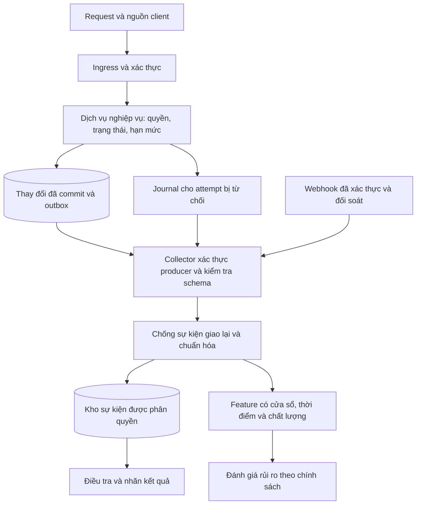

# Fraud signal collection: thu thập tín hiệu gian lận từ luồng nghiệp vụ

## 1. Mục tiêu và phạm vi

Fraud signal collection là quá trình thu thập những quan sát có cấu trúc để nhận diện và điều tra hành vi có khả năng gây gian lận. Dữ liệu cần mô tả được người thực hiện, hành động, đối tượng, ngữ cảnh nghiệp vụ, kết quả và độ tin cậy của từng nguồn.

Bài học thuộc chương **Fraud Detection** của module `SECURITY_APPLICATION_SECURITY_BUSINESS_LOGIC_SECURITY`. Phạm vi là thu thập tín hiệu liên quan đến bỏ qua phê duyệt, sửa giá, thao tác sai quyền, gửi yêu cầu trùng và lạm dụng lợi ích của sản phẩm. Các tín hiệu được gắn với business invariants, state machine, quyền theo đối tượng, transaction và idempotency.

Sau bài học, người học có thể:

- Chuyển một giả thuyết lạm dụng nghiệp vụ thành danh mục dữ liệu cần thu thập.
- Phân biệt dữ liệu do client khai báo với sự kiện đã được backend xác nhận.
- Thiết kế schema, định danh và nguồn gốc dữ liệu phục vụ liên kết sự kiện.
- Ghi đúng các lượt thử, thay đổi đã commit và kết quả bên ngoài mà không đếm trùng.
- Xử lý sự kiện đến muộn, dữ liệu thiếu và lỗi pipeline.
- Hạn chế dữ liệu nhạy cảm và kiểm thử khả năng làm sai lệch tín hiệu.

Các tên sự kiện, mã định danh, cửa sổ thời gian và số liệu trong bài là ví dụ thiết kế. Chúng cần được điều chỉnh theo sản phẩm; không phải ngưỡng phát hiện gian lận dùng chung.

## 2. Phân biệt sự kiện, tín hiệu, feature, quyết định và nhãn

Nếu gọi mọi bản ghi bất thường là “gian lận”, hệ thống sẽ khó giải thích quyết định và khó đánh giá sai sót. Cần phân biệt các khái niệm:

| Khái niệm | Ý nghĩa | Ví dụ |
| --- | --- | --- |
| Sự kiện quan sát | Một việc được nguồn dữ liệu ghi nhận | Backend từ chối một yêu cầu hoàn vì vượt hạn mức |
| Tín hiệu | Quan sát có thể có ích khi đánh giá rủi ro | Nhiều lượt bị từ chối do vượt hạn mức |
| Feature | Đại lượng được tính theo định nghĩa cụ thể | Số attempt bị từ chối của một tài khoản trong 15 phút |
| Quyết định | Kết quả của chính sách hoặc bộ đánh giá | Yêu cầu xác minh thêm hoặc chuyển người xem xét |
| Nhãn kết quả | Kết luận có nguồn và trạng thái riêng | Hồ sơ đã được điều tra, xác nhận hoặc bác bỏ nghi ngờ |

Một IP được nhiều tài khoản sử dụng có thể đến từ mạng công ty hoặc mạng di động. Một yêu cầu gửi lại có thể do mất kết nối. Các quan sát đó có giá trị khi kết hợp ngữ cảnh, nhưng chưa chứng minh một cá nhân đã gian lận.

Ngược lại, một bất biến chắc chắn như “không hoàn vượt số tiền được phép” phải được backend thực thi ngay cả khi chưa có tín hiệu đáng ngờ. Thu thập dữ liệu hỗ trợ đánh giá rủi ro và điều tra; nó không thay thế kiểm tra quyền, hạn mức hoặc trạng thái.

## 3. Bắt đầu từ giả thuyết lạm dụng nghiệp vụ

Trước khi thêm log, cần xác định hành vi muốn quan sát và quyết định nào có thể sử dụng dữ liệu đó. Việc ghi toàn bộ request dễ tạo nhiều dữ liệu nhạy cảm mà vẫn thiếu ngữ cảnh nghiệp vụ.

| Giả thuyết lạm dụng | Sự kiện và dữ liệu cần thiết | Điều phải phân biệt |
| --- | --- | --- |
| Bỏ qua bước duyệt | Hành động yêu cầu, trạng thái server, phiên bản đề nghị, kết quả kiểm tra duyệt | Gọi sai thứ tự với đề nghị hợp lệ đang chờ |
| Sửa giá hoặc lợi ích | Giá client khai, giá server tính, phiên bản chính sách, mã lý do từ chối | Giá hiển thị cũ với giá bị cố ý thay đổi |
| Thao tác sai quyền | Chủ thể đã xác thực, phạm vi tenant được phép, hành động, kết quả cấp quyền | Mã đối tượng do client gửi với đối tượng đã được phép truy cập |
| Gửi lại để nhận lợi ích nhiều lần | Attempt, command, nghĩa vụ nghiệp vụ, kết quả idempotency | Retry mạng, sự kiện giao lại và giao dịch mới |
| Nhiều tài khoản nhận cùng ưu đãi | Lượt nhận lợi ích, chiến dịch, các liên kết có nguồn tin cậy | Một người dùng nhiều tài khoản với nhiều người dùng chung mạng |
| Lạm dụng công cụ nội bộ | Nhân viên thực tế, workload, grant, phê duyệt, đối tượng, kết quả | Người khởi tạo với tài khoản dịch vụ thực thi |

[OWASP API6:2023](https://api-security.owasp.org/editions/2023/en/0xa6-unrestricted-access-to-sensitive-business-flows/) mô tả rủi ro khi các luồng nhạy cảm bị khai thác quá mức, kể cả qua thao tác kỹ thuật hợp lệ. Vì vậy, danh mục tín hiệu cần bám vào giá trị và quy tắc của luồng, thay vì chỉ đếm lỗi HTTP hoặc mẫu đầu vào độc hại.

Với từng giả thuyết, hãy ghi rõ chủ sở hữu dữ liệu, nguồn phát sinh, mức độ quan trọng, thời hạn cần dữ liệu và hậu quả nếu dữ liệu thiếu. Nếu một trường không phục vụ giả thuyết hoặc việc điều tra đã xác định, cần xem xét có thật sự cần thu thập hay không.

## 4. Nguồn tín hiệu và mức tin cậy

### 4.1. Ghi nguồn gốc theo từng nhóm trường

Một sự kiện do backend phát vẫn có thể chứa giá trị do client khai. Xác thực producer không biến toàn bộ nội dung thành dữ kiện đã được chứng minh.

| Nguồn | Ví dụ | Mức bảo đảm và giới hạn |
| --- | --- | --- |
| Ngữ cảnh xác thực đã kiểm tra | Actor, workload, phiên xác thực nội bộ | Thể hiện danh tính mà hệ thống đã xác thực; vẫn có khả năng tài khoản bị chiếm |
| Dịch vụ nghiệp vụ | Trạng thái, giá server tính, hạn mức, kết quả kiểm tra | Có thẩm quyền trong miền tương ứng tại thời điểm quan sát |
| Database hoặc sổ giao dịch | Command, reservation, kết quả đã commit | Phải gắn đúng phiên bản hoặc thời điểm đọc |
| Ingress được kiểm soát | Địa chỉ nguồn quan sát, route, thời điểm nhận | Phụ thuộc cấu hình chuỗi proxy và điểm kết thúc kết nối |
| Client | Device ID, user agent, thao tác giao diện, múi giờ | Có thể giả mạo, bỏ gửi hoặc phát lại |
| Nhà cung cấp bên ngoài | Kết quả giao dịch, tham chiếu phương thức thanh toán | Cần xác thực nguồn, chống phát lại và hiểu ngữ nghĩa dữ liệu |
| Nhóm điều tra | Nhãn hồ sơ, bằng chứng, lý do kết luận | Có quy trình, thời điểm và khả năng sửa kết luận |

Một webhook có chữ ký hợp lệ giúp chứng minh nguồn và tính toàn vẹn theo cơ chế của nhà cung cấp. Nó không tự chứng minh người dùng là chủ thẻ hoặc một giao dịch chắc chắn không có gian lận.

OWASP lưu ý rằng dữ liệu từ vùng tin cậy khác có thể bị thiếu, sửa, giả mạo hoặc phát lại trong [Logging Cheat Sheet](https://cheatsheetseries.owasp.org/cheatsheets/Logging_Cheat_Sheet.html). Thiết kế bên dưới sử dụng nguồn gốc dữ liệu để giữ rõ các giới hạn đó.

### 4.2. IP và thông tin thiết bị

Địa chỉ nguồn phải được lấy tại điểm quan sát đáng tin cậy. Nếu dùng header chuyển tiếp qua proxy, chỉ tin các proxy đã cấu hình và áp dụng quy tắc phân tích chuỗi nhất quán. Không coi một giá trị `X-Forwarded-For` tùy ý từ Internet là IP đã xác minh.

Một device ID do trình duyệt gửi là mã liên kết do client cung cấp. Người dùng có thể xóa dữ liệu trình duyệt; kẻ tấn công cũng có thể tạo nhiều mã khác nhau. Device fingerprint có thể thay đổi, va chạm hoặc chịu ảnh hưởng bởi trình duyệt và thiết bị dùng chung. Cần ghi phiên bản phương pháp và độ bảo đảm phù hợp.

Nếu dịch vụ làm giàu dữ liệu suy ra vị trí từ IP, kết quả đó là suy luận có nguồn và thời điểm riêng. Nó không tương đương vị trí vật lý đã được xác minh của người dùng.

### 4.3. Phạm vi tenant phải xuất phát từ kiểm tra quyền

`tenantId` dùng để phân vùng dữ liệu không được lấy trực tiếp từ header chưa kiểm tra. Backend xác lập tenant qua ngữ cảnh đã xác thực, route đã được ánh xạ tin cậy và quan hệ đối tượng được phép.

Khi người dùng ở tenant A thử truy cập tài nguyên ngoài quyền, sự kiện từ chối không nên làm lộ chủ sở hữu hay dữ liệu của tenant B. Có thể ghi tham chiếu yêu cầu đã được bảo vệ và mã lý do chung, cùng phạm vi đã được phép của actor.

Nếu chưa xác định được tenant, đánh dấu phạm vi chưa phân giải. Không gán một tenant mặc định rồi để sự kiện đi vào kho dữ liệu khách hàng đó.

## 5. Ngữ nghĩa sự kiện và các định danh cần tách

### 5.1. Đặt tên theo điều đã xảy ra

Một danh mục sự kiện minh họa cho hoàn tiền:

| Sự kiện | Điều được khẳng định |
| --- | --- |
| `refund.attempt.observed` | Backend đã xử lý một lượt thử; outcome chỉ rõ kết quả |
| `refund.command.submitted` | Một đề nghị hoàn mới đã commit vào trạng thái chờ xem xét |
| `refund.approval.recorded` | Quyết định duyệt hoặc từ chối đã được lưu |
| `refund.execution.accepted` | Hệ thống đã chấp nhận một thực thi hợp lệ |
| `refund.provider.result.verified` | Một kết quả từ nhà cung cấp đã được xác thực và đối chiếu |
| `refund.succeeded` | Nghiệp vụ đã ghi nhận hoàn thành công theo tiêu chí đã định nghĩa |

`submitted` chưa có nghĩa được duyệt; `accepted` chưa có nghĩa nhà cung cấp đã xử lý xong. Mã HTTP 200 hoặc 202 không đủ để suy ra một khoản tiền đã được hoàn.

Outcome của attempt có thể là `ACCEPTED`, `REJECTED`, `IDEMPOTENT_REPLAY` hoặc `SYSTEM_ERROR`, với định nghĩa rõ ràng. Lỗi hạ tầng không nên bị đổi thành từ chối nghiệp vụ vì hai trường hợp tạo tín hiệu khác nhau.

### 5.2. Không dùng một ID cho mọi mục đích

| Định danh | Đơn vị biểu diễn | Quy tắc quan trọng |
| --- | --- | --- |
| `eventId` | Một bản ghi sự kiện | Giữ nguyên khi broker giao lại cùng sự kiện |
| `requestId` | Một request đã được server tiếp nhận | Không tin giá trị client gửi nếu dùng cho mục đích bảo mật |
| `attemptId` | Một lượt xử lý nghiệp vụ tại biên đã định nghĩa | Retry request mới thường là attempt mới |
| `commandId` | Một lệnh hoặc đề nghị nghiệp vụ | Giữ ổn định khi gửi lại cùng ý định hợp lệ |
| `obligationId` | Một quyền lợi hoặc nghĩa vụ cần thực hiện | Giúp ngăn nhiều command tiêu thụ cùng một nghĩa vụ |
| `executionId` | Một thực thi có hiệu ứng cần theo dõi | Liên kết với nhà cung cấp và đối soát |
| `correlationId` | Một nhóm hoạt động liên quan | Hữu ích cho truy vết; không phải bằng chứng cấp quyền |
| `aggregateVersion` | Phiên bản của đối tượng nghiệp vụ | Chỉ có thứ tự trong phạm vi đối tượng được định nghĩa |

Một client gửi ba lần cùng yêu cầu có thể tạo ba attempt nhưng chỉ một command. Broker giao cùng sự kiện ba lần vẫn là một event. Một command có nhiều trạng thái trong thời gian dài cũng không trở thành nhiều giao dịch thành công.

Khóa idempotency nguyên bản không nhất thiết cần được đưa vào dữ liệu phân tích. Có thể dùng mã command nội bộ hoặc một tham chiếu được bảo vệ, đủ để liên kết mà không sao chép thông tin không cần thiết.

## 6. Schema sự kiện có ngữ cảnh nghiệp vụ

### 6.1. Envelope và trường theo loại sự kiện

Một envelope nên có phiên bản schema, loại sự kiện, producer, thời điểm, phạm vi, định danh liên kết và phân loại dữ liệu. Các trường nghiệp vụ được định nghĩa riêng cho từng loại; không nên tạo một bản đồ tùy ý chứa toàn bộ request.

Ví dụ giả lập dưới đây ghi nhận một lượt đề nghị hoàn bị từ chối. Số tiền được biểu diễn bằng số nguyên theo đơn vị nhỏ nhất của tiền tệ; trong ví dụ VND, đơn vị đó là một đồng.

```json
{
  "schemaVersion": 1,
  "eventId": "EVT-932",
  "eventType": "refund.attempt.observed",
  "producer": {
    "service": "refund-service",
    "sourceKind": "APPLICATION_SERVER"
  },
  "occurredAt": "2026-11-22T10:00:00.120Z",
  "observedAt": "2026-11-22T10:00:00.100Z",
  "ingestedAt": "2026-11-22T10:00:00.480Z",
  "tenantId": "TENANT-A",
  "actor": {
    "accountRef": "ACCOUNT-61",
    "identitySource": "VERIFIED_AUTH_CONTEXT"
  },
  "requestId": "REQ-212",
  "attemptId": "ATT-212",
  "correlationId": "CORR-401",
  "commandId": null,
  "target": {
    "paymentRef": "PAY-481"
  },
  "requestClaim": {
    "requestedAmountMinor": 800000,
    "currency": "VND"
  },
  "serverSnapshot": {
    "snapshotVersion": 25,
    "capturedAmountMinor": 1200000,
    "confirmedRefundAmountMinor": 300000,
    "activeReservationAmountMinor": 200000,
    "remainingAmountMinor": 700000,
    "currency": "VND"
  },
  "network": {
    "sourceIpRef": "IPREF-72",
    "source": "TRUSTED_INGRESS",
    "keyVersion": "fraud-link-key-3"
  },
  "clientSignals": {
    "deviceRef": "DEVREF-12",
    "assurance": "CLIENT_CLAIM"
  },
  "outcome": "REJECTED",
  "reasonCode": "REFUND_LIMIT_EXCEEDED",
  "businessPolicyVersion": "refund-policy-7"
}
```

`requestClaim` ghi điều đã được yêu cầu, không khẳng định số tiền đó hợp lệ. `serverSnapshot` là các giá trị nhất quán mà backend dùng tại thời điểm kiểm tra. Hạn mức còn lại là `1.200.000 - 300.000 - 200.000 = 700.000 VND`, thấp hơn khoản đề nghị 800.000 VND.

`commandId` là null vì chưa tạo đề nghị mới. `snapshotVersion` chỉ dùng được nếu mô hình dữ liệu thực sự cung cấp phiên bản đại diện cho toàn bộ snapshot; nếu không có, phải dùng cơ chế snapshot nhất quán và metadata phù hợp thay vì tạo một số phiên bản giả.

Trong ví dụ, collector bổ sung `ingestedAt` sau khi nhận. Producer không tự quyết định thời điểm tiếp nhận của collector. Các mã IP và thiết bị là giá trị minh họa, không phải IP hoặc thông tin thiết bị thật.

### 6.2. Quy tắc schema

Hợp đồng sự kiện cần quy định:

- Trường bắt buộc, kiểu dữ liệu, giới hạn độ dài và tập giá trị cho phép.
- Nguồn gốc của từng nhóm trường, cách biểu diễn unknown và trường không áp dụng.
- Tiền tệ, đơn vị tiền, quy tắc chuẩn hóa và xử lý tràn số.
- Ý nghĩa trạng thái, outcome và mã lý do; không dùng thông báo lỗi tự do làm mã phân loại.
- Quy tắc tương thích khi thêm trường hoặc thay đổi ngữ nghĩa.
- Chủ sở hữu schema, phiên bản và hành vi với sự kiện không hợp lệ.

Không dùng `0`, chuỗi rỗng hoặc `false` để biểu diễn đồng thời cả “không có”, “không thu được” và “không áp dụng”. Một hệ thống không nhìn thấy dữ liệu thiết bị phải giữ trạng thái thiếu dữ liệu, thay vì tự kết luận thiết bị có độ rủi ro thấp.

## 7. Đặt điểm thu thập gần quyết định nghiệp vụ

### 7.1. Pipeline minh họa



Ingress giúp quan sát lưu lượng, nhưng thường không biết giá server tính, phê duyệt đã gắn với phiên bản nào hoặc transaction có commit hay không. Dịch vụ nghiệp vụ cần phát các sự kiện có ngữ nghĩa đó.

[OWASP Business Logic Security Cheat Sheet](https://cheatsheetseries.owasp.org/cheatsheets/Business_Logic_Security_Cheat_Sheet.html) khuyến nghị ghi nhận chủ thể, tài nguyên, hành động, kết quả và ngữ cảnh nghiệp vụ cho thao tác cấp giá trị, đổi quyền hoặc dịch chuyển tiền. Trong thiết kế này, các trường đó được cụ thể hóa thành hợp đồng sự kiện.

### 7.2. Thay đổi thành công đi cùng transaction

Nếu một đề nghị đã commit nhưng sự kiện bị mất, hệ thống phân tích có thể không nhìn thấy hoạt động quan trọng. Nếu sự kiện được phát trước commit rồi transaction rollback, hệ thống có thể đếm một hoạt động chưa tồn tại.

Transactional outbox giải quyết phần liên kết giữa thay đổi nội bộ và ý định phát sự kiện: cùng transaction lưu bản ghi nghiệp vụ và outbox. Worker gửi outbox sau đó, có retry và theo dõi tồn đọng.

Không cần giữ transaction trong lúc gọi collector hoặc broker từ xa. Outbox cũng không tự bảo đảm consumer chỉ xử lý đúng một lần; lớp nhận vẫn cần xử lý giao lại.

### 7.3. Lượt bị từ chối cần sống ngoài transaction đã rollback

Một phép kiểm tra thất bại có thể là tín hiệu quan trọng. Nếu sự kiện từ chối nằm trong chính transaction bị rollback, nó cũng bị xóa.

Mã giả Java dưới đây minh họa điểm thu thập cho việc **gửi đề nghị hoàn**, chưa phải thực thi hoàn tiền. Các repository, cơ chế khóa, kiểm tra quyền và journal cần triển khai thực tế; đoạn mã không chạy độc lập.

```java
RefundReceipt submitRefund(
        RefundRequest input,
        TrustedRequestContext requestContext) {

    try {
        return transactions.required(() -> {
            PaymentContext payment = repository.loadAuthorizedAndLock(
                    requestContext.principal(), input.paymentId());
            RefundIntent intent = canonicalizeOnServer(payment, input);

            RefundCommand previous = commands.findByScopedRequestKey(
                    payment, input.requestKey());
            if (previous != null) {
                previous.requireSameIntent(intent);
                outbox.append(events.attemptObserved(
                        requestContext, previous, IDEMPOTENT_REPLAY));
                return previous.receipt();
            }

            businessRules.requireSubmissionAllowed(payment, intent);
            RefundCommand command = commands.createPendingReview(
                    payment, intent, input.requestKey());

            outbox.append(events.commandSubmitted(command, requestContext));
            outbox.append(events.attemptObserved(
                    requestContext, command, ACCEPTED));
            return command.receipt();
        });
    } catch (ExpectedDecisionRejection rejection) {
        // Tại đây transaction nghiệp vụ đã rollback.
        // Chỉ lấy mã lý do và snapshot được phép đưa vào sự kiện.
        attemptJournal.appendDurablyOrApplyFailurePolicy(
                events.safeRejectedAttempt(requestContext, rejection));
        throw rejection;
    }
}
```

Sự kiện command mới chỉ phát khi tạo đề nghị mới. Một lần gửi lại hợp lệ có thể tạo attempt với outcome `IDEMPOTENT_REPLAY`, nhưng không phát thêm `command.submitted`.

Việc kiểm tra hạn mức lúc gửi đề nghị không đủ để bảo vệ thực thi về sau. Khi duyệt và thực thi, backend phải kiểm tra lại quyền, trạng thái, hạn mức và phê duyệt gắn với dữ liệu hiện tại theo quy tắc nghiệp vụ.

`safeRejectedAttempt` phải dùng dữ liệu đã được phép ghi, đặc biệt khi nguyên nhân từ chối là quyền truy cập. Không đưa toàn bộ đối tượng, request, stack trace hoặc thông báo ngoại lệ chứa bí mật vào sự kiện. Các lỗi hạ tầng và request không phân tích được cần điểm thu thập tương ứng tại biên xử lý, với phân loại riêng.

Journal từ chối cũng có chính sách lỗi được xác định trước. Nếu không ghi được, hệ thống phải có tín hiệu chất lượng và hành vi phù hợp với mức quan trọng; không âm thầm giả định dữ liệu vẫn đầy đủ.

## 8. Chống đếm trùng và phân biệt đơn vị đo

### 8.1. Giao lại cùng event

Broker hoặc outbox có thể giao cùng sự kiện nhiều lần. Collector hoặc consumer cần định danh producer đã xác thực và `eventId` ổn định, rồi xử lý idempotent theo phạm vi được định nghĩa.

Một mô hình có thể dùng khóa duy nhất `(producer_id, event_id)`. Producer không được tùy ý phát sự kiện dưới danh tính dịch vụ khác. Nếu cùng khóa có nội dung khác, cần ghi nhận xung đột và đưa vào xử lý kiểm tra; không ghi đè âm thầm.

Đánh dấu đã xử lý và cập nhật bộ đếm phải có cơ chế nhất quán. Nếu cập nhật bộ đếm xong nhưng chưa lưu dấu chống trùng, sự kiện giao lại sẽ bị đếm thêm. Nếu lưu dấu trước rồi mất cập nhật, dữ liệu sẽ bị thiếu.

Thời hạn giữ dữ liệu chống trùng cần tương thích với khả năng replay và độ trễ vận hành. Với replay lịch sử ngoài khoảng đó, dùng quy trình dựng lại có namespace hoặc phiên bản tính toán riêng để tránh cộng vào feature đang chạy một lần nữa.

### 8.2. Retry request và command khác nhau

| Hiện tượng | Đếm attempt | Đếm command mới | Đếm hoàn thành công |
| --- | --- | --- | --- |
| Một request tạo đề nghị mới | Tăng một attempt | Tăng một command | Chưa tăng |
| Request mới gửi lại cùng đề nghị hợp lệ | Tăng một attempt với outcome replay | Không tăng | Không tự tăng |
| Broker giao lại cùng event | Không tăng thêm do chống trùng event | Không tăng | Không tăng |
| Callback thành công được xác minh và ghi nhận lần đầu | Theo hợp đồng sự kiện callback riêng | Không tạo lại command | Tăng theo execution đã xác nhận |
| Callback thành công được phát lại | Không coi là giao dịch mới | Không tăng | Không tăng lần nữa |

Một client đổi khóa idempotency có thể tạo ý định yêu cầu khác, nhưng vẫn phải chịu kiểm tra nghĩa vụ và bất biến nghiệp vụ. Thu thập tín hiệu cần giữ liên kết command–nghĩa vụ để phát hiện hoặc điều tra những trường hợp nhiều command tranh cùng một quyền lợi.

Không đặt tên feature chung chung là `refund_count` nếu có thể bị hiểu thành số attempt, số đề nghị, số execution hoặc số khoản hoàn thành công. Đơn vị đo là một phần của hợp đồng dữ liệu.

## 9. Thời gian, thứ tự và dữ liệu đến muộn

### 9.1. Các mốc thời gian có ý nghĩa khác nhau

- `observedAt`: thời điểm server bắt đầu quan sát hoặc tiếp nhận hành động theo định nghĩa của loại sự kiện.
- `occurredAt`: thời điểm sự kiện nghiệp vụ hoặc quyết định được ghi nhận tại nguồn có thẩm quyền.
- `ingestedAt`: thời điểm collector nhận sự kiện.
- `availableAt`: thời điểm dữ liệu hoặc feature thực sự sẵn sàng cho bộ ra quyết định.

Thời gian do client gửi có thể được giữ như một claim riêng nếu cần, nhưng không thay thế thời gian server. Với nguồn bên ngoài, lưu thêm thời điểm do nhà cung cấp khai và thời điểm hệ thống nhận, kèm trạng thái xác thực.

Cần đồng bộ và theo dõi sai lệch đồng hồ giữa dịch vụ. Một timestamp đơn lẻ không tạo được thứ tự tổng thể đáng tin cậy cho mọi đối tượng. Phiên bản aggregate giúp sắp xếp trong phạm vi đối tượng; correlation và causation giúp giải thích quan hệ giữa các sự kiện.

### 9.2. Định nghĩa cửa sổ rõ ràng

Một feature minh họa:

```text
refund_limit_rejected_attempts_15m(account, tenant, t)
  = số attemptId khác nhau có:
      eventType = refund.attempt.observed
      outcome = REJECTED
      reasonCode = REFUND_LIMIT_EXCEEDED
      occurredAt thuộc khoảng (t - 15 phút, t]
```

Feature này đếm lượt thử riêng biệt; nó không đếm số command thành công. Trước khi tính, dữ liệu giao lại cùng event phải được xử lý chống trùng.

Thiết kế còn cần quy định mức đến muộn chấp nhận được, cách cập nhật cửa sổ khi sự kiện đến muộn và cách biểu diễn cửa sổ chưa đầy đủ. Có thể có kết quả tạm thời rồi hiệu chỉnh; người dùng feature cần biết trạng thái đó.

Một sự kiện đến sau cửa sổ phục vụ quyết định vẫn có thể hữu ích cho điều tra hoặc tính lại lịch sử. Không tự sửa sự kiện gốc để giả vờ nó đã được biết sớm hơn.

### 9.3. Tránh dùng dữ liệu tương lai khi đánh giá lại

Khi kiểm tra hiệu quả phát hiện trong quá khứ, chỉ sử dụng dữ liệu đã sẵn sàng tại thời điểm quyết định. Kết quả điều tra hoặc phản hồi thanh toán đến nhiều ngày sau không thể được xem như feature đã có ngay lúc đặt hàng.

Vì vậy, cần lưu thời điểm dữ liệu được biết và phiên bản feature, bên cạnh thời điểm sự kiện thực tế. Đây là yêu cầu đối với khả năng tái dựng quyết định, kể cả khi hệ thống chỉ dùng rule và chưa có mô hình học máy.

## 10. Hợp đồng feature và chất lượng liên kết

Thu thập tín hiệu cần bảo đảm dữ liệu đủ để tạo feature, nhưng không nên gộp luôn kết luận gian lận vào trường đầu vào. Một hợp đồng feature nên chỉ rõ đơn vị đo, nguồn, phạm vi, cửa sổ, độ mới và hành vi khi thiếu.

| Feature minh họa | Đơn vị và nguồn | Giới hạn cần ghi |
| --- | --- | --- |
| Tuổi tài khoản | Chênh lệch từ thời điểm tạo do dịch vụ tài khoản xác nhận | Không lấy ngày tạo do client khai |
| Lượt sai thứ tự trong 15 phút | Attempt bị từ chối với mã chuyển trạng thái không hợp lệ | Phân biệt lỗi tích hợp hoặc giao diện với lạm dụng |
| Số accountRef liên kết với deviceRef trong 10 phút | Số accountRef khác nhau, trong cùng phạm vi được phép | Device claim có thể bị đổi hoặc dùng chung |
| Số nghĩa vụ hoàn có nhiều command | Quan hệ command–obligation từ dịch vụ nghiệp vụ | Cần định nghĩa thế nào là cùng một nghĩa vụ |
| Tần suất sửa đề nghị sau duyệt | Sự kiện đổi phiên bản và mất hiệu lực duyệt | Một thay đổi có thể là sửa lỗi hợp lệ |
| Độ mới của trạng thái thanh toán | Khoảng thời gian từ lần xác minh gần nhất | Kết quả cũ hoặc chưa rõ phải có cờ chất lượng |

Không dùng IP, thiết bị hoặc phương thức thanh toán làm định danh con người tuyệt đối. Một liên kết nên có loại quan hệ, nguồn, thời điểm bắt đầu/kết thúc hoặc thời điểm quan sát và độ bảo đảm phù hợp.

Nếu dùng dấu vân tay phương thức thanh toán do nhà cung cấp cung cấp, cần hiểu phạm vi so sánh của họ. Cùng một phương thức có thể được biểu diễn khác giữa nhà cung cấp hoặc phạm vi dịch vụ; một chuỗi token có thể là bí mật dùng để thanh toán và không nên bị coi như mã phân tích an toàn.

Thiếu dữ liệu khác với không có hành vi bất thường. Feature nên có trạng thái như `AVAILABLE`, `MISSING`, `STALE`, `PARTIAL` hoặc `NOT_APPLICABLE`, cùng thời điểm cập nhật. Nếu pipeline bị chậm, bộ đánh giá phải nhận biết chất lượng đó thay vì sử dụng mặc định số 0.

Việc nhiều tín hiệu cùng xuất hiện cũng cần diễn giải theo nguồn. IP và vị trí suy ra từ chính IP không phải hai bằng chứng độc lập. Các account chung mạng công ty hoặc gia đình là tình huống cần đưa vào kiểm thử sai dương.

## 11. Bảo vệ dữ liệu và khả năng liên kết

### 11.1. Chỉ thu dữ liệu phục vụ mục đích đã xác định

Trường nhạy cảm như mật khẩu, OTP, cookie phiên, access token, khóa bí mật, CVV và thông tin thanh toán nguyên bản không nên đi vào pipeline tín hiệu. Không ghi toàn bộ header hoặc request body chỉ để phòng trường hợp sau này cần.

Đối với thông tin liên hệ, IP hoặc thiết bị, cần xác định mục đích, mức chi tiết, quyền truy cập và thời hạn giữ. Những nhu cầu điều tra cần dữ liệu chi tiết hơn có thể được xử lý bằng kho bằng chứng tách biệt, có quyền truy cập và nhật ký sử dụng riêng.

Dữ liệu trong sự kiện ví dụ được thiết kế bằng tham chiếu nội bộ và giá trị giả lập. Các số tiền vẫn có thể là dữ liệu kinh doanh nhạy cảm, nên không được xem toàn bộ sự kiện là công khai chỉ vì không chứa tên người dùng.

### 11.2. Tham chiếu có khóa và phạm vi rõ ràng

Nếu cần liên kết một giá trị nhạy cảm mà không lưu nguyên bản trong feature store, có thể dùng HMAC với khóa được bảo vệ. Cách mã hóa đầu vào phải chuẩn hóa và không mơ hồ, ví dụ:

```text
reference = HMAC(
  K_version,
  Encode([purpose, tenantId, identifierType, normalizedValue])
)
```

`Encode` phải phân tách kiểu và độ dài rõ ràng; không nối chuỗi tùy ý dễ tạo cùng biểu diễn cho các bộ giá trị khác nhau. Chuẩn hóa phải phù hợp từng loại dữ liệu, tránh biến hai giá trị khác nhau thành một liên kết sai.

Hash thường của dữ liệu có không gian nhỏ như số điện thoại có thể bị dò bằng từ điển. HMAC giảm khả năng đó khi khóa được giữ bí mật, nhưng vẫn tạo dữ liệu có thể liên kết. Không gọi dữ liệu này là ẩn danh hoàn toàn.

`purpose` và tenant giúp giới hạn liên kết theo mục đích, phạm vi. Nếu có nhu cầu phát hiện xuyên tenant, phải thiết kế một phạm vi phân tích riêng được cho phép, thay vì bỏ tenant khỏi khóa và vô tình mở dữ liệu giữa khách hàng.

Cần có `keyVersion`, phân quyền sử dụng khóa và kế hoạch thay khóa. Khi thay khóa, cùng giá trị có thể sinh tham chiếu mới; nếu không xử lý chuyển tiếp, feature theo cửa sổ sẽ bị đứt liên kết. Thời gian chuyển tiếp, khả năng liên kết và yêu cầu xóa phải được thiết kế cùng nhau.

### 11.3. Vòng đời dữ liệu

Quy định thời hạn riêng cho sự kiện gốc, feature, snapshot phục vụ quyết định, nhãn điều tra và bản xuất dữ liệu. Xử lý hết hạn hoặc yêu cầu xóa phải tính đến cache, bản sao phân tích, dữ liệu dẫn xuất và bản sao lưu theo cơ chế quản lý của hệ thống.

Mã hóa khi truyền và lưu, phân quyền theo chức năng và tenant, ghi nhận truy cập, kiểm soát export và bảo vệ trước sửa/xóa trái phép là các phần của thiết kế pipeline. Quyền đọc feature tổng hợp không tự bao gồm quyền đọc bằng chứng gốc hoặc truy ngược tham chiếu.

## 12. Độ tin cậy vận hành và chống làm nhiễu dữ liệu

### 12.1. Phân hạng mức quan trọng

| Loại dữ liệu | Cách thu thập minh họa | Hành vi khi lỗi |
| --- | --- | --- |
| Sự kiện nghiệp vụ quan trọng đã commit | Outbox cùng transaction | Không commit thay đổi nếu không lưu được outbox bắt buộc trong thiết kế này |
| Attempt bị từ chối quan trọng | Journal riêng có khả năng lưu bền vững | Áp dụng chính sách lỗi đã định nghĩa và phát cảnh báo chất lượng |
| Click hoặc thời gian thao tác giao diện | Kênh telemetry riêng, mức tin cậy client | Có thể thiếu hoặc lấy mẫu nếu hợp đồng sử dụng chấp nhận |
| Kết quả bên ngoài | Xác thực, đối chiếu, lưu và chống phát lại | Giữ trạng thái chưa rõ và retry/đối soát theo hợp đồng nguồn |

Nếu collector tập trung ngừng nhưng outbox vẫn lưu được, có thể tiếp tục nghiệp vụ theo chính sách và đồng bộ sau. Nếu dữ liệu dùng cho quyết định trực tuyến đã quá cũ, cần biểu diễn độ mới và chọn phương án xử lý được xác định trước cho hành động đó.

Không mặc định bỏ mọi kiểm soát khi dịch vụ đánh giá rủi ro mất kết nối. Các bất biến quyền, trạng thái, tiền và chống trùng vẫn phải được thực thi tại dịch vụ nghiệp vụ.

### 12.2. Tấn công vào collector và feature store

Kẻ tấn công có thể gửi hàng loạt mã thiết bị, trường cực dài, event ID trùng, timestamp tương lai hoặc claim rằng một tài khoản khác đã thực hiện hành vi đáng ngờ. Vì vậy, cần:

- Xác thực producer và giới hạn loại sự kiện mỗi producer được phát.
- Tách sự kiện client khỏi sự kiện nghiệp vụ có thẩm quyền.
- Áp dụng schema, giới hạn kích thước, tập trường cho phép và xử lý an toàn khi hiển thị log.
- Giới hạn tốc độ và cardinality để tránh làm đầy bộ nhớ, kho lưu hoặc cửa sổ tính toán.
- Theo dõi sự kiện không hợp lệ, xung đột ID, sai lệch đồng hồ và thay đổi bất thường về lượng dữ liệu.
- Bảo vệ kênh nhận nhãn điều tra để người dùng không tự gắn nhãn xấu cho tài khoản khác.

Không loại bỏ toàn bộ một sự kiện bảo mật chỉ vì một trường tùy chọn lỗi nếu có thể giữ phần an toàn và đánh dấu trường lỗi. Ngược lại, sự kiện thiếu định danh hoặc nguồn bắt buộc không nên được đưa thẳng vào bộ đếm có thẩm quyền.

Client telemetry bị thiếu có thể là hành vi có chủ ý hoặc chỉ là chặn script, lỗi trình duyệt hay mất mạng. Giữ trạng thái thiếu và ngữ cảnh; không tự kết luận gian lận từ việc thiếu một nguồn dễ bị tác động.

### 12.3. Theo dõi chất lượng như một phần của tín hiệu

Các chỉ số hữu ích gồm:

- Độ trễ từ `occurredAt` đến `ingestedAt` và đến lúc feature sẵn sàng, theo từng nguồn.
- Số lượng, tuổi lớn nhất và tốc độ tăng của outbox chưa gửi.
- Tỷ lệ sự kiện thiếu trường bắt buộc, schema không hợp lệ hoặc nguồn chưa xác thực.
- Số event giao lại, số xung đột cùng ID khác nội dung và số sự kiện đến muộn.
- Tỷ lệ feature `MISSING`, `STALE` hoặc `PARTIAL`.
- Đối chiếu số command đã commit với số sự kiện command tương ứng, sau khoảng chờ phát tán đã định nghĩa.

Đối chiếu nên có cùng phạm vi tenant, nguồn, loại command và cửa sổ. Một khoảng chậm phát sự kiện chưa chắc là mất dữ liệu; cần phân biệt tồn đọng với thiếu vĩnh viễn.

Nếu phải lấy mẫu vì quá tải, phải ghi rõ nguồn và tỷ lệ lấy mẫu. Bộ đếm cần số chính xác không được âm thầm đọc dữ liệu đã lấy mẫu như dữ liệu đầy đủ. Các sự kiện quan trọng cho bất biến và điều tra cần chính sách ưu tiên riêng.

## 13. Ví dụ xuyên suốt: ba lượt gửi, một đề nghị

Giả sử khách hàng gửi một đề nghị hoàn hợp lệ. Phản hồi đầu tiên bị mất, nên ứng dụng gửi lại hai lần cùng ý định và khóa idempotency có phạm vi phù hợp.

**Lượt thứ nhất:** backend tạo command `RCMD-19` ở trạng thái chờ xem xét. Transaction commit một sự kiện `refund.command.submitted` và một `refund.attempt.observed` với outcome `ACCEPTED`.

**Lượt thứ hai và thứ ba:** backend nhận diện command đã có, kiểm tra nội dung cùng ý định và trả kết quả hiện tại. Mỗi lượt tạo một attempt mới với outcome `IDEMPOTENT_REPLAY`; không tạo command mới.

**Giao lại:** broker giao lại bản ghi `command.submitted` thêm hai lần. Ba lần nhận cùng event được xử lý thành một sự kiện nghiệp vụ duy nhất.

Kết quả quan sát:

| Đại lượng | Giá trị |
| --- | --- |
| Attempt được backend xử lý | 3 |
| Attempt có outcome replay | 2 |
| Command mới | 1 |
| Event `command.submitted` khác nhau | 1 |
| Khoản hoàn thành công tại thời điểm này | Chưa có kết quả thành công được xác nhận |

Nếu feature chỉ đếm số message nhận được từ broker, nó có thể báo sai nhiều đề nghị. Nếu chỉ đếm command, nó không nhìn thấy việc client phải retry. Giữ cả hai lớp với đơn vị rõ ràng giúp phân tích đúng.

Một tình huống khác là client đổi khóa để tạo nhiều command cho cùng nghĩa vụ. Khi đó, ràng buộc nghiệp vụ phải ngăn việc tiêu thụ quyền lợi lặp; dữ liệu command–obligation và các attempt bị từ chối giúp điều tra. Chỉ tăng điểm rủi ro mà vẫn cho phép trả tiền nhiều lần sẽ không bảo vệ được bất biến.

## 14. Nhãn kết quả và khả năng tái dựng quyết định

Nhãn điều tra cần tách khỏi sự kiện quan sát, có người hoặc hệ thống tạo, bằng chứng, thời điểm, phiên bản và trạng thái như đang xem xét, đã xác nhận hoặc đã sửa kết luận.

Một tranh chấp thanh toán không tự động đồng nghĩa gian lận đã được xác nhận. Một hồ sơ chưa bị khiếu nại cũng chưa chứng minh chắc chắn là hợp lệ. Các loại kết quả cần được định nghĩa theo quy trình của sản phẩm.

Nếu người xem xét kết luận chỉ dựa trên cảnh báo được tạo từ chính feature đó, dùng kết luận ấy làm sự thật độc lập có thể tạo vòng lặp thiên lệch. Cần lưu nguồn bằng chứng và phân biệt nhãn nghiệp vụ với quyết định tự động của hệ thống.

Để tái dựng một quyết định, nên giữ được phiên bản rule hoặc mô hình, feature đã sử dụng, thời điểm dữ liệu sẵn sàng, trạng thái chất lượng và tham chiếu sự kiện đầu vào theo chính sách lưu trữ. Việc này phục vụ giải thích và đánh giá sai dương/sai âm; không yêu cầu sao chép mọi dữ liệu gốc vào từng quyết định.

## 15. Kiểm thử thu thập tín hiệu và kế hoạch triển khai

Các kiểm thử cần dùng dữ liệu giả lập trong môi trường kiểm soát. Mục tiêu là chứng minh ngữ nghĩa và chất lượng dữ liệu, bên cạnh việc phát hiện một mẫu nghi ngờ.

| Tình huống kiểm thử | Kết quả cần chứng minh |
| --- | --- |
| Client gửi actor hoặc tenant giả | Actor và phạm vi có thẩm quyền không bị ghi đè |
| Giả `X-Forwarded-For` ngoài chuỗi proxy tin cậy | Không biến claim đó thành địa chỉ đã xác minh |
| Client tự gửi event `refund.succeeded` | Không được nhận dưới nguồn nghiệp vụ có thẩm quyền |
| Truy cập tài nguyên ngoài quyền | Có tín hiệu từ chối an toàn, không làm lộ dữ liệu tenant khác |
| Transaction tạo command rollback | Không có sự kiện khẳng định command đã commit |
| Từ chối nghiệp vụ làm rollback | Journal từ chối vẫn lưu theo hợp đồng riêng |
| Gửi lại cùng request hợp lệ | Có attempt replay, không tạo thêm command |
| Broker giao lại cùng event | Feature không tăng thêm do bản sao message |
| Cùng event ID khác nội dung | Có xung đột được theo dõi, không ghi đè âm thầm |
| Sự kiện đến muộn hoặc lệch đồng hồ | Đánh dấu chất lượng và xử lý cửa sổ theo hợp đồng |
| Thiếu device claim hoặc nguồn làm giàu dữ liệu | Feature biểu diễn thiếu dữ liệu, không mặc định rủi ro bằng 0 |
| Nhiều người dùng chung IP hoặc thiết bị | Giữ đúng quan hệ quan sát, không biến liên kết thành cùng một người |
| Trường quá dài hoặc có ký tự điều khiển | Không gây log injection, lỗi giao diện hay tăng tài nguyên vô hạn |
| Collector ngừng và phục hồi | Có tồn đọng được giám sát, phát lại an toàn và đối chiếu dữ liệu |
| Chuyển phiên bản khóa HMAC | Biết phạm vi liên kết còn giữ, bị đứt hoặc được chuyển tiếp |
| Xóa hoặc hết hạn dữ liệu | Các bản sao và feature được xử lý theo vòng đời đã định nghĩa |
| Kết quả điều tra đến sau nhiều ngày | Không lọt vào feature được xem là đã biết ở thời điểm quyết định cũ |
| Producer đổi schema | Consumer tương thích hoặc từ chối có kiểm soát, có tín hiệu vận hành |

Một trình tự triển khai thực tế:

1. Chọn một luồng có giá trị cần bảo vệ và viết các giả thuyết lạm dụng.
2. Định nghĩa sự kiện, định danh, nguồn gốc từng nhóm trường và dữ liệu cần loại bỏ.
3. Thu thập cả kết quả hợp lệ, từ chối và replay với ngữ nghĩa rõ ràng.
4. Bổ sung outbox, journal riêng, kiểm tra schema và cơ chế chống sự kiện giao lại.
5. Đối chiếu độ đầy đủ với dữ liệu nghiệp vụ trước khi dùng cho quyết định gây ảnh hưởng người dùng.
6. Theo dõi ở chế độ quan sát, đánh giá tình huống hợp lệ có biểu hiện tương tự và điều chỉnh chất lượng.
7. Kết nối feature với chính sách xử lý, quy trình điều tra và cách sửa nhãn kết quả.

Đầu ra cần đạt là một tập dữ liệu có thể giải thích nguồn, ngữ nghĩa, thời điểm và mức đầy đủ. Khi một tín hiệu tăng, người điều tra phải có khả năng xác định đó là nhiều lượt thử, nhiều ý định nghiệp vụ, hiệu ứng đã xảy ra hay chỉ là lỗi của pipeline.
