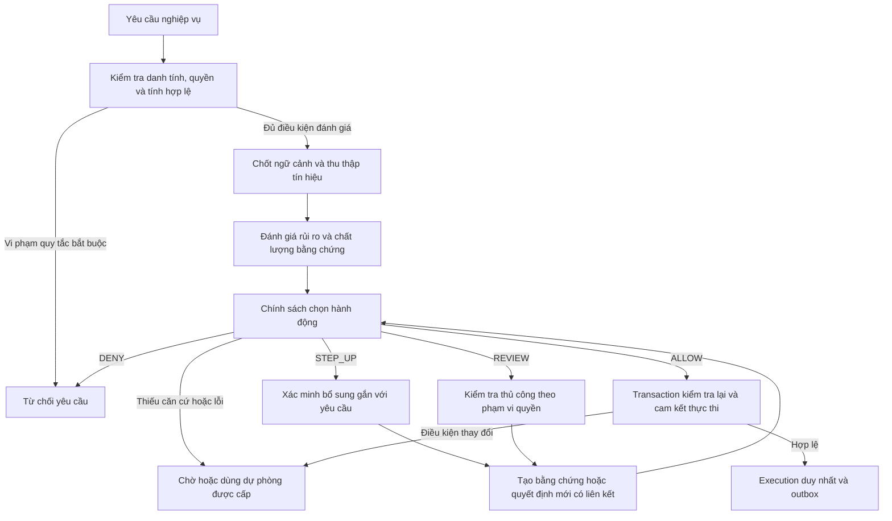

# Fraud decision confidence — Độ tin cậy của quyết định chống gian lận

## 1. Mục tiêu và phạm vi

Trong chương **Fraud Detection**, *fraud decision confidence* là mức độ có căn cứ để dùng một kết quả đánh giá gian lận cho một hành động cụ thể: cho phép tiếp tục, yêu cầu xác minh thêm, chờ kiểm tra hoặc từ chối.

Một hệ thống có thể trả về điểm rủi ro rất cao nhưng dùng dữ liệu cũ, thiếu tín hiệu hoặc chưa được đánh giá trên nhóm khách hàng hiện tại. Ngược lại, điểm rủi ro thấp cũng không cấp quyền bỏ qua phê duyệt, hoàn tiền vượt hạn mức hay thực hiện lại cùng giao dịch.

Bài học tập trung vào cách xây dựng và sử dụng độ tin cậy của quyết định trong bảo mật logic nghiệp vụ. Sau bài học, người học có thể:

- Phân biệt điểm rủi ro, xác suất đã hiệu chuẩn, chất lượng bằng chứng và độ tin cậy để hành động.
- Đánh giá ảnh hưởng của tỷ lệ gian lận nền, sai dương và sai âm.
- Thiết kế phản ứng phù hợp khi dữ liệu thiếu, mô hình không phù hợp hoặc kết quả chưa chắc chắn.
- Ràng buộc quyết định với đúng khách hàng, đối tượng, số tiền, trạng thái và phiên bản yêu cầu.
- Giữ transaction, idempotency và quyền theo đối tượng độc lập với kết quả chấm điểm.
- Theo dõi hiệu quả bằng nhãn có nguồn, có độ trễ và có phạm vi đánh giá rõ ràng.

Hệ thống trong bài có thể dùng luật, mô hình học máy hoặc kết hợp cả hai. Tính đúng đắn của quyết định phụ thuộc vào cả chuỗi từ thu thập tín hiệu đến thực thi, không chỉ thuật toán chấm điểm.

## 2. Bốn khái niệm dễ bị đánh đồng

| Khái niệm | Câu hỏi được trả lời | Giới hạn cần hiểu |
| --- | --- | --- |
| Điểm rủi ro — risk score | Yêu cầu này được xếp rủi ro cao hay thấp theo bộ chấm điểm? | Thang điểm không tự mang ý nghĩa xác suất |
| Xác suất gian lận đã hiệu chuẩn | Trên dữ liệu phù hợp, dự báo có khớp tương đối với tỷ lệ gian lận quan sát được không? | Không bảo đảm kết quả cho từng yêu cầu riêng lẻ |
| Chất lượng bằng chứng | Tín hiệu có đáng tin, đủ mới, đủ đầy và đúng đối tượng không? | Nhiều tín hiệu có thể cùng xuất phát từ một nguồn lỗi |
| Độ tin cậy để hành động | Với bằng chứng và sai số hiện có, hành động nào được chính sách cho phép? | Còn phụ thuộc hậu quả, quyền, bất biến và khả năng khôi phục |

### 2.1. Điểm 90/100 chưa phải xác suất 90%

Một rule engine có thể cộng điểm:

```text
Thiết bị mới:              +20
Nhiều yêu cầu trong phút:  +40
Địa chỉ mạng bất thường:   +30
Tổng:                      90
```

Con số 90 chỉ là tổng theo quy tắc minh họa. Muốn diễn giải thành xác suất, phải có phương pháp ánh xạ được đánh giá trên dữ liệu phù hợp.

Ngay cả một API đặt tên trường là `fraudProbability` cũng chưa đủ chứng minh chất lượng xác suất. Cần biết nhãn gian lận được định nghĩa thế nào, cửa sổ kết quả nào được dự báo, mô hình áp dụng cho nhóm nào và hiệu chuẩn còn hiệu lực hay không.

### 2.2. Điểm cao không đồng nghĩa với chắc chắn

Một mô hình có thể dự báo gần 1 khi gặp một loại yêu cầu chưa được huấn luyện hoặc một trường đầu vào bị sai. Mức cực đoan của đầu ra không tự phản ánh mức hiểu biết của mô hình.

Có thể phân biệt sự không chắc chắn do tín hiệu vốn mơ hồ với sự thiếu hiểu biết do dữ liệu ít hoặc khác phạm vi đã đánh giá. Không phải mọi mô hình đều cung cấp một ước lượng đáng tin cho hai loại này.

Nếu hệ thống dùng nhãn `HIGH_CONFIDENCE`, cần định nghĩa điều kiện đạt nhãn bằng bằng chứng kiểm chứng được. Không tạo nhãn đó chỉ bằng phép kiểm tra `score > 0.9`.

### 2.3. Một cấu trúc kết quả rõ nghĩa

Thay vì trả về một số `confidence` không có định nghĩa, có thể lưu:

```text
riskScore:                 giá trị xếp hạng theo phiên bản bộ chấm điểm
estimatedFraudProbability: có thể rỗng nếu chưa đủ căn cứ diễn giải
evidenceStatus:            SUFFICIENT / LIMITED / UNUSABLE
calibrationStatus:         SUPPORTED / STALE / UNSUPPORTED
cohortSupport:             SUPPORTED / UNKNOWN
recommendedAction:         ALLOW / STEP_UP / REVIEW / DENY / NO_DECISION
reasonCodes:               mã lý do nội bộ
evaluatedAt:               thời điểm đánh giá
validUntil:                hạn sử dụng theo chính sách
modelVersion:              phiên bản mô hình hoặc bộ luật
policyVersion:             phiên bản chính sách hành động
contextFingerprint:        ràng buộc với ngữ cảnh được đánh giá
```

Đây là mô hình minh họa, không phải chuẩn bắt buộc. Mục đích là giữ riêng các đại lượng có ý nghĩa khác nhau. Giá trị xác suất chưa có thì để thiếu rõ ràng; không thay bằng 0.

## 3. Tình huống xuyên suốt: yêu cầu hoàn tiền bị đánh giá sai

Giả sử một khách hàng có quyền yêu cầu hoàn 4.000.000 VND về phương thức thanh toán gốc. Backend đã xác nhận yêu cầu thuộc đúng tài khoản và đang nằm trong hạn mức hoàn hợp lệ.

Ứng dụng gặp lỗi mạng nên gửi lại cùng ý định nhiều lần. Pipeline tín hiệu đếm mỗi request HTTP thành một lần “thử hoàn tiền”, dù tất cả đều cùng request nghiệp vụ và idempotency key.

Kết quả:

```text
Điểm rủi ro: 0,92
Lý do: số lần yêu cầu tăng nhanh
Nguồn đặc trưng: bộ đếm request HTTP chưa loại trùng
Phạm vi hiệu chuẩn: chưa đánh giá cho loại retry này
```

Nếu hệ thống kết luận “chắc chắn gian lận 92%” rồi khóa tài khoản, nó đang biến lỗi đo lường thành quyết định có ảnh hưởng lớn.

Cách xử lý có căn cứ hơn:

1. Xác định đúng danh tính ý định nghiệp vụ, tách retry mạng khỏi hành vi mới.
2. Đánh dấu đặc trưng tốc độ là không đủ tin cậy trong trường hợp này.
3. Chạy lại đánh giá với dữ liệu hợp lệ hoặc chuyển sang phản ứng dự phòng theo chính sách.
4. Giữ nguyên kiểm tra quyền, trạng thái, phê duyệt và hạn mức hoàn tiền.
5. Bảo đảm dù có nhiều request và nhiều lần đánh giá, chỉ một execution nghiệp vụ được tạo.

Nếu khách thay đích nhận sang một tài khoản mà nghiệp vụ cấm, yêu cầu phải bị chặn bởi quy tắc đó ngay cả khi điểm rủi ro bằng 0. Độ tin cậy của mô hình không sửa được một yêu cầu vốn không hợp lệ.

## 4. Chất lượng bằng chứng tạo nền cho quyết định

### 4.1. Kiểm tra nguồn, đối tượng và thời gian

| Khía cạnh | Câu hỏi kiểm tra | Ví dụ sai lệch |
| --- | --- | --- |
| Nguồn | Ai tạo dữ liệu, có thể bị client sửa hay không? | Client gửi `trustedDevice=true` và server tin trực tiếp |
| Liên kết đối tượng | Tín hiệu thuộc đúng tenant, tài khoản và giao dịch không? | Lấy lịch sử của tài khoản có cùng email hiển thị |
| Độ mới | Dữ liệu phản ánh thời điểm nào? | Danh sách rủi ro đã cũ nhưng được coi là hiện hành |
| Độ đầy đủ | Thiếu trường nào, thiếu vì lý do gì? | Dịch vụ thiết bị timeout nên mã hóa thành “thiết bị tốt” |
| Thứ tự sự kiện | Dữ liệu được biết lúc quyết định hay chỉ xuất hiện sau đó? | Dùng kết quả tranh chấp tương lai để đánh giá quá khứ |
| Tính duy nhất | Một hành vi có bị tính nhiều lần không? | Broker giao lại sự kiện làm tăng bộ đếm |
| Phạm vi hỗ trợ | Bộ chấm điểm từng được đánh giá trên loại giao dịch này chưa? | Dùng mô hình mua hàng cho hoàn tiền thủ công |

Mỗi tín hiệu quan trọng nên có nguồn và thời điểm. Thời gian sự kiện (*event time*) có thể khác thời gian hệ thống nhận nó (*processing time*). Khi tính “số thao tác trong 10 phút”, phải định nghĩa dùng thời gian nào, xử lý sự kiện muộn và cho phép lệch đồng hồ ra sao.

Dữ liệu do client cung cấp có thể hữu ích như một tín hiệu được đánh giá mức tin cậy. Nó không nên trở thành sự thật có thẩm quyền chỉ vì được đặt trong JSON hoặc ký lại bởi chính backend sau khi nhận.

### 4.2. Nhiều dấu hiệu chưa chắc là nhiều bằng chứng độc lập

IP mới, quốc gia IP mới và khoảng cách địa lý lớn có thể cùng suy ra từ một lần thay đổi mạng. Nếu nhân ba sức nặng như ba nguồn độc lập, hệ thống có thể quá tự tin.

Một IP dùng chung có thể thuộc doanh nghiệp, nhà mạng hoặc gia đình. Việc nhiều tài khoản xuất hiện trên cùng IP là dấu hiệu cần ngữ cảnh, chưa đủ để khẳng định một người điều khiển tất cả.

Khi kết hợp luật hoặc xác suất từ nhiều nguồn, không tùy tiện cộng, nhân hay lấy trung bình rồi gọi kết quả là xác suất đã hiệu chuẩn. Cần một phương pháp kết hợp được đánh giá trên dữ liệu có quan hệ tương tự.

### 4.3. Dữ liệu thiếu phải có trạng thái riêng

Phân biệt ít nhất:

```text
Giá trị bằng 0
Không có sự kiện trong cửa sổ được quan sát đầy đủ
Không thu thập được dữ liệu
Nguồn dữ liệu đang lỗi
Dữ liệu không áp dụng cho loại yêu cầu
```

Gộp tất cả thành 0 có thể khiến một kẻ lạm dụng được xếp rủi ro thấp chỉ bằng cách làm một nguồn tín hiệu không trả lời.

Hệ thống cũng cần theo dõi việc dữ liệu thiếu có tăng theo tenant, phiên bản ứng dụng hoặc nhóm thiết bị hay không. Một lỗi triển khai có thể làm giảm độ tin cậy cho cả nhóm giao dịch.

## 5. Tỷ lệ gian lận nền và ý nghĩa của cảnh báo

Một luật bắt được phần lớn gian lận vẫn có thể tạo rất nhiều cảnh báo nhầm khi gian lận hiếm.

Xét một tập dữ liệu giả định đã có nhãn đủ tin cậy:

```text
Tổng yêu cầu:                         10.000
Yêu cầu gian lận thực tế:                100
Yêu cầu hợp lệ thực tế:                9.900

Bắt đúng gian lận (TP):                   90
Bỏ sót gian lận (FN):                     10
Cảnh báo nhầm yêu cầu hợp lệ (FP):        495
Cho qua đúng yêu cầu hợp lệ (TN):      9.405
```

Các chỉ số:

```text
Recall    = TP / (TP + FN) = 90 / 100 = 90%
FPR       = FP / (FP + TN) = 495 / 9.900 = 5%
Precision = TP / (TP + FP) = 90 / 585 ≈ 15,4%
```

Vậy một cảnh báo trong ví dụ không có nghĩa là “khả năng gian lận 90%”. Con số 90% mô tả tỷ lệ phát hiện trong các trường hợp gian lận; chỉ khoảng 15,4% cảnh báo là gian lận trên tập đang xét.

Công thức và ý nghĩa precision, recall, false positive rate được trình bày trong [Google Machine Learning Crash Course — Classification metrics](https://developers.google.com/machine-learning/crash-course/classification/accuracy-precision-recall).

Khi tỷ lệ gian lận nền thay đổi, precision cũng có thể thay đổi dù recall và FPR gần như giữ nguyên. Vì vậy, hiệu quả trên dữ liệu đã cân bằng để thử nghiệm không được dùng trực tiếp như tỷ lệ đúng của cảnh báo trên lưu lượng thực.

Đối với dữ liệu mất cân bằng, accuracy đơn lẻ dễ gây hiểu nhầm. Cần xem precision, recall, tỷ lệ cảnh báo nhầm, giá trị thiệt hại và hiệu quả tại ngưỡng thực sự dùng. Đường precision–recall cũng phải được diễn giải cùng tỷ lệ gian lận của tập đánh giá.

## 6. Hiệu chuẩn xác suất và mức chắc chắn của phép đo

### 6.1. Hiệu chuẩn trả lời điều gì?

Nếu các dự báo quanh 0,8 là phù hợp và được hiệu chuẩn tốt, tỷ lệ gian lận quan sát trong nhóm dự báo đó nên gần 80% trên dữ liệu đại diện có nhãn. Đây là tính chất của nhóm dự báo, không phải bảo đảm cho một giao dịch đơn lẻ.

Có thể kiểm tra bằng biểu đồ độ tin cậy (*reliability diagram*), so sánh xác suất dự báo trung bình với tỷ lệ gian lận quan sát trong từng khoảng. Xem [scikit-learn — Probability calibration](https://scikit-learn.org/stable/modules/calibration.html).

Bảng giả định sau minh họa một mô hình chưa được hiệu chuẩn tốt:

| Khoảng dự báo | Số trường hợp có nhãn | Xác suất dự báo trung bình | Tỷ lệ gian lận quan sát |
| --- | --- | --- | --- |
| 0,00–0,10 | 800 | 0,04 | 0,03 |
| 0,40–0,60 | 200 | 0,50 | 0,22 |
| 0,80–1,00 | 100 | 0,90 | 0,56 |

Nhóm cuối được dự báo trung bình 90% nhưng chỉ quan sát 56% gian lận. Trên mẫu minh họa đó, không nên hiển thị đầu ra như một xác suất đáng tin để quyết định tự động.

Mô hình vẫn có thể xếp nhóm cuối rủi ro cao hơn nhóm đầu. **Khả năng xếp hạng** và **độ đúng của xác suất** là hai thuộc tính khác nhau.

### 6.2. Cỡ mẫu và phạm vi ảnh hưởng cách kết luận

Hai nhóm cùng có tỷ lệ đúng 90% nhưng một nhóm chỉ có 10 trường hợp, nhóm kia có 1.000 trường hợp. Chúng không cung cấp lượng bằng chứng ngang nhau.

Khi báo cáo tỷ lệ, cần kèm số lượng mẫu, khoảng thời gian, nhóm giao dịch và mức trưởng thành của nhãn. Có thể dùng khoảng tin cậy thống kê phù hợp để thể hiện bất định của tỷ lệ trên quần thể đang xét.

Khoảng tin cậy của tỷ lệ đúng trong một nhóm không phải “khoảng xác suất gian lận của khách hàng này”. Nếu dữ liệu có nhiều giao dịch liên quan cùng tài khoản hoặc một chiến dịch tấn công, giả định các mẫu độc lập có thể sai; phương pháp ước lượng bất định phải xét cấu trúc đó.

Cần xem cả những nhóm quan trọng theo nghiệp vụ: loại thao tác, giá trị giao dịch, tuổi tài khoản, thị trường được phục vụ và nguồn thanh toán. Kết quả tốt ở mức toàn hệ thống có thể che giấu một nhóm ít mẫu hoặc hiệu chuẩn kém.

### 6.3. Đánh giá ngoài dữ liệu huấn luyện

Dữ liệu dùng để huấn luyện, điều chỉnh hiệu chuẩn và đánh giá cuối cần có ranh giới rõ ràng. Không điều chỉnh ngưỡng liên tục trên cùng tập kiểm thử rồi tiếp tục coi kết quả đó là đánh giá độc lập.

Với gian lận, tách dữ liệu theo thời gian thường quan trọng vì hành vi thay đổi. Cũng cần đánh giá nguy cơ rò rỉ giữa các tài khoản, thiết bị hoặc nhóm giao dịch liên quan tùy mục tiêu triển khai.

Đặc trưng tại thời điểm quyết định chỉ được dùng thông tin đã có lúc đó. Kết quả điều tra hoặc tranh chấp xuất hiện sau này có thể làm nhãn, nhưng không được vô tình chảy ngược vào dữ liệu đầu vào của quyết định quá khứ.

Nếu huấn luyện bằng cách lấy nhiều mẫu gian lận hơn tỷ lệ thực, phải đánh giá lại ý nghĩa xác suất trên phân phối phục vụ thực tế. Xác suất từ một tập có tỷ lệ gian lận nhân tạo không tự mang sang được lưu lượng thật.

### 6.4. Không dùng một chỉ số để kết luận mọi thứ

Brier score và log loss có thể đánh giá chất lượng dự báo xác suất. Chúng phản ánh nhiều thành phần, nên một giá trị tốt hơn không tự chứng minh riêng hiệu chuẩn tốt hơn. Tài liệu [scikit-learn về hiệu chuẩn](https://scikit-learn.org/stable/modules/calibration.html) lưu ý giới hạn này.

Ngoài chỉ số tổng, cần xem biểu đồ hiệu chuẩn, số mẫu mỗi khoảng, chất lượng nhãn, khả năng xếp hạng và hiệu quả quyết định ở ngưỡng sử dụng. Chỉ số sai lệch hiệu chuẩn theo khoảng cũng phụ thuộc cách chia khoảng; báo cáo một số nhỏ có thể che vùng rủi ro cao ít mẫu.

## 7. Từ đánh giá rủi ro đến hành động nghiệp vụ

### 7.1. Quy tắc bắt buộc luôn được kiểm tra riêng

Có ba câu hỏi nối tiếp:

```text
1. Yêu cầu có hợp lệ về quyền, trạng thái và bất biến không?
2. Bằng chứng chống gian lận đủ dùng trong ngữ cảnh này không?
3. Hành động nào được phép theo chính sách rủi ro?
```

Các điều kiện như đúng quyền đối tượng, tổng hoàn tiền không vượt hạn mức, đủ phê duyệt và không thực hiện trùng phải được giữ độc lập với mô hình. Một kết quả `ALLOW` của hệ thống chống gian lận chỉ mở qua cổng rủi ro; nó không có nghĩa là đã được hoàn tiền.

Đối với thao tác sai quyền hoặc vi phạm quy tắc cứng, backend từ chối mà không cần mô hình chứng minh người dùng có ý định xấu. “Yêu cầu không được phép” và “người này đã được xác nhận gian lận” là hai kết luận khác nhau.

### 7.2. Chọn phản ứng theo bằng chứng và hậu quả

| Điều kiện | Phản ứng có thể phù hợp | Điều phải giữ |
| --- | --- | --- |
| Vi phạm quyền hoặc bất biến bắt buộc | `DENY` | Không cho điểm rủi ro ghi đè |
| Rủi ro thấp, bằng chứng đầy đủ, phạm vi đã đánh giá | `ALLOW` theo chính sách | Kiểm tra lại điều kiện nghiệp vụ khi thực thi |
| Cần bằng chứng bổ sung có thể thu thập an toàn | `STEP_UP` | Ràng buộc xác minh với đúng ý định |
| Rủi ro cao nhưng chưa đủ căn cứ kết luận tự động | `REVIEW` hoặc giữ yêu cầu chờ | Có thời hạn và đầu mối xử lý |
| Bằng chứng mạnh, chính sách cho phép từ chối tự động | `DENY` | Lưu căn cứ và đường xem xét phù hợp |
| Thiếu dữ liệu, ngoài phạm vi hoặc lỗi đánh giá | `NO_DECISION` và phản ứng dự phòng | Không chuyển giá trị thiếu thành xác suất 0 |

Các phản ứng là ví dụ thiết kế. Không có một ngưỡng số duy nhất áp dụng tốt cho mọi hành động. Chặn vĩnh viễn tài khoản, trì hoãn hoàn tiền và yêu cầu xác minh thêm có hậu quả khác nhau, nên cần tiêu chuẩn bằng chứng và quyền quyết định khác nhau.

### 7.3. Chi phí sai quyết định giúp giải thích ngưỡng

Trong một mô hình đơn giản chỉ có cho phép và chặn:

```text
p       = xác suất gian lận đã được đánh giá phù hợp
C_FN    = chi phí khi cho phép một yêu cầu gian lận
C_FP    = chi phí khi chặn một yêu cầu hợp lệ

ExpectedLoss(ALLOW) = p × C_FN
ExpectedLoss(DENY)  = (1 − p) × C_FP

Ưu tiên DENY khi:
p > C_FP / (C_FP + C_FN)
```

Công thức giả định chi phí hai kết quả đúng bằng 0, chặn ngăn được toàn bộ tổn thất và các chi phí đã được quy về cùng đơn vị. Đây là mô hình giải thích, không phải ngưỡng triển khai sẵn.

Ví dụ giả định `C_FN = 1.000.000` và `C_FP = 100.000`, ngưỡng theo mô hình là khoảng 9,1%. Nhưng thực tế còn có chi phí hỗ trợ, tổn hại khách hàng, mức tiền có thể thu hồi, sai số xác suất và các lựa chọn như xác minh hoặc kiểm tra thủ công.

Không dùng công thức này với một risk score chưa có ý nghĩa xác suất. Không lấy số tiền đề nghị hoàn làm toàn bộ tổn thất kỳ vọng nếu nghiệp vụ thực tế có thu hồi, phí hoặc tác động khác.

### 7.4. Khả năng xử lý của đội kiểm tra cũng là điều kiện

Nếu chính sách chuyển 10.000 hồ sơ mỗi ngày sang một đội chỉ xử lý được 1.000 hồ sơ, trạng thái `REVIEW` có thể trở thành đình trệ thay vì kiểm soát.

Cần xác định ưu tiên, thời hạn, đường leo thang và phản ứng khi hàng đợi quá tải. Có thể ưu tiên theo mức ảnh hưởng và giá trị của việc có thêm thông tin. Không tự giải phóng mọi hồ sơ thành `ALLOW` khi hết thời gian chờ.

Các hồ sơ giá trị lớn, ngoài phạm vi đánh giá hoặc có dữ liệu không nhất quán có thể cần người có quyền cao hơn. Quyền của người kiểm tra vẫn bị giới hạn bởi bất biến nghiệp vụ.

## 8. Nhãn kết quả và vòng phản hồi

### 8.1. Quyết định của hệ thống chưa phải sự thật

Một giao dịch bị chặn không tự trở thành nhãn “gian lận”. Một giao dịch được cho qua cũng không tự trở thành “hợp lệ”.

Một mô hình nhãn minh họa:

```text
CONFIRMED_FRAUD       Có bằng chứng đáp ứng định nghĩa gian lận
CONFIRMED_LEGITIMATE  Có bằng chứng hợp lệ theo tiêu chí của sản phẩm
UNKNOWN              Chưa đủ dữ liệu hoặc chưa đủ thời gian quan sát
DISPUTED             Có kết luận mâu thuẫn cần giải quyết
```

Lưu cả nguồn nhãn, thời điểm, bằng chứng, phiên bản tiêu chí và khả năng bị sửa sau điều tra. Một khiếu nại hoặc chargeback có thể là tín hiệu kết quả quan trọng nhưng không phải mọi trường hợp đều tương đương gian lận theo định nghĩa của hệ thống.

### 8.2. Tôn trọng độ trễ của nhãn

Một quyết định hôm nay có thể chỉ có kết quả sau nhiều ngày hoặc sau một chu kỳ xử lý. Nếu đánh giá quá sớm rồi coi “chưa có báo cáo” là hợp lệ, hệ thống dễ tự báo hiệu quả tốt hơn thực tế.

Mỗi sản phẩm cần quy định cửa sổ quan sát và tiêu chí nhãn đủ trưởng thành. Khi báo cáo theo tuần quyết định, phải phân biệt số liệu tạm thời với số liệu đã có đủ thời gian theo dõi.

Không trộn dữ liệu đã trưởng thành của mô hình cũ với dữ liệu mới chưa có nhãn của mô hình mới để kết luận mô hình mới tốt hơn.

### 8.3. Kiểm soát thiên lệch do chính hành động của hệ thống

Các hồ sơ được review thường không được chọn ngẫu nhiên. Các giao dịch bị chặn có thể không bao giờ tạo ra kết quả thanh toán để quan sát. Vì vậy, tỷ lệ gian lận trong tập đã review không đại diện trực tiếp cho mọi lưu lượng.

Người kiểm tra cũng có thể bị ảnh hưởng bởi điểm rủi ro đã hiển thị. Nếu mọi quyết định đồng ý với mô hình được dùng như sự thật, vòng phản hồi có thể củng cố lỗi ban đầu.

Cần ghi nhận chính sách chọn hồ sơ, hành động đã áp dụng và nguồn bằng chứng độc lập. Có thể dùng rà soát mẫu có kiểm soát trong phạm vi an toàn; không cho qua yêu cầu vốn vi phạm quyền hoặc bất biến chỉ để thu thập nhãn.

## 9. Ràng buộc quyết định với đúng ngữ cảnh

### 9.1. Quyết định không phải một token cho phép dùng lại tùy ý

Một kết quả hợp lệ cho hoàn 400.000 VND không được dùng cho hoàn 4.000.000 VND. Kết quả của tài khoản A không được dùng cho tài khoản B, dù cùng thiết bị.

Context fingerprint có thể ràng buộc:

```text
tenantId
actorId và chủ thể nghiệp vụ liên quan
operationType
requestId và requestRevision
orderId / paymentId
amountMinor và currency
destinationRef
riskRelevantStateVersion
featureSnapshotId
modelVersion
policyVersion
evaluatedAt và validUntil
```

Snapshot và fingerprint do server tạo từ dữ liệu đáng tin cậy. Nếu quyết định đi qua nhiều dịch vụ, phải bảo vệ nguồn phát hành và kiểm tra đầy đủ phạm vi, nội dung, hiệu lực tại bên thực thi. Một trường `decisionId` hoặc một chữ ký hợp lệ riêng lẻ chưa đủ nếu phần kiểm tra đối tượng bị bỏ sót.

### 9.2. Thời hạn không thay thế kiểm tra thay đổi

Một quyết định còn hạn 60 giây vẫn có thể không dùng được nếu số tiền hoặc đích nhận đã đổi. Ngược lại, việc một trường mô tả không liên quan thay đổi không nhất thiết làm mất hiệu lực nếu chính sách đã xác định nó không ảnh hưởng rủi ro.

Cần định nghĩa rõ các trường có ý nghĩa đối với quyết định. Khi chúng thay đổi, yêu cầu được đánh giá lại hoặc chuyển sang trạng thái chờ; không lấy quyết định cũ rồi tự cập nhật fingerprint để khớp dữ liệu mới.

Không kéo dài thời hạn mỗi lần retry. Retry của cùng một ý định giữ nguyên kết quả còn hợp lệ; đánh giá mới có danh tính và bằng chứng riêng.

### 9.3. Mất kết nối không được biến thành cho phép ngầm

Khi dịch vụ chống gian lận timeout, cần phân biệt:

- Chưa có đánh giá sử dụng được.
- Đã có đánh giá nhưng phản hồi bị mất.
- Đang truy vấn một quyết định đã tồn tại.
- Quyết định cũ có tồn tại nhưng không còn hợp ngữ cảnh.

Phản ứng dự phòng có thể là giữ yêu cầu chờ, yêu cầu xác minh hoặc dùng một chính sách giới hạn đã được phê duyệt cho loại thao tác cụ thể. Mọi lựa chọn phải được khai báo trước, có phạm vi và theo dõi được.

Đối với hành động không đảo ngược hoặc ảnh hưởng lớn, thiếu quyết định đủ điều kiện thường cần ngăn thực thi cho đến khi xử lý được. Với hành động khác, tổ chức có thể chấp nhận một chế độ dự phòng có hạn mức; chế độ đó vẫn giữ quyền, state machine, giới hạn cộng dồn và idempotency.

## 10. Luồng backend giữ nguyên các bất biến

### 10.1. Tách đánh giá khỏi tác động không đảo ngược

Một kiến trúc minh họa:



`STEP_UP` thành công chỉ bổ sung bằng chứng phù hợp. Một OTP hợp lệ không tự chứng minh mọi hành vi hợp lệ, không xác nhận ý định của người khác và không cho phép đổi đối tượng giao dịch.

Review cũng không có quyền ghi đè mọi quy tắc. Người kiểm tra có thể quyết định cho qua cổng rủi ro theo quyền được cấp; nghiệp vụ hoàn tiền vẫn kiểm tra đủ phê duyệt, trạng thái và hạn mức.

Mỗi quyết định mới cần liên kết với quyết định trước, giữ lịch sử và lý do. Không sửa một kết quả `REVIEW` thành `ALLOW` trong cơ sở dữ liệu mà mất người thực hiện và bằng chứng.

### 10.2. Mã giả Java cho đường thực thi được cho phép

Ví dụ tập trung vào bước sau khi hệ thống đã có một quyết định cho phép sử dụng được. Các hàm transaction, repository và policy là mã giả để mô tả ranh giới, không phải chương trình có thể chạy trực tiếp.

```java
ExecutionReceipt commitAllowedRefund(
        Actor actor,
        RequestId requestId,
        long expectedRevision,
        DecisionId decisionId) {

    return transactions.required(() -> {
        var request = requests.lockForTenant(
                actor.tenantId(), requestId);

        authorization.requireCanRefund(actor, request);
        request.requireRevision(expectedRevision);

        var executionKey = ExecutionKey.forRequest(
                request.tenantId(), request.id(), request.revision());

        var existing = executions.findByKey(executionKey);
        if (existing.isPresent()) {
            return ExecutionReceipt.from(existing.get());
        }

        request.requireReadyForExecution();

        // Quyết định được lưu và xác minh từ nguồn server đáng tin cậy.
        var decision = decisions.requireEffectiveFor(request, decisionId);
        decision.requireSameContext(request.riskRelevantSnapshot());
        decision.requireUsableAt(clock.instant());

        riskPolicy.requireAllowWithSufficientEvidence(
                decision, request);

        approvals.requireCurrentBusinessApprovals(request);

        var ledger = refundLedgers.lockForPayment(
                request.tenantId(), request.paymentId());

        ledger.requireValidDestination(request);
        ledger.requireRefundCapacity(request.amount());

        var execution = executions.createUnique(
                executionKey, decision.id(), request.snapshot());

        ledger.reserve(execution.id(), request.amount());
        outbox.addUnique(new RefundRequested(execution.id()));
        request.markExecutionCommitted(execution.id());
        audit.recordRiskAndExecution(actor, request, decision, execution);

        return ExecutionReceipt.from(execution);
    });
}
```

Một điểm rủi ro thấp không bỏ qua được `requireCanRefund`, `requireCurrentBusinessApprovals` hoặc `requireRefundCapacity`. Quyết định cũng không tự tạo một execution mới cho request đã có execution.

Khóa request bảo vệ trạng thái của ý định; khóa hoặc cơ chế nguyên tử trên ledger bảo vệ tổng tiền trước các request khác nhau. Unique constraint trên execution giữ danh tính nghiệp vụ ngay cả khi có các đường gọi khác hoặc retry.

Transaction chỉ giữ tính nguyên tử cho các dữ liệu trong phạm vi của nó. Tín hiệu hoặc quyền ở dịch vụ khác cần có hợp đồng độ mới và phiên bản rõ ràng; gọi hàm kiểm tra trong transaction không tự khóa được dữ liệu bên ngoài.

### 10.3. Outbox và idempotency giữ tác động bên ngoài

Cùng transaction, hệ thống tạo execution, giữ chỗ, ghi trạng thái và outbox. Sau commit, dịch vụ thực thi dùng execution ID ổn định để gọi nhà cung cấp.

Outbox có thể phát lại sự kiện. Vì vậy, cần loại trùng ở phía nhận và sử dụng idempotency của nhà cung cấp nếu có. Một khóa HTTP mới hoặc một lần chấm điểm mới không được tạo execution thứ hai cho cùng ý định.

Nếu không rõ nhà cung cấp đã xử lý hay chưa, giữ trạng thái kết quả không xác định và đối soát. Không giải phóng reservation hoặc hoàn tiền lần nữa chỉ vì hệ thống chống gian lận trả `ALLOW` ở lần đánh giá mới.

Độ tin cậy của đánh giá gian lận và độ chắc chắn của kết quả thực thi là hai loại thông tin riêng:

```text
Fraud assessment:  Yêu cầu được đánh giá thế nào?
Execution result:  Tác động bên ngoài đã xảy ra hay chưa?
```

Một đánh giá rất tốt không giải quyết được sự mơ hồ của phản hồi thanh toán bị mất.

## 11. Kiểm tra thủ công và giải thích quyết định

Người kiểm tra cần thấy dữ liệu đủ để đánh giá, gồm:

- Loại thao tác, tenant, tài khoản, số tiền và đối tượng liên quan.
- Tín hiệu có nguồn, độ mới và các trường còn thiếu.
- Điểm rủi ro có định nghĩa; xác suất chỉ hiển thị khi có cơ sở sử dụng.
- Phiên bản mô hình, chính sách và phạm vi đánh giá liên quan.
- Lý do chuyển review, lịch sử quyết định và các kết quả đã xác minh.
- Giới hạn quyền của người kiểm tra và bước tiếp theo được phép.

Nếu mô hình trả 0,92 nhưng hiệu chuẩn không được hỗ trợ cho nhóm đó, giao diện phải thể hiện giới hạn này. Một thanh “92% chắc chắn gian lận” có thể khiến người kiểm tra tin sai vào mức chắc chắn.

Mã lý do như `NEW_DEVICE` hoặc `HIGH_REQUEST_VELOCITY` giúp truy vết đóng góp vào quyết định. Nó chưa phải chứng cứ độc lập rằng khách đã gian lận và chưa chứng minh quan hệ nhân quả.

Đối với quyết định tác động lớn, có thể yêu cầu người thứ hai xem xét theo chính sách. Quyền override cần giới hạn theo hành động, số tiền và phạm vi; lưu lý do và dữ liệu đã xem, không cấp một cờ bỏ qua vĩnh viễn.

Thông báo ra ngoài cần đủ để người dùng biết trạng thái và cách bổ sung thông tin qua kênh được xác minh. Tránh tiết lộ chi tiết ngưỡng, mô hình hoặc dữ liệu của người khác có thể giúp dò tìm cách vượt qua. Bảo vệ hệ thống vẫn phải dựa vào kiểm soát thực thi, không chỉ việc giữ bí mật ngưỡng.

## 12. Theo dõi độ tin cậy sau triển khai

### 12.1. Theo dõi riêng từng lớp

| Lớp theo dõi | Chỉ số hoặc bằng chứng | Cách diễn giải |
| --- | --- | --- |
| Dữ liệu đầu vào | Tỷ lệ thiếu, độ trễ, trùng sự kiện, sai liên kết | Cho biết chất lượng căn cứ đang thay đổi thế nào |
| Đầu ra chấm điểm | Phân phối score và mức hỗ trợ theo nhóm | Dịch chuyển là tín hiệu cần xem xét, chưa chứng minh gian lận tăng |
| Dự báo xác suất | Biểu đồ hiệu chuẩn, số mẫu, Brier/log loss | Cần nhãn đủ trưởng thành và phạm vi rõ |
| Phát hiện | Precision, recall, FPR, kết quả ở ngưỡng thực dùng | Không trộn các ngưỡng hoặc tập chọn khác nhau |
| Quyết định | Tỷ lệ allow, step-up, review, deny và override | Thể hiện phản ứng hệ thống, chưa phải nhãn thật |
| Kết quả kinh doanh | Thiệt hại đã xác nhận, tác động đến yêu cầu hợp lệ, thời gian chờ | Cần định nghĩa mẫu số và cửa sổ theo dõi |
| Thực thi | Execution trùng, reservation treo, kết quả không xác định | Phản ánh tính đúng đắn của giao dịch |

Tỷ lệ thiệt hại cần mẫu số rõ, chẳng hạn số tiền gian lận đã xác nhận trên giá trị giao dịch trong cùng nhóm và giai đoạn. “Tổng số tiền đã chặn” không tự bằng thiệt hại đã ngăn, vì một phần yêu cầu bị chặn có thể hợp lệ hoặc chưa gây tổn thất.

NIST AI RMF nhấn mạnh đo lường tính hợp lệ và độ tin cậy trong bối cảnh sử dụng, cùng việc theo dõi hệ thống. Đây là cơ sở để đánh giá toàn bộ quá trình vận hành thay vì chỉ một điểm số thử nghiệm. Xem [NIST AI RMF 1.0](https://nvlpubs.nist.gov/nistpubs/ai/NIST.AI.100-1.pdf).

### 12.2. Phân biệt các loại thay đổi

- **Data drift:** phân phối đầu vào thay đổi, ví dụ nhiều thiết bị hoặc phương thức thanh toán mới.
- **Thay đổi tỷ lệ nền:** tỷ lệ gian lận của lưu lượng thay đổi.
- **Concept drift:** quan hệ giữa tín hiệu và kết quả thay đổi.
- **Lỗi pipeline:** schema, múi giờ, cách loại trùng hoặc cách ghép đối tượng bị sai.
- **Thay đổi chính sách:** cùng điểm số nhưng hành động khác do ngưỡng hoặc phản ứng được sửa.

Một đợt tăng score có thể do tấn công thật, chiến dịch khuyến mại hợp lệ hoặc lỗi đếm. Cần đối chiếu tín hiệu và kết quả trước khi kết luận.

Theo dõi riêng các nhóm có điều kiện phục vụ khác nhau giúp phát hiện thiệt hại do chặn nhầm hoặc dữ liệu thiếu tập trung ở một nhóm. Việc thu thập và sử dụng thuộc tính để phân tích phải theo phạm vi dữ liệu được phép và mục đích đã xác định.

### 12.3. Triển khai thay đổi có thể truy vết

Phiên bản mới có thể được chạy ở chế độ quan sát trước khi ảnh hưởng quyết định, rồi áp dụng trong phạm vi được kiểm soát. Các bất biến bắt buộc vẫn giữ nguyên trong mọi chế độ.

Gắn model version, feature schema version và policy version vào quyết định. Khi kết quả xấu đi, phải phân biệt lỗi chấm điểm, lỗi tín hiệu và lỗi chính sách trước khi chọn cách khắc phục.

Rollback không được mở lại execution đã hoàn tất hoặc bỏ kiểm tra cho yêu cầu đang chờ. Một request bị đánh giá lại vẫn cần giữ danh tính ý định nghiệp vụ, lịch sử và điều kiện thực thi hiện tại.

## 13. Ma trận kiểm thử tình huống tấn công logic

Đây là các tình huống cần xác minh khi hiện thực hệ thống. Với đường bị từ chối hoặc chờ, cần kiểm tra cả việc không tạo tác động tài chính trái phép.

| Tình huống | Điều kiện thử | Kết quả mong đợi |
| --- | --- | --- |
| Client tự khai rủi ro thấp | Gửi `riskScore=0`, `trusted=true` hoặc decision ID tự tạo | Backend không dùng làm quyết định có thẩm quyền |
| Sai quyền nhưng score thấp | Người dùng tác động đơn của người khác | Từ chối theo quyền đối tượng |
| Vượt hạn mức nhưng được allow | Đề nghị hoàn quá số còn được phép | Không tạo execution dù quyết định rủi ro cho phép |
| Thiếu dữ liệu | Nguồn thiết bị lỗi hoặc không trả kết quả | Ghi trạng thái thiếu; không đổi thành bằng chứng tốt |
| Score sai schema | Giá trị ngoài miền, kiểu không hợp lệ hoặc model version không hỗ trợ | Không dùng làm xác suất; xử lý lỗi theo chính sách |
| Retry làm tăng velocity | Nhiều request cùng một ý định được phát lại | Loại trùng theo ngữ nghĩa đã định nghĩa; không tự coi là nhiều ý định |
| Sự kiện đến muộn | Event time nằm trong quá khứ nhưng nhận sau | Áp dụng đúng quy tắc cửa sổ và độ trễ |
| Tín hiệu sai tenant | Ghép đặc trưng của khách hàng khác | Từ chối hoặc cách ly dữ liệu, không đưa vào đánh giá |
| Tái dùng quyết định | Dùng kết quả của request A cho request B | Binding không khớp; không thực thi |
| Thay số tiền hoặc đích nhận | Đổi dữ liệu sau khi được đánh giá | Đánh giá cũ không còn dùng được theo phạm vi ràng buộc |
| Quyết định hết hạn | Dùng kết quả ở đúng và sau hạn | Áp dụng điều kiện thời gian server nhất quán |
| Mô hình không hỗ trợ nhóm mới | Loại hoàn tiền mới chưa được đánh giá | Không gắn mức tin cậy cao chỉ vì score cực đoan |
| Timeout dịch vụ đánh giá | Mất phản hồi trước hoặc sau khi quyết định được lưu | Không allow ngầm; tra cứu hoặc xử lý dự phòng có kiểm soát |
| Hàng đợi review quá tải | Quá thời hạn xử lý hoặc vượt năng lực | Có phản ứng đã quy định; không tự giải phóng tất cả |
| Override không đúng quyền | Nhân viên vượt hạn mức hoặc ngoài tenant | Không chấp nhận; audit giữ đúng người thực hiện |
| Đánh giá lại sau execute | Một ý định đã có execution được chấm điểm mới | Trả kết quả hiện có; không hoàn tiền thêm |
| Kết quả thanh toán chưa rõ | Nhà cung cấp đã nhận nhưng mất phản hồi | Giữ bảo vệ hạn mức và đối soát; score mới không tạo lệnh mới |
| Nhãn giả hoặc quá sớm | Dùng trạng thái blocked hoặc chưa có khiếu nại làm nhãn thật | Không tự coi là nhãn xác nhận |
| Callback kết quả bị phát lại | Cùng bằng chứng được nhận nhiều lần | Không tăng nhiều lần số nhãn hoặc giá trị tổn thất |
| Rollback mô hình | Đổi model/policy khi còn request chờ | Giữ phiên bản, lịch sử và ràng buộc thực thi rõ ràng |

Kiểm thử chất lượng quyết định và kiểm thử an toàn thực thi có mục tiêu khác nhau. Một tập kiểm thử calibration không chứng minh transaction chống hoàn tiền trùng; một kiểm thử idempotency thành công cũng không chứng minh mô hình dự báo tốt.

## 14. Các sai lầm cần tránh khi diễn giải confidence

**Đặt tên score là probability rồi coi như đã hiệu chuẩn.** Tên trường không tạo ra bằng chứng thống kê hoặc phạm vi áp dụng.

**Dùng khoảng tin cậy của một nhóm để kết luận cho một cá nhân.** Hai đại lượng trả lời hai câu hỏi khác nhau; cần giữ rõ đối tượng của phát biểu.

**Lấy số nguồn đồng ý làm số bằng chứng độc lập.** Tín hiệu có thể tương quan hoặc cùng phụ thuộc một dữ liệu sai.

**Xem không phát hiện gian lận là đã chứng minh hợp lệ.** Có thể chưa có nhãn, chưa đủ thời gian hoặc không quan sát được kết quả.

**Dùng chính quyết định làm ground truth.** Việc bị chặn hoặc được review phản ánh chính sách chọn, không tự chứng minh bản chất giao dịch.

**Cho phép score ghi đè quy tắc nghiệp vụ.** Điểm thấp không cấp quyền truy cập, không tạo thêm hạn mức và không khôi phục một phê duyệt đã mất hiệu lực.

**Cho rằng quyết định mới cho phép thực hiện lại ý định cũ.** Đánh giá có thể thay đổi theo thời gian; danh tính execution vẫn phải giữ duy nhất.

**Quá tin vào mô hình nên bỏ người và quy trình vận hành.** Dữ liệu lỗi, tín hiệu mới, nhãn mâu thuẫn và kết quả không xác định cần đầu mối xử lý có quyền phù hợp.

Một quyết định chống gian lận đáng tin cần nêu được bằng chứng nào đang được dùng, giới hạn nào còn tồn tại, hành động nào được chính sách cho phép và ràng buộc nào vẫn được backend cưỡng chế. Khi giữ rõ các lớp này, hệ thống có thể ứng phó với rủi ro mà vẫn bảo toàn quyền, state machine, transaction và idempotency của nghiệp vụ.
