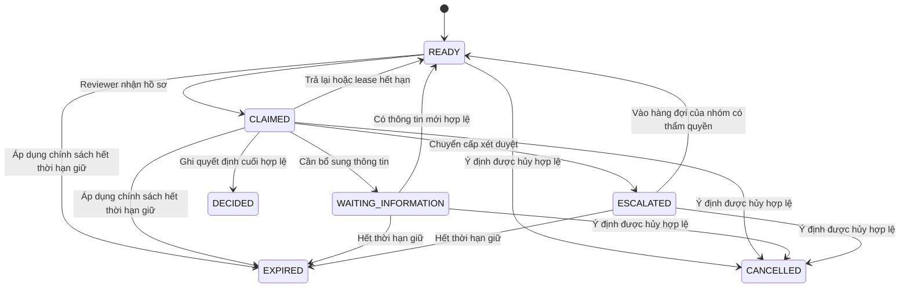

# Fraud review queue — Hàng đợi xét duyệt gian lận

## 1. Hàng đợi xét duyệt giải quyết vấn đề gì?

Không phải mọi giao dịch đáng ngờ đều đủ căn cứ để từ chối ngay. Một đơn hàng có nhiều dấu hiệu bất thường có thể đến từ khách hàng hợp lệ; một yêu cầu hoàn tiền trông bình thường lại có thể nằm trong chuỗi lạm dụng có chủ đích. Hệ thống cần nơi tập hợp các trường hợp cần con người đánh giá, theo dõi ai đang xử lý và chuyển kết quả đánh giá thành hành động nghiệp vụ có kiểm soát.

**Fraud review queue** là hàng đợi hồ sơ cần xét duyệt vì có tín hiệu rủi ro gian lận. Một hồ sơ thường gắn với một ý định nghiệp vụ cụ thể, như thực hiện thanh toán, hoàn tiền hoặc thay đổi thông tin nhận tiền. Nó chứa căn cứ đánh giá, mức ưu tiên, thời hạn, trạng thái xử lý và dấu vết quyết định.

Hàng đợi này không đồng nghĩa với message broker. Broker có thể chuyển sự kiện giữa các dịch vụ; hàng đợi xét duyệt còn có quyền truy cập, phân công, bằng chứng, quy trình ra quyết định và trách nhiệm của người duyệt. Việc một message đã được nhận không chứng minh giao dịch đã được xét duyệt hoặc đã hoàn tất.

Trong bảo vệ logic nghiệp vụ, mục tiêu là làm cho quy trình đánh giá không trở thành đường vòng: không tự cho qua khi quá hạn, không dùng quyết định cũ cho nội dung mới, không để hai người tạo hai hiệu ứng và không cho reviewer tác động ngoài phạm vi được giao.

Sau bài này, bạn có thể:

- Phân biệt tín hiệu rủi ro, hồ sơ xét duyệt, quyết định và lệnh thực thi.
- Thiết kế state machine và cơ chế nhận hồ sơ có thời hạn.
- Giữ nhất quán giữa quyết định xét duyệt và trạng thái giao dịch.
- Xử lý retry, nhận trùng sự kiện, bằng chứng thay đổi và kết quả bên ngoài chưa rõ.
- Đo tải hàng đợi và chất lượng xét duyệt mà không đồng nhất quyết định nội bộ với sự thật về gian lận.

Các tình huống, ngưỡng và con số dưới đây thuộc một hệ thống thương mại giả định. Chúng minh họa nguyên tắc thiết kế, không phải chính sách phát hiện gian lận áp dụng chung.

## 2. Bắt đầu bằng các bất biến nghiệp vụ

Giả sử một yêu cầu hoàn tiền cần xét duyệt. Một thiết kế yếu có thể tạo case nhưng vẫn để API hoàn tiền thực thi ngay, hoặc tự đổi trạng thái sang “đã duyệt” khi worker không nhận được kết quả kịp thời. Hàng đợi khi đó chỉ là nơi ghi chú, không thực sự bảo vệ nghiệp vụ.

Cần xác định các bất biến trước khi xây màn hình:

1. Ý định bị giữ để xét duyệt chưa được thực hiện hành động đang bị chặn khi chưa đủ điều kiện giải phóng.
2. Hồ sơ chỉ thuộc một tenant và một phạm vi đối tượng xác định; reviewer chỉ được xem và xử lý trong quyền của mình.
3. Một quyết định chỉ áp dụng cho đúng hành động, đối tượng và phiên bản nội dung đã được đánh giá.
4. Mỗi revision của hồ sơ chỉ có tối đa một quyết định cuối có hiệu lực theo quy trình; sửa quyết định phải qua một chuyển tiếp riêng có dấu vết.
5. Một quyết định cho phép không tự bỏ qua business invariants, như tổng tiền hoàn không vượt tiền đã thu.
6. Retry và xử lý đồng thời không tạo nhiều lệnh nghiệp vụ cho cùng ý định được duyệt.
7. Hết thời gian giữ quyền xử lý của reviewer không đồng nghĩa giao dịch được duyệt.
8. Quá SLA, thiếu reviewer hoặc lỗi hạ tầng không tự chuyển thành `ALLOW` nếu chính sách không có một ngoại lệ được định nghĩa riêng.
9. Kết quả chưa rõ của dịch vụ bên ngoài không được coi là thất bại chắc chắn để chạy lại bằng một định danh mới.
10. Mọi quyết định và hiệu ứng đều truy ngược được người thao tác, bằng chứng và phiên bản chính sách liên quan.

Phạm vi giữ cần rõ ràng. Giữ một yêu cầu hoàn tiền không mặc nhiên khóa mọi hoạt động của khách hàng. Nếu cần hạn chế cả tài khoản, đó phải là hành động có căn cứ và quy trình riêng. Ngược lại, một case bị đóng không được vô tình tháo mọi hạn chế khác đang có trên cùng tài khoản.

## 3. Tách tín hiệu, hồ sơ, quyết định và hiệu ứng

### 3.1. Bốn thực thể có vòng đời khác nhau

| Thực thể | Vai trò | Ví dụ |
| --- | --- | --- |
| Risk assessment | Đánh giá tại một thời điểm từ dữ liệu và chính sách cụ thể | Nhiều lần đổi thông tin nhận tiền trước yêu cầu hoàn |
| Review case | Đơn vị công việc cần reviewer xử lý | Hồ sơ xét duyệt `case-401` cho yêu cầu `refund-71` |
| Review decision | Kết luận có phạm vi và căn cứ | Cho phép đúng yêu cầu revision 3 trong thời hạn quy định |
| Execution command | Lệnh thực thi một hành động đã đủ điều kiện | Lệnh hoàn tiền `command-812` |

Một risk score không phải quyền thực thi. Một case `DECIDED` không chứng minh command đã hoàn tất. Một kết quả `ALLOW` chỉ cho phép tiếp tục theo những điều kiện đã xác định; nó không tự biến giao dịch thành hợp lệ trong mọi hoàn cảnh về sau.

### 3.2. Dữ liệu cốt lõi của hồ sơ

```text
ReviewCase
  case_id
  tenant_id
  subject_type, subject_id
  action_type, intent_id, intent_revision
  case_revision
  risk_assessment_id, risk_policy_version
  evidence_snapshot_id, evidence_captured_at
  priority, created_at, review_due_at, hold_expires_at
  queue_partition, required_reviewer_capability
  state
  claimant_id, claim_epoch, lease_expires_at
  terminal_decision_id
  version
```

`review_due_at` là mốc cần xử lý theo SLA. `hold_expires_at` là mốc giới hạn việc giữ ý định hoặc tài nguyên theo chính sách nghiệp vụ. `lease_expires_at` là thời hạn reviewer đang có quyền xử lý độc quyền hồ sơ. Ba thời hạn này không thay thế nhau.

`intent_revision` xác định nội dung nghiệp vụ, chẳng hạn số tiền, đồng tiền và điểm đến của yêu cầu hoàn. `case_revision` xác định nội dung xét duyệt, có thể thay đổi khi thêm bằng chứng quan trọng. Hệ thống cần quy định thay đổi nào làm mất hiệu lực quyết định hoặc yêu cầu xét duyệt lại.

### 3.3. Bằng chứng cần có nguồn và thời điểm

Bằng chứng có thể gồm lịch sử sự kiện, trạng thái giao dịch, kết quả xác minh và các tín hiệu liên quan. Cần phân biệt dữ liệu do hệ thống kiểm chứng với thông tin do người dùng hoặc reviewer nhập.

Ví dụ, dòng “khách nói tài khoản nhận tiền này là của họ” là một phát biểu trong hồ sơ, không tự là bằng chứng xác minh quyền sở hữu. Tương tự, một IP dùng chung hoặc thay đổi thiết bị là tín hiệu để đánh giá trong ngữ cảnh, không tự chứng minh gian lận.

Nên lưu tham chiếu nguồn, thời điểm ghi nhận và snapshot đủ để giải thích quyết định. Nếu giao diện chỉ hiển thị dữ liệu hiện tại, dữ liệu có thể thay đổi sau khi duyệt khiến không còn biết reviewer đã nhìn thấy gì. Snapshot cần có chính sách truy cập và lưu giữ; không sao chép mật khẩu, token, mã OTP hoặc dữ liệu thanh toán bí mật vào case.

## 4. Đưa hồ sơ vào hàng đợi mà không tạo khoảng trống bảo vệ

### 4.1. Giữ ý định và tạo case nhất quán

Một luồng tiếp nhận khái niệm:

```text
Nhận ý định nghiệp vụ
  -> kiểm tra quyền và tính hợp lệ cơ bản
  -> đánh giá rủi ro theo chính sách
  -> nếu cần review:
       đặt cổng thực thi của ý định thành PENDING_REVIEW
       tạo hoặc cập nhật case đúng revision
       lưu sự kiện bền vững
  -> trả trạng thái chờ xét duyệt
```

Khi các bản ghi nằm trong cùng cơ sở dữ liệu, thay đổi cổng thực thi và tạo case nên thuộc cùng transaction. Không để commit ý định có thể thực thi rồi mới cố gửi message tạo case sau đó. Nếu dùng outbox, ghi outbox trong transaction trước khi phát sự kiện ra ngoài.

Trong kiến trúc nhiều dịch vụ, cần một giao thức mà phía thực thi chưa cho phép hành động khi chưa có kết quả đủ điều kiện. Không thể giả định có transaction nguyên tử qua mọi dịch vụ. Phải xác định nơi có thẩm quyền giữ cổng nghiệp vụ và cách khôi phục khi một bước bị gián đoạn.

### 4.2. Chống trùng ở hai lớp

Sự kiện có thể được chuyển nhiều lần. Có thể dùng receipt với event ID để chống xử lý trùng thông điệp, đồng thời dùng ràng buộc nghiệp vụ theo `(tenant_id, intent_id, action_type, intent_revision)` để không tạo nhiều case hoạt động cho cùng một ý định nếu mô hình quy định như vậy.

Chỉ deduplicate theo customer ID là quá rộng: cùng một khách có thể có nhiều ý định hợp lệ cần đánh giá riêng. Chỉ deduplicate theo event ID lại có thể chưa đủ khi hai sự kiện khác nhau cùng biểu diễn một ý định nghiệp vụ.

Việc đếm các lần thử đáng ngờ cũng cần tách khỏi chống lặp hiệu ứng. Nhiều request có thể không tạo thêm command nhưng vẫn là tín hiệu về hành vi gửi yêu cầu. Hệ thống phải định nghĩa đang đo số lần thử, số ý định hay số giao dịch thực tế, tránh làm sai dữ liệu rủi ro.

### 4.3. Khi có thêm tín hiệu sau khi tạo case

Nếu có bằng chứng quan trọng mới, tăng revision của case hoặc tạo một lần đánh giá mới theo mô hình đã chọn. Reviewer đang mở trang cũ không được lưu quyết định như thể dữ liệu chưa đổi. Màn hình cần cho biết case đã thay đổi và yêu cầu đánh giá lại phần liên quan.

Nếu hành động đã xảy ra, không chuyển giao dịch ngược về `PENDING_REVIEW` để giả vờ chưa thực hiện. Có thể tạo hồ sơ điều tra hoặc lệnh khắc phục riêng. Những hành động như thu hồi quyền, bù trừ hay yêu cầu xác minh bổ sung có vòng đời và quyền riêng.

## 5. State machine của hàng đợi

### 5.1. Trạng thái hồ sơ minh họa



Đây là state machine hồ sơ; trạng thái giữ, thanh toán hoặc hoàn tiền vẫn có mô hình riêng. Các chuyển tiếp phải phối hợp để không còn case hoạt động cho một ý định đã bị hủy mà worker vẫn có thể thực thi.

`DECIDED` tham chiếu một quyết định như `ALLOW` hoặc `REJECT`. “Cần bổ sung” và “chuyển cấp” là hành động trong quy trình, không phải cho phép tạm thời. `EXPIRED` không mặc định đồng nghĩa `ALLOW` hay `REJECT`; hiệu ứng lên ý định phải theo chính sách hết hạn được định nghĩa rõ.

### 5.2. Lease hết hạn khác case hết hạn

Nếu reviewer mất kết nối, lease có thể hết và hồ sơ được người khác nhận. Case vẫn cần xét duyệt; thời hạn SLA và thời hạn giữ ban đầu không tự đặt lại.

Nếu ý định hết thời hạn giữ, cần một hành động nghiệp vụ rõ ràng, như hủy ý định chưa thực hiện và giải phóng phần tài nguyên được phép. Không tự giải phóng tiền hoặc tài nguyên nếu hiệu ứng bên ngoài đang ở trạng thái chưa rõ. Đối soát phải diễn ra trước bước có nguy cơ tạo hai hiệu ứng trái ngược.

Không âm thầm gia hạn `hold_expires_at` mỗi lần đổi reviewer. Gia hạn giữ là một quyết định có giới hạn và căn cứ riêng, có thể cần thẩm quyền cao hơn.

## 6. Phân quyền nhận hồ sơ và ra quyết định

### 6.1. Nhận việc không tạo thêm quyền nghiệp vụ

Một reviewer có thể được đọc case nhưng chưa được xem toàn bộ dữ liệu gốc hoặc cho phép mọi loại giao dịch. Cần tách các khả năng như:

```text
fraud.case.read
fraud.case.claim
fraud.evidence.reveal
fraud.case.request_information
fraud.case.escalate
fraud.decision.allow
fraud.decision.reject
fraud.hold.extend
fraud.policy.manage
```

Permission đi cùng tenant, loại ý định, phân vùng hàng đợi và hạn mức thẩm quyền. Một người có quyền `allow` ở tenant A không được dùng lease của case B để duyệt tenant B. Việc đã là claimant chỉ chứng minh hồ sơ đang được giao cho họ, không thay thế kiểm tra quyền hiện tại.

Các endpoint danh sách, tìm kiếm, thống kê, tải bằng chứng và xuất báo cáo phải giới hạn tương tự. Không chỉ bảo vệ endpoint lưu quyết định rồi để API đếm hoặc preview lộ dữ liệu tenant khác.

Với thao tác nhạy cảm, có thể cần hai người độc lập. Người tạo hoặc đề nghị ý định không được tự làm người duyệt cuối nếu chính sách yêu cầu phân tách nhiệm vụ. Một người cũng không được tự sửa ngưỡng rủi ro rồi dùng chính thay đổi đó để cho phép hồ sơ của mình.

### 6.2. Lease để phối hợp công việc

Lease là quyền xử lý tạm thời trên một hồ sơ, có thời hạn và phiên bản nhận việc. Ví dụ:

```text
case_id = case-401
claimant_id = reviewer-17
claim_epoch = 8
lease_expires_at = mốc thời gian máy chủ
```

Mỗi lần nhận mới, `claim_epoch` tăng. Khi lưu hoặc gia hạn, request phải khớp cả claimant và epoch hiện tại. Epoch là fencing token để phân biệt các lượt nhận việc; nó không phải bí mật xác thực và không tự cấp quyền.

Giả sử reviewer A nhận epoch 8 rồi mất mạng. Sau khi lease hết, B nhận epoch 9. A quay lại với trang cũ và bấm cho phép. Máy chủ phải từ chối epoch 8, kể cả khi A vẫn là reviewer hợp lệ. Nếu chỉ kiểm tra vai trò hoặc trạng thái `CLAIMED`, cả hai có thể cùng lưu kết quả.

### 6.3. Nhận hồ sơ bằng cập nhật có điều kiện

SQL minh họa theo PostgreSQL, dùng tham số bind và phạm vi đã được máy chủ xác định:

```sql
UPDATE fraud_review_case
SET state = 'CLAIMED',
    claimant_id = :actor_id,
    claim_epoch = claim_epoch + 1,
    lease_expires_at = :new_lease_expires_at,
    version = version + 1
WHERE case_id = :case_id
  AND tenant_id = :authorized_tenant_id
  AND queue_partition = :authorized_partition
  AND (
       state = 'READY'
       OR (state = 'CLAIMED' AND lease_expires_at <= :now)
  )
  AND hold_expires_at > :now
RETURNING case_id, case_revision, claim_epoch, lease_expires_at;
```

Chỉ nhận việc thành công khi đúng một dòng được trả về. `claim_epoch` cần được khởi tạo không null và tăng theo quy tắc có kiểm soát. Mốc thời gian và thời lượng lease lấy từ máy chủ; client không được tự yêu cầu lease vô hạn.

Đoạn SQL chỉ minh họa tranh chấp quyền nhận. Dịch vụ vẫn phải kiểm tra permission, phân vùng phù hợp, trạng thái ý định và những điều kiện khác trước khi xác nhận nhận việc. Khi có chờ khóa lâu, cần kiểm tra lại hạn bằng thời gian hiện tại tại điểm chấp nhận, không dùng một giá trị `now` đã cũ để cấp lease cho case không còn được xử lý.

Endpoint gia hạn chỉ cập nhật khi lease còn hạn, claimant và epoch khớp, reviewer còn quyền và case vẫn đang cần xử lý. Một heartbeat của tab cũ không được hồi sinh lease đã mất. Gia hạn lease cũng không gia hạn thời hạn giữ của giao dịch.

Khi xử lý số lượng lớn, có thể chọn ứng viên bằng cơ chế khóa và bỏ qua bản ghi đang được xử lý phù hợp với cơ sở dữ liệu. Tuy vậy, chiến lược chọn vẫn cần chống bỏ đói hồ sơ và không giao việc ngoài phạm vi. Không cho client tự sửa priority để đẩy case của mình lên đầu.

## 7. Ra quyết định trên nội dung hiện tại

### 7.1. Hợp đồng API minh họa

```http
POST /fraud-review/cases/case-401/decisions
Idempotency-Key: decision-case-401-example
Content-Type: application/json

{
  "expectedCaseRevision": 4,
  "expectedIntentRevision": 3,
  "claimEpoch": 8,
  "verdict": "ALLOW",
  "reasonCode": "VERIFIED_CONTEXT",
  "evidenceReferences": ["evidence-81", "evidence-84"],
  "reviewerNote": "Đã đối chiếu theo quy trình xác minh hiện hành"
}
```

Actor lấy từ phiên đã xác thực. Máy chủ không nhận `approvedBy`, tenant tùy ý, trạng thái thanh toán hoặc số tiền mới từ payload quyết định. Tham chiếu bằng chứng phải thuộc đúng case và được phép dùng; không tin một danh sách ID chỉ vì client gửi lên.

Các reason code nên có ý nghĩa rõ và phù hợp loại verdict. Ghi chú tự do giúp giải thích nhưng không thay thế bằng chứng bắt buộc. Không yêu cầu reviewer chép thông tin nhạy cảm vào ghi chú để chứng minh đã xem dữ liệu.

### 7.2. Transaction lưu quyết định

Một thuật toán khái niệm:

```text
Xác thực reviewer và kiểm tra schema request

Bắt đầu transaction cục bộ
  kiểm tra quyền và trạng thái an ninh có thẩm quyền
  chiếm bản ghi idempotency cho ý định lưu quyết định
  đồng bộ case và cổng nghiệp vụ liên quan
  kiểm tra claimant, claim_epoch và lease còn hiệu lực
  kiểm tra case_revision, intent_revision và bằng chứng bắt buộc
  kiểm tra scope hiện tại, hạn giữ và thẩm quyền verdict
  kiểm tra đủ phê duyệt độc lập nếu cần
  ghi quyết định bất biến cho đúng revision
  chuyển case sang DECIDED và kết thúc lease
  cập nhật cổng nghiệp vụ theo quyết định hợp lệ
  tạo command khi quy trình yêu cầu thực thi
  ghi audit, kết quả idempotency và outbox
Commit
```

Case, cổng nghiệp vụ và các bản ghi dùng chung phải có cơ chế đồng bộ phù hợp. Nếu quyền bị thu hồi, ý định bị hủy hoặc có tín hiệu buộc xét lại cùng lúc, hệ thống phải xác định thứ tự hiệu lực và điểm chấp nhận quyết định. Chỉ kiểm tra ở gateway rồi ghi dữ liệu sau đó không bảo vệ các thay đổi cạnh tranh này.

Ràng buộc duy nhất trên `(case_id, case_revision)` cho quyết định cuối giúp ngăn hai quyết định cùng có hiệu lực ở cùng revision. Ràng buộc theo tenant, intent, revision và loại hành động ở command bảo vệ việc tạo hiệu ứng nghiệp vụ. Cần dùng đúng mô hình dữ liệu; một unique constraint không tự kiểm tra đầy đủ quyền hoặc state machine.

### 7.3. Khi cần hai người hoặc thay đổi quyết định

Nếu cần hai người, lần đánh giá đầu có thể tạo proposal ràng buộc với snapshot và revision rồi chuyển sang nhóm có thẩm quyền. Người thứ hai xử lý nhiệm vụ được giao theo lease của họ, xác minh đề xuất và điều kiện hiện tại. Chỉ tạo quyết định cuối khi đủ yêu cầu độc lập; không coi proposal đầu là `ALLOW` tạm thời.

Không sửa đè verdict cũ để che lịch sử. Việc xem xét lại cần một hành động được phép, tham chiếu quyết định trước và xác định hiệu ứng đã xảy ra hay chưa. Nếu chưa thực thi, có thể vô hiệu quyết định hoặc command đang chờ qua chuyển trạng thái được kiểm soát. Nếu đã thực thi, cần quy trình khắc phục riêng thay vì đổi một cột thành `REJECT` rồi coi tiền hoặc quyền đã tự quay về.

### 7.4. Tín hiệu mới giữa quyết định và thực thi

Quyết định nên gắn với phiên bản đánh giá rủi ro hoặc cổng nghiệp vụ có thẩm quyền. Tại bước chấp nhận thực thi, kiểm tra quyết định còn áp dụng cho intent hiện tại, còn hạn và chưa bị vô hiệu bởi điều kiện mới theo chính sách.

Ví dụ, reviewer cho phép hoàn về phương thức gốc. Sau đó một request đổi nơi nhận xuất hiện. Quyết định cũ không được dùng cho nội dung mới; cần revision mới và đánh giá tương ứng. Dù quyết định vẫn hợp lệ, dịch vụ hoàn tiền còn phải kiểm tra số tiền còn có thể hoàn, đồng tiền và các giới hạn chung.

Trong hệ thống phân tán, không thể giữ khóa cơ sở dữ liệu xuyên qua mọi lời gọi bên ngoài. Phải xác định mốc chấp nhận thực thi và chính sách khi tín hiệu đến sau mốc đó. Tín hiệu mới có thể dừng command chưa gửi hoặc tạo một quy trình điều tra, nhưng không tự đảo ngược một hiệu ứng bên ngoài đã xảy ra.

## 8. Retry, outbox và kết quả bên ngoài chưa rõ

### 8.1. Không để lỗi mạng tạo hai quyết định hoặc hai hiệu ứng

Client có thể mất phản hồi sau khi quyết định đã commit. Cùng khóa idempotency và cùng nội dung phải truy về quyết định cũ theo quyền xem hiện tại. Cùng khóa nhưng khác verdict, revision hoặc bằng chứng phải báo xung đột, không sửa quyết định đã lưu.

Hai khóa khác nhau vẫn có thể nhắm cùng case revision. Vì vậy cần cả idempotency của request và ràng buộc nghiệp vụ ngăn quyết định cuối trùng. Chỉ một bản ghi trong bộ nhớ của một instance không đủ khi nhiều instance cùng xử lý hoặc sau khởi động lại.

Ghi quyết định, cập nhật cổng và outbox trong cùng transaction giúp không mất sự kiện thực thi sau commit. Consumer nhận trùng phải nhận ra command đã tồn tại hoặc đã xử lý. Việc đánh dấu message đã nhận không thay thế lưu kết quả command bền vững.

### 8.2. Timeout không chứng minh chưa thực hiện

Ví dụ, worker gửi lệnh hoàn tiền đến nhà cung cấp rồi timeout. Nếu nhà cung cấp thực tế đã xử lý, tạo một command mới có thể hoàn lần hai. Cần giữ định danh nghiệp vụ ổn định khi retry, dùng khả năng chống trùng của bên nhận nếu có và đối soát kết quả chưa rõ.

Không giải phóng giữ chỗ chỉ vì một lời gọi mạng thất bại. Việc chuyển tiền đang giữ chỗ sang đã hoàn hoặc giải phóng sau thất bại dứt điểm phải nguyên tử và chỉ thực hiện một lần. Trạng thái `DECIDED` của case không thay thế trạng thái xử lý này.

Thông báo cho khách hàng cũng cần gắn với kết quả đúng: đã gửi xét duyệt, đã có quyết định và đã hoàn tất giao dịch là ba sự kiện khác nhau. Retry gửi thông báo không được chạy lại nghiệp vụ.

## 9. Ưu tiên, SLA và kiểm soát quá tải

### 9.1. Ưu tiên theo nhiều yếu tố có nguồn rõ ràng

Có thể xét mức tác động, tính cấp bách, độ tuổi hồ sơ và yêu cầu chuyên môn. Không nên chỉ xếp theo risk score hoặc theo số tiền lớn nhất; cách đó có thể khiến hồ sơ cũ và giao dịch nhỏ bị bỏ đói.

| Yếu tố | Cách dùng minh họa | Giới hạn cần giữ |
| --- | --- | --- |
| Mức tác động tiềm tàng | Đẩy các hành động có hậu quả lớn vào nhóm chuyên trách | Không biến giá trị giao dịch thành kết luận gian lận |
| Thời gian còn được giữ | Cảnh báo và điều phối trước hạn | Không tự cho phép để giải phóng backlog |
| Tuổi hồ sơ | Tăng ưu tiên có giới hạn hoặc dành năng lực xử lý | Không làm mất kiểm tra rủi ro và thẩm quyền |
| Năng lực reviewer | Chuyển đến nhóm đủ khả năng | Không giao ngoài tenant hoặc phạm vi được phép |
| Bằng chứng đã đủ | Tránh để hồ sơ sẵn sàng nằm chờ không cần thiết | Không khuyến khích chỉ chọn hồ sơ dễ và bỏ hồ sơ khó |

Priority và thời hạn do chính sách phía máy chủ quyết định. Khách hàng, nhân viên hỗ trợ hoặc reviewer không được tùy ý sửa mức ưu tiên để bỏ qua quy trình.

### 9.2. Backlog là một điều kiện vận hành cần thiết kế

Giả sử có 30 case mới mỗi giờ, bốn reviewer, mỗi người trung bình hoàn tất năm case mỗi giờ. Năng lực trung bình là 20 case mỗi giờ; nếu các điều kiện đó giữ nguyên và chưa có nguồn giảm tải khác, backlog tăng khoảng 10 case mỗi giờ. Đây là phép tính năng lực đơn giản, không mô tả đầy đủ độ biến động hoặc độ khó khác nhau của case.

Tăng số lần retry không làm tăng năng lực reviewer; nó có thể còn tạo thêm nhiễu. Các biện pháp phù hợp hơn gồm điều phối sang nhóm đủ quyền, bổ sung năng lực, cải thiện chất lượng bằng chứng đầu vào và điều chỉnh chính sách tiếp nhận qua quy trình được phê duyệt.

Khi quá SLA, cần cảnh báo, chuyển cấp và áp dụng chính sách hết thời hạn giữ. Mọi chính sách tự động cho phép một nhóm rủi ro thấp phải là quyết định rủi ro rõ ràng, có điều kiện và được quản lý riêng; không được phát sinh ngầm từ việc hàng đợi đã đầy.

Cũng cần giới hạn tài nguyên đang giữ: tồn kho, hạn mức hoặc số lượng intent chờ. Giới hạn phải có phạm vi và cách xử lý an toàn khi đạt ngưỡng. Không giữ tài nguyên vô hạn chỉ để duy trì hình ảnh rằng hàng đợi đang hoạt động bình thường.

## 10. Màn hình reviewer phải hỗ trợ quyết định đúng

Một màn hình xét duyệt nên cho biết đối tượng và hành động đang bị giữ, tenant, revision, thời điểm snapshot, các tín hiệu chính, trạng thái hiện tại và thời gian còn lại. Reviewer cần phân biệt dữ liệu đã kiểm chứng với ghi chú hoặc phát biểu chưa xác minh.

Những chi tiết có ảnh hưởng trực tiếp đến an toàn quy trình gồm:

- Hiển thị rõ số tiền, đồng tiền và điểm đến có liên quan trước khi quyết định.
- Thông báo khi case thay đổi, lease mất hiệu lực hoặc người khác đã quyết định.
- Phân biệt “yêu cầu bổ sung”, “chuyển cấp”, “cho phép” và “từ chối” bằng hành động có ý nghĩa rõ.
- Chỉ hiện dữ liệu gốc khi thật sự cần và reviewer có quyền; ghi nhận việc truy cập nhạy cảm.
- Yêu cầu xác nhận phù hợp với tác động, đặc biệt khi dùng phím tắt hoặc xử lý batch.
- Hiển thị kết quả từ máy chủ sau khi lưu; không tự kết luận thành công chỉ vì đã bấm nút.

Countdown phía client chỉ hỗ trợ nhận biết thời gian, không cấp hoặc thu hồi lease. Máy chủ vẫn kiểm tra tại lúc lưu. Một tab bị treo có thể hiển thị thông tin cũ; vì vậy nội dung request phải mang các revision và epoch cần đối chiếu.

Ghi chú, tệp và liên kết do người dùng cung cấp là dữ liệu không đáng tin cậy. Xử lý an toàn khi hiển thị, giới hạn tải và tránh để nội dung hồ sơ trở thành nơi chạy mã hoặc đánh cắp phiên reviewer. Không bắt reviewer tải bí mật về máy để hoàn thành quy trình.

Đối với quyết định ảnh hưởng khách hàng, thông báo cần theo chính sách sản phẩm và có đường bổ sung thông tin hoặc khiếu nại khi phù hợp. Không tiết lộ toàn bộ chi tiết tín hiệu và ngưỡng phát hiện trong phản hồi công khai; đồng thời không dùng thông báo mơ hồ để thay thế trạng thái nghiệp vụ chính xác ở phía hệ thống.

## 11. Đo hiệu quả mà không đánh đồng quyết định với sự thật

### 11.1. Đo luồng xử lý

Các chỉ số vận hành hữu ích gồm:

| Chỉ số | Câu hỏi trả lời |
| --- | --- |
| Case mới, case hoàn tất trong khoảng thời gian | Năng lực có theo kịp nhu cầu không? |
| Backlog theo tuổi, tenant, loại hành động | Hồ sơ đang tích tụ ở đâu? |
| Thời gian từ tiếp nhận đến nhận việc | Case chờ reviewer bao lâu? |
| Thời gian xử lý và thời gian chờ bổ sung | Nút thắt là đánh giá hay thiếu dữ liệu? |
| Thời gian đến quyết định, như p50 và p95 | Phân bố trải nghiệm chờ có đuôi dài không? |
| Số case quá SLA hoặc gần hết hạn giữ | Cần điều phối khẩn cấp ở đâu? |
| Lease hết hạn, nhận lại, xung đột revision | Cơ chế phối hợp hoặc chất lượng công cụ có vấn đề không? |
| Quyết định đã có nhưng command chưa hoàn tất | Vấn đề nằm ở xét duyệt hay thực thi? |

Đổi reviewer hoặc chuyển cấp không nên làm mất tuổi thật của hồ sơ. Nên giữ mốc tiếp nhận ban đầu và lưu các khoảng chờ riêng. Nếu chỉ tính thời gian từ lần nhận việc gần nhất, dashboard có thể trông tốt trong khi khách đã chờ rất lâu.

Không chỉ đánh giá reviewer bằng số case đóng. Chỉ tiêu đơn lẻ có thể khuyến khích chọn hồ sơ dễ, từ chối cho nhanh hoặc đóng hồ sơ để giảm backlog mà chưa giải quyết ý định nghiệp vụ.

### 11.2. Đo chất lượng quyết định

Tỷ lệ `REJECT` của hàng đợi không phải tỷ lệ gian lận của toàn hệ thống. Case đã được chọn vào queue vốn không đại diện cho toàn bộ giao dịch. Quyết định của reviewer cũng chưa chắc là nhãn sự thật độc lập.

Muốn đánh giá chất lượng cần có định nghĩa và nguồn kết quả phù hợp, có thể đến muộn: điều tra sau đó, kết quả xác minh độc lập, khiếu nại được giải quyết hoặc các bằng chứng nghiệp vụ khác. Cần xác định khoảng thời gian quan sát và xử lý những trường hợp chưa có kết quả.

Ví dụ, một quyết định bị đảo sau khi khách bổ sung thông tin không tự chứng minh reviewer ban đầu làm sai nếu chính sách khi đó yêu cầu chưa được cho phép. Ngược lại, không có khiếu nại cũng không chứng minh giao dịch bị từ chối là gian lận. Việc đánh giá phải xét thông tin có tại thời điểm quyết định.

Có thể theo dõi tỷ lệ quyết định được xem lại, mức nhất quán giữa reviewer và ảnh hưởng đến giao dịch hợp lệ theo dữ liệu đã xác minh. Nếu dùng kết quả review để huấn luyện hoặc điều chỉnh chính sách, cần tránh vòng lặp trong đó hệ thống chỉ học lại phán đoán chưa được kiểm chứng của chính mình.

## 12. Audit và khả năng khôi phục sau sự cố

### 12.1. Lưu đủ để tái dựng chuỗi quyết định

Một chuỗi audit cần liên kết được:

```text
risk assessment
  -> case và revision
  -> các lần nhận, gia hạn, trả lại hoặc chuyển cấp
  -> bằng chứng được sử dụng
  -> proposal và phê duyệt độc lập nếu có
  -> quyết định cuối
  -> command thực thi
  -> kết quả nghiệp vụ thực tế
```

Các trường quan trọng gồm actor thật, tenant, case ID, intent ID và revision, claim epoch, verdict, reason code, evidence references, policy version, thời gian và correlation ID. Lưu cả lần bị từ chối quan trọng như sai tenant, dùng lease cũ hoặc cố tự phê duyệt.

Không ghi session token, mã xác thực, dữ liệu thanh toán bí mật hoặc nội dung khách hàng không cần thiết. Tham chiếu session trong audit nên không chứa bí mật có thể dùng để đăng nhập. Người có quyền xử lý case không được sửa hoặc xóa dấu vết quyết định của mình.

Audit cho thay đổi đã commit cần được ghi bền vững cùng transaction hoặc qua outbox bền vững. Các lần từ chối phát sinh khi transaction bị rollback cần đường ghi thích hợp để không biến mất theo rollback. Việc phát log đến hệ thống ngoài bị chậm không được khiến hệ thống tạo một quyết định khác cho cùng revision.

### 12.2. Khôi phục mà không phá bất biến

Sau khi worker hoặc ứng dụng khởi động lại, cần tìm được những trạng thái cần tiếp tục: case còn lease đã hết, quyết định chưa phát command, command chưa có kết quả rõ và hold gần quá hạn. Các tác vụ khôi phục phải idempotent và đi qua cùng điều kiện quyền kỹ thuật, state machine và ràng buộc nghiệp vụ liên quan.

Một script “cho qua tất cả case cũ” có thể làm giảm backlog nhưng phá cơ chế kiểm soát. Nếu cần thay đổi chính sách hàng loạt, phải chốt phạm vi, phê duyệt, phiên bản chính sách và audit từng tác động. Không sửa trực tiếp trạng thái cuối mà bỏ qua command, giữ chỗ hoặc dữ liệu dẫn xuất.

Trong quá trình điều tra sự cố, phân biệt hồ sơ chưa có quyết định với quyết định đã có nhưng chưa thực thi. Hai nhóm cần cách khôi phục khác nhau; chạy lại toàn bộ từ đầu có thể tạo hiệu ứng trùng.

## 13. Kiểm thử tình huống tấn công logic

Kiểm thử nên khẳng định dữ liệu và tác dụng phụ, không chỉ mã HTTP. Một API trả lỗi nhưng vẫn tạo outbox event thực thi là lỗi bảo vệ nghiệp vụ.

| Tình huống | Cách thử | Kết quả cần bảo đảm |
| --- | --- | --- |
| Truy cập chéo tenant | Reviewer A đọc hoặc nhận case của B | Không lộ dữ liệu hoặc tạo thay đổi trái phép |
| Vượt thẩm quyền verdict | Reviewer chỉ có quyền đọc gửi `ALLOW` | Không ghi quyết định cuối |
| Mass assignment | Thêm `tenantId`, `state`, `approvedBy` vào payload | Không đổi trường do máy chủ quản lý; nên từ chối input ngoài hợp đồng |
| Hai người nhận cùng case | Cho hai request tranh một case READY | Chỉ một lease có hiệu lực được cấp |
| Reviewer cũ quay lại | A dùng epoch cũ sau khi B đã nhận | Không lưu hoặc gia hạn bằng lượt nhận cũ |
| Lease hết đúng ranh giới | Lưu tại `now == lease_expires_at` | Bị từ chối theo quy ước thời gian |
| Gia hạn sau khi mất quyền | Thu hồi permission rồi gửi heartbeat | Không kéo dài quyền xử lý |
| Bằng chứng mới xuất hiện | Tăng case revision trước khi lưu trang cũ | Quyết định cũ bị xung đột hoặc yêu cầu đánh giá lại |
| Ý định thay đổi | Đổi số tiền hoặc nơi nhận sau xét duyệt | Không dùng quyết định cũ cho nội dung mới |
| Tự phê duyệt | Người đề nghị đồng thời duyệt trong luồng hai người | Không đủ điều kiện tạo quyết định cuối |
| Hai verdict cạnh tranh | Gửi ALLOW và REJECT cho cùng revision | Chỉ một quyết định cuối có hiệu lực |
| Retry cùng khóa | Gửi lại cùng nội dung sau mất phản hồi | Trả về quyết định cũ, không tạo command thứ hai |
| Cùng khóa, khác nội dung | Đổi verdict hoặc revision với khóa cũ | Báo xung đột và không sửa quyết định đã lưu |
| Khác khóa, cùng ý định | Nhiều request lưu và thực thi cùng revision | Ràng buộc nghiệp vụ ngăn hiệu ứng trùng |
| Sự kiện đầu vào trùng | Phát lại event hoặc hai event cùng ý định | Không nhân đôi case hoạt động trái mô hình |
| Cổng review bị bỏ qua | Gọi trực tiếp API thực thi khi PENDING_REVIEW | Không thực hiện hành động đang bị giữ |
| Quá SLA | Để hồ sơ vượt hạn xét duyệt | Cảnh báo hoặc chuyển cấp theo chính sách, không tự ALLOW |
| Hết thời hạn giữ | Case còn chờ nhưng hold đã đến hạn | Áp dụng đúng chuyển tiếp, không giải phóng mù khi kết quả ngoài chưa rõ |
| ALLOW nhưng sai bất biến | Duyệt hoàn vượt số tiền còn có thể hoàn | Dịch vụ nghiệp vụ vẫn chặn |
| Worker nhận trùng | Phát lại outbox event đã xử lý | Không tạo hiệu ứng mới |
| Timeout bên ngoài | Bên nhận đã xử lý nhưng phản hồi mất | Giữ định danh cũ và đối soát, không tự chạy lệnh mới |
| Hủy cạnh tranh với quyết định | Hủy intent cùng lúc reviewer cho phép | Kết quả tuân theo mốc hiệu lực và state machine đã định nghĩa |
| Lỗi giữa case và outbox | Gây lỗi trước commit | Không có quyết định hoặc cổng được cập nhật dở dang trong transaction cục bộ |
| Khôi phục sau restart | Dừng worker giữa nhận và hoàn tất | Tiếp tục an toàn từ trạng thái bền vững |
| Đọc kết quả khi mất quyền | Dùng khóa idempotency sau thu hồi quyền đọc | Không lộ phản hồi nhạy cảm đã lưu |

Dùng thời gian có thể điều khiển để kiểm tra lease, SLA, thời hạn giữ và thời hạn quyết định. Với cạnh tranh, chủ động tạo thời điểm chồng lấn bằng barrier hoặc công cụ đồng bộ của bộ kiểm thử. Hai request chạy tuần tự không chứng minh được tính nguyên tử.

Sau mỗi tình huống, kiểm tra case, quyết định, cổng nghiệp vụ, command, giữ chỗ, outbox, audit và số hiệu ứng tại dịch vụ giả lập. Các phép kiểm tra này giúp phát hiện lỗi mà thông báo trên giao diện không thể hiện được.

## 14. Bài tập thiết kế

Một hệ thống nhiều tenant đưa các yêu cầu hoàn tiền có tín hiệu rủi ro vào hàng đợi xét duyệt. Reviewer có phạm vi tenant và hạn mức khác nhau. Một số trường hợp cần hai người; bằng chứng có thể đến muộn và nhà cung cấp thanh toán có thể timeout sau khi đã xử lý.

Hãy thiết kế các đầu ra sau:

1. Danh sách bất biến cho review gate, số tiền hoàn, revision và chống trùng hiệu ứng.
2. Mô hình tách risk assessment, case, evidence snapshot, decision và execution command.
3. State machine phân biệt chờ xét duyệt, lease của reviewer, quyết định và kết quả thực thi.
4. Ma trận quyền cho đọc, nhận case, xem dữ liệu gốc, cho phép, từ chối, chuyển cấp và gia hạn hold.
5. Cơ chế nhận việc có lease và fencing token; cách từ chối reviewer dùng trang cũ.
6. Transaction lưu quyết định, idempotency, ràng buộc duy nhất và outbox.
7. Chính sách khi có tín hiệu mới, quá SLA, hết thời hạn giữ và kết quả thanh toán chưa rõ.
8. Dashboard tối thiểu và ít nhất tám kiểm thử phủ lỗi scope, revision, cạnh tranh, retry và quá tải.

Thiết kế cần giải thích được vì sao một reviewer hợp lệ vẫn không thể duyệt ngoài phạm vi, dùng lease cũ, cho phép nội dung đã đổi hoặc tạo hai lần hoàn tiền. Đồng thời, mọi case phải có đường tiến triển hoặc kết thúc rõ ràng mà không biến áp lực vận hành thành quyền bỏ qua các bất biến nghiệp vụ.
