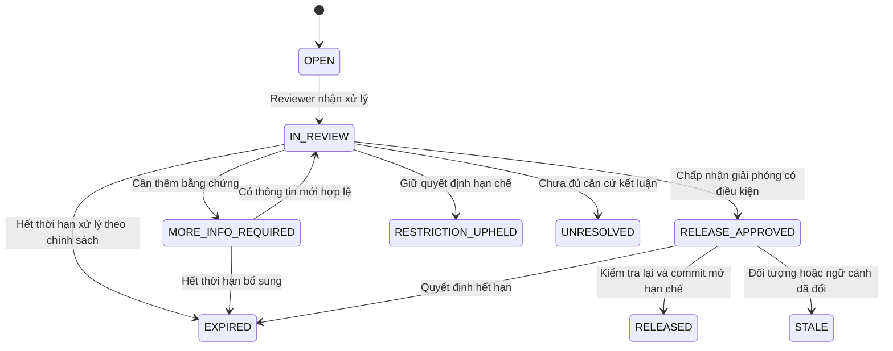

# Fraud false positive handling — Xử lý cảnh báo gian lận nhầm

## 1. Mục tiêu và phạm vi

Một khách hàng hợp lệ có thể mua hàng giá trị cao trên thiết bị mới, dùng chung mạng với nhiều người hoặc đặt nhiều đơn trong một chiến dịch khuyến mại. Những hành vi này có thể giống dấu hiệu gian lận và bị hệ thống giữ lại để kiểm tra. Nếu mọi cảnh báo đều dẫn đến khóa tài khoản vĩnh viễn, hệ thống làm tổn hại người dùng hợp lệ và tạo áp lực để nhân viên hỗ trợ bỏ qua kiểm soát.

**False positive** trong phát hiện gian lận là trường hợp hệ thống dự đoán hoặc cảnh báo gian lận đối với một hoạt động thực tế hợp lệ, theo định nghĩa và khoảng thời gian đánh giá đã chọn. Xử lý false positive cần vừa giảm tác động sai lên khách hàng, vừa ngăn kẻ tấn công lợi dụng luồng khiếu nại để được mở chặn.

Bài học thuộc module `SECURITY_APPLICATION_SECURITY_BUSINESS_LOGIC_SECURITY`, trong chương **Fraud Detection**. Trọng tâm là business invariants, state machine, quyền theo đối tượng, transaction, idempotency và kiểm thử tình huống tấn công logic trong quy trình xử lý cảnh báo nhầm.

Sau bài học, bạn cần có khả năng:

- Phân biệt cảnh báo, quyết định xử lý, kết quả review và nhãn gian lận đã được xác nhận.
- Đọc đúng false positive rate, precision và tác động lên khách hàng.
- Thiết kế xác minh bổ sung, review, khiếu nại và giải phóng hạn chế có phạm vi.
- Ngăn quyết định review bị dùng lại cho giao dịch đã thay đổi hoặc thực thi trùng do retry.
- Thu thập phản hồi có chất lượng để điều chỉnh luật/model mà không học lại các quyết định sai.

Ví dụ trong bài dùng đơn hàng bị giữ trước bước thực hiện nghiệp vụ tiếp theo. Các trạng thái, hạn mức và khoảng thời gian là thiết kế minh họa, cần được điều chỉnh theo hệ thống thực tế.

## 2. Phân biệt tín hiệu, quyết định và sự thật quan sát được

Một dấu hiệu như IP dùng chung hoặc thiết bị mới chỉ là tín hiệu. Nó không tự chứng minh một cá nhân có hành vi gian lận.

| Khái niệm | Ý nghĩa | Điều không thể suy ra tự động |
| --- | --- | --- |
| Risk signal | Dữ liệu có thể liên quan rủi ro | Chủ thể chắc chắn gian lận |
| Risk score | Điểm xếp hạng hoặc ước lượng theo mô hình | Điểm 0,9 luôn đồng nghĩa xác suất gian lận 90% |
| Alert | Trường hợp vượt điều kiện cần xem xét | Phải từ chối vĩnh viễn |
| Enforcement decision | Hành động hệ thống chọn: cho tiếp tục, xác minh, giữ hoặc từ chối | Nhãn huấn luyện đã đúng |
| Review outcome | Nhận định của reviewer dựa trên bằng chứng có lúc đó | Không thể xuất hiện thông tin mới về sau |
| Observed outcome/label | Kết quả có nguồn, thời điểm và mức tin cậy | Mọi trường hợp chưa có báo cáo gian lận đều hợp lệ |

Một điểm rủi ro chỉ có ý nghĩa xác suất nếu đã được hiệu chỉnh và kiểm chứng phù hợp. Không đưa lời khẳng định xác suất vào giao diện hoặc logic chi phí chỉ vì model trả về một số trong khoảng 0 đến 1.

Cũng cần phân biệt quy tắc cứng với đánh giá rủi ro:

- Đơn hàng không thuộc tài khoản đang đăng nhập là vấn đề quyền theo đối tượng.
- Khoản hoàn tiền vượt số tiền còn được hoàn là vi phạm invariant nghiệp vụ.
- Đơn hàng đến từ thiết bị mới là tín hiệu có thể dẫn đến xác minh bổ sung.

Việc xác nhận cảnh báo là nhầm không làm các điều kiện quyền, số tiền, trạng thái, phê duyệt hoặc chống gửi trùng trở nên tùy chọn. Một risk score thấp cũng không được dùng để bỏ qua những điều kiện đó.

## 3. Đo false positive đúng mẫu số

### 3.1. Ma trận nhầm lẫn minh họa

Giả sử có 10.000 hoạt động và đã biết đầy đủ kết quả cuối cùng trong ví dụ giả định: 100 hoạt động gian lận, 9.900 hoạt động hợp lệ. Bộ phát hiện cảnh báo 90 hoạt động gian lận và 198 hoạt động hợp lệ.

| Kết quả thực tế | Có cảnh báo | Không cảnh báo | Tổng |
| --- | --- | --- | --- |
| Gian lận | TP = 90 | FN = 10 | 100 |
| Hợp lệ | FP = 198 | TN = 9.702 | 9.900 |
| Tổng | 288 | 9.712 | 10.000 |

Các chỉ số:

```text
False positive rate = FP / (FP + TN)
                    = 198 / 9.900 = 2%

Precision           = TP / (TP + FP)
                    = 90 / 288 = 31,25%

Recall              = TP / (TP + FN)
                    = 90 / 100 = 90%

Tỷ lệ cảnh báo nhầm trong tập có cảnh báo
                    = FP / (TP + FP)
                    = 198 / 288 = 68,75%
```

False positive rate 2% không có nghĩa chỉ 2% cảnh báo là nhầm. Khi gian lận hiếm, số hoạt động hợp lệ bị cảnh báo có thể lớn hơn số gian lận được phát hiện dù FPR có vẻ thấp.

### 3.2. Chọn đơn vị đo và hành động được đo

Trong ví dụ trên, “positive” là **có cảnh báo**, chưa phải bị chặn. Một hệ thống có thể dùng cùng cảnh báo để yêu cầu xác minh ở nhóm này và giữ để review ở nhóm khác.

Vì vậy cần ghi rõ:

- Đơn vị là operation nghiệp vụ, đơn hàng, tài khoản hay request HTTP.
- Đang đo chất lượng phát hiện hay tác động của hành động cưỡng chế.
- Kết quả được xác nhận sau bao lâu, từ nguồn nào và còn bao nhiêu trường hợp chưa rõ.
- Cohort, phiên bản luật/model và chính sách xử lý nào được dùng.

Retry cùng một operation không nên bị đếm thành nhiều hoạt động độc lập. Tương tự, một người gọi hỗ trợ ba lần về cùng đơn hàng không tạo ra ba false positive riêng cho chỉ số theo đơn hàng.

Trong thực tế, không phải mọi hoạt động đều có nhãn đáng tin cậy. Trường hợp chưa có khiếu nại hoặc chưa phát hiện tổn thất cần được quản lý như dữ liệu chưa đủ kết luận nếu chưa đáp ứng tiêu chí nhãn. Không ép tất cả chúng thành `LEGITIMATE` để làm đẹp chỉ số.

## 4. Chọn phản ứng theo rủi ro và mức độ gây gián đoạn

Xử lý false positive hiệu quả cần nhiều lựa chọn thay vì chỉ cho phép hoặc khóa toàn bộ tài khoản.

| Phản ứng | Khi có thể phù hợp | Điều kiện cần chú ý |
| --- | --- | --- |
| Cho tiếp tục và theo dõi | Rủi ro thấp, tác động có thể kiểm soát | Vẫn giữ invariant và audit tương ứng |
| Xác minh bổ sung | Có yếu tố bất thường nhưng người dùng có cách xác minh đáng tin cậy | Gắn challenge với đúng chủ thể và operation |
| Giữ hành động cụ thể để review | Cần xem xét trước một bước nhạy cảm | Có thời hạn, hàng đợi và trách nhiệm xử lý |
| Giới hạn một phần | Chưa đủ tin cậy cho hành động rủi ro cao | Giới hạn rõ khả năng bị hạn chế và điều kiện phục hồi |
| Từ chối hành động | Có căn cứ mạnh hoặc không đáp ứng điều kiện bắt buộc | Có lý do phù hợp và kênh xử lý nếu chính sách cho phép |

Phạm vi phản ứng cần tương xứng với tín hiệu. Một đơn hàng đáng ngờ không mặc nhiên làm mọi chức năng đọc lịch sử của tài khoản trở nên nguy hiểm. Ngược lại, nếu có bằng chứng tài khoản bị chiếm đoạt, chỉ mở lại đơn hàng mà bỏ qua an toàn tài khoản có thể không đủ.

Xác minh thành công giúp tăng độ tin cậy của một yếu tố cụ thể, chẳng hạn quyền kiểm soát kênh đã đăng ký. Nó không tự chứng minh giao dịch không gian lận, khách hàng sở hữu mọi đối tượng liên quan hoặc mọi bước phê duyệt đã hoàn thành.

Thời hạn giữ phải gắn với vòng đời nghiệp vụ: đơn có thể hết thời gian giữ hàng, thay đổi giá hoặc bị hủy trong khi chờ review. Không giữ vô hạn và cũng không mặc định hết thời gian chờ là cho phép thực hiện. Khi hết hạn, chuyển sang kết quả rõ ràng theo chính sách, thông báo phù hợp và giữ khả năng truy vết.

## 5. Invariant của luồng xử lý cảnh báo nhầm

| Mã | Invariant | Tình huống phải chặn |
| --- | --- | --- |
| F1 | Chỉ chủ thể được cấp quyền mới xem hoặc khiếu nại operation thuộc phạm vi của mình | Đổi `orderId` để yêu cầu mở chặn đơn của người khác |
| F2 | Quyết định review gắn đúng tenant, operation và thông số đã kiểm tra | Dùng quyết định cho một đơn để mở nhiều đơn khác |
| F3 | Mở chặn rủi ro không thay thế điều kiện nghiệp vụ bắt buộc | Cho xuất hàng khi thanh toán chưa xác nhận |
| F4 | Reviewer đủ quyền, quyết định có căn cứ và tách nhiệm vụ theo chính sách | Nhân viên tự tạo ngoại lệ rồi tự xác nhận cho giao dịch liên quan |
| F5 | Bằng chứng, phiên bản và thời hạn vẫn hợp lệ tại ranh giới giải phóng | Dùng quyết định cũ sau khi số tiền hoặc đích nhận đã đổi |
| F6 | Giải phóng hạn chế chỉ có hiệu lực một lần cho đúng operation | Retry làm phát sinh hai lần thực hiện nghiệp vụ |
| F7 | Quyết định, thay đổi và audit bắt buộc nhất quán khi commit | Đơn đã mở chặn nhưng không biết ai quyết định |
| F8 | Ngoại lệ có phạm vi, thời hạn và điều kiện thu hồi | Một lần review biến thành miễn kiểm tra vĩnh viễn |
| F9 | Nhãn phản hồi giữ nguồn và mức tin cậy | Quyết định hỗ trợ được coi ngay là sự thật để huấn luyện |

Không nên lưu một cờ tổng quát `isTrusted = true` rồi bỏ qua mọi kiểm tra cho tài khoản. Nếu cần cơ chế tin cậy, phải định nghĩa những tín hiệu nào được giảm trọng số, loại hành động nào được hưởng, thời hạn và các kiểm soát vẫn bắt buộc.

## 6. Thiết kế luồng xác minh, review và khiếu nại

### 6.1. Tiếp nhận an toàn

Thông báo cho người dùng nên nêu được hành động nào đang bị giữ, cách tiếp tục và kỳ vọng xử lý theo chính sách. Dùng mô tả đủ để họ khắc phục, chẳng hạn cần xác minh bổ sung hoặc cần nhân viên xem xét. Không đưa toàn bộ ngưỡng luật, đặc trưng nội bộ hoặc dữ liệu của người khác vào thông báo.

Endpoint gửi khiếu nại phải xác thực chủ thể và kiểm tra quyền trên chính operation. Biết mã đơn hoặc sở hữu một link được chuyển tiếp không tự chứng minh quyền yêu cầu mở chặn. Tách quyền gửi thông tin bổ sung khỏi quyền ghi kết luận review.

Nhiều lần gửi cùng khiếu nại cần được hợp nhất hoặc chống lặp theo operation/vòng review. Không tự cấp ngoại lệ vì số lần liên hệ cao, cũng không để việc chống spam tước mất mọi kênh phục hồi của khách hàng hợp lệ.

Nếu có challenge, nó cần gắn với chủ thể, operation và thông số quan trọng; có nonce, thời hạn và cơ chế chống sử dụng lại. Kênh xác minh phải được chọn từ ngữ cảnh đáng tin cậy. Cho client nhập một số điện thoại mới rồi dùng ngay số đó để chứng minh quyền với giao dịch cũ tạo ra một vòng xác minh không có giá trị.

### 6.2. Thu thập bằng chứng vừa đủ

Reviewer nên có các thông tin liên quan và được phép truy cập:

- Phiên bản đơn hàng, loại hành động, giá trị và thay đổi đáng chú ý gần đây.
- Nhóm lý do cảnh báo, phiên bản luật/model và thời điểm đánh giá.
- Kết quả xác minh bổ sung và nguồn bằng chứng, không phải bí mật của bước xác minh.
- Lịch sử review/ngoại lệ liên quan, kể cả quyết định đã thu hồi hoặc hết hạn.
- Các dấu hiệu phản bác và các dữ kiện còn chưa biết.

Một IP dùng chung hoặc không có lịch sử mua hàng không nên được xem là kết luận tự đủ. Tương tự, lời giải trình thuyết phục không tự thay thế bằng chứng. Cần tiêu chí nhất quán cho việc chấp nhận, giữ hạn chế hoặc chuyển cấp.

Không mặc định thu thập giấy tờ hoặc dữ liệu cá nhân tối đa cho mọi cảnh báo. Chọn thông tin cần thiết theo loại rủi ro và bảo vệ tài liệu qua kênh phù hợp. Reviewer không cần xem toàn bộ dữ liệu thanh toán hoặc token để xác nhận một challenge đã thành công.

### 6.3. Vòng đời case review

Một state machine minh họa:



`RELEASE_APPROVED` chỉ là quyết định cho phép giải phóng một hạn chế cụ thể nếu các điều kiện vẫn đúng. `RELEASED` xác nhận hạn chế đó đã được gỡ theo hợp đồng; nó không có nghĩa tiền đã được thu, đơn đã xuất hàng hoặc tài khoản được miễn kiểm tra về sau.

`UNRESOLVED` phản ánh chưa đủ bằng chứng, không phải nhãn gian lận hay nhãn hợp lệ. Quy trình cần xác định trách nhiệm chuyển cấp và cách xử lý thời hạn còn lại. `EXPIRED` cũng không tự chuyển thành cho phép hoặc mặc định gian lận.

Nếu có khiếu nại tiếp theo với bằng chứng mới, tạo vòng review hoặc revision có liên kết tới lịch sử cũ. Không ghi đè quyết định trước như thể nó chưa từng tồn tại. Cần giới hạn số review đang hoạt động cho cùng operation/vòng xử lý theo chính sách để tránh các nhóm đưa ra quyết định mâu thuẫn.

## 7. Gắn quyết định với đối tượng và bằng chứng đã review

Một quyết định giải phóng có thể chứa:

```text
RiskReleaseDecision
  decisionId
  reviewCaseId
  reviewRevision
  tenantId
  operationId
  orderId
  expectedOrderVersion
  holdId
  expectedHoldVersion
  reviewedRiskContextVersion
  evidenceReferences
  policyVersion
  reviewerSubjectId
  outcome                 // RELEASE_APPROVED
  reasonCode
  decidedAt
  expiresAt
```

`reviewedRiskContextVersion` nhận diện bộ thông tin rủi ro đã biết và được dùng khi quyết định, chẳng hạn phiên bản dấu hiệu, quyết định trước hoặc sự kiện tài khoản liên quan. Cần định nghĩa sự kiện nào làm tăng phiên bản và yêu cầu đánh giá lại.

Nếu người dùng thay số tiền, mặt hàng, tài khoản nhận hoặc thông tin quan trọng khác sau review, quyết định cũ có thể không còn áp dụng. Mức độ ràng buộc phụ thuộc operation, nhưng phải được mô hình hóa; không chỉ kiểm tra một cờ “đã được hỗ trợ xác nhận”.

Ngữ cảnh rủi ro có thể nhận dữ liệu bất đồng bộ. Ghi rõ thời điểm đánh giá, độ mới và phạm vi dữ liệu đã có. Kiểm tra phiên bản của dữ liệu đã biết không chứng minh hệ thống đã nhận mọi tín hiệu có thể xuất hiện trong tương lai.

Một quyết định chỉ giải phóng những hold cụ thể được phép. Đơn hàng có thể còn hạn chế khác về thanh toán, tồn kho hoặc yêu cầu xác minh khác. Không dùng thao tác `clearAllHolds()` để xử lý một cảnh báo nhầm đơn lẻ.

Reviewer cần đủ phạm vi trên tenant, loại hành động và độ nhạy cảm. Các ngoại lệ lớn có thể yêu cầu thêm người duyệt độc lập theo chính sách. Quyền làm hỗ trợ hoặc quyền xem case không tự cấp quyền override mọi quyết định rủi ro.

## 8. Giải phóng hạn chế bằng transaction và idempotency

### 8.1. Giả mã xử lý

Mã dưới đây là giả mã gần với Java để minh họa ranh giới kiểm soát, không phải mã có thể biên dịch trực tiếp:

```java
RiskReleaseReceipt releaseHold(Principal actor, ReleaseRiskHoldCommand cmd) {
    Tenant tenant = tenantAccess.requireAuthorizedTenant(actor, cmd.tenantId());
    validateRequest(cmd);

    return transaction.execute(() -> {
        // Khóa theo giao thức/thứ tự nhất quán rồi đọc lại dữ liệu cần quyết định.
        LockedRiskContext ctx = riskLocks.loadAndLock(
            tenant.id(), cmd.reviewCaseId(), cmd.decisionId()
        );
        reviewPolicy.requireVisible(actor, ctx);

        CommandEntry command = idempotency.reserveOrLoad(
            tenant.id(), actor.id(), "RELEASE_RISK_HOLD", ctx.hold().id(),
            cmd.idempotencyKey(), canonicalFingerprint(cmd)
        );
        if (command.isCompleted()) {
            reviewPolicy.requireCanReadReceipt(actor, ctx, command);
            return command.savedReceipt();
        }

        reviewPolicy.requireCanRelease(actor, ctx);
        ctx.reviewCase().requireVersion(cmd.expectedReviewVersion());
        RiskReleaseDecision decision = ctx.decision();
        reviewPolicy.requireUsableDecision(ctx, decision, clock.instant());
        decision.requireOutcome(RELEASE_APPROVED);
        decision.requireExactOperationAndHold(ctx);

        ctx.order().requireVersion(decision.expectedOrderVersion());
        ctx.order().requireBusinessStateAllowsRiskRelease();
        ctx.hold().requireActiveVersion(decision.expectedHoldVersion());
        ctx.riskContext().requireVersion(decision.reviewedRiskContextVersion());
        riskPolicy.requireReleasableWithCurrentEvidence(ctx);

        ctx.hold().releaseBy(decision.id());
        holds.saveWithVersionCheck(ctx.hold());
        ctx.order().bumpVersionForRiskChange();
        orders.saveWithVersionCheck(ctx.order());
        ctx.reviewCase().markReleased(command.operationId());
        reviews.saveWithVersionCheck(ctx.reviewCase());

        AuditEvent event = auditFactory.riskHoldReleased(actor, ctx, command.operationId());
        auditRepository.append(event);
        outbox.append(event);
        RiskReleaseReceipt receipt = RiskReleaseReceipt.from(ctx, command.operationId());
        idempotency.complete(command, receipt);
        return receipt;
    });
}
```

Decision và đối tượng thực tế được đọc phía máy chủ, không nhận các cờ `falsePositive = true` hoặc `allow = true` từ người khiếu nại rồi lưu trực tiếp. `requireUsableDecision` phải kiểm tra phạm vi, chính sách, thời hạn, trạng thái thu hồi và yêu cầu về reviewer theo semantics đã chọn.

Khóa case không tự ngăn đơn hàng, hold hoặc ngữ cảnh rủi ro thay đổi. Các đường cập nhật liên quan phải phối hợp cùng giao thức khóa/phiên bản. Nếu tín hiệu mới đã được lưu trước ranh giới giải phóng, quyết định dựa trên phiên bản cũ phải bị kiểm tra lại thay vì ghi đè tình trạng mới.

Nếu tín hiệu chỉ đến sau khi giải phóng, xử lý bằng một đánh giá mới theo chính sách và trạng thái nghiệp vụ hiện tại. Không giả rằng transaction cục bộ có thể khóa thông tin chưa được nhận hoặc hoàn tác tác dụng bên ngoài đã xảy ra.

### 8.2. Ví dụ cập nhật có điều kiện

SQL sau minh họa một phần của transaction, sau khi đã giữ ngữ cảnh và kiểm tra các điều kiện liên quan:

```sql
UPDATE order_risk_hold
SET state = 'RELEASED',
    release_decision_id = :approved_decision_id,
    version = version + 1,
    updated_at = CURRENT_TIMESTAMP
WHERE tenant_id = :authorized_tenant_id
  AND id = :reviewed_hold_id
  AND order_id = :reviewed_order_id
  AND state = 'ACTIVE'
  AND version = :expected_hold_version
RETURNING id, order_id, state, version;
```

Không cập nhật được hàng nào là dấu hiệu cần xử lý xung đột hoặc trạng thái đã thay đổi; không tiếp tục ghi audit thành công. SQL này không thay thế kiểm tra order, decision và ngữ cảnh rủi ro trong cùng transaction.

Các thao tác sửa hold, tăng phiên bản đơn, chuyển trạng thái case, audit, outbox và kết quả idempotency phải cùng commit hoặc cùng rollback. Nếu audit bắt buộc không ghi được, không để hạn chế được gỡ mà không có dấu vết tương ứng.

### 8.3. Retry và bước nghiệp vụ tiếp theo

Cùng idempotency key và nội dung trong scope đã công bố trả lại biên nhận cũ nếu còn quyền xem; cùng key nhưng nội dung khác phải bị từ chối. Nếu hai key khác nhau cùng giải phóng một hold, trạng thái/phiên bản vẫn phải ngăn thực thi lặp.

Một event giải phóng có thể được outbox phát lại. Consumer cần chống lặp theo event ID hoặc khóa nghiệp vụ và không thực hiện tác dụng hai lần. Không suy ra bảo đảm thực thi đúng một lần trên mọi dịch vụ chỉ từ việc thêm outbox.

Bước nghiệp vụ tiếp theo phải kiểm tra các điều kiện của chính nó: quyền, trạng thái đơn, thanh toán, hạn mức, tồn kho hoặc phê duyệt cần thiết. Việc risk hold đã được gỡ chỉ thỏa một điều kiện trong số đó.

Nếu phiên bản đã đổi, không tự lấy phiên bản mới rồi áp dụng lại quyết định cũ cho tiện. Người hoặc dịch vụ có thẩm quyền cần đánh giá thông tin mới và tạo quyết định phù hợp.

## 9. Ngoại lệ có phạm vi và chống lạm dụng kênh hỗ trợ

Một lần xác định cảnh báo nhầm có thể dẫn đến giải phóng một hold, điều chỉnh một tín hiệu sai hoặc cấp ngoại lệ tạm thời. Đây là các hành động khác nhau, cần quyền và audit riêng.

Nếu cần ngoại lệ, mô hình hóa tối thiểu:

```text
RiskException
  exceptionId
  tenantId
  subjectOrOperationId
  applicableActions
  affectedRuleIds
  maxAmountOrOtherLimits
  evidenceReference
  grantedBy
  grantedAt
  expiresAt
  revokedAt
  reasonCode
```

Một ngoại lệ cho một rule không tự vô hiệu hóa các rule khác, các tín hiệu mạnh mới hoặc kiểm soát quyền. Một ngoại lệ cho lần mua hàng hiện tại không tự mở quyền cho các giao dịch sau có giá trị cao hơn.

Những hành vi có thể lạm dụng luồng xử lý false positive gồm gửi lại nhiều lần cho đến khi gặp người dễ chấp thuận, đổi số tiền sau khi được duyệt, mượn quyết định cho operation khác hoặc dùng tài khoản mới để né lịch sử review. Kiểm soát bằng lịch sử quyết định chung, quyền trên đối tượng, giới hạn hợp lý, ràng buộc phiên bản và chuyển cấp nhất quán.

Không đánh giá tính hợp lệ theo mức độ gây áp lực, giá trị khách hàng hoặc chức danh người yêu cầu. Nếu sản phẩm có quy trình ưu tiên theo phân khúc, ưu tiên thời gian xử lý không mặc nhiên được hiểu là miễn invariant nghiệp vụ.

Nếu kênh xác minh chính không sử dụng được, cần đường thay thế có mức bảo đảm được định nghĩa. Thất bại khi nhận mã hoặc không thể cung cấp ngay một loại bằng chứng có thể là vấn đề tiếp cận hoặc lỗi kỹ thuật; nó không tự trở thành nhãn gian lận.

Ngoại lệ cần được xem xét lại khi có bằng chứng mới về chiếm đoạt tài khoản, thay đổi chủ thể hoặc hành vi vượt phạm vi. Không tự lan truyền mức tin cậy hay nghi ngờ sang mọi người dùng chung IP, thiết bị hoặc địa chỉ, vì quan hệ đó có thể không thể hiện cùng một chủ thể.

## 10. Phản hồi, nhãn và điều chỉnh luật/model

### 10.1. Quyết định mở chặn chưa phải ground truth hoàn chỉnh

Kết luận của reviewer phản ánh bằng chứng tại thời điểm review. Có thể ghi một nhãn như `REVIEWED_LEGITIMATE` kèm nguồn và mức tin cậy, nhưng không tự biến nó thành kết quả cuối cùng không thể sửa.

Nên tách:

| Dữ liệu | Ví dụ | Công dụng |
| --- | --- | --- |
| Decision outcome | `RELEASED_AFTER_REVIEW` | Giải thích hệ thống đã hành động thế nào |
| Reviewer judgment | `LIKELY_LEGITIMATE`, `INSUFFICIENT_EVIDENCE` | Lưu nhận định có nguồn tại thời điểm review |
| Observed outcome | `CONFIRMED_FRAUD`, `CONFIRMED_LEGITIMATE`, `UNKNOWN` | Đánh giá theo tiêu chí xác nhận của nghiệp vụ |
| Label metadata | Nguồn, thời điểm, phiên bản và độ tin cậy | Kiểm soát chất lượng dữ liệu phản hồi |

Những tên trên là quy ước minh họa. Hệ thống phải định nghĩa thế nào là đủ căn cứ xác nhận; không gán `CONFIRMED_LEGITIMATE` chỉ vì chưa thấy báo cáo gian lận trong thời gian ngắn.

Nếu thông tin mới làm thay đổi nhãn, giữ phiên bản và nguồn sửa. Không sửa âm thầm dữ liệu đánh giá để các báo cáo trước và sau không thể đối chiếu. Dữ liệu do khách hàng gửi có thể bổ sung bằng chứng, nhưng không được đi thẳng thành nhãn được tin cậy trong pipeline huấn luyện.

### 10.2. Tránh thiên lệch từ tập khiếu nại

Những người khiếu nại không đại diện đầy đủ cho mọi người bị chặn. Một số người bỏ cuộc, một số không hiểu cách liên hệ và một số hành vi gian lận chủ động sử dụng kênh khiếu nại.

Vì vậy:

- Tỷ lệ mở chặn trong tập đã review không phải FPR trên toàn bộ hoạt động hợp lệ.
- Không có khiếu nại không chứng minh quyết định chặn đúng.
- Không có báo cáo gian lận ở giao dịch đã bị ngăn thực hiện không chứng minh giao dịch đó hợp lệ.
- Chỉ đánh giá trên các ca dễ có nhãn có thể bỏ qua nhóm khó xác minh hoặc nhóm bị gián đoạn nhiều nhất.

Có thể xây dựng tập kiểm tra độc lập, lấy mẫu phù hợp và đối chiếu kết quả về sau theo quyền được phép. Cần công bố độ bao phủ nhãn, phần chưa rõ và giới hạn suy luận. Nếu chỉ tính chỉ số trên tập có nhãn, ghi rõ đó là chỉ số của tập này và có thể bị thiên lệch lựa chọn.

### 10.3. Điều chỉnh theo nguyên nhân gốc

Một đợt cảnh báo nhầm có thể đến từ luật không phù hợp, thay đổi hành vi hợp lệ, dữ liệu đầu vào lỗi, độ trễ sự kiện hoặc sai cấu hình. Ví dụ, ứng dụng gửi thiếu định danh thiết bị sau một bản phát hành có thể làm tỷ lệ “thiết bị mới” tăng mạnh mà không có thêm gian lận.

Trước khi hạ ngưỡng hoặc tắt rule, đối chiếu phiên bản luật/model, nguồn dữ liệu, thời điểm triển khai và phân bố tín hiệu. Sửa dữ liệu sai thường phù hợp hơn việc tạo ngoại lệ vĩnh viễn cho mọi tài khoản bị ảnh hưởng.

Thay đổi luật/model cần có quản lý phiên bản, tiêu chí đánh giá và kế hoạch theo dõi. Có thể chạy shadow để quan sát quyết định dự kiến, hoặc rollout giới hạn với điều kiện dừng đã định nghĩa. Không nới các invariant bắt buộc để làm thử nghiệm giảm false positive.

Dữ liệu shadow chưa cho biết đầy đủ tác động nếu chính sách thực thi mới có thể thay đổi hành vi người dùng hoặc kẻ tấn công. Đối chiếu cả chất lượng phát hiện, tác động cưỡng chế và kết quả quan sát được theo thời gian.

## 11. Theo dõi tác động và audit quyết định

### 11.1. Chỉ số cần theo dõi cùng nhau

| Chỉ số | Cách hiểu | Giới hạn cần nêu |
| --- | --- | --- |
| FPR của detector | FP trên tổng hoạt động hợp lệ theo định nghĩa đã chọn | Cần nhãn/ước lượng có phương pháp và độ bao phủ rõ |
| Precision của cảnh báo | Gian lận thật trong tập có cảnh báo | Khác tỷ lệ khách hàng bị ảnh hưởng |
| Tỷ lệ đảo quyết định sau review | Số ca được mở chặn trên số ca review đã kết luận trong tập đo | Không tự bằng tỷ lệ false positive toàn hệ thống |
| Tỷ lệ giữ/chặn nhầm người hợp lệ | Hoạt động hợp lệ bị hành động đó tác động trên tổng hoạt động hợp lệ | Phải tách giữ, challenge và chặn |
| Thời gian xử lý | Thời gian người dùng chịu hạn chế hoặc chờ review | Theo dõi cả ca còn mở, không chỉ ca hoàn tất |
| Bỏ cuộc và liên hệ lại | Tác động lên trải nghiệm và công việc hỗ trợ | Nhiều nguyên nhân khác ngoài phát hiện gian lận |
| Tổn thất hoặc gian lận xác nhận sau mở chặn | Kết quả quan sát sau khi xử lý cảnh báo | Có độ trễ và có thể chưa đủ nhãn |
| Ngoại lệ quá hạn/phạm vi | Chất lượng quản trị ngoại lệ | Số lượng thấp không tự chứng minh ngoại lệ đúng |

Không tối ưu riêng tỷ lệ đảo quyết định: số thấp có thể do review quá khắt khe, số cao có thể do detector nhiều lỗi hoặc do tập review đã được chọn lọc. Cần xem cùng nhãn đáng tin cậy, tổn thất và tác động lên khách hàng hợp lệ.

Phân tích theo phiên bản luật, loại hành động, kênh, nhóm giá trị và các đặc điểm vận hành có cơ sở. Các nhóm ít dữ liệu có thể biến động mạnh; báo cáo số mẫu và tránh kết luận từ một tỷ lệ đơn lẻ. Việc phân nhóm cũng cần tôn trọng quyền truy cập và mục đích dùng dữ liệu.

Chi phí false positive không chỉ là số đơn mất đi: còn có thời gian bị giữ, công việc hỗ trợ, khả năng tiếp cận kênh xác minh và mất niềm tin. Chi phí false negative cũng không chỉ là một điểm số. Khi điều chỉnh chính sách, xác định giả định và bằng chứng cho từng loại chi phí thay vì chọn một ngưỡng chung cho mọi hành động.

### 11.2. Dấu vết cần đủ để tái dựng

Audit của một quyết định giải phóng cần liên kết được:

- Actor thực thi, reviewer thực và căn cứ quyền/ngoại lệ đã dùng.
- Tenant, operation, đơn hàng, hold, decision và revision case.
- Phiên bản đối tượng, ngữ cảnh rủi ro, luật/model và chính sách liên quan.
- Mã lý do, tham chiếu bằng chứng, thời hạn và kết quả cụ thể.
- Operation ID, event ID và quan hệ nhân quả với bước nghiệp vụ tiếp theo.

Sự kiện giải phóng chỉ khẳng định risk hold đã được gỡ khi transaction commit. Xác nhận thanh toán, xuất hàng hoặc hoàn tiền là các sự kiện riêng có căn cứ của chúng. Không gom tất cả vào một trường `success = true`.

Không ghi mã xác minh, token, dữ liệu thanh toán bí mật hoặc toàn bộ tài liệu khách hàng vào audit. Giữ tham chiếu được bảo vệ và metadata cần thiết. Quyền tìm kiếm, đọc chi tiết và xuất audit phải giữ cùng ranh giới tenant/phạm vi.

Theo dõi cả lỗi của pipeline: hold đã đổi nhưng thiếu event bắt buộc, outbox tồn đọng, quyết định còn được dùng sau hết hạn và nhiều lần mở chặn tập trung ở một actor. Một event đầy đủ trường không tự chứng minh nội dung quyết định đúng; cần khả năng đối chiếu với nguồn bằng chứng và trạng thái nghiệp vụ.

## 12. Kiểm thử tình huống lạm dụng và lỗi hệ thống

Các tình huống sau là gợi ý cho hệ thống triển khai quy trình xử lý false positive. Chúng kiểm tra cả chất lượng quyết định lẫn khả năng giữ invariant.

| Tình huống | Kết quả cần kiểm chứng |
| --- | --- |
| Người dùng đổi ID đơn/case sang của tài khoản hoặc tenant khác | Không xem, khiếu nại hoặc mở chặn được đối tượng ngoài quyền |
| Client gửi `falsePositive = true`, reviewer ID hoặc cờ override | Không tạo được kết luận hoặc quyền mở chặn từ dữ liệu tự khai |
| Đổi kênh liên hệ rồi dùng ngay kênh đó làm bằng chứng cho giao dịch cũ | Không chấp nhận một vòng xác minh không đáp ứng chính sách |
| Challenge hết hạn, đã dùng hoặc dành cho operation khác | Không được dùng để giải phóng hạn chế |
| Đơn thay số tiền, mặt hàng hoặc đích liên quan sau review | Quyết định cũ không áp dụng sai thông số; cần đánh giá lại |
| Có thêm tín hiệu rủi ro đã lưu trước thời điểm giải phóng | Phiên bản/ngữ cảnh cũ bị phát hiện theo giao thức đồng thời |
| Đơn bị hủy hoặc hết thời gian giữ trong lúc chờ review | Không tự đưa đơn trở lại bước thực hiện không còn hợp lệ |
| Review kết luận cảnh báo nhầm nhưng còn hold khác | Chỉ gỡ hold được phép; các điều kiện còn lại vẫn giữ |
| Hai nhân viên quyết định hoặc giải phóng đồng thời | Không ghi đè âm thầm; tối đa một chuyển tiếp có hiệu lực cho cùng phiên bản |
| Timeout sau commit rồi retry cùng key | Phát lại biên nhận cũ nếu còn quyền xem, không thực thi lần hai |
| Hai key khác nhau cố giải phóng cùng hold | State machine/phiên bản chặn tác dụng lặp |
| Audit/outbox lỗi trước commit | Transaction rollback; không mở chặn thiếu dấu vết bắt buộc |
| Consumer nhận event giải phóng hai lần | Không tạo hai lần thực hiện nghiệp vụ tiếp theo |
| Ngoại lệ hết hạn hoặc bị dùng ngoài loại hành động/giới hạn | Không được áp dụng |
| Gửi lại khiếu nại tới nhiều nhóm để tìm quyết định dễ hơn | Lịch sử và vòng review được liên kết; không tự sinh override độc lập trái chính sách |
| Không có khiếu nại hoặc kết quả chưa đủ thời gian quan sát | Không tự gán nhãn hợp lệ hoặc gian lận chỉ từ sự thiếu dữ liệu |
| Người dùng/nhân viên thay nhãn để tác động pipeline học | Quyền, nguồn và phiên bản nhãn được kiểm soát |
| Dữ liệu thiết bị bị lỗi sau triển khai | Có thể phát hiện nguyên nhân dữ liệu, tách khỏi thay đổi hành vi gian lận |
| Bulk API, worker hoặc endpoint hỗ trợ khác xử lý cùng operation | Cùng invariant, quyền và audit vẫn áp dụng |

Kiểm thử tranh chấp cần tạo các transaction thực sự chồng lấn, chẳng hạn dùng barrier để hai client bắt đầu từ cùng phiên bản. Chạy request nối tiếp hoặc chỉ mock repository không chứng minh được hành vi khóa, uniqueness và rollback.

Sau mỗi tình huống, kiểm tra trạng thái đơn, hold, case, decision, phiên bản, số tác dụng nghiệp vụ, idempotency, audit và outbox. Với chỉ số, kiểm tra mẫu số, đơn vị đo, dữ liệu chưa có nhãn và việc chống đếm trùng retry.

Đánh giá detector còn cần các ví dụ hợp lệ dễ bị nhầm như thiết bị mới, IP dùng chung hoặc lưu lượng tăng theo chiến dịch, cùng ví dụ gian lận có bằng chứng. Không chỉ kiểm thử rằng nút “mở chặn” gọi đúng API.

## 13. Checklist thiết kế

1. Định nghĩa rõ positive là cảnh báo hay hành động chặn, và đo theo đơn vị nghiệp vụ nào.
2. Tách tín hiệu, quyết định thực thi, kết luận review và nhãn có nguồn xác nhận.
3. Có phản ứng nhiều mức, thời hạn xử lý và kênh phục hồi được bảo vệ bằng quyền theo đối tượng.
4. Xác minh và quyết định review gắn với đúng operation, thông số, bằng chứng và phiên bản.
5. Giải phóng hạn chế giữ nguyên các invariant khác, có transaction, idempotency và audit tương ứng.
6. Ngoại lệ có phạm vi/thời hạn; quyết định một lần không biến thành miễn kiểm tra vĩnh viễn.
7. Đo tác động lên khách hàng, chất lượng review và kết quả gian lận với độ trễ/độ bao phủ nhãn rõ ràng.
8. Thay đổi luật/model và dữ liệu phản hồi có quản lý phiên bản, kiểm thử và quan sát sau triển khai.

Xử lý cảnh báo nhầm cần tạo ra con đường phục hồi đáng tin cậy cho hoạt động hợp lệ. Con đường đó phải được bảo vệ chặt chẽ như chính luồng phát hiện, vì quyết định mở chặn cũng là một quyết định nghiệp vụ có thể bị lạm dụng.
