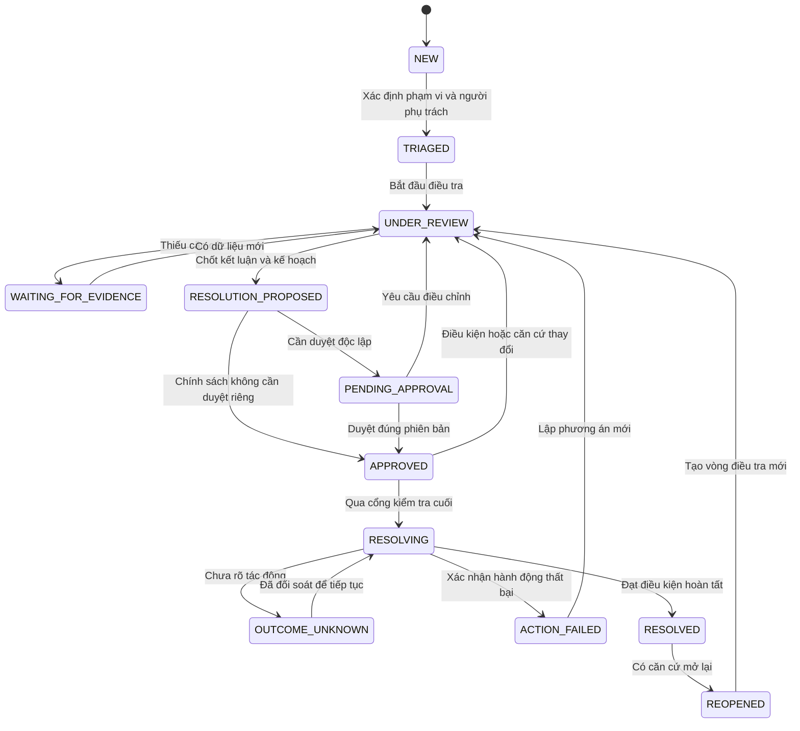

# Giải quyết hồ sơ nghi ngờ gian lận — Fraud case resolution

Trong chương **Fraud Detection**, giải quyết hồ sơ là quá trình chuyển một nghi vấn thành kết luận có căn cứ, biện pháp được cấp phép và kết quả đã được đối soát. Công việc có thể bao gồm xác định cảnh báo sai, ngăn yêu cầu hoàn tiền trùng, xử lý lạm dụng khuyến mại, khôi phục quyền cho người dùng hợp lệ hoặc chuyển một phần việc sang nhóm có thẩm quyền.

Bài học thuộc module `SECURITY_APPLICATION_SECURITY_BUSINESS_LOGIC_SECURITY`. Trọng tâm là giữ các quy tắc nghiệp vụ khi đóng một hồ sơ: không bỏ bước phê duyệt, không thao tác sai đối tượng, không hoàn tiền hai lần và không gỡ hạn chế do hồ sơ khác tạo ra. State machine, quyền theo đối tượng, transaction và idempotency phải tiếp tục có hiệu lực trong công cụ điều tra.

Sau bài này, bạn có thể:

- Phân biệt tín hiệu rủi ro, kết luận điều tra, biện pháp và kết quả thực thi.
- Viết điều kiện đủ để giải quyết một hồ sơ và điều kiện mở lại.
- Thiết kế kế hoạch xử lý gắn với bằng chứng, phiên bản và phê duyệt.
- Xử lý retry, tranh chấp giữa người vận hành, callback đến muộn và kết quả chưa rõ.
- Xây dựng các tình huống kiểm thử lạm dụng quy trình giải quyết hồ sơ.

Các vai trò, mã trạng thái, số tiền và thời hạn trong bài là ví dụ thiết kế. Chúng cần được điều chỉnh theo sản phẩm và chính sách của tổ chức; không phải quy tắc mặc định của mọi hệ thống chống gian lận.

## 1. Giải quyết hồ sơ cần tạo ra điều gì?

Một cảnh báo “gửi yêu cầu hoàn tiền nhiều lần” chưa cho biết người dùng gian lận. Nguyên nhân có thể là retry sau timeout, lỗi client, một người cố gửi nhiều lệnh khác nhau hoặc sự kiện bị xử lý lặp trong hệ thống phát hiện.

Nếu hỗ trợ viên chỉ chọn “đóng hồ sơ”, hệ thống có thể còn các vấn đề:

- Khoản hoàn tiền vẫn chưa biết đã thực hiện hay chưa.
- Hạn chế tạm thời của khách hàng chưa được gỡ.
- Một hồ sơ khác vẫn cần giữ hạn chế nhưng đã bị gỡ nhầm.
- Quyết định không ghi căn cứ, khiến người điều tra sau không tái dựng được.
- Nhãn “gian lận” được gửi sang hệ thống phân tích dù chưa đủ bằng chứng.

Một lần giải quyết hoàn chỉnh nên có bốn đầu ra:

| Đầu ra | Câu hỏi cần trả lời |
|---|---|
| Kết luận có phạm vi | Đã xác định điều gì, cho đối tượng và khoảng sự kiện nào? |
| Căn cứ quyết định | Nguồn nào đã được kiểm tra, còn điểm chưa chắc chắn nào? |
| Kế hoạch và kết quả hành động | Hệ thống được phép làm gì và thực tế đã làm đến đâu? |
| Trách nhiệm sau xử lý | Có phần việc đang chờ, lịch xem lại hoặc quyền khiếu nại nào? |

Trạng thái hồ sơ là trạng thái vận hành. Nó không tự thay thế trạng thái của thanh toán, tài khoản, ưu đãi hoặc yêu cầu hoàn tiền.

## 2. Tách tín hiệu, kết luận, hành động và thiệt hại

### 2.1. Bốn lớp dữ liệu khác nhau

| Lớp | Ví dụ | Cách diễn giải |
|---|---|---|
| Tín hiệu phát hiện | Năm request hoàn tiền trong hai phút | Điều kiện cần xem xét, chưa phải kết luận |
| Kết luận điều tra | Các request là retry cùng thao tác đã đối soát | Nhận định có phạm vi và căn cứ |
| Biện pháp xử lý | Không tạo khoản hoàn mới; gỡ một hạn chế của hồ sơ | Hành động cần quyền và kiểm tra riêng |
| Kết quả thực tế | Khoản hoàn gốc thành công; hạn chế của hồ sơ đã gỡ | Dữ kiện xác nhận tác động |

Điểm rủi ro cao là đầu vào để ưu tiên hoặc áp dụng biện pháp tạm thời theo chính sách. Nếu hệ thống chưa hiệu chuẩn điểm thành xác suất, không được diễn giải một điểm số như “xác suất gian lận 95%”. Kể cả điểm đã được hiệu chuẩn, quyết định với một hồ sơ vẫn cần xem xét chất lượng dữ liệu và điều kiện nghiệp vụ.

Một người dùng bị chặn giao dịch cũng chưa chứng minh đã gian lận. Biện pháp ngăn ngừa và kết luận về hành vi cần có các trường dữ liệu riêng.

### 2.2. Bộ kết luận minh họa

| Kết luận | Ý nghĩa | Điều kiện ghi nhận |
|---|---|---|
| `CONFIRMED_FRAUD` | Có đủ căn cứ theo chính sách cho hành vi gian lận cụ thể | Lưu nhận định, bằng chứng và người có thẩm quyền |
| `FALSE_POSITIVE` | Cảnh báo đang xét đã được giải thích bằng hoạt động hợp lệ hoặc lỗi phát hiện | Nêu rõ cảnh báo nào sai và bằng chứng giải thích |
| `POLICY_ABUSE` | Có lạm dụng quy tắc sản phẩm nhưng không gán thêm kết luận ngoài căn cứ | Ánh xạ với chính sách và hành động cụ thể |
| `INCONCLUSIVE` | Chưa đủ căn cứ để xác nhận hoặc bác bỏ | Ghi điểm còn thiếu và hướng xử lý tiếp |

Đây là taxonomy của ví dụ. Hệ thống thực tế cần định nghĩa ranh giới và quan hệ giữa các nhãn, tránh việc hai điều tra viên dùng cùng từ cho hai ý nghĩa khác nhau.

`DUPLICATE`, `MERGED` hoặc `TRANSFERRED` nên thể hiện cách xử lý hồ sơ, không tự trở thành nhãn gian lận cho khách hàng. Một hồ sơ được chuyển tuyến vẫn cần người tiếp nhận và trách nhiệm theo dõi rõ ràng.

### 2.3. Thiệt hại không được đếm từ số cảnh báo

Cần tách giá trị bị đe dọa, thiệt hại đã xác nhận, số đã thu hồi và số còn đang tranh chấp hoặc đối soát. Một khoản tiền có nhiều cảnh báo hoặc nhiều case không được tính lặp vào tổng thiệt hại.

Không coi một lệnh bị chặn là khoản thiệt hại đã xảy ra rồi được thu hồi. Tương tự, nhà cung cấp chấp nhận yêu cầu thu hồi chưa chứng minh tiền đã được thu hồi thành công.

Các con số cần liên kết với bút toán hoặc operation có thẩm quyền và giữ đúng loại tiền. Quy tắc quy đổi để báo cáo tổng phải được định nghĩa riêng với dữ liệu giao dịch gốc.

## 3. Bất biến nghiệp vụ khi giải quyết hồ sơ

| Bất biến | Cách thể hiện trong hệ thống |
|---|---|
| Đúng quyền và đối tượng | Người xử lý có quyền với tenant, hồ sơ và từng hành động được đề xuất |
| Có căn cứ cho kết luận | Kết luận tham chiếu một tập bằng chứng đã xác minh và có phiên bản |
| Không coi nghi vấn là sự thật đã chứng minh | Tín hiệu, độ tin cậy và kết luận được lưu riêng |
| Không tạo giá trị trùng | Hoàn tiền, thu hồi ưu đãi hoặc bồi hoàn phải có định danh nghiệp vụ chống trùng |
| Không gỡ hạn chế ngoài phạm vi | Chỉ xử lý các hold hoặc restriction thuộc quyết định được cấp phép |
| Không làm mất lịch sử | Điều chỉnh, mở lại và thu hồi tạo phiên bản hoặc sự kiện mới |
| Không đóng khi tác động bắt buộc chưa rõ | Operation chưa có kết quả phải được đối soát hoặc chuyển giao theo điều kiện rõ |
| Không dùng duyệt cũ cho nội dung mới | Kết luận, hành động và tham số trọng yếu gắn với cùng phiên bản |
| Không xử lý lặp sai khi cạnh tranh | Hai điều tra viên hoặc worker cùng thao tác vẫn giữ được bất biến |
| Không bỏ quên trách nhiệm theo dõi | Mọi phần việc còn mở có người phụ trách, thời hạn và trạng thái riêng |

OWASP khuyến nghị mô hình hóa workflow ở máy chủ, kiểm tra quyền theo ngữ cảnh đối tượng và bảo vệ các đoạn đọc–kiểm tra–ghi trước cạnh tranh. Các nguyên tắc này áp dụng trực tiếp cho thao tác giải quyết hồ sơ có thể làm thay đổi tiền, quyền hoặc trạng thái. Xem [OWASP Business Logic Security Cheat Sheet](https://cheatsheetseries.owasp.org/cheatsheets/Business_Logic_Security_Cheat_Sheet.html).

Ví dụ, một khoản hoàn phải tiếp tục tuân theo điều kiện:

```text
successfulRefunds + activeRefundReservations + requestedRefund
    <= refundableCapturedAmount
```

Các thành phần phải cùng thanh toán, loại tiền và đơn vị, với quy tắc tính tránh trừ cùng một khoản hai lần. Kết luận “đã xác nhận gian lận” không tự cho phép vượt điều kiện này hoặc sửa sổ giao dịch để khớp câu chuyện điều tra.

## 4. Hồ sơ cần dữ liệu nào để quyết định?

### 4.1. Tập bằng chứng có cấu trúc

Một hồ sơ nên liên kết được:

- Các tín hiệu gốc, phiên bản rule hoặc model, thời điểm và dữ liệu đầu vào liên quan.
- Các đối tượng nghiệp vụ như tài khoản, đơn, thanh toán, ưu đãi và operation.
- Sự kiện thực tế đã xác nhận cùng nguồn và thời điểm đối soát.
- Những nhận định đang kiểm tra, bằng chứng hỗ trợ và bằng chứng mâu thuẫn.
- Biện pháp tạm thời đã áp dụng, chủ sở hữu và điều kiện xem lại.
- Lịch sử phân công, xác minh, đề xuất, phê duyệt và chuyển trạng thái.

Đối với mỗi nhận định, cần tách dữ kiện quan sát được khỏi suy luận. Ví dụ “ba request có cùng idempotency key và digest” là dữ kiện; “đây là retry hợp lệ” là kết luận cần đối chiếu thêm người gọi, operation và ngữ cảnh.

### 4.2. Chất lượng và nguồn gốc

| Nguồn | Vai trò có thể có | Giới hạn cần kiểm tra |
|---|---|---|
| Sổ giao dịch và operation nội bộ | Xác định tác động đã được hệ thống ghi nhận | Dữ liệu có thể đang chờ đối soát bên ngoài |
| Kết quả nhà cung cấp qua kênh xác thực | Xác nhận trạng thái thao tác liên quan | Phải khớp merchant, tenant và mã giao dịch |
| Audit quản trị | Giải thích ai đã đổi quyền hoặc trạng thái | Cần kiểm tra độ phủ và quyền truy cập |
| Thông tin do khách hàng cung cấp | Giải thích ngữ cảnh, bổ sung chứng cứ | Có thể nhầm, bị sửa hoặc không thuộc đúng đối tượng |
| Điểm hoặc rule phát hiện | Ưu tiên kiểm tra và giải thích cảnh báo | Không tự chứng minh chủ thể có lỗi |

Đừng đếm nhiều bản sao của cùng một nguồn thành nhiều xác nhận độc lập. Một email, ảnh chụp email và ghi chú sao chép nội dung email vẫn có thể cùng xuất phát từ một thông tin chưa được xác minh.

Giá trị hash giúp đối chiếu tính toàn vẹn so với bản đã ghi nhận, không chứng minh nội dung là thật hoặc ai có quyền sử dụng. Dữ liệu nhập vào cần được hiển thị an toàn; nội dung ghi chú không được trở thành chỉ dẫn có thẩm quyền để công cụ tự bỏ kiểm tra.

### 4.3. Thời gian và dữ liệu đến muộn

Lưu riêng thời điểm sự kiện, thời điểm tiếp nhận và thời điểm xác minh. Một callback đến muộn có thể giải thích request retry trước đó; không suy ra thứ tự nghiệp vụ chỉ từ thứ tự các dòng xuất hiện trên màn hình.

Khi nguồn mâu thuẫn, cần xác định hệ thống có thẩm quyền cho từng loại dữ kiện và tạo công việc đối soát. Nếu chưa biết khoản hoàn đã thành công, hồ sơ không nên kết luận rằng “không có giao dịch” chỉ vì chưa thấy callback.

## 5. Kế hoạch giải quyết gắn với phiên bản

Kết luận không nên được lưu dưới dạng một nút “Fraud/Not fraud” rồi tự áp dụng nhiều hành động ngầm. Hãy tạo một kế hoạch có phiên bản, tách kết luận khỏi danh sách hành động.

Ví dụ hồ sơ cảnh báo hoàn tiền trùng sau timeout:

```json
{
  "caseId": "FRC-6006",
  "tenantId": "TENANT-A",
  "caseVersion": 12,
  "resolutionVersion": 3,
  "subject": {
    "accountId": "ACC-101",
    "paymentId": "PAY-7001"
  },
  "disposition": "FALSE_POSITIVE",
  "reasonCode": "RETRY_OF_RECONCILED_REFUND",
  "evidenceSetVersion": 5,
  "verificationRefs": ["VER-301", "VER-302", "VER-303"],
  "originalRefundOperationId": "REF-2001",
  "actions": [
    {
      "actionId": "ACT-01",
      "type": "RELEASE_CASE_HOLD",
      "holdId": "HOLD-FRC-6006",
      "expectedHoldVersion": 8
    }
  ],
  "financialDecision": "NO_ADDITIONAL_REFUND",
  "policyVersion": "fraud-resolution-v4",
  "makerPersonId": "PERSON-21",
  "approvalRef": "APR-301",
  "expiresAt": "2026-11-22T04:00:00Z"
}
```

Đây là snapshot minh họa do máy chủ quản lý, không phải tập thuộc tính client được tự khẳng định. `financialDecision` ghi rõ không tạo khoản hoàn mới; thao tác tài chính gốc được theo dõi bằng `originalRefundOperationId`.

Kế hoạch cần ràng buộc với tenant, hồ sơ, đối tượng, bằng chứng, chính sách và thời hạn. Thay đổi kết luận, đích tác động, số tiền, hold hoặc căn cứ trọng yếu phải tạo phiên bản mới và đánh giá lại phê duyệt.

Danh tính người lập và người duyệt lấy từ ngữ cảnh được xác thực. Nếu chính sách yêu cầu độc lập, một người dùng hai tài khoản không được tính thành hai người chỉ vì hai `userId` khác nhau.

Nếu không cần hành động, kế hoạch vẫn cần ghi lý do `NO_ACTION_REQUIRED` cùng điều kiện đóng. “Không hành động vì không đủ bằng chứng” và “không hành động vì request đã được xử lý đúng” là hai kết quả khác nhau cần phân biệt.


## 6. Quy trình ra quyết định và phân tách trách nhiệm

### 6.1. Phân loại và giao người chịu trách nhiệm

Khi tiếp nhận hồ sơ, cần xác định phạm vi, mức ưu tiên, tác động đang diễn ra và người phụ trách. Các cảnh báo trùng có thể được gom về cùng hồ sơ, nhưng phải giữ liên kết tới từng tín hiệu nguồn.

Cơ chế claim hoặc lease giúp giảm hai người cùng xử lý một việc. Nó không thay thế quyền truy cập, kiểm tra phiên bản hay cơ chế đồng thời tại bước tạo tác động. Một điều tra viên mở màn hình trước chưa có quyền ghi đè quyết định mới hơn.

### 6.2. Điều tra và kiểm tra giả thuyết thay thế

Đối với cảnh báo hoàn tiền trùng, có thể xem xét:

| Giả thuyết | Dữ liệu cần đối chiếu |
|---|---|
| Retry hợp lệ | Key, digest, người gọi, operation gốc và thời điểm timeout |
| Client tự gửi lệnh mới | Key khác nhau, nội dung, luồng client và các operation được tạo |
| Pipeline phát hiện đếm lặp | Mã sự kiện nguồn, trạng thái consumer và dấu vết xử lý |
| Yêu cầu tác động sai thanh toán | Quan hệ tenant, người yêu cầu, đơn và payment |
| Có thao tác quản trị bất thường | Audit về thay đổi quyền, phê duyệt hoặc vượt hạn mức |

Việc dùng key khác nhau có thể là lỗi client hoặc hành vi cố ý. Nó là dữ kiện cần giải thích, chưa tự chứng minh động cơ. Kết luận nên giới hạn ở điều đã có căn cứ, chẳng hạn “đã phát hiện yêu cầu vượt hạn mức và đã chặn” thay vì gán thêm nhận định không được chứng minh.

### 6.3. Phê duyệt phù hợp tác động

Chính sách có thể cho điều tra viên tự ghi một số kết luận ít rủi ro, nhưng yêu cầu người duyệt độc lập cho hoàn tiền ngoại lệ, gỡ hạn chế nhạy cảm, thu hồi tài sản hoặc thay đổi quyền lớn.

Cần xác định:

- Ai được đề xuất và ai được duyệt từng hành động.
- Người duyệt có đúng phạm vi tenant và đối tượng không.
- Có yêu cầu độc lập theo người hoặc nhóm chức năng không.
- Quyết định có còn hiệu lực khi quyền, bằng chứng hoặc chính sách thay đổi không.
- Hành động có nằm trong hạn mức và loại ngoại lệ được phép không.

OWASP khuyến nghị kiểm tra cấp phép giao dịch tại máy chủ, bảo vệ thứ tự các bước và kiểm tra cuối gắn với thực thi. Nếu dữ liệu giao dịch thay đổi, thông tin cấp phép trước đó cần được xử lý lại phù hợp. Xem [OWASP Transaction Authorization Cheat Sheet](https://cheatsheetseries.owasp.org/cheatsheets/Transaction_Authorization_Cheat_Sheet.html).

### 6.4. Thiếu bằng chứng và quá hạn xử lý

Đưa hồ sơ vào trạng thái chờ có chủ sở hữu, nội dung còn thiếu và mốc xem lại. Với biện pháp tạm thời, phải định nghĩa thời hạn, người có quyền gia hạn và điều kiện hết hiệu lực hoặc chuyển tuyến.

Không tự đổi `INCONCLUSIVE` thành `CONFIRMED_FRAUD` chỉ vì khách hàng chưa phản hồi. Việc không phản hồi có thể được chính sách dùng cho một quyết định vận hành nhất định, nhưng không được làm biến mất mức độ chưa chắc chắn của kết luận.

Tương tự, quá thời hạn xử lý không tự cho phép đóng mọi phần việc hoặc giữ hạn chế vô thời hạn. Cần tuyến leo thang và quyết định có thẩm quyền cho phần việc chưa xong.

## 7. State machine của hồ sơ và hành động

### 7.1. Vòng đời hồ sơ



Sơ đồ là mô hình minh họa. Các tuyến gộp trùng hoặc chuyển nhóm cần quy tắc riêng và không được dùng làm đường bỏ qua phần việc bắt buộc.

`APPROVED` chỉ có nghĩa kế hoạch đủ điều kiện được xem xét thực thi. Quyền hiện tại, dữ liệu đối tượng và các bất biến vẫn phải được kiểm tra tại bước thực thi.

### 7.2. Vòng đời từng hành động

Một hồ sơ có thể chứa nhiều hành động với kết quả khác nhau:

```text
PLANNED -> QUEUED -> RUNNING -> SUCCEEDED
                          -> FAILED_CONFIRMED
                          -> OUTCOME_UNKNOWN

PLANNED hoặc QUEUED -> CANCELLED, nếu chưa vượt điểm cam kết
```

Hành động bên ngoài có thể không hủy được sau khi đã gửi. Quy trình cần định nghĩa điểm cam kết và cách đối soát, thay vì để một nút hủy luôn báo thành công.

Một kế hoạch gồm “gỡ hold, gửi thông báo, thu hồi ưu đãi” phải ghi được kết quả từng mục. Không dùng một cờ `done` chung để che việc một hành động còn chưa rõ.

### 7.3. Điều kiện chuyển sang RESOLVED

Trong chính sách minh họa, điều kiện gồm:

- Kết luận, căn cứ, phạm vi và phiên bản đã được chốt.
- Phê duyệt bắt buộc có hiệu lực và gắn đúng nội dung.
- Các hành động bắt buộc có kết quả xác định hoặc đã được chuyển giao theo một tuyến được cho phép, có người nhận trách nhiệm rõ ràng.
- Biện pháp tạm thời của hồ sơ đã được xử lý hoặc tiếp tục theo một quyết định có chủ sở hữu và mốc xem lại.
- Các operation tài chính liên quan đã được đối soát đủ cho kết luận và hành động đang đóng.
- Audit và các công việc thông báo cần thiết đã được tạo bền vững.

Nếu hệ thống chọn chỉ cho đóng khi mọi hành động bắt buộc đã hoàn tất, không được lách bằng cách đổi chúng thành tùy chọn. Nếu cho phép chuyển giao, trạng thái của việc được chuyển vẫn phải hiển thị và liên kết được từ hồ sơ gốc.

## 8. Thực thi kế hoạch mà vẫn giữ bất biến

### 8.1. Kiểm tra cuối tại điểm tạo tác động

Khi thực thi, máy chủ đọc kế hoạch đã chốt thay vì tin một tập tham số mới từ giao diện. Cần kiểm tra quyền người thực hiện, phiên bản hồ sơ, bằng chứng, quyết định, đối tượng và trạng thái hiện tại.

Ví dụ, đề xuất gỡ `HOLD-FRC-6006` không cho phép gỡ `HOLD-OTHER-88`. Nếu hold đã được thay đổi hoặc chuyển sang một quy trình khác, phải đánh giá lại thay vì tìm một hold gần giống để thao tác.

Quyền điều tra không tự cho phép hoàn tiền hoặc khóa tài khoản. Mỗi hành động nhạy cảm cần quyền và điều kiện riêng, kể cả khi được gọi từ một màn hình có tên “Resolve case”.

### 8.2. Mô hình hạn chế theo nguyên nhân

Một tài khoản có thể đồng thời chịu nhiều hạn chế:

```text
ACC-101
  HOLD-FRC-6006: tạo bởi hồ sơ FRC-6006, đang chờ giải thích retry
  HOLD-OTHER-88: tạo bởi hồ sơ FRC-6088, cần xác minh độc lập
```

Khi giải quyết `FRC-6006` là cảnh báo sai, chỉ gỡ hold thuộc phạm vi quyết định đó. Hạn chế hiệu lực của tài khoản được tính lại từ những nguyên nhân còn hoạt động. `HOLD-OTHER-88` vẫn có thể giữ tài khoản ở trạng thái hạn chế.

Thiết kế cần lưu chủ sở hữu, loại hạn chế, đối tượng, phạm vi hành động bị chặn và điều kiện hết hiệu lực. Một cờ toàn cục `blocked=false` dễ làm mất các nguyên nhân độc lập.

Nếu nhiều dịch vụ cùng quản lý hạn chế, cần quy tắc tổng hợp và nguồn có thẩm quyền. Chỉ khóa bảng case trong một dịch vụ không bảo vệ được việc dịch vụ khác thêm một hạn chế cùng lúc.

### 8.3. Transaction cục bộ cho trường hợp gỡ hold

Đoạn mã giả theo phong cách Java dưới đây minh họa trường hợp dữ liệu hồ sơ, hold, quyết định và kết quả đối soát nằm trong cùng phạm vi transaction. Các phương thức là hợp đồng thiết kế, không phải mã Java có thể sao chép để chạy.

```java
ResolutionRef resolveFalsePositive(ResolveCommand cmd, AnalystContext actor) {
    return tx.required(() -> {
        var fraudCase = cases.lockInTenant(actor.tenantId(), cmd.caseId());
        access.requireCurrentResolutionScope(actor, fraudCase);

        var slot = idempotency.lockOrCreate(
            actor.tenantId(), actor.id(), "RESOLVE_FRAUD_CASE", cmd.key());
        slot.requireSameDigest(canonicalDigest(cmd));
        if (slot.hasResolution()) {
            return resolutions.visibleReference(actor, slot.resolutionId());
        }

        fraudCase.requireVersion(cmd.caseVersion());
        fraudCase.requireState(APPROVED);
        var plan = fraudCase.frozenResolution(cmd.resolutionVersion());
        var decision = decisions.lockFor(plan);
        decision.requireValidUnusedAndBoundTo(plan, clock.instant());
        evidence.requireVerifiedCurrentSet(plan);
        policy.requireCurrentAuthorityAndAllowedActions(actor, plan);
        approvals.requireIndependentReviewWhenNeeded(plan, decision);
        refunds.requireReconciledOriginalOperation(plan.originalRefundRef());

        var restrictions = restrictionsRepo.lockAggregate(plan.accountId());
        var hold = restrictions.requireHoldOwnedByCase(
            plan.holdId(), fraudCase.id(), plan.expectedHoldVersion());
        var operation = operations.createUniqueFor(
            fraudCase.id(), plan.version(), plan.releaseActionId());

        hold.releaseFor(operation.id());
        restrictions.recomputeEffectiveRestrictions();
        decision.consumeFor(operation.id());
        var resolution = fraudCase.markResolvedFromCompletedLocalPlan(
            plan, operation, "NO_ADDITIONAL_REFUND");
        slot.attach(resolution.id());
        audit.appendResolution(actor, fraudCase, plan, operation);
        outbox.appendCaseResolved(resolution);
        return resolution.reference();
    });
}
```

Các điều kiện cần hiện thực hóa:

- Truy vấn tài khoản và hold tiếp tục giới hạn theo tenant và quan hệ với hồ sơ; định danh tài khoản không tự là quyền truy cập.
- Khóa aggregate hạn chế chỉ hữu ích nếu mọi đường thêm, gỡ và tính hạn chế cùng tuân theo cơ chế đó.
- Quyền, quyết định và tập bằng chứng có thể thay đổi phải tham gia cơ chế đồng thời phù hợp; nếu nằm ở dịch vụ khác, transaction cục bộ không tự khóa được chúng.
- Operation có ràng buộc duy nhất được cơ sở dữ liệu thực thi, không chỉ kiểm tra `exists()` trước khi ghi.
- Phương thức đánh dấu hoàn tất kiểm tra toàn bộ hành động bắt buộc của kế hoạch; ví dụ này chỉ có một hành động cục bộ và không tạo thêm hoàn tiền.
- Mọi ghi dữ liệu nghiệp vụ, idempotency, audit bắt buộc và outbox trong ví dụ cùng commit hoặc cùng rollback.
- Các lần từ chối cần được ghi theo cơ chế không mất theo rollback nghiệp vụ, với nội dung tối thiểu phù hợp.

Đối với deadlock hoặc xung đột phiên bản, retry phải đọc và kiểm tra lại điều kiện. Không chỉ gửi lại các giá trị đã đọc trước đó rồi giả định kế hoạch vẫn hợp lệ.

### 8.4. Chống trùng ở nhiều lớp

| Lớp | Ràng buộc minh họa | Mục đích |
|---|---|---|
| Request API | Key theo tenant, chủ thể và hành động; gắn digest | Trả lại kết quả cũ cho retry cùng nội dung |
| Hành động giải quyết | Duy nhất theo case, phiên bản kế hoạch và actionId | Key khác không tạo lại cùng hành động |
| Operation tiền hoặc giá trị | Định danh nghiệp vụ ở dịch vụ thực thi | Nhiều case không tạo trùng cùng khoản tác động |
| Sự kiện tích hợp | Định danh sự kiện và chuyển trạng thái hợp lệ | Callback hoặc message lặp không cộng tác động lần nữa |

Hai hồ sơ khác nhau có thể cùng liên quan một khoản thanh toán. Tính duy nhất theo case chưa đủ ngăn hoàn hai lần; dịch vụ tiền phải giữ bất biến toàn thanh toán và đối chiếu các operation liên quan.

Cùng idempotency key nhưng thay kết luận, phiên bản hoặc đối tượng phải báo xung đột. Trước khi trả lại kết quả đã cache, vẫn cần kiểm tra người gọi có quyền xem dữ liệu đó ở thời điểm hiện tại.

## 9. Hành động bên ngoài, timeout và đối soát

### 9.1. Lưu ý định trước, theo dõi kết quả sau

Với hành động gọi nhà cung cấp hoặc dịch vụ khác, một transaction cục bộ có thể lưu operation, tiêu thụ quyết định theo hợp đồng, cập nhật case sang `RESOLVING` và tạo outbox. Worker thực hiện operation sau commit.

Cần xác định điểm cam kết: quyết định đã cấp phép bền vững cho operation hay worker còn phải kiểm tra lại trước tác động. Quy tắc thu hồi, hết hạn và hủy phải khớp lựa chọn đó. Một trường `approved=true` trong message không đủ để bỏ qua phần kiểm tra cần thiết.

Outbox không tự bảo đảm hệ thống bên ngoài thực hiện đúng một lần. Dùng định danh operation ổn định và cơ chế idempotency của bên nhận nếu có, theo đúng thời hạn và cách so khớp tham số mà tích hợp hỗ trợ.

### 9.2. Timeout không chứng minh không có tác động

Sau khi gửi yêu cầu, có thể xảy ra:

- Bên nhận chưa thực hiện và không phản hồi.
- Bên nhận đã thực hiện nhưng phản hồi bị mất.
- Bên nhận đang xử lý và sẽ gửi kết quả sau.

Vì vậy, giữ operation ở `OUTCOME_UNKNOWN` và đối soát theo mã cũ. Không tạo operation mới chỉ để có một phản hồi nhanh hơn. Một action chỉ được xem là thất bại xác định khi có căn cứ phù hợp với giao thức tích hợp, kể cả khả năng kết quả đến muộn.

Nếu có tiền đang giữ chỗ, cần tiếp tục tính đúng trong bất biến cho đến khi có điều kiện giải phóng được định nghĩa. Case không được gỡ giữ chỗ tùy ý chỉ vì điều tra viên đã chọn kết luận.

### 9.3. Callback trùng hoặc không đúng thứ tự

Cần xác minh nguồn callback, quan hệ tenant–đối tượng–operation và tính hợp lệ của chuyển trạng thái. Sự kiện bị phát lại không được ghi thêm một khoản tiền hoặc gỡ hạn chế lần nữa.

Không mặc định sự kiện đến cuối cùng là trạng thái đúng nhất. Một callback cũ đến trễ không được làm operation đã xác nhận thành công quay về trạng thái đang xử lý. Kết quả mâu thuẫn cần được đối soát và ghi lịch sử, không ghi đè để làm dashboard hết cảnh báo.

## 10. Điều chỉnh, mở lại và gộp hồ sơ

### 10.1. Mở lại khi có căn cứ mới

Có thể mở lại khi xuất hiện bằng chứng mới đáng kể, kết quả đối soát mâu thuẫn, người có thẩm quyền phát hiện lỗi hoặc người dùng cung cấp thông tin khiến kết luận cần đánh giá lại.

Lưu lý do mở lại, người thực hiện, kết luận trước và phiên bản mới. Không xóa quyết định cũ. Các operation đã thành công vẫn là sự kiện đã xảy ra; mở lại case không làm chúng tự biến mất hoặc được phép chạy lại.

Nếu cần thay đổi bù, tạo hành động mới có căn cứ, trạng thái mong đợi và thẩm quyền riêng. Ví dụ, gỡ nhầm một hạn chế không được khắc phục bằng cách sửa lịch sử như thể chưa từng gỡ.

### 10.2. Gộp trùng cần giữ quan hệ và trách nhiệm

Một hồ sơ trùng có thể liên kết tới hồ sơ chính thay vì lặp điều tra. Tuy nhiên, cần kiểm tra:

- Hai hồ sơ thực sự nói về cùng vấn đề nào và phần nào khác nhau.
- Bằng chứng, người phụ trách và công việc chờ đã được chuyển giao ra sao.
- Các hold thuộc hồ sơ nào, có cần đổi chủ sở hữu theo quyết định rõ ràng không.
- Operation tài chính hoặc thu hồi giá trị có bị đếm và thực hiện lặp không.
- Người dùng của từng phạm vi có được phép xem hồ sơ chính không.

Gộp không tự xác nhận hai chủ thể là cùng người và không tự gỡ mọi hạn chế của hồ sơ phụ. Hồ sơ liên tenant cần quyền điều tra liên tenant riêng, không mở quyền chỉ vì dữ liệu có liên quan.

### 10.3. Chuyển tuyến vẫn cần theo dõi

Nếu công việc chuyển sang nhóm thanh toán, an ninh tài khoản hoặc người xử lý tranh chấp, ghi đơn vị nhận, mã hồ sơ liên quan, phần việc, thời hạn và tiêu chí phản hồi. “Đã chuyển” không đồng nghĩa biện pháp bên ngoài đã hoàn thành.

Với `INCONCLUSIVE`, có thể kết thúc vòng điều tra theo chính sách nhưng cần giữ nhãn chưa xác định và quyết định rõ cho biện pháp tạm thời. Không mặc định kéo dài hạn chế hoặc biến người dùng thành đối tượng gian lận đã xác nhận.


## 11. Thông báo, xem xét lại và trải nghiệm người dùng hợp lệ

### 11.1. Thông báo dựa trên kết quả thực tế

Thông báo cần phản ánh điều đã xác nhận. Nếu mới tiếp nhận lệnh gỡ hạn chế ở hệ thống khác, chưa thể thông báo tài khoản đã hoàn toàn hoạt động bình thường.

Với ví dụ cảnh báo sai do retry, có thể thông báo rằng yêu cầu đã được kiểm tra, khoản hoàn gốc đã có kết quả và hồ sơ này không tạo thêm khoản hoàn. Nếu tài khoản còn hạn chế do một vấn đề khác, nội dung không được làm người dùng hiểu rằng mọi hạn chế đều đã được gỡ.

Thông báo nên giải thích phạm vi kết quả, việc còn chờ, mốc phản hồi tiếp theo và cách cung cấp thêm thông tin phù hợp. Không tiết lộ dữ liệu của người khác, bí mật xác thực hoặc chi tiết quy tắc giúp lạm dụng hệ thống phát hiện.

### 11.2. Yêu cầu xem xét lại

Một luồng xem xét lại có thể nhận bằng chứng bổ sung, đối chiếu kết luận và chuyển tới người khác theo chính sách. Yêu cầu đó phải liên kết với hồ sơ và quyết định trước, không trở thành một lệnh tự động gỡ hạn chế.

Cần tránh biến việc gửi nhiều yêu cầu xem xét lại thành cách né hạn mức hoặc tạo thêm bồi hoàn. Các request có thể được gom về cùng quy trình, nhưng vẫn giữ nội dung mới, thời điểm nhận và người chịu trách nhiệm.

Nếu yêu cầu bị từ chối xem xét lại, phải ghi lý do theo chính sách. Việc khách hàng không đồng ý không tự là tín hiệu đủ để xác nhận gian lận.

### 11.3. Biện pháp tương xứng và có thể kiểm tra

Một kết luận cảnh báo sai cần dẫn đến việc xem xét các hậu quả do chính cảnh báo tạo ra: hạn chế, điểm trạng thái, hàng đợi chờ và thông báo trước đó. Tuy nhiên, chỉ điều chỉnh những hậu quả nằm trong phạm vi có căn cứ.

Đối với hồ sơ chưa rõ, chính sách cần xác định biện pháp tạm thời phù hợp, thời hạn và tuyến xem lại. Không yêu cầu người dùng cung cấp mật khẩu, OTP cho nhân viên hoặc bí mật hệ thống để được bỏ hạn chế; bước xác minh nên diễn ra trên luồng được bảo vệ và trả về kết quả có phạm vi rõ ràng.

## 12. Audit và bảo vệ dữ liệu hồ sơ

### 12.1. Dấu vết cần tái dựng được quyết định

Một chuỗi audit hữu ích gồm:

| Nhóm | Dữ liệu cần liên kết |
|---|---|
| Tín hiệu | Alert, rule hoặc model version, thời điểm và phạm vi |
| Hồ sơ | Case, tenant, đối tượng và phiên bản |
| Điều tra | Người phụ trách, nhận định, verification và phiên bản tập bằng chứng |
| Quyết định | Kết luận, reason code, kế hoạch và policy version |
| Phê duyệt | Người lập, người duyệt, thời điểm, phạm vi và hiệu lực |
| Tác động | Action, operation, idempotency record tham chiếu, kết quả trước/sau |
| Theo dõi | Chuyển tuyến, thông báo, mốc xem lại, mở lại và điều chỉnh |

OWASP khuyến nghị ghi đủ ngữ cảnh thời điểm, chủ thể, hành động và kết quả; các hoạt động nghiệp vụ bất thường cũng cần được quan sát. Dữ liệu từ vùng tin cậy khác cần được xem xét nguồn và độ tin cậy. Xem [OWASP Logging Cheat Sheet](https://cheatsheetseries.owasp.org/cheatsheets/Logging_Cheat_Sheet.html).

Audit nên phân biệt đề xuất với thực thi và thành công cục bộ với kết quả bên ngoài. Các sự kiện như `RESOLUTION_PROPOSED`, `RESOLUTION_APPROVED`, `ACTION_REQUESTED`, `ACTION_RECONCILED` và `CASE_RESOLVED` có ý nghĩa khác nhau.

### 12.2. Giữ lịch sử và quyền đọc phù hợp

Điều chỉnh kết luận phải giữ phiên bản cũ, lý do, người sửa và liên kết tới thông tin mới. Quyền sửa quyết định, quyền thực thi và quyền xóa dữ liệu audit cần được phân tách phù hợp để tránh một người che mọi dấu vết của mình.

Người được xem case chưa chắc được tải mọi tài liệu gốc hoặc xuất toàn bộ hồ sơ. Cần quyền theo tenant, đối tượng và trường dữ liệu, cùng dấu vết truy cập với dữ liệu nhạy cảm.

Tài liệu gốc nên nằm trong kho được kiểm soát; ghi chú và log lưu tham chiếu hoặc dữ liệu đã che khi phù hợp. Tránh sao chép toàn bộ thông tin định danh, dữ liệu thanh toán hoặc bí mật vào nhiều nơi chỉ để thuận tiện tra cứu.

Thời hạn lưu, xóa và bảo toàn theo nhu cầu điều tra cần được tổ chức định nghĩa. Đóng case không tự đồng nghĩa được xóa mọi chứng cứ; cũng không có nghĩa giữ mọi tài liệu vô thời hạn.

### 12.3. Case đã đóng vẫn cần khả năng đối soát

Hệ thống cần tra được operation và quyết định liên quan ngay cả khi case không còn trong hàng đợi làm việc. Callback hoặc thông tin mới đến sau khi đóng phải được gắn vào đúng hồ sơ và kích hoạt tuyến đánh giá lại khi cần.

Không cập nhật lặng lẽ kết luận cũ để số liệu khớp kết quả mới. Việc điều chỉnh là một sự kiện có trách nhiệm riêng và có thể ảnh hưởng nhãn phản hồi cho hệ thống phát hiện.

## 13. Phản hồi cho hệ thống phát hiện và đo hiệu quả xử lý

### 13.1. Kết luận vận hành chưa tự là nhãn huấn luyện chuẩn

Một hồ sơ có thể đóng vì trùng, chuyển nhóm, hết một vòng xử lý hoặc chưa đủ bằng chứng. Những lý do đó không tự là nhãn “không gian lận” hoặc “gian lận”.

Nếu gửi kết quả sang rule engine hoặc pipeline phân tích, nên có hợp đồng nhãn gồm:

```text
case_id, resolution_version
label, label_scope, label_status
reason_code, evidence_set_version
reviewer_or_approver_ref
policy_version, decided_at
source_alert_refs, rule_or_model_version
supersedes_label_ref, nếu đây là điều chỉnh
```

`label_scope` cần nêu nhãn áp dụng cho một request, giao dịch, loại hành vi hay khoảng thời gian nào. Kết luận một cảnh báo retry là sai không tự chứng minh mọi hành động của tài khoản đều hợp lệ.

Hệ thống nhận cần xử lý nhãn bị thu hồi hoặc thay thế. Sự kiện cập nhật lặp không được tạo nhiều phiếu xác nhận cho cùng một quyết định.

### 13.2. Tránh vòng lặp tự củng cố

Nếu model gắn điểm cao, tài khoản bị chặn và trạng thái bị chặn lại được dùng làm bằng chứng xác nhận model đúng, hệ thống tạo vòng lặp thiếu xác minh độc lập.

Tương tự, nếu mọi case `INCONCLUSIVE` đều bị ép thành nhãn gian lận để dễ huấn luyện, dữ liệu phản hồi sẽ không còn phản ánh mức độ chắc chắn thật. Cần giữ trạng thái chưa xác định và tiêu chí chọn nhãn đủ chất lượng riêng.

Dữ liệu xem xét thủ công cũng có thiên lệch lựa chọn: thường chỉ các cảnh báo hoặc nhóm rủi ro cao mới được điều tra. Không suy ra trực tiếp chất lượng trên toàn bộ giao dịch từ tập này nếu chưa có thiết kế đánh giá phù hợp.

### 13.3. Chỉ số cần ghi rõ mẫu số

| Chỉ số | Ý nghĩa cần định nghĩa |
|---|---|
| Thời gian tiếp nhận | Từ lúc phát sinh hoặc nhận alert đến khi có người phụ trách |
| Thời gian kết luận | Từ đầu vòng điều tra đến khi có kết luận được chốt |
| Thời gian giải quyết thực tế | Đến khi các điều kiện hoàn tất và đối soát được đáp ứng |
| Tỷ trọng cảnh báo sai trong tập đã kết luận | Tập case nào được tính, gồm những nhãn nào và có loại chưa xác định không |
| Tỷ lệ mở lại | Số hồ sơ mở lại trên nhóm hồ sơ đã giải quyết trong kỳ xác định |
| Hành động chưa rõ kết quả | Số operation và tuổi chờ, theo nguồn và loại tác động |
| Tác động tới người dùng hợp lệ | Hạn chế hoặc thời gian chờ do cảnh báo sau đó được xác định sai |
| Thiệt hại và thu hồi xác nhận | Bút toán hoặc operation đã đối soát, có quy tắc chống đếm trùng |

Trong đánh giá nhị phân có nhãn tham chiếu, false positive rate thường tính bằng `FP / (FP + TN)`, tức trên các trường hợp thực sự không gian lận. Tỷ trọng cảnh báo sai trong những alert đã được xem xét có mẫu số khác và không nên được gọi lẫn là cùng chỉ số. Nếu chỉ có dữ liệu điều tra một phần, cần nói rõ giới hạn trước khi dùng tỷ lệ để thay rule.

Tốc độ đóng case cần được đọc cùng tỷ lệ mở lại, tác động chưa rõ và chất lượng kết luận. Tối ưu số case đóng mỗi ngày bằng cách bỏ đối soát sẽ làm mất ý nghĩa bảo vệ nghiệp vụ.

## 14. Kiểm thử các tình huống lạm dụng quy trình

Bảng dưới là đặc tả hành vi cần kiểm thử trong môi trường được phép. Quan sát cả trạng thái case, quyết định, hold, operation, sổ giao dịch, audit và outbox.

| Tình huống | Thiết lập thử | Kết quả mong đợi |
|---|---|---|
| Giải quyết sai tenant | Người xử lý chỉ có quyền A gọi case của B | Không đọc hoặc thay đổi dữ liệu ngoài quyền |
| Có quyền xem nhưng không có quyền hành động | Gọi hoàn tiền hoặc gỡ hạn chế từ màn hình case | Bị chặn bởi quyền theo hành động và đối tượng |
| Giả trạng thái trên client | Gửi `approved=true` hoặc trạng thái cuối | Máy chủ dùng trạng thái và quyết định đã lưu |
| Bỏ bước điều tra hoặc duyệt | Gọi thực thi từ `NEW` hoặc `PENDING_APPROVAL` | Không tạo tác động |
| Tự phê duyệt khi bị cấm | Người lập dùng tài khoản hoặc vai trò khác để duyệt | Kiểm tra độc lập theo chính sách vẫn có hiệu lực |
| Sửa kế hoạch sau duyệt | Đổi hold, số tiền hoặc kết luận | Quyết định cũ không được dùng |
| Bằng chứng bị thu hồi | Thu hồi verification trước thực thi | Chặn hoặc đánh giá lại kế hoạch phụ thuộc |
| Quyết định hết hạn | Gọi sau `expiresAt` | Không tạo tác động mới bằng quyết định cũ |
| Quyền bị thu hồi | Thu hẹp phạm vi trước thực thi | Áp dụng quyền hiện tại theo hợp đồng |
| Hai điều tra viên cùng sửa | Hai quyết định dựa trên cùng case version | Không ghi đè im lặng; một bên phải đánh giá lại |
| Retry cùng key và nội dung | Phản hồi giải quyết bị mất | Trả lại cùng resolution, không chạy lại hành động |
| Cùng key khác nội dung | Đổi phiên bản hoặc kết luận khi retry | Báo xung đột |
| Hai key cùng action | Gửi thực thi đồng thời | Tối đa một tác động của cùng hành động |
| Hai case cùng khoản hoàn | Hai kế hoạch cùng đề nghị hoàn một giao dịch | Dịch vụ tiền giữ bất biến và chống trùng liên case |
| Gỡ sai hold | Case này tham chiếu hold của case khác | Bị chặn do không khớp chủ sở hữu và phạm vi |
| Còn hold độc lập | Gỡ hold của case đã giải quyết | Hold khác còn hiệu lực; trạng thái tổng hợp vẫn đúng |
| Thêm hold cạnh tranh | Một luồng thêm hạn chế khi luồng khác gỡ | Không ghi đè làm mất nguyên nhân mới |
| Timeout hành động bên ngoài | Không nhận phản hồi sau khi gửi | `OUTCOME_UNKNOWN`, đối soát operation cũ |
| Callback lặp | Phát lại cùng sự kiện | Không cộng tiền hoặc cập nhật tác động lần hai |
| Callback cũ đến sau | Gửi trạng thái cũ sau kết quả cuối | Không đảo ngược chuyển trạng thái sai |
| Kế hoạch thành công một phần | Một action xong, một action chưa rõ | Case không báo hoàn tất trái điều kiện; giữ kết quả từng mục |
| Lỗi trước commit | Gây lỗi sau khi gỡ hold nhưng chưa commit | Không tồn tại trạng thái gỡ hold mà case và quyết định chưa khớp |
| Mở lại hồ sơ | Có bằng chứng mới sau `RESOLVED` | Giữ lịch sử cũ, tạo vòng mới, không replay operation đã thành công |
| Gộp hồ sơ có hold riêng | Gộp hai case liên quan | Không tự gỡ hoặc chuyển hold nếu chưa có quyết định rõ |
| Thiếu bằng chứng quá hạn | Người dùng chưa phản hồi | Không tự gán `CONFIRMED_FRAUD`; có tuyến xử lý theo chính sách |
| Nhãn chưa xác định | Đóng vòng điều tra với `INCONCLUSIVE` | Không ép thành nhãn nhị phân xác nhận gian lận |
| Nhãn điều chỉnh bị giao lặp | Gửi lại sự kiện thay nhãn | Hệ thống nhận áp dụng đúng phiên bản, không đếm nhiều lần |
| Truy cập tài liệu trực tiếp | Người ngoài phạm vi dùng evidenceId có thật | Bị chặn và có dấu vết truy cập phù hợp |
| Thông báo trước đối soát | Worker mới tiếp nhận hành động | Không tuyên bố tác động đã hoàn tất |

Với ca cạnh tranh, cần chủ động đồng bộ các request để chúng tranh cùng phiên bản hoặc dữ liệu. Hai phản hồi thành công có thể cùng trỏ về một kết quả idempotent hợp lệ, nên cần kiểm tra số operation và tác động thực tế.

Ngoài các ca bị chặn, phải có ca hợp lệ: hồ sơ đủ căn cứ, đủ quyền và phê duyệt được xử lý; action hoàn thành đúng một lần; retry trả cùng kết quả; trường hợp chưa rõ được đối soát rồi tiếp tục; người dùng hợp lệ được khôi phục đúng phần hạn chế thuộc hồ sơ.

## 15. Ví dụ xuyên suốt: giải thích cảnh báo hoàn tiền trùng

### 15.1. Bối cảnh

`PAY-7001` của `TENANT-A` đã thu 2.000.000 VND. Operation `REF-2001` yêu cầu hoàn toàn bộ khoản này. Client bị timeout và gửi lại cùng idempotency key, cùng nội dung. Dịch vụ hoàn trả về cùng operation, nhưng pipeline cảnh báo đã đếm số request và mở `FRC-6006`.

Hồ sơ tạo `HOLD-FRC-6006` để hạn chế một số thao tác trong lúc kiểm tra. Tài khoản còn `HOLD-OTHER-88` do một hồ sơ độc lập quản lý.

Trong ví dụ, dữ liệu tiền dùng đơn vị nhỏ nhất đã cấu hình cho VND, một đơn vị tương ứng một đồng. Không suy ra quy ước tiền tệ khác từ ví dụ này.

### 15.2. Điều tra và kết luận có phạm vi

| Bước | Dữ kiện hoặc quyết định | Hệ quả |
|---|---|---|
| 1. Đối chiếu request | Cùng key, digest, người gọi và payment | Có căn cứ xem đây là retry cùng thao tác |
| 2. Đối soát operation | Nhà cung cấp và sổ giao dịch xác nhận `REF-2001` đã hoàn 2.000.000 VND | Không cần tạo khoản hoàn mới |
| 3. Kiểm tra pipeline | Cảnh báo đếm request thay vì tác động duy nhất | Giải thích được nguồn cảnh báo sai |
| 4. Chốt phạm vi | `FALSE_POSITIVE` cho cảnh báo retry của `FRC-6006` | Không kết luận thay hồ sơ độc lập |
| 5. Lập kế hoạch | `NO_ADDITIONAL_REFUND`; chỉ gỡ `HOLD-FRC-6006` | Giữ các điều kiện nghiệp vụ khác |
| 6. Duyệt và thực thi | Kiểm tra quyền, phiên bản, căn cứ và hold | Một operation gỡ hold trong transaction |
| 7. Kiểm tra kết quả | Hold của case đã gỡ, hold độc lập còn hiệu lực | Thông báo đúng phạm vi khôi phục |
| 8. Hoàn tất | Lưu audit, nhãn phản hồi có phạm vi và công việc sửa rule | Case được giải quyết khi đạt điều kiện |

Vì đã hoàn đủ 2.000.000 VND, yêu cầu hoàn thêm tiền phải bị chặn theo bất biến dù người vận hành đang xử lý cảnh báo sai. Nếu kết quả `REF-2001` chưa rõ ở bước 2, giữ công việc đối soát và không mặc định tạo hoàn mới.

### 15.3. Trường hợp phát hiện vấn đề khác

Nếu đối chiếu cho thấy một request tham chiếu payment không thuộc quyền người gọi, đó là dữ kiện khác cần điều tra. Hệ thống vẫn chặn request theo quyền đối tượng ngay lập tức, còn kết luận về hành vi được đưa ra theo căn cứ và chính sách.

Nếu có hai operation đã thực sự tạo tác động vượt giới hạn, cần điều tra lỗ hổng bất biến, xác nhận số tiền và lập phương án xử lý phù hợp. Việc gán nhãn người dùng không thay thế sửa cơ chế chống trùng hoặc khôi phục dữ liệu đúng cách.

### 15.4. Các câu hỏi cần trả lời trước khi giải quyết

- Kết luận đang áp dụng cho cảnh báo, hành động, đối tượng và khoảng thời gian nào?
- Bằng chứng nào hỗ trợ, bằng chứng nào mâu thuẫn và điều gì còn chưa rõ?
- Ai có quyền quyết định và thực hiện từng hành động; có cần người duyệt độc lập không?
- Phiên bản hồ sơ, bằng chứng, kế hoạch và chính sách có còn khớp nhau không?
- Mỗi action có định danh duy nhất, kết quả xác định và đường đối soát chưa?
- Các hạn chế hoặc phần việc của hồ sơ khác có được giữ đúng phạm vi không?
- Việc mở lại, phản hồi nhãn và thông báo có bảo toàn lịch sử cùng mức độ chắc chắn không?

Một lần giải quyết hồ sơ có chất lượng nối được **tín hiệu → căn cứ đã kiểm tra → kết luận có phạm vi → hành động được cấp phép → kết quả đã đối soát → trách nhiệm theo dõi**. Chuỗi này cần được thể hiện trong dữ liệu và đường thực thi, để công cụ điều tra tiếp tục giữ đúng các quy tắc nghiệp vụ của hệ thống.
