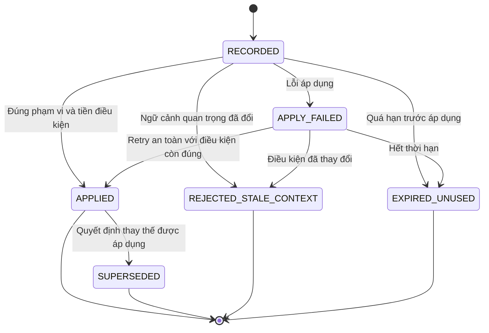

# Fraud decision audit: truy nguyên quyết định chống gian lận

## 1. Mục tiêu và phạm vi

Fraud decision audit là khả năng truy nguyên một quyết định chống gian lận từ dữ liệu đã được biết tại thời điểm đánh giá, qua chính sách hoặc người ra quyết định, đến hành động thực sự được áp dụng và kết quả được quan sát sau đó.

Bài học thuộc chương **Fraud Detection** của module `SECURITY_APPLICATION_SECURITY_BUSINESS_LOGIC_SECURITY`. Phạm vi là bảo vệ quy tắc nghiệp vụ trước hành vi bỏ qua phê duyệt, sửa giá, thao tác sai quyền và gửi yêu cầu trùng. Audit phải liên kết với business invariants, state machine, quyền theo đối tượng, transaction và idempotency.

Sau bài học, người học có thể:

- Phân biệt kết quả đánh giá rủi ro với quyết định có hiệu lực và hiệu ứng nghiệp vụ.
- Thiết kế bản ghi quyết định đủ để giải thích dữ liệu, phiên bản và lý do.
- Giữ liên kết giữa quyết định tự động, xem xét thủ công, ghi đè và kết quả điều tra.
- Xử lý quyết định cũ, gửi lại, lỗi áp dụng và thiếu dữ liệu audit.
- Tái dựng quyết định trong phạm vi dữ liệu còn giữ mà không phát sinh giao dịch thật.
- Kiểm thử khả năng che giấu, làm sai lệch hoặc lợi dụng lịch sử quyết định.

Các mã định danh, thời hạn, điểm số và cấu trúc dữ liệu trong bài là thiết kế minh họa. Chúng không phải chính sách chống gian lận hay ngưỡng vận hành dùng chung cho mọi hệ thống.

## 2. Tình huống dẫn nhập: vì sao yêu cầu hoàn bị giữ lại?

Một khách hàng hỏi vì sao yêu cầu hoàn 700.000 VND chưa được xử lý. Nhân viên hỗ trợ thấy một dòng “risk score = 0,82” và một trạng thái đang chờ. Sau đó, một người xem xét cho phép tiếp tục nhưng giao dịch vẫn chưa được gửi.

Chỉ hai giá trị điểm số và trạng thái không trả lời được các câu hỏi quan trọng:

- Điểm 0,82 được tính từ những dữ liệu nào và có ý nghĩa gì?
- Chính sách nào chọn giữ lại, ai triển khai chính sách đó và khi nào?
- Dữ liệu thanh toán lúc đánh giá có đầy đủ và còn mới không?
- Quyết định giữ lại đã được áp dụng hay chỉ được đề xuất?
- Người cho phép tiếp tục có quyền trên đúng tenant, giao dịch và số tiền không?
- Sau khi qua bước kiểm tra gian lận, yêu cầu có còn thiếu phê duyệt nghiệp vụ khác không?

Một audit tốt phải giải thích được chuỗi quyết định mà không suy diễn từ trạng thái hiện tại. Cùng một trạng thái chờ có thể đến từ xem xét gian lận, chờ phê duyệt nghiệp vụ, lỗi hạ tầng hoặc đang đối soát giao dịch bên ngoài.

Đối tượng cần audit gồm cả quyết định cho phép, yêu cầu xác minh thêm, giữ để xem xét, từ chối và hành vi dự phòng khi bộ đánh giá gặp lỗi. Chỉ lưu quyết định từ chối sẽ bỏ mất các lần hệ thống đã cho qua rồi phát sinh vấn đề.

## 3. Tách các lớp quyết định và kết quả

### 3.1. Những lớp cần được ghi riêng

| Lớp | Câu hỏi được trả lời | Ví dụ |
| --- | --- | --- |
| Kiểm tra quyền | Actor có được yêu cầu hành động trên đối tượng này không? | Nhân viên có quyền xử lý hồ sơ thuộc tenant A |
| Kiểm tra bất biến nghiệp vụ | Hành động có hợp lệ với trạng thái, tiền và phê duyệt hiện tại không? | Không hoàn vượt hạn mức; không bỏ bước duyệt |
| Đánh giá rủi ro | Dữ liệu quan sát cho thấy mức rủi ro nào? | Engine trả chỉ số 0,82, có một feature đã cũ |
| Quyết định xử lý | Chính sách chọn hành động nào từ kết quả đánh giá? | `HOLD_FOR_REVIEW` |
| Áp dụng quyết định | Dịch vụ đích đã áp dụng được hành động chưa? | Risk gate chuyển sang `REVIEW_REQUIRED` |
| Hiệu ứng nghiệp vụ | Tiền hoặc trạng thái nghiệp vụ thực tế thay đổi ra sao? | Chưa có execution gửi đến nhà cung cấp |
| Kết quả điều tra | Điều gì được biết sau khi xem xét thêm? | Chưa đủ bằng chứng gian lận; phát hiện dữ liệu chậm cập nhật |

Quyết định rủi ro thấp không tự cấp quyền truy cập hoặc bỏ phê duyệt nghiệp vụ. Tương tự, người xem xét có thể gỡ một chặn về rủi ro nhưng vẫn không có quyền sửa giá hoặc tạo khoản hoàn vượt số tiền cho phép.

### 3.2. Hành động phải có ngữ nghĩa rõ

Một hợp đồng quyết định minh họa có thể dùng:

| Hành động | Ý nghĩa |
| --- | --- |
| `CLEAR_RISK_GATE` | Qua bước kiểm tra rủi ro trong phạm vi và thời hạn đã xác định |
| `HOLD_FOR_REVIEW` | Giữ thao tác nhạy cảm để người có trách nhiệm xem xét |
| `REQUIRE_STEP_UP` | Cần hoàn thành một bước xác minh cụ thể trước khi đánh giá tiếp |
| `DECLINE_OPERATION` | Từ chối thao tác theo chính sách được ghi nhận |
| `DEFER` | Chưa thể kết luận, chẳng hạn vì dữ liệu hoặc dịch vụ chưa sẵn sàng |

Không dùng từ `ALLOW` chung chung nếu mỗi dịch vụ hiểu nó theo một cách. Nếu sử dụng tên đó, phải định nghĩa rõ nó cho qua lớp nào và các điều kiện còn phải kiểm tra.

Trong ví dụ hoàn tiền, `workflowState` và `riskDisposition` là hai chiều riêng. Yêu cầu có thể ở trạng thái `PENDING_APPROVAL` và có risk disposition `CLEARED`. Trạng thái này vẫn chưa cho phép chuyển tiền vì phê duyệt nghiệp vụ chưa hoàn tất.

## 4. Những câu hỏi một hồ sơ audit cần trả lời

Một hồ sơ quyết định nên trả lời được tám nhóm câu hỏi:

1. **Ai và cái gì:** người yêu cầu, chủ thể bị đánh giá, dịch vụ thực thi, tenant, command và đối tượng nghiệp vụ.
2. **Khi nào:** dữ liệu phát sinh khi nào, sẵn sàng khi nào, được đánh giá khi nào và có hiệu lực khi nào.
3. **Đã biết gì:** feature, nguồn, độ mới, mức đầy đủ và các bằng chứng được dùng tại thời điểm đó.
4. **Dùng chính sách nào:** rule set, model nếu có, ngưỡng, thứ tự ưu tiên, cấu hình và phiên bản triển khai.
5. **Vì sao chọn hành động:** rule nào có hiệu lực, lý do có cấu trúc, nhánh dự phòng hoặc ngoại lệ nào được dùng.
6. **Đã áp dụng gì:** quyết định có được dịch vụ đích chấp nhận, có bị lỗi, hết hạn hoặc từ chối vì ngữ cảnh thay đổi không.
7. **Ai thay đổi quyết định:** người xem xét, thẩm quyền, bằng chứng, phê duyệt và liên kết với quyết định trước.
8. **Biết thêm gì về sau:** kết quả giao dịch, điều tra, khiếu nại hoặc sửa kết luận, cùng nguồn và thời điểm.

Kiểm soát AU-3 trong [NIST SP 800-53 Revision 5](https://nvlpubs.nist.gov/nistpubs/SpecialPublications/NIST.SP.800-53r5.pdf) đề cập nội dung bản ghi audit như loại sự kiện, thời điểm, nơi phát sinh, nguồn, kết quả và các chủ thể liên quan. Bài này mở rộng các trường đó thành hợp đồng riêng cho quyết định chống gian lận.

Một mã `decisionId` giúp liên kết nhưng không thay thế nội dung. Nếu hồ sơ chỉ trỏ đến các bảng có thể bị ghi đè, người điều tra vẫn có thể mất dữ liệu lịch sử cần thiết.

## 5. Thiết kế dữ liệu cho một quyết định có thể giải thích

### 5.1. Các nhóm thông tin chính

| Nhóm | Trường hoặc tham chiếu minh họa | Yêu cầu |
| --- | --- | --- |
| Định danh | `decisionId`, `evaluationId`, `commandId`, `attemptId` | Phân biệt đánh giá, quyết định, lượt gọi và lệnh nghiệp vụ |
| Phạm vi | Tenant, accountRef, paymentRef, số tiền, tiền tệ | Có nguồn và quan hệ được backend xác thực |
| Ngữ cảnh | Phiên bản command, trạng thái, digest nội dung quan trọng | Phát hiện quyết định đã cũ hoặc áp dụng sai đối tượng |
| Dữ liệu đầu vào | Feature snapshot, giá trị, nguồn, chất lượng, thời điểm sẵn sàng | Phản ánh điều đã biết lúc ra quyết định |
| Chính sách | Rule set, artifact digest, ngưỡng, cấu hình, chiến lược ưu tiên | Giữ phiên bản thực sự đã chạy |
| Engine | Kiểu đánh giá, bản build, model artifact nếu có | Không bắt buộc có model khi hệ thống chỉ dùng rule |
| Lý do | Rule có hiệu lực, reason code, nhánh dự phòng | Phân biệt điều kiện khớp với lý do thực sự quyết định hành động |
| Kết quả | Hành động, phạm vi, thời hạn, điều kiện cần hoàn thành | Không trộn với hiệu ứng giao dịch |
| Áp dụng | Enforcement ID, trạng thái trước/sau, lỗi và thời điểm | Cho biết quyết định có hiệu lực thực tế hay chưa |
| Xem xét | Nhân viên, grant, bằng chứng, quyết định liên quan | Truy nguyên trách nhiệm và quyền theo đối tượng |

### 5.2. Feature snapshot phải có thời điểm và chất lượng

Một giá trị như `refund_attempts_15m = 8` chưa đủ. Cần biết nó đếm attempt hay command, trong cửa sổ nào, đã chống giao lại chưa và có đủ dữ liệu không.

Snapshot có thể giữ các giá trị cần thiết trực tiếp hoặc trỏ đến một đối tượng bất biến có phiên bản, phân quyền và thời hạn giữ phù hợp. Nếu chỉ giữ tham chiếu đến một feature store luôn cập nhật, giá trị ngày mai có thể khác dữ liệu từng được dùng hôm nay.

Các trường thời gian hữu ích gồm:

- `eventTime`: thời điểm sự kiện gốc được ghi nhận theo nguồn.
- `availableAt`: thời điểm dữ liệu thực sự sẵn sàng cho việc ra quyết định.
- `evaluatedAt`: thời điểm engine đánh giá.
- `recordedAt`: thời điểm quyết định được lưu bền vững.
- `effectiveAt`: thời điểm dịch vụ đích áp dụng thành công.
- `validUntil`: giới hạn hiệu lực nếu loại quyết định có thời hạn.

Một feature có thể tồn tại trong lịch sử nhưng chưa đến hệ thống lúc quyết định được đưa ra. Không đưa dữ liệu đến muộn vào snapshot cũ rồi trình bày như hệ thống đã biết nó từ trước.

### 5.3. Lý do phải phản ánh nhánh thực sự được dùng

Nếu rule A có điểm ưu tiên cao hơn rule B, audit cần chỉ ra rule nào quyết định hành động cuối cùng. Danh sách mọi rule khớp chưa chứng minh tại sao hệ thống chọn giữ lại thay vì yêu cầu xác minh.

Mã lý do nên có từ vựng được quản lý, chẳng hạn `REFUND_VELOCITY_REVIEW`, `FEATURE_STALE`, `MANUAL_REVIEW_REQUIRED` hoặc `ENGINE_TIMEOUT_FALLBACK`. Mô tả tự do có thể bổ sung ngữ cảnh, nhưng không thay thế reason code ổn định.

Nếu có model, điểm 0,82 phải đi cùng định nghĩa thang đo. Chỉ số rủi ro trong khoảng 0–1 không tự đồng nghĩa xác suất gian lận 82%. Feature attribution hoặc một câu giải thích được tạo sau đó cũng không tự chứng minh nguyên nhân thực tế của hành vi.

Nếu một công cụ sinh văn bản được dùng để tóm tắt hồ sơ, bản tóm tắt cần dẫn đến bằng chứng đã lưu. Không dùng nội dung được tạo sau làm nguồn gốc giả cho một lý do mà engine chưa từng sử dụng.

## 6. Ví dụ bản ghi quyết định và bản ghi áp dụng

Ví dụ dưới đây mô tả một engine chỉ dùng rule. Rule cho trường hợp dữ liệu thanh toán cũ có ưu tiên cao hơn rule về tốc độ gửi đề nghị. Không có model hoặc xác suất được suy diễn thêm.

```json
{
  "schemaVersion": 1,
  "decisionId": "FD-701",
  "evaluationId": "FE-501",
  "decisionKind": "AUTOMATED",
  "tenantId": "TENANT-A",
  "subjectAccountRef": "ACCOUNT-61",
  "commandId": "RCMD-19",
  "commandVersion": 5,
  "paymentRef": "PAY-481",
  "requestedAmountMinor": 700000,
  "currency": "VND",
  "contextDigest": "SERVER_COMPUTED_CONTEXT_DIGEST",
  "evaluatedAt": "2026-11-22T10:00:00.120Z",
  "validUntil": "2026-11-22T10:05:00Z",
  "engine": {
    "type": "RULES",
    "buildVersion": "fraud-engine-12"
  },
  "policy": {
    "ruleSetVersion": "refund-risk-23",
    "artifactDigest": "POLICY_ARTIFACT_DIGEST",
    "priorityStrategy": "HIGHEST_PRIORITY_WINS"
  },
  "featureSnapshot": {
    "snapshotId": "FS-811",
    "featureDefinitionVersion": "refund-features-6",
    "values": {
      "refundCommandCount15m": 8,
      "paymentStatusAgeSeconds": 900
    },
    "quality": {
      "refundCommandCount15m": "AVAILABLE",
      "paymentStatusAgeSeconds": "STALE"
    },
    "availableAt": "2026-11-22T09:59:59.900Z"
  },
  "ruleResults": [
    {"ruleId": "RR-10", "matched": true, "selected": true},
    {"ruleId": "RR-20", "matched": true, "selected": false}
  ],
  "action": "HOLD_FOR_REVIEW",
  "reasonCodes": ["FEATURE_STALE", "MANUAL_REVIEW_REQUIRED"],
  "recordedBy": {
    "workloadId": "FRAUD-DECISION-SERVICE"
  },
  "correlationId": "CORR-401"
}
```

`refundCommandCount15m` đếm command khác nhau theo định nghĩa feature, không phải số message broker nhận được. Giá trị stale của trạng thái thanh toán được thể hiện rõ; hệ thống đang giữ lại theo chính sách chất lượng dữ liệu, chưa kết luận gian lận.

Trong thiết kế này, `validUntil` giới hạn thời điểm có thể bắt đầu áp dụng quyết định. Nếu hành động giữ lại đã được áp dụng, việc đến thời hạn không tự gỡ chặn; việc tiếp tục cần quyết định mới theo chính sách. Các loại quyết định khác phải định nghĩa riêng thời hạn của hành động được cho phép.

Bản ghi áp dụng là một đối tượng khác:

```json
{
  "enforcementId": "ENF-901",
  "decisionId": "FD-701",
  "commandId": "RCMD-19",
  "status": "APPLIED",
  "riskDispositionBefore": "PENDING_EVALUATION",
  "riskDispositionAfter": "REVIEW_REQUIRED",
  "workflowState": "PENDING_APPROVAL",
  "commandVersionBefore": 5,
  "commandVersionAfter": 6,
  "effectiveAt": "2026-11-22T10:00:00.200Z",
  "financialExecutionId": null
}
```

Bản ghi này chứng minh bước giữ để xem xét đã được áp dụng. Nó đồng thời cho thấy chưa có execution tài chính. Nếu thao tác áp dụng thất bại, cần một sự kiện lỗi tương ứng; không sửa `APPLIED` thành thất bại sau đó mà làm mất lịch sử.

Tài liệu [OPA Decision Logs](https://www.openpolicyagent.org/docs/management-decision-logs) là một ví dụ triển khai thực tế về định danh quyết định, metadata phiên bản chính sách và che dữ liệu nhạy cảm trước khi xuất log. Schema trên độc lập với OPA và được thiết kế cho ngữ cảnh nghiệp vụ của bài.

## 7. Chuỗi sự kiện và vòng đời quyết định

### 7.1. Lưu lịch sử theo sự kiện bổ sung

Một chuỗi điển hình có thể gồm:

```text
fraud.evaluation.completed
    -> fraud.decision.recorded
    -> fraud.enforcement.applied
    -> fraud.review.recorded
    -> fraud.override.authorized
    -> fraud.decision.recorded (quyết định mới)
    -> fraud.enforcement.applied
    -> fraud.outcome.observed
```

Các sự kiện không nhất thiết nằm trong cùng dịch vụ hoặc cùng transaction. Audit phải lưu liên kết, nguồn và trạng thái; không hứa tính nguyên tử xuyên toàn bộ chuỗi chỉ vì có cùng correlation ID.

Quyết định mới tham chiếu quyết định trước, cùng lý do thay thế hoặc thay đổi phạm vi. Một sự kiện bổ sung xác nhận việc thay thế có thể dùng để dựng trạng thái hiện tại. Bản ghi lịch sử ban đầu vẫn phản ánh điều hệ thống từng quyết định.

### 7.2. State machine cho việc áp dụng



Đây là trạng thái dựng từ các sự kiện áp dụng, không yêu cầu ghi đè bản ghi quyết định bất biến. Nếu backend chỉ lưu một cột “quyết định hiện tại”, người điều tra sẽ khó biết lần áp dụng nào bị lỗi hoặc quyết định nào từng có hiệu lực.

Hết hạn trước áp dụng phải khác việc một quyết định đã có hiệu lực rồi được thay thế. Hành vi với một chặn đang tồn tại phải được chính sách định nghĩa; không tự cho phép hành động tiền chỉ vì bản ghi đánh giá cũ đã quá hạn.

## 8. Transaction, ngữ cảnh cũ và điểm áp dụng

### 8.1. Tách đánh giá từ xa khỏi transaction ngắn

Quy trình minh họa có ba giai đoạn:

1. Tạo snapshot ngữ cảnh từ dữ liệu được phép và ghi phiên bản liên quan.
2. Gọi engine, nhận kết quả đã xác thực và lưu bằng chứng đánh giá ở nguồn tương ứng.
3. Mở transaction ngắn để kiểm tra lại ngữ cảnh, lưu quyết định, áp dụng risk gate, ghi audit và outbox.

Không giữ khóa database trong suốt thời gian chờ engine từ xa. Khi quay lại, phải kiểm tra các thuộc tính quan trọng có thể đổi, như số tiền, tiền tệ, người nhận, tenant, phiên bản command hoặc tình trạng phê duyệt.

Nếu snapshot không còn khớp, lưu kết quả “đã cũ, chưa áp dụng” và đánh giá lại theo chính sách. Không lấy một quyết định cho 700.000 VND để áp dụng sau khi command đã đổi thành 900.000 VND.

Digest giúp so sánh nội dung nhưng phải được tạo từ biểu diễn chuẩn hóa phía server và bao phủ các trường quan trọng. Digest do client tự gửi không thay thế được dữ liệu có thẩm quyền hoặc kiểm tra quan hệ đối tượng.

### 8.2. Mã giả Java cho điểm áp dụng

Đoạn sau minh họa áp dụng **risk disposition**, chưa tạo giao dịch hoàn tiền. Các kiểu và repository là mã giả; việc khóa, uniqueness và ghi outbox cần triển khai thật.

```java
ApplyReceipt applyDecision(
        RecordedEvaluation evaluation,
        TrustedServicePrincipal caller) {

    return transactions.required(() -> {
        RefundCommand command = repository.lockCommand(
                evaluation.commandId());
        authorization.requireDecisionApplyScope(caller, command);

        ApplyReceipt previous = enforcement.findReceipt(
                evaluation.decisionId());
        if (previous != null) {
            decisionRecords.requireSameEvaluation(evaluation);
            return previous;
        }

        decisionRecords.insertOrVerifySameEvaluation(evaluation);
        Instant now = clock.instant();
        ApplyPlan plan = decisionGate.plan(evaluation, command, now);

        if (!plan.applicable()) {
            ApplyReceipt rejected = enforcement.appendRejected(
                    evaluation, command, plan.reasonCode(), now);
            outbox.appendDecisionEnforcementRejected(rejected);
            return rejected;
        }

        // Chỉ thay risk disposition; không bỏ phê duyệt nghiệp vụ.
        command.applyRiskDisposition(plan.disposition());
        ApplyReceipt applied = enforcement.appendApplied(
                evaluation, command, now);
        outbox.appendDecisionEnforced(applied);
        return applied;
    });
}
```

`decisionGate.plan` phải kiểm tra thời hạn, phiên bản và digest ngữ cảnh, hành động được phép, ràng buộc thay thế và các điều kiện liên quan. `RecordedEvaluation` đến từ kênh được xác thực; nó không được tạo bằng cách tin mọi trường trong request bên ngoài.

Kiểm tra idempotency xảy ra trước việc so sánh phiên bản sau áp dụng, vì lần áp dụng đầu có thể đã tăng phiên bản command. Gửi lại cùng quyết định cần trả kết quả cũ, trong khi cùng `decisionId` nhưng khác nội dung phải bị từ chối.

Nếu transaction thất bại, bản ghi áp dụng và thay đổi risk disposition cùng rollback. Kết quả đánh giá đã xảy ra ở engine vẫn cần có nguồn audit riêng để không bị mất dấu. Những lỗi không thể commit vào transaction đó phải được ghi qua kênh lỗi hoặc journal riêng theo chính sách.

### 8.3. Hạn chế bảo đảm xuyên dịch vụ

Việc engine đã ghi `evaluation.completed` không chứng minh dịch vụ nghiệp vụ đã áp dụng. Ngược lại, dịch vụ nghiệp vụ có thể đã commit nhưng phản hồi cho caller bị mất.

Cần đối chiếu theo `evaluationId`, `decisionId` và enforcement ID để tìm các trường hợp đánh giá chưa nhận được quyết định, quyết định chưa có kết quả áp dụng hoặc áp dụng thành công nhưng mất phản hồi. Retry và đối soát phải dùng các định danh ổn định.

Ngay trước một hành động tiền, backend vẫn kiểm tra quyền, hạn mức, phê duyệt và trạng thái hiện tại. Risk gate đã qua không phải giấy phép vô thời hạn cho mọi phiên bản command sau đó.

## 9. Idempotency và các quyết định cạnh tranh

### 9.1. Đơn vị chống trùng

| Tình huống | Đơn vị cần giữ ổn định | Hành vi audit |
| --- | --- | --- |
| Broker giao lại cùng sự kiện | Producer và event ID | Không tạo thêm sự kiện logic hoặc tăng bộ đếm quyết định |
| Caller gửi lại cùng quyết định | Decision ID và digest nội dung | Trả kết quả áp dụng đã có |
| Đánh giá lại bằng dữ liệu mới | Evaluation ID và decision ID mới | Tham chiếu quyết định hoặc ngữ cảnh trước |
| Người xem xét sửa kết luận | Review ID và quyết định mới | Bổ sung lịch sử, giữ kết luận cũ |
| Giao dịch tài chính retry | Command, nghĩa vụ và execution | Không coi retry là quyết định hoàn tiền mới |

Một lần gửi lại không nên bị đếm như một lần engine mới đánh giá. Một lần đánh giá lại hợp lệ cũng không được bị mất vì chỉ chống trùng theo account hoặc payment.

Nếu consumer đánh dấu đã xử lý sự kiện tách rời việc cập nhật trạng thái dựng lại, crash có thể gây thiếu hoặc đếm trùng. Thiết kế consumer phải có cơ chế nhất quán giữa dấu xử lý và thay đổi tương ứng.

### 9.2. Hai quyết định cho cùng một phiên bản

Giả sử hai engine cùng đánh giá command phiên bản 5. Một bên chọn giữ lại, bên kia cho qua risk gate. Không nên để thứ tự message đến tình cờ quyết định kết quả.

Cần quy tắc có thẩm quyền rõ ràng, ví dụ chỉ chấp nhận đánh giá từ orchestration hiện tại, kiểm tra evaluation generation và cập nhật có điều kiện theo phiên bản. Quyết định đến sau có thể bị từ chối vì ngữ cảnh đã đổi hoặc đi qua luồng thay thế được phép.

Dùng timestamp lớn nhất làm quy tắc duy nhất là chưa đủ khi đồng hồ lệch hoặc dữ liệu đầu vào khác nhau. Audit phải ghi vì sao một quyết định được chọn và quyết định cạnh tranh bị loại theo cơ chế nào.

## 10. Xem xét thủ công, ghi đè và khiếu nại

### 10.1. Một lần ghi đè là một quyết định có trách nhiệm

Người xem xét cần quyền theo tenant, hồ sơ, hành động và hạn mức. Danh tính nhân viên lấy từ ngữ cảnh xác thực, không lấy từ trường `reviewerId` do client tự khai.

Một hồ sơ ghi đè nên chứa:

- Quyết định bị tác động, command và phiên bản được xem xét.
- Người đề nghị, người xem xét và người duyệt nếu chính sách yêu cầu độc lập.
- Mã lý do, bằng chứng đã xem và thời điểm dữ liệu được biết.
- Hành động mới, phạm vi, thời hạn và các điều kiện còn phải hoàn thành.
- Grant hoặc chính sách tạo thẩm quyền, cùng kết quả áp dụng thực tế.

Một ghi chú “khách VIP, cho qua” không đủ để chứng minh quyền hoặc bằng chứng. Những trường hợp ngoại lệ cần lý do có cấu trúc và quy trình thích hợp cho sản phẩm.

### 10.2. Không xóa lịch sử để biểu diễn sửa kết luận

Khi người xem xét xác nhận dữ liệu cũ gây giữ nhầm, tạo quyết định mới liên kết với quyết định cũ. Không sửa snapshot cũ thành dữ liệu mới rồi làm như hệ thống đã có kết luận đúng ngay từ đầu.

Nếu phát hiện lỗi dữ liệu trong bản ghi, có thể bổ sung sự kiện hiệu chỉnh, trường bị ảnh hưởng, nguồn xác nhận và người thực hiện. View hiện tại có thể hiển thị kết luận đã sửa, đồng thời cho phép người có quyền xem lịch sử.

### 10.3. Khiếu nại và phân biệt nội dung công khai

Hồ sơ khiếu nại cần liên kết đến quyết định liên quan, bằng chứng bổ sung, người xử lý và kết quả. Kết luận mới không tự động khẳng định mọi quyết định trước đó đều thiếu căn cứ; phải xem dữ liệu nào đã có tại từng thời điểm.

Thông báo cho khách hàng nên được dựng từ một lớp thông tin được phép công bố, có phiên bản mẫu hoặc tham chiếu thông báo. Không gửi nguyên rule, ngưỡng, dữ liệu của tài khoản liên quan hoặc ghi chú điều tra nội bộ.

Nếu thông báo bên ngoài và quyết định nội bộ khác nhau về mức chi tiết, audit cần giải thích quan hệ đó. Không tạo thông báo khẳng định gian lận đã được xác nhận khi hồ sơ chỉ đang ở trạng thái cần xem xét.

## 11. Tái dựng, replay và đánh giá lại

### 11.1. Ba hoạt động khác nhau

| Hoạt động | Câu hỏi | Dữ liệu sử dụng |
| --- | --- | --- |
| Tái dựng lịch sử | Hệ thống đã biết và làm gì? | Bản ghi và snapshot thực tế đã lưu |
| Tính lại lịch sử | Cùng phiên bản và đầu vào cũ có tái tạo kết quả được không? | Artifact, cấu hình, dữ liệu và runtime phù hợp |
| Đánh giá giả định | Chính sách mới sẽ quyết định thế nào trên dữ liệu cũ? | Snapshot cũ cùng phiên bản đánh giá thử mới |

Kết quả giả định phải có namespace hoặc loại bản ghi riêng và tham chiếu quyết định gốc. Nó không thay thế sự thật lịch sử và không được tự gửi lệnh đến dịch vụ tài chính.

### 11.2. Ghi rõ giới hạn tái tạo

Muốn tính lại cần giữ được rule hoặc model artifact, cấu hình, định nghĩa feature, snapshot, cách chuẩn hóa và phiên bản engine cần thiết. Một nhãn phiên bản chỉ có ích khi có thể xác định đúng artifact đã chạy; nên lưu digest và nguồn artifact được bảo vệ.

Digest chứng minh nội dung khớp với một giá trị tham chiếu còn tin cậy, nhưng không tự khẳng định artifact an toàn hoặc được phê duyệt. Quyền triển khai và lịch sử phê duyệt chính sách cũng cần được truy nguyên.

Không phải hệ thống nào cũng tái tạo được kết quả giống từng bit: có thể tồn tại xử lý ngẫu nhiên, phụ thuộc môi trường hoặc dịch vụ ngoài thay đổi. Audit phải ghi cấp độ tái tạo đạt được và các thành phần còn thiếu.

Nếu dữ liệu đã hết thời hạn giữ, tham chiếu và digest còn lại có thể giúp đối chiếu tính toàn vẹn nhưng không khôi phục được nội dung đầu vào. Báo cáo cần nói rõ giới hạn này thay vì hứa replay đầy đủ.

### 11.3. Tránh dùng dữ liệu tương lai

Một phản hồi điều tra hoặc tranh chấp đến sau nhiều ngày chỉ được dùng làm kết quả hậu kiểm tại thời điểm nó được biết. Không dùng nó như feature sẵn có trong quyết định ban đầu.

Khi tính sai dương hoặc sai âm, cần ghi nguồn nhãn, độ trễ, phạm vi hồ sơ đã được xem xét và phiên bản định nghĩa. Quyết định bị khiếu nại chưa chắc là sai; quyết định không bị khiếu nại cũng chưa chắc đúng.

## 12. Bảo vệ audit và giới hạn dữ liệu nhạy cảm

### 12.1. Tách dữ liệu thường dùng khỏi bằng chứng hạn chế

Có thể chia thành ba lớp:

| Lớp | Nội dung | Quyền điển hình |
| --- | --- | --- |
| Chỉ mục quyết định | ID, loại hành động, reason code, thời gian, trạng thái áp dụng | Nhóm hỗ trợ hoặc vận hành trong phạm vi cần thiết |
| Snapshot có kiểm soát | Feature, chất lượng, phiên bản, ngữ cảnh đã chuẩn hóa | Nhóm đánh giá và điều tra có quyền |
| Bằng chứng nhạy cảm | Chứng từ hoặc dữ liệu gốc cần cho điều tra | Quyền riêng, có ghi nhận truy cập và thời hạn giữ |

Không ghi mật khẩu, OTP, access token, cookie phiên, khóa bí mật hoặc dữ liệu thanh toán nguyên bản vào hồ sơ quyết định. Các trường nhập tự do phải được giới hạn và xử lý an toàn khi ghi hoặc hiển thị.

Tham chiếu và dữ liệu đã giả danh vẫn có thể liên kết đến cá nhân hoặc quan hệ kinh doanh. Chúng cần phân quyền và vòng đời phù hợp. Một hash không tự làm cho dữ liệu nhạy cảm trở thành dữ liệu công khai.

### 12.2. Phân quyền ghi, đọc và quản trị

Người có quyền xem xét một giao dịch không tự có quyền xóa lịch sử quyết định. Người triển khai rule không nên có thể tự che giấu toàn bộ hoạt động triển khai và áp dụng của mình.

AU-9 trong [NIST SP 800-53 Revision 5](https://nvlpubs.nist.gov/nistpubs/SpecialPublications/NIST.SP.800-53r5.pdf) đề cập bảo vệ thông tin và công cụ audit trước truy cập, sửa hoặc xóa trái phép. Áp dụng vào thiết kế này, cần tách quyền thao tác nghiệp vụ khỏi quyền quản trị kho bằng chứng và theo dõi các hành động đặc quyền trên audit.

Tìm kiếm theo tenant, xem chi tiết, xuất dữ liệu và truy cập bằng chứng đều cần kiểm tra quyền riêng. Một ID khó đoán không thay thế được quyền theo đối tượng. Các truy vấn hoặc export nhạy cảm nên tạo dấu vết sử dụng.

### 12.3. Tính toàn vẹn và giới hạn của cơ chế mật mã

Có thể dùng lưu trữ chỉ bổ sung, bản sao tách quyền, sequence và cơ chế kiểm chứng tính toàn vẹn. Một hash chain theo partition có dạng minh họa:

```text
H_i = Hash(H_(i-1) || CanonicalEncode(event_i) || sequence_i)
```

Nếu một người có thể sửa toàn bộ log và mọi giá trị kiểm chứng, họ có thể tính lại cả chuỗi. Vì vậy, muốn phát hiện việc viết lại hoặc cắt bỏ lịch sử, cần điểm kiểm chứng được bảo vệ độc lập, quản lý khóa nếu có chữ ký và cơ chế đối chiếu sequence hoặc số lượng.

Chuỗi hash theo partition cũng không tự tạo thứ tự tổng thể xuyên mọi dịch vụ. Cần lưu phạm vi sequence, timestamp, liên kết nhân quả và trạng thái đối chiếu phù hợp.

Một hồ sơ có tính toàn vẹn chứng minh được rằng nội dung không bị thay đổi theo bảo đảm của cơ chế. Nó không tự chứng minh feature chính xác, rule hợp lý hoặc người xem xét không thông đồng.

### 12.4. Lưu giữ và hiệu chỉnh

Chính sách lưu giữ phải bao gồm record, snapshot, artifact, bằng chứng, bản sao và export. Thiết kế “chỉ bổ sung” phục vụ tính truy nguyên trong thời gian lưu; việc hết hạn hoặc xóa có thẩm quyền vẫn cần quy trình theo chính sách áp dụng.

Nếu cần ẩn hoặc loại bỏ dữ liệu nhạy cảm, ghi nhận việc xử lý và giới hạn tái dựng còn lại bằng metadata được phép giữ. Không để retention của snapshot ngắn hơn nhu cầu audit mà không công bố rằng khả năng giải thích sẽ giảm.

## 13. Xử lý lỗi audit và đối chiếu độ đầy đủ

### 13.1. Quyết định khi thành phần bị lỗi

| Lỗi | Hành vi minh họa |
| --- | --- |
| Không lưu được record bắt buộc tại điểm áp dụng | Không commit thay đổi risk disposition trong kiến trúc minh họa |
| Bộ thu audit tập trung ngừng nhưng local journal/outbox còn bền vững | Tiếp tục theo chính sách, theo dõi tồn đọng và đồng bộ lại |
| Engine timeout | Tạo quyết định dự phòng có mã lý do và phiên bản chính sách phù hợp |
| Thiếu hoặc stale feature | Ghi trạng thái chất lượng và nhánh quyết định thực sự được dùng |
| Commit đã thành công nhưng phản hồi mất | Retry cùng decision ID, trả kết quả cũ |
| Nhận cùng decision ID nhưng nội dung khác | Từ chối, ghi xung đột và điều tra nguồn |
| Kênh xem xét thủ công ngừng | Giữ trách nhiệm và tuyến xử lý dự phòng; không giả tạo một phê duyệt |

Một lỗi hệ thống không nên bị ghi thành “đã xác nhận gian lận”. Nếu chính sách yêu cầu giữ lại khi không đánh giá được, reason code phải thể hiện tình trạng không đánh giá được.

OWASP khuyến nghị kiểm thử lỗi logging, bảo vệ dữ liệu nhạy cảm và tránh để cơ chế log bị lợi dụng gây chặn nhầm người dùng trong [Logging Cheat Sheet](https://cheatsheetseries.owasp.org/cheatsheets/Logging_Cheat_Sheet.html). Với audit quyết định, điều này đòi hỏi cả chính sách lỗi lẫn khả năng xác minh hành động đã áp dụng.

### 13.2. Đối chiếu các tập dữ liệu

Có thể đối chiếu theo thời gian chờ phát tán đã định nghĩa:

- Evaluation đã hoàn tất nhưng chưa có record quyết định tương ứng.
- Quyết định đã ghi nhưng chưa có kết quả áp dụng hoặc từ chối áp dụng.
- Risk disposition đã đổi nhưng không tìm thấy enforcement có thẩm quyền.
- Ghi đè đã được phê duyệt nhưng chưa có quyết định thay thế được áp dụng.
- Execution tiền được chấp nhận nhưng thiếu liên kết với quyết định rủi ro bắt buộc cho phiên bản đó.
- Record tham chiếu snapshot, policy artifact hoặc bằng chứng không còn truy cập được như cam kết.

Không đồng nhất dữ liệu chậm với mất dữ liệu vĩnh viễn. Trạng thái đối chiếu nên phân biệt đang chờ, quá hạn cần xử lý và đã xác nhận thiếu.

Các quyết định ảnh hưởng người dùng hoặc tiền cần chính sách audit đầy đủ theo mức quan trọng đã xác định. Không âm thầm lấy mẫu record rồi báo cáo như đã truy nguyên được mọi quyết định. Nếu telemetry phụ được lấy mẫu, ghi rõ phạm vi và giới hạn.

## 14. Ví dụ xuyên suốt: giữ lại, xem xét và tiếp tục

**T0 — Đánh giá ban đầu.** Engine tạo `FD-701` cho `RCMD-19` phiên bản 5. Rule về dữ liệu thanh toán stale được chọn, dẫn đến `HOLD_FOR_REVIEW`. Snapshot, rule set và ngữ nghĩa chất lượng được lưu.

**T1 — Áp dụng.** Dịch vụ nghiệp vụ xác nhận ngữ cảnh còn khớp, ghi enforcement `ENF-901` và chuyển risk disposition sang `REVIEW_REQUIRED`. Workflow vẫn `PENDING_APPROVAL`. Không có execution tiền.

**T2 — Dữ liệu cập nhật.** Nhóm vận hành xác minh trạng thái thanh toán mới. Dữ liệu đó được ghi với thời điểm sẵn sàng thực tế; snapshot của T0 được giữ nguyên.

**T3 — Xem xét.** Nhân viên có quyền trên tenant A tạo review với bằng chứng mới. Chính sách của sản phẩm yêu cầu người duyệt độc lập cho việc gỡ giữ trường hợp này, nên bản ghi phê duyệt liên kết với review và phiên bản command hiện tại.

**T4 — Quyết định mới.** `FD-702` tham chiếu `FD-701`, chọn `CLEAR_RISK_GATE` trong phạm vi xác định. Sau khi áp dụng thành công, lịch sử cho biết quyết định trước đã được thay thế. Các lần gửi lại thông điệp T4 không tạo thêm quyết định hoặc hiệu ứng áp dụng.

**T5 — Phê duyệt và thực thi nghiệp vụ.** Hệ thống vẫn yêu cầu phê duyệt hoàn tiền và kiểm tra số tiền có thể hoàn. Khi đủ điều kiện, nó mới tạo execution có idempotency và reservation phù hợp. Kết quả nhà cung cấp được ghi riêng.

Nếu tại T4 số tiền hoặc đích nhận đã đổi, quyết định mới cần được đánh giá theo ngữ cảnh mới. Nếu tại T5 kết quả gửi ra ngoài chưa rõ, audit ghi trạng thái đang đối soát; không gọi việc qua risk gate là hoàn tiền thành công.

Khi khách hàng hỏi lý do chậm, người hỗ trợ có thể thấy rằng yêu cầu đã từng được giữ vì chất lượng dữ liệu, sau đó qua bước rủi ro nhưng còn chờ phê duyệt nghiệp vụ. Thông tin này giúp trả lời đúng mà không công bố rule chi tiết hoặc dữ liệu của tài khoản khác.

## 15. Kiểm thử và checklist vận hành

Các kiểm thử dưới đây dùng dữ liệu giả lập trong môi trường kiểm soát. Cần kiểm tra record, sự kiện, snapshot, trạng thái dựng lại và hiệu ứng nghiệp vụ thực tế.

| Tình huống kiểm thử | Kết quả cần chứng minh |
| --- | --- |
| Client tự khai reviewer hoặc workload có quyền cao | Danh tính audit và quyền vẫn lấy từ ngữ cảnh đã xác thực |
| Truy vấn quyết định của tenant khác | Bị từ chối ở API và lớp dữ liệu phù hợp; không làm lộ bằng chứng |
| Đổi số tiền sau đánh giá trước áp dụng | Quyết định bị từ chối vì ngữ cảnh cũ hoặc được đánh giá lại |
| Hai quyết định cạnh tranh cho cùng phiên bản | Kết quả theo quy tắc có thẩm quyền, không theo thứ tự message tình cờ |
| Gửi lại cùng decision ID và cùng nội dung | Trả kết quả cũ, không tăng số lần áp dụng |
| Cùng decision ID nhưng khác action hoặc snapshot | Từ chối xung đột và giữ bằng chứng |
| Commit áp dụng thành công nhưng mất phản hồi | Retry không làm thay đổi risk disposition lần nữa |
| Transaction lỗi trước commit | Không có trạng thái áp dụng thành công giả; evaluation vẫn có nguồn truy nguyên |
| Snapshot chứa feature stale hoặc missing | Record chỉ rõ chất lượng và nhánh quyết định tương ứng |
| Engine timeout | Nhìn thấy lý do dự phòng, không biến lỗi thành kết luận gian lận |
| Người tạo tự duyệt bằng tài khoản khác cùng nhân sự | Quy tắc độc lập vẫn được kiểm tra theo định danh phù hợp |
| Grant xem xét hết hạn trước áp dụng | Backend từ chối theo mốc hiệu lực được thiết kế |
| Quyết định giữ đã áp dụng rồi quá hạn | Không tự gỡ chặn nếu chính sách yêu cầu quyết định mới |
| Rule triển khai mới khi replay lịch sử | Tách tính lại phiên bản cũ với đánh giá giả định phiên bản mới |
| Dữ liệu điều tra đến sau nhiều ngày | Không trở thành feature được giả định đã biết ở T0 |
| Sửa hoặc xóa một phần audit | Cơ chế đối chiếu và kiểm chứng phát hiện theo bảo đảm đã thiết kế |
| Snapshot đã hết thời hạn lưu | Báo cáo giới hạn tái dựng, không khẳng định replay đầy đủ |
| Export chứa token hoặc trường không được phép | Cơ chế lọc và kiểm tra quyền ngăn dữ liệu nhạy cảm đi ra |
| Quyết định rủi ro cho qua nhưng thiếu phê duyệt nghiệp vụ | Không tạo giao dịch tiền trái với workflow |

Checklist cho một hồ sơ cần điều tra:

1. Xác định đúng tenant, command, evaluation, decision và enforcement.
2. Kiểm tra nội dung quan trọng và phiên bản đối tượng tại thời điểm đánh giá, áp dụng.
3. Đọc snapshot đã lưu, chất lượng dữ liệu và thời điểm dữ liệu sẵn sàng.
4. Xác định artifact, rule hoặc model thực sự đã chạy và lý do được chọn.
5. Đối chiếu quyết định với trạng thái đã áp dụng và các lỗi hoặc lần retry.
6. Kiểm tra thẩm quyền, bằng chứng và liên kết của mọi review hoặc override.
7. Tách kết quả tiền, kết quả điều tra và thông tin được biết sau khỏi dữ kiện ban đầu.
8. Ghi kết luận, giới hạn bằng chứng và hành động khắc phục bằng sự kiện bổ sung.

Các chỉ số nên theo dõi gồm tỷ lệ quyết định thiếu snapshot hoặc artifact, tuổi của quyết định chưa có kết quả áp dụng, số áp dụng bị từ chối vì ngữ cảnh cũ, số xung đột ID, số ghi đè chưa đủ bằng chứng và thời gian đối chiếu các khoảng thiếu audit.

Một hồ sơ audit hữu ích phải cho phép người có quyền xác định điều hệ thống đã biết, đã quyết định và đã làm, cùng những điều còn chưa xác minh được. Khả năng đó giúp sửa chính sách, phát hiện lạm dụng nội bộ và xử lý sai sót mà vẫn giữ lịch sử nghiệp vụ có thể giải thích.
