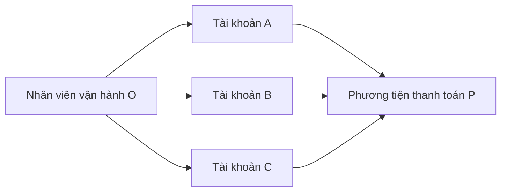
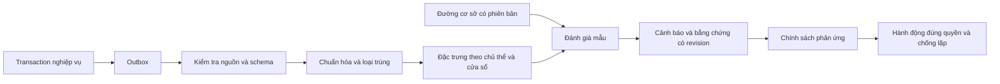

# Anomalous transaction pattern — Nhận diện mẫu giao dịch bất thường

## 1. Mục tiêu và phạm vi

Trong chương **Anomaly Detection**, *anomalous transaction pattern* là mẫu giao dịch khác đáng kể so với hành vi tham chiếu phù hợp hoặc quan hệ nghiệp vụ được kỳ vọng. Sự khác biệt có thể nằm ở giá trị, số lượng, thời điểm, thứ tự thao tác, đối tượng liên quan hoặc cách nhiều giao dịch kết hợp với nhau.

Một yêu cầu hoàn tiền riêng lẻ có thể hợp lệ nhưng thuộc một chuỗi đáng xem xét: nhiều khoản sát ngưỡng duyệt, nhiều tài khoản cùng tạo yêu cầu cho một nhóm phương tiện thanh toán, hoặc một nhân viên vừa được cấp quyền đã thực hiện hàng loạt thay đổi. Ngược lại, một đợt tăng giao dịch do khuyến mại có thể hoàn toàn hợp lệ.

Sau bài học, người học có thể:

- Chọn đơn vị giao dịch và dữ liệu sự kiện đúng với câu hỏi phát hiện.
- Phân loại mẫu bất thường theo giá trị, tần suất, chuỗi trạng thái và quan hệ.
- Xây dựng đặc trưng, cửa sổ thời gian và đường cơ sở có ngữ cảnh.
- Xử lý retry, sự kiện trùng, đến muộn và thay đổi hành vi bình thường.
- Chuyển phát hiện thành phản ứng có phạm vi, có kiểm tra quyền và chống lặp.
- Kiểm thử các tình huống lạm dụng logic lẫn các nguyên nhân gây cảnh báo nhầm.

**Bất thường là tín hiệu để đánh giá, không tự là bằng chứng gian lận.** Điểm bất thường cũng không mặc nhiên là xác suất gian lận.

Các bất biến bắt buộc vẫn phải được backend bảo vệ: đúng quyền trên đối tượng, đúng trạng thái, đủ phê duyệt, không sửa giá trái phép và không xử lý cùng ý định nhiều lần. Không chờ bộ dò bất thường phát hiện rồi mới thực thi các quy tắc đó.

OWASP nhấn mạnh việc giữ quy tắc và kiểm soát chuyển trạng thái ở phía server trong thiết kế bảo mật nghiệp vụ. Xem [OWASP Business Logic Security Cheat Sheet](https://cheatsheetseries.owasp.org/cheatsheets/Business_Logic_Security_Cheat_Sheet.html).

## 2. Tình huống xuyên suốt: nhiều yêu cầu hoàn tiền sát ngưỡng

Giả sử một nền tảng có quy trình hoàn tiền thủ công. Theo chính sách minh họa, yêu cầu từ 1.000.000 VND trở lên cần mức duyệt bổ sung.

Trong một khoảng ngắn, hệ thống ghi nhận:

| Quan sát | Giá trị giả định | Câu hỏi cần điều tra |
| --- | --- | --- |
| Yêu cầu hoàn tiền mới | 18 ý định nghiệp vụ khác nhau trong 5 phút | Có tăng bất thường so với nhóm tương đương không? |
| Giá trị | Nhiều khoản 990.000 VND | Có dấu hiệu chia nhỏ để né mức duyệt không? |
| Đối tượng | Nhiều đơn và tài khoản trong cùng tenant | Có chung tác nhân, phương tiện hoặc căn cứ hoàn không? |
| Người thao tác | Một tài khoản vận hành | Đây là xử lý theo lô được cấp hay hành vi lạm dụng? |
| Thời điểm | Ngoài khung làm việc thông thường của nhóm này | Có lịch vận hành hoặc sự kiện hợp lệ giải thích không? |

Một tín hiệu đơn lẻ chưa đủ để kết luận. Giá 990.000 VND có thể là giá bán phổ biến; một nhân viên có thể đang xử lý danh sách tồn đọng theo phân công.

Tuy vậy, sự kết hợp giữa tần suất mới, nhiều khoản gần ngưỡng, cùng người thao tác và thời điểm khác thường tạo ra một hồ sơ đáng xem xét.

Trước hết phải xác nhận “18 yêu cầu” là 18 ý định mới. Nếu đó là một yêu cầu được gửi lại 18 lần do lỗi mạng, mẫu phản ánh vấn đề retry hoặc hành vi thử gọi API, không phải 18 lần hoàn tiền mới.

Trong mọi trường hợp, tổng hoàn tiền của từng thanh toán vẫn phải được kiểm tra nguyên tử. Nếu chính sách có giới hạn cộng dồn, giới hạn đó phải được cưỡng chế tại đường thực thi, kể cả khi bộ dò chưa kịp tạo cảnh báo.

## 3. Các nhóm mẫu cần quan sát

### 3.1. Bất thường về giá trị và tỷ lệ

Các tín hiệu có thể gồm:

- Giá trị cao hơn nhiều so với lịch sử của cùng loại giao dịch.
- Nhiều khoản lặp lại ngay dưới một ngưỡng duyệt.
- Tỷ trọng giá trị hoàn tiền của một nhóm đơn tăng mạnh.
- Mức giảm giá hoặc số lượng điều chỉnh khác xa nhóm sản phẩm tương đương.
- Quan hệ giữa giá trị và số lượng không còn giống hành vi thông thường.

Phải so sánh cùng tiền tệ hoặc dùng quy tắc quy đổi đã xác định. Số nguyên 1.000 của hai đồng tiền khác nhau không có cùng ý nghĩa.

Giá trị âm không hợp lệ, tiền tệ không được phép hoặc hoàn vượt số được hoàn là vi phạm quy tắc đầu vào và nghiệp vụ. Chúng cần bị từ chối trực tiếp; việc ghi nhận chuỗi cố vi phạm có thể tạo thêm tín hiệu điều tra.

### 3.2. Bất thường về tần suất

Tần suất có thể được đo theo người thao tác, tài khoản khách hàng, thanh toán, đơn hàng, phương tiện hoặc nhóm đối tượng liên quan.

Cần phân biệt:

```text
Số lần gọi API
Số ý định nghiệp vụ mới
Số lần thử thực thi
Số execution đã cam kết
Số giao dịch đã được xác nhận thành công
```

Một hệ thống có thể có nhiều lần thử nhưng chỉ một execution. Ngược lại, một kẻ lạm dụng có thể tạo nhiều ý định mới, mỗi ý định chỉ gọi một lần. Dùng sai đơn vị đếm sẽ làm bộ dò bỏ sót hoặc cảnh báo nhầm.

Tần suất thấp trên từng tài khoản cũng có thể tạo tổng lớn nếu hành vi phân tán qua nhiều tài khoản. Vì vậy, chỉ đặt bộ đếm theo user ID thường chưa đủ.

### 3.3. Bất thường về thời gian

Các mẫu đáng xem xét có thể là:

- Giao dịch dồn vào những khoảng ngắn.
- Thời gian giữa các thao tác gần như đều nhau.
- Hoạt động xuất hiện ngoài lịch thông thường của chủ thể.
- Nhiều thao tác nguy cơ cao ngay sau đổi quyền hoặc đổi thông tin liên hệ.
- Hoạt động rải chậm qua nhiều giờ nhằm tránh cửa sổ phát hiện ngắn.

Nhịp đều có thể do tự động hóa hợp lệ, tác vụ đối soát hoặc lịch chạy của ứng dụng. Cần biết vai trò, lịch tác vụ và mục đích, thay vì coi mọi thao tác máy móc là gian lận.

Khung giờ phải có múi giờ và quy tắc lịch phù hợp. “Ngoài giờ” theo máy chủ UTC có thể là giờ kinh doanh bình thường của tenant.

### 3.4. Bất thường về chuỗi trạng thái

Một chuỗi có thể đáng chú ý dù mỗi bước riêng lẻ hợp lệ:

```text
Tạo yêu cầu → hủy → mở lại → thay đối tượng → xin duyệt lại
Cấp quyền mới → thực hiện hàng loạt thao tác → thu hồi quyền
Nhận ưu đãi → hủy đơn → nhận lại ưu đãi bằng tài khoản liên quan
```

Ngược lại, một bước chuyển bị cấm, chẳng hạn từ chưa duyệt sang đã giải ngân, phải bị state machine ngăn ngay.

Phân biệt ba tình huống:

| Dữ liệu quan sát | Ý nghĩa có thể có | Cách xử lý |
| --- | --- | --- |
| Chuỗi hợp lệ nhưng hiếm | Hành vi mới hoặc có rủi ro | Tạo tín hiệu có ngữ cảnh |
| Thử chuyển trạng thái bị server từ chối | Có thể là thử lạm dụng hoặc lỗi client | Ghi nhận lần thử và kết quả từ chối |
| Trạng thái không hợp lệ đã được ghi bền vững | Có thể là lỗi cưỡng chế, đường vòng hoặc dữ liệu sai | Điều tra tính toàn vẹn nghiệp vụ và hạn chế ảnh hưởng |

Sự kiện đến không đúng thứ tự cũng có thể làm một chuỗi nhìn giống bỏ bước. Cần đối chiếu phiên bản trạng thái và thời điểm trước khi kết luận.

### 3.5. Bất thường về quan hệ

Một bộ dò quan hệ có thể tìm:

- Nhiều tài khoản cùng liên quan đến một phương tiện thanh toán.
- Một tác nhân điều khiển thao tác trên nhiều tài khoản.
- Nhiều nguồn giá trị hội tụ về một đích.
- Một nguồn phân tán sang nhiều đích trong thời gian ngắn.
- Cặp người tạo–người duyệt có tần suất khác thường.

Ví dụ đồ thị điều tra trong phạm vi tenant được phép:



Đồ thị thể hiện quan hệ dữ liệu, chưa chứng minh A, B và C cùng một người. Doanh nghiệp, gia đình hoặc một bên thanh toán hộ hợp lệ có thể tạo quan hệ tương tự.

Nếu nghiệp vụ chỉ cho hoàn về phương thức thanh toán gốc, bộ dò không được cho phép đổi đích để “theo dõi thêm”. Ràng buộc đích nhận vẫn được thực thi riêng.

## 4. Hợp đồng sự kiện phải phản ánh nghiệp vụ

### 4.1. Sự kiện HTTP khác sự kiện nghiệp vụ

Log HTTP hữu ích cho việc nhìn thấy lần thử, lỗi và retry. Để biết điều gì đã xảy ra trong nghiệp vụ, cần sự kiện có ý nghĩa rõ, chẳng hạn:

```text
REFUND_REQUEST_CREATED
REFUND_APPROVED
REFUND_EXECUTION_COMMITTED
REFUND_SETTLED
REFUND_FAILED_FINAL
REFUND_RESERVATION_RELEASED
```

Không cộng số tiền của tất cả các loại này thành “tổng hoàn tiền”. Cùng một khoản có thể xuất hiện ở nhiều giai đoạn vòng đời.

Một sự kiện `REFUND_REQUEST_CREATED` chưa chứng minh tiền đã được chuyển. Một `REFUND_EXECUTION_COMMITTED` mô tả ý định thực thi bền vững trong hệ thống; kết quả bên ngoài có thể còn chờ xác nhận.

### 4.2. Dữ liệu tối thiểu

Một cấu trúc minh họa:

```json
{
  "eventId": "EVT-DEMO-81",
  "schemaVersion": 1,
  "eventType": "REFUND_REQUEST_CREATED",
  "tenantId": "TENANT-DEMO-A",
  "eventTime": "2026-11-22T02:10:00Z",
  "observedAt": "2026-11-22T02:10:02Z",
  "actorId": "OPERATOR-DEMO-7",
  "subjectAccountId": "ACCOUNT-DEMO-19",
  "aggregateId": "REFUND-DEMO-92",
  "stateVersion": 1,
  "orderId": "ORDER-DEMO-4",
  "paymentId": "PAYMENT-DEMO-8",
  "amountMinor": 990000,
  "currency": "VND",
  "instrumentRef": "INSTRUMENT-DEMO-5",
  "correlationId": "CORR-DEMO-31"
}
```

Theo quy ước tiền của ví dụ, VND được lưu bằng số nguyên đồng. Hệ thống đa tiền tệ phải định nghĩa đơn vị nhỏ nhất và cách làm tròn cho từng loại.

Danh tính actor, tenant và quan hệ đối tượng lấy từ nguồn server đáng tin cậy. Producer không được phát sự kiện cho tenant ngoài phạm vi của nó chỉ bằng cách sửa JSON.

`instrumentRef` là tham chiếu được quản lý, không phải số thẻ hoặc thông tin tài khoản đầy đủ. Các định danh đã giả danh vẫn có thể liên quan đến dữ liệu cá nhân; cần quyền truy cập, mục đích sử dụng và thời gian lưu phù hợp.

### 4.3. Tạo sự kiện cùng transaction nghiệp vụ

Transactional outbox giúp ghi thay đổi nghiệp vụ và ý định phát sự kiện trong cùng transaction. Nếu tạo yêu cầu rollback, không được phát một sự kiện thành công tương ứng.

Outbox hoặc broker vẫn có thể giao lại dữ liệu. Bên nhận cần loại trùng theo:

- **Event ID:** nhận lại cùng một sự kiện vận chuyển.
- **Danh tính sự kiện nghiệp vụ:** cùng thay đổi nghiệp vụ bị phát thành nhiều event ID khác nhau.

Danh tính thứ hai phụ thuộc hợp đồng từng loại sự kiện. Ví dụ, nếu mỗi transition chỉ phát một sự kiện loại đó, có thể dùng tenant, aggregate, state version và event type. Không dùng một công thức chung khi một phiên bản hợp lệ có thể chứa nhiều sự kiện cùng loại.

Các lần gọi API thực sự khác nhau vẫn có thể được đếm là nhiều lần thử. Loại trùng phải theo ý nghĩa của từng đặc trưng, không xóa mọi retry khỏi dữ liệu quan sát.

## 5. Đặc trưng phải có định nghĩa và mẫu số rõ ràng

Mỗi đặc trưng nên có một hợp đồng gồm: chủ thể, loại sự kiện, cách loại trùng, cửa sổ, đơn vị, nguồn dữ liệu và cách xử lý thiếu.

| Đặc trưng | Định nghĩa minh họa | Điều cần tránh |
| --- | --- | --- |
| Tần suất ý định | Số refund request ID mới trong cửa sổ theo actor | Đếm lại mỗi lần broker giao sự kiện |
| Tổng giá trị đề xuất | Tổng amount của các yêu cầu mới, cùng tiền tệ | Cộng cả approved và settled của cùng khoản |
| Số đối tượng liên quan | Số tài khoản hoặc đơn khác nhau theo actor | Coi mọi ID khác nhau là người khác nhau |
| Tập trung phương tiện | Số tài khoản khác nhau liên quan cùng instrument trong cửa sổ | Coi quan hệ dùng chung là bằng chứng chắc chắn |
| Tỷ trọng sát ngưỡng | Số yêu cầu gần ngưỡng chia tổng yêu cầu đủ điều kiện xét | Dùng ngưỡng khác tiền tệ hoặc phiên bản chính sách |
| Khoảng cách thao tác | Phân bố thời gian giữa các ý định khác nhau | Suy ra hành vi từ thứ tự nhận sự kiện chưa được sắp đúng |
| Chuỗi sau đổi quyền | Số thao tác nhạy cảm trong khoảng sau sự kiện cấp quyền | Bỏ qua quyền và phạm vi thực tế được cấp |

### 5.1. Tỷ lệ phải dùng tập đối tượng tương thích

Để đo tỷ lệ đơn có yêu cầu hoàn, có thể chọn một cohort gồm các đơn được thanh toán trong một giai đoạn:

```text
refundOrderRatio =
  số đơn trong cohort có ít nhất một yêu cầu hoàn
  tính đến thời điểm quan sát
  /
  tổng số đơn đủ điều kiện trong cohort
```

Tử số là một tập con của mẫu số. Cần giữ cùng tiêu chí và thời gian theo dõi khi so sánh hai cohort.

Có 11 đơn yêu cầu hoàn trong 20 đơn tương đương 55%; có 11 đơn trong 1.000 đơn tương đương 1,1%. Cùng số tuyệt đối nhưng ý nghĩa khác nhau.

Không lấy yêu cầu hoàn của các đơn từ nhiều tháng trước chia cho số đơn vừa được thanh toán trong 5 phút rồi gọi đó là “tỷ lệ đơn bị hoàn”. Nếu dùng một tỷ số hoạt động như vậy cho phát hiện vận hành, phải đặt tên và diễn giải đúng; nó không còn là tỷ lệ của một tập đơn.

Mẫu số bằng 0 cần có trạng thái chưa tính được, không thay bằng 1 để tạo một tỷ lệ có vẻ hợp lệ. Cohort quá mới hoặc quá ít đơn cũng cần thể hiện mức hỗ trợ hạn chế.

### 5.2. Khoản sát ngưỡng cần biết chính sách nào đang áp dụng

Giả sử một mức duyệt bổ sung bắt đầu tại `T`. Một đặc trưng có thể đếm các khoản trong:

```text
T − delta <= amount < T
```

`delta` là khoảng quan sát do thiết kế xác định, cùng tiền tệ và cùng quy tắc đơn vị. Cần biết ngưỡng có thay đổi theo thời điểm, vai trò hoặc loại thao tác không.

Một sản phẩm có giá phổ biến ngay dưới ngưỡng có thể tạo nhiều yêu cầu như vậy một cách bình thường. Đặc trưng cần kết hợp với số đơn, tác nhân, quan hệ đối tượng, lịch sử và mục đích nghiệp vụ.

Nếu quy tắc bắt buộc tính tổng để tránh chia nhỏ, server phải giữ giới hạn tổng tại transaction thực thi. Bộ dò chỉ bổ sung khả năng nhìn thấy mẫu lạm dụng hoặc lỗi quy trình.

### 5.3. Số tiền ở các trạng thái không được cộng lẫn

Nên giữ riêng:

```text
requestedAmount:  giá trị đề xuất
reservedAmount:   giá trị đã giữ chỗ cho thực thi
settledAmount:    giá trị đã xác nhận hoàn
releasedAmount:   giá trị giữ chỗ được giải phóng
```

Một vòng đời có thể đi qua cả bốn giá trị mà không tạo bốn lần hoàn tiền. Trạng thái không xác định ở nhà cung cấp cần tiếp tục được đối soát, không tự được tính là thất bại rồi giải phóng tiền.

Đối với tổng tài chính, xác định rõ đang tính dòng phát sinh hay số dư tại một thời điểm. Đếm lại mọi sự kiện cập nhật số dư sẽ làm tổng sai ngay cả khi từng sự kiện không bị giao trùng.

## 6. Xây dựng đường cơ sở phù hợp

### 6.1. So sánh với nhóm tương đương

Một đường cơ sở tốt cần trả lời: “Bình thường đối với ai, trong hoạt động nào, ở giai đoạn nào?”

Có thể xét:

- Tenant hoặc nhóm tenant được phép phân tích.
- Vai trò tác nhân: khách hàng, vận hành, quản trị, tác vụ hệ thống.
- Loại giao dịch, kênh, sản phẩm và tiền tệ.
- Khung giờ, ngày trong tuần và lịch kinh doanh.
- Tuổi tài khoản, quy mô hoạt động và lịch sử liên quan.
- Chiến dịch hoặc tác vụ theo lô đã được xác nhận.

Không dùng cùng mức đếm cho một cửa hàng nhỏ và một đối tác xử lý hàng chục nghìn đơn. Cũng không mặc định tài khoản mới có hành vi “bình thường bằng 0”.

Phân nhóm quá chi tiết làm mỗi nhóm thiếu mẫu. Có thể dùng đường cơ sở nhiều tầng: lịch sử riêng nếu đủ dữ liệu, nhóm tương đương nếu thiếu, rồi một chính sách khởi đầu được giới hạn. Phải ghi nhận đang dùng tầng nào và mức hỗ trợ ra sao.

Phân tích liên tenant chỉ được thực hiện qua dịch vụ và dữ liệu có phạm vi quyền phù hợp. Không mở quyền xem hồ sơ tenant khác cho nhân viên hỗ trợ chỉ vì bộ dò cần một thống kê tham chiếu.

### 6.2. Median và MAD cho một ví dụ đơn biến

Với dữ liệu có điểm cực đoan, median và median absolute deviation, viết tắt MAD, có thể là lựa chọn mô tả ít bị kéo lệch hơn trung bình và độ lệch chuẩn.

Một công thức modified Z-score:

```text
m   = median(x)
MAD = median(|x − m|)

modifiedZ = 0,6745 × (currentValue − m) / MAD
```

NIST trình bày công thức này và cách dùng để đánh dấu điểm có thể là ngoại lệ. Đây là kỹ thuật sàng lọc thống kê, không tự là chính sách chống gian lận. Xem [NIST/SEMATECH — Detection of Outliers](https://itl.nist.gov/div898/handbook/eda/section3/eda35h.htm).

Ví dụ chỉ để minh họa phép tính, với số yêu cầu mới trong tám cửa sổ tương đương:

```text
Lịch sử:       2, 3, 3, 4, 4, 5, 5, 6
Median:        4
Độ lệch tuyệt đối:
               2, 1, 1, 0, 0, 1, 1, 2
MAD:           1
Hiện tại:      18

modifiedZ = 0,6745 × (18 − 4) / 1 = 9,443
```

Kết quả cho thấy 18 khác xa phần lịch sử nhỏ đang xét. Nó không có nghĩa xác suất gian lận là 94,43%, cũng không chứng minh đã đủ dữ liệu để triển khai tự động. Tám cửa sổ chỉ phục vụ minh họa số học.

NIST nêu ngưỡng 3,5 như một quy tắc đánh dấu ngoại lệ tiềm năng trong phương pháp này. Không sao chép nó thành ngưỡng chặn mọi loại giao dịch; cần đánh giá theo phân phối, cỡ mẫu, mùa vụ và hậu quả của phản ứng.

### 6.3. MAD bằng 0 và dữ liệu quá ít

Nếu lịch sử đều là 0 hoặc cùng một giá trị, MAD có thể bằng 0. Công thức trên không còn dùng trực tiếp được.

Hệ thống cần phản ứng rõ: chuyển sang đặc trưng khác, dùng đường cơ sở nhóm có đủ hỗ trợ hoặc trả trạng thái chưa đủ căn cứ. Tự cộng một epsilon rất nhỏ có thể làm một thay đổi nhỏ nhận điểm cực lớn và tạo cảm giác chắc chắn giả.

Với số đếm thưa, nhiều giá trị 0 hoặc phân phối lệch mạnh, phương pháp phù hợp có thể khác ví dụ đơn biến. Các mô hình nhiều đặc trưng hoặc quan hệ cũng cần được đánh giá riêng; đầu ra vẫn là mức khác thường theo mô hình, không tự là nhãn gian lận.

### 6.4. Không để đường cơ sở học nhầm cuộc tấn công

Nếu cập nhật đường cơ sở quá nhanh từ mọi giao dịch mới, một chuỗi lạm dụng kéo dài có thể dần trở thành “bình thường”.

Có thể giữ phiên bản tham chiếu, giới hạn tốc độ cập nhật, tách giai đoạn đang điều tra và so sánh với một mốc ổn định. Cần biết dữ liệu nào được dùng để cập nhật và ai có quyền chấp nhận thay đổi.

Ngược lại, đóng băng mãi đường cơ sở cũng gây cảnh báo nhầm khi kinh doanh thay đổi thật. Việc đưa lịch khuyến mại hoặc batch job vào ngữ cảnh phải có nguồn, phạm vi và thời hạn; một ghi chú tự khai của actor không được biến thành quyền miễn kiểm tra.

## 7. Cửa sổ thời gian, sự kiện đến muộn và phát lại

### 7.1. Cửa sổ cố định và cửa sổ trượt

Cửa sổ cố định có thể là `[09:00, 09:05)`, tiếp theo `[09:05, 09:10)`. Nó dễ tổng hợp nhưng có hiệu ứng ranh giới.

Một đợt hoạt động quanh 09:05 có thể bị chia thành hai cửa sổ, khiến mỗi phần chưa vượt mức quan sát dù tổng trong vài giây rất cao. Cửa sổ trượt với bước phù hợp hoặc thống kê theo các sự kiện gần nhất giúp xem hành vi qua ranh giới đó.

Cửa sổ ngắn giúp nhận đột biến; cửa sổ dài giúp nhìn hoạt động chậm và phân tán. Có thể dùng nhiều độ dài, nhưng phải quản lý số lượng cảnh báo và chi phí trạng thái.

Các cửa sổ chồng lấn có thể cùng chứa một sự kiện. Đây không phải lỗi loại trùng: mỗi cửa sổ đang trả lời một câu hỏi riêng. Không cộng kết quả của chúng thành tổng giao dịch duy nhất.

### 7.2. Event time khác processing time

`eventTime` mô tả lúc thay đổi nghiệp vụ xảy ra. `processingTime` mô tả lúc bộ xử lý nhận và xử lý dữ liệu.

Apache Beam giải thích sự khác biệt này cùng watermark và dữ liệu đến muộn. Watermark là ước lượng tiến độ hoàn chỉnh của dữ liệu, không phải bảo đảm mọi sự kiện trước mốc đó đã xuất hiện. Xem [Apache Beam Programming Guide — Watermarks and late data](https://beam.apache.org/documentation/programming-guide/#watermarks-and-late-data).

Dù không dùng Beam, thiết kế vẫn cần xác định:

| Vấn đề | Quy tắc cần chốt |
| --- | --- |
| Dữ liệu đến sai thứ tự | Dùng state version và thời gian nghiệp vụ để tái dựng |
| Đến muộn trong giới hạn | Cập nhật cửa sổ và bằng chứng theo cơ chế đã chọn |
| Đến sau giới hạn lưu trạng thái | Chuyển sang đối soát hoặc backfill, không bỏ im lặng |
| Timestamp ở tương lai bất hợp lý | Kiểm tra nguồn và sai lệch đồng hồ |
| Thiếu hoặc gián đoạn nguồn | Đánh dấu độ đầy đủ, không kết luận “không có bất thường” |
| Kết quả cửa sổ thay đổi | Có revision và lịch sử cho cảnh báo |

Timestamps lấy từ client không được tự quyết định vị trí sự kiện nếu client có thể sửa để tránh cửa sổ. Cần biết đâu là thời điểm server xác nhận, đâu là thời điểm do thiết bị khai báo.

### 7.3. Dữ liệu muộn cần sửa bằng chứng có kiểm soát

Một cửa sổ có thể có kết quả ban đầu rồi được bổ sung sự kiện. Cảnh báo cần giữ liên kết với cùng chủ thể, quy tắc và khoảng thời gian, thay vì tạo một ticket mới cho mỗi lần cập nhật.

Nếu dữ liệu mới làm giảm độ nghiêm trọng hoặc chứng minh lỗi đếm, lưu revision và lý do sửa. Không âm thầm xóa dấu vết khiến người vận hành không biết quyết định trước đã dựa vào dữ liệu nào.

Dữ liệu lịch sử đến muộn cũng không tự cấp quyền gây tác động tài chính ở hiện tại. Phản ứng phải đánh giá trạng thái và quyền hiện hành, không coi một cảnh báo quá khứ như lệnh thực thi vĩnh viễn.

### 7.4. Replay và backfill phải có chế độ riêng

Khi phát lại lịch sử để sửa đặc trưng hoặc thử phiên bản mới, cần phân biệt kết quả mô phỏng với phát hiện trực tiếp.

Chế độ replay có thể tạo bằng chứng và số liệu đánh giá nhưng không mặc nhiên gửi lại mọi thông báo, khóa lại tài khoản hoặc phát sinh lệnh nghiệp vụ. Nếu muốn chuyển phát hiện lịch sử sang xử lý thật, phải có quyết định riêng với phạm vi được kiểm tra.

Thời gian lưu loại trùng cần phù hợp cửa sổ retry, phát lại và đối soát. Xóa khóa sớm trong khi sự kiện cũ vẫn có thể quay lại sẽ làm bộ đếm tăng giả.

## 8. Ví dụ truy vấn mẫu quan hệ

Giả sử bảng sự kiện đã được chuẩn hóa và loại trùng theo hợp đồng nghiệp vụ. Một truy vấn minh họa tìm phương tiện liên quan nhiều tài khoản trong một cửa sổ:

```sql
SELECT
    tenant_id,
    instrument_ref,
    COUNT(DISTINCT subject_account_id) AS account_count,
    COUNT(DISTINCT aggregate_id) AS refund_request_count
FROM normalized_business_event
WHERE event_type = 'REFUND_REQUEST_CREATED'
  AND tenant_id = :authorized_tenant_id
  AND event_time >= :window_start
  AND event_time < :window_end
  AND instrument_ref IS NOT NULL
GROUP BY tenant_id, instrument_ref
HAVING COUNT(DISTINCT subject_account_id) >= :min_accounts;
```

Các tham số là đầu vào đã được kiểm soát. Truy vấn chỉ là bước tạo ứng viên điều tra, chưa kết luận vi phạm.

Cần hiểu `instrument_ref` đại diện cho gì: phương tiện gốc, đích nhận được phép hay một quan hệ khác. Không trộn các vai trò khác nhau thành một node chỉ vì cùng kiểu chuỗi.

Nếu thiếu instrument, không gộp mọi giá trị rỗng thành “một phương tiện chung” để tạo fan-in giả. Nếu token thay đổi giữa các nguồn, cần cơ chế ánh xạ được quản lý; không tự ghép bằng một phần số thẻ hoặc tên hiển thị.

Đối với hệ thống lớn, tránh quét toàn bộ lịch sử cho mỗi request. Có thể duy trì tổng hợp theo khóa, cửa sổ và phiên bản; vẫn cần kiểm soát cardinality và giới hạn tài nguyên để chính bộ dò không bị làm quá tải.

## 9. Pipeline phát hiện và tính nhất quán khi xử lý

Một luồng minh họa:



Cổng quyền, state machine, transaction và idempotency của nghiệp vụ vẫn nằm ở đường xử lý giao dịch. Pipeline quan sát bổ sung khả năng phát hiện mẫu nhiều bước hoặc nhiều đối tượng.

### 9.1. Mã giả Java cho một bộ dò theo cửa sổ

Ví dụ dưới đây chỉ minh họa một bộ dò đếm yêu cầu mới theo actor trong một cửa sổ cố định. `run.scopeId()` phân biệt vùng xử lý trực tiếp với từng lần replay; các repository và hàm chính sách là mã giả.

```java
void processCreatedRefund(
        AuthenticatedProducer producer,
        BusinessEvent event,
        ProcessingRun run) {

    producerPolicy.requireAllowedTenant(producer, event.tenantId());
    eventSchema.requireRefundRequestCreated(event);
    eventTimePolicy.requireAcceptedForRun(event, run);

    transactions.required(() -> {
        var receipt = inbox.acceptUnique(
                run.scopeId(),
                event.eventId(),
                event.businessEventKey(),
                event.businessPayloadDigest());

        if (receipt.isDuplicate()) {
            return;
        }

        var window = windows.fixedWindowFor(event.eventTime());
        var key = FeatureKey.of(
                run.scopeId(),
                event.tenantId(),
                event.actorId(),
                event.currency(),
                window);

        var bucket = features.lockOrCreate(key);
        bucket.addCreatedIntent(
                event.aggregateId(), event.amountMinor());

        var baseline = baselines.forVersion(
                run.baselineVersion(), bucket.cohort());

        var finding = detector.evaluate(
                bucket.snapshot(), baseline, run.detectorVersion());

        var update = alerts.applyEvaluation(
                key, finding, bucket.evidenceReference());

        if (run.isLive()) {
            notifications.queueIfPolicyRequires(update);
        }
    });
}
```

`acceptUnique` phải phát hiện cả sự kiện đã nhận lại lẫn cùng thay đổi nghiệp vụ bị phát dưới ID mới, theo hợp đồng của ví dụ. Nếu một ID được tái dùng với dữ liệu nghiệp vụ khác, đó là xung đột cần cách ly và điều tra, không coi là retry bình thường.

Digest dùng dữ liệu nghiệp vụ chuẩn hóa; không đưa thời điểm nhận lại vào rồi làm mỗi lần giao có một digest khác. Mỗi bộ dò hoặc lần chạy có namespace riêng để việc một bộ dò đã đọc sự kiện không làm bộ dò khác bỏ qua nó.

`applyEvaluation` có thể tạo cảnh báo, cập nhật cảnh báo đã có hoặc không tạo mới khi chưa đủ điều kiện. Khi dữ liệu muộn làm kết luận thay đổi, cập nhật phải giữ revision và bằng chứng tương ứng.

### 9.2. Receipt, đặc trưng và cảnh báo cần phối hợp

Trong mô hình một cơ sở dữ liệu, việc đánh dấu sự kiện đã xử lý, thay đổi bộ đếm và ghi kết quả cần cùng commit hoặc cùng rollback.

Nếu đánh dấu inbox trước rồi cập nhật bộ đếm ở một hệ thống khác bị lỗi, retry có thể bị bỏ qua trong khi đặc trưng chưa được cập nhật. Nếu tăng bộ đếm trước rồi mất receipt, retry có thể tăng lần nữa.

Với stream processor hoặc kho phân tán, cần dùng cơ chế checkpoint, state và output phù hợp với nền tảng. Không suy ra bảo đảm “chính xác một lần” trên mọi hệ thống chỉ từ việc broker có một tùy chọn xử lý chống trùng.

Thông báo ra ngoài cũng cần outbox hoặc cơ chế bền vững tương đương. Gửi email trong transaction cơ sở dữ liệu không làm email được thu hồi khi transaction rollback.

### 9.3. Giới hạn tài nguyên và phạm vi khóa

Cửa sổ trượt, đặc trưng đồ thị và số khóa lớn làm tăng chi phí trạng thái. Cần kiểm soát thời gian lưu, số chủ thể, số cạnh và cách xử lý khi không đủ tài nguyên.

Nếu dùng cấu trúc ước lượng số lượng phần tử khác nhau để giảm bộ nhớ, phải biết sai số và ảnh hưởng quanh ngưỡng. Không dùng một ước lượng gần đúng để thay cho hạn mức tài chính bắt buộc phải chính xác.

Không để một tenant tạo vô hạn ID làm ảnh hưởng bộ dò của mọi tenant. Tình trạng bỏ dữ liệu hoặc suy giảm độ đầy đủ cần được thể hiện trên kết quả; không trả “bình thường” chỉ vì bộ dò hết bộ nhớ.

## 10. Từ cảnh báo đến phản ứng an toàn

### 10.1. Cảnh báo là hồ sơ có ngữ cảnh

Một cảnh báo nên chứa:

- Loại mẫu và lý do được đánh dấu.
- Tenant, chủ thể, khoảng thời gian và phiên bản bộ dò.
- Giá trị quan sát, nhóm tham chiếu và mức hỗ trợ của đường cơ sở.
- Tham chiếu các giao dịch, quan hệ và chuỗi trạng thái liên quan.
- Tình trạng đầy đủ, loại trùng và dữ liệu đến muộn.
- Mức ảnh hưởng tiềm năng, trạng thái xử lý và người phụ trách.
- Lịch sử thay đổi đánh giá.

Không nên chỉ ghi “anomaly score = 9,443” rồi yêu cầu người vận hành tự đoán ý nghĩa. Cần nêu đặc trưng nào được chấm điểm, đơn vị và phạm vi tham chiếu.

Số tiền trong cảnh báo phải có nhãn: giá trị đề xuất, đang giữ chỗ hay đã thanh toán. Tổng yêu cầu đáng chú ý không tự bằng thiệt hại.

### 10.2. Phản ứng theo mức ảnh hưởng và bằng chứng

| Điều kiện | Phản ứng có thể phù hợp | Giới hạn cần giữ |
| --- | --- | --- |
| Mẫu mới nhưng bằng chứng còn yếu | Ghi nhận, tăng quan sát hoặc tạo hồ sơ xem xét | Không kết luận gian lận chắc chắn |
| Có nhiều tín hiệu phù hợp | Kiểm tra thủ công hoặc yêu cầu xác minh | Ràng buộc với đúng đối tượng và ý định |
| Yêu cầu còn chờ, rủi ro đáng kể | Giữ phạm vi hẹp theo chính sách | Có thời hạn và đầu mối giải quyết |
| Thử vi phạm quy tắc bắt buộc | Từ chối tại backend và ghi nhận lần thử | Không chờ đủ điểm bất thường |
| Đã có tác động tài chính | Đối soát, hạn chế ảnh hưởng tiếp theo, xử lý sự cố | Không giả định có thể rollback bên ngoài |

Không khóa mọi tài khoản dùng chung IP chỉ vì một quan hệ được đánh dấu. Phản ứng cần thu hẹp vào đối tượng và hành động được phép, xét cả khả năng dùng chung hợp lệ.

Nếu lựa chọn phản ứng tự động, cần xác định rõ quyền của dịch vụ, chính sách hiện hành và cách dừng hoặc thu hồi. Bộ dò có quyền quan sát không mặc nhiên có quyền sửa số dư, thay quyền hay đảo giao dịch.

### 10.3. Chống lặp cho cảnh báo và hành động

Một danh tính cảnh báo logic có thể gồm:

```text
detectorVersion + tenantId + patternType
+ subjectKey + windowStart + windowEnd
```

Đây là ví dụ cho bộ dò theo cửa sổ. Với mẫu đồ thị hoặc chuỗi dài, cần danh tính phù hợp hơn. Những cửa sổ chồng lấn cũng có thể được liên kết vào một hồ sơ chung để giảm trùng lặp cho người xử lý.

Một thay đổi bằng chứng không nhất thiết tạo một thông báo mới. Cần chính sách cho thông báo ban đầu, tăng mức nghiêm trọng và cập nhật quan trọng. Mỗi ý định thông báo có khóa ổn định để retry không gửi lại tùy ý.

Hành động phản ứng cũng có danh tính riêng, ràng buộc với:

```text
responseIntentId
alertId và evidenceRevision liên quan
tenantId và targetScope
actionType
policyVersion
targetPreconditions
expiresAt
```

Dịch vụ thực thi kiểm tra quyền, phạm vi, trạng thái hiện tại và receipt của hành động. Tái xử lý cảnh báo không được tự tạo một lần khóa, mở khóa hoặc điều chỉnh tài chính khác.

Nếu cần bù trừ tài chính, phải tạo yêu cầu qua nghiệp vụ được cấp quyền, với phê duyệt và idempotency riêng. Không để callback “đã phát hiện bất thường” trực tiếp sửa tiền.

### 10.4. Cảnh báo đến sau không sửa lịch sử quyết định

Một bộ dò bất đồng bộ có thể nhận diện mẫu sau khi một số giao dịch đã được thực hiện. Khi đó, không thể hứa nó đã ngăn mọi giao dịch trong mẫu.

Cần phân biệt phát hiện phục vụ điều tra với kiểm tra trực tiếp trước cam kết. Nếu một yêu cầu bắt buộc phải được đánh giá trước thực thi, đường nghiệp vụ cần cổng quyết định và phản ứng timeout rõ ràng, thay vì chỉ phát sự kiện rồi cho qua.

## 11. Điều tra ví dụ 18 yêu cầu theo thứ tự bằng chứng

### Bước 1: Xác nhận đơn vị và độ đầy đủ

Đối chiếu 18 request ID khác nhau, loại sự kiện, actor, tenant và thời gian. Kiểm tra chúng có phải retry, phát lại hay dữ liệu backfill không.

Nếu chỉ có một ý định được phát nhiều lần, sửa đặc trưng và cập nhật cảnh báo. Lịch sử sửa cần chỉ rõ nguyên nhân, tránh giữ nhãn lạm dụng sai cho khách hàng hoặc nhân viên.

### Bước 2: Xem khả năng hợp lệ theo ngữ cảnh

Đối chiếu lịch xử lý tồn đọng, phân công, hồ sơ sự cố thanh toán, chiến dịch và mức hoạt động thường thấy. Thông tin giải thích phải có nguồn được kiểm chứng; câu “tôi đang chạy batch” của người bị điều tra chưa tự đủ để đóng hồ sơ.

Nếu có batch được cấp, vẫn kiểm tra đúng phạm vi, từng khoản, người duyệt và tổng hạn mức. Hoạt động theo lô không phải quyền bỏ qua quy tắc.

### Bước 3: Kiểm tra mẫu kết hợp

Trong ví dụ, 18 khoản đều bằng 990.000 VND có tổng giá trị đề xuất 17.820.000 VND. Cần ghi đúng đó là tổng đề xuất; chưa thể nói đây là thiệt hại hay tiền đã chuyển.

Xem các đơn có giá gốc tương ứng không, có chung căn cứ hoàn, ai tạo và duyệt, phương tiện liên quan là gì, có quan hệ hợp lệ nào giải thích tập trung không.

### Bước 4: Kiểm tra trạng thái thật trước phản ứng

Phân loại các yêu cầu còn chờ, đã giữ chỗ, đã được nhà cung cấp nhận, đã hoàn tất hoặc đang không xác định.

Có thể giữ các yêu cầu chưa cam kết theo quyền và chính sách. Với lệnh đã bàn giao, cần cơ chế hủy hoặc đối soát thực tế; không đổi trạng thái nội bộ thành “đã hủy” rồi khẳng định tiền không thể chuyển.

### Bước 5: Ghi kết quả và cải thiện quy tắc

Kết quả có thể là hành vi hợp lệ, lỗi dữ liệu, lỗi kiểm soát nghiệp vụ hoặc lạm dụng có bằng chứng. Lưu nguồn kết luận, người xác nhận và những giới hạn chưa giải quyết.

Nếu phát hiện lỗi bỏ bước phê duyệt, cần sửa cổng nghiệp vụ. Chỉ nâng điểm cảnh báo cho hành vi đó không khắc phục được đường vòng.

## 12. Đánh giá hiệu quả và vận hành bộ dò

Nên theo dõi nhiều lớp:

| Nhóm | Ví dụ chỉ số | Điều cần ghi kèm |
| --- | --- | --- |
| Chất lượng dữ liệu | Tỷ lệ trùng, thiếu, sai schema, độ trễ | Nguồn, tenant, thời gian gián đoạn |
| Mức hỗ trợ | Tỷ lệ chủ thể có đường cơ sở đủ dùng | Nhóm tham chiếu và phiên bản |
| Phát hiện | Số mẫu, mức bao phủ tình huống đã biết, độ trễ | Phiên bản bộ dò, cửa sổ, điều kiện đủ mẫu |
| Cảnh báo | Số hồ sơ trên 1.000 ý định nghiệp vụ mới | Cách gộp cảnh báo và mẫu số |
| Xử lý | Thời gian review, số cảnh báo trùng, hồ sơ tồn | Năng lực và quyền của nhóm xử lý |
| Kết quả | Kết luận có bằng chứng, cảnh báo nhầm, ảnh hưởng hợp lệ | Độ trễ và nguồn của kết luận |
| Thực thi phản ứng | Hành động lặp, sai phạm vi, kết quả không xác định | Danh tính ý định và bằng chứng thực thi |

Độ trễ có thể tính từ lúc mẫu đủ điều kiện theo dữ liệu nghiệp vụ đến lúc cảnh báo được tạo. Cần nêu rõ định nghĩa và xem riêng thời gian chậm của nguồn dữ liệu với thời gian xử lý của bộ dò.

Precision trên các cảnh báo đã được điều tra có thể không đại diện cho tất cả cảnh báo nếu đội chỉ chọn các hồ sơ nặng nhất. Cảnh báo chưa có kết luận cũng không tự là sai dương. Cần phân biệt kết quả tạm thời, chưa rõ và đã xác nhận.

Thử phiên bản mới trên dữ liệu có ngữ cảnh và phát lại có kiểm soát. Kiểm tra cả mùa cao điểm, dữ liệu thưa, gián đoạn nguồn và lịch sử tấn công, không chỉ một tập có vài điểm cực đoan dễ nhận diện.

Một phiên bản tốt hơn cần được đánh giá cả chất lượng phát hiện và ảnh hưởng vận hành. Giảm cảnh báo bằng cách bỏ qua nguồn đang lỗi có thể làm số liệu đẹp hơn nhưng giảm khả năng quan sát.

## 13. Ma trận kiểm thử tình huống tấn công logic

| Tình huống | Dữ liệu thử | Kết quả mong đợi |
| --- | --- | --- |
| Giao lại cùng event | Cùng ID được nhận nhiều lần | Không tăng đặc trưng hoặc thông báo lặp |
| Cùng thay đổi, ID mới | Hai event ID cho cùng thay đổi nghiệp vụ | Loại trùng theo hợp đồng loại sự kiện |
| Cùng ID, payload khác | Số tiền hoặc đối tượng bị đổi | Phát hiện xung đột, không âm thầm ghi đè |
| Retry HTTP | Nhiều lần gọi cùng ý định | Bộ đếm ý định không tăng như nhiều giao dịch mới |
| Nhiều ý định thật | Actor tạo nhiều request ID khác nhau | Không loại nhầm thành retry |
| Sự kiện khác giai đoạn | Created, approved và settled của cùng khoản | Không cộng thành ba khoản tiền đã hoàn |
| Ranh giới cửa sổ | Hoạt động dồn trước và sau mốc cố định | Bộ dò nhiều cửa sổ thể hiện được phạm vi thiết kế |
| Sự kiện đến muộn | Bổ sung dữ liệu cho cửa sổ đã có cảnh báo | Cập nhật bằng chứng có revision; không tạo hành động tùy ý |
| Sai thứ tự | Settled đến trước sự kiện trước đó trong pipeline | Không kết luận bỏ bước chỉ từ thứ tự nhận |
| Hoạt động chậm | Phân tán qua nhiều giờ | Bộ dò cửa sổ dài hoặc quan hệ được đánh giá riêng |
| Chia nhỏ giá trị | Nhiều khoản sát ngưỡng | Tạo tín hiệu; giới hạn cộng dồn bắt buộc vẫn được backend giữ |
| Cùng IP hợp lệ | Nhiều tài khoản qua mạng doanh nghiệp | Không coi quan hệ đó là chứng minh cùng người |
| Instrument rỗng | Nhiều event thiếu tham chiếu phương tiện | Không gộp thành một đích chung giả |
| Sai tenant | Producer hoặc người xem dùng ID tenant khác | Chặn theo quyền, không lộ bằng chứng |
| Khác tiền tệ | Giá trị số giống nhau ở nhiều đồng tiền | Không tổng hợp hoặc so trực tiếp sai đơn vị |
| MAD bằng 0 | Lịch sử không đổi hoặc toàn 0 | Trả trạng thái hoặc fallback đã định nghĩa, không điểm vô hạn |
| Ít lịch sử | Tài khoản hoặc nhóm mới | Dùng tầng tham chiếu phù hợp, không giả vờ có đường cơ sở mạnh |
| Khuyến mại hợp lệ | Tăng giao dịch có lịch và phạm vi xác nhận | Đánh giá đúng ngữ cảnh, vẫn giữ bất biến |
| Tấn công kéo dài | Mẫu lệch lặp trong thời gian cập nhật baseline | Kiểm tra việc đường cơ sở bị kéo theo và cơ chế phát hiện |
| Replay lịch sử | Chạy lại bộ dò trên sự kiện cũ | Tách namespace, không phát lại tác động trực tiếp |
| Lỗi giữa inbox và feature | Dừng xử lý tại các điểm commit | Không mất lần cập nhật hoặc tăng bộ đếm hai lần |
| Cảnh báo phát lại | Cùng hồ sơ được xử lý lại | Không thực thi lại cùng response intent |
| Quyền phản ứng bị thu hồi | Hành động đang chờ mất điều kiện thực thi | Dừng theo chính sách, có audit |
| Cardinality tăng mạnh | Nhiều đối tượng hoặc cạnh mới | Bảo vệ tài nguyên, báo trạng thái suy giảm đúng nghĩa |

Kiểm thử cạnh tranh cần có các tiến trình cùng cập nhật một khóa hoặc cùng thực thi một ý định phản ứng. Kiểm thử nối tiếp chỉ đủ cho một phần bài toán retry.

Đối với các quy tắc tiền hoặc quyền, kiểm tra cả tác động cuối cùng: không vượt hạn mức, không chạm nhầm đối tượng và không tạo execution trùng. Một cảnh báo xuất hiện đúng không chứng minh nghiệp vụ đã an toàn.

## 14. Điểm cần giữ khi triển khai

Mẫu giao dịch bất thường được tạo từ sự kết hợp giữa dữ liệu đúng nghĩa, phép so sánh đúng nhóm và quan hệ đúng ngữ cảnh. Giá trị hiếm, tần suất cao hoặc đồ thị tập trung là những dấu hiệu để xem xét; cần bằng chứng bổ sung trước khi kết luận bản chất hành vi.

Thiết kế đáng tin cần giữ được nguồn sự kiện, đơn vị đếm, phiên bản đường cơ sở và lịch sử cảnh báo. Phản ứng đi qua quyền theo đối tượng, trạng thái hợp lệ và danh tính ý định chống lặp. Các bất biến nghiệp vụ vẫn được cưỡng chế ngay tại đường transaction, giúp hệ thống an toàn cả khi bộ dò chậm, dữ liệu thiếu hoặc một mẫu chưa từng xuất hiện.
