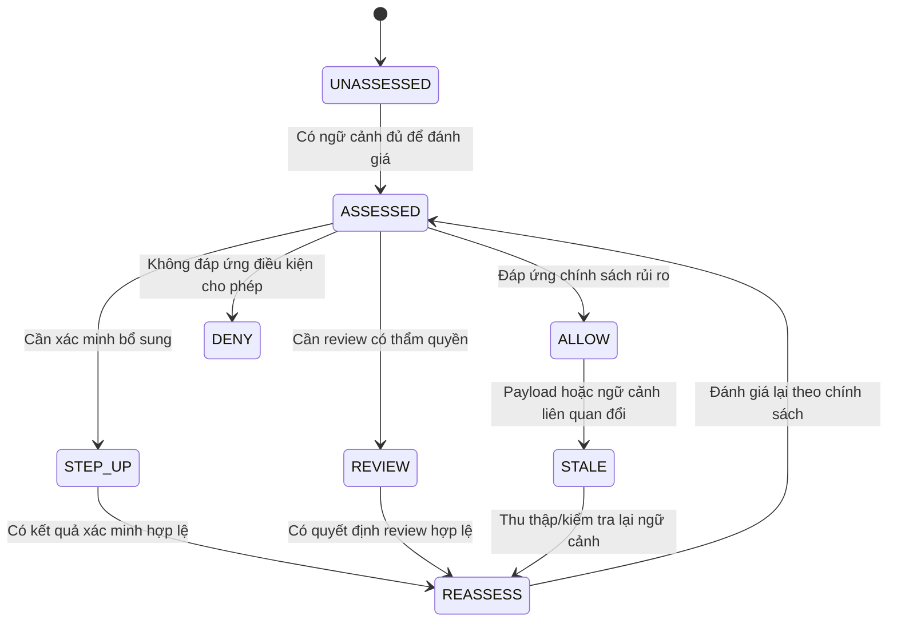

# Anomalous location pattern — Mẫu vị trí bất thường

## 1. Mục tiêu và phạm vi

Một tài khoản vừa sử dụng ứng dụng qua mạng ở khu vực A, vài phút sau lại gửi yêu cầu nhạy cảm qua một điểm mạng cách rất xa. Đây có thể là dấu hiệu tài khoản bị chiếm đoạt, nhưng cũng có thể do VPN, mạng doanh nghiệp, chuyển mạng di động hoặc dữ liệu định vị IP không chính xác.

**Anomalous location pattern** là mẫu vị trí hoặc thay đổi vị trí khác với bối cảnh được kỳ vọng của một chủ thể và hành động. Mục tiêu phát hiện là tạo bằng chứng rủi ro có thể giải thích, rồi chọn phản ứng phù hợp. Tín hiệu vị trí không tự chứng minh danh tính, quyền theo đối tượng hoặc hành vi gian lận.

Bài học thuộc module `SECURITY_APPLICATION_SECURITY_BUSINESS_LOGIC_SECURITY`, trong chương **Anomaly Detection**. Nội dung gắn phân tích vị trí với business invariants, state machine, quyền theo đối tượng, transaction, idempotency và kiểm thử các tình huống lạm dụng logic.

Sau bài học, bạn cần có khả năng:

- Phân biệt vị trí ước lượng của điểm mạng với vị trí thực của người dùng.
- Thiết kế sự kiện và baseline có nguồn, thời gian, độ mới và mức chất lượng rõ ràng.
- Hiểu các mẫu như di chuyển khó khả thi, đổi vùng bất ngờ và phiên hoạt động phân tán.
- Gắn quyết định xác minh hoặc review với đúng hành động và phiên bản đối tượng.
- Ngăn tín hiệu vị trí bị dùng để bỏ qua hạn mức, thay phạm vi quyền hoặc đầu độc baseline.

Các địa điểm, khoảng cách và quyết định trong bài là ví dụ thiết kế. Không có một ngưỡng khoảng cách hoặc tốc độ cố định phù hợp cho mọi sản phẩm.

## 2. Vị trí nào đang được quan sát?

### 2.1. Nguồn dữ liệu và giới hạn

| Nguồn | Điều có thể quan sát | Giới hạn cần giữ |
| --- | --- | --- |
| Địa chỉ IP tại biên mạng đáng tin cậy | Điểm nguồn mạng mà hệ thống nhận được theo kiến trúc triển khai | Có thể là VPN, proxy, NAT hoặc mạng doanh nghiệp |
| Dữ liệu geolocation IP | Ước lượng vùng/quốc gia/tọa độ liên quan IP | Không mặc nhiên là tọa độ người đang cầm thiết bị |
| Vị trí thiết bị gửi lên | Một phép đo hoặc khai báo từ thiết bị, nếu được cung cấp | Có thể thiếu, cũ, sai hoặc bị giả; trường accuracy tự khai không phải bảo đảm |
| Múi giờ, ngôn ngữ, locale | Thiết lập của client | Dễ thay đổi; không chứng minh vị trí vật lý |
| Địa chỉ giao hàng/thanh toán | Địa chỉ phục vụ một nghiệp vụ | Có thể khác nơi người dùng đang ở |
| Quốc gia của hồ sơ/tài khoản | Thuộc tính đã khai hoặc xác minh theo quy trình riêng | Không cho biết người dùng đang truy cập từ đâu |

Không trộn các nguồn thành một trường `location` mà làm mất nguồn gốc. So sánh tọa độ IP ở lần trước với vị trí thiết bị ở lần sau như thể chúng có cùng độ chính xác dễ tạo cảnh báo sai.

Thiếu dữ liệu vị trí nên là `UNKNOWN` hoặc một trạng thái chất lượng tương ứng. Không chuyển tọa độ thiếu thành `(0, 0)`, vì `(0, 0)` là một tọa độ có ý nghĩa địa lý và sẽ tạo khoảng cách giả.

### 2.2. Ranh giới tin cậy của IP và header

Nếu ứng dụng ở sau reverse proxy hoặc load balancer, IP nguồn dùng để phân tích phải được lấy theo cấu hình proxy đáng tin cậy. Client có thể tự gửi `X-Forwarded-For` hoặc một header tương tự; nhận giá trị đó vô điều kiện cho phép kẻ tấn công tự chọn đầu vào vị trí.

Cần xác định proxy nào được tin cậy, cách proxy ghi đè/bổ sung header và cách phân tích chuỗi hop theo đúng topology. Không có quy tắc lấy phần tử đầu hoặc cuối phù hợp cho mọi hệ thống. Đường truy cập trực tiếp bỏ qua proxy cũng phải được xử lý theo cùng ranh giới tin cậy.

Địa chỉ IP vẫn chỉ là nguồn mạng sau khi đã lấy đúng. Nó không trở thành bằng chứng người dùng có mặt tại một thành phố. Dữ liệu ASN hoặc loại mạng có thể bổ sung bối cảnh, nhưng mạng trung tâm dữ liệu hoặc VPN không tự đồng nghĩa gian lận.

## 3. Sự kiện và baseline cần đủ ngữ cảnh

### 3.1. Mô hình quan sát tối thiểu

```text
LocationObservation
  eventId
  tenantId
  subjectId
  sessionReference
  deviceReference
  operationId
  eventType
  occurredAt
  ingestedAt
  networkSourceReference
  locationSource
  geoDatasetVersion
  countryOrRegionCode
  estimatedCoordinates
  uncertaintyMetadata
  qualityStatus
  verificationContext
```

Các trường không có dữ liệu phải biểu diễn rõ là chưa biết. `uncertaintyMetadata` cần giữ đúng ý nghĩa của nguồn cung cấp; không tự tạo một xác suất hoặc bán kính chính xác nếu nguồn không có căn cứ cho nó.

`occurredAt` dùng để so sánh hoạt động phải xuất phát từ sự kiện đáng tin cậy phía máy chủ hoặc nguồn đã được xác minh phù hợp. Timestamp client tự khai không đủ để chứng minh thứ tự. `ingestedAt` giúp biết độ trễ thu thập, không thay thế thời điểm sự kiện thực sự được quan sát.

Không ghi raw session token vào dữ liệu phân tích. Dùng tham chiếu phù hợp và bảo vệ quyền truy cập. Đối với principal đại diện một đội, tài khoản dùng chung hoặc dịch vụ phân tán, giả định “mọi sự kiện là cùng một người di chuyển” có thể không đúng. Cần chọn phạm vi baseline phù hợp với mô hình danh tính.

### 3.2. Chọn hoạt động tham chiếu

Một baseline hữu ích có thể xét lịch sử vùng mạng, thiết bị/phiên đã xác minh và hành động liên quan. Tuy nhiên, điểm tham chiếu gần nhất không mặc nhiên là điểm đáng tin cậy nhất.

Ví dụ, nếu một lần đăng nhập đáng ngờ ở vùng B chưa được xác minh, không nên lập tức coi B là vị trí bình thường mới rồi dùng nó để đánh giá một thao tác đổi tài khoản nhận tiền ngay sau đó.

Nên tách:

- Lịch sử quan sát: những gì hệ thống đã thấy.
- Lịch sử đủ tin cậy làm baseline: những gì đáp ứng tiêu chí cập nhật baseline.
- Lịch sử quyết định: hệ thống đã cho phép, yêu cầu xác minh, giữ hoặc từ chối thế nào.

Người dùng mới hoặc ít lịch sử cần trạng thái thiếu baseline, không tự bị gán bất thường hoặc an toàn. Có thể dùng bối cảnh thiết bị và hành động để chọn bước xác minh, nhưng không giả tạo lịch sử không tồn tại.

Mọi truy vấn baseline phải giữ ranh giới tenant và chủ thể. Không gộp hai tài khoản chỉ vì cùng email, IP hoặc địa chỉ nếu hệ thống chưa có quan hệ danh tính đáng tin cậy.

## 4. Phát hiện mẫu di chuyển khó khả thi

### 4.1. Khoảng cách và thời gian

Một heuristic thường dùng là so sánh khoảng cách ước lượng giữa hai quan sát với khoảng thời gian của chúng. Tên “impossible travel” mô tả tín hiệu đáng nghi; kết quả không chứng minh một người thực sự đã di chuyển như vậy.

Với vĩ độ và kinh độ tính bằng radian, có thể dùng công thức Haversine cho khoảng cách cung lớn xấp xỉ trên mô hình Trái Đất hình cầu:

```text
a = sin²((lat2 - lat1) / 2)
    + cos(lat1) × cos(lat2) × sin²((lon2 - lon1) / 2)

d = 2 × R × atan2(sqrt(a), sqrt(1 - a))

v_estimated = d / deltaTimeHours
```

`R` có thể lấy xấp xỉ 6.371 km trong tính toán minh họa. Khoảng cách này không phải chiều dài đường đi thực tế và cũng không làm dữ liệu tọa độ đầu vào chính xác hơn.

Một hàm Java chỉ tính khoảng cách:

```java
static double haversineKm(double lat1, double lon1, double lat2, double lon2) {
    requireCoordinate(lat1, lon1);
    requireCoordinate(lat2, lon2);

    double phi1 = Math.toRadians(lat1);
    double phi2 = Math.toRadians(lat2);
    double deltaPhi = Math.toRadians(lat2 - lat1);
    double deltaLambda = Math.toRadians(lon2 - lon1);
    double sinHalfPhi = Math.sin(deltaPhi / 2.0);
    double sinHalfLambda = Math.sin(deltaLambda / 2.0);

    double a = sinHalfPhi * sinHalfPhi
        + Math.cos(phi1) * Math.cos(phi2) * sinHalfLambda * sinHalfLambda;
    a = Math.max(0.0, Math.min(1.0, a));
    return 2.0 * 6371.0 * Math.atan2(Math.sqrt(a), Math.sqrt(1.0 - a));
}

static void requireCoordinate(double latitude, double longitude) {
    if (!Double.isFinite(latitude) || !Double.isFinite(longitude)
        || latitude < -90.0 || latitude > 90.0
        || longitude < -180.0 || longitude > 180.0) {
        throw new IllegalArgumentException("Invalid coordinates");
    }
}
```

Hàm không nhận `null`; dữ liệu thiếu phải được xử lý trước ở mô hình quan sát. Hàm cũng không quyết định chặn hay mở quyền. Việc kẹp `a` vào khoảng `[0, 1]` xử lý sai số số học, không phải cơ chế sửa tọa độ sai.

### 4.2. Xét bất định và thứ tự sự kiện

Nếu nguồn có bán kính bất định phù hợp, một heuristic có thể dùng:

```text
d_adjusted = max(0, d - radius1 - radius2)
v_adjusted = d_adjusted / deltaTimeHours
```

Ví dụ khoảng cách hai điểm ước lượng là 6.000 km, hai bán kính lần lượt 100 và 200 km, thời gian cách nhau 15 phút. Khi đó `d_adjusted = 5.700 km` và `v_adjusted = 22.800 km/h`.

Các số này chỉ minh họa phép tính. Công thức chỉ có ý nghĩa theo giả định của miền bất định; nếu bán kính không bảo đảm vị trí thực nằm trong đó, không được gọi kết quả là cận dưới chắc chắn của quãng đường. Khi chất lượng thấp hoặc hai miền chồng lấn lớn, nên giảm độ tin cậy của tín hiệu thay vì dùng kết quả máy móc.

Nếu thời gian bằng hoặc nhỏ hơn 0, không chia để tạo ra tốc độ vô hạn rồi kết luận gian lận. Có thể có hai phiên đồng thời, sự kiện đến sai thứ tự hoặc đồng hồ lệch. Ghi loại tình huống, sắp xếp/tính lại trong cửa sổ phù hợp và kết hợp các bằng chứng khác.

Hai quan sát từ cùng VPN nhưng khác điểm thoát mạng vẫn có thể tạo tốc độ ước lượng rất lớn. Ngược lại, hai hoạt động ở gần nhau không chứng minh an toàn: kẻ chiếm tài khoản có thể truy cập qua mạng gần nạn nhân. Vì vậy, khoảng cách là một đặc trưng rủi ro, không phải điều kiện cấp quyền.

## 5. Các mẫu cần xem xét ngoài khoảng cách hai điểm

| Mẫu | Ví dụ tín hiệu | Ngữ cảnh cần đối chiếu |
| --- | --- | --- |
| Vùng mới đột ngột | Hoạt động nhạy cảm từ vùng chưa có trong baseline | Thiết bị/phiên, xác minh gần đây, lịch sử đi lại đã biết |
| Nhiều vùng trong cửa sổ ngắn | Một chủ thể có hoạt động qua nhiều điểm mạng xa nhau | VPN, gateway doanh nghiệp, số phiên, loại sự kiện |
| Phiên hoạt động đồng thời phân tán | Hai phiên thực hiện hành động ở các vùng khó liên hệ | Principal có đại diện một người hay nhiều người; phiên có dấu hiệu bị lấy cắp không |
| Đổi vị trí rồi đổi thông tin nhạy cảm | Vùng mạng mới, tiếp theo là đổi kênh liên hệ hoặc đích nhận | Thứ tự sự kiện, tuổi tài khoản, xác minh và quyền của hành động |
| Lệch giữa các thuộc tính vị trí | Điểm mạng, hồ sơ và địa chỉ giao hàng ở các vùng khác nhau | Du lịch, mua hộ, địa chỉ doanh nghiệp và ý nghĩa từng trường |
| Luân phiên điểm mạng kèm thử lặp | Nhiều yêu cầu nhạy cảm qua nhiều IP/vùng | Đếm theo chủ thể/operation, không chỉ theo từng IP |

Các mẫu nên tạo reason code có thể giải thích, như `NEW_NETWORK_REGION` hoặc `GEO_TEMPORAL_INCONSISTENCY`, cùng bằng chứng về khoảng thời gian, nguồn và chất lượng. Không đặt tên kết quả như `USER_IS_ABROAD` nếu hệ thống chỉ biết vị trí điểm mạng.

Tín hiệu kết hợp thường hữu ích hơn một điều kiện đơn lẻ. Ví dụ, vùng mạng mới cộng thiết bị chưa được xác minh và yêu cầu đổi đích nhận có thể cần xác minh hoặc review. Nhưng device ID client tự khai không đủ chứng minh đó là thiết bị cũ; cần hiểu mức bảo đảm của từng yếu tố.

### 5.1. Cửa sổ thời gian, sự kiện trễ và chống đếm trùng

Với chuỗi sự kiện, cần chốt phạm vi cửa sổ và cách xử lý event đến muộn. Sắp xếp theo thời điểm sự kiện đáng tin cậy, ghi nhận độ trễ và tính lại những kết quả bị ảnh hưởng khi chính sách yêu cầu. Không lấy thứ tự message đến làm lịch sử di chuyển chắc chắn.

Dedupe theo `eventId` ngăn cùng event được relay nhiều lần làm tăng số vùng hoặc số lần hoạt động. Tuy nhiên, hai request thật từ hai mạng khác nhau vẫn có thể là hai quan sát an ninh đáng lưu dù cùng liên quan một operation.

Đối với chỉ số hoặc hạn mức nghiệp vụ, retry cùng operation không được đếm thành nhiều lần mua hàng/hoàn tiền. Tách đếm quan sát mạng khỏi đếm tác dụng nghiệp vụ để tránh cả báo động giả lẫn thực hiện lặp.

Cập nhật trạng thái phân tích theo phiên bản/điểm thời gian đã xử lý; event cũ không được vô tình ghi đè một baseline mới hơn. Việc giữ thêm event trễ để điều tra cũng không đồng nghĩa cho phép nó thay baseline đủ tin cậy hiện hành.

## 6. Invariant và phản ứng đối với hành động nhạy cảm

### 6.1. Những điều tín hiệu vị trí không được thay thế

| Mã | Invariant | Tình huống phải chặn |
| --- | --- | --- |
| L1 | Quyền được kiểm tra trên đúng tenant, chủ thể và đối tượng | IP ở vùng quen thuộc được dùng để xem đơn của người khác |
| L2 | Vị trí dựa trên nguồn có ranh giới tin cậy rõ | Client giả header hoặc country code để được ưu tiên |
| L3 | Quyết định rủi ro gắn với đúng hành động, payload, phiên bản và thời hạn | Xác minh cho đơn giá thấp rồi đổi thành đơn giá cao |
| L4 | Dữ liệu thiếu hoặc kém chất lượng được biểu diễn trung thực | `UNKNOWN` bị biến thành quốc gia an toàn mặc định |
| L5 | Thay đổi nghiệp vụ, kết quả lệnh và audit bắt buộc nhất quán khi commit | Đơn đã xác nhận nhưng không có căn cứ quyết định |
| L6 | Hạn mức tổng hợp không thể bị đặt lại bằng cách đổi IP/vùng | Chia thao tác qua nhiều quốc gia để né hạn mức tài khoản |
| L7 | Baseline chỉ được cập nhật theo tiêu chí và quyền phù hợp | Một chuỗi truy cập đáng ngờ tự tạo vùng quen thuộc mới |
| L8 | Quyết định dựa trên tín hiệu đã biết không được coi là chân lý vĩnh viễn | Một lần xác minh miễn mọi kiểm tra vị trí về sau |

Nếu nghiệp vụ thật sự có chính sách theo vùng, phải xác định vùng nào có ý nghĩa: vùng hợp đồng, tài nguyên, đích giao hàng hay nguồn mạng. Một IP mới không được tự chuyển tài khoản sang hạn mức hoặc tenant khác. Những thuộc tính nghiệp vụ có thẩm quyền cần được quản trị bằng quy trình riêng.

### 6.2. State machine của quyết định rủi ro

Một mô hình minh họa:



`ALLOW` nghĩa điều kiện rủi ro tương ứng đã thỏa trong phạm vi quyết định. Nó không chuyển đơn hàng sang thanh toán thành công hoặc cấp quyền thao tác. State machine nghiệp vụ vẫn kiểm tra trạng thái, tiền, tồn kho, phê duyệt và quyền của chính hành động đó.

Phản ứng cần tương xứng với loại hành động. Một lần đọc thông tin ít nhạy cảm có thể chỉ cần theo dõi; một thay đổi đích nhận hoặc thực thi giao dịch quan trọng có thể cần xác minh mới hoặc review. Những lựa chọn này do chính sách có phiên bản quyết định, không do client gửi cờ `locationVerified = true`.

Challenge phải gắn với chủ thể, operation và thông số quan trọng, có thời hạn và chống dùng lại. Nếu có dấu hiệu kênh liên hệ bị đổi hoặc tài khoản bị chiếm đoạt, việc gửi mã tới kênh vừa được thay có thể không đủ giá trị xác minh.

## 7. Gắn quyết định với phiên bản hành động

Một quyết định có thể chứa:

```text
LocationRiskDecision
  decisionId
  tenantId
  subjectId
  operationType
  operationReference
  reviewedPayloadDigest
  expectedObjectVersion
  riskContextVersion
  observationReferences
  sourceQualitySummary
  ruleOrModelVersion
  policyVersion
  outcome
  challengeOrReviewReference
  decidedAt
  expiresAt
```

Digest cần bao phủ dữ liệu quyết định ý nghĩa hành động. Với xác nhận đơn hàng, có thể bao gồm đơn, giá trị/loại tiền do máy chủ xác định, phiên bản địa chỉ giao hàng và các trường liên quan. Không chỉ hash một cờ “đã xác minh” rồi để target hoặc số tiền nằm ngoài.

Máy chủ tạo hoặc xác minh nội dung này từ nguồn có thẩm quyền. `subjectId`, country code hoặc decision ID trong request chỉ là tham chiếu đầu vào cần kiểm tra quyền và quan hệ, không phải sự cho phép tự đủ.

`riskContextVersion` bảo vệ quyết định trước những thay đổi liên quan đã được hệ thống biết, chẳng hạn sự kiện phiên mới hoặc thông tin tài khoản. Cần định nghĩa rõ nguồn nào cập nhật version và cách các đường ghi phối hợp khi đồng thời.

Nếu đánh giá/enrichment chạy ngoài transaction, lưu phiên bản snapshot và kiểm tra lại nó tại ranh giới thực thi. Chính sách độ mới cần xét cả tuổi dữ liệu, độ trễ ingestion và chất lượng nguồn. Một snapshot có version khớp nhưng đã quá cũ vẫn có thể không đủ cho hành động nhạy cảm.

Định nghĩa thời điểm đánh giá thời hạn, ví dụ ngay sau khi giữ các khóa cần thiết và trước khi chấp nhận thực thi. Lưu thời điểm đó. Quyết định còn hạn khi xếp hàng không có nghĩa còn hạn lúc worker chạy.

## 8. Transaction, idempotency và kiểm tra lại trước commit

### 8.1. Giả mã xác nhận đơn hàng

Mã sau là giả mã gần với Java. `TrustedRequestContext` do hạ tầng máy chủ tạo theo ranh giới proxy đã cấu hình; nó không phải một DTO để client tự điền.

```java
ConfirmReceipt confirmOrder(Principal actor, ConfirmOrderCommand cmd,
                            TrustedRequestContext requestContext) {
    Tenant tenant = tenantAccess.requireAuthorizedTenant(actor, cmd.tenantId());
    validateRequest(cmd);

    // Bước chuẩn bị phải kiểm tra phạm vi đọc và trả snapshot có nguồn/phiên bản.
    // Enrichment qua mạng được thực hiện ngoài transaction giữ khóa nghiệp vụ.
    PreparedLocationAssessment prepared = riskPreparation.prepareForOrder(
        actor, tenant.id(), cmd.orderId(), requestContext
    );

    return transaction.execute(() -> {
        LockedOrderContext ctx = orderLocks.loadAndLock(tenant.id(), cmd.orderId());
        orderPolicy.requireVisible(actor, ctx.order());

        CommandEntry command = idempotency.reserveOrLoad(
            tenant.id(), actor.id(), "CONFIRM_ORDER", ctx.order().id(),
            cmd.idempotencyKey(), canonicalFingerprint(cmd)
        );
        if (command.isCompleted()) {
            orderPolicy.requireCanReadReceipt(actor, ctx.order(), command);
            return command.savedReceipt();
        }

        orderPolicy.requireCanConfirm(actor, ctx.order());
        ctx.order().requireVersion(cmd.expectedOrderVersion());
        riskPolicy.requireBoundAndFreshSnapshot(actor, ctx, prepared, requestContext);
        RiskDecision decision = riskPolicy.requireUsableDecision(
            actor, ctx, prepared, cmd.challengeOrReviewReference(), clock.instant()
        );

        ctx.order().requireConfirmableState();
        pricing.requireCurrentServerQuote(ctx);
        payment.requireStateNeededForConfirmation(ctx);
        inventory.requireValidReservation(ctx);
        limits.reserveForOperationWithinTransaction(ctx, command.operationId());

        riskDecisions.consumeForOperation(decision, command.operationId());
        ctx.order().confirmBy(actor.id());
        orders.saveWithVersionCheck(ctx.order());
        AuditEvent event = auditFactory.orderConfirmed(actor, ctx, decision, command.operationId());
        auditRepository.append(event);
        outbox.append(event);

        ConfirmReceipt receipt = ConfirmReceipt.from(ctx.order(), command.operationId());
        idempotency.complete(command, receipt);
        return receipt;
    });
}
```

`requireUsableDecision` cần kiểm tra đúng chủ thể/operation, digest, version, chất lượng, chính sách, kết quả challenge/review, thời hạn và việc đã dùng/thu hồi. Nó không được gọi một dịch vụ enrichment chậm trong lúc giữ khóa rồi coi kết quả không gắn snapshot là đủ.

Những điều kiện về thanh toán/tồn kho ở ví dụ phụ thuộc state machine sản phẩm. Cần đọc trạng thái có thẩm quyền và bảo vệ các cập nhật/reservation nội bộ liên quan bằng cơ chế đồng thời phù hợp. Không giả định transaction cục bộ có thể bao phủ việc thu tiền tại nhà cung cấp bên ngoài.

### 8.2. Đóng khoảng trống đồng thời

Khóa đơn hàng không tự khóa ngữ cảnh rủi ro, challenge hoặc hạn mức. Các đường thay đổi phải phối hợp cùng giao thức khóa/phiên bản có thứ tự nhất quán. Nếu order hoặc risk context đã đổi, từ chối quyết định cũ và đánh giá lại; không tự lấy version mới rồi áp dụng kết luận cũ.

Việc đánh giá chỉ phản ánh dữ liệu đã có tại ranh giới được định nghĩa. Tín hiệu đến sau commit có thể tạo đánh giá mới và hành động phù hợp với trạng thái hiện tại, nhưng không thể làm transaction đã hoàn tất trở thành chưa từng xảy ra.

Cùng idempotency key và nội dung trong scope đã công bố phải trả biên nhận cũ nếu hiện tại còn quyền xem; cùng key nhưng khác nội dung bị từ chối. Nếu client gửi hai key khác nhau để xác nhận cùng đơn, state machine và ràng buộc nghiệp vụ vẫn phải ngăn thực thi lặp.

Thay đổi đơn, consumption quyết định, reservation nội bộ, audit bắt buộc, outbox và kết quả idempotency cần cùng commit hoặc cùng rollback trong thiết kế này. Nếu audit/outbox lỗi, không trả thành công sau khi bỏ qua dấu vết bắt buộc. Consumer nhận event nhiều lần cũng phải chống lặp riêng.

Tín hiệu vị trí có thể vẫn được lưu như security event khi yêu cầu bị từ chối. Đường ghi này cần phù hợp với semantics rollback, để không mất toàn bộ dấu vết chỉ vì transaction nghiệp vụ không commit; cũng không được biến lỗi ghi event thành cho phép hành động.

## 9. Giảm cảnh báo nhầm và bảo vệ baseline

### 9.1. Những tình huống hợp lệ dễ bị nhầm

| Tình huống | Vì sao có thể tạo mẫu bất thường | Hướng xử lý |
| --- | --- | --- |
| VPN hoặc mạng doanh nghiệp | Điểm thoát mạng thay đổi xa vị trí người dùng | Xét loại mạng, tính liên tục phiên và xác minh phù hợp |
| Chuyển Wi-Fi sang mạng di động | Định tuyến/định vị IP thay đổi dù người dùng ít di chuyển | Xét chất lượng nguồn và thời gian, không suy ra hành trình chắc chắn |
| Người dùng đi lại | Vùng mới nhưng hoạt động hợp lệ | Kết hợp thiết bị, phiên và xác minh cho hành động nhạy cảm |
| Hoạt động gần ranh giới vùng | Mã vùng thay đổi dù khoảng cách nhỏ | Xét khoảng cách/độ bất định, không chỉ so sánh country code |
| Dữ liệu geolocation được cập nhật | Cùng IP có thể được ánh xạ khác sau đổi dataset | Theo dõi phiên bản và đợt thay đổi nguồn |
| Tài khoản tổ chức/dịch vụ phân tán | Nhiều chủ thể hoặc node dùng cùng principal | Thiết kế baseline theo mô hình danh tính thực tế |
| Event trễ hoặc đồng hồ lệch | Thứ tự quan sát bị đảo hoặc thời gian bị nén | Xử lý theo event time và chất lượng thời gian |

Không dùng danh sách VPN hay mạng doanh nghiệp như một lối miễn mọi kiểm tra. Nó chỉ điều chỉnh cách hiểu tín hiệu vị trí; quyền, xác minh và kiểm soát hành động vẫn áp dụng.

Khi chưa đủ dữ liệu, phản ứng có thể là xác minh bổ sung hoặc review theo mức nhạy cảm. Một nguồn định vị kém chất lượng không nên bị diễn giải thành bằng chứng gian lận chắc chắn; cũng không nên mặc định là an toàn vì không tính được tốc độ.

Nếu sản phẩm nhận thông tin người dùng dự kiến đi lại, coi đây là ngữ cảnh bổ sung theo chính sách. Một khai báo tự phục vụ không tự cấp quyền bỏ xác minh, không mở tenant khác và không thay đổi hạn mức nghiệp vụ.

### 9.2. Tránh tự học từ hoạt động đáng ngờ

Một lỗi thiết kế là cập nhật “vùng quen thuộc” sau mọi request thành công HTTP. Thành công ở tầng HTTP có thể chỉ là chấp nhận một tác vụ, không chứng minh người gọi là chủ thể hợp lệ.

Tiêu chí cập nhật baseline nên xét loại sự kiện, mức xác minh, trạng thái điều tra và độ tin cậy của nguồn. Có thể giới hạn tốc độ thay đổi, giữ lịch sử phiên bản và yêu cầu bằng chứng bổ sung trước khi một vùng mới được coi là đủ tin cậy.

Lặp lại nhiều lần từ vùng mới không tự biến nó thành vùng an toàn. Nếu chuỗi quan sát xuất phát từ một phiên bị chiếm đoạt, việc học ngay từ chuỗi đó giúp kẻ tấn công bình thường hóa hành vi của mình.

Ngược lại, giữ baseline bất biến vĩnh viễn cũng làm người dùng hợp lệ liên tục bị xác minh. Cần cơ chế cập nhật có điều kiện, thu hồi và đánh giá chất lượng. Quyết định review giúp bổ sung căn cứ, nhưng vẫn phải giữ nguồn và khả năng sửa kết luận khi có thông tin mới.

### 9.3. Phân biệt thay đổi dữ liệu với thay đổi hành vi

Lưu phiên bản geolocation và cách diễn giải ban đầu để có thể tái dựng quyết định. Nếu làm enrichment lại bằng dataset mới, lưu kết quả đánh giá lại với phiên bản mới thay vì âm thầm thay tọa độ trong mọi event cũ.

Một đợt tăng cảnh báo ngay sau cập nhật dataset hoặc cấu hình proxy có thể đến từ nguồn dữ liệu. Đối chiếu các IP/nhóm mạng ổn định, trường còn thiếu và phân bố chất lượng trước khi kết luận có tấn công mới hoặc nới ngưỡng đại trà.

Khi điều chỉnh baseline hoặc thuật toán, giữ tiêu chí rollout và khả năng quay về phiên bản phù hợp. Việc phục hồi cấu hình phát hiện không tự hoàn tác đơn hàng đã bị giữ, đã được xác minh hoặc đã thực hiện; những tác động đó cần xử lý theo vòng đời nghiệp vụ của chúng.

## 10. Bảo vệ dữ liệu vị trí và bằng chứng quyết định

### 10.1. Ghi đủ theo mục đích

Dữ liệu vị trí và liên kết phiên có thể tiết lộ hành vi của người dùng. Chọn độ chi tiết phục vụ mục tiêu đã xác định: nếu vùng thô đủ cho đánh giá, không mặc định lưu tọa độ thiết bị chính xác cho mọi thao tác.

Tách dữ liệu nguồn nhạy cảm khỏi metadata phân tích khi phù hợp. Có thể lưu tham chiếu tới nguồn được bảo vệ cùng nguồn/phiên bản/chất lượng, thay vì sao chép raw IP hoặc tọa độ vào mọi log, event và dashboard.

Thời gian lưu cần phối hợp với cửa sổ phát hiện, điều tra và chính sách dữ liệu của tổ chức. Hạn chế quyền đọc, tìm kiếm và xuất theo tenant, phạm vi công việc và nhu cầu thực tế. Cache, search index và bản xuất phải giữ cùng ranh giới đó.

Hash IP đơn thuần không bảo đảm không thể nhận diện hoặc liên kết lại, đặc biệt khi miền giá trị có thể dò. Nếu dùng tham chiếu hoặc cơ chế mã hóa/băm có khóa để phục vụ liên kết có kiểm soát, vẫn phải quản lý quyền, khóa và mục đích sử dụng phù hợp.

Không dùng session token, mã xác minh hoặc toàn bộ thông tin khách hàng làm dữ liệu phân tích. Khi hiển thị reason/evidence do nguồn ngoài cung cấp, áp dụng định dạng và mã hóa an toàn, không render chuỗi đầu vào như HTML đáng tin cậy.

### 10.2. Audit phải phản ánh đúng mức bằng chứng

Một event đánh giá có thể có dạng:

```json
{
  "eventId": "event-7504",
  "eventType": "LOCATION_RISK_EVALUATED",
  "tenantId": "tenant-01",
  "subjectId": "customer-81",
  "operationReference": "order-310-confirm",
  "decisionId": "decision-614",
  "riskContextVersion": 19,
  "locationSource": "TRUSTED_EDGE_IP_GEOLOCATION",
  "geoDatasetVersion": "dataset-revision-12",
  "sourceQuality": "LIMITED",
  "reasonCodes": ["GEO_TEMPORAL_INCONSISTENCY", "SENSITIVE_ACTION"],
  "outcome": "STEP_UP_REQUIRED",
  "policyVersion": "location-policy-v3",
  "occurredAt": "2026-11-22T04:15:00Z"
}
```

Các tên phiên bản là minh họa. Event không khẳng định khách hàng thật sự đã di chuyển giữa hai địa điểm. `STEP_UP_REQUIRED` là kết quả đánh giá rủi ro, chưa phải một thay đổi nghiệp vụ đã được cho phép thực thi.

Với hành động có hiệu lực, audit riêng cần nối được decision, chủ thể thực, target, phiên bản trước/sau, kết quả xác minh/review và operation ID. Giữ event ID để consumer chống lặp; correlation ID hỗ trợ lần theo chuỗi, không dùng thay chứng cứ quyền hoặc idempotency key.

Quyết định có đủ trường chưa chứng minh nó đúng. Cần đối chiếu nguồn quan sát, cấu hình proxy, phiên bản chính sách và trạng thái nghiệp vụ. Tài khoản được kiểm toán không nên tự do sửa/xóa bằng chứng liên quan tới mình.

## 11. Đánh giá chất lượng phát hiện và tác động vận hành

Theo dõi nhiều nhóm chỉ số thay vì chỉ đếm số cảnh báo:

| Nhóm | Chỉ số minh họa | Câu hỏi cần trả lời |
| --- | --- | --- |
| Chất lượng dữ liệu | Tỷ lệ `UNKNOWN`, nguồn chất lượng thấp, tuổi snapshot, event trễ | Hệ thống có đủ thông tin để đánh giá không? |
| Mẫu phát hiện | Cảnh báo theo rule, phiên bản, loại mạng và hành động | Mức tăng đến từ hành vi hay thay đổi nguồn? |
| Phản ứng | Tỷ lệ step-up/review/deny, thời gian giữ, tỷ lệ bỏ cuộc | Người dùng hợp lệ chịu ảnh hưởng thế nào? |
| Kết quả quan sát | Ca được xác nhận liên quan chiếm đoạt/gian lận hoặc cảnh báo nhầm | Có bằng chứng đủ tin cậy cho kết luận không? |
| An toàn thực thi | Quyết định hết hạn còn được dùng, version conflict, lỗi audit/outbox | Luồng kiểm soát có giữ invariant không? |
| Baseline | Tốc độ thêm vùng mới, số lần thu hồi/cập nhật và nguồn bằng chứng | Có dấu hiệu học từ dữ liệu không đáng tin không? |

Nếu đo precision hoặc false positive rate, định nghĩa rõ đơn vị là sự kiện, phiên, tài khoản hay operation, thế nào là nhãn đã xác nhận và độ bao phủ nhãn. Tỷ lệ được mở chặn sau review không tự bằng FPR trên mọi hoạt động hợp lệ.

Không có khiếu nại hoặc chưa phát hiện gian lận không tự chứng minh quyết định đúng. Các ca có nhãn thường là một tập đã được chọn lọc; cần ghi phần chưa biết và độ trễ quan sát, không ép chúng thành nhãn hợp lệ để tính tỷ lệ đẹp hơn.

Phân tích theo chất lượng nguồn, loại mạng, loại hành động và giai đoạn triển khai. Với nhóm ít mẫu, tỷ lệ có thể biến động lớn. Không suy ra một quốc gia hoặc nhóm người dùng không đáng tin từ vài cảnh báo, cũng không dùng kết quả vị trí để suy đoán quốc tịch hoặc danh tính.

Có thể đánh giá thay đổi bằng replay dữ liệu có phiên bản hoặc chạy shadow. Replay phải giữ sự khác biệt giữa dữ liệu có lúc quyết định và dữ liệu chỉ biết về sau. Nếu vô tình dùng thông tin tương lai để đánh giá quá khứ, chất lượng có thể trông tốt hơn khả năng vận hành thật.

Shadow giúp so sánh quyết định dự kiến mà chưa đổi cưỡng chế, nhưng không chứng minh đầy đủ tác động khi chính sách mới làm người dùng/kẻ tấn công thay đổi hành vi. Rollout cần giới hạn phạm vi, tiêu chí dừng và theo dõi cả tác động nghiệp vụ.

## 12. Kiểm thử tình huống biên và lạm dụng logic

Các tình huống sau là gợi ý cho hệ thống triển khai phát hiện vị trí bất thường. Kiểm tra cả chất lượng tín hiệu lẫn tác dụng của quyết định.

| Tình huống | Kết quả cần kiểm chứng |
| --- | --- |
| Client tự gửi country code hoặc giả chuỗi `X-Forwarded-For` | Không điều khiển được vị trí được coi là nguồn đáng tin cậy |
| Request đi trực tiếp tới ứng dụng thay vì qua proxy dự kiến | Ranh giới lấy IP vẫn đúng hoặc đường truy cập bị xử lý theo cấu hình |
| Tọa độ thiếu, NaN, vô hạn hoặc ngoài miền | Không sinh khoảng cách/tốc độ giả; thể hiện rõ lỗi/chất lượng dữ liệu |
| Quan sát có tọa độ hợp lệ `(0, 0)` | Không nhầm với giá trị thiếu; vẫn xét nguồn và chất lượng |
| Hai điểm gần nhau qua kinh tuyến đổi ngày | Phép tính cung lớn không coi chênh lệch kinh độ là quãng đường gần vòng Trái Đất |
| Hai điểm trùng hoặc gần đối cực | Tính toán số học ổn định, không sinh NaN do sai số |
| Khoảng thời gian bằng/âm, đồng hồ lệch hoặc event đến đảo thứ tự | Không chia mù quáng để kết luận; có xử lý đồng thời/đến trễ |
| Một event được giao hai lần | Dedupe đúng, không làm tăng số vùng hoặc tác dụng nghiệp vụ |
| Nhiều request retry cùng operation qua các mạng khác nhau | Phân biệt quan sát an ninh với số operation có hiệu lực |
| VPN đổi điểm thoát nhưng phiên vẫn hợp lệ | Không tự kết luận di chuyển vật lý hoặc gian lận; phản ứng theo chính sách tổng hợp |
| Chủ thể là dịch vụ/tài khoản tổ chức phân tán | Không áp dụng giả định một người di chuyển một cách máy móc |
| Bán kính bất định thiếu hoặc nguồn rất kém | Không tự coi sai số bằng 0 và gán độ chính xác cao |
| Dataset geolocation đổi ánh xạ của cùng IP | Giữ phiên bản, phát hiện tác động nguồn và không sửa âm thầm lịch sử |
| Đổi IP/vùng để thực hiện nhiều thao tác nhỏ | Hạn mức theo chủ thể/đối tượng vẫn giữ, không bị đặt lại theo vùng |
| Vị trí ở vùng quen thuộc nhưng target thuộc người/tenant khác | Quyền theo đối tượng vẫn chặn |
| Challenge hợp lệ nhưng dành cho đơn hoặc payload khác | Không dùng được để cho phép hành động mới |
| Đơn, đích giao hoặc risk context đổi sau khi đánh giá | Version/digest lỗi thời bị phát hiện trước thực thi |
| Tín hiệu mới và lệnh xác nhận chạy đồng thời | Giao thức khóa/phiên bản giữ đúng ranh giới quyết định đã định nghĩa |
| Hai key khác nhau hoặc retry sau timeout cùng xác nhận đơn | State machine và idempotency ngăn tác dụng lặp |
| Audit/outbox lỗi trước commit | Transaction rollback, không có kết quả thành công thiếu căn cứ |
| Chuỗi truy cập đáng ngờ lặp lại từ vùng mới | Không tự đầu độc baseline thành vùng đủ tin cậy |
| Reviewer hoặc worker dùng ngoại lệ ngoài phạm vi/hết hạn | Không bỏ qua kiểm soát; có dấu vết quyết định phù hợp |
| Đọc baseline, dashboard hoặc xuất audit của tenant khác | Mọi đường truy vấn giữ ranh giới dữ liệu |

Các kiểm thử đồng thời cần tạo transaction thực sự chồng lấn. Kiểm thử transaction, khóa, uniqueness và rollback nên dùng loại cơ sở dữ liệu tương ứng khi triển khai, không chỉ mock repository.

Sau mỗi tình huống, kiểm tra observation, baseline, decision, phiên bản đối tượng, số tác dụng nghiệp vụ, idempotency, audit và outbox. Một mã HTTP đúng hoặc một nhãn cảnh báo đúng chưa đủ chứng minh toàn bộ luồng an toàn.

Các ví dụ toán học, giả mã và bảng kiểm thử trong bài mô tả thiết kế; chúng không phải kết quả kiểm thử của một hệ thống đã triển khai.

## 13. Checklist thiết kế

1. Mỗi dữ liệu vị trí giữ nguồn, thời gian, phiên bản và mức chất lượng có ý nghĩa.
2. Proxy/header có ranh giới tin cậy; dữ liệu client tự khai không tự thành căn cứ cấp quyền.
3. Khoảng cách/tốc độ được diễn giải theo độ bất định, loại principal và thứ tự sự kiện.
4. Baseline tách khỏi lịch sử quan sát, có tiêu chí cập nhật và chống học từ hoạt động đáng ngờ.
5. Phản ứng vị trí gắn với hành động nhạy cảm và không thay quyền, hạn mức hoặc state machine nghiệp vụ.
6. Quyết định ràng buộc payload/phiên bản/thời hạn, được kiểm tra lại tại ranh giới thực thi.
7. Transaction, idempotency, audit và consumer giữ tính nhất quán khi lỗi hoặc retry.
8. Dữ liệu vị trí được tối thiểu hóa; chất lượng phát hiện và tác động lên người dùng được đo cùng nhau.

Một mẫu vị trí bất thường nên khởi động quá trình đánh giá có căn cứ. Giá trị của nó đến từ việc kết hợp nguồn đáng tin cậy, bối cảnh hành động và kiểm soát nghiệp vụ, thay vì coi một tọa độ hay một mã quốc gia là bằng chứng tự đủ.
