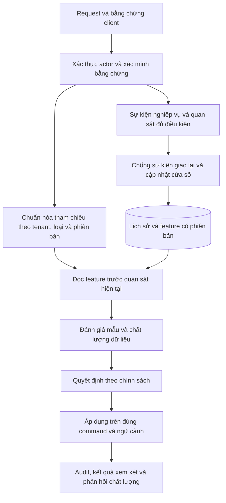
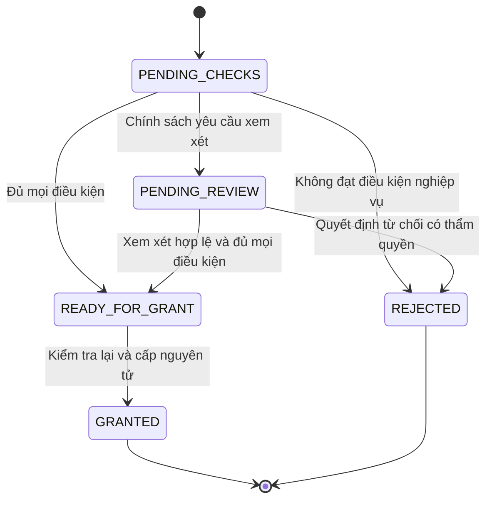

# Anomalous device pattern: phát hiện mẫu thiết bị bất thường

## 1. Mục tiêu và phạm vi

Anomalous device pattern là mẫu sử dụng một hoặc nhiều tham chiếu thiết bị khác với hành vi kỳ vọng của luồng nghiệp vụ, nhóm người dùng hoặc lịch sử đã quan sát. Ví dụ: một tham chiếu thiết bị liên quan đến nhiều tài khoản nhận ưu đãi trong thời gian ngắn, một tài khoản liên tục đổi tham chiếu khi yêu cầu hoàn tiền, hoặc một phiên quen thuộc đột ngột có bằng chứng thiết bị không còn khớp.

Bài học thuộc chương **Anomaly Detection** của module `SECURITY_APPLICATION_SECURITY_BUSINESS_LOGIC_SECURITY`. Trọng tâm là dùng tín hiệu thiết bị để hỗ trợ bảo vệ quy tắc nghiệp vụ trước lạm dụng ưu đãi, bỏ qua phê duyệt, sửa giá, thao tác sai quyền và gửi yêu cầu trùng.

Sau bài học, người học có thể:

- Phân biệt thiết bị vật lý, bản cài ứng dụng, hồ sơ trình duyệt và tham chiếu thiết bị trong dữ liệu.
- Xác định nguồn, độ bảo đảm và giới hạn của từng loại tín hiệu.
- Thiết kế feature theo cửa sổ, baseline và ngữ cảnh nghiệp vụ.
- Phân biệt hành vi bất thường với thiết bị dùng chung, cài lại ứng dụng hoặc lỗi thu thập.
- Áp dụng xác minh thêm hoặc xem xét với phạm vi phù hợp, đồng thời giữ các bất biến nghiệp vụ.
- Kiểm thử khả năng giả mạo, đầu độc lịch sử và lợi dụng cơ chế chặn thiết bị.

Các ngưỡng, cửa sổ và mã định danh trong bài chỉ minh họa thiết kế. Chúng cần được đánh giá bằng dữ liệu của sản phẩm trước khi dùng để tác động đến người dùng.

## 2. Thiết bị trong dữ liệu không đồng nghĩa một con người

### 2.1. Những đối tượng thường bị gọi chung là device

| Đối tượng | Ví dụ | Quan hệ với thiết bị vật lý |
| --- | --- | --- |
| Bản cài ứng dụng | Một app installation có mã cục bộ | Có thể thay đổi sau cài lại hoặc xóa dữ liệu |
| Hồ sơ trình duyệt | Cookie hoặc dữ liệu local của một browser profile | Một máy có nhiều profile; profile có thể bị sao chép hoặc mất |
| Fingerprint | Nhóm thuộc tính phần mềm, cấu hình hoặc kết nối | Có thể giống giữa nhiều máy hoặc thay đổi trên cùng máy |
| Khóa đã đăng ký | Public key được hệ thống liên kết với một client | Chứng minh sở hữu khóa theo giao thức; phạm vi bảo vệ khóa phụ thuộc triển khai |
| Bằng chứng nền tảng | Kết quả kiểm tra môi trường app hoặc thiết bị | Diễn tả các điều kiện của nền tảng tại một ngữ cảnh kiểm tra |
| Tham chiếu phân tích | Mã đã chuẩn hóa hoặc giả danh dùng trong feature | Là khóa liên kết dữ liệu, không tự xác nhận danh tính |

Trong bài, `deviceRef` là tham chiếu đã được hệ thống phân loại nguồn và phạm vi. Nếu nguồn chỉ là cookie, việc một `deviceRef` mới xuất hiện chỉ cho biết một tham chiếu mới được nhìn thấy. Nó chưa chứng minh khách hàng đang dùng một máy vật lý mới.

Một máy có thể được nhiều người dùng; một người có thể dùng nhiều máy. Một nhóm gian lận cũng có thể sử dụng nhiều thiết bị thật. Vì vậy, quy tắc “mỗi người một ưu đãi” không thể được chứng minh chỉ bằng việc mỗi `deviceRef` nhận một lần.

### 2.2. Bất thường là giả thuyết cần ngữ cảnh

Một tham chiếu xuất hiện ở tám tài khoản có thể liên quan đến lạm dụng, nhưng cũng có thể là máy tại quầy dịch vụ. Một tài khoản có ba tham chiếu trong một ngày có thể do đổi trình duyệt, dùng điện thoại và máy tính, hoặc cơ chế ID mới triển khai.

Điều cần đánh giá là mối liên hệ giữa mẫu thiết bị, loại bằng chứng, thời gian và hành động có giá trị. Dùng chung thiết bị để đọc nội dung có ý nghĩa khác với dùng chung tham chiếu để tạo hàng loạt lệnh nhận thưởng.

## 3. Những mẫu thiết bị đáng quan sát

| Mẫu | Cách biểu diễn | Giả thuyết cần kiểm tra | Giải thích hợp lệ có thể có |
| --- | --- | --- | --- |
| Một tham chiếu, nhiều tài khoản | Số account khác nhau theo deviceRef trong cửa sổ | Điều khiển nhiều tài khoản để lấy lợi ích | Gia đình, máy dùng chung, điểm hỗ trợ |
| Một tài khoản, nhiều tham chiếu mới | Tốc độ xuất hiện tham chiếu chưa từng thấy | Chiếm tài khoản hoặc cố né liên kết | Đổi máy, cài lại, lỗi cookie |
| Thay tham chiếu sau khi bị hạn chế | Chuỗi từ chối rồi tiếp tục cùng nghĩa vụ với ref khác | Né hạn chế hoặc thử nhiều client | App retry sai hoặc người dùng thử trình duyệt khác |
| Nhiều hành động có giá trị trong thời gian ngắn | Command nhận thưởng, đặt hàng hoặc hoàn tiền theo ref | Tự động hóa hoặc khai thác luồng | Chiến dịch, hoạt động theo lô đã được phép |
| Bằng chứng không khớp ngữ cảnh | Proof hoặc kết quả xác minh không gắn đúng request | Phát lại bằng chứng hoặc sao chép danh tính client | Lỗi tích hợp hoặc thời gian hệ thống lệch |
| Thay đổi mạnh so với lịch sử | Thay đổi nhóm client kết hợp thao tác nhạy cảm | Phiên bị chiếm hoặc môi trường bị thay đổi | Nâng cấp hệ điều hành hoặc ứng dụng |
| Mẫu đồng loạt trên nhiều tài khoản | Nhiều chuỗi hành động tương tự, liên kết có nguồn | Phối hợp hoặc lỗi tự động hóa | Job nội bộ, kiểm thử hoặc thay đổi giao diện |

IP, user agent và fingerprint mạng có thể bổ sung ngữ cảnh, nhưng không nên được xem là nhiều bằng chứng độc lập nếu chúng cùng phản ánh một nguồn. Đổi IP trên mạng di động không tự chứng minh đổi thiết bị; cùng IP qua NAT cũng không tự chứng minh cùng máy.

Với mỗi mẫu, cần xác định một giả thuyết có thể điều tra và một hành động phản ứng tương xứng. Không tạo danh sách thiết bị xấu lâu dài chỉ từ một lần tham chiếu xuất hiện ngoài baseline.

## 4. Nguồn tín hiệu và độ bảo đảm

### 4.1. Dữ liệu client và fingerprint

User agent, múi giờ, thông tin màn hình, mã cài đặt hoặc ID được gửi trong request là dữ liệu đầu vào từ client. Chúng có thể bị thiếu, thay đổi hoặc giả mạo. Một chuỗi ID dài, ngẫu nhiên nhìn có vẻ tốt vẫn chưa chứng minh người gửi là chủ hợp lệ của ID đó.

OWASP lưu ý rằng fingerprint và cơ chế phòng vệ phía client có thể bị giả mạo hoặc vượt qua, đồng thời cần nhiều lớp bảo vệ trong [Credential Stuffing Prevention Cheat Sheet](https://cheatsheetseries.owasp.org/cheatsheets/Credential_Stuffing_Prevention_Cheat_Sheet.html). Trong luồng nghiệp vụ, điều đó có nghĩa device signal phải đi cùng kiểm tra quyền, trạng thái và giới hạn lợi ích.

Fingerprint có thể phù hợp để tạo nhóm quan sát gần giống nhau. Nếu phương pháp không bảo đảm liên kết chính xác, schema nên gọi đó là `fingerprintGroupRef` hoặc ghi rõ loại liên kết. Không trộn nó với tham chiếu khóa đã chứng minh sở hữu rồi đếm như cùng một loại định danh.

### 4.2. Khóa đã đăng ký và bằng chứng theo request

Một client có thể đăng ký public key theo quy trình có kiểm soát. Khi thực hiện hành động nhạy cảm, nó chứng minh sở hữu private key bằng giao thức thích hợp. Nếu dùng challenge, cần quy định thời hạn, chống phát lại và cách gắn với ngữ cảnh hành động.

Ngữ cảnh cần bảo vệ có thể gồm tenant, actor đã xác thực, session, hành động, đối tượng và digest nội dung quan trọng. Một proof hợp lệ cho đăng nhập không tự cho phép sử dụng lại để đổi người thụ hưởng của lệnh khác.

Bằng chứng sở hữu khóa cho biết client có khả năng dùng khóa tại thời điểm xác minh. Nó không tự chứng minh khóa gắn độc quyền với một máy vật lý, người đang dùng là chủ tài khoản hợp pháp hoặc hành vi nghiệp vụ là hợp lệ. Các bảo đảm bổ sung phụ thuộc cách tạo, lưu và bảo vệ khóa.

Không coi việc một request nhắc đến public key đã đăng ký là proof. Nếu cho phép một bản cài dùng với nhiều tài khoản, quan hệ đó phải được thiết kế và phân quyền rõ; không tự suy ra một chủ sở hữu con người duy nhất từ khóa.

### 4.3. Kết quả kiểm tra nền tảng

Một số nền tảng cung cấp bằng chứng về ứng dụng hoặc môi trường thiết bị. Chẳng hạn, [Play Integrity API](https://developer.android.com/google/play/integrity/overview) cung cấp các verdict phục vụ đánh giá môi trường app và thiết bị; tài liệu khuyến nghị kết hợp với tín hiệu khác và quan sát tác động trước khi áp dụng cưỡng chế.

Kết quả đó cần được backend xác minh theo giao thức của nhà cung cấp, kiểm tra ngữ cảnh, độ mới và khả năng phát lại. Nó không tự đồng nghĩa một người dùng duy nhất hoặc không có gian lận. Một thiết bị thật vẫn có thể được dùng để lạm dụng ưu đãi.

Không giả định verdict môi trường là định danh thiết bị ổn định. Cũng cần phân biệt `NOT_REQUESTED`, `UNAVAILABLE`, `INVALID` và kết quả hợp lệ không đáp ứng một điều kiện. Các trạng thái này dẫn đến cách xử lý khác nhau.

### 4.4. Ngữ cảnh quan sát từ backend

Actor phải lấy từ ngữ cảnh xác thực. Tenant phải được backend xác lập và kiểm tra. Trạng thái command, số tiền, giá và kết quả nghiệp vụ đến từ dịch vụ có thẩm quyền.

Khi thu thập IP qua proxy, chỉ tin chuỗi chuyển tiếp đã cấu hình và điểm quan sát được kiểm soát. Khi đặc điểm kết nối được đo ở gateway hoặc proxy, cần ghi điểm đo; đặc điểm đó có thể phản ánh trung gian thay vì client cuối.

## 5. Hợp đồng quan sát thiết bị

### 5.1. Liên kết hành động với nguồn thiết bị

Một sự kiện quan sát cần đủ để xác định:

- Tenant và actor đã được phép gắn với sự kiện.
- Loại tham chiếu, cách tạo, phiên bản và độ bảo đảm.
- Hành động nghiệp vụ, command hoặc nghĩa vụ liên quan.
- Outcome thực tế và thời điểm tương ứng.
- Chất lượng dữ liệu, trạng thái proof và nguồn bổ sung.
- Định danh sự kiện phục vụ chống giao lại.

Không gắn một tài khoản nạn nhân vào device history chỉ vì request đăng nhập thất bại có nhập tên tài khoản đó. “Tên tài khoản được nhắm tới” và “actor đã xác thực” là hai quan hệ khác nhau.

Ví dụ giả lập về một quan sát trên request gửi đề nghị nhận ưu đãi:

```json
{
  "schemaVersion": 1,
  "eventId": "DO-921",
  "eventType": "device.business_observation.recorded",
  "producer": "promotion-service",
  "tenantId": "TENANT-A",
  "actorAccountRef": "ACCOUNT-61",
  "requestId": "REQ-212",
  "attemptId": "ATT-212",
  "commandId": "PCMD-19",
  "businessAction": "promotion.claim.submit",
  "campaignRef": "CAMPAIGN-7",
  "outcome": "SUBMITTED",
  "deviceEvidence": {
    "deviceRef": "DREF-42",
    "referenceKind": "REGISTERED_KEY",
    "proofStatus": "VERIFIED_FOR_REQUEST",
    "evidenceVersion": "device-proof-3",
    "referenceKeyVersion": "device-link-key-4",
    "verifiedAt": "2026-11-22T10:00:00.100Z",
    "attestationStatus": "NOT_REQUESTED"
  },
  "observedAt": "2026-11-22T10:00:00.100Z",
  "occurredAt": "2026-11-22T10:00:00.120Z",
  "ingestedAt": "2026-11-22T10:00:00.400Z"
}
```

Tham chiếu này đại diện cho một khóa đã được chứng minh sở hữu theo request, không khẳng định định danh phần cứng. `SUBMITTED` nghĩa là đề nghị đã được lưu, chưa có nghĩa ưu đãi đã được cấp.

Collector bổ sung `ingestedAt` khi nhận. Producer có thẩm quyền ghi nhận thao tác nghiệp vụ, nhưng các thuộc tính do client khai trong loại sự kiện khác vẫn phải được ghi nguồn riêng.

### 5.2. Khóa liên kết và phạm vi

Một feature theo thiết bị nên có khóa bao gồm tối thiểu:

```text
tenant + purpose + referenceKind + referenceVersion + deviceRef
```

Tùy cách tạo tham chiếu, cần thêm phiên bản khóa giả danh hoặc metadata chuyển tiếp. Nếu có yêu cầu phân tích xuyên tenant, phải xây dựng một phạm vi được cho phép riêng, thay vì bỏ tenant khỏi khóa một cách tùy tiện.

Trường hợp thiếu tham chiếu không được đưa vào một bucket chung như `deviceId=unknown` rồi xem mọi tài khoản trong bucket là cùng thiết bị. Hệ thống phải biểu diễn chất lượng thiếu dữ liệu và không tạo liên kết thiết bị giả.

## 6. Thiết kế feature theo mẫu hành vi

### 6.1. Một tham chiếu liên quan đến nhiều tài khoản

Feature minh họa:

```text
accounts_per_device_10m(d, tenant, t)
  = số actorAccountRef khác nhau từ các quan sát đủ điều kiện,
    thuộc đúng tham chiếu d và tenant,
    với occurredAt trong khoảng (t - 10 phút, t]
```

“Đủ điều kiện” phải được định nghĩa rõ: actor đã xác thực, nguồn hợp lệ, đúng loại bằng chứng và outcome phù hợp. Các request chỉ khai tên tài khoản không được trộn vào bộ đếm account đã xác thực.

Có thể tạo feature khác cho số tài khoản bị nhắm tới trong các lần đăng nhập thất bại, nhưng tên, nguồn và độ tin cậy phải tách riêng. Nó không chứng minh thiết bị đã sử dụng thành công tất cả tài khoản đó.

### 6.2. Tốc độ thực hiện hành động có giá trị

```text
promotion_commands_per_device_10m(d, campaign, t)
  = số commandId mới khác nhau đã được gửi hợp lệ
    trong đúng chiến dịch và cửa sổ đã định nghĩa
```

Đếm request sẽ làm retry mạng tăng số lượng. Đếm message broker sẽ làm việc giao lại tăng số lượng. Nếu mục tiêu là quan sát cấp lợi ích, cần một feature khác đếm các lần cấp đã xác nhận theo command hoặc nghĩa vụ, thay vì dùng số đề nghị như số quyền lợi đã nhận.

Số tài khoản và số command có thể cùng đến từ một tập sự kiện. Không xem chúng như hai bằng chứng hoàn toàn độc lập khi đánh giá độ mạnh của mẫu.

### 6.3. Tham chiếu mới đối với tài khoản

Một định nghĩa phù hợp là “chưa có quan sát đủ điều kiện của cặp account–reference trong lịch sử đã sẵn sàng trước thời điểm đánh giá”. Cần quy định thời gian lịch sử được giữ và điều kiện để một quan sát đủ tin cậy trở thành lịch sử quen thuộc.

Thứ tự xử lý rất quan trọng: nếu cập nhật lịch sử trước rồi mới hỏi tham chiếu có mới không, mọi request đầu tiên đều có thể bị coi là đã quen. Có thể đọc snapshot trước quan sát hiện tại hoặc loại rõ `currentObservationId` khỏi phép tính.

Không có dữ liệu lịch sử phải khác với có lịch sử nhưng chưa từng thấy ref này. Tài khoản mới, dữ liệu vừa hết hạn hoặc pipeline chưa đủ coverage cần cờ chất lượng riêng.

### 6.4. Tốc độ thay đổi tham chiếu

Có thể theo dõi số reference mới của một account trong 30 phút hoặc tỷ lệ reference mới trên số thao tác nhạy cảm. Nếu mẫu quá ít hoặc mẫu số bằng 0, tỷ lệ phải được đánh dấu không đủ dữ liệu theo hợp đồng, không chia tùy ý hoặc tự điền 0.

Một tăng đột biến trên nhiều tài khoản cùng phiên bản app có thể là lỗi SDK tạo ID mới mỗi lần mở. Cần kiểm tra thay đổi triển khai trước khi kết luận có chiến dịch chiếm tài khoản.

### 6.5. Thay đổi độ bảo đảm và ngữ cảnh

Một request trước đây thường có proof hợp lệ nhưng hiện tại không có proof là một quan sát đáng xem xét. Cần phân biệt client không hỗ trợ, lỗi dịch vụ, bằng chứng hết hạn và proof không hợp lệ.

User agent thay đổi mạnh hoặc vị trí suy ra từ IP khác thường chỉ bổ sung ngữ cảnh. Không coi chúng là bằng chứng chắc chắn về việc đổi máy hay di chuyển vật lý. Việc đánh giá hành động nhạy cảm cần kết hợp nguồn có thẩm quyền và lịch sử liên quan.

## 7. Baseline, nhóm so sánh và ngưỡng minh họa

### 7.1. So sánh với đúng nhóm

Baseline nên tách các nhóm có hành vi khác nhau, chẳng hạn web và app, bản cài mới và người dùng quay lại, thiết bị cá nhân và máy tại quầy đã được đăng ký. Một mức hoạt động bình thường của nhóm này có thể là ngoại lệ của nhóm khác.

Với mỗi nhóm, cần biết kích thước mẫu, phân phối theo khung giờ, thay đổi chiến dịch và chất lượng nguồn. Không dùng dữ liệu của nhiều nhóm trộn lẫn làm baseline rồi kết luận nhóm ít phổ biến là bất thường.

Đối với nhóm nhỏ hoặc thiết bị mới, biểu diễn trạng thái thiếu lịch sử. Có thể chọn xác minh thêm cho hành động nhạy cảm theo chính sách, nhưng không trình bày kết quả đó như đã chứng minh lệch khỏi baseline cá nhân.

Nếu có nhãn thiết bị dùng chung đã được vận hành xác nhận, nhãn cần có người chịu trách nhiệm, phạm vi và thời hạn rà soát. Client không được tự gửi `sharedDevice=true` để nhận ngoại lệ.

### 7.2. Một rule để chuyển xem xét

Giả sử sản phẩm thử nghiệm rule:

```text
Nếu dữ liệu đủ mới và đúng phạm vi,
   tham chiếu hiện tại có proof hợp lệ theo request,
   có ít nhất 5 account đã xác thực liên quan trong 10 phút,
   và có ít nhất 8 command nhận ưu đãi mới trong cùng chiến dịch,
thì đưa command hiện tại vào xem xét theo chính sách.
```

Các số 5, 8 và 10 phút chỉ minh họa. Rule này tìm một mẫu để xem xét, không kết luận năm tài khoản là cùng một người. Với máy dùng chung hợp lệ, việc xem xét có thể dẫn đến tiếp tục; với nguồn chưa đủ bảo đảm, cần cách xử lý tương ứng thay vì áp dụng cùng mức hạn chế.

Nếu feature được tính gần đúng, metadata phải cho biết đó là ước lượng và sai số liên quan. Không dùng một bộ đếm distinct gần đúng để thực thi bất biến cứng như giới hạn chi tiêu hoặc số quyền lợi được cấp.

### 7.3. Đừng để baseline tự học luôn hành vi lạm dụng

Nếu mọi quan sát được đưa ngay vào lịch sử “bình thường”, kẻ tấn công có thể tạo hoạt động dần dần để làm loãng độ bất thường. Cần định nghĩa cách cập nhật baseline, quản lý dữ liệu đang bị điều tra và kiểm tra thay đổi phân phối.

Ngược lại, nếu chỉ dùng những trường hợp hệ thống từng cho qua làm dữ liệu hợp lệ, baseline có thể giữ lại thiên lệch của rule cũ. Việc đánh giá cần có nguồn nhãn và phương pháp lấy mẫu thích hợp, cùng giới hạn kết luận rõ ràng.

## 8. Kiến trúc tính toán và quyết định theo thiết bị

### 8.1. Luồng xử lý minh họa



Luồng minh họa dùng lịch sử trước quan sát hiện tại. Nếu sản phẩm chọn tính cả request hiện tại, phải định nghĩa việc bổ sung đó rõ ràng và bảo đảm không đếm hai lần khi sự kiện tương ứng đến sau.

Các sự kiện chứng minh thay đổi đã commit có thể dùng outbox cùng transaction. Lượt bị từ chối cần kênh ghi phù hợp để không biến mất khi transaction rollback. Collector cần xác thực producer và giữ phân loại bằng chứng, tránh nhận một claim client như sự kiện thiết bị có thẩm quyền.

### 8.2. Mã giả Java đánh giá một mẫu

Đoạn sau minh họa tạo kết quả đánh giá thiết bị, chưa cho phép cấp ưu đãi. Các kiểu và hàm là mã giả, không chạy độc lập.

```java
DeviceRiskResult evaluateDevicePattern(
        TrustedRequestContext context,
        PromotionCommand command) {

    DeviceEvidence evidence = context.verifiedDeviceEvidence();
    if (evidence == null || !evidence.hasUsableReference()) {
        return DeviceRiskResult.unknown("DEVICE_REFERENCE_MISSING");
    }

    ScopedDeviceKey key = ScopedDeviceKey.fromTrustedContext(
            context.tenant(), evidence);
    DeviceFeatures features = featureStore.readPriorSnapshot(
            key, command.campaignId(), context.currentObservationId());

    if (!features.isFreshAndComplete()) {
        return DeviceRiskResult.unknown("DEVICE_FEATURES_UNAVAILABLE");
    }

    if (!evidence.isProofVerifiedFor(context, command)) {
        return DeviceRiskResult.signalOnly(
                "DEVICE_ASSOCIATION_REQUIRES_MORE_EVIDENCE",
                features.snapshotId());
    }

    if (features.distinctAccounts10m() >= 5
            && features.distinctPromotionCommands10m() >= 8) {
        return DeviceRiskResult.reviewSuggested(
                "MULTI_ACCOUNT_PROMOTION_PATTERN",
                command.id(), command.version(), features.snapshotId());
    }

    return DeviceRiskResult.noAnomalyObserved(features.snapshotId());
}
```

`readPriorSnapshot` có hợp đồng về thời điểm dữ liệu sẵn sàng, cửa sổ và việc loại quan sát hiện tại. `isProofVerifiedFor` phải kiểm tra bằng chứng gắn đúng ngữ cảnh, không chỉ một boolean do client cung cấp.

`UNKNOWN` không đồng nghĩa ít rủi ro. `signalOnly` cũng không đồng nghĩa chắc chắn có gian lận. Một chính sách riêng quyết định cách xử lý khi thiếu hoặc yếu bằng chứng, có thể khác theo độ nhạy cảm của hành động.

Kết quả `noAnomalyObserved` chỉ nói rule này chưa thấy mẫu đã định nghĩa trong dữ liệu có sẵn. Nó không cấp quyền, không bỏ kiểm tra điều kiện nhận ưu đãi và không bảo đảm tài khoản chưa bị chiếm.

### 8.3. Giới hạn của quyết định bất đồng bộ

Feature có thể chậm so với request. Hai request đến đồng thời có thể cùng đọc một snapshot cũ và chưa nhìn thấy nhau. Vì vậy, bộ phát hiện mẫu không được thay thế giới hạn cứng cần transaction hoặc cập nhật nguyên tử.

Ví dụ, nếu mỗi account chỉ được nhận một quyền lợi trong một chiến dịch, dùng ràng buộc theo account–campaign hoặc nghĩa vụ nghiệp vụ tương ứng. Thiết bị đổi ID, không gửi fingerprint hoặc đi qua nhiều máy vẫn không được phá bất biến đó.

## 9. Áp dụng vào state machine và quy tắc nghiệp vụ

Một flow nhận ưu đãi minh họa:



`READY_FOR_GRANT` yêu cầu cả điều kiện nghiệp vụ và kết quả xử lý rủi ro phù hợp. Khi chuẩn bị cấp, backend kiểm tra lại quyền theo đối tượng, trạng thái, phiên bản và khả năng tiêu thụ nghĩa vụ.

Các bất biến cần giữ có thể gồm:

- Actor chỉ thao tác trên tài khoản hoặc hồ sơ nằm trong phạm vi được phép.
- Giá, số tiền và giá trị ưu đãi do server tính theo chính sách.
- Nghĩa vụ được tiêu thụ đúng số lần được phép, kể cả khi có request đồng thời.
- Hành động yêu cầu phê duyệt chỉ thực thi sau phê duyệt hợp lệ, gắn đúng nội dung.
- Retry cùng command không cấp lại lợi ích hoặc tạo thêm execution tiền.

Một thiết bị từng được ghi nhận tốt không bỏ qua các bất biến này. Một người xem xét gỡ giữ về thiết bị cũng không tự có quyền thay đổi giá hoặc hạn mức.

Khi áp dụng quyết định, kiểm tra lại command version và các dữ liệu quan trọng. Quyết định cho thao tác nhận ưu đãi không tự áp dụng cho thao tác đổi người nhận tiền hoặc hoàn một số tiền khác.

Đối với hoàn tiền, dữ liệu thiết bị không giải quyết được trạng thái kết quả bên ngoài chưa rõ. Backend vẫn cần giữ reservation, tham chiếu execution và đối soát thay vì tạo khoản hoàn mới chỉ vì khách hàng đổi thiết bị để gửi lại.

## 10. Giả mạo tham chiếu, đầu độc lịch sử và gây chặn nhầm

### 10.1. Gắn hoạt động xấu vào tham chiếu của người khác

Nếu một hệ thống cho phép bất kỳ request nào tự khai `deviceId` rồi dùng nó để khóa tất cả account liên quan, kẻ tấn công có thể gửi hoạt động xấu dưới một ID bị sao chép và gây gián đoạn cho người khác.

Kiểm soát cần bao gồm phân loại độ bảo đảm, xác minh quan hệ khi cần, giới hạn tác động theo command hoặc actor và xem xét trước các biện pháp diện rộng. Không cho claim chưa xác minh tự tạo quan hệ tin cậy trong lịch sử thiết bị.

Một proof mạnh hơn giúp giảm giả mạo liên kết, nhưng thiết bị dùng chung vẫn tồn tại. Vì vậy, việc khóa mọi account liên quan cần thẩm quyền và bằng chứng riêng; không suy ra từ một rule fan-out đơn lẻ.

### 10.2. Thay ID và tạo thiết bị mới liên tục

Kẻ lạm dụng có thể xóa local storage, đổi profile hoặc tạo nhiều bản cài. Không nên xem mỗi tham chiếu mới là một con người mới được nhận quyền lợi.

Giữ giới hạn theo account, chiến dịch, nghĩa vụ và các thuộc tính có thẩm quyền mà sản phẩm thực sự được phép sử dụng. Tín hiệu thiết bị giúp phát hiện mẫu bổ sung, nhưng không tạo được định danh con người tuyệt đối.

Nếu một device claim không hợp lệ, không tự đăng ký nó thành “thiết bị mới đáng tin” chỉ để request đi tiếp. Quy trình đăng ký, xác thực và cấp quyền cần có ranh giới riêng.

### 10.3. Phát lại bằng chứng

Một bằng chứng từng hợp lệ có thể bị dùng lại cho request khác nếu không gắn ngữ cảnh hoặc không kiểm tra độ mới. Giao thức cần chống phát lại theo thiết kế nền tảng, kiểm tra challenge hoặc nội dung ràng buộc và hạn chế việc dùng sai mục đích.

Trong audit chỉ cần giữ trạng thái xác minh và tham chiếu cần thiết theo chính sách; không sao chép token, private key hoặc bí mật phiên vào mọi sự kiện.

### 10.4. Làm đầy feature store và làm quen giả

Hàng triệu ID ngẫu nhiên có thể làm tăng cardinality, dung lượng lịch sử và chi phí distinct counting. Cần schema, giới hạn chiều dài, quota, giới hạn tốc độ và chính sách lưu theo mức tin cậy.

Nếu cập nhật “thiết bị quen” chỉ bằng một request chưa đủ bảo đảm, kẻ tấn công có thể làm nóng lịch sử trước khi thực hiện hành động nhạy cảm. Cần định nghĩa điều kiện trở thành liên kết quen thuộc và thời điểm có hiệu lực, tách khỏi một quan sát đơn thuần.

## 11. Sai dương, sai âm và thay đổi phân phối

### 11.1. Các trường hợp hợp lệ dễ bị đánh dấu

| Trường hợp | Mẫu dễ gây hiểu nhầm | Cách đánh giá |
| --- | --- | --- |
| Gia đình dùng một máy | Nhiều account theo một ref | Kiểm tra loại hành động và bằng chứng khác; không đồng nhất thành một người |
| Quầy dịch vụ hoặc máy dùng chung | Nhiều người nhận hỗ trợ trên cùng client | Có ngữ cảnh vận hành được xác nhận và quyền phù hợp |
| Cài lại hoặc xóa dữ liệu | Tham chiếu mới trên account cũ | Xác minh quan hệ account, không kết luận máy mới là gian lận |
| Cập nhật app hoặc browser | Fingerprint thay đổi đồng loạt | Kiểm tra phiên bản collector và thời điểm triển khai |
| Trình duyệt hạn chế theo dõi | Thiếu hoặc giảm độ phân biệt thuộc tính | Biểu diễn thiếu dữ liệu và dùng phương án xác minh phù hợp |
| Người dùng nhiều thiết bị | Fan-out reference theo account | So sánh lịch sử và độ nhạy cảm hành động |
| Lỗi mạng gây retry | Nhiều attempt gần nhau | Đếm command và outcome replay riêng |

### 11.2. Những hành vi có thể lọt qua

Thiết bị thật, có app hợp lệ và proof đúng vẫn có thể dùng nhiều tài khoản để lạm dụng. Một cuộc tấn công chia đều qua nhiều máy có thể không tạo fan-out cao theo từng ref. Tài khoản bị chiếm cũng có thể hoạt động từ môi trường rất giống lịch sử.

Do đó, cần theo dõi quy tắc sản phẩm, quan hệ nghĩa vụ, hành vi giao dịch và kết quả điều tra. Đừng mô tả một thiết bị được xác minh là thiết bị hoàn toàn an toàn.

### 11.3. Phân biệt thay đổi hành vi với lỗi đo

Nếu sau một bản phát hành, tỷ lệ “thiết bị mới” tăng mạnh trên toàn bộ người dùng của phiên bản đó, cần kiểm tra SDK, cookie, cách chuẩn hóa và khóa giả danh. Thay đổi cơ chế tạo ID có thể tạo đứt gãy liên kết mà không có thay đổi thiết bị thật.

Giữ phiên bản collector, loại reference, phiên bản khóa và cohort trong dữ liệu giúp phát hiện lỗi đo. Việc tăng cảnh báo có thể đến từ hệ thống quan sát, không chỉ từ hành vi người dùng.

## 12. Thời gian, chống trùng và chất lượng feature

### 12.1. Cửa sổ và sự kiện đến muộn

Cần quy định rõ cửa sổ theo `occurredAt` hay thời điểm nhận, mức đến muộn chấp nhận và cách cập nhật kết quả. Không dùng thời gian client chưa xác minh làm nguồn duy nhất cho thứ tự nghiệp vụ.

Một snapshot nên có thời điểm tính, thời điểm dữ liệu sẵn sàng và trạng thái như `AVAILABLE`, `STALE`, `PARTIAL`, `MISSING` hoặc `INSUFFICIENT_HISTORY`. Dữ liệu bị thiếu không được mặc định thành lịch sử sạch.

Khi đánh giá lại quyết định quá khứ, chỉ sử dụng dữ liệu đã sẵn sàng vào lúc đó. Một sự kiện đến sau hoặc nhãn điều tra có sau không trở thành tín hiệu mà hệ thống từng biết sớm hơn.

### 12.2. Chống giao lại và retry

Cùng event do broker giao lại không làm tăng số account hoặc command. Cần định danh producer và event ID, đồng thời bảo đảm dấu đã xử lý nhất quán với cập nhật feature.

Retry request là attempt khác nhưng có thể cùng command. Một thiết bị gửi ba request cho một đề nghị đã có không được tính thành ba quyền lợi mới. Ngược lại, ba command khác nhau tranh cùng nghĩa vụ cần liên kết theo nghĩa vụ để phát hiện hoặc chặn đúng.

Nếu replay lịch sử để dựng lại baseline, không cộng dữ liệu đó thêm một lần vào cửa sổ trực tuyến. Dùng quy trình dựng lại có phiên bản hoặc namespace riêng.

### 12.3. Khả năng sẵn sàng của dịch vụ tín hiệu

Khi feature store hoặc dịch vụ xác minh thiết bị lỗi, cần giữ trạng thái lỗi rõ ràng và thực hiện chính sách dự phòng theo độ nhạy cảm của hành động. Các lựa chọn có thể là tiếp tục với giới hạn, xác minh thêm, chuyển xem xét hoặc chờ dữ liệu.

Dù chọn cách nào, dịch vụ nghiệp vụ vẫn thực thi kiểm tra quyền, state machine, hạn mức và idempotency. Đường dự phòng không được tự bỏ phê duyệt hoặc coi device claim là bằng chứng đã xác minh.

## 13. Bảo vệ dữ liệu thiết bị

### 13.1. Thu thập tối thiểu theo mục đích

Việc thêm nhiều thuộc tính có thể tăng khả năng liên kết nhưng cũng tăng rủi ro theo dõi và sai lệch. Cần xác định thuộc tính phục vụ mẫu nào, giữ bao lâu và ai có quyền xem.

W3C Privacy Working Group thảo luận tác động riêng tư và nguyên tắc giảm bề mặt fingerprinting trong [Mitigating Browser Fingerprinting in Web Specifications](https://www.w3.org/TR/fingerprinting-guidance/). Dù tài liệu hướng đến người thiết kế Web API, nguyên tắc chỉ dùng mức chi tiết cần thiết cũng hữu ích khi thiết kế tín hiệu chống lạm dụng.

Không mặc định thu toàn bộ danh sách phần mềm, thuộc tính phần cứng hoặc tín hiệu chi tiết chỉ vì có thể truy cập. Nếu nhóm thiết bị hoặc kết quả xác minh đáp ứng nhu cầu, cân nhắc dùng dữ liệu ít chi tiết hơn.

### 13.2. Giả danh và giới hạn liên kết

Một tham chiếu phân tích có thể được tạo bằng HMAC với khóa được bảo vệ:

```text
deviceRef = HMAC(
  K_version,
  Encode([purpose, tenantId, referenceKind, normalizedReference])
)
```

`Encode` cần biểu diễn kiểu và độ dài rõ ràng. Không dùng phép nối chuỗi mơ hồ. Dữ liệu có không gian nhỏ không nên chỉ được hash thường rồi coi là khó truy ngược.

HMAC tạo khả năng liên kết trong phạm vi thiết kế; nó không làm dữ liệu ẩn danh hoàn toàn. Khi thay khóa, cùng reference có thể sinh mã mới. Cần kế hoạch chuyển tiếp và metadata để không đếm nhầm thành nhiều thiết bị.

Không đưa raw private key, token xác thực hoặc session cookie vào feature store. Với public key và dữ liệu nguồn, cũng cần xác định liệu feature store có cần giữ nguyên bản hay chỉ cần tham chiếu.

### 13.3. Quyền và vòng đời dữ liệu

Quyền xem thiết bị của một account phải được kiểm tra theo đối tượng. Giao diện quản lý thiết bị cho khách hàng không được làm lộ account khác có liên kết quan sát với cùng reference.

Nếu người dùng thu hồi một đăng ký thiết bị, hệ thống cần áp dụng cơ chế thu hồi quyền hoặc phiên theo thiết kế. Lịch sử rủi ro và dữ liệu lưu giữ có vòng đời riêng; việc hiển thị, xóa hoặc giữ phải được quản lý rõ, không gây hiểu nhầm về trạng thái truy cập.

Theo dõi truy cập, export, retention, bản sao và dữ liệu dẫn xuất. Những nhãn như “thiết bị đáng ngờ” cũng cần nguồn, thời điểm và cơ chế rà soát; tránh biến một nghi ngờ cũ thành hạn chế vĩnh viễn không thể giải thích.

## 14. Ví dụ xử lý ba tình huống

### 14.1. Mẫu nhiều tài khoản nhận ưu đãi

Trong 10 phút trước request hiện tại, một tham chiếu khóa đã có proof hợp lệ liên quan đến tám account đã xác thực và 12 command mới trong cùng chiến dịch. Snapshot đủ mới và đúng phạm vi.

Rule minh họa ở phần 7 đề xuất xem xét command hiện tại. Audit giữ snapshot, loại bằng chứng, rule version, reason code và command version. Hệ thống chưa kết luận tám account thuộc cùng một người.

Nếu điều tra xác định có lạm dụng, xử lý quyền lợi theo chính sách. Nếu là máy hỗ trợ dùng chung hợp lệ, ghi kết quả và đánh giá lại chính sách hoặc cohort với thẩm quyền phù hợp. Không sửa lịch sử để làm như mẫu chưa từng xuất hiện.

### 14.2. Cài lại ứng dụng và request gửi lại

Một khách hàng cài lại app, có reference mới và gửi ba lần cùng đề nghị vì mất phản hồi. Backend nhận diện cùng command, chỉ tạo một đề nghị và ghi hai attempt replay theo hợp đồng.

Tín hiệu là reference mới và hành vi retry, chưa phải ba quyền lợi hoặc ba thiết bị. Nếu thao tác nhạy cảm cần xác minh thêm, quy trình xác minh phải gắn với đúng account và command. Sau xác minh, backend vẫn kiểm tra giá, điều kiện ưu đãi và nghĩa vụ còn hiệu lực.

### 14.3. Lỗi collector làm mọi reference thay đổi

Sau cập nhật SDK, phần lớn người dùng của một phiên bản app bị tạo ID mới mỗi request. Tỷ lệ reference mới và cardinality tăng đồng loạt, trong khi số command và kết quả cấp lợi ích không tăng tương ứng.

Nhóm vận hành đối chiếu theo phiên bản collector, xác nhận lỗi đo, hạn chế tác động của rule bị ảnh hưởng theo quy trình có audit và sửa nguồn tín hiệu. Các bất biến nghiệp vụ vẫn được giữ tại backend trong suốt quá trình.

Đây là tình huống cho thấy cần theo dõi cả dữ liệu và cơ chế đo. Nếu tự khóa mọi account có reference mới, chính bộ phát hiện có thể gây gián đoạn diện rộng.

## 15. Kiểm thử và vận hành

Các kiểm thử cần sử dụng dữ liệu giả lập trong môi trường kiểm soát, quan sát cả feature, quyết định, state machine và hiệu ứng thực tế.

| Tình huống kiểm thử | Kết quả cần chứng minh |
| --- | --- |
| Client tự gửi `trustedDevice=true` | Không tăng độ bảo đảm hoặc bỏ kiểm tra nghiệp vụ |
| Request dùng deviceRef của người khác nhưng không có proof | Không tạo liên kết tin cậy hoặc khóa diện rộng dựa trên claim đó |
| Phát lại proof cho command hoặc tenant khác | Bị từ chối theo ràng buộc ngữ cảnh |
| Proof hết hạn hoặc challenge đã dùng | Không được xem là xác minh mới hợp lệ |
| Một thiết bị dùng chung bởi nhiều account hợp lệ | Có tín hiệu đúng ngữ nghĩa, phản ứng tương xứng và khả năng xem xét |
| Một account dùng nhiều browser hoặc cài lại app | Không tự kết luận nhiều reference là nhiều người hoặc gian lận |
| Thiếu mọi device signal | Không đưa tất cả người dùng vào bucket chung như cùng thiết bị |
| Cập nhật lịch sử trước đánh giá reference mới | Kiểm thử phát hiện sai thứ tự; phép tính sử dụng lịch sử trước quan sát hiện tại |
| Broker giao lại cùng event | Không tăng thêm account hoặc command |
| Retry ba lần cùng command | Feature command tăng một lần; attempt và replay được phân biệt |
| Hai command đồng thời tranh cùng quyền lợi | Ràng buộc nghiệp vụ vẫn ngăn tiêu thụ quá mức dù feature chậm |
| Đổi deviceRef để nhận lại cùng ưu đãi | Không vượt qua giới hạn account–campaign hoặc nghĩa vụ |
| Sự kiện đến muộn hoặc timestamp tương lai | Cửa sổ và chất lượng được xử lý theo hợp đồng |
| Thay khóa HMAC hoặc phiên bản fingerprint | Biết phạm vi đứt liên kết; không âm thầm đếm thành nhiều máy vật lý |
| Nhiều ID ngẫu nhiên hoặc dữ liệu quá dài | Có giới hạn tài nguyên và tín hiệu vận hành |
| Feature store hoặc dịch vụ xác minh bị lỗi | Chất lượng hiển thị đúng; đường dự phòng giữ các bất biến |
| Thiết bị có verdict hợp lệ nhưng hành vi sai quyền | Backend vẫn từ chối theo quyền đối tượng |
| Gỡ giữ rủi ro nhưng thiếu phê duyệt | Không chuyển sang cấp lợi ích hoặc gửi tiền trái workflow |
| Giao diện thiết bị của account A | Không tiết lộ account B có liên kết trong dữ liệu phân tích |
| Triển khai collector mới gây thay đổi toàn cục | Phát hiện thay đổi theo phiên bản và giới hạn tác động rule có kiểm soát |

Một trình tự vận hành phù hợp:

1. Chọn luồng có giá trị và giả thuyết lạm dụng cụ thể.
2. Định nghĩa reference, nguồn, độ bảo đảm và phạm vi tenant.
3. Xây feature có đơn vị, cửa sổ, thời điểm sẵn sàng và chất lượng rõ ràng.
4. Quan sát theo cohort trước khi áp dụng hạn chế; kiểm tra thiết bị dùng chung và dữ liệu bị thiếu.
5. Áp dụng hành động theo đúng command và ngữ cảnh, giữ kiểm tra nghiệp vụ độc lập.
6. Theo dõi audit, kết quả xem xét, sai dương và lỗi nguồn tín hiệu.
7. Rà soát baseline, ngưỡng, phiên bản collector và vòng đời dữ liệu khi sản phẩm thay đổi.

Các chỉ số hữu ích gồm coverage theo loại bằng chứng, tỷ lệ proof lỗi hoặc thiếu, tỷ lệ reference mới theo phiên bản app, cardinality, độ trễ feature, số command bị chuyển xem xét và tỷ lệ kết quả được xác nhận sau đủ thời gian quan sát.

Mỗi kết luận cần giữ rõ điều đã biết: loại tham chiếu nào được liên kết, hành động gì xuất hiện, dữ liệu có đầy đủ không và quyết định đã tác động đến đối tượng nào. Cách diễn giải đó giúp dùng tín hiệu thiết bị để bảo vệ nghiệp vụ mà vẫn nhận biết giới hạn của phép đo.
