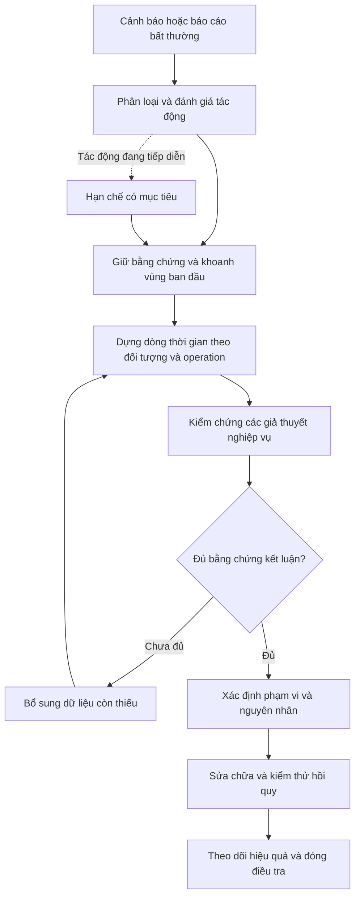

# Anomaly investigation: Điều tra bất thường trong logic nghiệp vụ

## 1. Mục tiêu và phạm vi

Trong chương **Anomaly Detection**, phát hiện bất thường tạo ra một tín hiệu cần xem xét. **Anomaly investigation** là quá trình biến tín hiệu đó thành kết luận có bằng chứng: hành vi nào đã xảy ra, quy tắc nghiệp vụ nào bị tác động, điều kiện nào cho phép hành vi đó và những đối tượng nào có thể chịu ảnh hưởng.

Bài học thuộc phạm vi `SECURITY_APPLICATION_SECURITY_BUSINESS_LOGIC_SECURITY`: bảo vệ quy tắc nghiệp vụ khỏi việc bỏ qua phê duyệt, sửa giá, thao tác sai quyền hoặc tạo tác động lặp. Trọng tâm điều tra là **business invariant, state machine, quyền theo đối tượng, transaction và idempotency**. Các chỉ số thống kê chỉ giúp chọn điểm bắt đầu; kết luận phải dựa trên ngữ nghĩa nghiệp vụ và dữ liệu có thể đối chiếu.

Sau bài học, bạn cần có khả năng:

- Chuyển một cảnh báo mơ hồ thành câu hỏi điều tra kiểm chứng được.
- Dựng dòng thời gian từ yêu cầu, quyết định quyền, chuyển trạng thái, giao dịch và tác động bên ngoài.
- Phân biệt retry hợp lệ, log giao trùng, lỗi vận hành và vi phạm nghiệp vụ.
- Đánh giá phạm vi, mức độ chắc chắn và biện pháp ngăn tác động tiếp diễn.
- Biến kết luận điều tra thành sửa chữa và kiểm thử tình huống lạm dụng có thể tái hiện.

Một bất thường không tự chứng minh có tấn công. Ngược lại, hành vi chỉ xảy ra một lần vẫn có thể là vi phạm nghiêm trọng nếu nó phá vỡ quy tắc bắt buộc, chẳng hạn khách hàng tự phê duyệt khoản hoàn tiền của chính mình.

## 2. Đi từ cảnh báo đến câu hỏi nghiệp vụ

Giả sử hệ thống cảnh báo: “Một tài khoản gửi nhiều yêu cầu hoàn tiền trong một phút”. Thông tin này chưa trả lời được liệu tiền có được hoàn nhiều lần hay không. Có thể người dùng bấm lại vì giao diện bị treo, SDK tự retry, consumer nhận lại cùng một sự kiện, hoặc nhiều khoản hoàn tiền độc lập đều hợp lệ.

Hãy viết lại cảnh báo thành các câu hỏi có thể kiểm chứng:

1. Có bao nhiêu **yêu cầu vận chuyển**, **lệnh nghiệp vụ**, **giao dịch nội bộ** và **tác động bên ngoài** khác nhau?
2. Các yêu cầu có cùng đối tượng, cùng payload chuẩn hóa và cùng phạm vi idempotency không?
3. Tổng tiền hoàn đã ghi nhận có vượt số tiền được phép hoàn không?
4. Người thực hiện có quyền trên đúng đơn hàng, đúng tenant và đúng thời điểm không?
5. Lệnh có đi qua bước phê duyệt và chuyển trạng thái hợp lệ không?
6. Nếu có vi phạm, nó xuất hiện ở lần xử lý đầu tiên, khi retry hay khi nhiều giao dịch chạy đồng thời?

### 2.1. Invariant là điểm tựa của kết luận

Invariant là điều kiện hệ thống phải luôn giữ tại những ranh giới đã xác định. Điều tra cần dùng đúng phiên bản quy tắc áp dụng khi sự kiện xảy ra.

| Nhóm | Ví dụ quy tắc cần kiểm chứng | Dữ liệu cần đối chiếu |
| --- | --- | --- |
| Tiền | Tổng hoàn tiền thành công không vượt số tiền đủ điều kiện hoàn | Số tiền đã thu, tiền tệ, sổ giao dịch, quy tắc điều chỉnh |
| Phê duyệt | Khoản hoàn vượt ngưỡng phải được phê duyệt trước khi thực thi | Phiên bản chính sách, bản phê duyệt, số tiền và đối tượng được duyệt |
| State machine | Chỉ được chuyển từ trạng thái cho phép sang trạng thái tiếp theo | Trạng thái trước/sau, version, kết quả commit |
| Quyền đối tượng | Chủ thể chỉ được thao tác trên đối tượng thuộc phạm vi được cấp | Tenant, quan hệ sở hữu, ủy quyền, quyết định quyền ở thời điểm xử lý |
| Giá | Giá cuối cùng do máy chủ tính từ chính sách hợp lệ | Phiên bản bảng giá, khuyến mãi, thuế/phí, giá lưu trên đơn |
| Idempotency | Retry cùng một lệnh trong phạm vi cam kết không tạo thêm tác động | Key, phạm vi key, fingerprint, operation ID, kết quả đã lưu |

Không lấy một công thức ví dụ áp dụng cho mọi sản phẩm. Sàn giao dịch, ví điện tử và cửa hàng bán lẻ có thể có cách tính số tiền được hoàn khác nhau. Khi có hoàn tác, chargeback hoặc nhiều tiền tệ, phải làm rõ mô hình kế toán trước khi cộng trừ.

### 2.2. Phân biệt ba tầng nhận định

- **Quan sát:** Có hai giao dịch hoàn tiền thành công cho cùng một đơn hàng.
- **Suy luận:** Hai giao dịch có thể đã cùng kiểm tra số dư trước khi giao dịch kia cập nhật.
- **Kết luận được xác nhận:** Trace và dữ liệu giao dịch cho thấy cả hai cùng đọc phiên bản cũ, sau đó mỗi giao dịch ghi một khoản hoàn tiền; thử nghiệm với lịch chạy tương ứng tái hiện được vi phạm.

Không chuyển một giả thuyết thành sự thật chỉ vì nó giải thích cảnh báo một cách thuận tiện. Khi thiếu bằng chứng đọc dữ liệu, có thể xác nhận invariant bị phá vỡ nhưng vẫn để nguyên nhân chạy đua ở trạng thái chưa xác nhận.

## 3. Quy trình điều tra có đầu ra rõ ràng



Các bước có thể diễn ra song song. Nếu tiền đang bị chi sai, không cần đợi biết đầy đủ nguyên nhân mới ngăn đường thực thi liên quan. Tuy nhiên, quyết định hạn chế phải có phạm vi, người chịu trách nhiệm và điều kiện gỡ bỏ để tránh biến một cảnh báo thành gián đoạn diện rộng.

### 3.1. Phân loại ban đầu

Ghi nhận tối thiểu:

- Mã vụ việc, nguồn cảnh báo, thời điểm phát hiện và khoảng thời gian cần khảo sát.
- Tenant, đối tượng nghiệp vụ, loại thao tác và các operation đã biết.
- Quy tắc nghi ngờ bị vi phạm, bằng chứng hiện có và dữ liệu còn thiếu.
- Tác động đã xác nhận; tác động tiềm năng cần ghi riêng.
- Tình trạng đang tiếp diễn, khả năng lan rộng và người phụ trách.

Ưu tiên theo tác động và khả năng tiếp diễn, không chỉ theo số lượng request. Một yêu cầu thay đổi tài khoản nhận tiền trái quyền có thể cần xử lý trước hàng nghìn lần retry bị từ chối.

### 3.2. Giữ bằng chứng trước khi trạng thái thay đổi

Lưu một tập bằng chứng tối thiểu, có kiểm soát truy cập, gồm các bản ghi nghiệp vụ liên quan, sự kiện audit, quyết định quyền, cấu hình và phiên bản mã xử lý. Ghi rõ nguồn lấy dữ liệu, thời điểm trích xuất, phạm vi truy vấn và các phép biến đổi đã thực hiện.

Nếu cần kiểm tra tính toàn vẹn của bản trích xuất, có thể lưu checksum và quản lý bản gốc theo quyền chỉ đọc. Checksum giúp phát hiện thay đổi sau khi trích xuất; nó không tự chứng minh log ban đầu chính xác hoặc đầy đủ.

Không sao chép token, cookie, mật khẩu, thông tin thẻ hoặc toàn bộ payload cá nhân vào hồ sơ điều tra. Dùng trường cần thiết, giá trị che bớt hoặc fingerprint được thiết kế phù hợp. Bằng chứng chứa dữ liệu nhạy cảm phải theo chính sách truy cập và lưu giữ tương ứng.

### 3.3. Khoanh vùng theo đối tượng và cơ chế

Đi từ phạm vi hẹp đến phạm vi có cùng điều kiện gây lỗi:

1. Operation xuất hiện trong cảnh báo.
2. Các operation khác trên cùng đối tượng trong khoảng thời gian liên quan.
3. Các đối tượng khác có cùng nhánh xử lý, phiên bản triển khai hoặc chính sách.
4. Các tenant hoặc kênh khác dùng chung cơ chế bị nghi ngờ.

Đừng chỉ tìm các tài khoản có tốc độ gửi tương tự. Nếu lỗi là thiếu kiểm tra quyền trên một endpoint, tài khoản gửi chậm vẫn có thể khai thác cùng lỗi.

## 4. Thu thập dữ liệu theo chuỗi quyết định nghiệp vụ

Một dòng access log thường chỉ cho biết endpoint nhận request và mã phản hồi. Để điều tra logic, cần kết nối được **ai yêu cầu → đối tượng nào → quyết định nào → trạng thái nào → tác động nào**.

### 4.1. Những định danh cần phân biệt

| Định danh | Vai trò | Giới hạn |
| --- | --- | --- |
| `request_id` | Nhận diện một lần nhận request | Retry thường có request ID khác |
| `trace_id` | Nối các bước xử lý trong trace | Không phải mọi retry hoặc consumer đều giữ cùng trace |
| `operation_id` | Nhận diện một lệnh nghiệp vụ được hệ thống cấp | Cần biết quy tắc cấp và tái sử dụng |
| `event_id` | Nhận diện một sự kiện | Một event có thể được giao nhiều lần |
| `idempotency_key` | Liên kết retry theo hợp đồng của API | Không ngăn nhiều lệnh với các key khác nhau |
| `provider_transaction_id` | Nhận diện tác động ở nhà cung cấp | Phải đối soát theo ngữ nghĩa và trạng thái của nhà cung cấp |
| `entity_id` + `tenant_id` | Nối dữ liệu theo đối tượng và phạm vi | Không bỏ tenant nếu ID không duy nhất toàn hệ thống |

Không dùng IP hoặc user agent làm khóa nhận diện lệnh. Nhiều người có thể dùng chung IP, còn cùng một người có thể đổi IP giữa các lần thực hiện.

### 4.2. Nội dung audit hữu ích

Ví dụ một sự kiện minh họa; tên trường không phải tiêu chuẩn bắt buộc:

```json
{
  "event_id": "evt-refund-021",
  "event_type": "refund.posted",
  "occurred_at": "2026-10-05T09:00:00.120Z",
  "observed_at": "2026-10-05T09:00:00.180Z",
  "tenant_id": "tenant-demo",
  "actor_id": "actor-31",
  "entity_type": "order",
  "entity_id": "order-781",
  "operation_id": "refund-op-a",
  "request_id": "request-a",
  "trace_id": "trace-a",
  "authorization_decision_id": "authz-a",
  "approval_id": "approval-a",
  "amount_minor": 700000,
  "currency": "VND",
  "entity_version_before": 12,
  "entity_version_after": 13,
  "transaction_reference": "ledger-tx-a",
  "policy_version": "refund-policy-8"
}
```

`amount_minor` là số nguyên theo đơn vị nhỏ nhất mà mô hình tiền tệ của ứng dụng quy định; không mặc định mọi tiền tệ có hai chữ số thập phân. Sự kiện trên ghi 700.000 VND theo mô hình ví dụ.

Các giá trị version và reference chỉ có ý nghĩa khi biết chúng được ghi ở đâu trong vòng đời giao dịch. Một log phát ra trước commit có thể mô tả thao tác sau đó bị rollback. Một log sau commit cũng có thể bị mất do tiến trình dừng. Vì vậy, dùng dữ liệu đã commit để kiểm chứng kết quả nội bộ; với tác động bên ngoài, cần đối soát thêm ở hệ thống thực thi tương ứng.

Nếu hệ thống dùng transactional outbox, hãy kiểm tra cả bản ghi outbox và trạng thái phát sự kiện. Cơ chế này hỗ trợ liên kết commit với việc phát sự kiện, nhưng không mặc nhiên làm consumer chỉ nhận một lần hoặc làm lời gọi thanh toán bên ngoài nguyên tử với cơ sở dữ liệu nội bộ.

### 4.3. Quyết định quyền phải có ngữ cảnh lịch sử

Điều tra quyền theo đối tượng cần xác định:

- Chủ thể đã được xác thực là ai; danh tính có được ủy quyền hay mạo danh hợp lệ không.
- Quyền áp dụng trên đối tượng cụ thể nào, thuộc tenant nào.
- Quan hệ sở hữu, vai trò và chính sách có hiệu lực tại thời điểm xử lý.
- Đường xử lý nào thực thi tác động và có kiểm tra lại điều kiện cần thiết không.
- Phê duyệt, nếu có, có ràng buộc đúng đối tượng, số tiền, tiền tệ và phiên bản dữ liệu không.

Vai trò hiện tại của người dùng không chứng minh vai trò của họ ở thời điểm sự cố. Một quyết định `allow` cũng không tự chứng minh kiểm tra quyền đúng: có thể code đã kiểm tra quyền trên tenant từ payload thay vì tenant của đối tượng được tải từ máy chủ.

## 5. Dựng dòng thời gian mà không nhầm thứ tự

### 5.1. Dùng nhiều loại thời gian

- **Thời gian sự kiện:** thời điểm thành phần nguồn ghi nhận hành động.
- **Thời gian quan sát:** thời điểm hệ thống thu thập nhận được dữ liệu.
- **Mốc giao dịch:** commit, version hoặc sequence có ngữ nghĩa được biết trong cùng hệ thống.

Chuẩn hóa múi giờ khi trình bày, giữ độ chính xác gốc và ghi lại sai lệch đồng hồ đã biết. Không sắp xếp log từ nhiều dịch vụ rồi coi đó là thứ tự nhân quả chắc chắn. Sự kiện đến sau có thể đã xảy ra trước; hai timestamp giống nhau không chứng minh chúng xảy ra đồng thời.

Trong một đối tượng được cập nhật có kiểm soát version, thứ tự version có thể hỗ trợ xác định chuỗi thay đổi. Không dùng số tăng dần của một bảng bất kỳ làm bằng chứng commit toàn cục khi hệ thống không có bảo đảm đó.

### 5.2. Truy vấn chuỗi sự kiện

Ví dụ SQL minh họa trên bảng audit đã chuẩn hóa. Các placeholder phải được bind bằng prepared statement hoặc cơ chế tham số của công cụ điều tra.

```sql
SELECT
    occurred_at,
    observed_at,
    event_id,
    event_type,
    operation_id,
    request_id,
    entity_version_before,
    entity_version_after,
    transaction_reference
FROM business_audit_event
WHERE tenant_id = :tenant_id
  AND entity_type = 'order'
  AND entity_id = :order_id
  AND occurred_at >= :window_start_utc
  AND occurred_at < :window_end_utc
ORDER BY occurred_at, observed_at, event_id;
```

`event_id` ở cuối chỉ giúp kết quả hiển thị ổn định, không tạo ra quan hệ trước sau về nghiệp vụ. Khi thời gian nguồn thiếu hoặc sai, cần tra thêm theo operation, reference giao dịch và khoảng thời gian quan sát. Một truy vấn chỉ dựa vào thời gian sự kiện có thể bỏ sót log bị ghi sai giờ.

Nếu bảng audit chứa nhiều bản sao của cùng sự kiện, hãy nhận diện bản sao bằng quy tắc của nguồn phát trước khi đếm. Không loại trùng theo số tiền, actor và timestamp vì hai giao dịch hợp lệ có thể giống các giá trị đó.

### 5.3. Bảng thời gian nên ghi cả khoảng trống

| Mốc | Điều quan sát được | Nguồn | Điều chưa thể kết luận |
| --- | --- | --- | --- |
| Nhận yêu cầu | Hai request khác nhau vào cùng endpoint | Gateway | Có tạo hai lệnh hay không |
| Kiểm tra quyền | Hai quyết định `allow` | Audit quyền | Chính sách có kiểm tra đúng đối tượng hay không |
| Kiểm tra hạn mức | Hai trace ghi cùng giá trị còn lại | Trace ứng dụng | Giá trị có được bảo vệ đến lúc ghi hay không |
| Ghi giao dịch | Hai operation có bản ghi đã commit | Sổ nghiệp vụ | Nhà cung cấp đã thực thi cả hai hay chưa |
| Đối soát | Hai reference ngoài có trạng thái thành công | Dữ liệu nhà cung cấp | Tác động đã được bù trừ ở bước sau hay chưa |

Ghi rõ khoảng trống giúp tránh kết luận quá mức. Nếu không có log kiểm tra hạn mức, kết luận “hai request đều đọc cùng giá trị” phải chờ bằng chứng khác hoặc tái hiện có kiểm soát.

## 6. Ca điều tra xuyên suốt: hoàn tiền vượt hạn mức

### 6.1. Mô hình nghiệp vụ của ví dụ

Một đơn hàng có số tiền đủ điều kiện hoàn là **1.000.000 VND**. Hệ thống cho phép hoàn từng phần. Mỗi khoản hoàn chỉ được thực thi khi đủ quyền và đáp ứng chính sách phê duyệt. Trong ca này, đã xác minh cả hai khoản có phê duyệt hợp lệ và người thực hiện có quyền trên đơn hàng.

Mô hình ví dụ không có chargeback, hoàn tác hay thay đổi số tiền đủ điều kiện trong cửa sổ điều tra. Invariant cần giữ là:

```text
Tổng số tiền hoàn thành công của đơn hàng <= 1.000.000 VND
```

Giả sử dữ liệu quan sát được như sau:

| Thời gian UTC | Operation A | Operation B |
| --- | --- | --- |
| 09:00:00.100 | Nhận yêu cầu hoàn 700.000, key `key-a` | |
| 09:00:00.105 | | Nhận yêu cầu hoàn 700.000, key `key-b` |
| 09:00:00.110 | Đọc tổng đã hoàn = 0 | |
| 09:00:00.112 | | Đọc tổng đã hoàn = 0 |
| 09:00:00.120 | Commit khoản hoàn 700.000 | |
| 09:00:00.125 | | Commit khoản hoàn 700.000 |
| Sau đối soát | Nhà cung cấp xác nhận giao dịch A thành công | Nhà cung cấp xác nhận giao dịch B thành công |

Chỉ sử dụng hai dòng “đọc tổng đã hoàn” như bằng chứng nếu thực sự có trace đáng tin cậy hoặc cơ chế quan sát tương ứng. Nếu không, giữ chúng trong mô hình giả thuyết, không đưa vào bảng sự kiện đã xác nhận.

### 6.2. Tách các giả thuyết cạnh tranh

| Giả thuyết | Bằng chứng cần kiểm tra | Dấu hiệu làm giả thuyết yếu đi |
| --- | --- | --- |
| Chỉ có log giao trùng | Event ID, ledger ID, reference ngoài | Có hai giao dịch nghiệp vụ và hai tác động ngoài độc lập |
| Retry cùng một lệnh bị thực thi lại | Phạm vi key, fingerprint, operation ID | Hai key khác nhau và hai lệnh độc lập theo hợp đồng API |
| Thiếu quyền trên đơn hàng | Dữ liệu đối tượng và quyết định quyền lịch sử | Quyền theo đối tượng đã được kiểm chứng đúng |
| Bỏ qua phê duyệt | Approval ID và nội dung được duyệt | Mỗi khoản đều có phê duyệt hợp lệ, ràng buộc đúng payload |
| Chạy đua khi giữ hạn mức | Thời gian chồng lấn, cách đọc/ghi, transaction và khóa | Có cơ chế giữ hạn mức nguyên tử thực sự bao phủ cả hai đường chạy |
| Hạch toán sai hoặc đối soát chậm | Mapping operation với ledger và nhà cung cấp | Cả hai nguồn độc lập xác nhận cùng tác động vượt hạn mức |

Hai key khác nhau không chứng minh có ý đồ xấu. Chúng chỉ cho thấy không thể dựa vào cơ chế loại trùng cùng key để bảo vệ invariant tổng tiền. Lỗi chạy đua có thể bị kích hoạt bởi người dùng hợp lệ, tác vụ nội bộ hoặc hành vi cố ý.

### 6.3. Kiểm chứng tác động bằng dữ liệu đã commit

Giả sử bảng `refund_posting` của ví dụ có đúng một bản ghi cho mỗi khoản hoàn đã ghi sổ thành công; `amount_minor` luôn dương và `posting_id` duy nhất. Bảng `order_refund_limit` chứa giới hạn đủ điều kiện hoàn theo đơn và tiền tệ. Không có bản ghi hoàn tác trong mô hình rút gọn này.

```sql
SELECT
    p.tenant_id,
    p.order_id,
    p.currency,
    SUM(p.amount_minor) AS refunded_minor,
    l.refundable_minor,
    SUM(p.amount_minor) - l.refundable_minor AS excess_minor
FROM refund_posting p
JOIN order_refund_limit l
  ON l.tenant_id = p.tenant_id
 AND l.order_id = p.order_id
 AND l.currency = p.currency
WHERE p.tenant_id = :tenant_id
  AND p.order_id = :order_id
GROUP BY
    p.tenant_id,
    p.order_id,
    p.currency,
    l.refundable_minor
HAVING SUM(p.amount_minor) > l.refundable_minor;
```

Với hai khoản 700.000 VND, tổng hoàn là 1.400.000 VND, vượt giới hạn **400.000 VND**. Truy vấn này phát hiện vi phạm trong mô hình đã nêu, không tự xác định nguyên nhân hoặc ý đồ của người thao tác.

Không chỉ lọc các khoản hoàn trong một cửa sổ ngắn rồi so với toàn bộ giới hạn của đơn. Muốn kết luận tổng vượt hạn mức, phải tính đủ các khoản liên quan đến trạng thái đang kiểm chứng. Với điều tra lịch sử, cần dữ liệu giới hạn và bút toán tại mốc đó; giới hạn hiện tại có thể đã thay đổi.

Trong mô hình có sổ kép, nhiều dòng cho một giao dịch, hoàn tác hoặc khoản đang chờ xử lý, cần dựng projection đúng ngữ nghĩa trước khi tổng hợp. Không dùng `DISTINCT amount_minor` để xử lý bản sao: hai khoản hoàn độc lập bằng nhau vẫn là hai tác động khác nhau. Cũng không cộng nhiều tiền tệ vào cùng một tổng.

### 6.4. Nguyên nhân kỹ thuật cần chứng minh

Mẫu xử lý dễ tạo lỗi trong ca này:

```text
Đọc tổng đã hoàn
Nếu tổng đã hoàn + số tiền yêu cầu <= giới hạn:
    Ghi một khoản hoàn mới
Commit
```

Nếu hai giao dịch cùng đọc tổng cũ và không có cơ chế phối hợp bảo vệ điều kiện, mỗi giao dịch có thể tự thấy hợp lệ trong khi kết quả chung vi phạm invariant. Việc đặt cả hai bước vào một transaction chưa đủ; còn phụ thuộc isolation, cấu trúc dữ liệu, khóa, ràng buộc và đường cập nhật thực tế.

Cách sửa có thể là cập nhật có điều kiện trên một bản ghi hạn mức chung, khóa một bản ghi chung trước khi kiểm tra, hoặc dùng cơ chế tuần tự hóa phù hợp. Lựa chọn nào cũng phải xử lý được cạnh tranh, rollback và retry theo đặc tính cơ sở dữ liệu đang dùng.

Một mô hình sửa minh họa:

```text
BEGIN TRANSACTION
    Nhận diện lệnh theo phạm vi idempotency đã công bố
    Nếu lệnh đã tồn tại:
        Kiểm tra fingerprint; trả kết quả hoặc trạng thái hiện có

    Xác thực quyền trên đối tượng và dữ liệu phê duyệt liên quan
    Giữ số tiền bằng cập nhật nguyên tử có điều kiện:
        chỉ thành công khi số tiền còn được phép >= số tiền yêu cầu

    Ghi operation và phần tiền được giữ
    Ghi ý định thực thi ra outbox
COMMIT

Worker gửi yêu cầu ngoài với định danh ổn định
Đối soát kết quả ngoài; chuyển tiền giữ thành tiền đã hoàn
Chỉ giải phóng tiền giữ khi đã xác định không còn tác động ngoài
```

Đây là phác thảo trách nhiệm, không phải một thuật toán cài đặt hoàn chỉnh. Cần thiết kế uniqueness và hành vi chờ khi hai request cùng key đến đồng thời. Khi nhà cung cấp timeout, không được mặc định giao dịch thất bại rồi giải phóng hạn mức ngay: tác động bên ngoài có thể đã xảy ra.

Với quy trình bất đồng bộ này, invariant trong khi xử lý phải bao gồm cả số tiền đã giữ:

```text
Số tiền đã hoàn thành công + số tiền đang được giữ <= giới hạn
```

Điều tra phải theo cùng mô hình đó; nếu chỉ đếm giao dịch thành công, bạn có thể bỏ sót việc hệ thống đã chấp nhận quá nhiều lệnh đang chờ.

### 6.5. Kết luận phù hợp với bằng chứng

Một kết luận có thể viết:

> Đơn `order-781` có hai khoản hoàn độc lập, mỗi khoản 700.000 VND, được ghi nhận thành công trong sổ nghiệp vụ và ở nhà cung cấp. Tổng hoàn vượt giới hạn 1.000.000 VND là 400.000 VND. Hai lệnh dùng key khác nhau nên cơ chế retry cùng key không loại trùng chúng. Bằng chứng xử lý và thử nghiệm đồng thời xác nhận điều kiện giữ hạn mức không được bảo vệ nguyên tử. Chưa có bằng chứng đủ để kết luận ý đồ của người gửi yêu cầu.

Nếu chưa tái hiện hoặc chưa có bằng chứng đọc/ghi, phải hạ mức chắc chắn của câu về nguyên nhân: “nghi ngờ chạy đua ở bước kiểm tra hạn mức; cần xác minh thêm”.

## 7. Điều tra những kiểu lạm dụng logic khác

### 7.1. Bỏ qua hoặc tái sử dụng phê duyệt

Đừng chỉ tìm `approval_id` khác rỗng. Hãy đối chiếu:

- Người duyệt có quyền đúng loại phê duyệt tại thời điểm duyệt không.
- Chính sách có yêu cầu tách người yêu cầu và người duyệt không.
- Approval có gắn đúng đối tượng, tenant, số tiền, tiền tệ và phiên bản dữ liệu không.
- Payload có bị đổi sau khi duyệt không; nếu có thì approval cũ còn hiệu lực theo chính sách không.
- Approval có bị thu hồi, hết hạn hoặc tái sử dụng ngoài số lần được phép không.
- Giao dịch có kiểm tra điều kiện phê duyệt ở điểm thực thi có thẩm quyền không.

Một approval hợp lệ cho 100.000 VND không chứng minh lệnh thực thi 900.000 VND được phép. Nếu không có lịch sử payload hoặc fingerprint tại thời điểm duyệt, đây là khoảng trống bằng chứng cần ghi rõ.

### 7.2. Sửa giá hoặc lạm dụng khuyến mãi

Đối chiếu giá từ client với giá do máy chủ tính, nhưng đừng coi mọi chênh lệch là tấn công. Cần kiểm tra thời hạn báo giá, quy tắc làm tròn, số lượng, thuế/phí, tiền tệ và chính sách khuyến mãi áp dụng lúc chốt đơn.

Những câu hỏi quan trọng:

- Endpoint thực thi có dùng giá client làm nguồn có thẩm quyền không.
- Voucher có bị dùng vượt giới hạn theo người, đơn hoặc chiến dịch không.
- Giới hạn có được giữ khi nhiều checkout chạy đồng thời không.
- Đơn có thay đổi sau khi giá hoặc khuyến mãi đã được xác nhận không.

Một mức giảm sâu có thể hoàn toàn hợp lệ trong chiến dịch. Kết luận cần chỉ ra quy tắc cụ thể bị vi phạm và phiên bản chính sách liên quan.

### 7.3. Thao tác sai quyền theo đối tượng

Ghép actor với đối tượng được truy xuất thực tế, không chỉ đối tượng được nêu trong request. Kiểm tra từng đường đọc/ghi, kể cả bulk API, export và worker thực thi sau đó.

Ví dụ: API kiểm tra người dùng thuộc `tenant-A`, nhưng tìm đơn bằng `order_id` và cập nhật một đơn thuộc `tenant-B`. Log `role=operator` và HTTP 200 không đủ chứng minh hợp lệ. Cần đối chiếu tenant của đơn từ dữ liệu có thẩm quyền với phạm vi được cấp cho actor.

Khi truy tìm phạm vi, tìm cả các yêu cầu bị từ chối lẫn yêu cầu thành công. Yêu cầu bị từ chối giúp hiểu chuỗi hành vi, nhưng chỉ ghi nhận tác động nếu có bằng chứng tác động thực tế.

### 7.4. Chuyển trạng thái không hợp lệ

So sánh chuỗi trạng thái đã commit với state machine có hiệu lực. Ví dụ, `DRAFT → APPROVED → EXECUTED` là đường hợp lệ; chuyển thẳng `DRAFT → EXECUTED` chỉ hợp lệ nếu chính sách có một đường riêng được kiểm soát.

Một khoảng trống log không tự chứng minh bước bị bỏ qua. Tìm lịch sử trạng thái, dữ liệu phê duyệt và operation thực thi. Ngược lại, có log “đã duyệt” nhưng giao dịch duyệt rollback cũng không chứng minh phê duyệt đã tồn tại.

Với luồng bất đồng bộ, kiểm tra dữ liệu có bị thay đổi giữa lúc kiểm tra và lúc sử dụng không. Việc kiểm tra ở API đầu vào chỉ có ý nghĩa bảo vệ nếu các điều kiện cần thiết vẫn được giữ hoặc được kiểm tra lại khi tác động xảy ra.

## 8. Phân biệt nhiễu, lỗi và hành vi cố ý

### 8.1. Baseline cần đúng nhóm so sánh

So sánh với hành vi của cùng vai trò, cùng loại nghiệp vụ, cùng kênh, cùng mùa vụ và quy mô phù hợp. Nhân viên xử lý hồ sơ theo lô có thể tạo nhiều thao tác hơn khách hàng thông thường. Một đợt mở bán có thể làm lưu lượng tăng nhưng không làm điều kiện quyền hoặc giới hạn tiền được phép thay đổi.

Baseline giúp đánh giá mức khác thường; invariant giúp đánh giá tính hợp lệ. Hành vi phổ biến vẫn có thể sai nếu nhiều client cùng kích hoạt một lỗi.

### 8.2. Dấu hiệu ý đồ chỉ là một phần hồ sơ

Các mẫu như liên tục đổi ID đối tượng, thử nhiều trạng thái, thay key để tạo lệnh độc lập hoặc điều chỉnh thời điểm gửi có thể hỗ trợ đánh giá hành vi cố ý. Chúng phải được đọc trong ngữ cảnh: client lỗi, công cụ kiểm thử được phép hoặc tích hợp đối tác cũng có thể tạo mẫu tương tự.

Hãy tách hai quyết định:

1. Có cần sửa lỗ hổng hay ngăn tác động tiếp diễn không?
2. Có đủ bằng chứng để quy kết một chủ thể cố ý lạm dụng không?

Bạn có thể trả lời “có” cho quyết định thứ nhất khi quyết định thứ hai vẫn chưa rõ. Không cần chứng minh động cơ mới sửa một invariant đã bị phá vỡ.

### 8.3. Nhãn kết quả phải nói rõ điều đã xác minh

| Kết quả | Điều đã biết | Hành động tiếp theo |
| --- | --- | --- |
| Hành vi hợp lệ | Quyền, trạng thái và invariant đều phù hợp | Điều chỉnh tín hiệu nếu nó tạo nhiễu |
| Lỗi dữ liệu quan sát | Cảnh báo do log trùng, mapping hoặc phép tổng hợp sai | Sửa pipeline và tính lại phạm vi |
| Vi phạm do lỗi hệ thống | Tác động sai đã xác nhận, chưa xác nhận ý đồ | Sửa cơ chế bảo vệ và xử lý dữ liệu bị ảnh hưởng |
| Lạm dụng đã xác nhận | Có vi phạm và bằng chứng phù hợp về hành vi cố ý | Xử lý sự cố theo phạm vi được xác nhận |
| Chưa đủ bằng chứng | Thiếu dữ liệu quyết định | Ghi khoảng trống, bổ sung quan sát và chỉ định lần xem xét tiếp |

Không dùng “chưa đủ bằng chứng” như lý do bỏ qua một rủi ro đang tiếp diễn. Vẫn có thể giới hạn thao tác có mục tiêu trong khi điều tra tiếp.

## 9. Xác định phạm vi và hạn chế tác động

### 9.1. Đếm đúng các đơn vị khác nhau

Báo cáo riêng số request, số operation, số đối tượng, số tenant và số tác động đã xác nhận. Ví dụ, 500 request có thể tương ứng 20 operation và 3 khoản chi sai. Một con số duy nhất sẽ làm người đọc hiểu sai quy mô.

Với tiền, tách:

- Giá trị sai đã xác nhận theo từng tiền tệ.
- Giá trị đang chờ đối soát.
- Giá trị có nguy cơ do cùng điều kiện gây lỗi.
- Giá trị đã được bù trừ hoặc thu hồi, có reference đối chiếu.

“Cùng chạy phiên bản có lỗi” là phạm vi có nguy cơ, không phải bằng chứng mọi giao dịch trong phạm vi đó đã sai. Mở rộng điều tra về trước từ thời điểm phát hiện nếu lỗi đã có từ trước; cũng kiểm tra các nhánh xử lý dùng chung cơ chế.

### 9.2. Biện pháp tạm thời phải gắn với nguyên nhân nghi ngờ

| Biện pháp | Khi hữu ích | Giới hạn cần nhớ |
| --- | --- | --- |
| Tạm dừng thực thi loại tác động liên quan | Sai tiền hoặc thay đổi quyền đang tiếp diễn | Cần xử lý lệnh đang chờ và kế hoạch mở lại |
| Chuyển thao tác nhạy cảm sang duyệt thủ công | Cần xác minh nghiệp vụ trước khi tiếp tục | Tăng tải vận hành; phê duyệt cũng phải ràng buộc đúng dữ liệu |
| Hạn chế theo actor hoặc đối tượng | Bằng chứng tập trung ở phạm vi cụ thể | Không thay thế sửa lỗi dùng chung |
| Điều phối tuần tự theo đối tượng | Nghi ngờ cạnh tranh trên cùng đối tượng | Cơ chế phải bao phủ mọi đường ghi và mọi instance liên quan |
| Giới hạn tốc độ | Giảm lưu lượng và tốc độ gây tác động | Không bảo đảm quyền, state machine hoặc invariant tiền |

Không xóa log hoặc ghi đè giao dịch để làm chỉ số trở lại bình thường. Với dữ liệu tài chính, bù trừ cần theo nghiệp vụ, có tham chiếu về giao dịch gốc và giữ được lịch sử kiểm toán.

## 10. Từ kết luận đến kiểm thử tình huống lạm dụng

Điều tra chỉ tạo giá trị bền vững khi sửa đúng cơ chế và kiểm chứng được hành vi mới. Ca kiểm thử nên bắt nguồn từ invariant đã bị đe dọa, không chỉ tái tạo số lượng request trong cảnh báo.

| Tình huống | Kết quả phải kiểm chứng |
| --- | --- |
| Hai lệnh 700.000 trên giới hạn 1.000.000 chạy đồng thời | Tổng tiền đã hoàn cộng tiền giữ không vượt giới hạn; không chấp nhận cả hai đầy đủ |
| Hai request cùng key và cùng payload đến đồng thời | Một operation có hiệu lực trong phạm vi hợp đồng; trả trạng thái/kết quả nhất quán |
| Cùng key nhưng payload khác | Không thực thi payload thứ hai; phản hồi xung đột theo hợp đồng API |
| Key khác nhau nhưng cùng đối tượng | Mỗi lệnh vẫn phải kiểm tra quyền, trạng thái và giới hạn tổng |
| Đổi số tiền sau phê duyệt | Yêu cầu bị từ chối hoặc phải duyệt lại theo chính sách |
| Dùng ID đối tượng của tenant khác | Không đọc hoặc ghi ngoài phạm vi được cấp |
| Phát lại cùng event | Consumer không tạo thêm tác động nghiệp vụ ngoài cam kết |
| Timeout sau khi nhà cung cấp đã nhận lệnh | Retry và đối soát không tạo thêm giao dịch; không giải phóng hạn mức sai |
| Tiến trình dừng sau commit trước khi trả HTTP | Client có thể tìm lại kết quả mà không tạo operation mới |
| Xung đột transaction rồi retry | Không mất kiểm tra quyền/phê duyệt và không ghi tác động lặp |

Để tái hiện chạy đua, dùng điểm đồng bộ trong môi trường kiểm thử để hai giao dịch chạm đúng khoảng nhạy cảm. Gửi nhiều request ngẫu nhiên có thể không chạm lỗi và làm kiểm thử thiếu ổn định. Các giao dịch phải thực sự dùng kết nối hoặc tiến trình độc lập tương ứng với kiểu cạnh tranh cần kiểm chứng.

Không chỉ kiểm tra HTTP status. Đọc trạng thái đã commit, sổ giao dịch, phần tiền giữ và số lần tác động ở bộ giả lập nhà cung cấp. Một phản hồi lỗi vẫn có thể đi kèm giao dịch đã commit nếu tiến trình gặp sự cố sau đó.

Việc sửa cảnh báo cũng cần phản ánh kết luận: bổ sung tín hiệu vi phạm invariant, giữ đủ định danh liên kết, giảm đếm trùng và mô tả rõ các khoảng trống quan sát. Không hạ ngưỡng cảnh báo hoặc đưa actor vào danh sách bỏ qua chỉ để cảnh báo biến mất.

## 11. Hồ sơ kết luận và điều kiện đóng điều tra

Một hồ sơ gọn nhưng đủ dùng nên có:

```text
Mã vụ việc:
Quy tắc nghiệp vụ và phiên bản chính sách liên quan:
Khoảng thời gian khảo sát, múi giờ và giới hạn độ chính xác:
Phạm vi đã xác nhận / phạm vi còn có nguy cơ:
Tóm tắt tác động, tách theo tiền tệ nếu có:
Dòng thời gian và tham chiếu bằng chứng:
Giả thuyết đã kiểm tra, giả thuyết đã loại trừ:
Nguyên nhân được xác nhận và mức độ chắc chắn:
Khoảng trống dữ liệu còn lại:
Biện pháp hạn chế, chủ sở hữu và điều kiện gỡ bỏ:
Sửa chữa lâu dài và kết quả kiểm thử:
Kết quả đối soát hoặc bù trừ:
Theo dõi sau sửa và người chấp nhận phần còn tồn đọng:
```

Đóng điều tra khi kết luận phù hợp với bằng chứng, tác động đang tiếp diễn đã được kiểm soát, sửa chữa đã được xác minh ở phạm vi liên quan và các phần tồn đọng có người chịu trách nhiệm. Nếu chưa thể xác định nguyên nhân, phải ghi trạng thái đó cùng lý do và bước tiếp theo; không ghi “đã an toàn” chỉ vì một khoảng thời gian không xuất hiện cảnh báo.

Theo dõi sau sửa nên gồm cả số lần invariant bị vi phạm, số giao dịch còn lệch khi đối soát, tỷ lệ cảnh báo có ích và độ đầy đủ của định danh liên kết. Số cảnh báo giảm chỉ có ý nghĩa khi pipeline vẫn nhận dữ liệu và phép đo không bị vô hiệu hóa.

## 12. Tự kiểm tra

**Một request có HTTP 500 thì có thể loại khỏi điều tra tác động không?**

Không. Giao dịch có thể đã commit hoặc nhà cung cấp đã thực thi trước khi phản hồi lỗi. Cần đối chiếu bằng operation và reference giao dịch.

**Có hai request ID nghĩa là có hai khoản tiền đã được hoàn không?**

Không. Hai request có thể là retry của cùng lệnh. Phải phân biệt request, operation, bản ghi đã commit và tác động bên ngoài.

**Hai lệnh dùng key khác nhau thì idempotency đã hỏng chưa?**

Chưa thể kết luận. Cơ chế cùng key có thể hoạt động đúng; lỗi vẫn có thể nằm ở invariant tổng hoặc ở hợp đồng nhận diện lệnh. Quy tắc nghiệp vụ phải được bảo vệ cho cả các lệnh độc lập.

**Hiện tại người dùng không có quyền thì có chứng minh hành động trước đó trái quyền không?**

Không. Cần quyền, quan hệ đối tượng và phiên bản chính sách tại thời điểm thực hiện, đồng thời xác minh code đã kiểm tra đúng đối tượng.

**Hai timestamp sát nhau có đủ kết luận lỗi chạy đua không?**

Không. Chúng chỉ là tín hiệu để kiểm tra. Cần bằng chứng về khoảng xử lý chồng lấn và cơ chế đọc/ghi, hoặc thử nghiệm có kiểm soát xác nhận điều kiện gây lỗi.

**Khi nào có thể gọi một cảnh báo là vi phạm nghiệp vụ đã xác nhận?**

Khi có thể nêu rõ invariant hoặc quy tắc áp dụng, chỉ ra bằng chứng đáng tin cậy về trạng thái hay tác động trái quy tắc, và giải thích được phạm vi cùng giới hạn của kết luận. Việc xác định có chủ ý lạm dụng là một câu hỏi riêng, cần bằng chứng tương ứng.
