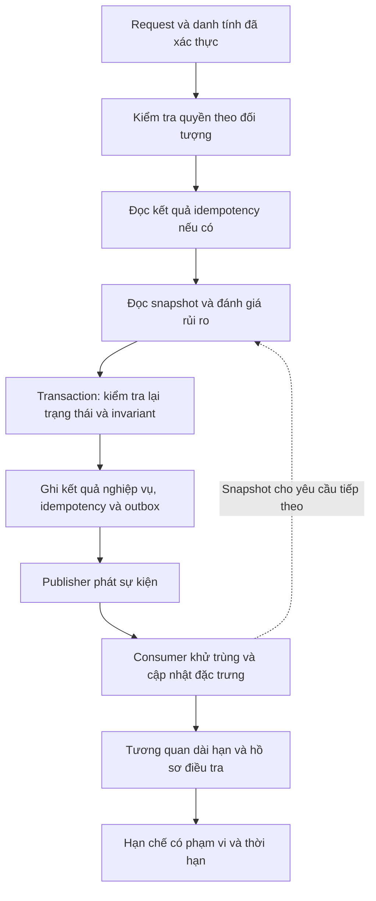
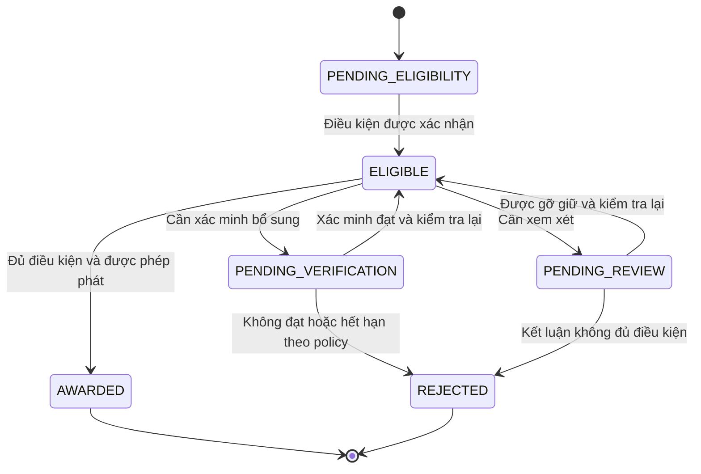

# Automated abuse detection — Tự động phát hiện lạm dụng nghiệp vụ

## 1. Mục tiêu và phạm vi

Trong chương **Abuse Controls** của module bảo mật logic nghiệp vụ, automated abuse detection là khả năng thu thập tín hiệu, liên kết hành vi và phát hiện việc sử dụng chức năng trái với mục đích kinh doanh. Một yêu cầu có thể đúng định dạng, dùng tài khoản hợp lệ và trả về HTTP 200 nhưng vẫn góp phần vào một chiến dịch lạm dụng.

Ví dụ: nhiều tài khoản mới cùng hưởng ưu đãi giới thiệu rồi chuyển quyền lợi về một nơi; một nhóm giữ chỗ liên tục nhưng hầu như không thanh toán; hoặc một nhân viên thử phê duyệt hàng loạt hồ sơ ngoài phạm vi được giao. Mục tiêu phát hiện là xác định hành vi cần hạn chế, xác minh thêm hoặc điều tra trước khi thiệt hại tiếp tục tăng.

OWASP mô tả các mối đe dọa tự động có thể khai thác chính chức năng hợp lệ của ứng dụng. Vì vậy, việc nhận diện cần hiểu ý nghĩa nghiệp vụ của hành động. Xem [OWASP Automated Threats to Web Applications](https://owasp.org/projects/automated-threats-to-web-applications).

Sau bài này, người học có thể:

- Chuyển một kịch bản lạm dụng thành sự kiện, đặc trưng và quy tắc phát hiện.
- Kết hợp quyền theo đối tượng, business invariants, state machine, transaction và idempotency với đánh giá rủi ro.
- Thiết kế phản ứng tương xứng, có bằng chứng và có thời hạn.
- Kiểm tra khả năng phát hiện, cảnh báo sai và độ tin cậy của chính đường ống phát hiện.

Các ngưỡng, điểm số, tên sự kiện và mã Java trong bài là **thiết kế minh họa**, cần hiệu chỉnh theo sản phẩm và dữ liệu thực tế. Điểm số minh họa không phải xác suất gian lận.

## 2. Nhận diện đúng bài toán cần giải quyết

### 2.1. Tự động hóa và lạm dụng là hai thuộc tính khác nhau

Một API đối tác có thể xử lý hàng nghìn giao dịch hợp lệ mỗi phút. Ngược lại, một người thao tác thủ công vẫn có thể lạm dụng hoàn tiền hoặc cố bỏ qua phê duyệt. Tốc độ, công cụ tự động hay trình duyệt không có giao diện chỉ là một phần ngữ cảnh.

Cần trả lời ba câu hỏi:

1. Hành vi có nằm trong quyền và hợp đồng sử dụng của chủ thể không?
2. Hành vi có vi phạm quy tắc bắt buộc hoặc gây tác động kinh doanh không được chấp nhận không?
3. Bằng chứng hiện có đủ mạnh để áp dụng biện pháp nào?

Một đợt tăng truy cập do chương trình khuyến mãi cần được đánh giá khác với một nhóm chiếm giữ toàn bộ tồn kho. OWASP API6 nhấn mạnh việc xác định các luồng nhạy cảm và rủi ro do sử dụng quá mức, chẳng hạn mua hàng, đặt chỗ và giới thiệu người dùng. Xem [API6:2023 — Unrestricted Access to Sensitive Business Flows](https://api-security.owasp.org/editions/2023/en/0xa6-unrestricted-access-to-sensitive-business-flows/).

### 2.2. Bốn lớp kiểm soát có vai trò riêng

| Lớp | Câu hỏi chính | Ví dụ |
| --- | --- | --- |
| Quyền theo đối tượng | Chủ thể có được tác động đối tượng này không? | Người A không được hoàn tiền đơn của B |
| Invariant và state machine | Lệnh có hợp lệ trong trạng thái hiện tại không? | Chưa duyệt thì chưa được giải ngân |
| Quota, transaction, idempotency | Tác động có vượt giới hạn hoặc bị thực hiện trùng không? | Một quyền lợi chỉ được ghi nhận một lần |
| Phát hiện lạm dụng | Chuỗi hành vi hợp lệ hoặc bị từ chối có biểu hiện nguy hiểm không? | Nhiều tài khoản mới cùng gom thưởng về một nơi |

Ba lớp đầu phải được thực thi tại nơi ra quyết định nghiệp vụ. Bộ phát hiện bổ sung khả năng nhìn theo thời gian, qua nhiều tài khoản và nhiều chức năng.

**Không dùng điểm rủi ro thấp để cho phép sửa giá trái phép, truy cập đối tượng không thuộc quyền hoặc nhảy qua bước phê duyệt.** Một invariant bị vi phạm phải khiến lệnh bị từ chối ngay cả khi tài khoản có lịch sử tốt.

## 3. Bắt đầu từ tài sản và hành vi gây thiệt hại

Trước khi viết bộ đếm, cần mô tả rõ tài sản được bảo vệ, chủ thể thực hiện và điều kiện gây thiệt hại. Bảng sau là các giả thuyết thiết kế cho một hệ thống thương mại điện tử:

| Luồng | Quy tắc bắt buộc | Dấu hiệu cần phát hiện | Tác động có thể xảy ra |
| --- | --- | --- | --- |
| Phát thưởng giới thiệu | Sự kiện đủ điều kiện đã xảy ra; mỗi quyền lợi chỉ trả một lần | Nhiều tài khoản mới, quan hệ giới thiệu tập trung, cùng nơi nhận thưởng | Thất thoát ngân sách ưu đãi |
| Giữ tồn kho | Tổng giữ chỗ không vượt khả dụng; có thời hạn giữ | Giữ nhiều nhưng ít thanh toán, lặp lại sau khi hết hạn | Khách hợp lệ không mua được |
| Hoàn tiền | Tổng hoàn không vượt số đã thu; đúng quyền và trạng thái | Nhiều yêu cầu bất thường, thay đổi nơi nhận, cùng nhóm đối tượng | Thất thoát tiền |
| Duyệt hồ sơ | Đúng phạm vi đối tượng và thứ tự trạng thái | Nhiều lần thử tự duyệt hoặc duyệt ngoài phạm vi | Vượt kiểm soát nội bộ |
| Đặt hàng | Giá và ưu đãi do server xác định | Thử nhiều biến thể mã giảm giá hoặc nhiều giá client gửi | Dò tìm điều kiện có thể khai thác |

Phân biệt **thiệt hại đã ngăn được** với **thiệt hại đã xảy ra**. Một trăm lần xin hoàn tiền bị từ chối là dấu hiệu cần xem xét; chúng không tương đương một trăm khoản hoàn thành công.

Với mỗi giả thuyết, ghi thêm:

- Đơn vị phát hiện: tài khoản, đối tượng, tenant, chiến dịch hay cụm liên kết.
- Cửa sổ thời gian và tốc độ phản ứng cần thiết.
- Dữ liệu nào đến từ server, dữ liệu nào có thể bị client giả mạo.
- Phản ứng dự kiến và đường khôi phục cho người dùng hợp lệ.
- Người chịu trách nhiệm hiệu chỉnh quy tắc và xử lý cảnh báo.

## 4. Thiết kế sự kiện có ngữ nghĩa nghiệp vụ

### 4.1. HTTP access log chưa đủ

Dòng log `POST /refunds 200` không cho biết ai sở hữu đơn, khoản hoàn có thực sự được commit hay không, và phản hồi có phải kết quả cũ được trả lại do retry hay không.

Sự kiện ứng dụng cần thể hiện hành động, đối tượng, kết quả và lý do. OWASP cũng nhấn mạnh ngữ cảnh từ ứng dụng, sự kiện kiểm soát truy cập và hành vi nghiệp vụ đáng ngờ. Xem [OWASP Logging Cheat Sheet — Which events to log](https://cheatsheetseries.owasp.org/cheatsheets/Logging_Cheat_Sheet.html#which-events-to-log).

Một bản ghi minh họa cho yêu cầu nhận thưởng bị từ chối:

```json
{
  "schema_version": 1,
  "event_id": "evt-781",
  "event_type": "benefit.claim.rejected",
  "occurred_at": "2026-11-22T08:15:30Z",
  "ingested_at": "2026-11-22T08:15:32Z",
  "tenant_id": "tenant-04",
  "actor_ref": "actor-ref-17",
  "actor_type": "CUSTOMER",
  "action": "CLAIM_REFERRAL_BENEFIT",
  "object_type": "BENEFIT_CLAIM",
  "object_ref": "claim-ref-205",
  "campaign_ref": "campaign-ref-09",
  "operation_id": "op-632",
  "request_id": "req-901",
  "trace_id": "trace-705",
  "idempotency_ref": "idem-ref-83",
  "outcome": "REJECTED",
  "reason_code": "QUALIFYING_PURCHASE_REQUIRED",
  "state_before": "PENDING_ELIGIBILITY",
  "state_after": "PENDING_ELIGIBILITY",
  "business_effect": "NONE",
  "request_disposition": "FIRST_ATTEMPT",
  "policy_version": "benefit-policy-v3"
}
```

Đây là bản ghi sự kiện nghiệp vụ, chưa phải kết luận tài khoản gian lận. Các trường `actor_ref`, `object_ref` và `idempotency_ref` là tham chiếu nội bộ đã được chuẩn hóa hoặc giả danh hóa; không phải token truy cập.

### 4.2. Phân biệt ba loại định danh

| Định danh | Đại diện cho | Dùng để |
| --- | --- | --- |
| `request_id` | Một lần nhận request | Điều tra retry, lỗi mạng, độ trễ |
| `operation_id` | Một ý định nghiệp vụ đã chuẩn hóa | Đếm lệnh nghiệp vụ và liên kết các lần thử |
| `event_id` | Một sự kiện cụ thể | Khử trùng khi broker phát lại cùng sự kiện |

Một operation có thể sinh nhiều request và nhiều loại sự kiện. Không khử trùng mọi sự kiện chỉ theo `operation_id`, vì như vậy có thể mất chuyển trạng thái hợp lệ. Ngược lại, đếm mọi bản sao `event_id` thành hành vi mới sẽ tạo cảnh báo sai khi consumer khởi động lại.

Idempotency key phải được ràng buộc theo hợp đồng API, thường gồm tenant, chủ thể, loại thao tác và payload nghiệp vụ đã chuẩn hóa. Cùng key nhưng payload khác cần được từ chối theo chính sách idempotency. Key do client thay liên tục không chứng minh đây là nhiều ý định độc lập; giới hạn nghiệp vụ vẫn cần khóa hoặc ràng buộc duy nhất riêng.

### 4.3. Ghi nhận cả thành công và thất bại một cách chính xác

Nên phân biệt các loại sự kiện:

- `command.rejected`: quyền, trạng thái hoặc invariant không cho phép thực hiện.
- `business.effect.committed`: thay đổi nghiệp vụ đã được commit.
- `request.replayed`: trả lại kết quả của operation cũ.
- `risk.decision.made`: một policy đưa ra quyết định dựa trên snapshot cụ thể.
- `review.completed`: kết quả xem xét, bao gồm lý do giữ nguyên hoặc gỡ hạn chế.

Nếu từ chối bằng exception làm rollback transaction, log được ghi trong cùng transaction có thể mất. Sự kiện từ chối cần đường ghi nhận phù hợp, có theo dõi lỗi giao nhận. Không ghi sự kiện từ chối bằng cách commit một phần thay đổi nghiệp vụ đang bị rollback.

Với thay đổi thành công, có thể ghi domain event vào transactional outbox trong cùng transaction với thay đổi dữ liệu. Publisher gửi lại sự kiện khi cần; consumer phải khử trùng. Outbox hỗ trợ giao nhận tin cậy nhưng không tự bảo đảm mọi consumer thực thi đúng một lần.

## 5. Từ sự kiện đến đặc trưng phát hiện

Đặc trưng, hay feature, là giá trị tóm tắt một khía cạnh hành vi tại thời điểm quyết định.

### 5.1. Các nhóm tín hiệu hữu ích

| Nhóm | Ví dụ đặc trưng | Cách diễn giải và giới hạn |
| --- | --- | --- |
| Tần suất | Số operation nhận thưởng khác nhau trong 10 phút | Phân biệt với số HTTP request và retry |
| Tỷ lệ kết quả | Số operation bị từ chối / tổng operation đã có kết quả | Cần đủ mẫu; xử lý operation đang chờ riêng |
| Trình tự | Nhiều lần yêu cầu giải ngân khi chưa duyệt | Dựa trên trạng thái server, không dựa vào việc có mở trang UI |
| Phạm vi đối tượng | Số đối tượng không thuộc quyền được thử truy cập | Chỉ định danh chủ thể khi đã xác thực đáng tin cậy |
| Tập trung quan hệ | Nhiều tài khoản cùng nơi nhận thưởng đã xác minh | Có thể là gia đình hoặc tổ chức hợp lệ |
| Tác động | Số quyền lợi đã commit hoặc tổng tiền hoàn | Phân biệt với số tiền người dùng chỉ yêu cầu |
| Độ lệch lịch sử | Tốc độ khác hẳn nhóm tương đồng hoặc lịch sử tài khoản | Khuyến mãi và tài khoản mới có thể làm thay đổi nền |

Ví dụ, “checkout nhanh hơn một giây” có thể xuất hiện ở client lưu thông tin sẵn, công cụ hỗ trợ tiếp cận hoặc API đối tác. Tín hiệu này chỉ nên đóng góp hạn chế nếu không có bằng chứng nghiệp vụ bổ sung.

### 5.2. Xác định khóa nhóm phù hợp

Chỉ đếm theo IP dễ bỏ sót người đổi mạng và dễ ảnh hưởng cả văn phòng dùng chung NAT. Một thiết kế thực tế có thể kết hợp:

- `tenant + actor + action` để theo dõi từng chủ thể.
- `tenant + object + action` để nhận ra nhiều chủ thể cùng nhắm vào một tài sản.
- `tenant + campaign` để theo dõi ngân sách và biến động toàn chiến dịch.
- `tenant + verified_payout_ref` để tìm cụm tài khoản cùng nơi nhận quyền lợi.
- Nhóm mạng hoặc phiên như tín hiệu bổ sung, có mức tin cậy thấp hơn.

Mọi khóa cần có phạm vi tenant rõ ràng. Tương quan xuyên tenant chỉ được thực hiện khi có mục đích, quyền truy cập và cơ chế quản trị riêng; tránh để việc điều tra một tenant làm lộ dữ liệu tenant khác.

### 5.3. Dùng nhiều cửa sổ thời gian

Một nhóm chỉ gửi vài lệnh mỗi giờ có thể tránh ngưỡng theo phút nhưng vẫn lấy nhiều ưu đãi trong cả ngày. Vì vậy, nên xem đồng thời cửa sổ ngắn để bắt đột biến và cửa sổ dài để phát hiện tích lũy.

Ví dụ minh họa:

- Trong 1 phút: số operation đặt giữ chỗ tăng bất thường.
- Trong 1 giờ: nhiều lần giữ chỗ kết thúc mà không mua.
- Trong 24 giờ: nhiều tài khoản cùng nơi nhận thưởng.
- Trong 7 ngày: một cụm lặp lại hành vi qua nhiều chiến dịch.

Phải quy định rõ cửa sổ là cố định hay trượt, có bao gồm sự kiện hiện tại không và áp dụng theo event time hay processing time. Ví dụ cửa sổ trượt `(t - 1 giờ, t]` loại sự kiện đúng tại biên trái. Với sự kiện đến muộn, cần chính sách cập nhật kết quả và tránh phát lại biện pháp đã áp dụng.

Các bộ đếm gần đúng có thể phù hợp cho đánh giá rủi ro. Giới hạn bắt buộc như “mỗi quyền lợi chỉ phát một lần” cần được bảo vệ bằng dữ liệu và thao tác nguyên tử có tính đúng đắn phù hợp.

### 5.4. Chất lượng dữ liệu là một phần của kết quả

Mỗi snapshot nên có thời điểm tạo, độ trễ, tỷ lệ thiếu trường và phiên bản cách tính. Một feature chưa tính được không được âm thầm đổi thành 0.

Ví dụ, không truy cập được kho feature không có nghĩa là tài khoản có 0 lần nhận thưởng. Đó là trạng thái **không đủ dữ liệu**, cần đi theo chính sách dự phòng đã định nghĩa.

## 6. Thiết kế quy tắc có thể giải thích

Một quy tắc tốt có giả thuyết, bằng chứng, phạm vi áp dụng và phản ứng cụ thể. Mẫu dưới đây là đặc tả minh họa, không phải cấu hình cho một engine có sẵn:

```yaml
rule_id: referral-benefit-cluster
version: 3
scope: tenant_and_campaign
target_action: RELEASE_REFERRAL_BENEFIT
window: rolling_24h
minimum_evidence:
  distinct_new_eligible_accounts_same_verified_payout: 6
  recent_cluster_benefit_claims: 10
data_requirements:
  max_feature_age_seconds: 90
  require_complete_snapshot: true
response:
  action: HOLD_NEW_BENEFIT_RELEASE
  review_ttl_hours: 24
  create_or_update_case: true
```

Quy tắc này phản ánh giả thuyết “một cụm tài khoản mới đang tập trung hưởng ưu đãi về cùng nơi”. Nó chưa đủ để kết luận mọi thành viên trong cụm đều vi phạm.

Các điều kiện trong quy tắc phải cùng nói về một phạm vi. Không ghép số tài khoản của chiến dịch A với số lần nhận thưởng của chiến dịch B rồi diễn giải thành bằng chứng chung.

### 6.1. Quy tắc đơn, tổ hợp và bất thường

- **Quy tắc đơn:** dễ giải thích, phù hợp với tín hiệu rõ như nhiều lần thử chuyển trạng thái bị cấm.
- **Quy tắc tổ hợp:** yêu cầu nhiều tín hiệu bổ trợ, chẳng hạn tài khoản mới, tỷ lệ bị từ chối cao và cùng nơi nhận thưởng.
- **Phát hiện bất thường:** so sánh với lịch sử hoặc nhóm tương đồng để tìm thay đổi chưa có luật cụ thể.
- **Phân tích quan hệ:** tìm cụm tài khoản, đối tượng và nơi nhận có cấu trúc đáng xem xét.

Phát hiện bất thường không tự chứng minh hành vi xấu. Một chương trình tiếp thị thành công cũng có thể tạo khác biệt lớn so với lịch sử.

### 6.2. Tránh cộng trùng cùng một bằng chứng

Các tín hiệu “tài khoản mới”, “chưa có lịch sử mua” và “số giao dịch trước đây bằng 0” có thể biểu diễn cùng một sự thật. Cộng điểm độc lập cho cả ba sẽ làm rủi ro bị phóng đại.

Nên nhóm tín hiệu theo họ nguyên nhân, đặt trần đóng góp và ghi rõ lý do. Những tín hiệu dễ giả mạo như User-Agent hoặc device ID do client tự gửi cần trọng số thấp và không được dùng làm căn cứ duy nhất cho chế tài mạnh.

Nếu dùng mô hình học máy, vẫn cần kiểm soát chất lượng nhãn, độ trễ nhãn và thay đổi phân phối. Dữ liệu sau khi chặn đã bị ảnh hưởng bởi chính biện pháp chặn; không thể xem việc người dùng không hoàn tất giao dịch là bằng chứng độc lập rằng cảnh báo ban đầu đúng.

## 7. Tổ chức đường xử lý đồng bộ và bất đồng bộ

Không phải phát hiện nào cũng cần nằm trên đường xử lý trực tiếp của request. Các đặc trưng đơn giản có thể được đọc nhanh; tương quan dài ngày hoặc phân tích đồ thị thường phù hợp hơn với xử lý nền.



Sơ đồ mô tả đường đi của lệnh có quyền hợp lệ và chưa có kết quả idempotency để trả lại. Những request bị từ chối sớm có đường ghi nhận sự kiện riêng. Không buộc mọi request đi hết sơ đồ.

### 7.1. Đường đồng bộ bảo vệ quyết định hiện tại

Một trình tự minh họa cho yêu cầu phát thưởng:

1. Xác thực và lấy actor, tenant từ ngữ cảnh tin cậy.
2. Tải đối tượng trong đúng phạm vi; kiểm tra quyền hiện tại.
3. Kiểm tra idempotency: cùng key và payload thì có thể trả kết quả cũ theo hợp đồng; payload khác thì từ chối.
4. Nếu đây là lệnh mới, lấy snapshot đặc trưng và quyết định rủi ro trong thời gian giới hạn.
5. Bắt đầu transaction ngắn; đọc lại trạng thái cần bảo vệ, thực thi invariant và xử lý tranh chấp đồng thời.
6. Ghi trạng thái kết quả, bản ghi idempotency và outbox một cách nhất quán.
7. Trả kết quả đúng với trạng thái đã commit.

Kết quả idempotency chỉ được trả cho chủ thể có quyền nhận kết quả đó. Nếu quyền đã bị thu hồi, hệ thống không được dùng cache để tiết lộ dữ liệu hoặc bỏ qua quyền hiện tại.

Không giữ khóa cơ sở dữ liệu trong lúc gọi một dịch vụ chấm điểm từ xa chậm. Nếu quyết định rủi ro phụ thuộc số tiền, đối tượng hoặc trạng thái, phải ràng buộc kết quả với các dữ kiện đó, có thời hạn và kiểm tra lại khi commit. Payload đổi hoặc version đối tượng đổi có thể khiến quyết định cũ không còn áp dụng được.

Bộ phát hiện có tính nhất quán cuối cùng không bảo đảm quan sát được mọi request đồng thời. Nếu chính sách yêu cầu “tối đa N lần thành công”, cần quota nguyên tử hoặc ràng buộc dữ liệu phù hợp trong đường ghi nghiệp vụ.

### 7.2. Đường bất đồng bộ bổ sung tầm nhìn

Xử lý nền có thể tìm cụm tài khoản hoặc mô hình lạm dụng chậm. Kết quả của nó có thể:

- Hạn chế những lần phát quyền lợi tiếp theo.
- Đưa hồ sơ đang chờ vào hàng xem xét.
- Giảm số lượng giữ chỗ được phép trong phạm vi một chiến dịch.
- Tạo hồ sơ điều tra kèm bằng chứng và dòng thời gian.

Một phát hiện đến sau khi giao dịch đã commit không tự đảo ngược giao dịch. Nếu cần điều chỉnh quyền lợi, thu hồi hoặc hoàn tác, phải dùng quy trình nghiệp vụ bù trừ có quyền, điều kiện và dấu vết riêng.

### 7.3. Phát hiện và thực thi là hai trách nhiệm

Một cảnh báo không nên có quyền sửa trực tiếp mọi tài khoản. Thành phần thực thi cần nhận một lệnh có cấu trúc:

```text
case_id + action_id + tenant + subject + restricted_action
+ reason_code + policy_version + evidence_snapshot + expires_at
```

Thành phần này kiểm tra phạm vi quyền của dịch vụ phát lệnh, tính hiện hành của bằng chứng và trạng thái đối tượng. Cùng một `action_id` được gửi lại không được tạo thêm chế tài hoặc gia hạn vô hạn.

Với lệnh thay đổi trạng thái, dùng version hoặc điều kiện chuyển trạng thái để tránh kết quả cũ ghi đè quyết định mới của người xem xét.

## 8. Ví dụ Java: đánh giá rủi ro khi phát thưởng giới thiệu

Ví dụ dùng cú pháp Java 17, chỉ minh họa hàm ra quyết định trên một snapshot đã được tổng hợp. Nó không triển khai kho feature, xác thực, transaction hay giao tiếp HTTP.

Giả định của ví dụ:

- Các bộ đếm lần thử áp dụng cho cùng tenant, actor và chiến dịch trong cửa sổ 1 giờ.
- Một lần thử là một operation đã có kết quả; retry trả lại kết quả cũ không tạo lần thử mới.
- Số tài khoản dùng cùng nơi nhận thưởng được tính trong cùng tenant và chiến dịch, trong 24 giờ.
- Nơi nhận thưởng là tham chiếu server đã xác minh, không phải chuỗi tùy ý client gửi.
- Snapshot đã hoàn tất thu thập cho cửa sổ theo quy ước của hệ thống; độ trễ dữ liệu vẫn được theo dõi riêng.
- Khi dữ liệu không dùng được, chính sách mẫu giữ việc phát thưởng để xem xét; người dùng vẫn có thể sử dụng chức năng khác.

```java
import java.time.Duration;
import java.time.Instant;
import java.util.ArrayList;
import java.util.List;
import java.util.Objects;

public final class ReferralAbusePolicy {
    private static final String VERSION = "referral-risk-v1";
    private static final Duration MAX_AGE = Duration.ofSeconds(90);

    public enum Action {
        MONITOR,
        STEP_UP,
        HOLD_FOR_REVIEW
    }

    public record Features(
            Instant sampledAt,
            boolean complete,
            long distinctAttempts1h,
            long rejectedAttempts1h,
            long distinctAccountsSameVerifiedPayout24h,
            boolean newAccount) {
    }

    public record Decision(
            Action action,
            Integer score,
            String policyVersion,
            List<String> reasons) {
    }

    public static Decision evaluate(Features f, Instant now) {
        Objects.requireNonNull(f);
        Objects.requireNonNull(now);

        if (!f.complete() || f.sampledAt() == null) {
            return unavailable("FEATURES_UNAVAILABLE");
        }

        Duration age = Duration.between(f.sampledAt(), now);
        if (age.isNegative() || age.compareTo(MAX_AGE) > 0) {
            return unavailable("FEATURES_STALE_OR_CLOCK_SKEW");
        }

        if (f.distinctAttempts1h() < 0
                || f.rejectedAttempts1h() < 0
                || f.rejectedAttempts1h() > f.distinctAttempts1h()
                || f.distinctAccountsSameVerifiedPayout24h() < 0) {
            return unavailable("FEATURES_INVALID");
        }

        int score = 0;
        List<String> reasons = new ArrayList<>();

        if (f.newAccount()) {
            score += 10;
            reasons.add("NEW_ACCOUNT");
        }

        double rejectionRatio = f.distinctAttempts1h() == 0
                ? 0.0
                : (double) f.rejectedAttempts1h()
                    / f.distinctAttempts1h();

        if (f.distinctAttempts1h() >= 20
                && rejectionRatio >= 0.80) {
            score += 30;
            reasons.add("MANY_REJECTED_DISTINCT_ATTEMPTS");
        }

        if (f.distinctAccountsSameVerifiedPayout24h() >= 6) {
            score += 30;
            reasons.add("SHARED_VERIFIED_PAYOUT_CLUSTER");
        }

        Action action = score >= 60
                ? Action.HOLD_FOR_REVIEW
                : score >= 30 ? Action.STEP_UP : Action.MONITOR;

        return new Decision(
                action, score, VERSION, List.copyOf(reasons));
    }

    private static Decision unavailable(String reason) {
        return new Decision(
                Action.HOLD_FOR_REVIEW,
                null,
                VERSION,
                List.of(reason));
    }
}
```

### 8.1. Đọc đúng kết quả

Ví dụ tài khoản mới có 25 lần thử khác nhau, trong đó 22 lần bị từ chối, đồng thời thuộc cụm 7 tài khoản cùng nơi nhận thưởng:

- Tài khoản mới: 10 điểm.
- Tỷ lệ bị từ chối `22 / 25 = 88%`, đủ mẫu: 30 điểm.
- Cụm nơi nhận thưởng vượt ngưỡng minh họa: 30 điểm.
- Tổng 70 điểm, trả về `HOLD_FOR_REVIEW`.

70 điểm không có nghĩa là 70% khả năng gian lận. Đây chỉ là tổng đóng góp theo policy mẫu.

`MONITOR` có nghĩa là không yêu cầu biện pháp bổ sung từ policy này. Lệnh vẫn phải vượt qua kiểm tra quyền, trạng thái, điều kiện hưởng ưu đãi và giới hạn phát thưởng.

`STEP_UP` yêu cầu bước xác minh bổ sung phù hợp với luồng. Xác minh danh tính thành công không tự chứng minh điều kiện hưởng ưu đãi đã thỏa mãn, và không được tạo ngoại lệ vĩnh viễn cho tài khoản.

`HOLD_FOR_REVIEW` ngăn phát quyền lợi mới trong phạm vi đã chỉ định, đồng thời tạo trạng thái chờ có thời hạn và có người xử lý. Nó không tự khóa toàn bộ tài khoản.

### 8.2. Những phần cần bổ sung khi tích hợp

Hàm trên nhận feature tin cậy từ server. API không được cho client gửi `newAccount=false` hoặc tự khai số lần bị từ chối để có điểm thấp hơn.

Việc tích hợp cần lưu phiên bản policy, tuổi snapshot, mã lý do và hành động đã thực thi. Cấu hình ngưỡng cần có phiên bản và người chịu trách nhiệm. Lỗi gọi kho feature phải được chuyển thành trạng thái không đủ dữ liệu và đi qua fallback đã định nghĩa.

Thời điểm `sampledAt` trong ví dụ chỉ kiểm tra tuổi snapshot. Hệ thống thật còn cần watermark hoặc thông tin tương đương để biết snapshot có thiếu sự kiện do consumer bị trễ hay không.

## 9. Kết nối quyết định với state machine và transaction

Một state machine minh họa cho quyền lợi:



Đường quay về `ELIGIBLE` không tự phát tiền. Lệnh phát thưởng vẫn cần thực thi đầy đủ kiểm tra khi commit.

Một transaction phát thưởng cần bảo vệ các điều kiện như:

- Claim thuộc đúng tenant và chủ thể được phép thao tác.
- Trạng thái hiện tại cho phép phát thưởng.
- Điều kiện giao dịch đủ chuẩn còn hợp lệ.
- Số tiền hoặc số điểm được tính từ chính sách server.
- Chưa tồn tại bản ghi trao cùng quyền lợi.
- Ngân sách hoặc quota bắt buộc còn đủ, được trừ nguyên tử.

Có thể dùng unique constraint trên khóa quyền lợi, chẳng hạn `(tenant_id, campaign_id, qualifying_purchase_id, benefit_type)`, **nếu** đây đúng là đơn vị duy nhất trong quy tắc sản phẩm. Không sao chép khóa ví dụ sang một mô hình có quy tắc khác.

Khóa idempotency và khóa quyền lợi giải quyết hai vấn đề liên quan nhưng khác nhau: cùng key giúp xử lý retry; khóa quyền lợi ngăn phát cùng quyền lợi qua nhiều key khác nhau.

Nếu việc phát quyền lợi gọi sang hệ thống bên ngoài, transaction cơ sở dữ liệu cục bộ không bao trùm được tác động đó. Cần lệnh giao nhận bền vững, idempotency theo hợp đồng downstream và đối soát kết quả. Không giữ transaction mở rồi giả định một HTTP timeout đồng nghĩa bên ngoài chưa xử lý.

## 10. Chọn phản ứng tương xứng và tránh bị lợi dụng để khóa nạn nhân

| Mức bằng chứng | Phản ứng có thể phù hợp | Điều cần kiểm soát |
| --- | --- | --- |
| Yếu hoặc thiếu ngữ cảnh | Ghi nhận, tăng quan sát có giới hạn | Không âm thầm thu thập mọi dữ liệu nhạy cảm |
| Trung bình | Giảm tốc hoặc xác minh bổ sung | Có đường cho client hợp lệ và người dùng cần hỗ trợ tiếp cận |
| Nhiều tín hiệu bổ trợ | Tạm giữ thao tác nhạy cảm để xem xét | Có phạm vi, thời hạn và thời gian xử lý |
| Vi phạm invariant rõ ràng | Từ chối lệnh ngay | Không cho điểm rủi ro hoặc CAPTCHA tạo ngoại lệ |
| Đã xác nhận lạm dụng | Áp dụng biện pháp theo quy trình nghiệp vụ | Có bằng chứng, thẩm quyền và cơ chế phục hồi |

Một cơ chế tự động khóa tài khoản chỉ vì nhiều request nhắm tới tên tài khoản đó có thể trở thành công cụ tấn công. Kẻ khác gửi request xấu để làm nạn nhân bị khóa dù nạn nhân không thực hiện hành vi.

Biện pháp phòng tránh gồm:

- Gắn hành vi với danh tính đã xác thực thay vì tên người dùng tùy ý trong payload.
- Phân biệt chủ thể thực hiện với đối tượng bị nhắm tới.
- Áp dụng giới hạn tại nguồn hoặc tại hành động khi có thể.
- Yêu cầu bằng chứng bổ sung trước khi hạn chế rộng hoặc kéo dài.
- Ghi nhận nguyên nhân và cho phép người có quyền gỡ hạn chế.

Một CAPTCHA đã giải thành công chỉ chứng minh kết quả của thử thách cụ thể theo giả định của cơ chế đó. Nó không cho phép người dùng bỏ qua quyền sở hữu, mức giá server hoặc điều kiện phê duyệt.

Nếu dùng `429 Too Many Requests`, cung cấp hướng dẫn retry phù hợp và giữ nguyên ngữ nghĩa idempotency. Nếu giữ hồ sơ chờ xử lý, phản hồi phải cho client hiểu trạng thái thực tế; không trả thông báo “đã phát thưởng” khi quyền lợi còn chờ xem xét.

## 11. Xử lý lỗi của chính hệ thống phát hiện

Bộ phát hiện có thể mất kết nối, quá tải hoặc nhận dữ liệu sai. Chính sách dự phòng cần được quyết định theo hành động và tác động, không chỉ bằng một lựa chọn chung cho toàn hệ thống.

| Sự cố | Chính sách minh họa | Điều phải tiếp tục bảo đảm |
| --- | --- | --- |
| Dịch vụ chấm điểm timeout khi đọc danh mục | Cho đọc theo quyền hiện tại và ghi nhận suy giảm | Không bỏ kiểm tra quyền |
| Feature chưa đủ khi phát thưởng giá trị cao | Chuyển chờ xem xét, chưa phát quyền lợi | Không coi thiếu dữ liệu là rủi ro bằng 0 |
| Consumer sự kiện bị trễ | Đánh dấu snapshot thiếu độ tươi; giảm phụ thuộc vào điểm | Quota và invariant tại đường ghi vẫn có hiệu lực |
| Broker gửi lại sự kiện | Consumer khử trùng theo `event_id` trong phạm vi lưu giữ | Không tăng điểm nhiều lần vì cùng sự kiện |
| Hệ thống hồ sơ điều tra lỗi | Lưu quyết định và công việc cần giao nhận để thử lại | Không mất dấu các quyền lợi đang bị giữ |
| Hết thời gian xem xét | Chạy quy trình hết hạn đã thiết kế, thông báo trạng thái | Không để hồ sơ bị giữ vô thời hạn |

“Cho tiếp tục” khi detector lỗi chỉ được áp dụng cho phần kiểm soát rủi ro được phép suy giảm. Các điều kiện bắt buộc như số tiền hợp lệ, quyền đối tượng và chống phát trùng vẫn phải hoạt động.

Giới hạn tài nguyên cho pipeline bằng kích thước sự kiện tối đa, hàng đợi có giới hạn, timeout, retry có backoff và chính sách lưu giữ. Không cho một actor sinh vô hạn khóa feature hoặc log body rất lớn khiến chính bộ phát hiện trở thành điểm gây cạn tài nguyên.

## 12. Bảo vệ dữ liệu và bằng chứng phát hiện

Tín hiệu phát hiện có thể chứa quan hệ giữa người dùng, lịch sử giao dịch hoặc thông tin thiết bị. Cần thu thập đúng phần cần cho giả thuyết, có mục đích sử dụng và thời hạn lưu giữ.

OWASP khuyến nghị tránh ghi trực tiếp những dữ liệu như mật khẩu, access token, khóa bí mật và thông tin thanh toán nhạy cảm. Xem [Logging Cheat Sheet — Data to exclude](https://cheatsheetseries.owasp.org/cheatsheets/Logging_Cheat_Sheet.html#data-to-exclude).

Trong thiết kế minh họa của bài:

- Chỉ lưu tham chiếu nơi nhận thưởng do server quản lý; không lưu nguyên số tài khoản hoặc dữ liệu thẻ để tìm cụm.
- Nếu cần đối sánh định danh bằng HMAC, dùng khóa bí mật được quản lý riêng, phiên bản khóa và phạm vi đối sánh phù hợp. Hash thuần của dữ liệu ít khả năng có thể bị dò lại.
- Xem dữ liệu giả danh hóa là dữ liệu vẫn cần được bảo vệ; người có quyền hoặc dữ liệu bổ sung có thể liên kết lại.
- Chỉ tin địa chỉ mạng được suy ra qua proxy đã cấu hình tin cậy; không tin trực tiếp header IP bất kỳ từ client.
- Hạn chế chiều dài và chuẩn hóa trường do client cung cấp; dùng log có cấu trúc để tránh chèn dòng hoặc giả mạo trường.
- Kiểm soát người đọc bằng chứng, người sửa policy và người thực thi chế tài; ghi nhận việc truy cập và thay đổi.
- Đặt thời hạn riêng cho sự kiện thô, feature tổng hợp, khóa khử trùng và hồ sơ điều tra.

Device fingerprint cần được đánh giá về độ tin cậy và mục đích thu thập. Nó có thể thay đổi khi người dùng cập nhật trình duyệt, dùng chung thiết bị hoặc chủ động bảo vệ quyền riêng tư. Không coi nó là danh tính chắc chắn.

Chỉ số giám sát nên dùng nhãn có số lượng giá trị được giới hạn, chẳng hạn `rule_id`, `action`, `outcome`. Không dùng mỗi account ID hoặc email làm một nhãn metric riêng; chi tiết điều tra nằm trong kho sự kiện có kiểm soát.

## 13. Đo khả năng phát hiện và chi phí với người dùng hợp lệ

### 13.1. Phân biệt phát hiện đúng và phát hiện nhiều

Với một tập đã có nhãn đáng tin cậy:

```text
precision = TP / (TP + FP)
recall    = TP / (TP + FN)

TP: trường hợp lạm dụng được phát hiện
FP: trường hợp hợp lệ bị gắn cờ
FN: trường hợp lạm dụng bị bỏ sót
```

Ví dụ, nếu trong 100 hồ sơ đã xác minh đủ bằng chứng có 20 hồ sơ lạm dụng và 80 hồ sơ hợp lệ, precision trên tập hồ sơ đó là 20%. Tỷ lệ này chưa đại diện toàn bộ lưu lượng nếu chỉ xem xét một nhóm cảnh báo đặc biệt.

Muốn ước lượng recall cần biết cả các trường hợp lạm dụng bị bỏ sót. Chỉ xem hàng đợi cảnh báo không cung cấp đủ thông tin đó. Có thể bổ sung nguồn đối soát nghiệp vụ, mẫu giao dịch không bị gắn cờ và kịch bản mô phỏng đã biết nhãn. Recall trên mô phỏng chỉ phản ánh tập tình huống được mô phỏng.

### 13.2. Theo dõi tác động ở cả hai phía

| Nhóm đo lường | Ví dụ | Mục đích |
| --- | --- | --- |
| Chất lượng phát hiện | Precision theo rule và nhóm người dùng | Tìm quy tắc gây nhiều cảnh báo sai |
| Thiệt hại nghiệp vụ | Quyền lợi lạm dụng đã xác nhận, tồn kho bị giữ | Đánh giá tác động thực tế |
| Tác động đến người hợp lệ | Tỷ lệ phải xác minh, bỏ dở, yêu cầu hỗ trợ | Tránh chuyển chi phí sang khách hàng |
| Vận hành | Độ trễ quyết định, tuổi snapshot, consumer lag | Nhận ra phát hiện suy giảm |
| Xử lý hồ sơ | Số hồ sơ chờ, thời gian xem xét, tỷ lệ gỡ giữ | Bảo đảm biện pháp tạm thời được xử lý |
| An toàn thực thi | Số lệnh chế tài trùng, hạn chế quá hạn | Kiểm tra đường phản ứng |

Tổng số request bị chặn không phải số tiền đã tiết kiệm. Một request có thể bị gửi lại nhiều lần; số tiền yêu cầu có thể không bao giờ đủ điều kiện thanh toán.

Khi đánh giá thay đổi, cần xét mùa vụ, chiến dịch, nhóm khách và biến động lưu lượng. Việc số tiền thất thoát giảm sau một lần chỉnh rule chưa đủ chứng minh toàn bộ mức giảm do rule gây ra.

### 13.3. Dùng nhãn có nguồn gốc và có trạng thái chưa rõ

Một hồ sơ có thể là `CONFIRMED_ABUSE`, `CONFIRMED_LEGITIMATE` hoặc `INCONCLUSIVE`. Không ép mọi trường hợp chưa điều tra thành “gian lận” hoặc “hợp lệ”.

Lưu người xác minh, thời điểm, loại bằng chứng và độ trễ kết luận. Khi dùng kết quả để hiệu chỉnh hoặc huấn luyện, chỉ dùng dữ liệu có thể biết tại thời điểm quyết định; không đưa kết quả tương lai vào feature rồi tưởng hệ thống phát hiện tốt trong thực tế.

## 14. Ma trận kiểm thử tình huống tấn công logic

Các tình huống dưới đây là đặc tả kiểm thử để đội phát triển triển khai với đồng hồ điều khiển được, dữ liệu cố định và hệ thống phụ thuộc mô phỏng. Chúng không yêu cầu thử gây tải hoặc lạm dụng một dịch vụ thật.

| Tình huống | Kết quả cần kiểm tra |
| --- | --- |
| Client retry cùng key và cùng payload sau timeout | Một tác động nghiệp vụ; retry có thể được quan sát riêng nhưng không tăng số quyền lợi |
| Cùng key nhưng payload khác | Bị từ chối theo hợp đồng idempotency; không sửa kết quả đã commit |
| Đổi key để xin lại cùng quyền lợi | Khóa nghiệp vụ vẫn ngăn phát lần hai |
| Nhiều request đồng thời khi snapshot còn cũ | Quota hoặc unique constraint vẫn giữ invariant |
| Thử giải ngân khi hồ sơ chưa duyệt, điểm rủi ro thấp | Lệnh bị từ chối vì trạng thái không hợp lệ |
| Sửa giá hoặc nơi nhận trong payload sau khi được đánh giá rủi ro | Server tính lại giá, kiểm tra quyền và không tái dùng quyết định sai phạm vi |
| Nhiều nhân viên hợp lệ cùng IP văn phòng | Không áp dụng khóa diện rộng chỉ dựa vào IP |
| Một chủ thể đổi IP và thiết bị | Tín hiệu theo actor, đối tượng và chiến dịch vẫn được liên kết khi có bằng chứng |
| Nhiều tài khoản mới cùng nơi nhận thưởng | Tạo cảnh báo hoặc giữ đúng quyền lợi trong phạm vi; không kết luận tự động mọi thành viên gian lận |
| Tấn công chậm qua nhiều giờ | Cửa sổ dài có thể quan sát tích lũy dù cửa sổ ngắn chưa vượt ngưỡng |
| Broker phát lại cùng sự kiện | Không tăng bộ đếm hoặc thực thi cùng chế tài thêm lần nữa |
| Sự kiện đến muộn hoặc sai thứ tự | Feature và phản ứng tuân theo chính sách event time, không ghi đè trạng thái mới bằng kết quả cũ |
| Sự kiện nằm đúng biên cửa sổ | Kết quả đúng theo quy ước bao gồm hoặc loại biên đã công bố |
| Feature thiếu, sai số đếm hoặc timestamp ở tương lai | Không bị coi là điểm rủi ro bằng 0; dùng fallback đúng cho hành động |
| Hệ thống feature hoặc chấm điểm timeout | Thời gian xử lý được giới hạn; invariant và quyền vẫn được kiểm tra |
| Người khác gửi dữ liệu xấu nhắm vào tài khoản nạn nhân | Không phạt nạn nhân chỉ dựa trên định danh bị nhắm tới |
| Sự kiện từ chối xảy ra trong transaction bị rollback | Bằng chứng từ chối không bị mất do dùng sai đường ghi |
| Quyền bị thu hồi trước lúc trả kết quả idempotency | Không để cache tiết lộ kết quả cho chủ thể mất quyền |
| Hạn chế hết hạn hoặc người xem xét đã gỡ giữ | Lệnh cũ không tự khôi phục hạn chế hay gia hạn vô hạn |
| Client gửi header có ký tự xuống dòng hoặc trường quá dài | Log giữ cấu trúc hợp lệ và giới hạn tài nguyên |
| Hai tenant có cùng ID cục bộ | Không trộn feature, cảnh báo hoặc bằng chứng của hai tenant |

Với hàm Java ở trên, cần kiểm tra thêm các biên cụ thể: 19 và 20 lần thử; tỷ lệ ngay dưới và bằng 80%; 5 và 6 tài khoản cùng nơi nhận; tuổi snapshot bằng và lớn hơn 90 giây. Sử dụng tham số `now` để kiểm soát thời gian thay vì chờ đồng hồ thật.

Bài kiểm thử có giá trị khi xác minh cả **quyết định** và **tác động**: trạng thái nào được commit, bao nhiêu lần quyền lợi được phát, sự kiện nào được ghi, và chế tài có đúng phạm vi hay không.

## 15. Một dòng thời gian minh họa

Giả sử hệ thống có chương trình phát thưởng sau khi đơn mua đầu tiên hoàn tất:

| Thời điểm | Quan sát | Cách xử lý |
| --- | --- | --- |
| 09:00 | Một tài khoản gửi yêu cầu nhận thưởng trước khi đơn đủ điều kiện | Invariant từ chối; ghi lý do và trạng thái |
| 09:01 | Client gửi lại cùng operation do không nhận được phản hồi | Trả kết quả theo idempotency; không coi là quyền lợi mới |
| 09:20 | Có nhiều operation mới bị từ chối trong cùng chiến dịch | Tăng tín hiệu hành vi; kiểm tra cả khả năng client lỗi |
| 10:00 | Tổng hợp thấy nhiều tài khoản mới cùng nơi nhận thưởng đã xác minh | Tạo hoặc cập nhật hồ sơ cụm với bằng chứng liên quan |
| 10:05 | Một claim đã đủ điều kiện xin phát thưởng | Quyền và invariant hợp lệ; policy yêu cầu giữ để xem xét |
| 11:00 | Người xem xét xác định đây là nhóm người dùng hợp lệ | Gỡ giữ có dấu vết; thực hiện lại kiểm tra trước khi phát |
| 11:01 | Consumer nhận lại sự kiện cũ đã dẫn tới cảnh báo | Khử trùng hoặc kiểm tra version; không tái áp dụng lệnh cũ |

Nếu kết luận là lạm dụng, việc từ chối hoặc thu hồi phải theo quy trình được phép của sản phẩm. Nếu kết luận chưa rõ, hồ sơ cần tiếp tục có thời hạn xử lý; không dùng sự thiếu bằng chứng để giữ vô thời hạn.

Dòng thời gian cho thấy bộ phát hiện hỗ trợ quyết định dựa trên ngữ cảnh, còn tính đúng đắn của phát thưởng vẫn được giữ bằng điều kiện nghiệp vụ và thao tác dữ liệu.

## 16. Triển khai và vận hành có kiểm soát

Một lộ trình phù hợp cho hệ thống mới:

1. **Xác định giả thuyết:** chọn một luồng nhạy cảm, viết invariant và mục tiêu giảm thiệt hại.
2. **Chuẩn hóa sự kiện:** bảo đảm có danh tính tin cậy, định danh operation, kết quả commit và lý do từ chối.
3. **Chạy quan sát:** tính feature và quyết định nhưng chưa tác động người dùng; ghi policy version và bằng chứng.
4. **Lấy mẫu xem xét:** kiểm tra cảnh báo sai, các nhóm dùng chung mạng hoặc nơi nhận, ảnh hưởng của retry và client lỗi.
5. **Bật phản ứng trong phạm vi nhỏ:** chọn hành động có thể phục hồi, giới hạn tenant hoặc chiến dịch phù hợp.
6. **Theo dõi và điều chỉnh:** xem đồng thời thiệt hại, tỷ lệ xác minh, thời gian chờ và trạng thái pipeline.
7. **Mở rộng khi có bằng chứng:** duy trì chủ sở hữu rule, khả năng rollback phiên bản và quy trình gỡ hạn chế.

Một hồ sơ cảnh báo nên chứa mã rule, phiên bản, cửa sổ tính, feature snapshot, bằng chứng hỗ trợ, hành động đã thực thi, thời hạn và người phụ trách. Thông báo cho người dùng cần nêu hành động họ có thể thực hiện; chi tiết nội bộ phục vụ dò ngưỡng được giới hạn cho người có quyền điều tra.

Khi có sự cố do rule, rollback policy chưa đủ: cần tìm cả các hồ sơ đã bị giữ bởi phiên bản đó, xác định hồ sơ nào có thể gỡ và chạy quy trình khôi phục đúng thẩm quyền. Công tắc tắt một rule phải tách khỏi kiểm soát quyền, transaction và invariant.

## 17. Những lỗi thiết kế cần nhận ra sớm

- Chỉ dựa vào IP hoặc User-Agent rồi khóa mọi tài khoản liên quan.
- Coi mọi tự động hóa là lạm dụng, kể cả API đối tác đã được cấp quyền.
- Dùng số request để đại diện số lần phát tiền hoặc số quyền lợi.
- Ghi sự kiện thành công trước commit rồi tính cả transaction đã rollback.
- Cho phép điểm thấp hoặc xác minh thành công bỏ qua state machine.
- Coi feature thiếu là 0, không theo dõi độ trễ sự kiện.
- Dùng chính việc bị chặn làm nhãn khẳng định gian lận.
- Tự động gia hạn hạn chế mỗi lần phát lại sự kiện cũ.
- Áp dụng tương quan xuyên tenant mà không có quản trị dữ liệu.
- Tạo rất nhiều cảnh báo nhưng thiếu người xử lý, thời hạn và đường phục hồi.

Thiết kế đạt mục đích khi có thể trả lời bằng bằng chứng: **hành vi nào bị nghi ngờ, dữ liệu nào hỗ trợ, điều kiện bắt buộc nào đã được kiểm tra, phản ứng có phạm vi gì và người dùng hợp lệ khôi phục trạng thái bằng cách nào**.
