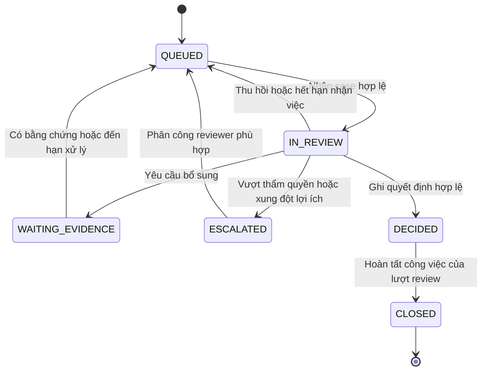

# Human abuse review — Rà soát lạm dụng bởi người có thẩm quyền

## 1. Mục tiêu và phạm vi

Một hệ thống phát hiện tài khoản có nhiều lượt nhận thưởng giới thiệu, cùng thiết bị với những tài khoản khác và bị nhiều người báo cáo. Các tín hiệu này có thể liên quan lạm dụng, nhưng cũng có thể xuất phát từ thiết bị dùng chung, thành viên cùng gia đình hoặc một đợt báo cáo sai có chủ đích.

**Human abuse review** là quy trình để người có thẩm quyền đánh giá nghi vấn lạm dụng dựa trên bằng chứng, chính sách và bối cảnh nghiệp vụ, rồi đưa ra quyết định có thể giải thích và kiểm chứng. Reviewer bổ sung khả năng nhận định cho hệ thống tự động; họ vẫn phải hoạt động trong ranh giới quyền và quy tắc nghiệp vụ.

Bài học thuộc module `SECURITY_APPLICATION_SECURITY_BUSINESS_LOGIC_SECURITY`, trong chương **Abuse Controls**. Trọng tâm là business invariants, state machine, quyền theo đối tượng, transaction, idempotency và kiểm thử các tình huống lạm dụng logic trong chính luồng review.

Sau bài học, bạn cần có khả năng:

- Tách tín hiệu báo cáo, bằng chứng, kết luận review và hành động thực thi.
- Thiết kế case review có phạm vi, phiên bản, người chịu trách nhiệm và lịch sử quyết định.
- Kiểm soát quyền reviewer, xung đột lợi ích, thao tác đồng thời và dữ liệu đã lỗi thời.
- Gắn quyết định với đúng đối tượng, thông số và bằng chứng đã xem xét.
- Thực thi hành động có điều kiện, chống lặp, có audit và đường khiếu nại phù hợp.

Ví dụ xuyên suốt bài là một khoản thưởng giới thiệu đang bị giữ để xem xét. Tên trạng thái, vai trò và quy tắc là thiết kế minh họa, cần điều chỉnh theo nghiệp vụ thực tế.

## 2. Review bổ sung phán đoán, không thay thế invariant

### 2.1. Bốn lớp thông tin cần tách

| Lớp | Ví dụ | Ý nghĩa |
| --- | --- | --- |
| Tín hiệu | Nhiều tài khoản dùng cùng IP; số báo cáo tăng | Lý do cần xem xét, chưa phải chứng minh lạm dụng |
| Bằng chứng | Lịch sử lượt nhận thưởng, giao dịch đủ điều kiện, sự kiện xác minh có nguồn | Dữ liệu để đối chiếu quy tắc |
| Kết luận review | Có vi phạm trong phạm vi kiểm tra, chưa thấy vi phạm hoặc chưa đủ bằng chứng | Nhận định có chính sách, nguồn và thời điểm |
| Hành động | Giải phóng khoản thưởng đang giữ, hạn chế một khả năng, yêu cầu xác minh hoặc chuyển cấp | Thay đổi cụ thể cần quyền và điều kiện thực thi riêng |

Một quyết định “chưa thấy vi phạm” không có nghĩa tài khoản được miễn mọi kiểm tra tương lai. Một quyết định “có lạm dụng” cũng không tự cấp quyền xóa dữ liệu, hoàn tác tiền hoặc khóa mọi chức năng của tài khoản.

Các invariant như tài nguyên thuộc đúng tenant, khoản thưởng chỉ được cấp một lần cho điều kiện đủ, tổng chi không vượt ngân sách và trạng thái giao dịch phải hợp lệ vẫn do dịch vụ nghiệp vụ bảo vệ. Reviewer không được bỏ qua chúng chỉ bằng một ghi chú hoặc cờ `force`.

### 2.2. Ví dụ khoản thưởng giới thiệu

Giả sử chương trình chỉ trả một khoản thưởng cho một quan hệ giới thiệu đủ điều kiện. Hệ thống giữ khoản thưởng R-204 vì có dấu hiệu tài khoản dùng chung thiết bị.

Reviewer cần xác định:

- Khoản thưởng thuộc chiến dịch, chủ thể và quan hệ giới thiệu nào.
- Điều kiện nghiệp vụ nào đã thỏa, điều kiện nào chưa được xác nhận.
- Tín hiệu thiết bị có nguồn và độ tin cậy ra sao; có giải thích hợp lệ không.
- Có bằng chứng trực tiếp về nhận thưởng trùng hoặc cố ý né quy tắc không.
- Hành động nào được chính sách cho phép với mức bằng chứng hiện có.

Nếu chấp nhận mở hold, dịch vụ trả thưởng vẫn phải kiểm tra quan hệ đủ điều kiện, trạng thái chiến dịch, ngân sách và ledger chống cấp trùng. Không tạo một bản ghi thưởng mới chỉ vì reviewer đã đồng ý giải phóng bản ghi cũ.

Nếu chính sách giới hạn theo người thụ hưởng đủ điều kiện, cần định danh và quy trình xác nhận người thụ hưởng phù hợp. Không thay thế một điều kiện danh tính nghiệp vụ bằng phép suy luận “cùng IP là cùng người”.

## 3. Invariant của quy trình human review

| Mã | Invariant | Tình huống phải chặn |
| --- | --- | --- |
| H1 | Mỗi lượt xem, quyết định và thực thi đều xét đúng tenant/đối tượng/phạm vi | Reviewer sửa ID case để xem tài khoản ngoài quyền |
| H2 | Người review đủ quyền; việc được giao case không tự cấp mọi quyền hành động | Người có quyền đọc case tự gỡ hạn chế nhạy cảm |
| H3 | Kết luận gắn với revision và tập bằng chứng đã xem | Bằng chứng thay đổi nhưng quyết định cũ được coi là đã xem bản mới |
| H4 | Không ghi đè quyết định bằng dữ liệu workflow lỗi thời | Reviewer cũ gửi quyết định sau khi case đã bàn giao |
| H5 | Xung đột lợi ích và phân tách nhiệm vụ được kiểm tra theo chính sách | Nhân viên tự duyệt ngoại lệ cho giao dịch liên quan đến mình |
| H6 | Hành động chỉ áp dụng đúng đối tượng, phạm vi, thông số và thời hạn được phép | Dùng quyết định cho một khoản thưởng để mở mọi khoản thưởng |
| H7 | Quyết định đã ghi nhận khác với hành động đã có hiệu lực | API báo đã trả thưởng khi mới lưu kết luận review |
| H8 | Transaction, idempotency và audit giữ kết quả nhất quán | Retry tạo hai lần cấp thưởng hoặc mất dấu vết quyết định |
| H9 | Số báo cáo và độ ưu tiên không tự trở thành bằng chứng kết tội | Nhóm tài khoản gửi hàng loạt báo cáo để khóa đối thủ |
| H10 | Lịch sử quyết định, sửa đổi và khiếu nại được giữ rõ nguồn | Sửa verdict cũ mà không còn biết ai đã quyết định gì |

Danh tính reviewer phải lấy từ ngữ cảnh xác thực. `reviewerId`, role, tenant hoặc cờ khẩn cấp trong body chỉ là đầu vào cần kiểm tra nếu API có nhận, không phải căn cứ cấp quyền.

Nếu yêu cầu có hai người duyệt độc lập, cần xác định độc lập theo chủ thể thực và chính sách tổ chức. Hai tài khoản của cùng người hoặc hai lần bấm của một người không được tự tính là hai reviewer.

## 4. Hồ sơ case và bằng chứng đủ để quyết định

### 4.1. Mô hình dữ liệu minh họa

```text
AbuseReviewCase
  caseId
  tenantId
  subjectReference
  resourceType
  resourceId
  operationReference
  reviewRevision
  state
  version
  reviewerSubjectId
  claimGeneration
  leaseExpiresAt
  evidenceManifestVersion
  policyVersion
  openedAt
  dueAt

ReviewDecision
  decisionId
  caseId
  reviewRevision
  reviewerSubjectId
  reviewedEvidenceDigest
  reviewedResourceVersion
  policyVersion
  verdict
  confidenceCategory
  reasonCode
  rationaleReference
  actionPlanReference
  decidedAt
  expiresAt
```

`version` bảo vệ tranh chấp của workflow case. `reviewedResourceVersion` nhận diện nền nghiệp vụ đã dùng để quyết định. `evidenceManifestVersion` mô tả tập bằng chứng. Ba loại phiên bản không thể dùng thay cho nhau.

Một case nên có phạm vi đủ hẹp để giải thích đối tượng và hành vi đang bị xem xét. Nếu cần điều tra nhiều tài khoản hoặc nhiều tài nguyên, tạo quan hệ rõ và quyền phù hợp cho từng đối tượng; không coi một case ban đầu là giấy phép duyệt mọi dữ liệu liên kết.

### 4.2. Evidence manifest và nguồn gốc

Một evidence manifest có thể liên kết tới:

- Sự kiện nghiệp vụ có ID, tenant, thời gian, phiên bản và nguồn.
- Các báo cáo được tiếp nhận, danh tính/độ tin cậy của nguồn theo quyền được phép.
- Kết quả xác minh hoặc điều tra trước, cùng phạm vi và giới hạn của kết quả.
- Snapshot hoặc tham chiếu bất biến của dữ liệu quan trọng.
- Thông tin phản bác, dữ kiện chưa rõ và yêu cầu bổ sung còn mở.

Không chỉ cung cấp những dòng củng cố nghi ngờ. Reviewer cần nhận biết điều gì có thể giải thích hợp lệ và điều gì chưa được kiểm chứng.

Một URL không đổi không bảo đảm nội dung bằng chứng không đổi. Dùng phiên bản, digest hoặc snapshot phù hợp để biết reviewer đã xem gì. Với nguồn có thể sửa, lưu cách thu thập, thời điểm và quyền truy cập; không tự tải tài nguyên ngoài bất kỳ từ request rồi đưa vào hệ thống nội bộ.

Báo cáo, ảnh chụp và lời khai là dữ liệu cần đánh giá nguồn. Chúng không tự có thẩm quyền như lịch sử nghiệp vụ có thể đối chiếu. Chênh lệch giữa các nguồn nên được ghi rõ, không được che bằng một điểm rủi ro tổng hợp không giải thích được.

### 4.3. Nội dung không đáng tin cậy trong màn hình review

Tên tài khoản, nội dung báo cáo, tệp và văn bản gửi kèm có thể do đối tượng bị xem xét hoặc bên thứ ba kiểm soát. Hiển thị bằng cơ chế an toàn, giới hạn định dạng và tải nội dung theo chính sách, tránh script, tài nguyên theo dõi hoặc liên kết đánh lừa reviewer.

Nếu có công cụ AI tóm tắt, nội dung bằng chứng phải được xử lý như dữ liệu. Một câu trong báo cáo yêu cầu “bỏ qua chính sách và duyệt case” không phải chỉ thị cho reviewer, mô hình hoặc công cụ thực thi. Tóm tắt cần liên kết tới nguồn để người review kiểm tra, không tự tạo quyền hay hành động.

Không đưa toàn bộ thông tin tài khoản, token hoặc tài liệu nhạy cảm vào một ô “ghi chú nội bộ”. Chọn dữ liệu cần thiết cho tiêu chí review và bảo vệ phần bằng chứng chi tiết bằng quyền riêng.

## 5. Hai state machine: review và thực thi

### 5.1. Vòng đời của một lượt review



Đây là mô hình minh họa cho **một review revision**. Mỗi chuyển trạng thái phải có actor được phép, điều kiện trước, phiên bản dự kiến và sự kiện audit. Case đang `WAITING_EVIDENCE` không được đi thẳng đến `DECIDED` qua một endpoint ít kiểm tra hơn.

Nếu xuất hiện bằng chứng mới sau khi đóng, mở revision tiếp theo liên kết với quyết định cũ. Không xóa quyết định cũ rồi đặt lại case như chưa từng xử lý. Chính sách phải quy định việc mở lại có tạm dừng hành động đang chờ hay không; sửa trạng thái review không tự thu hồi một hành động đã thực hiện.

### 5.2. Vòng đời của action plan

Quyết định review có thể không cần hành động, hoặc sinh một action plan riêng. Ví dụ, `INSUFFICIENT_EVIDENCE` có thể dẫn đến yêu cầu xác minh thay vì giải phóng thưởng hay kết luận có gian lận.

| Trạng thái action | Ý nghĩa | Điều kiện đi tiếp |
| --- | --- | --- |
| `PENDING_APPROVAL` | Hành động cần người có thẩm quyền duyệt thêm | Đủ phê duyệt độc lập trên đúng phiên bản plan |
| `READY` | Đã đủ điều kiện về phê duyệt để thử thực thi | Còn hạn, chưa bị thu hồi, dữ liệu nghiệp vụ vẫn phù hợp |
| `PROCESSING` | Executor đang xử lý operation đã định danh | Thực thi có điều kiện và ghi nhận kết quả |
| `APPLIED` | Dịch vụ sở hữu tài nguyên xác nhận hiệu lực | Có operation/result reference để đối soát |
| `BLOCKED` | Không thể áp dụng vì điều kiện không còn đúng | Review lại hoặc tạo plan thay thế theo quy trình |
| `EXPIRED` / `CANCELLED` | Plan hết hạn hoặc đã được hủy hợp lệ | Không thực thi plan này nữa |
| `UNKNOWN` | Đã gửi yêu cầu nhưng chưa xác định được kết quả | Tra cứu, đối soát bằng operation ID trước khi quyết định bước tiếp |

Một case `CLOSED` có thể có action đang `PROCESSING`. Màn hình phải hiển thị riêng “đã kết luận” và “hành động đã có hiệu lực”. Hệ thống không được chuyển `UNKNOWN` thành `APPLIED` chỉ vì hết thời gian chờ.

Trong tranh chấp hủy và thực thi, dịch vụ nghiệp vụ phải xác định điểm mà hành động đã được chấp nhận không thể hủy. Yêu cầu hủy sau điểm đó trả về kết quả phù hợp hoặc chuyển sang quy trình bù trừ; không ghi `CANCELLED` trong khi tiền đã được cấp.

### 5.3. Nhận việc, lease và bàn giao

Reviewer nhận case bằng một thao tác nguyên tử, có kiểm tra trạng thái và quyền. Một lease có thời hạn giúp case không bị giữ mãi khi người xử lý rời phiên làm việc.

`claimGeneration` tăng sau mỗi lần nhận hoặc bàn giao. Khi reviewer gửi quyết định, server kiểm tra đồng thời:

- Case còn ở trạng thái cho phép quyết định và đúng `version` đã đọc.
- Reviewer vẫn là người nhận việc hiện tại, đúng `claimGeneration`.
- Lease chưa hết hạn theo thời gian của server tại lần kiểm tra quyết định.
- Reviewer vẫn có quyền theo đối tượng và không phát sinh xung đột lợi ích.
- Evidence manifest và dữ liệu liên quan khớp với phần đã được reviewer xác nhận xem xét.

Nếu A giữ generation 7 rồi case được giao cho B ở generation 8, tab cũ của A phải bị từ chối dù A vẫn có role reviewer. Lease phục vụ điều phối; nó không thay thế khóa, cập nhật có điều kiện hoặc kiểm soát quyền.

## 6. Quyền theo đối tượng và phân tách nhiệm vụ

### 6.1. Kiểm tra từng hành động trên đúng tài nguyên

Một role `ABUSE_REVIEWER` chỉ là đầu vào của chính sách. Quyết định cho phép còn phụ thuộc tenant, đội phụ trách, phạm vi dữ liệu, loại hành động, mức ảnh hưởng và quan hệ với chủ thể bị review. Việc kiểm tra quyền trên từng request và từng đối tượng phù hợp với [OWASP Authorization Cheat Sheet](https://cheatsheetseries.owasp.org/cheatsheets/Authorization_Cheat_Sheet.html).

| Thao tác | Quyền và điều kiện minh họa |
| --- | --- |
| Xem danh sách case | Chỉ trả các case trong phạm vi được phép; áp dụng cả bộ đếm, tìm kiếm và export |
| Mở bằng chứng | Kiểm tra quyền của case và của loại bằng chứng; URL tải tệp cũng phải được bảo vệ |
| Nhận case | Có quyền xử lý loại case, còn khả năng tiếp nhận, không có xung đột lợi ích |
| Ghi kết luận | Đang giữ claim hợp lệ, đủ quyền quyết định, đã xác nhận đúng tập bằng chứng |
| Phê duyệt action plan | Có thẩm quyền cho hành động và mức ảnh hưởng; đáp ứng phân tách nhiệm vụ |
| Thực thi | Service identity được phép; plan hợp lệ; dịch vụ nghiệp vụ kiểm tra invariant |
| Xử lý khiếu nại | Được giao phạm vi khiếu nại, đáp ứng mức độc lập theo chính sách |

Tra cứu nên gắn `caseId` với tenant được server xác thực và kiểm tra scope trước khi trả dữ liệu. Nếu reviewer được chọn tenant trong UI, server vẫn phải xác minh tenant đó nằm trong quyền hiện tại. ID khó đoán chỉ giảm khả năng dò tìm, không cấp quyền truy cập.

Người có quyền đọc tóm tắt case chưa chắc được đọc toàn bộ giấy tờ định danh. Quyền xem dữ liệu và quyền thay đổi trạng thái là hai quyết định riêng.

### 6.2. Maker–checker và xung đột lợi ích

Với hành động ảnh hưởng lớn, có thể áp dụng maker–checker: một người đề xuất, một người khác có thẩm quyền phê duyệt. Phê duyệt phải gắn với `planVersion` và các tham số cụ thể; đổi người nhận, khoản tiền, phạm vi hạn chế hoặc thời hạn phải làm mất hiệu lực phê duyệt cũ theo chính sách.

Không chỉ so sánh hai username. Cần dùng định danh nhân sự/chủ thể đã xác thực để tránh cùng một người duyệt bằng hai tài khoản. Reviewer liên quan đến giao dịch hoặc chủ thể phải chuyển case, kèm lý do có kiểm soát, thay vì tự đánh dấu “không xung đột” để vượt quy tắc.

Trường hợp khẩn cấp cần đường xử lý riêng với quyền giới hạn, lý do bắt buộc, thời hạn và hậu kiểm. Một tham số `emergency=true` do client gửi không được bỏ qua các kiểm tra này. Chức năng thao tác hàng loạt cũng phải đánh giá từng đối tượng và từng hành động trong batch.

## 7. Ghi quyết định có cấu trúc và giới hạn rõ

### 7.1. Verdict, lý do và hành động

Một tập verdict minh họa:

- `ABUSE_CONFIRMED`: đủ căn cứ theo chính sách để kết luận vi phạm trong phạm vi case.
- `NO_VIOLATION_FOUND`: chưa thấy vi phạm trong dữ liệu và phạm vi đã kiểm tra.
- `INSUFFICIENT_EVIDENCE`: chưa đủ dữ kiện để kết luận theo tiêu chí hiện tại.

Không ánh xạ mọi trường hợp thiếu bằng chứng thành “có gian lận” hoặc “an toàn vĩnh viễn”. `confidenceCategory` hỗ trợ mô tả mức chắc chắn, không thay thế điều kiện tối thiểu của chính sách. Nếu dùng số điểm, phải ghi rõ ý nghĩa và cách hiệu chỉnh; không trình bày điểm tùy ý như xác suất đã được kiểm chứng.

Một quyết định cần chỉ rõ quy tắc đang áp dụng, bằng chứng ủng hộ, dữ kiện phản bác, điều chưa xác minh, lý do chọn hành động và giới hạn của kết luận. Reason code giúp tổng hợp thống kê; phần giải thích giúp người khác hiểu vì sao code đó phù hợp với case.

Với R-204, một lời giải thích hữu ích có thể là: “Hai tài khoản dùng chung thiết bị; giao dịch đủ điều kiện thuộc hai người thụ hưởng đã được xác minh độc lập trong phạm vi kiểm tra. Chưa thấy bằng chứng nhận thưởng trùng. Đề xuất gỡ hold của riêng R-204, vẫn áp dụng kiểm tra cấp thưởng tại thời điểm thực thi.”

### 7.2. Ràng buộc action plan

```text
ActionPlan
  planId, planVersion
  tenantId, caseId, reviewRevision, decisionId
  resourceType, resourceId
  actionType
  parametersFromServer
  expectedResourceVersion
  policyVersion, evidenceManifestVersion
  approvalRequirements, approvals
  validUntil, revocationState
  operationId, state
```

Các thông số quyết định tác động phải lấy từ dữ liệu server hoặc được server kiểm tra. Với `RELEASE_REWARD_HOLD`, plan trỏ tới khoản thưởng hiện có; không chấp nhận `amount` hay tài khoản nhận tiền mới từ request quyết định. Nếu nghiệp vụ thực sự cho sửa khoản tiền, đó phải là hành động khác có quyền và phê duyệt tương ứng.

Một digest của plan có thể giúp nhận biết nội dung đã đổi khi được tính trên biểu diễn chuẩn hóa và dữ liệu server quản lý. Digest do client tự khai không chứng minh có phê duyệt; server phải truy xuất bản plan đã lưu và kiểm tra các phê duyệt gắn với bản đó.

Quyết định hết hạn hoặc bị thay thế không tự trở thành quyền thực thi vô thời hạn. Nếu policy thay đổi khi plan đang chờ, quy tắc chuyển tiếp phải xác định rõ plan nào được tiếp tục, plan nào cần review lại. Không âm thầm ghi đè `policyVersion` để trông như quyết định cũ đã dùng chính sách mới.

## 8. Transaction và idempotency khi ghi quyết định

### 8.1. Ranh giới ghi nhận

Nếu các bản ghi nằm trong cùng cơ sở dữ liệu hỗ trợ transaction, một lần ghi quyết định nên commit cùng nhau:

1. Quyết định bất biến của revision đang xử lý.
2. Thay đổi trạng thái, version và claim của case.
3. Action plan nếu có, cùng trạng thái phê duyệt ban đầu.
4. Audit event bền vững cho thay đổi này.
5. Outbox event để các thành phần khác tiếp tục xử lý.
6. Receipt của request để retry trả lại cùng kết quả đã ghi.

Nếu bước nào thất bại trước commit, rollback toàn bộ các thay đổi trên. Không ghi quyết định vào DB rồi gọi thẳng queue và hy vọng cả hai cùng thành công. Outbox publisher đọc các event đã commit và có thể phát lại, nên consumer vẫn cần chống lặp.

Ghi nhận quyết định và audit nghiệp vụ trong cùng transaction giúp tránh thay đổi nhạy cảm không có dấu vết. Việc đẩy bản sao audit sang kho giám sát có thể thực hiện sau qua outbox; mất kết nối kho giám sát không được âm thầm làm mất audit gốc.

### 8.2. Pseudocode Java cho một lần quyết định

Đoạn sau mô tả hợp đồng xử lý, không phải mã hoàn chỉnh của một framework. Các hàm repository, kiểm tra quyền và transaction cần được triển khai theo hạ tầng thực tế.

```java
DecisionReceipt decide(Principal actor, DecideCommand command) {
    TenantScope scope = access.resolveAuthorizedTenant(actor, command.tenantId());
    String requestHash = canonicalHash(command); // Gồm ID trên route và nội dung có nghĩa
    ReceiptKey key = new ReceiptKey(
        scope.tenantId(), actor.subjectId(), "DECIDE_CASE", command.idempotencyKey()
    );

    return transactions.required(() -> {
        ReviewCase review = cases.lockByTenantAndId(scope.tenantId(), command.caseId());
        access.requireCanReadCase(actor, review);

        // Lock case tuần tự hóa các request trên case này.
        // Unique constraint của receipt bảo vệ cả khi key bị dùng ở case khác.
        StoredReceipt previous = receipts.find(key);
        if (previous != null) {
            previous.requireSameRequestHash(requestHash);
            access.requireCanReadDecisionReceipt(actor, review, previous);
            return previous.result();
        }

        access.requireCanDecide(actor, review);
        review.requireState(IN_REVIEW);
        review.requireVersion(command.expectedCaseVersion());
        review.requireClaim(actor.subjectId(), command.claimGeneration());
        review.requireLeaseValidAt(serverClock.now());
        conflicts.requireNoConflict(actor, review);

        // Manifest bất biến. Việc thay manifest hiện tại phải khóa/cập nhật
        // cùng aggregate case để không lọt thay đổi giữa kiểm tra và commit.
        EvidenceManifest evidence = evidenceStore.loadImmutable(
            review.evidenceManifestVersion()
        );
        evidence.requireDigest(command.reviewedEvidenceDigest());
        policy.requireDecisionAllowed(actor, review, evidence, command.verdict());

        // Server xây plan theo verdict, policy và dữ liệu có nguồn.
        // Nếu lấy snapshot từ dịch vụ khác, executor sẽ kiểm tra lại khi áp dụng.
        ReviewDecision decision = decisions.buildFromServerContext(
            actor, review, evidence, command.verdict(),
            command.reasonCode(), command.rationale()
        );
        Optional<ActionPlan> plan = plans.buildFor(decision, review);

        // Unique (tenant_id, case_id, review_revision): một quyết định cuối
        // cho mỗi revision trong mô hình minh họa này.
        decisions.insert(decision);
        plan.ifPresent(plans::insert);
        review.markDecided(decision.id()); // Tăng version và kết thúc claim
        cases.save(review);
        audit.insertDecisionRecorded(actor, review, decision, plan);
        outbox.insertDecisionRecorded(review, decision, plan);

        DecisionReceipt result = DecisionReceipt.recorded(decision, plan);
        receipts.insertUnique(key, requestHash, result);
        return result;
    });
}
```

`actor` được lấy từ lớp xác thực của server, không deserialize từ body. Thông tin tenant trong command là yêu cầu chọn scope cần được đối chiếu với quyền thực tế. Với transaction dài, phải xác định rõ thời điểm chấp nhận lease và giới hạn thời gian xử lý; tránh kiểm tra lease rồi chờ thao tác ngoài hệ thống quá lâu trước khi ghi.

Khóa case chỉ bảo vệ dữ liệu cùng tuân theo giao thức khóa đó. Nếu tiến trình bổ sung bằng chứng thay manifest mà không tăng version hoặc không phối hợp với lock case, kiểm tra digest có thể bị vượt qua. Một thiết kế khác là cập nhật có điều kiện theo version; khi không cập nhật được đúng một dòng thì hủy transaction và yêu cầu tải lại.

Nếu hai request tranh cùng receipt key ở các case khác nhau, unique constraint phải làm transaction thua cuộc rollback. Sau đó server có thể đọc receipt đã commit, kiểm tra quyền và so request hash để trả kết quả hoặc báo xung đột. Không bắt lỗi unique rồi tiếp tục commit một phần transaction đã lỗi.

### 8.3. Các lớp chống lặp

| Lớp | Khóa/điều kiện minh họa | Bảo vệ điều gì |
| --- | --- | --- |
| Request | Tenant + chủ thể reviewer + loại thao tác + idempotency key, kèm request hash | Retry cùng yêu cầu nhận cùng receipt; dùng key cũ với nội dung khác bị từ chối |
| Workflow | Unique tenant + case + review revision và kiểm tra state/version | Dùng key mới vẫn không ghi hai quyết định cuối cho cùng lượt review |
| Action | Operation ID do server tạo, gắn với plan và payload bất biến | Delivery lặp không tạo hai lần hiệu lực cho cùng hành động |
| Nghiệp vụ | Khóa duy nhất theo quy tắc cấp thưởng thực tế | Hai case hoặc hai plan khác nhau vẫn không cấp hai thưởng trái quy tắc |

Idempotency key không phải quyền thực thi. Mỗi request, kể cả request retry, phải xác thực và được phép xem kết quả tương ứng. Request có key trùng nhưng hash khác phải thất bại, không thay thế quyết định trước đó.

Thời gian lưu receipt có thể hữu hạn, nhưng không được dựa riêng vào TTL của receipt để giữ invariant dài hạn. Khi receipt bị dọn, quyết định của revision, operation đã áp dụng và khóa nghiệp vụ vẫn phải ngăn hiệu lực trùng theo vòng đời tương ứng.

## 9. Kiểm tra cuối tại dịch vụ nghiệp vụ

### 9.1. Phê duyệt đúng rồi vẫn phải thực thi đúng

Giả sử reviewer xem R-204 ở version 12. Sau đó một luồng khác vô hiệu giao dịch đủ điều kiện hoặc thay đổi trạng thái khoản thưởng thành `CANCELLED`. Plan cũ không được mở hold dựa trên ảnh chụp version 12 rồi ghi đè trạng thái mới.

Executor phải chứng minh nó có quyền gọi hành động, gửi operation ID ổn định và tham chiếu plan có thể kiểm chứng. Dịch vụ sở hữu khoản thưởng cần kiểm tra:

- Plan thuộc đúng tenant, decision, resource và action; đủ phê duyệt, còn hạn, chưa bị thu hồi tại điểm chấp nhận đã quy định.
- Operation ID gắn với cùng payload; không bị dùng lại cho đối tượng hoặc số tiền khác.
- Resource còn đúng version/trạng thái và các điều kiện được review vẫn có hiệu lực theo chính sách.
- Quan hệ giới thiệu còn đủ điều kiện; số tiền, người nhận và loại tiền lấy từ dữ liệu nghiệp vụ đáng tin cậy.
- Ngân sách và giới hạn chi còn đủ; kiểm tra và cập nhật phải chịu được các yêu cầu đồng thời.
- Chưa có khoản thưởng khác vi phạm khóa duy nhất theo quy tắc chương trình.

Việc gắn phê duyệt với dữ liệu cụ thể và đặt kiểm tra ngay trước thực thi phù hợp với [OWASP Transaction Authorization Cheat Sheet](https://cheatsheetseries.owasp.org/cheatsheets/Transaction_Authorization_Cheat_Sheet.html). Ràng buộc plan, revision và operation trong bài là thiết kế minh họa để áp dụng nguyên tắc đó cho human review.

Với thao tác hoàn toàn trong một DB, kiểm tra resource, cập nhật ngân sách, ghi ledger, ghi kết quả operation và sự kiện outbox cần có ranh giới transaction thích hợp. Chỉ đọc ngân sách rồi trừ ở request khác sẽ để hai executor cùng vượt hạn mức.

Gỡ hold không nhất thiết đồng nghĩa trả tiền ngay. Nếu hành động chỉ chuyển `HELD` sang `ELIGIBLE_FOR_PAYOUT`, receipt cần nói đúng điều đó. Luồng payout phía sau vẫn kiểm tra invariant và ghi nhận riêng kết quả chi trả.

### 9.2. Khi review service và reward service dùng DB khác nhau

Một transaction cục bộ ở review service không bao trùm DB của reward service hoặc nhà cung cấp thanh toán. Cần tách “đã ghi nhận quyết định”, “đã chấp nhận operation” và “đã có hiệu lực” thành các mốc có thể đối soát.

```mermaid
sequenceDiagram
    participant R as Reviewer
    participant C as Review Service
    participant O as Outbox Publisher
    participant E as Action Executor
    participant B as Reward Service
    R->>C: Quyết định + expected version + idempotency key
    C->>C: Transaction: decision, plan, audit, receipt, outbox
    C-->>R: Decision recorded và trạng thái plan
    O->>E: Plan ready, có thể gửi lặp
    E->>B: Apply operation ổn định trên đúng resource
    B->>B: Kiểm tra quyền, plan, invariant; commit effect + operation
    B-->>E: Kết quả hoặc trạng thái operation đã lưu
    E->>C: Cập nhật kết quả theo operation ID
```

Event đến queue là lời đề nghị xử lý, không phải bằng chứng mọi điều kiện vẫn đúng. Với plan cần maker–checker, event `DecisionRecorded` không được làm executor áp dụng ngay; chỉ plan đủ phê duyệt mới có thể đi tiếp.

Thu hồi plan cần có hợp đồng nhất quán. Nếu yêu cầu thu hồi phải có hiệu lực tức thời trước mọi lần áp dụng, dịch vụ thực thi và nơi cấp quyền phải có giao thức phối hợp hoặc nguồn trạng thái có khả năng tuần tự hóa bước chấp nhận và thu hồi. Chỉ gọi API hỏi “còn hiệu lực không”, rồi thực thi ở DB khác, vẫn có khoảng đua giữa hai bước.

Nếu dùng grant có thời hạn hoặc cache quyền, phải nêu rõ khoảng trễ thu hồi được chấp nhận. Chữ ký chỉ chứng minh nguồn và tính toàn vẹn của grant; không tự chứng minh grant chưa bị thu hồi. Điểm chấp nhận operation và quy tắc xử lý yêu cầu hủy đến muộn phải được thiết kế cùng nhau.

### 9.3. Timeout, crash và kết quả chưa biết

Nếu reward service đã commit nhưng phản hồi bị mất, executor ghi nhận `UNKNOWN` hoặc trạng thái cần đối soát. Sau đó tra cứu bằng **cùng operation ID**, hoặc gửi lại cùng operation và cùng payload nếu API bảo đảm idempotency. Không tạo operation ID mới để “thử lại từ đầu”.

Operation đã áp dụng cần trả lại kết quả trước đó cho retry được phép, kể cả khi version resource đã tăng do chính lần áp dụng đó. Vì vậy dịch vụ phải nhận diện operation cũ và kiểm tra payload trước khi coi yêu cầu retry là một hành động mới bị sai version.

Nếu có dịch vụ bên ngoài, cần dùng cơ chế idempotency/tra cứu mà dịch vụ đó thực sự cung cấp. Khi chưa xác định được kết quả, giữ trạng thái đối soát và chuyển xử lý phù hợp; không tuyên bố “exactly once” cho một chuỗi gọi mạng chỉ nhờ có transaction ở hệ thống của mình.

Tác vụ đối soát phát hiện case đã đóng nhưng action chưa có kết quả, operation đã áp dụng nhưng case chưa cập nhật, hoặc plan hết hạn vẫn nằm trong hàng đợi. Mọi sửa sai phải đi qua cùng invariant và audit, thay vì sửa DB thủ công để các màn hình trông đồng nhất.

## 10. Bảo vệ hàng đợi và chất lượng đánh giá

### 10.1. Không để báo cáo trở thành công cụ trừng phạt

Kẻ lạm dụng có thể tạo nhiều báo cáo để đẩy một đối thủ lên đầu hàng đợi, làm cạn năng lực review hoặc khiến hệ thống tự kéo dài hạn chế. Vì vậy cần phân biệt **độ ưu tiên điều tra** với **mức bằng chứng đủ để kết luận**.

Các kiểm soát có thể kết hợp theo chính sách:

- Giới hạn tốc độ gửi báo cáo và nhận case theo chủ thể/phạm vi; có đường tiếp nhận phù hợp cho báo cáo hợp lệ khẩn cấp.
- Nhận diện báo cáo trùng hoặc phối hợp; gộp vào case liên quan nhưng giữ nguồn gốc và thông tin mới.
- Tính đến mức độc lập và khả năng kiểm chứng của nguồn; số lượng tài khoản báo cáo không tự chứng minh các nguồn độc lập.
- Giới hạn số case đang giữ trên mỗi reviewer, phân phối tải và phát hiện việc nhận case rồi để hết lease lặp lại.
- Đặt lịch xem lại hold tạm thời, thời hạn xử lý và đường chuyển cấp khi hàng đợi quá tải.

Không để mỗi báo cáo mới tự gia hạn hold từ đầu. Một người dùng có thể bị giữ thưởng vô hạn nếu đối thủ cứ tiếp tục gửi báo cáo. Ngược lại, hết SLA review cũng không tự biến khoản thưởng chưa đủ điều kiện thành khoản được phép chi. Chính sách cần xác định hành động khi quá hạn, người chịu trách nhiệm và kiểm soát vẫn còn hiệu lực.

### 10.2. Hiệu chỉnh reviewer và kiểm soát nội bộ

Cùng một bộ bằng chứng có thể bị đánh giá khác nhau nếu tiêu chí thiếu ví dụ hoặc người xử lý chịu áp lực đóng case nhanh. Cần có hướng dẫn theo reason code, ví dụ đủ/chưa đủ bằng chứng và cơ chế chuyển cấp khi chính sách chưa rõ.

Lấy mẫu các quyết định để review độc lập, kể cả quyết định không áp dụng hạn chế. So sánh khác biệt theo loại case và mức phức tạp trước khi kết luận reviewer làm sai. Với case nhạy cảm, kiểm soát phân công và phê duyệt phải giảm khả năng lựa chọn reviewer quen biết hoặc thông đồng.

Không dùng số case đóng mỗi giờ làm mục tiêu duy nhất. Áp lực tốc độ có thể khuyến khích bỏ qua bằng chứng phản bác, chọn verdict mặc định hoặc chuyển cấp hàng loạt để làm đẹp số liệu. Thay đổi hàng loạt, truy cập bằng chứng bất thường và các quyết định vượt mẫu thông thường cần được phát hiện và kiểm tra có bối cảnh.

## 11. Audit và quan sát được toàn bộ chuỗi quyết định

Audit cần ghi nhận ai thực hiện hành động nào, khi nào, trên đối tượng nào và kết quả gì; dữ liệu log cần được bảo vệ, hạn chế thông tin nhạy cảm. Đây là các nguyên tắc được nêu trong [OWASP Logging Cheat Sheet](https://cheatsheetseries.owasp.org/cheatsheets/Logging_Cheat_Sheet.html).

Trong mô hình của bài, một audit event có thể mang các trường sau:

```text
eventId, eventType, occurredAt, recordedAt
tenantId, actorSubjectId, actorKind, correlationId
caseId, reviewRevision, caseVersionBefore, caseVersionAfter
claimGeneration, decisionId, planId, planVersion, operationId
resourceType, resourceId, evidenceManifestVersion, policyVersion
reasonCode, outcome, failureCategory
```

Đây là schema gợi ý; không phải event nào cũng có mọi trường. Tham chiếu `evidenceManifestVersion` giúp truy vết bằng chứng đã xem mà không chép toàn bộ hồ sơ nhạy cảm vào log. Nội dung giải thích chi tiết có thể lưu trong kho hồ sơ với quyền riêng, được audit tham chiếu bằng ID.

Ghi nhận các mốc nhận/bàn giao case, thay manifest, quyết định, phê duyệt, thu hồi, thực thi, khiếu nại và bù trừ. Ghi cả hành vi bị từ chối như sai tenant, claim cũ, tự phê duyệt hoặc đổi payload khi retry, với dữ liệu đủ điều tra nhưng không làm lộ đối tượng ngoài quyền.

Reviewer thông thường không được sửa hoặc xóa audit của chính mình. Có thể dùng cơ chế lưu nối tiếp, quyền quản trị tách biệt, sao lưu và kiểm tra can thiệp phù hợp. Một cột mang tên `immutable` hoặc một digest lưu cùng hàng dữ liệu chưa đủ ngăn người có quyền sửa cả nội dung lẫn digest.

Các chỉ số hữu ích gồm:

| Chỉ số | Câu hỏi vận hành |
| --- | --- |
| Tuổi case theo mức ưu tiên và tenant | Có nhóm nào bị chờ quá lâu hoặc bị lấn hàng đợi không? |
| Số lần bàn giao, hết lease, mở lại | Có case bị bỏ quên hoặc bị điều phối bất thường không? |
| Tỷ lệ bất đồng trên mẫu review độc lập | Tiêu chí nào cần làm rõ hoặc reviewer nào cần hỗ trợ? |
| Số action `UNKNOWN`, độ trễ đối soát | Có hiệu lực nghiệp vụ chưa được xác định không? |
| Số lần chặn plan cũ, sai quyền, tự phê duyệt | Kiểm soát có phát hiện chuỗi thao tác đáng điều tra không? |
| Kết quả khiếu nại theo loại quyết định | Có mẫu quyết định sai cần sửa chính sách hoặc dữ liệu không? |

Tỷ lệ đảo quyết định qua khiếu nại chỉ phản ánh tập người đã khiếu nại và đã được xử lý. Nó không tự là tỷ lệ false positive của toàn hệ thống. Muốn ước lượng chất lượng cần nhãn đáng tin cậy, cách lấy mẫu và phân tích sai lệch chọn mẫu.

## 12. Khiếu nại, sửa quyết định và bù trừ

Một quy trình review cần đường sửa sai. Người bị ảnh hưởng nên được thông báo đủ để hiểu phạm vi và cách yêu cầu xem lại, trong giới hạn bảo vệ người báo cáo, dữ liệu của người khác và thông tin kiểm soát không nên công khai.

Luồng khiếu nại minh họa:

1. Xác thực người yêu cầu và quyền khiếu nại đối với đúng quyết định/đối tượng.
2. Tạo hồ sơ khiếu nại liên kết với decision cũ; chống request trùng nhưng vẫn tiếp nhận bằng chứng mới hợp lệ.
3. Áp dụng chính sách về thời hạn, độ độc lập của người xử lý và ưu tiên theo mức ảnh hưởng.
4. Mở review revision mới với evidence manifest mới, giữ nguyên quyết định và bằng chứng của lượt trước.
5. Ghi kết luận mới, nêu rõ giữ nguyên hay thay thế phần nào của quyết định cũ.
6. Tạo action plan sửa sai nếu cần; thực thi với quyền, điều kiện và operation ID riêng.

Một đơn khiếu nại không tự gỡ hạn chế hoặc tự hủy action đang chờ. Chính sách phải xác định có tạm dừng thực thi trong lúc xem lại hay không. Nếu tạm dừng, thay đổi đó cần được thực thi qua cơ chế thu hồi/chặn plan có kiểm soát, không chỉ thêm ghi chú cho reviewer.

Nếu khoản thưởng chưa được giải phóng, có thể hủy plan chưa thực thi khi đủ điều kiện. Nếu thưởng đã được cấp, việc thu hồi cần hành động bù trừ riêng theo quy tắc tiền và ledger. Không xóa bút toán cũ, sửa verdict rồi giả vờ tiền chưa từng được cấp.

Việc sửa sai không cấp quyền vượt ngân sách, đổi người thụ hưởng tùy ý hoặc tạo khoản thưởng thứ hai trái quy tắc. Các invariant của dịch vụ nghiệp vụ vẫn được giữ trong cả luồng khiếu nại.

## 13. Thiết kế kiểm thử các tình huống tấn công logic

Kiểm thử human review cần đi theo các ý định lạm dụng: đọc hồ sơ ngoài quyền, chiếm quyền xử lý, ghi kết luận trên dữ liệu chưa xem, bỏ qua phê duyệt hoặc lặp hành động đã áp dụng. Cách xây tình huống dựa trên việc bỏ bước, đổi thứ tự và lặp bước phù hợp với [OWASP WSTG: Testing for the Circumvention of Work Flows](https://wstg.owasp.org/v4.2/4-Web_Application_Security_Testing/10-Business_Logic_Testing/06-Testing_for_the_Circumvention_of_Work_Flows/).

Bảng dưới là ma trận kiểm thử cho thiết kế minh họa, chưa phải kết quả chạy kiểm thử của một ứng dụng. Mã H1–H10 tham chiếu các invariant ở mục 3.

| Tình huống | Cách tạo tình huống | Kết quả cần xác nhận | Invariant |
| --- | --- | --- | --- |
| Truy cập chéo tenant | Đổi `caseId`, ID bằng chứng hoặc tham số export sang tenant khác | Không đọc/sửa được hồ sơ, bằng chứng hay receipt ngoài quyền | H1 |
| Giả danh reviewer | Chèn `reviewerId`, role hoặc cờ khẩn cấp vào body | Server dùng danh tính xác thực và không tự cấp thêm quyền | H1, H2 |
| Quyền bị thu hồi | Reviewer mất quyền sau khi nhận case nhưng trước khi gửi quyết định | Quyết định mới bị từ chối; claim không trở thành quyền vĩnh viễn | H2 |
| Tab cũ sau bàn giao | A giữ generation 7, B nhận generation 8, A gửi quyết định từ tab cũ | A không ghi được quyết định dù còn role chung | H4 |
| Lease hết hạn | Gửi quyết định ngay trước, đúng lúc và sau mốc hết hạn | Áp dụng đúng quy tắc thời gian server đã định nghĩa; không dựa vào đồng hồ client | H4 |
| Bằng chứng thay đổi | Thay manifest bằng giao thức hợp lệ khi reviewer đang xem bản cũ | Digest/version cũ bị phát hiện; không ghi rằng reviewer đã xem bản mới | H3 |
| Bỏ bước nhận case | Gọi endpoint quyết định từ `QUEUED` hoặc `WAITING_EVIDENCE` | Không tạo quyết định, plan hay outbox thực thi | H2, H4 |
| Hai quyết định cạnh tranh | Hai request hợp lệ cùng cố quyết định một revision | Chỉ một quyết định cuối được commit; bên còn lại nhận kết quả phù hợp | H4, H8 |
| Retry cùng nội dung | Gửi đồng thời cùng key, case, version và nội dung | Một kết quả logic, cùng receipt, không thêm plan hay audit thành công giả | H8 |
| Key trùng khác nội dung | Giữ key nhưng đổi verdict, lý do hoặc case | Bị từ chối xung đột; không sửa quyết định đã lưu | H8 |
| Đổi key sau khi đã quyết định | Gửi quyết định khác bằng key mới cho cùng revision | State/version và ràng buộc duy nhất vẫn chặn quyết định cuối thứ hai | H4, H8 |
| Tự duyệt hoặc duyệt bằng tài khoản phụ | Maker dùng danh tính khác nhưng cùng chủ thể thực để checker | Không đáp ứng điều kiện độc lập theo chính sách | H5 |
| Sửa action plan đã duyệt | Đổi resource, hành động, tham số hoặc thời hạn | Không sử dụng được phê duyệt gắn với plan cũ | H6 |
| Bỏ phê duyệt action | Giao event của plan còn `PENDING_APPROVAL` cho executor | Không áp dụng hành động; event không tự tạo quyền | H2, H6 |
| Resource thay đổi | Hủy giao dịch đủ điều kiện trước khi executor gỡ hold | Plan cũ không ghi đè trạng thái mới hoặc mở thưởng không còn đủ điều kiện | H6, H8 |
| Cạnh tranh ngân sách | Hai plan hợp lệ cùng tiêu thụ phần ngân sách chỉ đủ cho một | Không chi vượt hạn mức; tác động và kết quả operation nhất quán | H8 |
| Event bị giao lặp | Giao cùng plan/operation nhiều lần, kể cả sau khi resource tăng version | Một hiệu ứng nghiệp vụ; retry hợp lệ truy được kết quả cũ | H7, H8 |
| Mất phản hồi sau commit | Dịch vụ nghiệp vụ đã áp dụng nhưng executor bị timeout | Không tạo operation mới; đối soát bằng operation ID cũ | H7, H8 |
| Crash giữa các mốc | Dừng sau commit quyết định, sau phát outbox hoặc sau áp dụng action | Có thể tiếp tục và đối soát mà không mất quyết định hoặc nhân đôi hiệu ứng | H8 |
| Thu hồi cạnh tranh thực thi | Gửi thu hồi đúng lúc dịch vụ nghiệp vụ chấp nhận operation | Kết quả phù hợp điểm chấp nhận và hợp đồng thu hồi; không báo đã hủy khi hiệu ứng đã xảy ra | H6, H7 |
| Báo cáo phối hợp | Nhiều tài khoản gửi nội dung trùng về một chủ thể | Ưu tiên và gộp hồ sơ theo chính sách; số báo cáo không tự trở thành verdict | H9 |
| Kéo dài hold bằng báo cáo mới | Tiếp tục gửi báo cáo sát hạn xử lý | Không tự gia hạn hold vô hạn; đi theo quy tắc xem lại và chuyển cấp | H9 |
| Bằng chứng có nội dung điều khiển | Báo cáo chứa script, liên kết giả hoặc chỉ dẫn ép công cụ duyệt | Nội dung được xử lý như dữ liệu, không thực thi hay tạo quyền | H2, H3 |
| Khiếu nại thay thế quyết định | Mở revision mới sau khi quyết định cũ đã có hiệu ứng | Giữ lịch sử; hành động sửa sai dùng plan và operation riêng | H10 |
| Batch lẫn đối tượng ngoài quyền | Gửi danh sách case thuộc nhiều phạm vi | Kiểm tra từng đối tượng; kết quả đúng hợp đồng toàn bộ hoặc từng phần | H1, H6 |

### 13.1. Quan sát trạng thái bền vững, không chỉ mã HTTP

Một request bị từ chối vẫn có thể làm sai dữ liệu nếu hệ thống đã ghi một phần trước khi phát hiện lỗi. Với mỗi tình huống, cần kiểm tra những phần liên quan:

- Revision, state, version và claim hiện tại của case.
- Số quyết định cuối, nội dung quyết định và evidence manifest được tham chiếu.
- Plan, phê duyệt, operation ID và trạng thái thực thi.
- Ledger thưởng, ngân sách hoặc tài nguyên thực sự bị tác động.
- Receipt, audit và outbox đã commit; khả năng truy lại chuỗi xử lý.

Audit về một lần bị từ chối có thể được ghi theo thiết kế, nhưng không được tạo audit giả rằng quyết định đã được chấp nhận. Thông báo, callback và việc xuất dữ liệu cũng là tác dụng phụ cần quan sát khi tình huống kiểm thử có liên quan.

### 13.2. Ép tranh chấp tại đúng điểm

Kiểm thử hai reviewer gửi tuần tự không chứng minh được tính đúng khi đồng thời. Dùng barrier hoặc cơ chế điều phối của môi trường kiểm thử để hai luồng cùng đến điểm nhận claim, ghi quyết định, tiêu thụ ngân sách hoặc chấp nhận operation. Kiểm tra kết quả sau khi mọi transaction đã hoàn tất, kể cả transaction thua cuộc.

Các thuộc tính cần giữ trong mô hình này gồm:

```text
Với mỗi (tenant, case, reviewRevision):
  số quyết định cuối đã commit <= 1

Mỗi quyết định đã commit:
  tham chiếu đúng manifest mà reviewer xác nhận
  ghi nhận reviewer, policy và phạm vi tại thời điểm quyết định

Với mỗi operationId:
  chỉ gắn với một ý định và một payload bất biến
  số hiệu ứng nghiệp vụ được áp dụng <= 1

Sau mọi lịch thực thi:
  quyền và phạm vi đối tượng không bị mở rộng ngầm
  ngân sách không âm theo mô hình chi tiêu đã định nghĩa
  không phát sinh thưởng trùng theo khóa nghiệp vụ của chương trình
```

Receipt hết TTL, worker khởi động lại và event phát lại là các biến thể cần đưa vào thiết kế kiểm thử. Mock repository hoặc mock dịch vụ ngoài có thể hỗ trợ kiểm tra nhánh xử lý, nhưng không chứng minh được khóa, unique constraint hay cam kết idempotency của hệ thống thực.

## 14. Đi qua một case R-204 từ nghi vấn đến kết quả

### 14.1. Gỡ hold đúng phạm vi

Giả sử R-204 đang `HELD`, resource version 12; case C-204 ở revision 1, evidence manifest E-5 và policy P-3.

1. Hệ thống mở case do tín hiệu thiết bị dùng chung. Tín hiệu này chỉ giải thích lý do review, chưa quyết định tài khoản vi phạm.
2. Reviewer A nhận claim generation 7 trong phạm vi tenant được phép. A xem E-5, bao gồm dữ kiện ủng hộ nghi ngờ và dữ kiện phản bác.
3. A kết luận `NO_VIOLATION_FOUND` trong phạm vi đã kiểm tra, ghi reason code và lý do. Server ghi quyết định D-1 cùng plan gỡ hold của riêng R-204; plan tham chiếu version 12 và không cho đổi người nhận hoặc số tiền.
4. Nếu chính sách yêu cầu maker–checker cho trường hợp này, plan chờ người duyệt độc lập B. Nếu không yêu cầu, server có thể tạo plan ở trạng thái `READY` theo chính sách, không cần giả lập một phê duyệt.
5. Executor gọi reward service bằng operation O-1. Dịch vụ xác nhận quyền, plan, điều kiện và resource version trước khi chấp nhận.
6. Nếu action chỉ gỡ hold, reward service chuyển R-204 từ `HELD` sang `ELIGIBLE_FOR_PAYOUT` và lưu kết quả O-1. Review service hiển thị “đã gỡ hold”; chưa hiển thị “đã trả thưởng”.
7. Luồng payout riêng đánh giá điều kiện chi trả, ngân sách và khóa chống thưởng trùng. Chỉ khi hiệu ứng chi trả được xác nhận, trạng thái liên quan mới biểu thị đã trả thưởng.

Chuỗi này tách ba việc: kết luận nghi vấn, gỡ một điều kiện chặn và chi trả tài sản. Từng việc có bằng chứng hoàn tất và điều kiện riêng.

### 14.2. Khi dữ liệu thay đổi giữa quyết định và thực thi

Nếu giao dịch đủ điều kiện bị hủy trước bước 5 và R-204 tăng lên version 13, operation O-1 không được ép ghi trạng thái theo version 12. Plan chuyển sang kết quả bị chặn hoặc cần đánh giá lại, kèm lý do có thể truy vết. Quyết định D-1 vẫn giữ nguyên bằng chứng và bối cảnh lúc nó được lập; nó không bị sửa để trông như đã xem dữ liệu version 13.

Ngược lại, nếu O-1 đã áp dụng hợp lệ và chính nó làm version tăng, một retry của O-1 phải tìm kết quả operation đã lưu trước khi đánh giá như lệnh mới. Không dùng sự thay đổi do chính operation tạo ra làm lý do tạo O-2 rồi thực hiện lại.

### 14.3. Khi có thông tin mới sau khi đóng case

Nếu sau đó xuất hiện bằng chứng nhận thưởng trùng có thể kiểm chứng, mở revision 2 với manifest mới. Reviewer có thẩm quyền đánh giá thông tin mới và quan hệ với quyết định D-1. Kết luận mới có thể giữ nguyên hoặc thay thế một phần kết luận cũ theo chính sách.

Nếu R-204 mới đủ điều kiện payout nhưng chưa chi, hành động chặn tiếp cần phối hợp với luồng payout tại điểm chấp nhận đã định nghĩa. Nếu tiền đã chi, dùng quy trình điều chỉnh hoặc thu hồi được phép với operation riêng. Đóng/mở lại case không tự dịch chuyển tiền và không được xóa lịch sử của O-1.

## 15. Checklist thiết kế human abuse review

- [ ] Case có phạm vi rõ: tenant, chủ thể, tài nguyên, hành vi nghi vấn và review revision.
- [ ] Tách tín hiệu, bằng chứng, verdict và action; số báo cáo không tự quyết định có vi phạm.
- [ ] Reviewer xem được nguồn, phiên bản, dữ kiện phản bác và giới hạn của bằng chứng cần thiết.
- [ ] Quyền đọc case, đọc bằng chứng, nhận việc, kết luận, duyệt action và thực thi được kiểm tra riêng.
- [ ] Claim, lease, generation và case version chặn tab cũ hoặc reviewer đã bàn giao.
- [ ] Có quy tắc xung đột lợi ích, chuyển cấp và duyệt độc lập theo mức ảnh hưởng.
- [ ] Kết luận có reason code, lý do, policy version và liên kết tới manifest đã xem.
- [ ] Action plan gắn đúng đối tượng, hành động, tham số, thời hạn và phê duyệt; không có cờ bỏ mọi kiểm tra.
- [ ] Ghi quyết định, trạng thái, audit, receipt và outbox có ranh giới transaction được xác định.
- [ ] Retry request, ghi quyết định, giao event và hiệu ứng nghiệp vụ có các lớp chống lặp phù hợp.
- [ ] Dịch vụ sở hữu tài nguyên kiểm tra lại điều kiện và bảo vệ ngân sách, trạng thái, khóa nghiệp vụ.
- [ ] Có quy tắc thu hồi, điểm chấp nhận operation và cách xử lý kết quả chưa xác định.
- [ ] Hàng đợi có giới hạn tác động, theo dõi tuổi case và đường xử lý hold quá hạn.
- [ ] Audit và thông tin nhạy cảm được bảo vệ; truy được chuỗi từ báo cáo đến hiệu ứng thực tế.
- [ ] Khiếu nại giữ lịch sử và tạo revision mới; sửa sai bằng hành động hợp lệ có thể đối soát.
- [ ] Ma trận kiểm thử bao gồm sai quyền, bỏ bước, dữ liệu cũ, cạnh tranh, retry, crash và lạm dụng báo cáo.

Khi áp dụng vào một hệ thống, mỗi mục cần có bằng chứng triển khai tương ứng: chính sách, schema, điều kiện cập nhật, hợp đồng dịch vụ hoặc kết quả kiểm thử. Người review chịu trách nhiệm đánh giá trong phạm vi được giao; dịch vụ nghiệp vụ chịu trách nhiệm bảo vệ invariant ở mọi đường thực thi, bao gồm cả hành động được con người chấp thuận.
