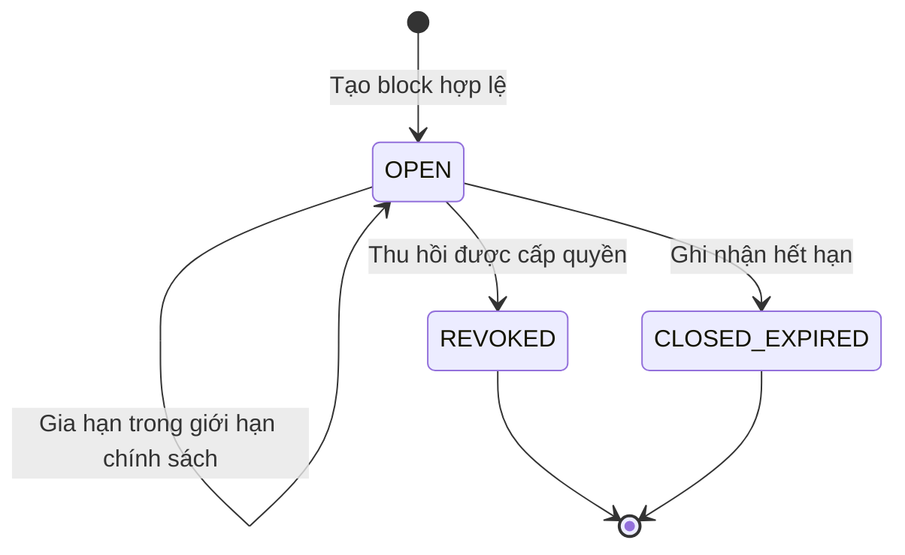

# Temporary action block: Khóa tạm thời một hành động nghiệp vụ

## 1. Mục tiêu và ý nghĩa

**Temporary action block** là biện pháp từ chối thực hiện một hành động nghiệp vụ trong một phạm vi và khoảng thời gian xác định. Ví dụ: tạm dừng tạo yêu cầu hoàn tiền cho một đơn hàng đang có dấu hiệu bị lạm dụng, nhưng vẫn cho phép người có quyền xem đơn và theo dõi các khoản hoàn đã được chấp nhận.

Trong chương **Abuse Controls** của module `SECURITY_APPLICATION_SECURITY_BUSINESS_LOGIC_SECURITY`, cơ chế này giúp hạn chế tác động trong lúc xác minh dấu hiệu bỏ qua phê duyệt, sửa giá, thao tác sai quyền hoặc gửi lệnh lặp. Nó phải phối hợp với business invariants, state machine, quyền theo đối tượng, transaction và idempotency để bảo vệ tác động thực tế.

Sau bài học, bạn cần có khả năng:

- Chọn đúng hành động, chủ thể hoặc đối tượng cần khóa tạm thời.
- Biểu diễn phạm vi, thời hạn, lý do và vòng đời của một block.
- Đặt bước kiểm tra tại nơi máy chủ chấp nhận tác động nghiệp vụ.
- Xử lý cạnh tranh giữa bật khóa, gửi lệnh, hết hạn và mở khóa.
- Thiết kế phản hồi, quan sát vận hành và kiểm thử các đường lách kiểm soát.

Khóa tạm thời tạo ra khoảng thời gian để điều tra hoặc sửa chữa. Khi khóa hết hạn, các quy tắc quyền, phê duyệt, trạng thái, hạn mức và chống tác động lặp vẫn phải được thực thi đầy đủ.

## 2. Phân biệt các cơ chế kiểm soát

| Cơ chế | Câu hỏi nó giải quyết | Ví dụ |
| --- | --- | --- |
| Temporary action block | Hành động này có đang bị tạm dừng trong phạm vi liên quan không? | Tạm khóa `REFUND_CREATE` trên một đơn hàng |
| Rate limit | Có vượt tốc độ hoặc số lượng cho phép trong cửa sổ đo không? | Giới hạn số lần gửi yêu cầu theo một chính sách |
| Cooldown | Đã qua khoảng chờ sau một hành động hoặc sự kiện chưa? | Chờ một khoảng thời gian trước khi gửi lại mã xác minh |
| Step-up verification | Có cần thêm bằng chứng trước khi tiếp tục không? | Xác minh bổ sung trước khi đổi nơi nhận tiền |
| Quyền theo đối tượng | Chủ thể có được thao tác trên đúng đối tượng này không? | Nhân viên chỉ xử lý đơn trong phạm vi được cấp |
| Idempotency | Retry cùng một lệnh có tạo thêm tác động không? | Cùng key và payload không tạo hai khoản hoàn |
| Business invariant | Trạng thái chung có giữ quy tắc bắt buộc không? | Tổng tiền hoàn và tiền giữ không vượt giới hạn |

Một hệ thống có thể vừa giới hạn tốc độ vừa khóa tạm thời. Người gửi chậm hơn ngưỡng vẫn phải bị từ chối nếu hành động đang bị khóa. Người được mở khóa vẫn phải có quyền và đáp ứng invariant.

Có thể diễn đạt điều kiện chấp nhận một lệnh mới như sau:

```text
Được chấp nhận =
    chủ thể hợp lệ
    AND có quyền trên đối tượng
    AND không có block phù hợp đang có hiệu lực
    AND chuyển trạng thái hợp lệ
    AND đáp ứng phê duyệt
    AND giữ được các invariant nghiệp vụ
    AND đáp ứng hợp đồng idempotency
```

Công thức mô tả các điều kiện cần có, không quy định mọi hệ thống phải kiểm tra theo đúng thứ tự hiển thị. Thứ tự thực thi còn phải bảo vệ dữ liệu khỏi lộ lọt, tránh tác động trước khi xác minh và xử lý được yêu cầu đồng thời.

## 3. Chọn phạm vi khóa

### 3.1. Dùng hành động nghiệp vụ chuẩn hóa

Hãy đặt tên như `REFUND_CREATE`, `ORDER_PRICE_OVERRIDE` hoặc `PAYOUT_DESTINATION_CHANGE`. Một hành động có thể đi qua nhiều endpoint, phiên bản API, bulk API hoặc worker. Tất cả đường thực thi tương đương phải ánh xạ về cùng loại hành động cần kiểm soát.

Nếu chỉ khóa URL `/refund`, client có thể chuyển sang endpoint hoàn tiền theo lô mà vẫn tạo cùng tác động. Nếu chỉ khóa nút trên giao diện, lời gọi API trực tiếp vẫn có thể đi qua.

Một hành động cũng cần được tách đủ rõ. `REFUND_VIEW`, `REFUND_CREATE` và `REFUND_RECONCILE` có tác động khác nhau. Tạm dừng tạo khoản hoàn mới không nhất thiết phải dừng xem kết quả hoặc đối soát khoản đã gửi đến nhà cung cấp.

### 3.2. Các trục phạm vi thường gặp

| Phạm vi | Khi phù hợp | Điểm cần kiểm soát |
| --- | --- | --- |
| Actor + hành động | Tín hiệu gắn với một chủ thể đã xác thực | Chủ thể có thể dùng nhiều phiên hoặc kênh |
| Đối tượng + hành động | Cần bảo vệ một đơn, ví hoặc hồ sơ cụ thể | Nhiều actor cùng thao tác trên đối tượng |
| Quan hệ actor–đối tượng | Cần hạn chế một quan hệ truy cập cụ thể | Không làm mất kiểm tra quyền của các quan hệ khác |
| Tenant + hành động | Lỗi hoặc rủi ro bao phủ một tổ chức | Phạm vi ảnh hưởng lớn, cần quyền quản trị tương xứng |
| Toàn hệ thống + hành động | Sự cố dùng chung cần dừng tác động | Cần quy trình vận hành và điều kiện mở lại rõ ràng |

Mỗi block cần có loại phạm vi rõ ràng, các định danh chuẩn hóa và ranh giới tenant khi áp dụng. Đối tượng phải được tải từ nguồn có thẩm quyền; không tin `tenant_id`, `owner_id` hoặc giá trị giá tiền chỉ vì client đã gửi chúng.

Ví dụ khóa theo đơn:

```text
tenant = tenant-demo
scope_type = OBJECT
object_type = ORDER
object_id = order-781
action = REFUND_CREATE
```

Khi so khớp, máy chủ lấy tenant và định danh của đơn thực tế đang xử lý. Một request không được tự khai báo tenant khác để tránh block hoặc để tạo block trên tài sản của người khác.

### 3.3. Tránh phạm vi ngầm định

Không dùng `object_id = null` mà không quy định rõ nó có nghĩa là toàn tenant, thiếu dữ liệu hay không hợp lệ. Nên dùng loại phạm vi tường minh và kiểm tra tổ hợp trường tương ứng. Một block loại `OBJECT` thiếu đối tượng phải bị từ chối khi tạo, thay vì vô tình trở thành block diện rộng.

IP, thiết bị và user agent có thể là tín hiệu bổ sung. Chúng thường không đủ để thay thế định danh nghiệp vụ: nhiều người dùng có thể chung IP; một tài khoản có thể thay đổi IP và thiết bị. Nếu dùng chúng để hạn chế, cần xác định rõ độ tin cậy, phạm vi tác động và cách xử lý người dùng hợp lệ bị ảnh hưởng.

### 3.4. Tín hiệu cũng có thể bị lợi dụng để gây khóa

Kẻ lạm dụng có thể cố tạo nhiều yêu cầu sai lên một tài khoản hoặc đơn của người khác nhằm khiến hệ thống tự khóa nạn nhân. Trước khi tạo block, hãy kiểm tra nguồn tín hiệu có thực sự chứng minh rủi ro gắn với phạm vi đó không.

Ví dụ, nhiều lần truy cập trái quyền vào một đơn từ các tài khoản không liên quan chưa đủ để kết luận chủ đơn cần bị khóa. Có thể cần hạn chế các chủ thể gửi yêu cầu, tăng quan sát hoặc xác minh thêm. Quyết định phải cân nhắc cả tác động của việc khóa nhầm.

## 4. Mô hình dữ liệu và thời hạn hiệu lực

### 4.1. Bản ghi block minh họa

```json
{
  "block_id": "block-204",
  "tenant_id": "tenant-demo",
  "scope_type": "OBJECT",
  "object_type": "ORDER",
  "object_id": "order-781",
  "action": "REFUND_CREATE",
  "lifecycle_status": "OPEN",
  "effective_from": "2026-10-05T09:00:00Z",
  "expires_at": "2026-10-05T09:15:00Z",
  "reason_code": "REFUND_PATTERN_REVIEW",
  "policy_version": "refund-abuse-policy-4",
  "source_signal_id": "signal-811",
  "created_by": "abuse-control-service",
  "created_at": "2026-10-05T09:00:00Z",
  "revision": 1
}
```

Khoảng 15 phút ở đây chỉ phục vụ ví dụ. Thời hạn thực tế phải dựa vào mức rủi ro, chi phí khóa nhầm, khả năng xác minh và chính sách vận hành của sản phẩm.

Nên lưu thêm lịch sử gia hạn, thu hồi, người thực hiện và tham chiếu hồ sơ điều tra khi có. Thông tin nội bộ như điểm rủi ro, bằng chứng hoặc nguồn tín hiệu cần được phân quyền; không đưa toàn bộ vào phản hồi cho client.

### 4.2. Hiệu lực là điều kiện tính tại lúc quyết định

Với bản ghi trên, block có hiệu lực khi:

```text
lifecycle_status == OPEN
AND phạm vi khớp ngữ cảnh nghiệp vụ có thẩm quyền
AND effective_from <= thời gian máy chủ có thẩm quyền
AND thời gian máy chủ có thẩm quyền < expires_at
```

Khoảng thời gian được hiểu là `[effective_from, expires_at)`: tại đúng `expires_at`, block đó không còn có hiệu lực. Một block khác cùng khớp vẫn có thể tiếp tục chặn hành động.

Không dùng đồng hồ client để xác định hết hạn. Khi có nhiều máy chủ, cần một chính sách thời gian nhất quán và theo dõi sai lệch đồng hồ. Trong bước xử lý có chờ khóa, thời gian xét hiệu lực phải được lấy tại điểm quyết định được thiết kế, tránh dùng giá trị đã lấy từ rất lâu trước khi chờ.

### 4.3. Phân biệt trạng thái lưu trữ và trạng thái hiệu lực

| Trạng thái lưu | Điều kiện thời gian | Ý nghĩa |
| --- | --- | --- |
| `OPEN` | Chưa tới `effective_from` | Đã lên lịch, chưa có hiệu lực |
| `OPEN` | Nằm trong khoảng hiệu lực | Đang chặn nếu phạm vi khớp |
| `OPEN` | Đã tới hoặc qua `expires_at` | Đã hết hiệu lực dù tác vụ dọn dẹp chưa chạy |
| `REVOKED` | Bất kỳ | Đã thu hồi chủ động |
| `CLOSED_EXPIRED` | Đã hết hạn | Đã được ghi nhận kết thúc theo thời gian |



Tác vụ dọn dẹp có thể chuyển block hết hạn sang `CLOSED_EXPIRED`, nhưng kiểm tra hiệu lực không được phụ thuộc vào việc tác vụ đó đã chạy. TTL của cache hoặc kho dữ liệu cũng có thể xóa bản ghi trễ; bản ghi còn tồn tại không đồng nghĩa block còn hiệu lực.

Với thiết kế này, block đã hết hạn hoặc bị thu hồi không được tự kích hoạt lại bằng một bản cập nhật cũ. Nếu cần hạn chế lần nữa, tạo quyết định mới có định danh và bằng chứng riêng theo chính sách.

### 4.4. Gia hạn phải có giới hạn

Quy định rõ thời lượng tối đa tính từ mốc nào, ai được gia hạn và tín hiệu mới nào đủ điều kiện. Nếu tính lại “thêm 15 phút kể từ bây giờ” sau mọi request bị chặn, một client tự retry có thể khiến block không bao giờ hết hạn.

Trong mô hình minh họa, gia hạn chỉ áp dụng cho block còn hiệu lực, dùng revision để phát hiện cập nhật cũ và bị giới hạn bởi thời hạn tối đa của quyết định gốc. Nếu rủi ro cần thời gian xử lý dài hơn, chuyển sang quy trình được phê duyệt tương ứng thay vì âm thầm duy trì một block mang tên tạm thời.

## 5. Các invariant của chính cơ chế khóa

Kiểm soát chống lạm dụng cũng cần quy tắc bất biến:

1. Chỉ chủ thể được cấp quyền mới được tạo, gia hạn hoặc thu hồi block đúng phạm vi.
2. Một block có hiệu lực phải được xét trên mọi đường chấp nhận cùng hành động nghiệp vụ.
3. Khi có nhiều block phù hợp, hành động vẫn bị chặn nếu ít nhất một block còn hiệu lực.
4. Hết hạn hoặc thu hồi một block không tự xóa các block khác.
5. Replay cùng một tín hiệu không tự tạo thêm block hoặc kéo dài thời hạn ngoài chính sách.
6. Mở khóa không bỏ qua quyền đối tượng, phê duyệt, state machine hay invariant tiền.
7. Thay đổi block và tác động của nó phải truy vết được bằng audit.

Ví dụ, một đơn bị khóa 10 phút và toàn tenant bị khóa 30 phút cho cùng hành động. Sau 10 phút, block trên đơn hết hạn nhưng yêu cầu tạo hoàn tiền vẫn bị chặn bởi block tenant. Không thể lấy “block cụ thể nhất” hoặc “bản ghi mới nhất” làm quyết định cuối cùng nếu chính sách yêu cầu áp dụng mọi block phù hợp.

Một thao tác “mở khóa” cần ghi rõ đang thu hồi block nào. Nếu sản phẩm hỗ trợ ngoại lệ cho một block diện rộng, ngoại lệ phải là một cơ chế được thiết kế riêng với quyền, thời hạn và audit; không biến một bản ghi `allow` bất kỳ thành quyền vượt qua tất cả block.

## 6. Đặt điểm thực thi tại ranh giới chấp nhận lệnh

### 6.1. Công bố hợp đồng hiệu lực

Trước khi viết code, cần trả lời “bị khóa” nghĩa là gì với từng giai đoạn:

- Request mới đến API có bị từ chối không?
- Lệnh đã tạo nhưng chưa commit được xử lý ra sao?
- Lệnh đã commit và đang nằm trong hàng đợi có tiếp tục không?
- Yêu cầu đã gửi đến nhà cung cấp có thể thu hồi không?
- Truy vấn kết quả hoặc đối soát có được tiếp tục không?

Hợp đồng dùng trong phần minh họa dưới đây là:

> Block ngăn chấp nhận lệnh mới trong phạm vi khi block có hiệu lực tại điểm quyết định. Bật block và chấp nhận lệnh được phối hợp qua cùng một guard giao dịch. Lệnh đã được chấp nhận trước khi block được commit tiếp tục theo quy trình xử lý và đối soát đã công bố.

Ở đây, “chấp nhận” là commit bền vững một operation cùng các thay đổi nội bộ cần thiết. Một HTTP request đã vào gateway hoặc nhận phản hồi sơ bộ chưa nhất thiết là một lệnh đã được chấp nhận.

Với hợp đồng này, việc bật block không thu hồi các ý định thực thi đã commit trước đó. Nếu sản phẩm cần dừng cả các lệnh đang chờ, phải có chính sách riêng cho hàng đợi, phần tiền đang giữ, trạng thái operation và tác động ngoài.

### 6.2. Lỗi kiểm tra tách rời tác động

Mẫu dưới đây có khoảng hở:

```text
Đọc block từ cache: không thấy block
Thực hiện kiểm tra nghiệp vụ
Tạo lệnh và ghi giao dịch
```

Giữa lúc đọc cache và ghi giao dịch, block có thể được bật. Việc đọc lại thêm một lần vẫn có khoảng hở nếu quyết định và chấp nhận tác động không được phối hợp với thao tác bật khóa.

Một cách bảo vệ là dùng guard bền vững chung cho phạm vi cần tuần tự hóa. Trong ví dụ **chỉ xét block theo đơn và hành động**, guard có khóa định danh:

```text
(tenant_id, order_id, REFUND_CREATE)
```

Mọi đường tạo block, gia hạn, thu hồi và chấp nhận lệnh mới trong phạm vi đó đều phải phối hợp qua cùng guard. Guard phải tồn tại độc lập với việc đã có block hay chưa; đọc một danh sách block rỗng không tự tạo ra sự bảo vệ chống việc chèn block đồng thời.

### 6.3. Luồng chấp nhận lệnh minh họa

```text
BEGIN TRANSACTION
    Tải đối tượng từ nguồn có thẩm quyền và xác định tenant thực tế
    Lấy khóa guard của đơn và hành động theo thứ tự đã quy định
    Lấy thời gian có thẩm quyền tại điểm quyết định sau khi chờ guard

    Kiểm tra danh tính và quyền trên đúng đối tượng

    Tra operation theo phạm vi idempotency đã công bố
    Nếu đã có operation:
        Kiểm tra fingerprint và quyền đọc kết quả
        Trả kết quả hoặc trạng thái đã lưu, không tạo tác động mới

    Tìm block phù hợp đang có hiệu lực từ nguồn quyết định
    Nếu có block:
        Ghi nhận quyết định từ chối bằng cơ chế audit phù hợp
        Kết thúc mà không tạo operation có tác động nghiệp vụ

    Kiểm tra trạng thái, phê duyệt và các invariant
    Giữ hạn mức hoặc cập nhật dữ liệu bằng cơ chế nguyên tử phù hợp
    Ghi operation được chấp nhận
    Ghi outbox cho tác động cần thực thi bên ngoài
COMMIT
```

Đây là giả mã mô tả trách nhiệm. Triển khai thực tế phải quy định cách kết thúc transaction khi từ chối và cách giữ audit. Nếu audit chỉ được ghi trong một transaction sau đó rollback thì bản ghi từ chối có thể bị mất. Có thể dùng một transaction ghi audit được commit riêng hoặc đường thu thập sự kiện có bảo đảm phù hợp.

Các kiểm tra quyền có thể cần thực hiện sớm hơn để hạn chế truy vấn hoặc tránh lộ dữ liệu. Việc giữ guard không thay thế quyền theo đối tượng. Những dữ liệu làm cơ sở cho invariant và phê duyệt cũng phải được bảo vệ khỏi thay đổi không hợp lệ đến lúc chấp nhận lệnh.

Idempotency cần uniqueness, fingerprint và cơ chế phối hợp cho request đồng thời. Guard theo đơn không tự giải quyết mọi trường hợp nếu phạm vi key còn bao gồm các đối tượng khác. Hãy thiết kế thứ tự lấy khóa và xử lý xung đột thống nhất để tránh deadlock hoặc sinh hai operation.

### 6.4. Luồng bật block phải dùng cùng cơ chế phối hợp

```text
BEGIN TRANSACTION
    Xác minh quyền quản lý block trong tenant và phạm vi được yêu cầu
    Xác định đối tượng, hành động và lấy cùng guard
    Lấy thời gian có thẩm quyền

    Kiểm tra nguồn tín hiệu và chống xử lý trùng quyết định tạo block
    Kiểm tra thời hạn, loại phạm vi và phiên bản chính sách
    Tạo block có thời điểm bắt đầu theo chính sách
    Ghi audit và sự kiện thay đổi cần phát ra
COMMIT

Thông báo block đã được ghi nhận thành công
```

Với một block có hiệu lực ngay trong mô hình này, có hai thứ tự hợp lệ:

| Thứ tự qua guard | Kết quả |
| --- | --- |
| Lệnh được chấp nhận và commit trước; sau đó block mới commit | Lệnh thuộc nhóm đã chấp nhận trước block |
| Block commit trước; sau đó lệnh lấy guard và thấy block còn hiệu lực | Lệnh mới bị từ chối |

Nếu có đường ghi bỏ qua guard, bảo đảm trên không còn đúng. Transaction chỉ giúp phối hợp khi các bên dùng cùng cơ chế và cơ sở dữ liệu cung cấp đúng ngữ nghĩa khóa được yêu cầu.

Thời gian xét hiệu lực trong mô hình là thời điểm ra quyết định sau khi lấy guard. Nếu yêu cầu của sản phẩm là “không tác động nào được thực thi sau một mốc giờ tuyệt đối”, phải thiết kế thêm bảo vệ tại điểm thực thi; kiểm tra lúc chấp nhận lệnh không đủ để đáp ứng hợp đồng mạnh hơn đó.

### 6.5. Mở rộng sang nhiều cấp phạm vi

Guard theo đơn trong ví dụ chưa bảo vệ cuộc đua với việc bật block toàn tenant. Khi hỗ trợ nhiều cấp phạm vi, cần một thiết kế phối hợp bao phủ cả block tenant, actor và đối tượng có thể áp dụng cho lệnh.

Một phương án đơn giản về tính đúng là tuần tự hóa mọi quyết định cùng tenant và hành động qua một guard chung. Nó có thể tạo tranh chấp lớn nên cần đánh giá tải. Những phương án dùng nhiều guard, read/write lock hoặc version phải chứng minh được rằng việc tạo block diện rộng không thể lọt giữa bước kiểm tra và commit lệnh.

Nếu có nhiều guard, các luồng phải lấy khóa theo cùng thứ tự chuẩn. Cũng cần giải quyết việc khởi tạo guard đồng thời bằng ràng buộc duy nhất hoặc cơ chế tương đương. Không tối ưu bằng cách chỉ khóa các block đã tồn tại rồi bỏ qua khả năng block mới xuất hiện.

## 7. Cache, thời gian và lỗi hạ tầng

### 7.1. Phân biệt cache hỗ trợ với nguồn ra quyết định

Cache có thể giảm tải, nhưng cache cũ có hai kiểu sai khác nhau:

| Dữ liệu cache cũ | Hệ quả | Điều cần thiết kế |
| --- | --- | --- |
| Không có block trong khi nguồn chính đã có | Có thể chấp nhận thêm lệnh trái hợp đồng | Kiểm tra có thẩm quyền hoặc công bố rõ độ trễ được chấp nhận |
| Có block đã hết hạn hoặc bị thu hồi | Chặn nhầm người dùng hợp lệ | Kiểm tra thời hạn, revision và cơ chế làm mới |

Thông báo vô hiệu hóa cache bất đồng bộ có thể bị trễ hoặc mất. TTL ngắn chỉ giới hạn một phần thời gian dữ liệu cũ, không tạo ra bảo đảm bật khóa có hiệu lực ngay.

Với hành động tiền tệ nhạy cảm và hợp đồng ở mục 6, quyết định cuối cùng phải được phối hợp với nguồn block có thẩm quyền. Cache có thể phục vụ giao diện hoặc hỗ trợ tra cứu, nhưng một cache miss không đủ làm bằng chứng cho phép chấp nhận lệnh mới.

Nếu sản phẩm chủ động dùng nhất quán cuối cùng, hãy ghi rõ khoảng chấp nhận rủi ro, đo độ trễ thực thi và phân loại những hành động được phép dùng mô hình đó. Không mô tả một hệ thống có độ trễ đồng bộ là khóa tức thời toàn cục.

### 7.2. TTL dùng để dọn dẹp, thời hạn dùng để quyết định

Một key vẫn nằm trong kho sau `expires_at` có thể đã hết hiệu lực. Ngược lại, key biến mất do mất dữ liệu, eviction hoặc lỗi cấu hình không chứng minh block hợp lệ đã hết hạn.

Thiết kế phải xác định rõ kho nào là nguồn dữ liệu có thẩm quyền, yêu cầu bền vững và cách phục hồi. Nếu block chỉ nằm trong bộ nhớ của một instance, request sang instance khác có thể đi qua. Nếu dùng cache làm nguồn chính, phải chấp nhận và xử lý các đặc tính mất dữ liệu tương ứng thay vì giả định nó là kho bền vững.

### 7.3. Không dùng thời gian đã cũ sau khi chờ

Ví dụ request bắt đầu lúc 09:14:59 nhưng chờ guard đến 09:15:02; block hết hạn lúc 09:15:00. Nếu lấy thời gian tại lúc vào request rồi dùng mãi, hệ thống có thể từ chối dù block đã hết hạn tại điểm quyết định.

Ở chiều ngược lại, block được lên lịch bắt đầu trong lúc request chờ cũng có thể bị bỏ sót nếu dùng thời gian cũ. Cần kiểm tra đặc tính của hàm thời gian thực tế: một số cơ chế thời gian có thể cố định theo transaction thay vì phản ánh thời điểm sau khi chờ khóa.

Đối với block có lịch bắt đầu trong tương lai, hãy công bố rõ ý nghĩa của mốc thời gian đối với lệnh đã được chấp nhận và các transaction đang chạy. Nếu cần ranh giới thời gian nghiêm ngặt hơn điểm quyết định đã nêu, phải bổ sung phối hợp tương ứng.

### 7.4. Khi không đọc được trạng thái block

Phân biệt ba kết quả: **có block**, **không có block** và **không thể xác định**. Timeout không tương đương với “không có block”.

Chính sách khi lỗi hạ tầng nên được xác định theo hành động. Với tạo khoản hoàn hoặc đổi tài khoản nhận tiền, có thể tạm từ chối chấp nhận lệnh mới khi không kiểm tra được điều kiện an toàn. Những hành động đọc ít rủi ro có thể tiếp tục theo chính sách riêng.

Phản hồi khi hạ tầng không sẵn sàng phải phản ánh đúng tình trạng đó; không nói tài khoản đã bị khóa khi hệ thống chưa xác định được block. Đường khôi phục vận hành và đối soát cũng cần được thiết kế để vẫn xử lý được các tác động đã có, với quyền và audit phù hợp.

## 8. Idempotency và các lệnh đang xử lý

### 8.1. Retry một lệnh cũ khác với tạo một lệnh mới

Trong hợp đồng minh họa, block chặn tạo lệnh mới. Nếu một operation đã được chấp nhận trước đó, request retry cùng key và fingerprint có thể trả lại kết quả hiện có sau khi kiểm tra quyền đọc. Nó không được gọi lại nhà cung cấp hoặc tạo thêm khoản giữ tiền.

| Tình huống | Cách xử lý cần có |
| --- | --- |
| Lệnh mới, chưa có operation, block đang có hiệu lực | Từ chối tạo tác động |
| Lệnh đã chấp nhận, retry cùng key và payload | Trả trạng thái/kết quả hiện có nếu được phép đọc |
| Cùng key nhưng payload khác | Từ chối xung đột theo hợp đồng idempotency |
| Key mới trong khi block còn hiệu lực | Vẫn bị chặn theo phạm vi nghiệp vụ |
| Block đã hết hiệu lực | Đánh giá lại toàn bộ điều kiện chấp nhận lệnh |

Nếu chính sách cần hạn chế cả việc xem một kết quả, đó là một quy tắc đọc riêng. Không vô tình trả dữ liệu nhạy cảm chỉ vì tìm thấy key trong kho idempotency.

### 8.2. Quy định rõ cách lưu kết quả từ chối tạm thời

Một hệ thống có thể lưu phản hồi từ chối trong kho idempotency; hệ thống khác chỉ gắn key với operation khi lệnh được chấp nhận. Hai lựa chọn tạo trải nghiệm retry khác nhau.

Trong mô hình bài học, từ chối do block xảy ra trước khi tạo operation có tác động. Audit vẫn ghi nhận lần từ chối, nhưng không biến nó thành operation thành công và không giữ vĩnh viễn một kết quả từ chối tạm thời như kết quả cuối cùng của lệnh.

Nếu sản phẩm lưu cả phản hồi từ chối theo key, cần công bố thời hạn lưu và cách gửi lại sau khi block hết hiệu lực. Tránh tình huống giao diện báo đã mở khóa nhưng mọi retry vẫn nhận phản hồi cũ mà không có cách tiếp tục hợp lệ.

Đổi key không được giúp lách block, quyền hay invariant. Block phải bám vào ngữ cảnh nghiệp vụ có thẩm quyền, không chỉ vào idempotency key.

### 8.3. Hàng đợi và tác động bên ngoài

Giả sử operation đã commit trước lúc bật block và đã ghi outbox. Theo hợp đồng ở mục 6, worker tiếp tục xử lý operation đó. Cần theo dõi và đối soát nó riêng với các lệnh mới bị từ chối.

Nếu muốn dừng cả lệnh chưa gửi ra ngoài, cần xác định trạng thái như `HELD_FOR_REVIEW`, người có quyền tiếp tục và cách quản lý phần hạn mức đã giữ. Worker phải kiểm tra điều kiện tại điểm chuyển sang thực thi, có cơ chế phối hợp với thay đổi block.

Chỉ đọc block rồi gọi nhà cung cấp vẫn có khoảng hở giữa đọc và gửi. Version hoặc fencing token chỉ tạo bảo vệ nếu thành phần thực thi kiểm tra token theo đúng giao thức. Gắn thêm một số version vào log không tự ngăn tác động.

Một yêu cầu đã gửi đến nhà cung cấp có thể vẫn thành công dù ứng dụng timeout hoặc vừa bật block. Không giải phóng tiền giữ hoặc tạo lệnh thay thế chỉ vì không nhận được phản hồi; cần đối soát theo định danh ngoài ổn định. Khả năng hủy và bù trừ phụ thuộc vào nghiệp vụ và hợp đồng với nhà cung cấp.

## 9. Quy trình tạo và vận hành block

### 9.1. Từ tín hiệu đến quyết định

Một luồng vận hành có thể gồm:

1. Nhận tín hiệu bất thường và kiểm tra nguồn, thời điểm, phạm vi.
2. Đối chiếu chính sách để xác định có cần khóa, hành động nào và thời hạn nào.
3. Xác minh quyền của thành phần ra quyết định trong phạm vi tương ứng.
4. Ghi block qua cơ chế có thẩm quyền và xác nhận kết quả commit.
5. Theo dõi các quyết định từ chối, operation đã chấp nhận trước đó và tác động đang chờ.
6. Điều tra, sửa chữa hoặc chuyển cấp xử lý khi cần.
7. Hết hạn hoặc thu hồi có audit; xác minh hành vi sau mở khóa.

Đừng hiển thị “đã khóa thành công” chỉ vì thông điệp tạo block đã được gửi vào hàng đợi. Cần phân biệt các trạng thái yêu cầu tạo block đã nhận, block đã ghi nhận và block đã có hiệu lực theo hợp đồng của hệ thống.

### 9.2. Chống xử lý trùng tín hiệu

Consumer có thể nhận lại một tín hiệu. Dùng định danh quyết định hoặc khóa chống trùng gắn với nguồn, phạm vi và chính sách phù hợp. Việc nhận lại cùng tín hiệu nên trả kết quả quyết định đã có, không mặc định tạo block mới với thời điểm hết hạn mới.

Nếu tín hiệu đến muộn sau khi block đã được thu hồi hoặc hết hạn, không tự kích hoạt lại quyết định cũ. Cần đánh giá độ mới của bằng chứng và chính sách tái khóa. Tín hiệu mới thực sự có thể tạo quyết định mới, nhưng phải giữ được quan hệ lịch sử và giới hạn vận hành.

### 9.3. Chọn thời hạn và điều kiện chuyển cấp

Thời hạn nên đủ để giảm tác động trong lúc xác minh, đồng thời giới hạn thiệt hại do khóa nhầm. Có thể dùng các yếu tố:

- Mức độ tác động của hành động và bằng chứng đã xác nhận.
- Thời gian cần để đối soát hoặc hoàn tất xác minh.
- Khả năng tiếp tục nghiệp vụ qua một đường được kiểm soát khác.
- Tần suất khóa nhầm và khả năng hỗ trợ người dùng.
- Giới hạn gia hạn và người chịu trách nhiệm xem xét lại.

Không để một bộ đếm request thất bại tự quyết định gia hạn vô hạn. Cần phân biệt retry do client đang chờ với tín hiệu rủi ro mới. Nếu rủi ro chưa được xử lý khi gần hết thời hạn, người phụ trách phải chọn một quyết định có căn cứ: gia hạn hợp lệ, chuyển sang biện pháp khác hoặc để block hết hiệu lực và tiếp tục theo dõi.

## 10. Phản hồi API và trải nghiệm sử dụng

### 10.1. Phản hồi có cấu trúc

Ví dụ khi người dùng đã được xác minh có quyền xem trạng thái thao tác:

```json
{
  "code": "ACTION_TEMPORARILY_BLOCKED",
  "action": "REFUND_CREATE",
  "message": "Thao tác hoàn tiền đang tạm dừng. Vui lòng thử lại sau hoặc liên hệ hỗ trợ.",
  "blocked_until": "2026-10-05T09:15:00Z",
  "retry_after_seconds": 900,
  "support_reference": "support-612",
  "request_id": "request-902"
}
```

Giả sử thời điểm phản hồi là 09:00:00 UTC và không có block khác kéo dài hơn, hai trường thời gian trong ví dụ tương ứng với nhau. Khi có nhiều block hoặc không thể đưa ra thời điểm hữu ích, phản hồi có thể bỏ trường thời gian hoặc dùng giá trị theo hợp đồng đã công bố.

Thời gian là thông tin theo trạng thái tại lúc phản hồi, không bảo đảm lần gửi sau chắc chắn được chấp nhận. Chính sách hoặc block khác có thể thay đổi; lần gửi tiếp theo vẫn phải được đánh giá đầy đủ.

Mã HTTP cần theo hợp đồng API của sản phẩm. Một quyết định cấm hành động theo chính sách có thể được biểu diễn bằng lỗi quyền/chính sách như 403, còn giới hạn tốc độ có thể dùng 429 khi đúng ngữ nghĩa. Không chọn 429 chỉ vì mọi block đều có thời hạn. Tình trạng không kiểm tra được kho block cần mã lỗi dịch vụ phù hợp và mã nghiệp vụ riêng.

### 10.2. Chỉ cung cấp thông tin cần thiết

Không trả điểm rủi ro, ngưỡng phát hiện, dấu hiệu nội bộ hoặc dữ liệu của người khác. Mã tham chiếu hỗ trợ nên cho phép người có quyền tra hồ sơ mà không tiết lộ nội dung hồ sơ cho client.

Kiểm tra quyền đọc trước khi tiết lộ đối tượng có bị block hay không. Nếu một người không có quyền với đơn hàng, phản hồi không nên trở thành cách dò tìm đơn hàng hoặc trạng thái điều tra của đơn đó.

### 10.3. Giao diện hỗ trợ quyết định của máy chủ

Giao diện có thể tạm vô hiệu hóa nút, giải thích hành động nào bị ảnh hưởng và hiển thị thời gian theo múi giờ người dùng. Sau khi đồng hồ đếm ngược kết thúc, giao diện nên làm mới trạng thái hoặc cho phép gửi lại để máy chủ đánh giá.

Không tự khẳng định đã mở khóa chỉ vì bộ đếm phía client về 0. Tránh retry dồn dập ngay lúc hết hạn; áp dụng chính sách retry phù hợp và giữ nguyên idempotency khi đang truy vấn một lệnh đã chấp nhận.

Người dùng vẫn cần xem được trạng thái operation cũ nếu họ có quyền và chính sách cho phép. Điều này giảm việc tạo key mới chỉ vì không biết yêu cầu trước đó đã thành công hay chưa.

## 11. Hết hạn, thu hồi và khôi phục

### 11.1. Hết hạn không phải một lệnh sửa dữ liệu nghiệp vụ

Khi block hết hiệu lực, hệ thống chỉ bỏ một điều kiện hạn chế. Không tự đặt lại trạng thái đơn hàng, xóa lịch sử phê duyệt, giải phóng tiền giữ hoặc hủy giao dịch ngoài.

Nếu một operation đang ở trạng thái giữ để xem xét, nó cần luồng xử lý riêng. Hết hạn block không đủ để chứng minh operation đó hợp lệ hoặc đủ điều kiện tự tiếp tục.

### 11.2. Thu hồi có quyền và kiểm soát xung đột

Thao tác thu hồi nên kiểm tra:

- Người thực hiện có quyền quản lý block đúng tenant, phạm vi và hành động.
- Block hiện còn ở trạng thái được phép thu hồi.
- Revision được người vận hành xem có còn là revision hiện tại không.
- Có các block khác vẫn đang áp dụng hay không.
- Lý do thu hồi và bằng chứng liên quan đã được ghi nhận.

Trong mô hình dùng guard, thu hồi và gia hạn phải dùng cùng cơ chế phối hợp. Có thể yêu cầu revision kỳ vọng để một màn hình cũ không ghi đè quyết định mới. Một thông điệp gia hạn đến trễ không được đổi block đã `REVOKED` trở lại `OPEN`.

Quyền thu hồi block không tự cấp quyền hoàn tiền, sửa giá hoặc bỏ qua phê duyệt. Với phạm vi hoặc tác động lớn, chính sách có thể yêu cầu thêm người phê duyệt quyết định vận hành. Quy định đó cần được áp dụng nhất quán cho cả giao diện quản trị và API nội bộ.

### 11.3. Đường khôi phục cần tiếp tục được kiểm soát

Nếu mọi thao tác đều bị khóa, đội vận hành có thể không còn cách đối soát hoặc xử lý khoản đã gửi. Hãy định nghĩa trước những hành động cần tiếp tục như đọc trạng thái, đối soát hoặc thực hiện bù trừ theo quy trình.

Các hành động đó cần mã hành động riêng, quyền phù hợp và audit. Không thêm một cờ chung kiểu `skip_abuse_check=true` mà caller tùy ý đặt được. Với thao tác khẩn cấp, ghi rõ ai dùng, phạm vi, thời hạn và kết quả.

Sau mở khóa, theo dõi cả lỗi nghiệp vụ và trải nghiệm người dùng. Nếu số cảnh báo giảm vì mất log hoặc vì mọi request đang lỗi ở gateway, đó không phải bằng chứng cơ chế đã hoạt động tốt.

## 12. Ca minh họa: tạm dừng tạo hoàn tiền trên một đơn

### 12.1. Bối cảnh

Đơn `order-781` thuộc `tenant-demo`, có giới hạn đủ điều kiện hoàn là **1.000.000 VND**. Trước lúc tạo block, hệ thống đã chấp nhận operation A trị giá **100.000 VND** và giữ phần hạn mức tương ứng. Chính sách áp dụng block theo đơn cho `REFUND_CREATE`; operation đã chấp nhận tiếp tục được xử lý và đối soát.

Hệ thống nhận tín hiệu nhiều lệnh hoàn tiền độc lập trên cùng đơn trong khoảng ngắn. Tín hiệu cần được điều tra; bản thân số lượng lệnh chưa chứng minh tổng tiền đã vượt giới hạn hoặc người gửi cố ý lạm dụng. Chính sách cho phép tạm dừng hành động này để xem xét.

### 12.2. Dòng thời gian

| Thời điểm UTC | Sự kiện | Kết quả mong đợi |
| --- | --- | --- |
| 08:59:59 | Operation A 100.000 được chấp nhận | Có operation và tiền giữ trước block |
| 09:00:00 | Block được commit, hiệu lực đến 09:15:00 | Bắt đầu chặn lệnh mới theo hợp đồng |
| 09:00:01 | Lệnh B dùng key mới yêu cầu 700.000 | Bị chặn; không tạo khoản hoàn hoặc tiền giữ mới |
| 09:00:02 | Client retry A bằng key và payload cũ | Trả trạng thái A nếu được phép; không tạo tác động lặp |
| 09:01:00 | Worker thực thi A | Tiếp tục theo chính sách dành cho lệnh đã chấp nhận |
| 09:05:00 | Cùng tín hiệu tạo block được giao lại | Không kéo dài thời hạn chỉ vì replay |
| 09:15:00 | Không có block khác và block này hết hiệu lực | Lệnh mới được xét lại đầy đủ |

Giả sử A đã hoàn thành công và không có giao dịch khác, hạn mức còn lại là 900.000 VND. Sau khi block hết hiệu lực, hai lệnh mới, mỗi lệnh 700.000 VND, đến đồng thời. Cơ chế invariant chỉ được cho phép tối đa một trong hai lệnh được chấp nhận đầy đủ: sau một khoản 700.000, phần còn lại chỉ là 200.000 VND.

Temporary action block không giải quyết cuộc đua hạn mức này. Nó chỉ tạo khoảng tạm dừng trước đó. Sau mở khóa, transaction và cơ chế giữ hạn mức vẫn phải bảo vệ:

```text
Tiền đã hoàn thành công + tiền đang giữ <= 1.000.000 VND
```

### 12.3. Những kết luận cần ghi nhận

- Lệnh mới trong khoảng block có hiệu lực đã bị từ chối mà không tạo tác động.
- Retry operation A không bị biến thành lệnh mới.
- Việc tiếp tục A phù hợp với hợp đồng đã công bố, không phải bằng chứng block bị lách.
- Tín hiệu giao trùng không kéo dài block.
- Sau hết hạn, quyền, phê duyệt và invariant vẫn được thực thi.
- Nếu có block tenant còn hiệu lực đến 09:30:00, các lệnh mới vẫn bị chặn sau 09:15:00.

## 13. Quan sát và kiểm thử tình huống lạm dụng

### 13.1. Audit và chỉ số vận hành

Audit thay đổi block nên ghi block ID, scope đã chuẩn hóa, hành động, người quyết định, nguồn tín hiệu, phiên bản chính sách, thời hạn trước/sau, revision và kết quả commit. Audit quyết định xử lý lệnh cần liên kết được request, operation nếu có và block khiến lệnh bị từ chối.

Tách số request bị chặn khỏi số operation và tác động thực tế. Một client retry 100 lần có thể tạo 100 quyết định từ chối nhưng không tạo operation nào. Dữ liệu này cần được đọc đúng khi đánh giá ảnh hưởng và tải vận hành.

Các chỉ số hữu ích gồm:

- Thời gian từ quyết định tạo block đến lúc được thực thi theo hợp đồng.
- Số lần không kiểm tra được trạng thái block và kết quả xử lý khi đó.
- Số lệnh được chấp nhận trái quy tắc trong phạm vi block đang có hiệu lực.
- Tỷ lệ khóa nhầm, số lần thu hồi sớm và số lần gia hạn.
- Thời gian chờ guard, xung đột transaction và ảnh hưởng đến độ trễ.
- Operation trước block còn chờ xử lý hoặc lệch đối soát.

Không dùng actor ID, order ID hoặc block ID làm nhãn cho mọi time series nếu chúng tạo số lượng nhãn quá lớn. Giữ định danh chi tiết trong log hoặc hệ thống truy vết được phân quyền, còn chỉ số tổng hợp dùng các chiều có quy mô kiểm soát được như loại hành động và loại quyết định.

### 13.2. Ma trận kiểm thử

| Tình huống | Điều cần kiểm chứng |
| --- | --- |
| Lệnh mới khớp block đang có hiệu lực | Không tạo operation có tác động, tiền giữ, outbox thực thi hoặc giao dịch ngoài |
| Lệnh khác hành động bị khóa | Được đánh giá theo chính sách riêng; không bị mở rộng khóa vô tình |
| Cùng ID đối tượng trong tenant khác | Chỉ phạm vi tenant đúng bị ảnh hưởng |
| Actor không có quyền truy cập đối tượng | Không lộ trạng thái block hoặc dữ liệu đối tượng |
| Gửi qua bulk API, API cũ hoặc worker | Cùng quy tắc chấp nhận hành động vẫn được áp dụng |
| Bật block đồng thời với tạo lệnh | Kết quả phù hợp thứ tự qua guard và commit, không chỉ thứ tự timestamp |
| Chờ guard qua mốc hết hạn | Dùng thời gian tại điểm quyết định theo hợp đồng |
| Thời gian đúng bằng `expires_at` | Block đó không còn hiệu lực; block khác vẫn được xét |
| Block đối tượng hết hạn nhưng block tenant còn hiệu lực | Lệnh mới vẫn bị chặn |
| Thu hồi và gia hạn đồng thời | Không ghi đè quyết định mới bằng revision cũ; block thu hồi không tự sống lại |
| Replay tín hiệu tạo block | Không tạo bản sao hoặc gia hạn ngoài chính sách |
| Đổi idempotency key khi đang bị khóa | Vẫn bị chặn theo actor/đối tượng/hành động phù hợp |
| Retry operation đã chấp nhận trước block | Trả kết quả theo quyền; không tạo thêm tác động |
| Cache cũ hoặc thông báo vô hiệu hóa bị mất | Không làm sai bảo đảm của điểm quyết định có thẩm quyền |
| Kho block timeout | Thực hiện đúng chính sách cho trạng thái không thể xác định |
| Khởi động lại hoặc chuyển instance | Block còn hiệu lực không biến mất do chỉ lưu trong bộ nhớ cục bộ |
| Sau mở khóa, gửi đồng thời vượt hạn mức | Invariant vẫn giữ; block không thay thế bảo vệ transaction |
| Gọi đường quản trị để tự mở khóa trái quyền | Bị từ chối và có audit phù hợp |

Các ca cạnh tranh nên dùng điểm đồng bộ để đặt hai transaction vào đúng thứ tự cần kiểm chứng, qua kết nối hoặc tiến trình độc lập. Gửi nhiều request ngẫu nhiên rồi thấy tất cả bị chặn chưa đủ chứng minh không có khoảng hở.

Kiểm tra dữ liệu đã commit và số lần tác động ở bộ giả lập nhà cung cấp, không chỉ mã HTTP. Với lệnh bị chặn, cần xác minh không có tác động nghiệp vụ mới; với retry lệnh cũ, tác động của lần chấp nhận trước đó vẫn có thể tồn tại hợp lệ.

## 14. Câu hỏi tự kiểm tra

**Có thể khóa ở giao diện và coi như đã bảo vệ hành động không?**

Không. Máy chủ phải kiểm tra ở các đường chấp nhận tác động tương đương, bao gồm API trực tiếp, bulk API và các đường xử lý nội bộ liên quan.

**Một key hết TTL có đủ để kết luận block đã hết hiệu lực không?**

Chưa đủ. Cần dựa vào mô hình nguồn dữ liệu có thẩm quyền và thời hạn đã công bố. Key có thể bị mất do eviction hoặc sự cố; key còn tồn tại cũng có thể đã quá thời hạn hiệu lực.

**Thu hồi block trên đơn có bảo đảm khách hàng hoàn tiền được ngay không?**

Không. Block tenant hoặc actor có thể còn hiệu lực; quyền, trạng thái, phê duyệt và hạn mức cũng cần được kiểm tra lại.

**Operation được thực thi sau lúc bật block có luôn là lỗi không?**

Không. Nếu operation đã được chấp nhận trước block và hợp đồng cho phép tiếp tục, đó có thể là hành vi đúng. Muốn dừng lệnh đang chờ phải có cơ chế và chính sách riêng.

**Tại sao cùng một tín hiệu được giao lại không nên mặc định làm mới thời hạn?**

Vì giao trùng không phải bằng chứng rủi ro mới. Làm mới vô điều kiện có thể kéo dài khóa vô hạn, đặc biệt khi consumer retry hoặc thông điệp đến trễ.

**Bật block có sửa được lỗi cho hoàn tiền vượt giới hạn không?**

Block có thể ngăn nhận thêm lệnh trong phạm vi khi có hiệu lực. Lỗi giới hạn cần được sửa bằng cơ chế bảo vệ invariant đúng tại transaction và các bước thực thi liên quan; sau mở khóa, cơ chế đó vẫn phải giữ được quy tắc nghiệp vụ.
