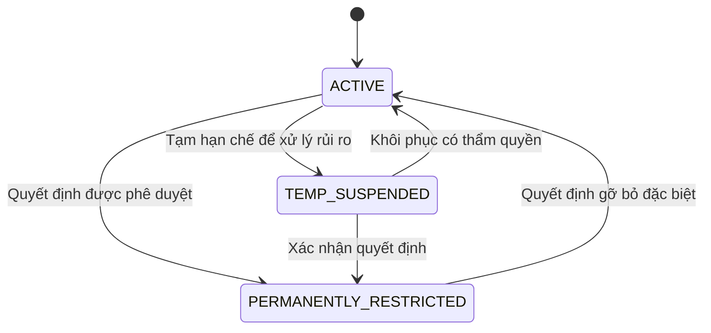

# Permanent account restriction — Hạn chế tài khoản vĩnh viễn

## Mục tiêu bài học

Trong chương **Abuse Controls**, permanent account restriction là quyết định duy trì một tập hạn chế đối với tài khoản mà không có thời điểm tự hết hạn. Tùy chính sách sản phẩm, tài khoản có thể bị ngừng toàn bộ hoạt động nghiệp vụ hoặc bị giới hạn trong một phạm vi tổ chức xác định, trong khi vẫn được truy cập một số chức năng hỗ trợ.

Trong bảo mật logic nghiệp vụ, quyết định này phải được thực thi tại nơi cấp quyền tạo tác động. Đổi một cờ trong cơ sở dữ liệu, ẩn nút trên giao diện hoặc chặn lần đăng nhập tiếp theo chưa đủ: phiên đang hoạt động, token cũ, API khác và công việc nền vẫn có thể tiếp tục phát hành mã ưu đãi, gửi lời mời hoặc thực hiện thao tác có giá trị.

Bài học tập trung vào business invariants, state machine, quyền theo đối tượng, transaction và idempotency để bảo đảm một quyết định hạn chế có hiệu lực đúng phạm vi, không bị lách và có thể xem xét lại một cách có kiểm soát.

Sau bài học, bạn có thể:

- Phân biệt hạn chế vĩnh viễn với tạm khóa, thu hồi phiên và xóa tài khoản.
- Xác định bằng chứng, thẩm quyền, phạm vi và các chuyển trạng thái hợp lệ.
- Thiết kế điểm thực thi cho API, token, công việc nền và thao tác đang xử lý.
- Bảo vệ quyết định áp dụng hoặc gỡ bỏ hạn chế khỏi vượt quyền, cạnh tranh và yêu cầu trùng.
- Kiểm thử hiệu lực thực tế của hạn chế thay vì chỉ kiểm tra giá trị một trường trạng thái.

## 1. “Vĩnh viễn” cần được định nghĩa rõ

Trong bài này, **vĩnh viễn** có nghĩa là hạn chế không tự hết hạn theo thời gian và không được gỡ bằng luồng tự phục vụ thông thường. Nếu tổ chức cho phép sửa quyết định sai hoặc chấp nhận đề nghị xem xét lại, việc gỡ bỏ phải là một quyết định mới, có thẩm quyền và có dấu vết.

Điều đó khác với thiết kế tuyệt đối không có cách khôi phục. Một hệ thống không cho sửa sai có thể duy trì tác động nghiêm trọng từ bằng chứng sai, tài khoản bị chiếm quyền hoặc lỗi vận hành. Chính sách phải nêu rõ hạn chế nào được xem xét lại, ai được quyết định và điều kiện nào phải thỏa.

| Biện pháp | Ý nghĩa chính | Không tự bảo đảm điều gì? |
|---|---|---|
| Rate limit | Giảm lượng yêu cầu trong một khoảng thời gian | Không duy trì quyết định cấm hoạt động lâu dài. |
| Tạm khóa | Tạm ngừng một số khả năng để điều tra hoặc chờ điều kiện khôi phục | Không đồng nghĩa đã có kết luận lạm dụng. |
| Hạn chế vĩnh viễn | Duy trì tập khả năng bị cấm mà không tự hết hạn | Không tự vô hiệu hóa token hoặc công việc đã được tiếp nhận. |
| Thu hồi thông tin xác thực hoặc phiên | Ngừng sử dụng một phương tiện truy cập | Không thay thế quyết định về quyền nghiệp vụ của tài khoản. |
| Xóa hoặc đóng tài khoản | Thay đổi vòng đời tài khoản và dữ liệu theo chính sách sản phẩm | Không tự giải quyết tác động đã xảy ra, công việc đang chạy hoặc việc đăng ký lại. |

Một hạn chế chỉ áp dụng cho tính năng gửi lời mời là hạn chế tính năng lâu dài; không nên hiển thị nó như thể toàn bộ tài khoản đã bị cấm hoạt động. Tên gọi và giao diện cần phản ánh đúng phạm vi được thực thi.

## 2. Tình huống: tài khoản lạm dụng phát hành mã ưu đãi

Giả sử một nền tảng cho phép nhân viên được phân quyền phát hành mã ưu đãi trong tổ chức của mình. Một tài khoản liên tục cấp mã cho các người nhận do cùng một nhóm kiểm soát. Hệ thống đã áp dụng ngưỡng theo nhân viên và người nhận, nhưng điều tra xác nhận tài khoản tiếp tục phối hợp lách chính sách qua nhiều chiến dịch.

Nhóm vận hành quyết định hạn chế vĩnh viễn tài khoản trong tổ chức A. Những kết quả cần đạt gồm:

- Không tiếp nhận thao tác phát hành mới của tài khoản trong tổ chức A sau thời điểm quyết định có hiệu lực.
- Không cho tài khoản dùng API quản trị khác hoặc phiên đăng nhập cũ để phát hành.
- Xử lý rõ các thao tác đang chờ và trường hợp đã gửi yêu cầu ra hệ thống bên ngoài.
- Không vô tình hạn chế tài khoản ở tổ chức B nếu quyết định chỉ có phạm vi A.
- Vẫn cung cấp đường truy cập xem thông báo hoặc đề nghị xem xét lại nếu chính sách cho phép.
- Không làm sai ngân sách, không hoàn hạn mức hai lần và không phát hành lại do retry.

Đây là một bài toán về quyền và trạng thái xuyên suốt vòng đời thao tác. Một câu lệnh cập nhật `restricted = true` chỉ là một phần nhỏ của giải pháp.

## 3. Xác định các invariant của cơ chế hạn chế

Trước khi thiết kế API quản trị, hãy viết các điều kiện luôn phải đúng:

1. **Đúng thẩm quyền:** chỉ chủ thể có quyền tương ứng mới được áp dụng hoặc gỡ hạn chế cho đúng đối tượng, trong đúng phạm vi.
2. **Không tự hết hạn:** hạn chế vĩnh viễn không được gỡ chỉ vì hết phiên, đổi mật khẩu, chạy tác vụ dọn dữ liệu hoặc đến một mốc thời gian mặc định.
3. **Không tạo quyền từ xác minh:** hoàn thành MFA, CAPTCHA hoặc đăng nhập lại không tự khôi phục quyền nghiệp vụ đã bị hạn chế.
4. **Không tiếp nhận mới trái quyết định:** trong ranh giới nhất quán đã chọn, thao tác nghiệp vụ mới không được tiếp nhận sau khi hạn chế có hiệu lực nếu thuộc tập bị cấm.
5. **Không lặp quyết định:** retry cùng một lệnh áp dụng hạn chế không tạo thêm các tác động quản trị tương đương.
6. **Không phục hồi bằng đường vòng:** sửa hồ sơ, chuyển vai trò, liên kết SSO hoặc gửi đề nghị xem xét không tự chuyển tài khoản về hoạt động bình thường.
7. **Không phá invariant nghiệp vụ khác:** hạn chế không cho phép ngân sách âm, phát hành trùng hoặc hoàn giá trị khi chưa xác định tác động thực tế.
8. **Có thể giải thích và đối soát:** mọi thay đổi hiệu lực có quyết định, lý do và phiên bản tương ứng.

Điều kiện thứ tư cần một định nghĩa chính xác về **tiếp nhận**. Trong thiết kế tham chiếu của bài, đó là thời điểm giao dịch ghi bền vững một operation mới và cấp quyền cho nó đi tiếp. Không dùng thời điểm request đến máy chủ hoặc thời điểm giao diện nhận phản hồi để suy ra thứ tự giao dịch.

## 4. Bằng chứng và quy trình ra quyết định

### 4.1. Tín hiệu nghi ngờ khác với kết luận

Các tín hiệu như nhiều tài khoản dùng chung IP, điểm rủi ro cao, số báo cáo lớn hoặc cùng loại thiết bị có thể hỗ trợ điều tra. Chúng không tự chứng minh rằng chủ tài khoản cố ý lạm dụng.

Ví dụ, một doanh nghiệp có thể có nhiều nhân viên truy cập qua cùng một mạng. Một tài khoản bị đánh cắp thông tin xác thực cũng có thể tạo hành vi xấu mà người sở hữu hợp lệ chưa biết. Trong tình huống này, biện pháp ban đầu có thể là thu hồi phiên, tạm ngừng thao tác nhạy cảm và khôi phục quyền kiểm soát tài khoản.

Quy trình cần phân biệt ít nhất:

- Lạm dụng đã được xác minh theo tiêu chí của sản phẩm.
- Dấu hiệu chiếm quyền tài khoản cần xử lý sự cố.
- Bất thường chưa đủ kết luận, cần điều tra thêm.
- Sử dụng hợp lệ nhưng khác phân bố thông thường.

Không để người gửi báo cáo điều khiển trực tiếp trạng thái tài khoản khác. Nếu chỉ cần đủ số báo cáo để hạn chế vĩnh viễn, kẻ tấn công có thể biến cơ chế chống lạm dụng thành công cụ từ chối dịch vụ đối với người dùng hợp lệ.

### 4.2. Hồ sơ quyết định

Một hồ sơ nên liên kết được tới các sự kiện đáng tin cậy: operation ID, tổ chức, đối tượng đích, thời điểm, trạng thái, kết quả và phiên bản chính sách. Thông tin client tự khai cần được phân biệt với dữ liệu server đã xác minh.

Với thao tác quản trị có tác động lớn, chính sách có thể yêu cầu người đề xuất và người phê duyệt khác nhau. Nếu áp dụng nguyên tắc này, backend phải kiểm tra trên danh tính đã xác thực; không tin các trường `requestedBy` hoặc `approvedBy` do client gửi.

Phê duyệt phải ràng buộc với nội dung quyết định: tài khoản, phạm vi, tập tác động, lý do và phiên bản bằng chứng liên quan. Nếu người vận hành đổi đối tượng hoặc phạm vi sau khi được duyệt, phê duyệt cũ không còn đủ để thực hiện nội dung mới.

Một luồng ví dụ:

```text
Tín hiệu phát hiện
  -> lập hồ sơ và bảo toàn sự kiện liên quan
  -> tạm hạn chế nếu có rủi ro cần ngăn ngay
  -> đánh giá bằng chứng và khả năng tài khoản bị chiếm quyền
  -> đề xuất phạm vi và tác động cụ thể
  -> phê duyệt theo chính sách
  -> áp dụng quyết định bằng giao dịch có kiểm soát
  -> thông báo phù hợp, theo dõi và xử lý đề nghị xem xét lại
```

Không đồng nhất trạng thái “hồ sơ đã được duyệt” với “hạn chế đã có hiệu lực”. Giao dịch áp dụng có thể thất bại hoặc gặp xung đột phiên bản; hệ thống cần hiển thị và đối soát được khoảng cách này.

## 5. Phạm vi và tập khả năng bị hạn chế

### 5.1. Hạn chế ai, ở đâu?

Danh tính đích nên là ID tài khoản nội bộ ổn định. Email, tên hiển thị hoặc số điện thoại có thể thay đổi, được tái sử dụng hoặc chưa được xác minh; chúng không nên là khóa duy nhất để quyết định tài khoản nào bị hạn chế.

Các phạm vi thường cần phân biệt:

- **Toàn nền tảng:** áp dụng đối với các hoạt động đã định nghĩa trên toàn bộ sản phẩm.
- **Một tổ chức:** chỉ áp dụng khi tài khoản hoạt động trong tổ chức đó.
- **Một tập tính năng:** giới hạn một số quyền năng cụ thể; cần gọi đúng là hạn chế tính năng nếu không cấm toàn bộ hoạt động tài khoản.

Backend phải kiểm tra người ra quyết định có quyền trên tài khoản và phạm vi đó. Quản trị viên của tổ chức A không được chuyển một hạn chế nội bộ thành hạn chế toàn nền tảng bằng cách sửa trường `scope`.

Nếu một tài khoản có nhiều hạn chế đang hoạt động, kết quả hiệu lực phải xét mọi hạn chế áp dụng cho khả năng đang yêu cầu. Gỡ một hạn chế cấp tổ chức không được làm mất hạn chế cấp nền tảng. Chỉ lấy một giá trị “mức độ cao nhất” mà bỏ qua phạm vi có thể khiến hệ thống chặn nhầm hoặc cho phép nhầm.

### 5.2. Có thể vẫn cần một đường truy cập tối thiểu

Ví dụ dưới đây là lựa chọn chính sách cho tài khoản bị hạn chế nghiệp vụ trong tổ chức A:

| Khả năng | Hành vi mong muốn trong ví dụ |
|---|---|
| Phát hành mã, tạo chiến dịch hoặc cấp quyền cho thành viên khác | Từ chối. |
| Gọi cùng thao tác qua API, SDK hoặc giao diện quản trị | Từ chối như nhau. |
| Xem thông báo hạn chế của chính mình | Cho phép qua đường truy cập được xác thực và giới hạn. |
| Gửi đề nghị xem xét lại | Cho phép theo chính sách, có kiểm soát chống spam riêng. |
| Đăng xuất hoặc xử lý an toàn thông tin xác thực | Duy trì đường xử lý phù hợp, không tự gỡ hạn chế. |
| Xem trạng thái một thao tác cũ | Xét quyền đọc hiện tại; không tạo lại tác động. |
| Hoạt động trong tổ chức B | Đánh giá độc lập nếu quyết định chỉ áp dụng cho A. |

Không cho một phiên hỗ trợ có quyền truy cập toàn bộ API chỉ vì người dùng cần xem thông báo. Có thể cần một phiên có mục đích riêng với tập khả năng hẹp. Đồng thời, không nên thiết kế việc thu hồi mọi phiên khiến đường đề nghị xem xét lại đã được hứa trong sản phẩm trở nên không thể sử dụng.

## 6. State machine và mô hình dữ liệu

### 6.1. Chuyển trạng thái phải tường minh

Sơ đồ sau là mô hình đơn giản cho quyền hoạt động trong **một phạm vi xác định**:



Không có chuyển đổi từ `PERMANENTLY_RESTRICTED` về `ACTIVE` do hết thời gian. Nếu sản phẩm không cho phép gỡ bỏ một loại hạn chế, bỏ chuyển đổi đặc biệt đó khỏi chính sách tương ứng.

Đề nghị xem xét lại có state machine riêng, chẳng hạn `SUBMITTED -> REVIEWING -> UPHELD/OVERTURNED`. Chỉ gửi hoặc tiếp nhận đề nghị không thay đổi hạn chế đang hiệu lực. Khi kết luận là gỡ bỏ, vẫn cần thực thi quyết định qua luồng có quyền tương ứng.

Trạng thái đóng tài khoản, trạng thái thông tin xác thực và trạng thái xử lý hồ sơ cũng nên được phân biệt. Dồn tất cả vào một trường `status` làm mất khả năng diễn đạt các tình huống như “tài khoản đã bị thu hồi phiên và hồ sơ đang được xem xét, hạn chế vẫn có hiệu lực”.

### 6.2. Dữ liệu tối thiểu của một hạn chế

| Nhóm | Trường minh họa | Mục đích |
|---|---|---|
| Định danh | `restrictionId`, `accountId` | Gắn quyết định với tài khoản ổn định. |
| Phạm vi | `scopeType`, `tenantId`, tập khả năng bị cấm | Xác định nơi và hành động được áp dụng. |
| Hiệu lực | `duration = INDEFINITE`, `status = ACTIVE`, `effectiveAt` | Phân biệt không tự hết hạn với hạn chế tạm thời. |
| Căn cứ | `caseId`, `reasonCode`, phiên bản bằng chứng và chính sách | Giải thích quyết định. |
| Thẩm quyền | Danh tính người đề xuất, người duyệt và dịch vụ thực thi | Kiểm tra trách nhiệm và phân tách nhiệm vụ. |
| Cạnh tranh | Phiên bản điều khiển tài khoản, phiên bản hạn chế | Ngăn cập nhật cũ ghi đè quyết định mới. |
| Xử lý lệnh | `commandId`, dấu vân tay nội dung | Làm cho retry có tính idempotent. |
| Lịch sử | Quyết định áp dụng, sửa phạm vi hoặc gỡ bỏ | Giữ được diễn tiến, không chỉ trạng thái cuối. |

Với hạn chế không tự hết hạn, không gán một thời hạn giả như “100 năm” rồi dùng chung logic hết hạn. Hãy biểu diễn ý nghĩa không hết hạn một cách rõ ràng và kiểm tra ràng buộc dữ liệu tương ứng.

Khi gỡ bỏ, có thể cập nhật bản ghi trạng thái phục vụ truy vấn, nhưng vẫn giữ sự kiện quyết định gỡ bỏ và quan hệ với quyết định cũ. Không xóa sạch lịch sử để làm tài khoản trông như chưa từng có quyết định.

## 7. Bảo vệ lệnh áp dụng và gỡ bỏ hạn chế

API quản trị cũng là một bề mặt tấn công logic nghiệp vụ. Ngoài kiểm tra đăng nhập, cần kiểm tra quyền hành động, đối tượng và phạm vi. Quyền xem hồ sơ không mặc nhiên bao gồm quyền hạn chế; quyền áp dụng không nhất thiết bao gồm quyền gỡ bỏ.

Ví dụ nội dung một lệnh áp dụng:

```json
{
  "commandId": "cmd_restrict_104",
  "accountId": "acct_42",
  "scope": {
    "type": "TENANT",
    "tenantId": "org_A"
  },
  "action": "APPLY_PERMANENT_RESTRICTION",
  "caseId": "case_208",
  "caseRevision": 7,
  "expectedControlVersion": 12,
  "reasonCode": "CONFIRMED_REPEAT_PROMOTION_ABUSE"
}
```

Các giá trị trên chỉ mô tả điều client yêu cầu. Server phải tải hồ sơ, xác minh quan hệ với tài khoản, kiểm tra phê duyệt và lấy danh tính người thao tác từ ngữ cảnh xác thực. Một ID hồ sơ tồn tại không tự chứng minh rằng người gọi có quyền thực thi quyết định của hồ sơ đó.

Một luồng giao dịch tham chiếu:

```text
BEGIN TRANSACTION
  Xác minh quyền thực thi của người gọi trên đối tượng và phạm vi.
  Phân xử commandId bằng cơ chế duy nhất phù hợp.
  Nếu lệnh đã hoàn tất với cùng nội dung: trả kết quả được phép xem.
  Nếu cùng commandId nhưng khác nội dung: từ chối xung đột.

  Khóa bản ghi điều khiển ổn định của tài khoản.
  Kiểm tra expectedControlVersion và trạng thái hiện tại.
  Kiểm tra hồ sơ, phiên bản và phê duyệt còn hiệu lực.
  Kiểm tra chuyển trạng thái có được phép không.

  Ghi quyết định và trạng thái hạn chế.
  Tăng phiên bản điều khiển tài khoản.
  Ghi kết quả của lệnh và sự kiện outbox cần phát đi.
COMMIT
```

Việc chống trùng phải xử lý cả khi chưa có bản ghi `commandId`, chẳng hạn bằng ràng buộc duy nhất và xử lý xung đột. Đọc không thấy dòng rồi tự tạo ở hai giao dịch không bảo đảm tính duy nhất.

Hai lệnh khác nhau có thể cạnh tranh: một người áp dụng hạn chế trong khi người khác đang gỡ bỏ theo dữ liệu cũ. Không dùng quy tắc “ghi sau thắng” mà không kiểm tra phiên bản. Lệnh dùng phiên bản cũ cần nhận xung đột để đánh giá lại trạng thái và căn cứ, thay vì âm thầm ghi đè.

Luồng sửa hồ sơ cá nhân, đồng bộ SSO hoặc thay vai trò thông thường không được cho phép ghi các trường điều khiển nội bộ. Dùng đầu vào tường minh cho từng hành động; không ánh xạ toàn bộ payload client vào thực thể tài khoản chứa `restrictionStatus` hoặc quyền quản trị.

## 8. Thực thi trên mọi đường tạo tác động

### 8.1. Đăng nhập và token chỉ là một lớp

Một access token có thể vẫn hợp lệ về chữ ký và thời hạn sau khi tài khoản bị hạn chế. Nếu API chỉ kiểm tra hai điều kiện đó rồi tin toàn bộ quyền trong token, quyết định mới sẽ chưa có hiệu lực trên phiên cũ.

Những biện pháp thường cần phối hợp:

- Thu hồi hoặc ngừng cấp refresh token theo chính sách phiên.
- Kiểm tra trạng thái quyền hiện tại trước thao tác nhạy cảm.
- Dùng phiên bản điều khiển trong token và đối chiếu với phiên bản đáng tin cậy hiện hành nếu chọn cơ chế này.
- Cập nhật hoặc loại bỏ các phiên và kết nối dài hạn có thể tiếp tục gửi lệnh.
- Bảo vệ cả API key, tài khoản tích hợp và luồng ủy quyền nếu chúng thực hiện thay cho chủ thể bị hạn chế.

Phiên bản trong token không có ích cho việc thu hồi nếu server không so sánh nó với nguồn trạng thái hiện hành. Rút ngắn thời hạn token chỉ giảm khoảng thời gian có thể tiếp tục sử dụng; không tạo bảo đảm thu hồi ngay lập tức.

Nếu cho phép tài khoản bị hạn chế đăng nhập để xem thông báo, kết quả đăng nhập phải phản ánh tập khả năng còn lại. Không cấp một token đầy đủ rồi hy vọng giao diện sẽ giấu các chức năng bị cấm.

### 8.2. Điểm thực thi thuộc tầng nghiệp vụ

Các đường REST, GraphQL, SDK, giao diện quản trị và tác vụ nền cần đi qua kiểm soát tương ứng tại dịch vụ nghiệp vụ. Gateway hoặc giao diện có thể kiểm tra sớm, nhưng không thay thế kiểm tra tại nơi tiếp nhận thao tác.

Cần xác định cả người thực hiện lẫn người được đại diện. Nếu một tích hợp dùng thông tin xác thực riêng nhưng thao tác thay cho tài khoản bị hạn chế, việc chỉ kiểm tra danh tính tích hợp có thể tạo đường vòng. Ngược lại, không nên tự động cấm mọi thao tác chỉ vì tài khoản bị hạn chế xuất hiện như người nhận hoặc bên liên quan.

Ví dụ, một dịch vụ nội bộ thực hiện hoàn tất giao dịch cũ hoặc hoàn trả giá trị không nhất thiết là “người dùng tiếp tục sử dụng tính năng”. Luồng này cần quyền và invariant riêng, phạm vi hẹp, có lưu vết; không phải một cờ bỏ qua toàn bộ kiểm soát.

### 8.3. Cache là điểm dễ tạo hiệu lực giả

Nếu cache vẫn giữ quyết định cho phép trong 10 phút, thay đổi trạng thái ở cơ sở dữ liệu không tự khiến mọi thao tác bị chặn ngay. Cần xác định độ trễ chấp nhận được cho từng loại thao tác.

Với thao tác có tác động lớn, thiết kế tham chiếu dùng kiểm tra trạng thái có tính nhất quán tại giao dịch tiếp nhận. Với dữ liệu chiếu hoặc giao diện, có thể chấp nhận đồng bộ trễ nếu không dùng nó để cấp quyền tạo tác động.

Khóa cache cần đúng tài khoản, phạm vi và khả năng. Không dùng một kết quả cho phép tại tổ chức B để quyết định tại tổ chức A. Đồng thời, cache từ chối đã cũ có thể khiến tài khoản tiếp tục bị chặn sau khi quyết định được gỡ; đây cũng là lỗi cần đo và sửa.

## 9. Cạnh tranh giữa hạn chế và thao tác nghiệp vụ

### 9.1. Lỗi check-then-act

Một chuỗi xử lý nguy hiểm:

```text
T1: Request đọc tài khoản đang ACTIVE.
T2: Quản trị viên áp dụng hạn chế và commit.
T3: Request dùng kết quả cũ để tạo operation mới và commit.
```

Kiểm tra tại T1 là đúng ở thời điểm đọc, nhưng không bảo vệ quyết định tại T3. Thêm một câu `if` trong controller không giải quyết được khoảng cách này.

Trong thiết kế cùng cơ sở dữ liệu, có thể dùng một bản ghi điều khiển tài khoản ổn định làm điểm phân xử. Cả giao dịch áp dụng hạn chế và giao dịch tiếp nhận thao tác đều khóa bản ghi này trước khi quyết định, giữ khóa đến commit. Các lần thay đổi hạn chế liên quan cũng phải tuân thủ giao thức đó.

Nếu thao tác nghiệp vụ có khóa trước, nó có thể được tiếp nhận trước quyết định hạn chế. Nếu giao dịch hạn chế có khóa và commit trước, thao tác tiếp theo phải nhìn thấy hạn chế và bị từ chối. Bảo đảm được phát biểu theo thứ tự tiếp nhận bền vững, không theo thứ tự request bắt đầu.

### 9.2. Giả mã Java cho điểm tiếp nhận

Đoạn sau minh họa hợp đồng giữa các thành phần, không phải chương trình có thể chạy độc lập:

```java
OperationResult issuePromotion(Actor actor, IssueCommand command) {
    return transaction.required(() -> {
        // Điểm khóa chung với mọi lệnh đổi hạn chế của tài khoản.
        accountControl.lockByAccountId(actor.accountId());

        // Actor lấy từ xác thực; tenant và campaign phải có quan hệ hợp lệ.
        authorization.requireCanIssue(actor, command.campaignId());

        restrictions.requireAllowed(
            actor.accountId(),
            actor.tenantId(),
            Capability.ISSUE_PROMOTION
        );

        // Trong cùng giao dịch: kiểm tra state, ngân sách, hạn mức,
        // idempotency; ghi operation và outbox, không gọi mạng bên ngoài.
        return issuance.acceptOnce(actor, command);
    });
}
```

`lockByAccountId` không được chỉ là khóa trong bộ nhớ của một tiến trình. Ở mô hình tham chiếu, đó là cơ chế phân xử chung ở cơ sở dữ liệu, được mọi luồng liên quan tuân thủ. Dữ liệu hạn chế phải được đọc theo mức nhất quán tương ứng, không qua bản sao chậm hoặc cache cho phép đã cũ.

Khóa tài khoản không tự bảo vệ ngân sách chiến dịch hoặc hạn mức người nhận. `acceptOnce` vẫn cần bảo vệ các invariant đó bằng transaction, ràng buộc và thứ tự khóa phù hợp. Nếu idempotency key đã tồn tại, không tạo thêm operation; quyền đọc kết quả có thể được cung cấp qua một luồng truy vấn riêng theo chính sách.

Mô hình này có chi phí tuần tự hóa các thao tác của cùng tài khoản. Có thể dùng thiết kế khác như kiểm tra phiên bản có điều kiện, nhưng phải chứng minh rằng thay đổi quyền và tiếp nhận thao tác không cùng thành công trên một trạng thái đã hết hiệu lực.

Nếu quyền và nghiệp vụ nằm ở các hệ thống khác nhau, một transaction cục bộ không bao phủ cả hai. Cần thiết kế giao thức cấp quyền và nơi tiếp nhận tương ứng, hoặc công bố rõ độ trễ hiệu lực có thể xảy ra. Không mô tả một kiểm tra từ xa trước khi ghi là bảo đảm nguyên tử xuyên hệ thống.

## 10. Công việc đang chờ và tác động bên ngoài

Chặn thao tác mới không tự giải quyết các operation đã được tiếp nhận trước đó. Cần chính sách theo trạng thái:

| Trạng thái operation | Hướng xử lý có thể áp dụng |
|---|---|
| Chưa được tiếp nhận | Từ chối nếu thuộc tập khả năng bị cấm. |
| Đã tiếp nhận, còn chờ và chưa tạo tác động | Giữ lại, hủy hoặc chuyển sang xét duyệt theo chính sách; chuyển trạng thái có điều kiện và idempotent. |
| Đang xử lý nội bộ | Kiểm tra điểm có thể dừng an toàn; không giải phóng tài nguyên khi worker vẫn có thể tạo tác động. |
| Đã gửi yêu cầu ra nhà cung cấp, chưa rõ kết quả | Đối soát và khử trùng lặp; không coi timeout là thất bại chắc chắn. |
| Đã hoàn tất | Giữ kết quả; xử lý bù trừ nếu nghiệp vụ cho phép bằng một thao tác riêng có quyền. |

Trong ví dụ mã ưu đãi, hệ thống có thể đưa operation chưa thực hiện vào trạng thái `HELD_BY_RESTRICTION`. Việc này không có nghĩa tự động xóa ngân sách giữ chỗ: trước hết phải xác định công việc không còn có thể phát hành mã và việc hoàn có đúng chính sách hay không.

Worker cần kiểm tra quyền thực thi tại điểm phù hợp và khử trùng lặp theo operation ID. Tuy nhiên, kiểm tra ngay trước khi gọi nhà cung cấp vẫn có khoảng cạnh tranh: hạn chế có thể được áp dụng sau kiểm tra nhưng trước khi yêu cầu ra ngoài thực sự có hiệu lực.

Vì vậy, phải tách hai cam kết:

- **Không tiếp nhận thao tác mới sau quyết định:** có thể bảo vệ bằng ranh giới nhất quán tại nơi tiếp nhận.
- **Không có tác động bên ngoài nào xảy ra sau một thời điểm:** đòi hỏi kiểm soát sâu hơn đối với thao tác đang chạy và hệ thống bên ngoài; không thể suy ra chỉ từ một lần kiểm tra trạng thái.

Nếu nhà cung cấp không hỗ trợ hủy hoặc cơ chế phân xử tương ứng, cần ghi rõ giới hạn này và có đối soát. Không hứa một hiệu lực tuyệt đối mà hệ thống thực tế không bảo đảm được.

Outbox giúp ghi công việc bền vững cùng giao dịch áp dụng hạn chế hoặc tiếp nhận operation. Nó không tự bảo đảm bên nhận thực hiện một lần duy nhất. Sự kiện bị gửi lại và worker khởi động lại vẫn cần xử lý idempotent.

## 11. Sự kiện, phiên bản và idempotency

### 11.1. Lệnh trùng không được tạo tác động trùng

Nếu phản hồi áp dụng hạn chế bị mất sau commit, client quản trị có thể gửi lại cùng lệnh. Với cùng `commandId` và cùng nội dung, server trả kết quả đã có sau khi kiểm tra quyền hiện tại. Không gửi thông báo mới, tăng phiên bản hoặc tạo thêm hồ sơ chỉ vì client retry.

Cùng khóa nhưng khác tài khoản, phạm vi hoặc hành động phải bị từ chối xung đột. Không dùng một khóa cũ làm quyền thay đổi quyết định. Phạm vi duy nhất của khóa và thời gian lưu kết quả cần được quy định rõ.

Với một lệnh mới nhưng tài khoản đã có hạn chế tương đương, chính sách có thể trả trạng thái đã áp dụng hoặc bổ sung một căn cứ độc lập. Cần xác định lựa chọn đó thay vì vô tình tạo hàng loạt hạn chế giống nhau khiến việc gỡ bỏ không thể dự đoán.

### 11.2. Sự kiện đến sai thứ tự

Giả sử phiên bản 13 áp dụng hạn chế, phiên bản 14 gỡ bỏ. Nếu consumer nhận sự kiện 14 rồi mới nhận 13, nó không được đưa dữ liệu chiếu quay lại trạng thái cũ.

Nhưng chỉ bỏ qua mọi sự kiện có phiên bản thấp hơn cũng chưa đủ với tất cả thiết kế. Nếu sự kiện chỉ chứa thay đổi từng phần, bỏ qua một phiên bản có thể làm mất một hạn chế độc lập ở phạm vi khác. Cần chọn một hợp đồng rõ:

- Sự kiện chứa snapshot đầy đủ cho phạm vi phiên bản được quản lý; consumer chỉ áp dụng snapshot mới hơn.
- Hoặc sự kiện là thay đổi từng phần; consumer bảo đảm xử lý đúng thứ tự, phát hiện khoảng trống và tải lại trạng thái khi cần.

Consumer còn cần khử trùng lặp theo event ID và có cách đối soát với nguồn sự thật. Xóa cache, cập nhật chỉ mục và đóng kết nối dài hạn có thể diễn ra bất đồng bộ, nhưng không nên là cơ sở duy nhất của bảo đảm chặn tại giao dịch nhạy cảm.

## 12. Gỡ bỏ hạn chế và khôi phục có kiểm soát

Đề nghị xem xét lại cần một đường xử lý thật sự sử dụng được, nhưng đường này cũng phải có kiểm tra danh tính, quyền xem hồ sơ và kiểm soát spam riêng. Không cho phép người gửi đọc bằng chứng nhạy cảm của tài khoản khác bằng cách đổi `caseId`.

Khi có quyết định gỡ bỏ:

1. Kiểm tra quyền gỡ hạn chế, phạm vi và phê duyệt cần thiết.
2. Khóa trạng thái điều khiển và kiểm tra phiên bản hiện tại.
3. Xác định chính xác hạn chế nào được gỡ; giữ nguyên các hạn chế độc lập còn hiệu lực.
4. Ghi quyết định mới, cập nhật trạng thái và tăng phiên bản trong cùng giao dịch.
5. Đồng bộ dữ liệu chiếu, phiên và thông báo theo hợp đồng.
6. Đánh giá riêng công việc đã giữ lại; không tự chạy lại toàn bộ công việc cũ.

Gỡ hạn chế không có nghĩa khôi phục tất cả role, token hoặc tích hợp từng bị thu hồi. Nếu sự cố liên quan đến chiếm quyền tài khoản, cần đáp ứng điều kiện khôi phục thông tin xác thực. Các quyền khác cũng có thể đã thay đổi trong thời gian hạn chế.

Không phát hành token toàn quyền dựa trên kết quả cũ được cache từ trước hạn chế. Ngược lại, một cache từ chối đã cũ cũng không nên khiến quyết định gỡ bỏ tồn tại trên giấy nhưng không có hiệu lực thực tế.

Việc người dùng đổi mật khẩu, đổi email, rời tổ chức rồi được mời lại hoặc liên kết nhà cung cấp SSO không tự được coi là quyết định gỡ bỏ. Luồng vòng đời tài khoản cần giữ hoặc đánh giá lại hạn chế theo chính sách đã xác định, không âm thầm reset về `ACTIVE`.

## 13. Đăng ký lại và giới hạn của nhận diện

Một hạn chế gắn với account ID cũ không tự chặn một tài khoản mới. Tuy nhiên, chuyển từ hạn chế một tài khoản sang ngăn một người hoặc tổ chức đăng ký lại là một quyết định phạm vi khác, cần tiêu chí nhận diện và bằng chứng phù hợp.

Không đồng nhất các tài khoản chỉ vì dùng chung IP hoặc thiết bị. Những tín hiệu này có thể hỗ trợ điều tra, nhưng cũng xuất hiện ở gia đình, doanh nghiệp và mạng công cộng. Việc liên kết sai có thể làm nhiều người hợp lệ bị hạn chế theo dây chuyền.

Nếu sản phẩm có quy tắc “một lợi ích cho một khách hàng đã xác minh trong một chiến dịch”, cần thực thi invariant đó trên định danh nghiệp vụ phù hợp, thay vì chỉ dựa vào số tài khoản. Khi đó tạo email mới không tự tạo thêm quyền hưởng lợi.

Đổi email không được làm account ID thay đổi. Đồng bộ hoặc cấp lại tài khoản từ SSO cũng không được ghi đè trạng thái điều khiển bằng giá trị mặc định. Việc gộp tài khoản cần đánh giá các hạn chế đang hiệu lực, không chọn trạng thái hoạt động chỉ vì một phía đang `ACTIVE`.

Xóa tài khoản và lưu dữ liệu phục vụ kiểm soát là các quyết định cần chính sách vòng đời riêng. Không giữ vô hạn toàn bộ dữ liệu chỉ vì hạn chế không tự hết hạn. Đồng thời, đừng để một tác vụ dọn bản ghi vô tình làm mất nguồn trạng thái mà điểm thực thi đang dựa vào. Cần xác định rõ dữ liệu tối thiểu, quyền truy cập và cách xử lý khi định danh được thay đổi hoặc tái sử dụng.

## 14. Thông báo, audit và vận hành khi có lỗi

### 14.1. Phản hồi cho người dùng

API có thể dùng mã lỗi nghiệp vụ ổn định như `ACCOUNT_RESTRICTED` cho thao tác bị cấm, cùng hướng dẫn xem thông báo hoặc đề nghị xem xét lại nếu có. Với một người đã được xác thực nhưng không được phép thực hiện hành động, phản hồi HTTP cần theo hợp đồng phân quyền của API; không giả vờ rằng hết hạn đăng nhập là nguyên nhân của mọi trường hợp hạn chế.

Không trả toàn bộ bằng chứng, điểm rủi ro, danh tính người báo cáo hoặc chi tiết có thể gây hại cho điều tra. Người dùng vẫn cần biết phạm vi bị ảnh hưởng và bước tiếp theo có thể thực hiện. Không hứa thời gian tự mở lại nếu hạn chế không có thời điểm hết hạn.

Hạn chế không chỉ tồn tại trong giao diện. Tắt JavaScript, gọi HTTP trực tiếp hoặc dùng phiên bản ứng dụng cũ vẫn phải nhận kết quả tương đương tại backend.

### 14.2. Dấu vết quyết định

Audit nên ghi được ai yêu cầu, ai phê duyệt, ai thực thi, tài khoản và phạm vi đích, lý do, hồ sơ và phiên bản liên quan, thời điểm hiệu lực, phiên bản trước/sau và kết quả. Ghi cả các nỗ lực quản trị bị từ chối quan trọng mà không làm lộ dữ liệu cho người gọi trái quyền.

Dấu vết cần được bảo vệ khỏi sửa hoặc xóa tùy ý bằng quyền truy cập và cơ chế lưu trữ phù hợp. Không gọi một bảng bình thường là bất biến chỉ vì ứng dụng hiện chưa có nút xóa. Hạn chế ghi dữ liệu cá nhân hoặc bí mật vào log; tham chiếu có kiểm soát tới bằng chứng thường phù hợp hơn sao chép toàn bộ nội dung.

Các chỉ số vận hành hữu ích:

- Thời gian từ commit quyết định đến cập nhật các dữ liệu chiếu và phiên liên quan.
- Số thao tác bị tiếp nhận trái chính sách sau thời điểm hiệu lực.
- Số công việc bị giữ lại, đang chưa rõ kết quả hoặc chưa được đối soát.
- Lỗi xung đột phiên bản, lệnh trùng và lỗi đồng bộ sự kiện.
- Trường hợp xem xét lại dẫn đến sửa quyết định, phân theo căn cứ đã được xác minh.
- Trường hợp tài khoản đã được gỡ hạn chế nhưng tiếp tục bị chặn do dữ liệu cũ.

Không đếm mọi truy cập sau hạn chế là vi phạm: xem thông báo hoặc gửi đề nghị có thể là hoạt động được phép. Cũng không suy ra hiệu quả chống lạm dụng chỉ từ số tài khoản bị hạn chế; cần đối chiếu thiệt hại đã ngăn, sai sót đã xác minh và các đường vòng còn tồn tại.

### 14.3. Khi nguồn trạng thái không hoạt động

Không đọc được trạng thái hạn chế không đồng nghĩa tài khoản đang hoạt động bình thường. Với thao tác tạo giá trị có rủi ro cao, có thể tạm từ chối tiếp nhận mới hoặc chuyển sang chờ theo chính sách. Luồng đọc thông báo, đăng xuất hoặc hỗ trợ có thể có hành vi dự phòng khác.

Nếu dùng cache cho phép làm dự phòng, phải nêu rõ thời gian và tác động có thể lọt qua. Một bản sao đồng bộ trễ không cung cấp cùng bảo đảm với kiểm tra nhất quán tại nơi tiếp nhận. Cần quan sát và đối soát khi dịch vụ phục hồi, thay vì im lặng coi mọi lần kiểm tra lỗi là cho phép.

## 15. Kiểm thử tình huống tấn công logic

### 15.1. Quyền, phạm vi và chuyển trạng thái

| Tình huống | Kết quả cần xác minh |
|---|---|
| Quản trị viên tổ chức A yêu cầu hạn chế tài khoản trong B | Từ chối, không thay đổi trạng thái hoặc tạo quyết định hiệu lực. |
| Người có quyền xem hồ sơ gọi lệnh áp dụng | Không mặc nhiên được phép áp dụng. |
| Người có quyền áp dụng nhưng không có quyền gỡ bỏ gọi lệnh gỡ | Từ chối theo phân quyền. |
| Client tự gửi `approvedBy` hoặc sửa phạm vi sau khi được duyệt | Không chấp nhận dữ liệu tự khai làm thẩm quyền; yêu cầu phê duyệt đúng nội dung. |
| Tài khoản bị hạn chế cập nhật hồ sơ với `status = ACTIVE` | Trường điều khiển không bị thay đổi. |
| Gửi đề nghị xem xét lại, đổi mật khẩu hoặc đăng nhập lại | Không tự gỡ hạn chế. |
| Gỡ một hạn chế cấp tổ chức khi còn hạn chế cấp nền tảng | Tập khả năng vẫn bị chặn theo hạn chế còn hiệu lực. |
| Chạy tác vụ hết hạn hoặc dọn dữ liệu | Không tự hết hiệu lực hạn chế vĩnh viễn ngoài chính sách. |

### 15.2. Token, API và chủ thể đại diện

Trước khi áp dụng hạn chế, tạo phiên web, access token, refresh token và thông tin tích hợp thuộc phạm vi thử nghiệm. Sau khi quyết định commit, thử thao tác bị cấm qua từng đường:

- Token cũ còn thời hạn và token vừa được cấp lại.
- API chính, API quản trị, SDK và kết nối dài hạn.
- Tenant khác và tài nguyên ngoài quyền.
- Luồng tích hợp đại diện cho tài khoản.
- Phiên chỉ được phép xem thông báo hoặc gửi đề nghị.

Kiểm tra không có operation nghiệp vụ mới được ghi nhận trái chính sách, không chỉ kiểm tra nút bị ẩn hoặc mã phản hồi. Đồng thời xác minh các khả năng hỗ trợ được phép vẫn sử dụng được và không mở rộng thành quyền thao tác đầy đủ.

### 15.3. Kiểm thử cạnh tranh có điều phối

Tạo hai giao dịch thực sự cạnh tranh trên cơ chế lưu trữ cần bảo vệ:

1. Giao dịch tiếp nhận phát hành mã giữ điểm khóa điều khiển; giao dịch hạn chế chờ. Khi thao tác commit trước, nó được phân loại là đã tiếp nhận trước hạn chế, và đi theo chính sách công việc đang chờ.
2. Giao dịch hạn chế giữ điểm khóa rồi commit; thao tác phát hành chờ. Sau khi tiếp tục, thao tác phải nhìn thấy hạn chế và không tạo operation mới.
3. Hai lệnh áp dụng và gỡ bỏ cùng dùng phiên bản cũ. Không được để cả hai ghi đè nhau mà không có phân xử hoặc xung đột phù hợp.

Dùng điểm đồng bộ trong kiểm thử để tái hiện thứ tự; chỉ gửi nhiều request ngẫu nhiên có thể không chạm đúng khoảng cạnh tranh. Kiểm tra trạng thái bền vững, phiên bản, giữ chỗ ngân sách và outbox sau giao dịch.

### 15.4. Retry, sự kiện và lỗi chưa rõ kết quả

- Mất phản hồi sau commit rồi retry cùng `commandId`: chỉ có một quyết định tương ứng và một tập tác động quản trị.
- Cùng khóa nhưng khác tài khoản hoặc phạm vi: xung đột, không đổi đối tượng của lệnh cũ.
- Consumer nhận cùng sự kiện nhiều lần: không tạo thêm thông báo hoặc tác động không mong muốn.
- Nhận snapshot phiên bản mới rồi bản cũ: dữ liệu chiếu không lùi trạng thái.
- Mất một sự kiện thay đổi từng phần: phát hiện khoảng trống và đồng bộ lại theo hợp đồng.
- Worker bị dừng sau khi gọi nhà cung cấp nhưng trước khi ghi kết quả: đối soát, không phát hành lại hoặc hoàn ngân sách chỉ vì timeout.
- Nguồn trạng thái không truy cập được: hành vi dự phòng đúng chính sách, không tự cho phép thao tác rủi ro cao.
- Gỡ hạn chế trong khi còn công việc bị giữ: không tự chạy lại tất cả, không tiêu thụ hoặc hoàn hạn mức hai lần.

Các kiểm thử cần nêu invariant quan sát được, chẳng hạn “không có operation mới sau quyết định theo thứ tự commit” hoặc “mỗi operation có tối đa một tác động nghiệp vụ được ghi nhận”, thay vì chỉ xác nhận một hàm kiểm tra trạng thái đã được gọi.

## 16. Bài tập thiết kế

Một tài khoản trong tổ chức A bị hạn chế vĩnh viễn lúc giao dịch điều khiển tài khoản commit. Khi đó có ba yêu cầu:

- Operation X đã được tiếp nhận nhưng chưa có worker nhận.
- Operation Y đã gửi yêu cầu phát hành mã ra nhà cung cấp và đang timeout.
- Request Z đang chờ điểm khóa điều khiển để được tiếp nhận.

Hãy mô tả chính sách và các chuyển trạng thái cho từng trường hợp. Thiết kế cần trả lời được:

1. Z có thể tạo operation mới không, và ranh giới nào bảo đảm điều đó?
2. X bị giữ hay bị hủy; điều kiện nào cho phép hoàn ngân sách giữ chỗ?
3. Y được đối soát bằng định danh nào; vì sao timeout không đủ để hoàn ngân sách?
4. Retry cùng idempotency key có tạo thêm mã hoặc công việc không?
5. Nếu quyết định được gỡ sau đó, X và Y được đánh giá lại thế nào?
6. Tài khoản vẫn được truy cập đường hỗ trợ nào mà không được cấp lại quyền phát hành?
7. Nếu tài khoản cũng thuộc tổ chức B, dữ liệu và khóa kiểm soát nào ngăn việc áp dụng sai phạm vi?
8. Bằng chứng bền vững nào cho phép xác minh toàn bộ các kết quả trên sau một sự cố?
