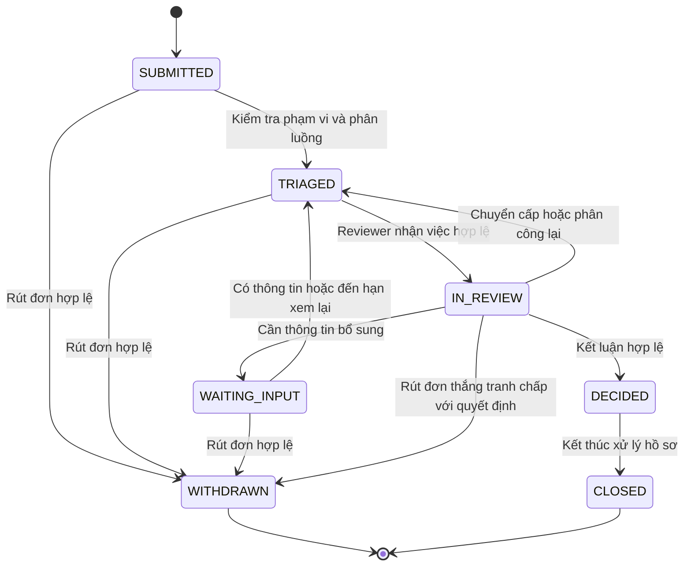

# Abuse control appeal — Khiếu nại đối với biện pháp kiểm soát lạm dụng

## 1. Vì sao luồng khiếu nại cũng cần bảo vệ logic nghiệp vụ?

Một khoản thưởng giới thiệu bị giữ vì hai tài khoản dùng chung thiết bị. Người nhận cho biết đó là thiết bị của gia đình và cung cấp thông tin bổ sung. Hệ thống cần cho phép xem lại quyết định sai, đồng thời ngăn một người dùng sửa ID khoản thưởng, gửi nhiều đơn hoặc giả danh người khác để được gỡ hạn chế ngoài quyền.

**Abuse control appeal** là quy trình tiếp nhận và đánh giá yêu cầu xem lại một biện pháp kiểm soát lạm dụng đã áp dụng hoặc đang chờ áp dụng. Kết quả có thể giữ nguyên, điều chỉnh hoặc hủy biện pháp trong phạm vi được xem xét. Khiếu nại là một luồng nghiệp vụ có quyền, trạng thái, bằng chứng và lịch sử riêng; nút “gửi khiếu nại” không tự mang quyền gỡ hạn chế.

Bài thuộc chương **Abuse Controls**, module `SECURITY_APPLICATION_SECURITY_BUSINESS_LOGIC_SECURITY`. Trọng tâm là bảo vệ business invariants, state machine, quyền theo đối tượng, transaction và idempotency trong luồng khiếu nại. Các trạng thái, role và schema dưới đây là mô hình minh họa, cần điều chỉnh theo sản phẩm và chính sách thực tế.

Sau bài học, bạn cần có khả năng:

- Gắn khiếu nại với đúng chủ thể, đối tượng và phiên bản biện pháp bị khiếu nại.
- Tách tiếp nhận đơn, kết luận xem xét và hiệu lực của hành động khắc phục.
- Chặn bỏ bước phê duyệt, dùng quyết định cũ và gửi yêu cầu trùng để gỡ hạn chế sai.
- Thiết kế đường tiếp nhận cho tài khoản bị hạn chế mà không cấp lại quyền sử dụng toàn hệ thống.
- Kiểm thử quyền theo đối tượng, tranh chấp đồng thời và các lỗi giữa nhiều dịch vụ.

Ví dụ xuyên suốt: khoản thưởng **R-204** đang có hold **H-81**, phát sinh từ quyết định **D-17**. Khiếu nại **A-42** chỉ yêu cầu xem lại H-81; nó không tự cho phép sửa giá trị R-204 hoặc gỡ mọi biện pháp trên tài khoản.

## 2. Phân biệt các đối tượng và kết quả

| Đối tượng | Ví dụ | Vai trò |
| --- | --- | --- |
| Tín hiệu nghi vấn | Thiết bị dùng chung, hành vi nhận thưởng bất thường | Đầu vào đánh giá; chưa tự chứng minh vi phạm |
| Quyết định ban đầu | D-17 xác định cần giữ R-204 để xác minh | Nêu lý do, bằng chứng và chính sách tại thời điểm quyết định |
| Biện pháp kiểm soát | H-81 giữ riêng R-204 đến thời hạn xác định | Trạng thái hạn chế có thể tác động đến nghiệp vụ |
| Khiếu nại | A-42 đề nghị xem lại H-81 | Hồ sơ yêu cầu, chủ thể, lý do và bằng chứng bổ sung |
| Kết luận khiếu nại | Hủy H-81 do không đủ căn cứ tiếp tục giữ | Kết luận có phạm vi và phiên bản được xem xét |
| Hành động khắc phục | Gỡ H-81 theo operation OP-61 | Thay đổi cần được dịch vụ nghiệp vụ kiểm tra và áp dụng |

Ba thông báo “đã nhận đơn”, “đã chấp nhận khiếu nại” và “hạn chế đã được gỡ” biểu thị ba mốc khác nhau. Nếu hệ thống mới ghi kết luận nhưng hành động còn chờ thực thi, không được thông báo như khoản thưởng đã được trả.

Một kết luận hủy hold không đồng nghĩa xác nhận mọi điều kiện trả thưởng đều đúng. Dịch vụ thưởng vẫn phải kiểm tra điều kiện hưởng thưởng, ngân sách, người nhận, trạng thái giao dịch và khóa chống cấp trùng. Nếu còn một hold độc lập khác, tài nguyên có thể vẫn bị hạn chế sau khi H-81 được gỡ.

## 3. Các invariant của luồng khiếu nại

| Mã | Invariant | Lạm dụng cần chặn |
| --- | --- | --- |
| A1 | Chủ thể chỉ khiếu nại biện pháp thuộc quyền của mình hoặc phạm vi đại diện đã xác minh | Thay `controlId` để xem hoặc gỡ hold của người khác |
| A2 | Tenant, tài nguyên và biện pháp đích được server đối chiếu với nhau | Kết hợp tenant hợp lệ với ID tài nguyên của tenant khác |
| A3 | Đơn và kết luận gắn với phiên bản quyết định, control và bằng chứng cụ thể | Dùng kết luận cũ để hủy hạn chế mới phát sinh |
| A4 | Tiếp nhận đơn không tự thay đổi hiệu lực của biện pháp | Spam đơn để tự gỡ hoặc liên tục tạm dừng hold |
| A5 | Chỉ reviewer đủ quyền, đang được giao việc hợp lệ mới được ghi kết luận | Gọi API quyết định từ tab đã bị thu hồi phân công |
| A6 | Hành động khắc phục chỉ tác động đúng control và phạm vi đã được phê duyệt | Hủy một hold nhưng mở mọi quyền của tài khoản |
| A7 | Retry không tạo nhiều kết luận hoặc nhiều hiệu lực nghiệp vụ | Gửi lại request để nhận thưởng hai lần |
| A8 | Hết hạn, hủy hoặc thay thế quyết định được kiểm tra khi thực thi | Áp dụng plan đã bị thu hồi nhưng còn trong queue |
| A9 | Giữ được lịch sử và đường sửa sai | Sửa kết luận cũ hoặc xóa ledger để che lần xử lý sai |
| A10 | Quá tải và lỗi kỹ thuật có cách xử lý được quy định trước | Mặc định kết tội hoặc kéo dài hạn chế vô hạn khi dịch vụ lỗi |

Một endpoint nội bộ, thao tác hàng loạt hoặc tài khoản hỗ trợ cũng phải giữ các invariant này. Role rộng không thay thế kiểm tra quyền trên đúng đối tượng và đúng hành động.

## 4. Quyền gửi đơn và đường tiếp nhận an toàn

### 4.1. Tài khoản bị hạn chế vẫn cần được nhận diện đúng

Nếu một tài khoản bị chặn đăng nhập thông thường, sản phẩm có thể cung cấp phiên chỉ dành cho khiếu nại hoặc kênh hỗ trợ có xác minh. Phiên đó chỉ cho phép xem thông báo phù hợp, gửi hồ sơ và theo dõi yêu cầu thuộc phạm vi được cấp.

Không tự bật lại quyền mua hàng, rút tiền hoặc đổi thông tin tài khoản chỉ để người dùng gửi khiếu nại. Nếu chưa xác minh được chủ thể, có thể tiếp nhận thông tin với mức tin cậy phù hợp, nhưng chưa được tiết lộ hồ sơ hoặc thực hiện thay đổi nhạy cảm.

Địa chỉ email, tên tài khoản và ảnh chụp do người gửi cung cấp là dữ liệu cần xác minh. Chúng không tự chứng minh quyền sở hữu tài khoản. Với người đại diện, server phải kiểm tra phạm vi, hiệu lực và quyền đại diện; một trường `actingForUserId` trong body không đủ để cấp quyền.

### 4.2. Kiểm tra từng request, kể cả sau khi tạo đơn

Server lấy danh tính từ ngữ cảnh xác thực và tra cứu control theo scope được phép. Các API xem đơn, xem tệp, thêm bằng chứng, rút đơn và xem kết quả đều kiểm tra lại quyền; biết `appealId` không đồng nghĩa được truy cập. Nguyên tắc kiểm tra quyền trên từng request và từng đối tượng được trình bày trong [OWASP Authorization Cheat Sheet](https://cheatsheetseries.owasp.org/cheatsheets/Authorization_Cheat_Sheet.html).

Body gửi đơn nên chỉ cho phép các trường cần thiết như tham chiếu control, phiên bản người dùng đã thấy, lý do và các ID tệp đã tải lên hợp lệ. Các trường `status`, `reviewerId`, `approved`, `tenantId` hoặc `remedyAction` không được dùng để tự cấp quyền hay quyết định kết quả. Nếu API cho chọn tenant, server vẫn phải xác minh quyền trong tenant đó.

Quyền tải tệp phải kiểm tra cả việc tệp thuộc đúng đơn, đúng chủ thể và đúng mục đích. Không dùng URL công khai lâu dài cho bằng chứng nhạy cảm. Nếu UI hiển thị hạn chế đã gỡ do khiếu nại, dữ liệu đó phải đến từ trạng thái thực thi có thẩm quyền, không suy ra từ một dòng ghi chú của reviewer.

## 5. Mô hình dữ liệu và phiên bản cần giữ

Một mô hình tối thiểu có thể gồm:

```text
AbuseControl
  controlId, tenantId, subjectId, resourceType, resourceId
  sourceDecisionId, controlType, parameters
  state, version, effectiveAt, expiresAt

Appeal
  appealId, tenantId, appellantSubjectId
  representedSubjectId, representationGrantReference
  targetControlId, targetControlVersion, originalDecisionId
  appealRound, state, version
  assignedReviewerId, assignmentGeneration, leaseExpiresAt
  evidenceManifestVersion, originalPolicyVersion, reviewPolicyVersion
  submittedAt, responseDueAt

AppealDecision
  decisionId, appealId, appealRound
  reviewerSubjectId, verdict, reasonCode
  reviewedControlVersion, reviewedEvidenceManifestVersion
  originalPolicyVersion, reviewPolicyVersion
  rationaleReference, decidedAt

RemedyPlan
  planId, planVersion, appealDecisionId
  tenantId, targetControlId, expectedControlVersion
  actionType, serverValidatedParameters
  approvalRequirements, approvals
  validUntil, revocationState, operationId, executionState
```

`Appeal.version` bảo vệ cập nhật đồng thời của workflow. `targetControlVersion` nhận diện biện pháp mà người gửi khiếu nại. `reviewedControlVersion` cho biết reviewer đã xem phiên bản nào khi quyết định. Phiên bản evidence manifest xác định tập bằng chứng được đánh giá. Không dùng một số version duy nhất để thay thế tất cả các ý nghĩa trên.

Các liên kết tenant–control–resource–decision phải được xác minh từ dữ liệu server. Nếu control thay đổi trong lúc chờ, hồ sơ vẫn cần giữ được snapshot hoặc tham chiếu bất biến của phần bị khiếu nại. Reviewer phải thấy thay đổi và xác nhận phạm vi mới nếu quy trình cho phép xem xét tiếp; server không âm thầm sửa ID đích của đơn.

Lưu riêng chính sách ban đầu và chính sách dùng cho lần xem lại. Khi chính sách thay đổi, cần quy tắc chuyển tiếp để xác định dùng phiên bản nào và khi nào phải chuyển cấp. Không ghi đè phiên bản cũ để trông như mọi quyết định đã tuân theo chính sách mới.

### Evidence manifest

Manifest có thể tham chiếu đến lý do áp dụng biện pháp, sự kiện nghiệp vụ, thông tin phản bác và bằng chứng người gửi bổ sung. Mỗi phần cần có nguồn, thời điểm, phiên bản và quyền truy cập phù hợp. Một đường dẫn không đổi chưa bảo đảm nội dung bằng chứng không đổi.

Reviewer cần nhìn thấy cả dữ kiện củng cố lẫn dữ kiện làm suy yếu kết luận ban đầu. Một báo cáo nhiều lần được sao chép không trở thành nhiều nguồn độc lập. Không yêu cầu người gửi chứng minh một điều mà chỉ dữ liệu nội bộ mới có thể xác nhận; hệ thống cần tự đối chiếu dữ liệu mình đang giữ.

Văn bản, tên tệp và hình ảnh do người dùng gửi là dữ liệu không đáng tin cậy. Hiển thị an toàn, kiểm soát tải tệp và không coi chỉ dẫn nằm trong bằng chứng là lệnh vận hành. Nếu có AI tóm tắt hồ sơ, kết quả phải liên kết về nguồn và không tự cấp quyền quyết định hoặc gọi hành động khắc phục.

## 6. State machine: tiếp nhận không có nghĩa là gỡ hạn chế



Đây là vòng đời của một lượt khiếu nại. Đơn ngoài phạm vi được ghi nhận kết quả xử lý phù hợp với chính sách, không giả thành kết luận đã review nội dung. Hết thời hạn bổ sung thông tin đưa hồ sơ về bước xử lý được quy định; không mặc định người gửi đã lạm dụng.

Mỗi chuyển trạng thái cần actor, điều kiện trước, version và audit. Khi phân công lại, tăng `assignmentGeneration`. Quyết định từ tab cũ phải thất bại nếu reviewer không còn giữ đúng generation, lease đã hết hoặc quyền hiện tại không còn phù hợp.

Hai thao tác rút đơn và ghi quyết định có thể đến đồng thời. Server phải tuần tự hóa bằng khóa hoặc cập nhật có điều kiện; chỉ một chuyển trạng thái hợp lệ được commit. Rút đơn sau khi có quyết định không tự hoàn tác hành động đã thực hiện.

Bằng chứng bổ sung trong lượt đang mở được gắn vào manifest mới và tăng version của hồ sơ. Nếu hồ sơ đã đóng, quy trình xem lại tiếp phải tạo lượt mới được server cho phép, liên kết rõ với lịch sử. Không cho client tự tăng `appealRound` hoặc sửa quyết định cũ.

### Trạng thái thực thi nằm riêng

Remedy plan có thể đi từ `PENDING_APPROVAL` đến `READY`, rồi `PROCESSING`, và cuối cùng `APPLIED`, `BLOCKED`, `CANCELLED` hoặc `EXPIRED`. `UNKNOWN` biểu thị đã gửi yêu cầu nhưng chưa biết có hiệu lực hay chưa; trạng thái này cần đối soát.

Kết luận khiếu nại đã lưu có thể tồn tại trong khi remedy plan còn chờ phê duyệt. Giao diện cần hiển thị riêng các trạng thái đó. Chỉ báo `APPLIED` khi dịch vụ sở hữu control xác nhận thay đổi đã commit; với thao tác chỉ gỡ hold, không suy ra đã hoàn thành payout.

## 7. Reviewer quyết định điều gì và trong giới hạn nào?

### 7.1. Kết luận có cấu trúc

| Verdict minh họa | Ý nghĩa | Hành động có thể cần |
| --- | --- | --- |
| `UPHOLD` | Giữ nguyên biện pháp trong phạm vi và căn cứ đã xem xét | Thông báo lý do, thời hạn và đường xem lại tiếp nếu có |
| `MODIFY` | Cần thay đổi phạm vi, thời hạn hoặc thông số của biện pháp | Tạo remedy plan đúng phần được điều chỉnh |
| `OVERTURN` | Không tiếp tục duy trì biện pháp theo kết luận lần này | Gỡ đúng control hoặc thực hiện khắc phục được phép |

Thiếu bằng chứng để quyết định có thể dẫn đến `WAITING_INPUT` hoặc chuyển cấp theo chính sách. Không biến lỗi truy cập dữ liệu hoặc hồ sơ chưa được đọc thành một verdict `UPHOLD` giả như đã kiểm tra đầy đủ. Nếu không còn đủ căn cứ để duy trì biện pháp, kết quả cần phản ánh đúng điều đó thay vì yêu cầu người dùng chứng minh mình vô tội bằng mọi giá.

Kết luận cần nêu quy tắc áp dụng, bằng chứng đã xem, dữ kiện phản bác, giới hạn và lý do chọn hành động. Mức độ chắc chắn hoặc điểm rủi ro không thay thế các điều kiện bắt buộc của chính sách.

### 7.2. Độc lập và phân tách nhiệm vụ

Tùy mức ảnh hưởng, có thể yêu cầu người review khiếu nại khác người ra quyết định ban đầu, hoặc thêm một người phê duyệt remedy plan. Phải kiểm tra độc lập theo chủ thể thực đã xác minh, không chỉ theo hai username.

Reviewer có quan hệ lợi ích với chủ thể hoặc giao dịch cần chuyển hồ sơ theo quy trình. Việc được giao case không tự cấp quyền gỡ mọi loại control. Những hành động tác động lớn có thể cần thẩm quyền riêng, xác thực tăng cường và maker–checker.

Phê duyệt gắn với đúng `planVersion` và thông số. Nếu đổi từ “gỡ H-81” thành “gỡ mọi hold của tài khoản”, đó là thay đổi phạm vi cần đánh giá lại, không được tái sử dụng phê duyệt cũ. Server xây dựng hoặc kiểm tra thông số remedy; không tin một JSON plan hoàn chỉnh do client gửi lên.

Nếu có quyền xử lý khẩn cấp, cần scope, lý do, thời hạn và hậu kiểm rõ ràng. `force=true` hoặc ghi chú “đã trao đổi với quản lý” không tự thay thế quyền và bằng chứng phê duyệt.

## 8. Transaction và idempotency

### 8.1. Chống trùng ở cả request lẫn nghiệp vụ

Cùng một người có thể bấm gửi nhiều lần hoặc mất phản hồi sau khi server đã commit. Idempotency key giúp nhận diện retry của cùng một yêu cầu, nhưng không tự ngăn họ gửi key mới hoặc tạo nhiều đơn để tác động lên một control.

| Lớp kiểm soát | Thiết kế minh họa |
| --- | --- |
| Request | Receipt có khóa tenant + chủ thể + loại thao tác + idempotency key; lưu hash của nội dung có nghĩa, gồm cả ID trên route |
| Tiếp nhận đơn | Phát hiện đơn đang mở của cùng chủ thể, control và lượt xem lại; cho bổ sung vào hồ sơ hợp lệ thay vì tạo song song tùy ý |
| Quyết định | Một kết luận cuối cho mỗi `appealId` và `appealRound` trong mô hình này |
| Hành động | Một operation ID ổn định gắn với remedy plan và payload cụ thể |
| Nghiệp vụ | Khóa duy nhất, state và giới hạn của dịch vụ sở hữu tài nguyên vẫn được giữ |

Key cũ với cùng nội dung trả lại receipt trước đó sau khi kiểm tra quyền đọc kết quả. Key cũ với nội dung khác phải bị từ chối, không ghi đè yêu cầu cũ. Khi receipt hết thời gian lưu, các ràng buộc quyết định, operation và nghiệp vụ vẫn phải chống hiệu lực trùng.

Quy tắc “một hồ sơ đang mở” cần được bảo vệ bằng ràng buộc dữ liệu hoặc cơ chế tương đương trong transaction. Kiểm tra `exists` rồi `insert` ở hai bước không được bảo vệ sẽ để hai request đồng thời cùng tạo đơn. Quy tắc này cũng không được trở thành “mỗi người chỉ được khiếu nại một lần vĩnh viễn”; lượt mới có bằng chứng hoặc căn cứ mới phải có đường xử lý theo chính sách.

### 8.2. Ghi kết luận và công việc tiếp theo cùng một transaction

Nếu dùng cùng DB có transaction, cần commit cùng nhau: kết luận, cập nhật case, remedy plan nếu có, audit nghiệp vụ, receipt và outbox event. Khi rollback, không được còn nửa quyết định hoặc một job thực thi không có hồ sơ hợp lệ.

Pseudocode Java dưới đây minh họa một giao thức; các repository và API là khái niệm, không phải thư viện có thể chạy trực tiếp:

```java
DecisionReceipt decide(Principal actor, DecideAppeal command) {
    TenantScope scope = access.resolveAuthorizedScope(actor, command.tenantId());
    ReceiptKey key = receiptKey(scope, actor, "DECIDE_APPEAL", command.key());
    String requestHash = canonicalRequestHash(command);

    return transactions.required(() -> {
        Appeal appeal = appeals.lockByTenantAndId(scope.tenantId(), command.appealId());
        access.requireCanReadAppeal(actor, appeal);

        StoredReceipt old = receipts.find(key);
        if (old != null) {
            old.requireSameRequestHash(requestHash);
            access.requireCanReadReceipt(actor, appeal, old);
            return old.result();
        }

        access.requireCanDecideAppeal(actor, appeal);
        appeal.requireState(IN_REVIEW);
        appeal.requireVersion(command.expectedAppealVersion());
        appeal.requireAssignment(actor.subjectId(), command.assignmentGeneration());
        appeal.requireLeaseValidAt(serverClock.now());
        conflicts.requireAllowedReviewer(actor, appeal);

        EvidenceManifest evidence = evidenceStore.loadImmutable(
            appeal.evidenceManifestVersion()
        );
        evidence.requireDigest(command.reviewedEvidenceDigest());
        appeal.requireReviewedControlVersion(command.reviewedControlVersion());
        policy.validateDecision(actor, appeal, evidence, command.verdict());

        AppealDecision decision = decisions.buildValidated(
            actor, appeal, evidence, command.verdict(),
            command.reasonCode(), command.rationale()
        );
        Optional<RemedyPlan> plan = remedies.buildFromServerData(decision, appeal);

        decisions.insertUniqueForRound(decision);
        plan.ifPresent(remedies::insert);
        appeal.markDecided(decision.id()); // Tăng version và kết thúc phân công
        appeals.save(appeal);
        audit.appendDecisionRecorded(actor, appeal, decision, plan);
        outbox.insertDecisionRecorded(appeal, decision, plan);

        DecisionReceipt receipt = DecisionReceipt.recorded(decision, plan);
        receipts.insertUnique(key, requestHash, receipt);
        return receipt;
    });
}
```

`actor` đến từ xác thực của server. Tenant trong command là lựa chọn cần được kiểm tra, không phải quyền tự khai. Các trường đích, plan và operation được xây từ dữ liệu server đã xác minh; command không được điều khiển trực tiếp trạng thái cuối hay reviewer.

Tất cả tiến trình đổi manifest, phân công hoặc trạng thái appeal phải phối hợp với cùng giao thức khóa/version. Nếu việc thêm bằng chứng âm thầm thay manifest mà không tăng version, reviewer có thể ghi kết luận trên dữ liệu đã lỗi thời. Một phương án thay cho khóa bi quan là cập nhật có điều kiện theo version; khi không cập nhật được đúng một dòng thì rollback và yêu cầu tải lại.

Unique constraint của receipt còn phải bảo vệ việc cùng key bị sử dụng ở các appeal khác nhau. Nếu tranh chấp unique xảy ra, rollback transaction thua cuộc trước khi đọc lại receipt và kiểm tra hash; không tiếp tục commit một transaction đã lỗi.

Outbox publisher có thể gửi event nhiều lần. Consumer phải xử lý lặp an toàn và kiểm tra trạng thái plan. Một event `DecisionRecorded` không đồng nghĩa plan đã đủ phê duyệt để thực thi. Không gọi dịch vụ bên ngoài trong transaction rồi coi transaction DB có thể rollback tác động của lời gọi đó.

## 9. Thực thi khắc phục trên đúng control

### 9.1. Kiểm tra cuối không được bỏ qua

Dịch vụ sở hữu control phải kiểm tra service identity của executor, plan có thẩm quyền, phạm vi, phê duyệt, thời hạn, trạng thái thu hồi và điều kiện nghiệp vụ tại điểm chấp nhận hành động. Phê duyệt cần gắn với dữ liệu cụ thể và có kiểm tra trước thực thi; nguyên tắc này được trình bày trong [OWASP Transaction Authorization Cheat Sheet](https://cheatsheetseries.owasp.org/cheatsheets/Transaction_Authorization_Cheat_Sheet.html).

Với A-42, plan chỉ cho phép hủy H-81 ở version đã được xem xét. Nếu H-81 đã đổi phạm vi hoặc phiên bản, dịch vụ không áp dụng mù; cần trả về xung đột hoặc kết quả cần review lại theo chính sách. Không dùng câu lệnh kiểu “gỡ tất cả hold của tài khoản” để hiện thực một plan chỉ nhắm H-81.

Trong cùng DB, kiểm tra version, thay đổi control, ghi kết quả operation và outbox phải nằm trong transaction phù hợp. Cập nhật theo điều kiện phải nhận biết trường hợp không tác động dòng nào; không vẫn trả thành công khi version không còn đúng.

Nếu H-81 đã hết hạn hoặc được gỡ trước đó, có thể trả kết quả không cần thay đổi như `ALREADY_INACTIVE` cho đúng biện pháp đó. Điều này không cho phép gỡ H-92, một control mới được tạo từ quyết định khác. Danh tính control phải giữ ổn định; không tái sử dụng ID cũ cho một biện pháp mới.

Sau khi gỡ H-81, quyền hiệu lực của tài nguyên được tính lại từ các control còn hoạt động và các quy tắc nghiệp vụ khác. Không ghi trực tiếp `accountEnabled=true` rồi bỏ qua mọi hạn chế còn lại.

### 9.2. Retry, timeout và đối soát

Executor dùng cùng operation ID và cùng payload cho các lần retry. Nếu control service đã commit nhưng phản hồi bị mất, executor ghi nhận trạng thái chưa biết và tra cứu operation hoặc gửi lại theo hợp đồng idempotency của API. Không tạo operation ID mới để thử lại như một hành động khác.

Control service nhận diện operation cũ, kiểm tra payload và trả kết quả đã lưu cho caller được phép. Việc nhận diện này phải xử lý được trường hợp version control đã tăng do chính operation trước đó; retry không bị biến thành một hành động mới chỉ vì version đã đổi.

Nếu các dịch vụ dùng DB khác nhau, transaction ở appeal service không bao trùm control service. Cần theo dõi riêng quyết định đã ghi, operation đã chấp nhận và hiệu lực đã xác nhận. Event kết quả về chậm hoặc bị lặp phải cập nhật đúng operation, không ghi đè plan mới bằng kết quả của plan cũ.

Thu hồi plan cũng có thể đua với thực thi. Nếu yêu cầu thu hồi phải chặn mọi hành động chưa được chấp nhận, nơi cấp quyền và nơi thực thi cần giao thức phối hợp có điểm tuần tự hóa rõ ràng. Chỉ hỏi API “plan còn hiệu lực không” rồi ghi ở DB khác vẫn có khoảng đua. Nếu dùng grant có thời hạn hoặc cache, phải xác định khoảng trễ thu hồi được chấp nhận; chữ ký không tự chứng minh grant chưa bị thu hồi.

### 9.3. Hết hạn và bù trừ

Thời hạn của control và thời hạn xử lý appeal là hai khái niệm khác nhau. Gửi thêm đơn không tự gia hạn control; quá SLA cũng không tự cấp quyền nhận thưởng. Nếu có tạm dừng biện pháp trong lúc khiếu nại, việc tạm dừng cần hành động riêng, có phạm vi và thời hạn theo chính sách.

Khi sự cố kỹ thuật xảy ra, cần quy trình chuyển cấp và đối soát. Lỗi dịch vụ appeal không được âm thầm biến một hold có hạn thành hold vô thời hạn. Việc không cho thực hiện một thao tác nhạy cảm khi chưa kiểm tra được quyền vẫn cần đi cùng quản lý vòng đời control và khôi phục dịch vụ rõ ràng.

Nếu hậu quả đã xảy ra, sửa sai cần hành động bù trừ riêng. Ví dụ, nếu một khoản tiền đã bị thu hồi sai, việc hoàn lại phải qua ledger và quy tắc tiền tương ứng. Không xóa giao dịch cũ hoặc sửa số dư trực tiếp để che dấu lần xử lý trước. Mọi cấp thưởng hoặc hoàn tiền sau khi khiếu nại vẫn kiểm tra ngân sách, điều kiện và chống trùng.

## 10. Không để chính luồng khiếu nại trở thành công cụ lạm dụng

Kẻ lạm dụng có thể gửi nhiều đơn, chia nhỏ bằng chứng thành nhiều đợt hoặc liên tục rút rồi gửi lại để chiếm hàng đợi và tìm reviewer dễ chấp nhận. Kiểm soát tiếp nhận cần giảm tải mà vẫn giữ đường sửa sai hợp lệ.

Có thể áp dụng giới hạn tốc độ theo chủ thể, control và phạm vi liên quan; nhận diện đơn trùng; liên kết các lượt cùng vụ việc; phân bổ năng lực theo mức ảnh hưởng và tuổi hồ sơ. Không chỉ dựa vào IP vì nhiều người hợp lệ có thể dùng chung mạng. Cần đường chuyển cấp cho trường hợp ảnh hưởng nghiêm trọng hoặc không thể sử dụng kênh thông thường.

Một hồ sơ đang mở có thể nhận thêm bằng chứng theo quy trình thay vì tạo nhiều đơn song song. Hồ sơ đã đóng có thể được xem lại khi có căn cứ mới được chính sách cho phép. Đừng tự cho người dùng chọn reviewer; đổi reviewer phải qua điều phối, có audit và kiểm soát xung đột lợi ích.

Thông báo kết quả nên giải thích biện pháp nào đã được xem xét, căn cứ chính, phần nào thay đổi, hiệu lực hiện tại và bước tiếp theo. Cần bảo vệ danh tính người báo cáo, dữ liệu người khác và chi tiết kiểm soát nhạy cảm. Việc hạn chế công khai một số thông tin không phải lý do để gửi thông báo mơ hồ đến mức người dùng không biết cần phản hồi điều gì.

Reviewer cần hướng dẫn chung về tiêu chí và ví dụ đủ/chưa đủ bằng chứng. Lấy mẫu review độc lập để phát hiện việc giữ nguyên quyết định theo thói quen hoặc chấp nhận khiếu nại quá dễ. Không tối ưu duy nhất số đơn đóng mỗi giờ vì điều đó có thể khuyến khích bỏ qua hồ sơ phức tạp.

## 11. Audit, bảo vệ dữ liệu và chỉ số vận hành

Audit cần thể hiện ai làm gì, trên đối tượng nào, thời điểm nào và kết quả ra sao; tránh đưa bí mật hoặc dữ liệu cá nhân không cần thiết vào log. Đây là các nguyên tắc được nêu trong [OWASP Logging Cheat Sheet](https://cheatsheetseries.owasp.org/cheatsheets/Logging_Cheat_Sheet.html).

Chuỗi sự kiện của mô hình trong bài nên liên kết được:

```text
controlId -> originalDecisionId -> appealId + appealRound
          -> appealDecisionId -> planId + planVersion -> operationId
```

Mỗi sự kiện quan trọng lưu tenant, actor đã xác thực, thời gian server, loại thao tác, version trước/sau khi phù hợp, reason code, kết quả và correlation ID. Tham chiếu manifest hoặc hồ sơ giải thích thay vì chép toàn bộ bằng chứng vào log phổ thông.

Ghi cả thao tác bị từ chối như sai scope, assignment cũ, tự phê duyệt, đổi payload của operation và cố dùng plan đã hết hạn. Reviewer không được tự sửa lịch sử của mình. Quyền quản trị audit, thời gian lưu, kiểm tra can thiệp và quyền xem bằng chứng cần được xác định riêng.

Trong luồng quyết định, audit nghiệp vụ có thể được ghi cùng transaction với thay đổi. Bản sao sang hệ thống giám sát được đẩy sau qua outbox; mất kết nối nơi giám sát không được làm mất dấu vết gốc của quyết định đã commit.

| Chỉ số | Ý nghĩa và giới hạn |
| --- | --- |
| Tuổi hồ sơ theo mức ảnh hưởng | Phát hiện tồn đọng và nhóm người dùng bị chờ quá lâu |
| Số lần hết lease, đổi reviewer, mở lại | Phát hiện bỏ quên hồ sơ hoặc điều phối bất thường |
| Tỷ lệ giữ nguyên/điều chỉnh/hủy theo loại control | Gợi ý nơi cần xem lại chính sách hoặc chất lượng quyết định ban đầu |
| Tỷ lệ bất đồng trên mẫu review độc lập | Hỗ trợ hiệu chỉnh tiêu chí, cần xét độ khó và thành phần mẫu |
| Remedy bị chặn do version/thu hồi/hết hạn | Phát hiện dữ liệu thay đổi hoặc kiểm soát bị thử vượt qua |
| Operation `UNKNOWN` và thời gian đối soát | Phát hiện hiệu lực chưa xác định, tránh xử lý lặp mù |

Tỷ lệ chấp nhận khiếu nại không tự là tỷ lệ false positive của hệ thống. Người khiếu nại là một tập tự chọn, không bao gồm mọi người bị ảnh hưởng; cần dữ liệu đánh giá và cách lấy mẫu phù hợp để ước lượng chất lượng chung.

## 12. Kiểm thử tình huống tấn công logic

Các ca kiểm thử cần chạy qua API và ranh giới dữ liệu có thẩm quyền, không chỉ xác nhận nút trên UI bị ẩn. Với tình huống đồng thời, điều phối các request tại điểm tranh chấp bằng barrier hoặc cơ chế kiểm soát trong môi trường test; tránh dựa vào thời gian `sleep` ngẫu nhiên.

| Tình huống | Kết quả phải quan sát được |
| --- | --- |
| Chủ thể A thay `controlId` hoặc `appealId` của B | Không đọc/sửa được hồ sơ ngoài quyền; không lộ chi tiết của B qua phản hồi |
| Chọn tenant được phép nhưng ghép ID control tenant khác | Bị từ chối; không tạo liên kết sai tenant |
| Body thêm `status=DECIDED`, `approved=true`, `reviewerId` | Các trường này không tạo quyền hay chuyển trạng thái ngoài luồng |
| Phiên chỉ dành cho khiếu nại gọi API nhận thưởng | Không được cấp quyền nghiệp vụ thông thường |
| Hai lần gửi cùng key và cùng nội dung | Trả cùng receipt; không tạo hai đơn/kết luận |
| Cùng key nhưng đổi control, verdict hoặc bằng chứng | Báo xung đột; không ghi đè kết quả cũ |
| Hai key khác nhau tạo đơn đồng thời trên cùng phạm vi đang mở | Ràng buộc tiếp nhận giữ đúng số hồ sơ được phép; không mất bằng chứng hợp lệ |
| Reviewer cũ quyết định sau khi phân công lại | Assignment generation hoặc version làm request thất bại |
| Bằng chứng được bổ sung khi reviewer đang gửi kết luận | Không commit kết luận như đã xem manifest mới; cần tải lại/xem lại |
| Reviewer tự duyệt remedy cần hai người độc lập | Không đạt yêu cầu phê duyệt; không thực thi |
| Plan đổi phạm vi sau khi đã phê duyệt | Phê duyệt cũ không đủ cho bản mới |
| H-81 đã đổi version hoặc H-92 mới xuất hiện | Plan cũ không ghi đè H-81 mới và không gỡ H-92 |
| Control hết hạn khi appeal còn chờ | Vòng đời control được xử lý theo chính sách; không tự gia hạn vì hồ sơ chưa đóng |
| Executor nhận event trùng hoặc event cũ đến muộn | Không có hiệu lực nghiệp vụ trùng; kết quả cũ không ghi đè operation mới |
| Control service commit rồi mất phản hồi | Đối soát hoặc retry cùng operation; nhận lại đúng kết quả đã lưu |
| Rút đơn đua với ghi quyết định | Chỉ chuyển trạng thái hợp lệ thắng; lịch sử phản ánh đúng thứ tự commit |
| Gỡ H-81 trong khi control độc lập khác còn hiệu lực | Chỉ H-81 bị gỡ; quyền thực tế vẫn tính từ các control còn lại |
| Thưởng đã được cấp bởi một luồng khác | Khiếu nại thành công không tạo thêm lần cấp thưởng trái invariant |

Kiểm tra thêm các điểm lỗi theo transaction:

- Lỗi trước commit quyết định: không có kết luận, plan hay outbox đã commit một phần.
- Commit thành công rồi mất phản hồi: retry trả receipt trước đó, không tạo quyết định mới.
- Publisher phát lặp sau khi crash: consumer vẫn giữ một hiệu lực cho cùng operation.
- Hành động đã có hiệu lực nhưng appeal service chưa cập nhật: trạng thái được đối soát theo operation, không áp dụng lại bằng ID mới.

Không yêu cầu số dòng log bằng một trong mọi lần retry: có thể cần ghi nhiều lần thử. Điều cần giữ là một kết luận cuối cho lượt xử lý và số hiệu lực nghiệp vụ đúng invariant, cùng khả năng truy vết từng lần thử.

## 13. Theo dõi trọn luồng A-42

1. Người nhận R-204 gửi khiếu nại H-81 từ phiên được xác thực. Server kiểm tra quan hệ sở hữu, tenant và quyền khiếu nại; lưu liên kết D-17 và phiên bản H-81 đang được nêu trong đơn.
2. Request bị gửi lại do mạng chập chờn. Cùng idempotency key và nội dung trả về A-42 đã tạo, không sinh A-43. Gửi key mới vẫn chịu quy tắc hồ sơ đang mở.
3. Reviewer nhận A-42 ở assignment generation 3, mở manifest có cả lý do giữ thưởng và thông tin gia đình dùng chung thiết bị. Việc dùng chung thiết bị không được tự xem là chứng minh nhận thưởng trùng.
4. Reviewer đối chiếu sự kiện nghiệp vụ, xác nhận chưa đủ căn cứ tiếp tục giữ H-81 và ghi `OVERTURN`. Transaction lưu kết luận, plan gỡ riêng H-81, audit, receipt và outbox. Nếu cần maker–checker, plan vẫn chờ người độc lập duyệt.
5. Trước khi áp dụng, control service kiểm tra plan, version, hạn và quyền. Nếu H-81 đã đổi do dữ kiện mới, plan bị chặn để xem lại; nếu chưa đổi và đủ điều kiện, service gỡ H-81 và lưu operation OP-61.
6. Phản hồi OP-61 bị mất. Executor tra cứu hoặc retry cùng operation; service trả kết quả đã lưu. Hệ thống không tạo một lần gỡ khác và không coi timeout là lý do mở tất cả hold.
7. Người dùng được thông báo H-81 đã gỡ sau khi có xác nhận hiệu lực. Nếu R-204 vẫn chưa đủ điều kiện payout hoặc còn control khác, trạng thái giải thích đúng điều đó. Dịch vụ thưởng vẫn bảo vệ ngân sách và ledger chống cấp trùng.

Nếu sau đó cần sửa kết luận, mở lượt xem lại có liên kết và tạo plan mới theo thẩm quyền. Quyết định D-17, kết luận của A-42 và operation OP-61 vẫn được giữ để giải thích lịch sử.

## 14. Điểm kiểm tra trước khi đưa luồng vào sử dụng

- Có xác định rõ người được khiếu nại, phạm vi đại diện và đường tiếp nhận cho tài khoản bị hạn chế không?
- Mỗi API và tệp bằng chứng có kiểm tra đúng tenant, chủ thể và đối tượng không?
- Khiếu nại có gắn với control, quyết định và tập bằng chứng theo phiên bản không?
- Gửi đơn, kết luận và hiệu lực khắc phục có trạng thái riêng, hiển thị đúng ý nghĩa không?
- Có ngăn reviewer cũ, tự phê duyệt, plan bị sửa và quyết định hết hạn không?
- Retry, crash và delivery lặp có được giữ an toàn ở cả request, operation và invariant nghiệp vụ không?
- Hết hạn control, quá SLA, rút đơn, mở lại và thu hồi plan có quy tắc xử lý tranh chấp rõ ràng không?
- Có đối soát, audit, bảo vệ dữ liệu và đường sửa sai khi quyết định hoặc thực thi sai không?

Luồng khiếu nại được thiết kế tốt cho phép sửa sai mà vẫn giữ ranh giới quyền và quy tắc nghiệp vụ. Kết luận đúng cần đi cùng thực thi đúng đối tượng, đúng phiên bản, đúng phạm vi và có thể truy vết.
