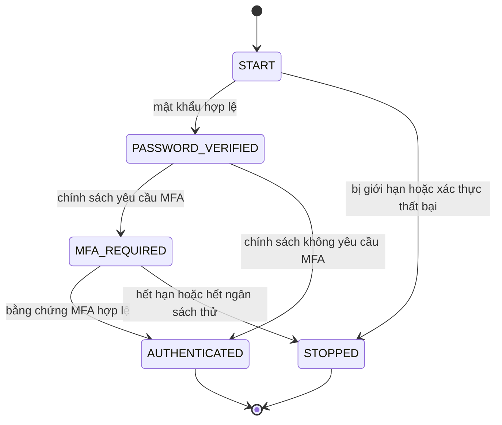

# Credential testing velocity: kiểm soát tốc độ thử thông tin xác thực

## 1. Mục tiêu và vị trí trong bảo mật logic nghiệp vụ

**Credential testing velocity** là mức độ và nhịp độ hệ thống bị yêu cầu kiểm tra thông tin xác thực trong một khoảng thời gian, xét theo những đối tượng như nguồn gửi, tài khoản đích, tổ chức và luồng xác thực.

Thông tin xác thực có thể là mật khẩu, mã OTP, mã khôi phục hoặc bằng chứng xác thực khác. Mỗi loại cần chính sách riêng; không nên gom tất cả thành một bộ đếm thất bại duy nhất.

Trong chương **Rate Limit Abuse**, chủ đề này trả lời câu hỏi: làm thế nào hạn chế việc dùng luồng xác thực hợp lệ để thử credential hàng loạt, đồng thời vẫn phục vụ người dùng hợp lệ và bảo vệ tài nguyên hệ thống?

Rủi ro nghiệp vụ không dừng ở việc đăng nhập sai nhiều lần. Nếu chiếm được tài khoản, đối tượng lạm dụng có thể đổi nơi nhận tiền, sửa giá trong phạm vi quyền bị cấp sai, gửi yêu cầu hoàn tiền hoặc thực hiện phê duyệt trái ý chủ tài khoản.

Rate limit làm giảm cơ hội thử và chi phí xử lý. Nó không thay thế:

- Kiểm tra quyền trên từng đối tượng nghiệp vụ.
- State machine của đăng nhập, MFA và các bước phê duyệt.
- Transaction bảo vệ số dư và giới hạn tiền.
- Idempotency của các thao tác có tác động nghiệp vụ.
- Xác thực bổ sung khi thao tác nhạy cảm yêu cầu mức bảo đảm cao hơn.

Sau bài này, bạn có thể định nghĩa đúng đơn vị đếm, thiết kế khóa giới hạn nhiều chiều, đặt kiểm soát trước bước kiểm tra credential tốn tài nguyên và kiểm thử khả năng chống lạm dụng trong hệ thống phân tán.

Các con số trong bài chỉ để minh họa, không phải ngưỡng khuyến nghị dùng ngay cho hệ thống thực tế.

## 2. Những kiểu hành vi cần phân biệt

| Hành vi | Mô tả khái quát | Tín hiệu nên quan sát |
|---|---|---|
| Đoán credential của một tài khoản | Nhiều lần kiểm tra nhằm vào cùng đối tượng | Tốc độ thử theo tài khoản, số nguồn khác nhau |
| Password spraying | Một nhóm giá trị dễ đoán được thử trên nhiều tài khoản | Số đích khác nhau từ một nguồn hoặc nhóm nguồn |
| Credential stuffing | Thử lại cặp định danh và credential có được từ nơi khác | Nhiều đích, nhiều nguồn, một phần đăng nhập thành công |
| Đoán OTP hoặc mã khôi phục | Lạm dụng bước xác thực sau hoặc thay cho mật khẩu | Số lần kiểm tra theo challenge, tài khoản và luồng |
| Client lỗi hoặc người dùng quên mật khẩu | Retry hoặc nhập sai ngoài ý muốn | Mẫu retry, lịch sử thiết bị, tỷ lệ hoàn tất hợp lệ |

Một địa chỉ IP có nhiều lỗi đăng nhập chưa đủ chứng minh tấn công. Nhiều người có thể dùng chung mạng doanh nghiệp, ký túc xá hoặc mạng di động.

Ngược lại, mỗi IP chỉ gửi ít yêu cầu cũng chưa chứng minh an toàn. Cùng một tài khoản có thể bị tác động từ nhiều nguồn.

Một lượt đăng nhập thành công cũng không tự động kết thúc nghi vấn: nó có thể là kết quả của quá trình thử credential trước đó.

## 3. Đếm đúng thứ cần bảo vệ

### 3.1. Request không đồng nghĩa với lần kiểm tra credential

Xét một luồng:

```text
HTTP request
  -> kiểm tra định dạng và giới hạn đầu vào
  -> kiểm soát tốc độ trước xác thực
  -> tra cứu định danh theo chính sách
  -> kiểm soát theo tài khoản hoặc challenge
  -> kiểm tra credential
  -> kiểm tra bước xác thực tiếp theo
  -> cấp phiên khi toàn bộ điều kiện đã đạt
```

Một request có thể bị chặn trước khi kiểm tra mật khẩu. Một request khác có thể kiểm tra mật khẩu thành công nhưng chưa hoàn tất MFA.

Cần tách các chỉ số:

| Chỉ số | Định nghĩa |
|---|---|
| `auth_requests_received` | Request đi vào luồng xác thực, kể cả request bị từ chối sớm |
| `admission_denied` | Request không được đi tiếp do quota hoặc điều kiện tiếp nhận |
| `credential_checks_started` | Số lần thực sự bắt đầu kiểm tra một loại credential |
| `credential_checks_invalid` | Kết quả kiểm tra xác nhận credential không hợp lệ |
| `credential_checks_valid` | Credential của bước hiện tại hợp lệ |
| `credential_checks_error` | Lỗi kỹ thuật, timeout hoặc lỗi phụ thuộc, chưa kết luận credential |
| `authentication_completed` | Toàn bộ luồng xác thực đã hoàn tất và đủ điều kiện cấp phiên |

Không gán timeout thành “sai mật khẩu”. Cũng không gán “mật khẩu đúng” thành “đã đăng nhập” nếu MFA còn chưa hoàn thành.

### 3.2. Công thức velocity

Với khóa quan sát `k`, cửa sổ dài `W` và thời điểm `t`:

```text
C(k, W, t)
  = số lần bắt đầu kiểm tra credential gắn với k
    có thời điểm thuộc (t - W, t]

velocity(k, W, t) = C(k, W, t) / W
```

Đơn vị của velocity phải rõ, ví dụ lần kiểm tra/phút.

Những feature bổ sung thường hữu ích:

```text
source_fan_out
  = số định danh đích khác nhau được một nguồn thử trong cửa sổ

target_fan_in
  = số nguồn khác nhau cùng thử một tài khoản đích trong cửa sổ

invalid_ratio
  = số kết quả credential không hợp lệ
    / số kết quả đã xác định là hợp lệ hoặc không hợp lệ
```

Mẫu số của `invalid_ratio` không gồm lỗi kỹ thuật và kết quả còn đang chờ. Nếu chưa có đủ kết quả, không tính tỷ lệ hoặc đánh dấu độ tin cậy thấp.

Một nguồn có 2/2 lần sai chưa chắc đáng ngờ hơn nguồn có 400/500 lần sai. Vì vậy, tỷ lệ cần đi kèm lượng mẫu và mức tác động.

### 3.3. Bộ đếm quota không nhất thiết bằng bộ đếm verifier

Quota được tiêu thụ trước khi xác thực để bảo vệ tài nguyên. Một request đã tiêu thụ quota ở chiều nguồn nhưng sau đó bị chặn ở chiều tài khoản có thể chưa chạy verifier.

Do đó:

- Bộ đếm quota phản ánh ngân sách tiếp nhận đã dùng.
- Telemetry của verifier phản ánh số lần kiểm tra thực sự bắt đầu.
- Bộ đếm kết quả phản ánh các lần kiểm tra đã hoàn tất.

Không đối soát ba con số như thể chúng bắt buộc bằng nhau trong mọi thời điểm. Chúng còn có thể lệch tạm thời do độ trễ sự kiện hoặc request đang xử lý.

## 4. Các bất biến của luồng xác thực

Trước khi chọn thuật toán rate limit, cần chốt các quy tắc không được vi phạm:

1. Chỉ cấp phiên sau khi tất cả bước xác thực bắt buộc hoàn tất.
2. Không thực hiện kiểm tra credential nếu cổng tiếp nhận bắt buộc chưa cho phép.
3. Kết quả của một challenge phải gắn với đúng luồng, đối tượng và thời hạn.
4. Challenge hết hạn, bị hủy hoặc đã dùng không được tái sử dụng trái với thiết kế.
5. Việc đổi instance, đổi endpoint hoặc phát lại request không được tự cấp thêm ngân sách ngoài chính sách.
6. Một tín hiệu từ người chưa xác thực không được tùy ý thay đổi quyền hay trạng thái nghiệp vụ của nạn nhân.

Ví dụ state machine:



Các nhánh trong sơ đồ là mô hình minh họa. Việc người gọi tự gửi `mfaPassed=true` không được phép tạo chuyển trạng thái.

Rate limit phải có mặt ở đúng bước cần bảo vệ. Chỉ giới hạn endpoint nhập mật khẩu nhưng để endpoint kiểm tra OTP không giới hạn sẽ để hở một đường thử credential khác.

## 5. Thiết kế khóa giới hạn nhiều chiều

### 5.1. Không chỉ dùng IP

| Chiều giới hạn | Bảo vệ điều gì | Giới hạn của tín hiệu |
|---|---|---|
| Nguồn mạng | Request dồn dập từ một điểm quan sát | NAT dùng chung; IP thay đổi; nhiều nguồn phân tán |
| Định danh đích trước xác thực | Hạn chế thử cùng một login hint | Chưa chứng minh người gọi sở hữu tài khoản |
| Tài khoản nội bộ sau tra cứu | Gộp các bí danh về cùng đối tượng | Phải tránh làm lộ tài khoản có tồn tại hay không |
| Cặp nguồn và đích | Mẫu thử tập trung của một nguồn | Không đủ để chặn nguồn phân tán |
| Challenge | Hạn chế đoán OTP trong một phiên xác thực | Tạo challenge mới không được làm mất giới hạn cấp cao hơn |
| Tenant hoặc realm | Chống lạm dụng trong một miền định danh | Không nên để tenant lớn làm mất khả năng phục vụ của tenant khác |
| Toàn dịch vụ | Bảo vệ năng lực verifier và hệ thống phụ thuộc | Cần phân bổ công bằng để tránh bị dùng làm công cụ gây nghẽn |

Một request có thể phải đi qua nhiều ngân sách. Việc vượt bất kỳ giới hạn bắt buộc nào có thể khiến request dừng trước verifier.

Các chiều phải phục vụ mục đích rõ ràng. Việc thêm nhiều khóa mà không kiểm soát độ lớn trạng thái có thể tự tạo vấn đề bộ nhớ.

### 5.2. Login hint chưa phải danh tính đã xác thực

Trước đăng nhập, địa chỉ email hoặc username là dữ liệu do người gọi tự khai.

Có thể xây khóa dạng:

```text
login_hint_key
  = HMAC(secret, realm || separator || normalized_login_hint)
```

Trong đó:

- `realm` xác định miền định danh hoặc tenant phù hợp.
- Cách ghép phải không nhập nhằng, chẳng hạn dùng mã hóa có độ dài trường.
- Chuẩn hóa phải khớp với quy tắc đăng nhập của chính hệ thống.
- Secret được quản lý như khóa bí mật, có kế hoạch thay và thời hạn giữ dữ liệu.

Không tự động viết thường hoặc biến đổi Unicode cho mọi loại định danh nếu hệ thống xác thực không dùng cùng quy tắc. Nếu bộ đếm và tra cứu hiểu định danh khác nhau, chúng có thể gộp nhầm hoặc tách sai đối tượng.

HMAC giúp hạn chế lưu định danh thô trong khóa, nhưng không biến dữ liệu thành vô danh. Các khóa vẫn có thể liên kết hoạt động và cần được bảo vệ.

Không dùng mật khẩu, OTP, mã khôi phục hoặc giá trị băm của chúng làm khóa quan sát hay đưa vào log.

### 5.3. Bí danh và tài khoản không tồn tại

Nếu một tài khoản đăng nhập được bằng cả email và username, chỉ đếm theo chuỗi người gọi nhập có thể chia ngân sách của cùng tài khoản thành nhiều phần.

Thiết kế có thể gồm:

1. Giới hạn đầu vào theo nguồn và dịch vụ trước khi tra cứu.
2. Giới hạn theo login hint đã chuẩn hóa.
3. Sau tra cứu, gắn các bí danh hợp lệ với cùng tài khoản nội bộ.
4. Với định danh không tồn tại, đi theo nhánh tương đương về chính sách bên ngoài và có bucket đại diện phù hợp.
5. Tránh trả thông tin cho biết nội bộ đã tìm thấy tài khoản hay chưa.

Nhánh tài khoản tồn tại và không tồn tại cần được đánh giá về mã phản hồi, nội dung, thời gian và hành vi rate limit. Không nên tuyên bố “không lộ tài khoản” chỉ vì thông báo lỗi giống nhau.

Nếu dùng thao tác kiểm tra giả để giảm kênh thời gian, chỉ thực hiện sau kiểm soát tiếp nhận và đo chi phí của nó. Không chạy phép tính tốn tài nguyên không giới hạn cho mọi username tùy ý.

### 5.4. Địa chỉ nguồn phải có nguồn gốc tin cậy

Không tin trực tiếp các header do client gửi để xác định IP.

Ở môi trường có proxy, cần cấu hình chuỗi proxy tin cậy và quy tắc trích xuất địa chỉ nguồn tại ranh giới do hệ thống quản lý. Ghi nhận đủ thông tin để điều tra sai cấu hình.

Gộp theo dải IP, mạng hoặc nguồn tương tự có thể giảm việc chia nhỏ, nhưng cũng tăng ảnh hưởng lên người dùng dùng chung hạ tầng. Độ rộng nhóm phải dựa trên đặc điểm mạng và dữ liệu thực tế, không có một prefix duy nhất phù hợp mọi nơi.

## 6. Cửa sổ thời gian và thuật toán

### 6.1. Fixed window

Ví dụ: tối đa một số lượng request trong từng phút theo mốc lịch.

Ưu điểm là đơn giản và ít trạng thái. Nhược điểm là hai cụm request ở hai phía biên cửa sổ có thể tạo burst lớn hơn mức người thiết kế hình dung.

Không mô tả “10 lần trong mỗi phút lịch” là “không bao giờ có quá 10 lần trong bất kỳ 60 giây nào”.

### 6.2. Sliding window

Cửa sổ trượt quan sát khoảng `(t - W, t]`. Nó sát với yêu cầu “trong bất kỳ W giây gần nhất” hơn, nhưng cần cân nhắc chi phí lưu và tổng hợp.

Nếu dùng cấu trúc xấp xỉ, phải biết sai số có thể làm đếm thiếu hay đếm thừa. Một cấu trúc phù hợp dashboard chưa chắc phù hợp quyết định từ chối request.

### 6.3. Token bucket

Token bucket có:

- Dung lượng tối đa `B`, thể hiện burst cho phép.
- Tốc độ nạp `r` token/giây.
- Mỗi lần tiếp nhận tiêu thụ một lượng token theo chính sách.

Với chi phí một token/request, giới hạn lý tưởng trong khoảng dài `W` không vượt quá `B + r × W`, tùy số token có sẵn ở đầu khoảng và cách rời rạc hóa.

Ví dụ `B = 10`, nạp 10 token/phút, cho phép burst ban đầu và nạp dần về sau. Nó không đồng nghĩa với tối đa 10 request trong mọi cửa sổ 60 giây.

### 6.4. Chọn theo mục tiêu

| Mục tiêu | Lựa chọn cần cân nhắc |
|---|---|
| Giới hạn burst và bảo vệ tài nguyên | Token bucket hoặc cơ chế tương đương |
| Giới hạn số lần thử trong khoảng gần nhất | Sliding window phù hợp hợp đồng |
| Theo dõi thử chậm kéo dài | Cửa sổ dài và tín hiệu tích lũy bổ sung |
| Phát hiện nhiều đích hoặc nhiều nguồn | Bộ đếm distinct theo đơn vị đã định nghĩa |
| Kiểm soát OTP trong một challenge | Ngân sách gắn vòng đời challenge và tài khoản |

Có thể kết hợp cửa sổ ngắn và dài. Chỉ dùng cửa sổ ngắn thường không nhìn thấy hành vi tích lũy chậm; chỉ dùng cửa sổ dài dễ làm người dùng hợp lệ chờ quá lâu sau một sự cố.

## 7. Điểm thực thi phải nằm trước công việc cần bảo vệ

Luồng tiếp nhận minh họa:

```text
1. Kiểm tra kích thước, định dạng và loại luồng xác thực.
2. Áp giới hạn thô theo nguồn, tenant và dịch vụ.
3. Chuẩn hóa định danh bằng quy tắc của hệ thống.
4. Áp chính sách theo login hint, tài khoản hoặc challenge.
5. Chỉ khi các gate bắt buộc cho phép:
   - bắt đầu kiểm tra credential;
   - ghi nhận auth_attempt_id do máy chủ tạo;
   - xử lý kết quả đúng state machine.
6. Ghi sự kiện có cấu trúc, không chứa credential.
7. Chỉ cấp phiên khi mọi điều kiện xác thực đã hoàn tất.
```

Một hệ thống kiểm tra mật khẩu trước rồi mới đếm thất bại có thể phát hiện tấn công nhưng vẫn để đối tượng tiêu thụ tài nguyên verifier ở tốc độ cao.

Tương tự, giới hạn tại gateway không bảo vệ được endpoint nội bộ có thể bị gọi trực tiếp nếu không có ranh giới truy cập và kiểm soát tương ứng.

### 7.1. Retry và idempotency phải hiểu đúng

Trong thanh toán hoặc hoàn tiền, idempotency giúp cùng một thao tác không tạo tác động tài chính hai lần.

Trong xác thực:

- Nếu một request thực sự chạy verifier lần nữa, đó là một lần kiểm tra mới cần được kiểm soát.
- Client tự gửi lại cùng request ID không được làm lần kiểm tra mới miễn quota.
- Sự kiện telemetry được nhận lại thì phải khử trùng lặp theo định danh sự kiện hoặc lần kiểm tra.
- Không tái sử dụng kết quả đăng nhập hoặc trả lại token chỉ vì idempotency key giống một lần trước.

Một cơ chế chống xử lý lặp dành riêng cho giao thức xác thực, nếu có, phải gắn chặt với challenge, nội dung, chủ thể, thời hạn và khả năng chống replay. Không áp dụng máy móc cache kết quả của API nghiệp vụ cho endpoint đăng nhập.

### 7.2. Không reset toàn bộ lịch sử khi có một lần thành công

Một lần mật khẩu đúng có thể thuộc cùng chuỗi lạm dụng. Nếu xóa mọi bộ đếm ngay khi nó xuất hiện, tín hiệu của nguồn hoặc các đích khác sẽ biến mất.

Có thể có chính sách khôi phục ngân sách cho một luồng đã xác minh đủ mạnh, nhưng phải giới hạn phạm vi. Không reset ngân sách toàn dịch vụ hoặc toàn nguồn chỉ vì một tài khoản đăng nhập thành công.

## 8. Đồng thời và nhiều instance

### 8.1. Vì sao kiểm tra rồi tăng riêng rẽ bị hở?

Pseudocode không an toàn:

```text
current = read(counter)

if current < limit:
    allow()
    write(counter, current + 1)
```

Hai request có thể cùng đọc một giá trị còn dưới ngưỡng, cùng được cho phép và làm mất cập nhật của nhau.

Cần một thao tác nguyên tử có ngữ nghĩa rõ:

```text
try_consume(key, policy):
    cập nhật thời gian hoặc cửa sổ
    kiểm tra ngân sách
    nếu đủ: trừ ngân sách và trả GRANTED
    nếu thiếu: trả DENIED cùng thời gian thử lại phù hợp
```

Việc kiểm tra, tiêu thụ và đặt thời hạn trạng thái phải có tính nhất quán cần thiết tại nơi lưu.

### 8.2. Bộ đếm trong bộ nhớ từng instance

Nếu mỗi instance tự cho phép `N` lần và có `K` instance, giới hạn toàn hệ thống có thể tiến gần `K × N` trong điều kiện phân phối tương ứng.

Sticky session chỉ giảm một số trường hợp; nó không tạo bảo đảm ngân sách toàn cục khi instance đổi, restart hoặc request được định tuyến lại.

Các hướng triển khai gồm kho trạng thái dùng chung với thao tác nguyên tử, phân vùng có chủ sở hữu rõ ràng hoặc cơ chế cấp phát ngân sách có giới hạn sai lệch đã được phân tích. Bộ đếm cục bộ có thể bổ sung chặn sớm, nhưng không nên được mô tả là giới hạn toàn cục nếu chưa có cơ chế đó.

### 8.3. Nhiều chiều không tự nhiên thành một transaction

Giả sử request phải tiêu thụ lần lượt ba ngân sách:

```text
nguồn -> tài khoản -> tenant
```

Nếu ngân sách nguồn đã trừ nhưng ngân sách tài khoản từ chối, có thể chấp nhận để nguyên phần đã trừ như một thiết kế bảo thủ. Khi đó request không đi tiếp và tài nguyên đã được tính một phần.

Cần ghi rõ:

- Mỗi ngân sách có thao tác tiêu thụ nguyên tử.
- Việc tiêu thụ toàn bộ các chiều không phải một transaction nguyên tử.
- Thất bại ở chiều sau có thể tiêu thụ dư ở chiều trước.
- Không tự hoàn quota nếu chưa phân tích cạnh tranh và khả năng lạm dụng.

Nếu nghiệp vụ yêu cầu tất cả cùng tiêu thụ hoặc không tiêu thụ gì, kho trạng thái phải hỗ trợ đúng bảo đảm đó trong phạm vi khóa liên quan. Không giả định tính nguyên tử xuyên nhiều phân vùng.

### 8.4. Đồng hồ, TTL và thay cấu hình

Thời gian do client gửi không được quyết định việc nạp token hay hết cửa sổ.

Bên lưu trạng thái cần có quy tắc đồng hồ nhất quán và xử lý trường hợp thời gian lùi. TTL phải đủ để giữ hiệu lực ngân sách; mất key quá sớm có thể cấp lại một bucket đầy.

Đổi phiên bản cấu hình hoặc thay khóa HMAC cũng có thể tạo không gian key mới. Nếu mọi bucket mới đều đầy, hệ thống có thể vô tình cấp thêm lượt thử. Kế hoạch thay đổi cần giữ, chuyển hoặc chồng chính sách trong giai đoạn phù hợp.

## 9. Minh họa cổng tiếp nhận bằng Java

Ví dụ sau chỉ minh họa điều phối nhiều ngân sách. Phần lưu trạng thái nguyên tử là một hợp đồng cần được triển khai và kiểm chứng riêng.

```java
import java.time.Duration;
import java.util.List;
import java.util.Objects;

public final class CredentialAdmissionGate {
    public enum Outcome {
        ADMITTED,
        RATE_LIMITED,
        DEPENDENCY_UNAVAILABLE
    }

    public record BudgetSpec(
            String key,
            int burstCapacity,
            Duration fullRefillTime) {

        public BudgetSpec {
            Objects.requireNonNull(key);
            Objects.requireNonNull(fullRefillTime);

            if (key.isBlank()
                    || burstCapacity < 1
                    || fullRefillTime.isZero()
                    || fullRefillTime.isNegative()) {
                throw new IllegalArgumentException("Invalid budget");
            }
        }
    }

    public record DebitResult(
            boolean granted,
            Duration retryAfter) {
    }

    public record GateDecision(
            Outcome outcome,
            Duration retryAfter) {
    }

    public static final class StoreUnavailable extends RuntimeException {
        public StoreUnavailable(String message) {
            super(message);
        }
    }

    public interface AtomicBudgetStore {
        // Nguyen tu cho tung key, dung dong ho do store quan ly.
        // Tu choi hoac mat ket noi khong duoc tra granted=true.
        DebitResult tryDebitOne(BudgetSpec budget) throws StoreUnavailable;
    }

    private final AtomicBudgetStore store;

    public CredentialAdmissionGate(AtomicBudgetStore store) {
        this.store = Objects.requireNonNull(store);
    }

    public GateDecision beforeCredentialCheck(List<BudgetSpec> requiredBudgets) {
        List<BudgetSpec> budgets = List.copyOf(requiredBudgets);

        if (budgets.isEmpty()) {
            throw new IllegalArgumentException("Required budgets are missing");
        }

        try {
            for (BudgetSpec budget : budgets) {
                DebitResult result = store.tryDebitOne(budget);

                if (!result.granted()) {
                    return new GateDecision(
                            Outcome.RATE_LIMITED,
                            result.retryAfter());
                }
            }

            return new GateDecision(Outcome.ADMITTED, Duration.ZERO);
        } catch (StoreUnavailable ex) {
            return new GateDecision(
                    Outcome.DEPENDENCY_UNAVAILABLE,
                    Duration.ofSeconds(3));
        }
    }
}
```

Cách tích hợp phải bảo đảm chỉ nhánh `ADMITTED` được gọi verifier:

```text
decision = gate.beforeCredentialCheck(requiredBudgets)

switch decision.outcome:
    ADMITTED:
        chạy bước kiểm tra credential được yêu cầu
    RATE_LIMITED:
        trả phản hồi giới hạn chung theo chính sách
        không chạy verifier
    DEPENDENCY_UNAVAILABLE:
        trả phản hồi dịch vụ tạm không sẵn sàng
        không chạy verifier trong luồng minh họa này
```

Các điều kiện quan trọng của ví dụ:

- `requiredBudgets` do máy chủ dựng từ ngữ cảnh đã kiểm chứng; client không được tự chọn khóa hay dung lượng.
- `fullRefillTime` là thời gian nạp từ rỗng đến đầy khi không tiêu thụ, không phải một sliding window.
- Mỗi lần `tryDebitOne` phải trả kết quả có thời gian chờ hợp lệ theo hợp đồng store.
- Nếu chiều sau từ chối, các chiều trước vẫn đã tiêu thụ; ví dụ cố ý chọn tính bảo thủ đó.
- Kết quả timeout tại store có thể chưa biết thao tác đã được ghi hay chưa. Luồng này dừng tiếp nhận thay vì thử verifier ngoài quota.
- Khoảng 3 giây là backoff minh họa cho lỗi phụ thuộc, không phải kết quả tính từ bucket.
- `ADMITTED` cho phép thực hiện bước kiểm tra, không có nghĩa credential đúng hoặc được cấp phiên.
- Cần kiểm thử triển khai store thật trong điều kiện đồng thời; interface không tự tạo tính nguyên tử.

Ví dụ dùng cú pháp record của Java 17. Nó chưa bao gồm dựng khóa, gateway, xử lý HTTP, state machine hay triển khai kho ngân sách.

## 10. Phản ứng với velocity cao mà không tạo công cụ khóa nạn nhân

### 10.1. Khóa tài khoản theo tín hiệu chưa xác thực là một đánh đổi lớn

Nếu bất kỳ ai cũng có thể gửi sai mật khẩu vài lần để khóa tài khoản đích vô thời hạn, hệ thống đã tạo ra một cách gây từ chối dịch vụ cho người dùng hợp lệ.

Giới hạn theo tài khoản vẫn có thể cần thiết, nhưng nên cân nhắc:

- Thời hạn ngắn và phạm vi rõ.
- Kết hợp các chiều nguồn, challenge và toàn dịch vụ.
- Luồng phục hồi hoặc xác thực thay thế dựa trên bằng chứng đủ mạnh.
- Không tự động vô hiệu hóa mọi phiên đang hoạt động chỉ từ chuỗi thất bại chưa xác thực.
- Cảnh báo và xử lý riêng nếu có bằng chứng tài khoản hoặc phiên đã bị chiếm.

Không có cách vừa cho phép vô hạn lần thử của người hợp lệ vừa chặn tuyệt đối mọi lần thử của người lạ chỉ dựa trên cùng một định danh tự khai. Cần mô tả rõ đánh đổi giữa an toàn và khả năng phục vụ.

### 10.2. Phân tầng hành động

| Mức độ | Hành động có thể cân nhắc |
|---|---|
| Tín hiệu nhẹ, chưa đủ bằng chứng | Ghi nhận, tăng quan sát, bổ sung tín hiệu |
| Burst từ nguồn | Từ chối tạm thời trước công việc tốn tài nguyên |
| Tập trung vào một tài khoản | Hạn chế thử và cung cấp luồng xác thực thay thế có bảo đảm |
| Nghi vấn stuffing có lượt thành công | Đánh giá phiên, yêu cầu bằng chứng bổ sung khi phù hợp |
| Áp lực lên toàn dịch vụ | Giảm tiếp nhận, phân bổ ngân sách và bảo vệ phụ thuộc |

Challenge chống tự động hóa có thể tăng chi phí lạm dụng nhưng không thay thế kiểm tra credential hay ngân sách thử. Giải challenge không được tự động cấp vô hạn lượt kiểm tra mật khẩu hoặc OTP.

Nếu có luồng thay thế, nó cần ngân sách và state machine riêng. Không để endpoint phục hồi, đăng nhập ứng dụng di động hoặc endpoint cũ trở thành đường vòng không bị giới hạn.

### 10.3. Phản hồi HTTP và tác động thời gian

Có thể dùng phản hồi giới hạn như HTTP 429 và chỉ dẫn thử lại khi phù hợp hợp đồng API. Lỗi phụ thuộc khiến dịch vụ không thể tiếp nhận có thể dùng phản hồi tạm không sẵn sàng.

Phản hồi không nên chứa:

- Tài khoản có tồn tại hay không.
- Tài khoản bị chặn bởi chiều nội bộ nào.
- Tên rule, giá trị tín hiệu nhạy cảm hoặc danh sách nguồn liên quan.
- Thông tin về bước MFA đã hoàn tất nếu người gọi chưa được phép biết.

Thời gian thử lại nên có quy tắc làm tròn và giới hạn phù hợp. Không hứa chính xác thời điểm sẽ được cho phép nếu nhiều ngân sách cùng ảnh hưởng.

Không giữ một worker bằng cách ngủ lâu để làm chậm mọi request. Từ chối sớm hoặc dùng cơ chế điều phối không giữ tài nguyên khan hiếm sẽ phù hợp hơn với mục tiêu chống cạn tài nguyên.

## 11. OTP, mã khôi phục và tái xác thực thao tác nhạy cảm

### 11.1. Giới hạn cả tạo và kiểm tra challenge

Với OTP, cần phân biệt:

- Yêu cầu gửi hoặc phát hành mã.
- Số lần kiểm tra mã.
- Số challenge được tạo cho cùng đối tượng.
- Chi phí và áp lực lên kênh gửi.
- Thời hạn và số lần sử dụng của challenge.

Chỉ giới hạn số lần thử trong mỗi challenge là chưa đủ nếu tạo challenge mới luôn cấp một ngân sách hoàn toàn mới mà không có giới hạn ở tài khoản hoặc luồng.

Việc gửi lại OTP phải tuân theo chính sách rõ về mã cũ, mã mới và thời hạn. Không cho client tự kéo dài vòng đời bằng cách phát lại request.

### 11.2. Đã đăng nhập vẫn có thể cần kiểm soát velocity

Một số thao tác nhạy cảm yêu cầu nhập lại mật khẩu, OTP hoặc bằng chứng khác:

- Đổi thông tin nhận tiền.
- Thay phương thức xác thực.
- Phê duyệt giao dịch giá trị lớn.
- Xem hoặc tạo mã khôi phục.

Các endpoint này cần giới hạn riêng theo phiên, tài khoản và loại thao tác. Việc có session không phải lý do cho phép thử credential không giới hạn.

Nếu thao tác cuối cùng tác động tiền hoặc quyền, vẫn cần kiểm tra quyền theo đối tượng, trạng thái hợp lệ và transaction. Việc xác thực bổ sung thành công không cấp quyền thực hiện mọi thao tác.

### 11.3. Ngăn tác động nghiệp vụ bị lặp

Sau khi xác thực đủ điều kiện, một lần phê duyệt hoặc đổi phương thức nhận tiền có thể vẫn bị retry.

Ở đây, idempotency của thao tác nghiệp vụ có vai trò riêng: tránh thực hiện tác động hai lần. Nó phải gắn với đúng chủ thể, nội dung và quyền thực hiện.

Không dùng việc “đã xác thực một lần” làm giấy phép phát lại tùy ý một yêu cầu nhạy cảm trong mọi phiên hoặc mọi thời điểm.

## 12. Telemetry và dữ liệu cá nhân

Một sự kiện kiểm tra có thể có các trường:

```text
event_id
auth_attempt_id
occurred_at
ingested_at
realm_or_tenant
flow_type
credential_factor
source_group
pseudonymous_target
challenge_reference
admission_result
verification_result
rule_version
correlation_id
```

Không ghi password, OTP, mã khôi phục, cookie phiên, access token hoặc toàn bộ request body.

Một số lưu ý:

- `auth_attempt_id` do máy chủ quản lý cho lần kiểm tra; không tin giá trị tùy ý của client để bỏ đếm.
- `credential_factor` phân biệt mật khẩu, OTP và loại khác.
- Kết quả một bước phải tách khỏi kết quả hoàn tất xác thực.
- Dữ liệu HMAC hoặc pseudonym vẫn cần quyền truy cập và thời hạn lưu.
- Không tạo nhãn metric không giới hạn theo username, IP hoặc account ID; chi tiết điều tra nên nằm ở kho sự kiện phù hợp.
- Giới hạn kích thước, TTL và cardinality của trạng thái. Hàng loạt định danh ngẫu nhiên không được khiến kho limiter tăng vô hạn.
- Áp kiểm soát thô trước khi tạo trạng thái chi tiết cho mỗi định danh mới.

Sự kiện đến muộn có thể cập nhật phân tích và hồ sơ điều tra. Nó không thể quay lại ngăn một lần kiểm tra đã diễn ra. Vì vậy, đường quyết định tiếp nhận không nên chỉ dựa vào stream tổng hợp có độ trễ không được kiểm soát.

## 13. Chọn ngưỡng và triển khai có kiểm soát

### 13.1. Bắt đầu bằng câu hỏi nghiệp vụ

Thay vì hỏi “nên cho phép bao nhiêu lần đăng nhập?”, hãy xác định:

1. Tài nguyên hoặc cơ hội thử nào cần bảo vệ?
2. Người dùng hợp lệ có những mẫu retry và thời gian phục hồi nào?
3. Người dùng dùng chung nguồn có quy mô ra sao?
4. Loại credential nào đang được thử và hậu quả khi bị đoán đúng là gì?
5. Cần chặn tức thời hay chỉ phát hiện để điều tra?
6. Khi phụ thuộc lỗi, hệ thống sẽ tiếp nhận hoặc từ chối theo chính sách nào?

Không chọn ngưỡng chỉ từ mức trung bình. Cần xem phân phối burst, đuôi dài, cohort và các sự cố client.

### 13.2. Ví dụ bảng tín hiệu

| Tín hiệu | Cửa sổ minh họa | Ý nghĩa cần điều tra |
|---|---|---|
| Nguồn phát sinh nhiều lần kiểm tra | 1 phút | Burst, client lỗi hoặc nguồn tự động hóa |
| Một nguồn thử nhiều đích | 10 phút | Fan-out cao, nhưng có thể là mạng dùng chung |
| Một đích nhận thử từ nhiều nguồn | 10 phút | Fan-in cao hoặc thay đổi môi trường mạng |
| Nhiều lần sai rồi có lần đúng | 30 phút | Cần đánh giá phiên và ngữ cảnh, chưa đủ kết luận |
| Nhiều challenge mới cho cùng tài khoản | 1 giờ | Có thể đang né giới hạn theo challenge |

Các cửa sổ trên không định nghĩa một chính sách hoàn chỉnh. Cần chọn thêm điều kiện đủ mẫu, nguồn dữ liệu, phản ứng và giới hạn ảnh hưởng khách hàng.

### 13.3. Shadow, canary và theo dõi

Có thể chạy bộ phát hiện ứng viên ở chế độ shadow để ghi quyết định giả định. Các kiểm soát bắt buộc đang có vẫn tiếp tục thực thi.

Kết quả shadow không cho biết chắc hành vi sau khi bị chặn sẽ ra sao. Một request trước đây được kiểm tra nhưng trong ứng viên sẽ bị từ chối tạo ra thay đổi về kết quả quan sát.

Khi canary:

- Chọn nhóm ổn định theo đơn vị phù hợp, tránh retry của cùng luồng đổi chính sách.
- Giữ một ngân sách bắt buộc nhất quán; không nhân đôi ngân sách chỉ vì hai cấu hình cùng chạy.
- Version hóa khóa, thuật toán và phản ứng.
- Theo dõi cả an toàn, khả năng đăng nhập hợp lệ và tải hệ thống.
- Chuẩn bị rollback bao gồm trạng thái bucket, không chỉ file cấu hình.

### 13.4. Chỉ số đánh giá

| Mục tiêu | Chỉ số cần xem |
|---|---|
| Bảo vệ verifier | Số lần bắt đầu kiểm tra, tải xử lý, hàng đợi và độ trễ |
| Giảm lạm dụng | Chuỗi lạm dụng xác nhận, lần đăng nhập bị chiếm và thiệt hại liên quan |
| Phục vụ người dùng | Tỷ lệ người dùng hợp lệ bị hạn chế, tỷ lệ hoàn tất xác thực, thời gian phục hồi |
| Chất lượng quyết định | Precision, recall khi có tập nhãn và mẫu số đáng tin cậy |
| Độ tin cậy limiter | Lỗi store, timeout, độ mới cấu hình, sai lệch quota |
| Độ tin cậy dữ liệu | Mất sự kiện, trùng, đến muộn, thiếu chiều quan sát |

Không dùng “tỷ lệ đăng nhập thành công giảm” làm bằng chứng độc lập rằng chống tấn công tốt hơn: người dùng hợp lệ cũng có thể bị chặn.

Nếu chỉ điều tra nhóm bị chặn, không thể suy ra đầy đủ số vụ lạm dụng trong nhóm được tiếp nhận. Cần nhãn hậu kiểm và phương pháp lấy mẫu có kiểm soát; không tự coi nhóm chưa điều tra là an toàn.

## 14. Bộ tình huống kiểm thử

| Tình huống | Kết quả cần xác nhận |
|---|---|
| Nhiều request đồng thời ở sát ngưỡng | Không vượt bảo đảm quota do read-modify-write rời rạc |
| Cùng chủ thể đi qua nhiều instance | Ngân sách có phạm vi đúng, không tự nhân theo số instance |
| Đổi instance hoặc restart | Không tự cấp bucket mới ngoài chính sách |
| Burst ở biên fixed window | Hành vi phù hợp hợp đồng đã công bố |
| Token bucket đầy rồi nạp dần | Phù hợp burst và tốc độ nạp, không bị hiểu thành sliding window |
| Request bị từ chối trước verifier | Không chạy hàm kiểm tra credential tốn tài nguyên |
| Cùng nội dung được gửi lại và verifier chạy lại | Mỗi lần kiểm tra mới vẫn chịu quota |
| Telemetry của một lần kiểm tra được phát lại | Phân tích không đếm trùng |
| Email và username cùng trỏ một tài khoản | Ngân sách theo tài khoản không bị tách ngoài ý muốn |
| Định danh không tồn tại | Không lộ sự tồn tại qua phản hồi hoặc chính sách khác biệt ngoài ý muốn |
| Nhiều người hợp lệ dùng chung IP | Đo ảnh hưởng và kiểm chứng khả năng phục hồi |
| Nhiều nguồn nhắm một tài khoản | Các tín hiệu và giới hạn cấp đích vẫn hoạt động |
| Header địa chỉ nguồn giả | Không làm đổi nguồn tin cậy |
| Hết lượt của một OTP challenge | Không được thử tiếp ngoài chính sách |
| Tạo lại challenge liên tục | Không xóa ngân sách cấp tài khoản hoặc luồng |
| Mật khẩu đúng nhưng MFA chưa đạt | Không cấp phiên |
| Một lần đúng sau nhiều lần sai | Không xóa mọi tín hiệu hoặc quota không liên quan |
| Store quota timeout | Đi theo chính sách lỗi, không tự chạy verifier ngoài gate |
| Đổi secret HMAC hoặc phiên bản key | Không vô tình cấp lại toàn bộ ngân sách |
| Định danh ngẫu nhiên số lượng lớn | TTL và giới hạn trạng thái ngăn cạn bộ nhớ |
| Lỗi kỹ thuật khi kiểm tra | Không ghi thành credential sai hoặc đăng nhập thành công |
| Retry thao tác nghiệp vụ sau xác thực | Không tạo tác động tài chính hoặc thay quyền hai lần |

Bên cạnh kiểm thử hàm, cần có kiểm thử tích hợp store thật, đồng thời nhiều instance và đường đi đầy đủ đến verifier. Một unit test mock luôn trả `granted=true` không xác nhận được tính nguyên tử hay phạm vi toàn cục.

Kiểm thử luồng thất bại cũng quan trọng: thiếu quota, lỗi phụ thuộc, snapshot phân tích trễ và cấu hình không hợp lệ không được vô tình trở thành nhánh cấp phiên.

## 15. Những lỗi thiết kế thường gặp

| Lỗi | Hậu quả | Cách sửa |
|---|---|---|
| Chỉ đếm đăng nhập sai | Không bảo vệ công việc trước khi có kết quả; bỏ sót chuỗi có lượt đúng | Kiểm soát tiếp nhận trước verifier và theo dõi kết quả riêng |
| Chỉ giới hạn theo IP | Bỏ sót thử phân tán, dễ chặn mạng dùng chung | Kết hợp nhiều chiều và phân tích tác động |
| Khóa vĩnh viễn theo định danh tự khai | Tạo công cụ gây từ chối dịch vụ cho nạn nhân | Dùng phản ứng có phạm vi, thời hạn và luồng phục hồi |
| Tin header IP của client | Khóa giới hạn có thể bị giả | Xác định nguồn qua ranh giới proxy tin cậy |
| Dùng bộ đếm từng instance như giới hạn toàn cục | Quota tăng theo quy mô triển khai | Dùng cơ chế trạng thái có phạm vi bảo đảm phù hợp |
| Reset mọi bộ đếm khi thành công | Xóa dấu hiệu của chuỗi lạm dụng | Giữ tín hiệu và chỉ khôi phục trong phạm vi có căn cứ |
| Tạo challenge mới cấp lại mọi lượt thử | Giới hạn theo challenge mất ý nghĩa | Thêm ngân sách cấp tài khoản và luồng |
| Xem telemetry trễ là cổng chặn tức thời | Có quyết định sau khi cơ hội thử đã xảy ra | Thực thi đồng bộ tại điểm tiếp nhận cần bảo vệ |
| Cache kết quả đăng nhập theo request ID tùy ý | Có thể tạo replay hoặc dùng sai kết quả | Thiết kế giao thức xác thực và chống replay riêng |
| Ghi password hoặc digest của password để phân tích | Tạo thêm kho dữ liệu nhạy cảm | Không thu thập credential vào telemetry |
| Tắt limiter khi store lỗi mà không có chính sách | Mở luồng thử không giới hạn đúng lúc sự cố | Thiết kế chế độ lỗi và năng lực dự phòng trước |
| Tăng ngưỡng chỉ vì có nhiều phàn nàn | Có thể che tấn công hoặc lỗi client chưa được sửa | Phân tích cohort, nguyên nhân và số liệu an toàn |

## 16. Bài tập áp dụng

Bạn vận hành một nền tảng có đăng nhập bằng mật khẩu, MFA bằng OTP và luồng phê duyệt hoàn tiền cần tái xác thực.

Hãy xây dựng đề xuất với các nội dung:

1. Xác định những sự kiện nào là request, lần kiểm tra credential và xác thực hoàn tất.
2. Thiết kế khóa theo nguồn, login hint, tài khoản, challenge, tenant và toàn dịch vụ; nêu nguồn dữ liệu của từng khóa.
3. Giải thích cách xử lý email và username cùng trỏ đến một tài khoản.
4. Chọn thuật toán cho burst ngắn và thử chậm kéo dài; mô tả chính xác bảo đảm thời gian.
5. Đặt gate trước verifier và nêu hành vi khi store không sẵn sàng.
6. Đề xuất phản ứng khi một tài khoản bị thử từ nhiều nguồn mà không khóa nạn nhân vô thời hạn.
7. Kiểm chứng việc tạo OTP challenge mới không cấp lại ngân sách vô hạn.
8. Đảm bảo mật khẩu đúng nhưng MFA chưa đạt không thể phê duyệt hoàn tiền.
9. Liệt kê metric, quy tắc không ghi credential và điều kiện rollback.
10. Thiết kế kiểm thử đồng thời qua nhiều instance cùng với retry của thao tác hoàn tiền.

Một thiết kế hoàn chỉnh phải giải thích được đối tượng nào đang dùng ngân sách, việc tiêu thụ có bảo đảm gì khi chạy đồng thời và người dùng hợp lệ sẽ phục hồi như thế nào. Đồng thời, nó phải giữ nguyên các kiểm soát nghiệp vụ tại bước sử dụng quyền sau xác thực.
