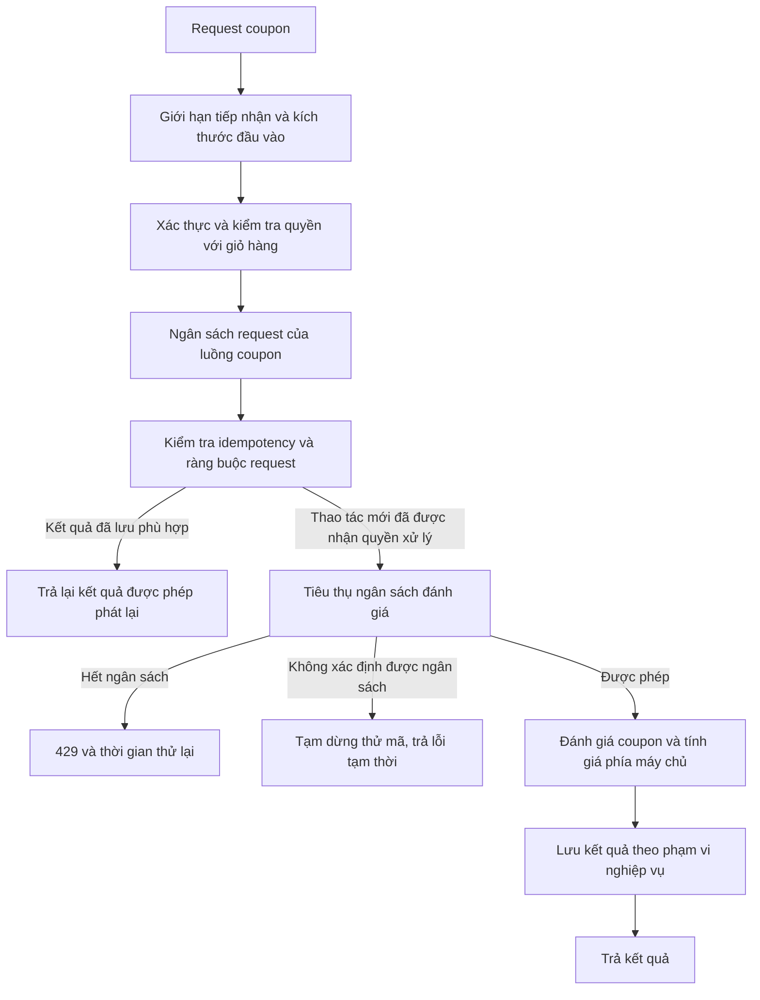

# Coupon testing velocity

## 1. Từ ô nhập mã giảm giá đến điểm dò tìm quyền lợi

**Coupon testing velocity** là tốc độ thử mã giảm giá hoặc điều kiện sử dụng mã trong một khoảng thời gian. Chức năng kiểm tra coupon thường trả lời một câu hỏi có giá trị: “Mã này có tồn tại, còn hiệu lực và dùng được cho giỏ hàng này không?”. Nếu có thể đặt câu hỏi ấy đủ nhiều lần, một bên lạm dụng có thể tìm ra mã hợp lệ, nhận diện chương trình riêng hoặc suy ra điều kiện hưởng ưu đãi.

Trong chương **Rate Limit Abuse** của module bảo vệ logic nghiệp vụ, mục tiêu là giữ cho khả năng thử coupon phù hợp với hành vi mua hàng dự kiến. Một request có thể hoàn toàn đúng JSON, được gửi bởi tài khoản đã đăng nhập và vẫn là một phần của quá trình dò mã tự động. Xác thực danh tính, kiểm tra dữ liệu và giới hạn tốc độ phải phối hợp với nhau.

Ví dụ, một cửa hàng có luồng sau:

```text
Nhập mã → kiểm tra điều kiện → xem giá sau giảm → đặt hàng → ghi nhận lượt dùng
```

Người mua thường nhập một vài mã được quảng bá hoặc được gửi cho họ. Một tác nhân tự động có thể thử hàng loạt giá trị, đổi giỏ hàng hoặc đổi kênh gọi API để lấy thêm phản hồi. Tác hại gồm:

- Phát hiện mã ưu đãi riêng và chia sẻ lại cho người không được hưởng.
- Suy ra mã dành cho khách hàng, nhóm đối tượng hoặc chiến dịch chưa công bố.
- Tiêu thụ tài nguyên tính giá, truy vấn điều kiện và gọi dịch vụ khuyến mãi.
- Kết hợp kết quả dò với lỗi quyền theo đối tượng, sửa giá hoặc ghi nhận coupon nhiều lần.

OWASP xem việc tự động hóa quá mức một luồng nhạy cảm là một rủi ro cần đánh giá theo mô hình kinh doanh. Luồng thử coupon là một trường hợp áp dụng cách nhìn đó; việc endpoint vẫn trả lời nhanh không chứng minh rằng quyền lợi khuyến mãi đang được bảo vệ. Xem [OWASP API6:2023 — Unrestricted Access to Sensitive Business Flows](https://github.com/OWASP/API-Security/blob/master/editions/2023/en/0xa6-unrestricted-access-to-sensitive-business-flows.md).

Sau bài học, người học cần có khả năng xác định một lượt thử, chọn khóa giới hạn, thiết kế xử lý đồng thời và retry, rồi kiểm chứng rằng giảm giá cuối cùng vẫn tuân thủ quy tắc nghiệp vụ.

## 2. Phân biệt các hành động và giới hạn cần bảo vệ

Không nên dùng cùng một bộ đếm để diễn giải mọi sự kiện liên quan đến coupon.

| Khái niệm | Ý nghĩa | Điều cần giữ đúng |
|---|---|---|
| Request đến hệ thống | Một lần gọi endpoint, kể cả request bị lặp hoặc bị từ chối sớm | Không cho lưu lượng làm cạn tài nguyên tiếp nhận |
| Lượt đánh giá coupon | Một lần thực sự kiểm tra mã và điều kiện nghiệp vụ | Hạn chế số cơ hội dò thông tin và chi phí đánh giá |
| Mã khác nhau đã thử | Số giá trị coupon phân biệt trong một phạm vi thời gian | Nhận diện hành vi tìm kiếm có hệ thống |
| Áp mã vào giỏ hàng | Thay đổi lựa chọn ưu đãi hoặc kết quả báo giá | Chỉ chủ thể có quyền với giỏ được thay đổi, giá do máy chủ tính |
| Lượt sử dụng coupon | Ghi nhận quyền lợi đã được tiêu thụ theo chính sách | Không vượt quota theo tài khoản, coupon hoặc chiến dịch |

Một mã đã kiểm tra thành công chưa nhất thiết được tiêu thụ. Việc tiêu thụ có thể xảy ra khi xác nhận đơn, khi thanh toán thành công hoặc qua cơ chế giữ chỗ. Hệ thống phải định nghĩa rõ thời điểm đó.

**Rate limit cho lượt thử** và **quota sử dụng ưu đãi** giải quyết hai bài toán khác nhau. Một khách hàng được thử năm mã không có nghĩa được hưởng năm lần giảm giá. Một coupon chỉ được dùng một lần cũng vẫn có thể bị dò hàng nghìn lần trước khi được dùng.

Giới hạn coupon không thay thế các bất biến sau:

```text
Chỉ chủ thể được phép mới có thể thao tác giỏ hàng.
Mức giảm và giá thanh toán được tính từ dữ liệu tin cậy phía máy chủ.
Coupon phải còn hợp lệ tại thời điểm nghiệp vụ yêu cầu.
Số lượt sử dụng đã chốt không vượt quota.
Một thao tác được retry không tạo thêm quyền lợi.
```

## 3. Viết bất biến về tốc độ trước khi chọn công nghệ

Chính sách cần trả lời bốn câu hỏi: đếm hành động nào, đếm cho ai, trong khoảng thời gian nào và làm gì khi vượt ngưỡng.

Ví dụ chính sách minh họa cho một hệ thống yêu cầu đăng nhập khi thử mã:

| Phạm vi | Ngưỡng minh họa | Mục đích |
|---|---|---|
| Tài khoản trong tenant | Tối đa 6 lượt đánh giá mới trong mọi khoảng 60 giây | Chặn một đợt dò nhanh |
| Tài khoản trong tenant | Tối đa 30 lượt đánh giá mới trong mọi khoảng 30 phút | Hạn chế dò chậm kéo dài |
| Request coupon của tài khoản | Ngân sách riêng, lớn hơn ngân sách đánh giá | Hạn chế cả retry, polling và request phát lại |
| Nguồn mạng qua proxy tin cậy | Ngưỡng theo lưu lượng thực tế và đặc điểm NAT | Bổ sung phát hiện nhiều tài khoản cùng nguồn |
| Toàn dịch vụ | Ngân sách theo năng lực và chiến dịch | Bảo vệ tài nguyên, phát hiện phân tán trên diện rộng |

Các con số trên chỉ phục vụ bài học, không phải cấu hình mặc định cho mọi cửa hàng. Cần quan sát lưu lượng hợp lệ, mức giảm giá, chi phí đánh giá, kênh bán hàng và tác động đến chuyển đổi trước khi đặt ngưỡng thực tế.

Với giới hạn cửa sổ trượt, bất biến có thể biểu diễn như sau:

```text
Với mọi chủ thể s và mọi thời điểm t:
evaluations(s, khoảng (t - 60 giây, t]) <= 6
```

Các lượt được tính là những lần hệ thống cho phép bắt đầu một đánh giá mới. Không chờ đánh giá thất bại mới cộng lượt: cách đó cho phép các request đồng thời cùng đi qua trước khi có kết quả.

Đối với chính sách này:

- Thử mã hợp lệ hoặc không hợp lệ đều tiêu thụ một lượt đánh giá.
- Không tìm thấy mã không phải lý do hoàn lại lượt.
- Timeout sau khi đã cấp lượt không tự động hoàn lại; hệ thống có thể đã thực hiện tra cứu.
- Kết quả bị từ chối bởi limiter không đi tiếp vào bộ máy đánh giá coupon.
- Kết quả idempotent đã lưu có thể được trả lại mà không đánh giá mới, nhưng request đó vẫn chịu ngân sách tiếp nhận request.

Số mã phân biệt là tín hiệu bổ sung. Nếu chỉ đếm mã khác nhau, người dùng lặp đi lặp lại một mã vẫn có thể gây tải hoặc dò sự thay đổi về điều kiện giỏ hàng.

## 4. Nhìn toàn luồng để tránh đường vòng

Hệ thống có thể có nhiều nơi thực hiện cùng một công việc:

```text
POST /coupon/validate
POST /carts/{cartId}/coupon
POST /checkout/preview
POST /orders
GraphQL mutation applyCoupon
API của ứng dụng di động hoặc đối tác
```

Đây là ví dụ các bề mặt cần kiểm kê, không phải danh sách endpoint bắt buộc. Nếu mỗi nơi có bộ đếm riêng, một người có thể chia lưu lượng qua nhiều nơi để tăng tổng số lần đánh giá.

Nên gắn chính sách với thao tác nghiệp vụ chung, chẳng hạn `COUPON_EVALUATE`, trong tầng ứng dụng hoặc dịch vụ miền dùng chung. Các kênh gọi vào phải sử dụng điểm kiểm soát đó. Gateway vẫn có vai trò chặn lưu lượng sớm, nhưng không phải nơi duy nhất hiểu được tài khoản, giỏ hàng và hành động thật sự.

Với endpoint nhận một danh sách coupon, ngân sách đánh giá phải phản ánh số mã sẽ được đánh giá. Một request chứa mười mã không mặc nhiên chỉ tốn một lượt. Cần giới hạn cả kích thước danh sách và số công việc sinh ra từ một request.

Nếu `checkout/preview` tự động đánh giá lại coupon đã gắn vào giỏ, phải xác định đó là một lần đánh giá mới hay đọc báo giá còn hiệu lực. Kết quả cache chỉ được dùng trong đúng phạm vi tài khoản, giỏ hàng, phiên bản dữ liệu và thời hạn đã thiết kế; cache không được trở thành cách lấy kết quả thuộc người khác.

## 5. Chọn khóa đếm từ danh tính và ngữ cảnh tin cậy

Khóa chính nên bền vững trước các thay đổi rẻ tiền của phía gọi:

```text
tenantId + authenticatedCustomerId + COUPON_EVALUATE
```

`tenantId` và `authenticatedCustomerId` phải đến từ ngữ cảnh xác thực, quan hệ dữ liệu hoặc quy tắc chọn tenant đã được kiểm tra. Không lấy trực tiếp `customerId` trong body rồi dùng làm danh tính để đếm hoặc cấp ưu đãi.

| Khóa hoặc tín hiệu | Giá trị sử dụng | Hạn chế cần xử lý |
|---|---|---|
| Tài khoản đã xác thực | Gắn các lượt thử qua nhiều phiên, IP và giỏ hàng | Một bên lạm dụng vẫn có thể sở hữu nhiều tài khoản |
| Session | Hữu ích cho khách chưa đăng nhập | Có thể bị tạo lại; không đủ làm rào chắn duy nhất |
| Giỏ hàng | Phát hiện thao tác quá mức trên một đối tượng | Tạo giỏ mới có thể làm mới bộ đếm nếu thiếu khóa tài khoản |
| IP hoặc dải mạng | Tín hiệu bổ sung cho lưu lượng phối hợp | NAT có nhiều người hợp lệ; địa chỉ nguồn cũng có thể thay đổi |
| Tín hiệu thiết bị | Hỗ trợ đánh giá rủi ro qua phiên | Có thể giả mạo, thiếu ổn định và có yêu cầu về quyền riêng tư |
| Chiến dịch hoặc toàn dịch vụ | Nhận diện lưu lượng phân tán và bảo vệ năng lực | Chặn cứng quá rộng có thể ảnh hưởng nhiều khách hàng |

Chỉ sử dụng header địa chỉ chuyển tiếp khi request thực sự đi qua proxy tin cậy và chuỗi proxy được xử lý đúng. Header do client tùy ý đặt không phải bằng chứng về địa chỉ nguồn.

Không thể luôn chọn khóa theo chiến dịch trước khi tra cứu mã, vì việc xác định chiến dịch có thể chính là kết quả cần bảo vệ. Cần có giới hạn theo tài khoản hoặc luồng **trước tra cứu**; giới hạn theo chiến dịch là lớp bổ sung sau khi đã xác định ngữ cảnh an toàn.

Với khách vãng lai, có thể kết hợp session do máy chủ phát hành, mạng, tín hiệu thiết bị và bước xác minh tăng dần. Cần thừa nhận rằng chưa đăng nhập thì hệ thống có ít bằng chứng hơn để liên kết nhiều lượt thử với cùng một người. Việc bắt đăng nhập hoặc xác minh khi rủi ro tăng là một lựa chọn sản phẩm cần đánh giá tác động.

Không nên khóa vĩnh viễn một coupon dùng chung chỉ vì nhiều lần nhập sai từ các nguồn không liên quan. Nếu bất kỳ ai cũng làm được điều đó, cơ chế chống dò mã trở thành công cụ làm gián đoạn chương trình khuyến mãi.

## 6. Chuẩn hóa dữ liệu mà không tạo cách né giới hạn

Quy tắc chuẩn hóa phải trùng với quy tắc nhận diện coupon của nghiệp vụ:

- Chỉ bỏ khoảng trắng ở đầu và cuối nếu chính sách cho phép.
- Chỉ coi chữ hoa và chữ thường là tương đương nếu hệ thống định nghĩa như vậy.
- Nếu mã chỉ dùng ký tự ASCII, hãy kiểm tra tập ký tự rõ ràng thay vì chấp nhận mọi Unicode rồi chuyển đổi không kiểm soát.
- Chặn độ dài và kích thước body trước khi xử lý tốn kém.

Nếu `SAVE10`, `save10` và ` SAVE10 ` cùng chỉ một coupon, chúng cũng phải có cùng biểu diễn khi tính số mã phân biệt. Tuy vậy, bộ đếm theo tài khoản vẫn tăng cho mỗi lượt đánh giá mới, kể cả khi biểu diễn mã giống nhau.

Không đưa mã thô vào tên khóa limiter hoặc nhãn metric. Với một không gian mã có thể đoán được, hash thông thường vẫn có thể bị dò bằng từ điển. Khi cần liên kết mã trong nhật ký hoặc bộ phát hiện rủi ro, có thể dùng HMAC với khóa bí mật do máy chủ quản lý trên mã đã chuẩn hóa. Giá trị này vẫn cần được bảo vệ và có thời hạn lưu thích hợp.

Không tạo một khóa lưu trữ không giới hạn cho mỗi mã ngẫu nhiên do client gửi. Số khóa, số phần tử theo cửa sổ, TTL và dung lượng theo chủ thể đều cần giới hạn. Việc đếm mã phân biệt có thể dùng cấu trúc có giới hạn hoặc cơ chế xấp xỉ được hiểu rõ; không dùng nó làm nguồn quyết định quota tiền tệ chính xác.

## 7. Chọn thuật toán đúng với ý nghĩa chính sách

| Thuật toán | Hành vi | Điểm cần cân nhắc với coupon |
|---|---|---|
| Cửa sổ cố định | Đếm trong từng khoảng thời gian rời nhau | Có thể cho hai đợt sát biên cửa sổ |
| Cửa sổ trượt chính xác | Giữ các lượt trong khoảng thời gian vừa qua | Phù hợp bất biến “trong mọi 60 giây”, nhưng có chi phí lưu trạng thái |
| Bộ đếm cửa sổ trượt xấp xỉ | Ước lượng từ các cửa sổ gần nhau | Cần chấp nhận và kiểm thử sai số |
| Token bucket | Cho phép burst đến dung lượng bucket, sau đó cấp lại token theo tốc độ | Phù hợp khi sản phẩm chấp nhận burst; không đồng nghĩa giới hạn cửa sổ trượt |

Ví dụ, token bucket có dung lượng 6 và tốc độ nạp 1 token mỗi 10 giây cho phép tiêu thụ 6 token ban đầu, rồi tiếp tục cấp token theo thời gian. Không được mô tả cấu hình này là “tối đa 6 lần trong mọi khoảng 60 giây”. Nó giới hạn burst và tốc độ dài hạn theo một ngữ nghĩa khác.

Với cửa sổ cố định, sáu lần ở cuối cửa sổ thứ nhất và sáu lần ở đầu cửa sổ thứ hai có thể tạo ra mười hai lần trong khoảng rất ngắn. Nếu rủi ro không chấp nhận điều đó, cần chọn thuật toán khác hoặc thêm giới hạn ngắn hạn.

Thời gian dùng cho quyết định phải do hệ thống tin cậy xác định. Không dùng timestamp do client gửi để mở lại cửa sổ. Cách xử lý đồng hồ và sai lệch giữa các node phải nằm trong hợp đồng của triển khai limiter.

## 8. Ra quyết định nguyên tử trong hệ thống nhiều instance

Mẫu đọc rồi ghi tách biệt sau đây có lỗi cạnh tranh:

```text
đọc count = 5
nếu count < 6 thì cho phép
ghi count = 6
```

Hai request có thể cùng đọc `5`, cùng được chấp nhận rồi cùng ghi `6`. Trạng thái lưu trữ không còn phản ánh số lượt thực tế.

Limiter cần một thao tác nguyên tử tương đương:

```text
tryConsume(scope, cost, policy, trustedNow)
  → ALLOWED
  → DENIED(retryAfter)
  → UNAVAILABLE
```

Trong cùng ranh giới nguyên tử, thao tác phải loại trạng thái hết hạn hoặc nạp token, kiểm tra ngân sách và ghi nhận phần đã tiêu thụ. Với cửa sổ trượt lưu từng lượt, định danh phần tử cũng phải tránh để các request cùng thời điểm ghi đè lên nhau.

Các instance phục vụ cùng một phạm vi phải dùng trạng thái phối hợp chung. Nếu mỗi instance giữ riêng sáu lượt, việc mở rộng lên nhiều instance sẽ làm tăng tổng ngân sách có thể tiêu thụ. Giới hạn cục bộ có thể là lớp giảm tải bổ sung, nhưng không thực thi được một quota toàn hệ thống nếu thiếu phối hợp.

Khi dùng kho dữ liệu phân tán, cần xem xét thêm:

- Ranh giới nguyên tử thực sự bao phủ những khóa nào; không mặc định mọi khóa trên mọi shard có thể cập nhật cùng một lần.
- Dữ liệu limiter có thể mất hoặc bị reset khi failover, eviction, triển khai hoặc thay đổi cách tạo khóa hay không.
- Thời hạn khóa có giữ đủ lịch sử cho cửa sổ và chỉ bắt đầu lại đúng lúc hay không.
- Timeout có khiến phía gọi không biết lượt đã bị tiêu thụ hay chưa hay không.

Nếu kiểm tra tuần tự ngân sách tài khoản rồi ngân sách mạng, lượt ở ngân sách đầu có thể đã bị trừ dù ngân sách sau từ chối. Có thể chấp nhận cách tính thận trọng này nếu chính sách đã nêu rõ. Không tự cộng bù một cách thiếu đồng bộ vì có thể cấp lại ngân sách sai. Nếu cần quyết định tất cả hoặc không gì cả, phải có thiết kế nguyên tử phù hợp với cách phân vùng lưu trữ.

Với nhiều vùng triển khai, cần dùng nguồn quyết định chung, định tuyến một chủ thể về vùng sở hữu hoặc phân bổ ngân sách vùng có tổng và sai số được kiểm soát. Không gọi một thiết kế nhất quán cuối cùng là giới hạn toàn cầu tuyệt đối.

## 9. Đặt limiter trong luồng xử lý nghiệp vụ



Các bước kiểm tra kích thước, xác thực và quyền không được trở thành công việc vô hạn trước limiter. Giới hạn tiếp nhận ở biên bảo vệ các bước này; ngân sách nghiệp vụ bảo vệ việc thử mã sau khi đã có danh tính và đối tượng đáng tin.

Mã giả Java sau minh họa thứ tự xử lý. Các thành phần là hợp đồng thiết kế, không phải lớp thư viện có thể sao chép để chạy ngay:

```java
CouponResult evaluateCoupon(Principal principal, CouponCommand command) {
    inputBounds.check(command); // Body, độ dài mã, số phần tử nếu có.

    var scope = trustedScope.from(principal);
    var cart = carts.requireAccessible(scope, command.cartId());
    var normalized = couponSyntax.normalizeAndValidate(command.code());

    // Mọi request đến bước này, kể cả phát lại, đều chịu ngân sách request.
    enforce(requestBudget.tryConsume(scope, "COUPON_FLOW", 1));

    // Nhận quyền xử lý nguyên tử theo key, chủ thể, giỏ, phiên bản giỏ,
    // thao tác và fingerprint nội dung đã chuẩn hóa.
    var claim = idempotency.claim(scope, cart, normalized, command.key());
    if (claim.isCompleted()) {
        return replayPolicy.requireStillReplayable(claim, cart);
    }
    if (claim.isProcessing()) {
        throw operationInProgress();
    }
    // Cùng key nhưng khác fingerprint bị claim() từ chối.

    try {
        enforce(evaluationBudget.tryConsume(scope, "COUPON_EVALUATE", 1));
        var result = pricing.evaluateCoupon(scope, cart, normalized);
        idempotency.complete(claim, result);
        return result;
    } catch (RuntimeException failure) {
        idempotency.finishFailureAccordingToContract(claim, failure);
        throw failure;
    }
}
```

`enforce` phải xử lý riêng `DENIED` và `UNAVAILABLE`; lỗi kho limiter không được diễn giải thành đã có token. `finishFailureAccordingToContract` phải phân biệt thất bại có kết quả chắc chắn với thất bại có thể đã tạo hiệu ứng. Không xóa dấu xử lý rồi chạy lại mù quáng khi có thay đổi trạng thái.

Một triển khai thực tế còn phải quy định lease, khôi phục thao tác đang xử lý, thời hạn lưu idempotency và giới hạn dung lượng. Nếu chỉ đánh giá để xem trước giá, cần làm rõ kết quả là ảnh chụp tại một thời điểm. Nếu đồng thời ghi coupon vào giỏ, phần ghi và trạng thái idempotency phải có cơ chế nhất quán để crash không gây áp dụng lặp.

## 10. Idempotency không được mở lại ngân sách dò mã

Retry có thể xuất hiện khi khách hàng bấm hai lần hoặc không nhận được phản hồi. Thiết kế cần hỗ trợ retry mà không cho phép lợi dụng key để thử mã vô hạn.

| Trường hợp | Xử lý mong đợi |
|---|---|
| Cùng key, cùng chủ thể và nội dung, thao tác đã xong | Phát lại kết quả nếu còn đúng phạm vi và chính sách thời hạn; không đánh giá mới |
| Cùng key, nội dung hoặc đối tượng khác | Từ chối xung đột; không thử coupon mới |
| Cùng key, thao tác còn đang xử lý | Trả trạng thái đang xử lý hoặc yêu cầu thử lại theo hợp đồng; không khởi chạy song song |
| Key mới, mã giống lần trước | Vẫn là thao tác mới và chịu ngân sách đánh giá nếu cần chạy lại |
| Key mới, mã mới | Chịu cùng ngân sách tài khoản, không tạo một ngân sách riêng |
| Phát lại rất nhiều request đã hoàn tất | Chịu giới hạn request dù không chạy bộ máy đánh giá |

Khóa limiter không được dựa chủ yếu vào idempotency key, request ID hoặc mã coupon. Đây đều là giá trị mà phía gọi có thể thay đổi với chi phí thấp.

Nội dung ràng buộc với idempotency cần được chuẩn hóa theo hợp đồng, chẳng hạn gồm tenant, chủ thể, thao tác, giỏ hàng, phiên bản giỏ và mã coupon. Không dùng key của tài khoản này để đọc kết quả của tài khoản khác.

Với kết quả giới hạn tạm thời, hợp đồng phải nói rõ key đó có thể thử lại sau thời gian chờ hay phải kết thúc bằng kết quả đã lưu. Dù chọn cách nào, việc thử lại vẫn phải qua ngân sách request và không được tự tạo thêm lượt đánh giá.

Idempotency cho thao tác giảm giá cần bảo vệ cả thời gian sau sự cố. Nếu key đã hết hạn mà cùng một đơn được gửi lại, ràng buộc nghiệp vụ ở cơ sở dữ liệu vẫn phải ngăn ghi nhận quyền lợi lần thứ hai.

## 11. Giữ đúng giá và quota khi chuyển từ kiểm tra sang sử dụng

Thông báo “coupon hợp lệ” chỉ có ý nghĩa trong ngữ cảnh đã kiểm tra. Sau đó, giỏ có thể đổi sản phẩm, coupon hết hạn hoặc người khác dùng hết quota chiến dịch.

Một mô hình không giữ chỗ có thể là:

```text
Giỏ đang mở → báo giá có coupon → xác nhận đơn → ghi nhận lượt dùng
```

Trong mô hình này, báo giá không đảm bảo đã giữ một suất sử dụng. Khi xác nhận đơn, máy chủ phải kiểm tra lại các điều kiện có thể thay đổi và chốt giá theo chính sách. Nếu giá thay đổi, giao diện cần xử lý việc xác nhận lại phù hợp với hợp đồng mua hàng.

Nếu nghiệp vụ có giữ chỗ, trạng thái cần được định nghĩa riêng:

```text
AVAILABLE → RESERVED → REDEEMED
                └──→ RELEASED hoặc EXPIRED
```

Giữ chỗ phải có chủ sở hữu, hạn dùng, giới hạn số chỗ được giữ và cách giải phóng. Cho phép thử mã giữ quota vô hạn có thể khiến người mua thật không còn quyền lợi dù chưa có đơn nào thanh toán.

Ở bước chốt quyền lợi, một transaction trong cùng cơ sở dữ liệu có thể cần:

1. Đọc hoặc khóa phiên bản giỏ và kiểm tra quyền thao tác.
2. Xác minh trạng thái đơn cho phép chuyển bước.
3. Tính giá từ giá hàng, điều kiện và mức giảm do máy chủ quản lý.
4. Cập nhật quota bằng điều kiện bảo đảm không vượt giới hạn.
5. Ghi lượt dùng cùng định danh thao tác hoặc đơn hàng có ràng buộc duy nhất thích hợp.
6. Ghi trạng thái đơn và commit toàn bộ, hoặc rollback toàn bộ.

Ví dụ, với chính sách một lần hưởng lợi cho mỗi khách hàng trong một chiến dịch, có thể cần ràng buộc duy nhất trên `(tenant_id, campaign_id, customer_id)`. Chỉ dùng ràng buộc này nếu chính sách thực sự là như vậy; coupon dùng lại nhiều lần cần mô hình khác.

Ràng buộc duy nhất đó không tự bảo vệ quota tổng chiến dịch. Một cập nhật có điều kiện, khóa phù hợp hoặc cơ chế tương đương vẫn cần bảo đảm chỉ còn một suất thì chỉ một transaction lấy được suất đó.

Kho limiter và cơ sở dữ liệu đơn hàng thường không nằm trong cùng transaction. Việc đã trừ một lượt thử rồi transaction đơn hàng thất bại có thể được chấp nhận để chống dò mã. Việc ghi giảm giá thành công nhưng bỏ sót quota tiền tệ thì không được chấp nhận. Nếu quyền lợi đi qua nhiều dịch vụ, cần mô hình nhất quán, idempotency và phục hồi tương ứng; không giả định một annotation transaction bao phủ mọi dịch vụ.

Các kiểm soát này ngăn việc kết hợp dò mã với sửa `discountAmount`, thay `customerId`, dùng giỏ của người khác hoặc gửi đồng thời nhiều yêu cầu sử dụng cùng một suất ưu đãi.

## 12. Phản hồi cho khách hàng và xử lý sự cố

Khi thật sự vượt ngân sách, có thể trả phản hồi theo hợp đồng API như:

```http
HTTP/1.1 429 Too Many Requests
Retry-After: 45
Cache-Control: no-store
Content-Type: application/json

{
  "code": "COUPON_TRY_LIMIT_REACHED",
  "message": "Bạn đã thử nhiều mã trong thời gian ngắn. Vui lòng thử lại sau.",
  "retryAfterSeconds": 45
}
```

Số `45` chỉ minh họa; máy chủ phải tính từ chính sách đang chặn. Khi nhiều giới hạn cùng áp dụng, thời gian được báo cần phản ánh thời điểm sớm nhất có thể thỏa tất cả các điều kiện đã biết. Giá trị này không đảm bảo lần sau chắc chắn được nhận nếu còn lưu lượng mới hoặc trạng thái rủi ro thay đổi.

Không giả dạng lỗi limiter thành “mã không tồn tại”. Hai tình huống cần hành vi retry khác nhau. Nếu không xác định được ngân sách do kho limiter lỗi, trả lỗi tạm thời phù hợp, chẳng hạn `503`, và không chạy tiếp việc thử mã theo chính sách bảo vệ đã chọn.

Đối với mã riêng, phản hồi quá chi tiết như “mã có thật nhưng chỉ dành cho khách hàng khác” làm tăng giá trị của mỗi lần dò. Có thể dùng thông báo “Mã không áp dụng được cho giỏ hàng này” và chỉ cung cấp chi tiết khi quyền biết thông tin đã được xác định. Mã công khai có thể cần giải thích rõ hơn về giá trị đơn tối thiểu; đây là lựa chọn theo độ nhạy dữ liệu.

Thông báo chung không tự loại bỏ mọi kênh suy luận. Cần kiểm tra khác biệt về status, cấu trúc phản hồi, cache và thời gian xử lý có tiết lộ sự tồn tại của mã riêng hay không. Tránh thêm độ trễ ngẫu nhiên mà không có giới hạn tài nguyên, vì giữ nhiều request chờ cũng tạo tải.

Khi limiter hỏng, một chính sách bảo thủ cho coupon có thể tạm dừng đánh giá mới và vẫn cho khách tiếp tục mua theo giá thông thường sau khi được thông báo rõ. Không âm thầm bỏ giảm giá rồi chốt đơn với số tiền khác số khách đã xác nhận. Các đơn đã chốt phải tiếp tục dùng dữ liệu giá đã chốt theo hợp đồng.

Nếu có cơ chế dự phòng cho một mức lưu lượng hạn chế, cần ghi rõ phạm vi và mức vượt ngưỡng có thể xảy ra. Limiter cục bộ dự phòng không mang lại cùng bảo đảm với limiter phân tán.

## 13. Đo lường để phát hiện cả dò nhanh lẫn dò phân tán

Các số đo cần giúp trả lời “bao nhiêu request đang thử mã?” và “bao nhiêu cơ hội đánh giá thực sự được cấp?”.

| Nhóm số đo | Ví dụ | Ý nghĩa |
|---|---|---|
| Lưu lượng | Tổng request coupon, tổng đánh giá mới | Phân biệt retry với công việc mới |
| Kết quả | Không áp dụng được, hợp lệ, vượt ngưỡng, lỗi hệ thống | Xác định nguyên nhân thay đổi tỷ lệ thất bại |
| Rủi ro | Số mã phân biệt, số giỏ mỗi chủ thể, nhiều tài khoản có tín hiệu chung | Nhận diện dò mã qua nhiều đối tượng |
| Hiệu lực kiểm soát | Số lượt được chấp nhận theo chính sách, số lần limiter không khả dụng | Phát hiện vượt ngưỡng hoặc bỏ qua kiểm soát |
| Trải nghiệm | Tỷ lệ khách thật gặp 429, thời gian hoàn tất checkout, phản ánh hỗ trợ | Đánh giá chặn nhầm và tác động kinh doanh |
| Quyền lợi | Lượt dùng theo chiến dịch, giá trị giảm, xung đột quota | Đối chiếu với các bất biến tài chính |

Không đưa tài khoản, IP, coupon thô hoặc HMAC riêng cho từng coupon vào label metric có số lượng giá trị không giới hạn. Metric nên dùng chiều có cardinality được kiểm soát; điều tra chi tiết dùng nhật ký có phân quyền, lấy mẫu và thời hạn lưu phù hợp.

Một sự kiện có thể chứa request ID, phiên bản chính sách, loại hành động, chủ thể được giả danh hóa, kết quả limiter và lý do quyết định. Không ghi bearer token, cookie phiên hoặc toàn bộ body theo thói quen.

Tỷ lệ mã sai cao là một tín hiệu, nhưng không đủ để kết luận lạm dụng. Chiến dịch quảng cáo có thể gửi mã chưa kích hoạt hoặc giao diện có thể tự gửi lặp. Ngược lại, một nhóm sử dụng nhiều mã hợp lệ vẫn có thể lạm dụng. Cần kết hợp tốc độ, ngữ cảnh và số liệu nghiệp vụ.

## 14. Kiểm thử tình huống tấn công logic

Thực hiện trong môi trường được phép với dữ liệu kiểm thử. Mục tiêu là chứng minh giới hạn và bất biến, không chỉ quan sát một lần nhận được `429`.

### 14.1. Kịch bản cửa sổ và đồng thời

Giả sử chính sách kiểm thử là cửa sổ trượt chính xác: sáu đánh giá trong mọi 60 giây, không có lượt trước đó và các ngân sách khác đủ lớn.

```text
Tại t0:
  Gửi đồng thời 20 thao tác mới cho cùng một tài khoản.
  Mỗi thao tác có key riêng; các mã đều có cú pháp hợp lệ.

Kỳ vọng trong lần chạy không có lỗi hạ tầng:
  Đúng 6 thao tác đi vào bộ máy đánh giá coupon.
  14 thao tác còn lại bị từ chối do ngân sách.
  Không thao tác nào tiêu thụ quota sử dụng chỉ vì được kiểm tra.

Tại t0 + 59 giây:
  Khi sáu lượt cũ vẫn nằm trong cửa sổ, chưa có lượt đánh giá mới.

Sau khi sáu lượt cũ rời cửa sổ:
  Ngân sách được phục hồi theo đúng định nghĩa biên thời gian.
```

Cần điều khiển đồng hồ trong bài kiểm thử thay vì chờ thật và suy đoán. Với triển khai cửa sổ trượt, kiểm tra riêng điểm đúng bằng 60 giây theo quy ước khoảng `(t - 60 giây, t]`. Với token bucket, viết kỳ vọng theo số token và tốc độ nạp, không tái sử dụng kỳ vọng cửa sổ trượt.

### 14.2. Ma trận kiểm thử các cách né giới hạn

| Tình huống | Kỳ vọng cần kiểm chứng |
|---|---|
| Đổi IP, giữ tài khoản | Không làm mới ngân sách tài khoản |
| Tạo giỏ mới, đăng nhập lại hoặc đổi session | Không làm mới ngân sách của cùng chủ thể |
| Chia request qua nhiều instance và nhiều kênh | Tổng lượt vẫn tuân thủ chính sách chung |
| Chuyển giữa validate, apply, preview và API di động | Không nhận ngân sách độc lập cho cùng hành động nghiệp vụ |
| Batch chứa nhiều mã | Số mã thực sự được đánh giá không vượt phần ngân sách đã cấp |
| Đổi chữ hoa, chữ thường và khoảng trắng | Nhận diện mã theo quy tắc chuẩn hóa; không né phép đếm đã định nghĩa |
| Lặp một mã duy nhất với nhiều key | Vẫn chịu giới hạn tổng lượt đánh giá |
| Dùng cùng key với mã hoặc giỏ khác | Bị từ chối xung đột trước khi đánh giá mã mới |
| Gửi đồng thời cùng key và nội dung | Chỉ một bên nhận quyền thực hiện; các bên còn lại không đánh giá song song |
| Phát lại kết quả đã xong ở tốc độ cao | Ngân sách request vẫn hoạt động |
| Đưa `customerId` khác vào body | Danh tính và quyền lợi không chuyển sang người khác |
| Dùng giỏ của tài khoản khác | Bị từ chối quyền; không tiết lộ kết quả coupon riêng |
| Gửi header địa chỉ nguồn tùy ý | Không thay được danh tính mạng đã xác minh |
| Mở rộng số instance hoặc thay phiên bản chính sách | Không vô tình nhân hoặc xóa ngân sách hiện tại |
| Kho limiter timeout, failover hoặc mất trạng thái | Xử lý theo hợp đồng lỗi, không mặc định cho qua |
| Tạo nhiều tài khoản, mỗi tài khoản thử dưới ngưỡng | Các tín hiệu tổng hợp phát hiện theo chính sách; ghi nhận phần rủi ro còn lại |
| Nhiều khách hợp lệ cùng NAT | Đo tỷ lệ chặn nhầm và kiểm chứng cơ chế xác minh hoặc khôi phục |

### 14.3. Kiểm thử bất biến sau khi tìm được mã hợp lệ

1. Kiểm tra mã với giỏ đủ điều kiện, rồi đổi giỏ sang không đủ điều kiện trước khi đặt hàng. Giá cuối không được dùng lại kết quả cũ thiếu kiểm tra.
2. Kiểm tra mã riêng bằng tài khoản đủ quyền, rồi thử dùng báo giá hoặc định danh kết quả từ tài khoản khác. Không được chuyển quyền lợi qua kết quả kiểm tra.
3. Đặt quota còn một suất, gửi đồng thời hai yêu cầu chốt ưu đãi bằng hai thao tác khác nhau. Chỉ một yêu cầu được tiêu thụ suất; dữ liệu đơn và quota phải nhất quán.
4. Gửi lại thao tác chốt đơn cùng key sau timeout. Không tạo thêm đơn hoặc lượt hưởng lợi.
5. Sửa `discountAmount`, giá hàng hoặc trạng thái phê duyệt trong request. Máy chủ vẫn dùng dữ liệu và chuyển trạng thái hợp lệ của chính mình.
6. Nếu có giữ chỗ, để hết hạn hoặc hủy luồng rồi kiểm tra quota được giải phóng đúng một lần; nhiều thao tác giải phóng đồng thời không làm tăng quota quá mức.

Đối với mỗi lần kiểm thử, đối chiếu cả phản hồi, số lần gọi bộ máy đánh giá, trạng thái limiter, số lượt dùng và dữ liệu giá. Chỉ đếm status HTTP không chứng minh được rằng hệ thống đã ngừng công việc bên trong.

OWASP WSTG khuyến nghị xác định các chức năng phải có giới hạn số lần sử dụng và xây dựng tình huống lạm dụng theo chính luồng của ứng dụng. Ma trận trên cụ thể hóa nguyên tắc đó cho coupon; xem [WSTG — Test Number of Times a Function Can Be Used Limits](https://wstg.owasp.org/stable/4-Web_Application_Security_Testing/10-Business_Logic_Testing/05-Test_Number_of_Times_a_Function_Can_Be_Used_Limits/).

## 15. Những thiết kế dễ tạo cảm giác an toàn sai

| Thiết kế | Lý do chưa bảo vệ đủ | Hướng sửa |
|---|---|---|
| Chỉ vô hiệu hóa nút nhập mã vài giây | Client có thể gọi API trực tiếp | Thực thi quyết định ở máy chủ |
| Chỉ giới hạn IP tại gateway | Không theo được chủ thể qua IP khác; có thể chặn cả NAT | Thêm danh tính nghiệp vụ và tín hiệu nhiều lớp |
| Chỉ cộng lượt khi mã sai | Mã đúng không bị đếm; request đồng thời chưa có kết quả | Cấp lượt nguyên tử trước đánh giá |
| Mỗi giỏ có một bộ đếm độc lập | Tạo giỏ mới tạo ngân sách mới | Duy trì khóa tài khoản bao trùm giỏ |
| Cache được dùng thì bỏ mọi giới hạn | Vẫn có tải tiếp nhận, phát lại và nguy cơ rò phạm vi | Giữ ngân sách request và kiểm tra phạm vi cache |
| Dùng `synchronized` hoặc bộ nhớ cục bộ cho quota toàn cụm | Chỉ phối hợp trong một tiến trình | Dùng cơ chế phối hợp phù hợp phạm vi |
| Hoàn lại lượt mỗi khi có lỗi | Có thể hoàn cho công việc đã chạy hoặc hoàn nhiều lần | Định nghĩa lỗi chắc chắn, lỗi chưa biết và tính thận trọng |
| Tin kết quả validate khi checkout | Điều kiện và quota có thể thay đổi | Kiểm tra lại hoặc xác thực reservation hợp lệ khi chốt |
| Chặn lâu dài cả chiến dịch vì một nguồn lạm dụng | Người tấn công có thể làm khách thật mất quyền lợi | Cô lập chủ thể rủi ro, bảo vệ năng lực và có đường phục hồi |
| Có CAPTCHA thì bỏ giới hạn | Bước xác minh không tự bảo đảm giới hạn toàn luồng | Giữ ngân sách, ràng buộc bằng chứng với chủ thể và hành động |

## 16. Bài tập thiết kế

Một cửa hàng bán hàng trên web và ứng dụng di động. Người mua có thể tạo nhiều giỏ hàng; mã riêng chỉ dùng được bởi một khách hàng; chiến dịch có quota tổng. Hệ thống triển khai ba instance ứng dụng và dùng chung cơ sở dữ liệu đơn hàng.

Hãy thiết kế chính sách và luồng xử lý với các đầu ra sau:

1. Định nghĩa rõ request, lượt đánh giá, báo giá và lượt tiêu thụ ưu đãi.
2. Chọn khóa tài khoản, tín hiệu bổ sung và cách chia sẻ chính sách giữa web với di động.
3. Chọn một thuật toán giới hạn, nêu chính xác ý nghĩa burst hoặc cửa sổ của nó.
4. Mô tả quyết định nguyên tử, phản ứng khi kho limiter lỗi và cách phục hồi sau timeout.
5. Xác định fingerprint idempotency, phạm vi kết quả có thể phát lại và cách xử lý key trùng nhưng khác nội dung.
6. Chỉ ra transaction hoặc cơ chế tương đương bảo vệ quyền với giỏ, giá, quota và lượt dùng ở bước chốt đơn.
7. Viết ít nhất một kịch bản đồng thời, một kịch bản đổi kênh và một kịch bản kiểm tra mã xong rồi sửa giỏ.

Thiết kế đạt yêu cầu khi có thể giải thích được **mỗi lượt đánh giá lấy ngân sách từ đâu**, **những thay đổi nào không làm mới ngân sách** và **điều gì bảo đảm quyền lợi chỉ được chốt đúng quy tắc**. Giới hạn tốc độ làm giảm cơ hội dò tìm; quyền theo đối tượng, kiểm tra trạng thái và transaction mới giữ được tính đúng đắn của ưu đãi khi một mã hợp lệ đã được tìm thấy.
