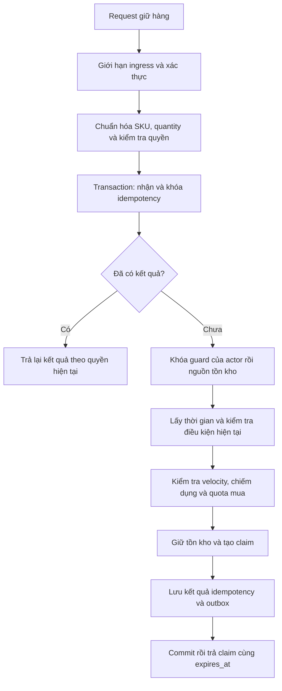
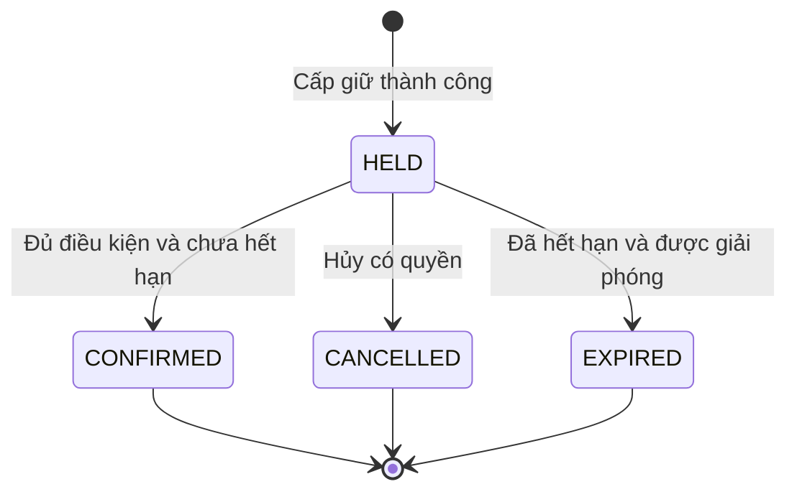

# Inventory claim velocity — Kiểm soát tốc độ chiếm giữ tồn kho

## 1. Bài toán: hệ thống vẫn chạy nhưng khách không còn hàng để mua

Trong chương **Rate Limit Abuse** của module bảo mật logic nghiệp vụ, inventory claim velocity là tốc độ một chủ thể hoặc một nhóm chủ thể tạo các lượt giữ hàng, giữ vé, giữ ghế hoặc giữ suất dịch vụ. Tài sản cần bảo vệ là khả năng tiếp cận nguồn cung hữu hạn của người dùng hợp lệ.

Một request giữ hàng có thể đúng schema, đã đăng nhập và không vượt giới hạn request thông thường. Tuy vậy, chuỗi request giữ rồi bỏ có thể khiến hàng luôn ở trạng thái không khả dụng, trong khi hệ thống gần như không bán được gì.

OWASP API6 nêu việc mua gom sản phẩm và chiếm giữ chỗ đặt trước là những ví dụ lạm dụng luồng nghiệp vụ nhạy cảm. Điều này cho thấy chỉ bảo vệ tài nguyên máy chủ chưa đủ để bảo vệ cơ hội mua hàng. Xem [API6:2023 — Unrestricted Access to Sensitive Business Flows](https://api-security.owasp.org/editions/2023/en/0xa6-unrestricted-access-to-sensitive-business-flows/).

Sau bài học, người học có thể:

- Phân biệt tốc độ request, tốc độ tạo lượt giữ, số lượng đang giữ và tổng lượng được mua.
- Viết invariant về tồn kho, quota và thời hạn giữ.
- Chọn phạm vi giới hạn, thuật toán thời gian và đơn vị tính phù hợp.
- Kết hợp transaction, state machine, quyền theo đối tượng và idempotency để chống lạm dụng.
- Kiểm thử tình huống tranh chấp đồng thời, retry, hết hạn và đổi danh tính.

Các con số và mô hình dữ liệu trong bài là **ví dụ thiết kế**, không phải ngưỡng chung cho mọi sản phẩm. Phần SQL minh họa một nguồn tồn kho có thẩm quyền duy nhất; hệ thống phân tán nhiều vùng cần cơ chế phân bổ quyền cấp hàng riêng.

## 2. Định nghĩa đúng hành động được tính

### 2.1. Claim khác với request và đơn đã mua

Trong bài này, một **claim** là bản ghi giữ một số đơn vị tồn kho cho một chủ thể trong thời hạn xác định. Một claim mới chỉ được xem là thành công khi transaction tạo claim và giữ tồn kho đã commit.

| Đại lượng | Đơn vị | Ví dụ |
| --- | --- | --- |
| Request velocity | Request mỗi khoảng thời gian | 30 lần gọi API giữ hàng trong một phút |
| Claim velocity | Claim mới hoặc đơn vị hàng được giữ mới mỗi khoảng thời gian | 6 đơn vị được cấp giữ trong cửa sổ 60 giây |
| Active held units | Đơn vị đang được hạch toán là giữ chỗ | Đang giữ tổng cộng 2 chiếc |
| Committed purchase units | Đơn vị đã được chốt mua theo chính sách | Đã mua 2 chiếc trong đợt bán |
| Hold duration | Thời gian tài nguyên bị giữ | Một claim giữ hàng tối đa 120 giây |

Một request chứa `quantity=20` có thể chiếm nhiều tài nguyên hơn 20 request mỗi request giữ một đơn vị. Vì vậy, đối với tồn kho, đếm theo số đơn vị thường cần thiết bên cạnh đếm số claim.

Một request retry có thể là lần truyền HTTP mới nhưng vẫn thuộc cùng một thao tác giữ hàng. Nó không được tạo claim hoặc gia hạn giữ hàng thêm lần nữa.

### 2.2. Ba loại ngân sách cần tách riêng

1. **Ngân sách tiếp nhận request:** bảo vệ CPU, kết nối, xác thực và truy vấn.
2. **Ngân sách tạo claim theo thời gian:** hạn chế việc liên tục cấp các lượt giữ mới.
3. **Ngân sách chiếm dụng và mua hàng:** giới hạn số đang giữ và tổng số được chốt mua.

Hủy claim có thể trả hàng về kho và giảm số đang giữ. Nó không nhất thiết hoàn lại ngân sách tạo claim trong cửa sổ thời gian. Nếu mỗi lần hủy đều xóa lịch sử tạo claim, kẻ lạm dụng có thể giữ, hủy rồi giữ lại không giới hạn.

Tương tự, “chỉ mua tối đa hai chiếc” không tự hạn chế việc một tài khoản giữ hai chiếc rồi bỏ hàng trăm lần.

## 3. Ví dụ lạm dụng và tác động kinh doanh

Giả sử một đợt bán có 200 chiếc, thời hạn giữ là 120 giây và mỗi tài khoản được giữ tối đa 2 chiếc. Một nhóm 100 tài khoản tạo mỗi tài khoản một claim giữ 2 chiếc. Chỉ 100 request đã có thể làm toàn bộ 200 chiếc tạm thời không khả dụng.

Mỗi tài khoản có thể còn rất xa ngưỡng 30 request/phút. Hệ thống không nhất thiết quá tải, nhưng khách thực sự muốn mua vẫn không lấy được hàng.

Các biến thể thường cần xem xét:

| Hành vi | Vì sao giới hạn đơn giản chưa đủ | Kiểm soát cần phối hợp |
| --- | --- | --- |
| Một request giữ số lượng rất lớn | Đếm request bỏ qua trọng số số lượng | Giới hạn quantity và số đơn vị được cấp |
| Giữ rồi hủy liên tục | Hoàn lại toàn bộ quota sẽ cho phép quay vòng | Lịch sử claim không bị xóa khi hủy |
| Giữ đến sát hạn rồi gia hạn | Mỗi lần renew có thể kéo dài vô hạn | Hạn tuyệt đối tính từ lần tạo đầu |
| Đổi IP hoặc dùng nhiều phiên | Khóa theo IP không theo đúng chủ thể | Giới hạn theo actor và nguồn tồn kho |
| Gọi qua web, mobile và GraphQL | Mỗi endpoint có bộ đếm riêng | Một chính sách tại dịch vụ nghiệp vụ |
| Dùng nhiều tài khoản | Quota từng tài khoản không kiểm soát cụm | Phân tích quan hệ, hàng chờ và phân bổ công bằng hơn |
| Gửi song song nhiều request | Các request cùng thấy quota còn đủ | Kiểm tra và cập nhật nguyên tử |
| Gọi xác nhận sau khi hết hạn | Claim cũ có thể tranh hàng đã cấp cho người khác | State machine và kiểm tra hạn dưới khóa |

Không được suy ra rằng mọi người dùng giữ rồi bỏ đều có ý đồ xấu. Người mua có thể đổi ý, mất mạng hoặc gặp lỗi thanh toán. Phản ứng cần dựa trên chính sách rõ ràng và tác động quan sát được.

## 4. Viết invariant trước khi chọn rate limiter

### 4.1. Invariant về tồn kho

Để đơn giản, xét một nguồn hàng cố định chưa có nhập thêm, trả hàng hoặc điều chuyển:

```text
S = available_units + held_units + committed_units

available_units >= 0
held_units >= 0
committed_units >= 0
```

Trong đó:

- `S` là tổng số đơn vị được phân bổ cho nguồn hàng trong ví dụ.
- `available_units` là số có thể cấp giữ mới.
- `held_units` là số đang được hạch toán cho claim ở trạng thái HELD.
- `committed_units` là số đã chuyển từ giữ sang chốt mua.

Khi tạo claim số lượng `q`: available giảm `q`, held tăng `q`. Khi xác nhận: held giảm `q`, committed tăng `q`. Khi hủy hoặc giải phóng claim hết hạn: held giảm `q`, available tăng `q`.

Đây là mô hình phân bổ của bài, không thay thế toàn bộ kế toán kho vật lý. Hàng giao đi, hàng trả lại và thay đổi nguồn cung cần những chuyển dịch nghiệp vụ riêng.

### 4.2. Invariant về chủ thể và đợt bán

Một chính sách minh họa:

```text
1 <= quantity_per_claim <= 2
held_units_per_actor <= 2
held_units_per_actor + purchased_units_per_actor <= 2
new_claim_units_in_rolling_60s + requested_quantity <= 6
initial_hold_duration = 120 seconds
absolute_hold_lifetime <= 180 seconds
```

Phạm vi của các giới hạn trên là cùng tenant, đợt bán và nguồn tồn kho. Giới hạn tổng lượng được mua không được tự reset vì người dùng tạo giỏ hàng mới hoặc đổi thiết bị.

Thời hạn 180 giây chỉ áp dụng nếu sản phẩm cho phép gia hạn có điều kiện. Nếu không có nghiệp vụ gia hạn, giữ nguyên hạn 120 giây; không tạo endpoint renew chỉ vì mô hình có thể hỗ trợ.

### 4.3. Invariant về quyền và dữ liệu

- Actor và tenant lấy từ ngữ cảnh xác thực, không lấy từ trường tùy ý client gửi.
- SKU, biến thể và kho được ánh xạ về nguồn tồn kho có thẩm quyền ở server.
- Chỉ chủ thể có quyền mới được đọc, xác nhận hoặc hủy claim.
- Giá, ưu đãi và điều kiện mua được xác định từ dữ liệu server.
- Claim chỉ có một chuyển trạng thái kết thúc có hiệu lực.
- Retry cùng operation không tạo thêm claim, không cộng thêm tồn kho và không đổi thời điểm tạo ban đầu.

Một điểm rủi ro thấp, một vé hàng chờ hợp lệ hoặc CAPTCHA đã giải không được tạo ngoại lệ cho các invariant này.

## 5. Chọn khóa giới hạn đúng phạm vi

Khóa chỉ theo URL thường quá nông; khóa chỉ theo account có thể vô tình trộn nhiều đợt bán không liên quan. Cần diễn đạt chính sách dưới dạng phạm vi dữ liệu rõ ràng.

| Phạm vi | Mục đích |
| --- | --- |
| `tenant + actor + sale + stock_pool` | Kiểm soát tốc độ và chiếm dụng của một chủ thể với một nguồn hàng |
| `tenant + actor + sale` | Giới hạn tổng mua trên nhiều SKU nếu sản phẩm quy định |
| `tenant + sale + stock_pool` | Bảo vệ khả năng cấp hàng và điều tiết cạnh tranh toàn nguồn |
| Nguồn mạng đáng tin cậy | Giảm tải request hoặc bổ sung tín hiệu rủi ro |
| Cụm danh tính có bằng chứng | Phát hiện nhóm tài khoản phối hợp, cần cơ chế quản trị riêng |

`stock_pool` là định danh server dùng cho nguồn cung thực sự. Nếu nhiều alias SKU cùng trỏ một nguồn hàng nhưng mỗi alias có quota riêng, người dùng có thể quay vòng alias để vượt giới hạn.

Nếu quota là “hai chiếc cho toàn bộ đợt bán”, khóa có SKU sẽ chưa đủ. Khi đó cần thêm ngân sách cấp đợt bán và bảo vệ mọi ngân sách liên quan trong cùng giao thức cấp hàng.

IP không đại diện chắc chắn cho một người. Văn phòng, trường học và mạng di động có thể có nhiều người chung IP; một người cũng có thể đổi IP. Quota tài khoản cũng không chứng minh quota theo con người nếu hệ thống cho phép tạo nhiều tài khoản.

## 6. Tính vận tốc theo thời gian một cách nhất quán

Với thời điểm quyết định `t`, một cách định nghĩa số đơn vị claim mới là:

```text
C(actor, t, Δ)
  = tổng quantity của các claim được tạo thành công
    có created_at trong khoảng (t - Δ, t]

Điều kiện nhận claim mới:
C(actor, t, 60 giây) + requested_quantity <= 6
```

Khoảng trên loại biên trái và bao gồm biên phải. `created_at` là thời điểm quyết định do server có thẩm quyền ghi, không phải timestamp do client truyền.

Claim đã hủy, đã hết hạn hoặc đã chốt mua vẫn đóng góp vào lịch sử tạo claim cho đến khi ra khỏi cửa sổ. Trạng thái hiện tại dùng để tính chiếm dụng; lịch sử tạo dùng để tính tốc độ. Không dùng cùng một bộ đếm thay thế cả hai.

### 6.1. Đếm trước hay sau transaction?

Cần đặt tên rõ cho đại lượng:

- `attempt_count`: số lần thử, có thể tăng cả khi lệnh bị từ chối.
- `admission_units`: số đơn vị được limiter cho đi tiếp, có thể chưa tạo claim được.
- `created_claim_units`: số đơn vị thuộc các claim đã được commit.
- `active_held_units`: số đơn vị vẫn đang được hạch toán là giữ.

Nếu lấy token Redis trước rồi transaction tạo claim thất bại, token đã tiêu thụ không tự trở thành “claim thành công”. Có thể chấp nhận tiêu thụ bảo thủ để chống thử liên tục, nhưng phải mô tả đúng ngữ nghĩa và theo dõi riêng.

Trong mô hình transaction ở phần sau, giới hạn bắt buộc dựa vào lịch sử claim trong cùng cơ sở dữ liệu. Tạo claim thất bại không tăng `created_claim_units`; một giới hạn attempt độc lập vẫn có thể ghi nhận lần thử đó.

### 6.2. Chọn thuật toán theo ý nghĩa cam kết

| Thuật toán | Đặc điểm | Điều cần hiểu |
| --- | --- | --- |
| Cửa sổ cố định | Dễ triển khai, lưu trữ ít | Có thể tạo đợt dồn ở ranh giới hai cửa sổ |
| Sliding log có trọng số | Cộng quantity của các claim còn trong cửa sổ | Cần lưu lịch sử và thao tác nguyên tử |
| Sliding window xấp xỉ | Tiết kiệm hơn log đầy đủ | Có sai số, cần xác định mức vượt được chấp nhận |
| Token bucket | Cho phép burst và nạp lại theo tốc độ | Không tương đương giới hạn cứng của mọi cửa sổ trượt |
| Hàng chờ cấp quyền | Điều tiết lượt vào khu vực cạnh tranh | Vé hàng chờ chưa phải quyền đã giữ được hàng |

Ví dụ token bucket có sức chứa `B=2` đơn vị và tốc độ nạp `r=6` đơn vị/phút có thể cho đi khoảng `B + r × T` đơn vị trong khoảng dài `T` khi bắt đầu đầy. Vì vậy, nó không có cùng cam kết với “tối đa 6 đơn vị trong mọi cửa sổ 60 giây”.

Có thể kết hợp một giới hạn ngắn để giảm burst, một giới hạn dài để chống quay vòng và một trần chiếm dụng đồng thời. Mỗi giới hạn phải có tên, phạm vi và đơn vị riêng.

## 7. Luồng tạo claim cần kiểm soát nhiều lớp

Một luồng minh họa:



Các nhánh từ chối cần trả lý do đúng, không làm thay đổi tồn kho. Giới hạn ingress vẫn có thể tác động request replay khi hệ thống đang quá tải; điều đó không được làm mất khả năng tra cứu một claim đã tạo thành công.

### 7.1. Không có bước nào thay thế bước khác

- Rate limiter không chứng minh tồn kho còn đủ.
- Kiểm tra tồn kho không chứng minh người dùng chưa vượt quota.
- Idempotency không ngăn người dùng cố tình tạo nhiều key mới.
- Xác thực không đồng nghĩa có quyền hủy claim bất kỳ.
- Một phiên hợp lệ không làm giá client gửi trở thành giá có thẩm quyền.

Mọi đường tạo hoặc tăng lượng giữ, gồm giỏ hàng, checkout nhanh, API đối tác và công cụ nội bộ, phải đi qua cùng quy tắc nghiệp vụ hoặc một quy trình được cấp quyền và kiểm soát tương đương.

Nếu cho sửa quantity, việc tăng từ 1 lên 2 phải xin cấp thêm một đơn vị qua các kiểm tra tương ứng. Không cho endpoint “sửa giỏ” tăng giữ hàng mà không đi qua kiểm soát cấp hàng.

### 7.2. Ràng buộc idempotency với ý nghĩa của lệnh

Khóa idempotency cần được đặt trong phạm vi tenant, actor và loại thao tác. Server tính fingerprint từ payload đã chuẩn hóa, bao gồm nguồn hàng, đợt bán, số lượng và các trường làm thay đổi tác động nghiệp vụ.

- Cùng key, cùng fingerprint, đã tạo claim: trả kết quả của claim đó.
- Cùng key, khác fingerprint: từ chối xung đột.
- Hai request cùng key đến đồng thời: một request xử lý; request còn lại chờ hoặc nhận trạng thái đang xử lý theo hợp đồng.
- Key mới nhưng cùng actor và nguồn hàng: vẫn bị kiểm tra velocity, chiếm dụng và quota.

Replay không thay `created_at`, `expires_at` hay quantity. Kết quả được lưu có thể chứa hạn gốc đã qua; client phải hiểu đây là kết quả operation cũ và có thể tra cứu trạng thái hiện tại. Không tạo claim mới để làm cho một replay cũ “còn hiệu lực”.

## 8. Một thiết kế transaction có thẩm quyền

Phần này minh họa mô hình PostgreSQL với mức cô lập **READ COMMITTED**, một nơi có quyền ghi cho mỗi nguồn hàng và giao thức khóa được tất cả đường ghi tuân thủ.

### 8.1. Dữ liệu tối thiểu

| Dữ liệu | Trách nhiệm |
| --- | --- |
| `inventory_stock` | Số available, held và committed theo nguồn hàng |
| `actor_inventory_guard` | Hàng khóa ổn định cùng số đang giữ và đã mua của actor |
| `inventory_claim` | Chủ sở hữu, quantity, thời điểm tạo, hạn giữ và trạng thái |
| `idempotency_operation` | Fingerprint và kết quả thao tác đã được ghi bền vững |
| `outbox_event` | Sự kiện cần phát sau commit |

Khóa duy nhất của guard phải khớp phạm vi quota, trong ví dụ là `(tenant_id, actor_id, sale_id, stock_pool_id)`. Nếu chưa có guard, tạo an toàn bằng thao tác có unique constraint và xử lý tranh chấp; không dùng chuỗi “SELECT không thấy rồi INSERT không có bảo vệ”.

### 8.2. Khóa hàng guard trước khi đọc lịch sử

Các câu SQL sau là những phần của **cùng transaction**, với tham số được bind bởi thư viện truy cập dữ liệu:

```sql
-- 1. Hàng guard phải tồn tại, đúng phạm vi và được khóa.
SELECT held_units, purchased_units
FROM actor_inventory_guard
WHERE tenant_id = :tenant_id
  AND actor_id = :actor_id
  AND sale_id = :sale_id
  AND stock_pool_id = :stock_pool_id
FOR UPDATE;

-- 2. Khóa nguồn hàng theo thứ tự chung của toàn hệ thống.
SELECT available_units, held_units, committed_units
FROM inventory_stock
WHERE tenant_id = :tenant_id
  AND sale_id = :sale_id
  AND stock_pool_id = :stock_pool_id
FOR UPDATE;

-- 3. Lấy mốc quyết định sau khi đã có các khóa cần thiết.
SELECT clock_timestamp() AS decision_at;

-- 4. Dùng đúng mốc decision_at cho truy vấn lịch sử.
SELECT COALESCE(SUM(quantity), 0) AS claimed_units
FROM inventory_claim
WHERE tenant_id = :tenant_id
  AND actor_id = :actor_id
  AND sale_id = :sale_id
  AND stock_pool_id = :stock_pool_id
  AND created_at > :decision_at - INTERVAL '60 seconds'
  AND created_at <= :decision_at;
```

Truy vấn lịch sử **không lọc theo trạng thái hiện tại**. Claim đã chuyển sang CANCELLED, EXPIRED hoặc CONFIRMED vẫn đại diện một lần đã được cấp giữ.

Tại READ COMMITTED, truy vấn lịch sử là statement riêng chạy sau khi lấy được guard. Khi mọi lần tạo claim cùng phạm vi đều khóa guard trước, hai transaction không thể đồng thời đọc cùng một ngân sách rồi cùng vượt trần.

Chỉ đặt `@Transactional` quanh một phép `SELECT SUM` rồi `INSERT` mà không có giao thức đồng bộ phù hợp không tạo ra bảo đảm này. Việc khóa guard cũng không tự ngăn một đường ghi khác bỏ qua nó.

PostgreSQL mô tả `FOR UPDATE` dùng để khóa các hàng được chọn và giữ khóa đến khi transaction kết thúc. Thiết kế vẫn cần thứ tự lấy khóa nhất quán để giảm deadlock. Xem [PostgreSQL — Explicit Locking](https://www.postgresql.org/docs/current/explicit-locking.html#LOCKING-ROWS).

### 8.3. Dùng thời gian đúng với thời điểm quyết định

Không lấy timestamp từ client. Nếu transaction phải chờ khóa, thời điểm bắt đầu transaction có thể đã cũ khi đến bước cấp hàng.

Trong PostgreSQL, `CURRENT_TIMESTAMP` phản ánh thời điểm bắt đầu transaction, còn `clock_timestamp()` phản ánh thời gian hiện tại khi được gọi. Ví dụ chọn một mốc sau khi lấy khóa và dùng lại nhất quán. Xem [PostgreSQL — Current Date/Time](https://www.postgresql.org/docs/current/functions-datetime.html#FUNCTIONS-DATETIME-CURRENT).

Cần định nghĩa rõ “được cấp tại thời điểm nào”. Trong ví dụ, `created_at` là mốc quyết định dưới khóa, được lưu cùng transaction; thời điểm phát sự kiện hoặc nhận phản hồi không thay thế mốc này.

Transaction cần ngắn, không gọi dịch vụ thanh toán hoặc chờ người dùng bên trong. Đặt giới hạn thời gian chờ khóa và có chính sách retry cho lỗi tranh chấp. Khi nguồn thời gian sai lệch bất thường, không cho timestamp tương lai hoặc nhảy lùi làm quota tự mở rộng ngoài chính sách.

### 8.4. Cập nhật tồn kho có điều kiện

Sau khi kiểm tra các quota:

```sql
UPDATE inventory_stock
SET available_units = available_units - :quantity,
    held_units = held_units + :quantity
WHERE tenant_id = :tenant_id
  AND sale_id = :sale_id
  AND stock_pool_id = :stock_pool_id
  AND available_units >= :quantity;
```

Ứng dụng phải kiểm tra đúng một hàng được cập nhật. Kết quả bằng 0 là không cấp được từ nguồn hàng đó hoặc dữ liệu đích không tồn tại; không được tiếp tục insert một claim thành công.

Trong cùng transaction, ứng dụng còn phải:

1. Tăng `held_units` của guard với quantity tương ứng.
2. Tạo đúng một claim trạng thái HELD.
3. Lưu `created_at` và `expires_at` do server xác định.
4. Lưu kết quả idempotency.
5. Ghi sự kiện outbox.

Nếu một bước thất bại, toàn bộ thay đổi cấp giữ phải rollback. Có thể bổ sung CHECK constraint cho số lượng dương và các số dư không âm; chúng là lớp bảo vệ thêm, không thay thế toàn bộ logic giao dịch.

### 8.5. Minh họa điều phối bằng mã giả Java

Đoạn dưới là **mã giả theo phong cách Java**. Các repository và kiểu dữ liệu biểu diễn hợp đồng cần triển khai, không phải một chương trình hoàn chỉnh.

```java
ClaimResult createClaim(AuthenticatedActor actor, ClaimCommand cmd) {
    NormalizedClaim input = normalizeAndValidate(actor, cmd);
    authorizeCreate(actor, input);

    return database.inReadCommittedTransaction(tx -> {
        Operation op = tx.lockOrCreateOperation(
                actor.tenantId(),
                actor.id(),
                "CREATE_INVENTORY_CLAIM",
                cmd.idempotencyKey(),
                fingerprint(input));

        op.requireSameFingerprint(fingerprint(input));

        if (op.completed()) {
            authorizeReadResult(actor, op.result());
            return op.result();
        }

        tx.ensureGuardExists(input.scope());
        Guard guard = tx.lockGuard(input.scope());
        Stock stock = tx.lockStock(input.stockScope());

        Instant decisionAt = tx.databaseTimeAfterLocks();
        Policy policy = tx.loadApplicablePolicy(input.saleId());
        requireSaleOpenAndEligible(actor, input, decisionAt, policy);

        long recentUnits = tx.sumCreatedUnits(
                input.scope(),
                decisionAt.minusSeconds(60),
                decisionAt);

        if (recentUnits + input.quantity() > 6) {
            return tx.rejectAndComplete(op, "CLAIM_VELOCITY_EXCEEDED");
        }

        if (guard.heldUnits() + guard.purchasedUnits()
                + input.quantity() > 2) {
            return tx.rejectAndComplete(op, "ACTOR_ALLOCATION_LIMIT");
        }

        if (stock.availableUnits() < input.quantity()) {
            return tx.rejectAndComplete(op, "STOCK_UNAVAILABLE");
        }

        tx.moveAvailableToHeldOrFail(
                input.stockScope(), input.quantity());
        tx.incrementActorHeld(input.scope(), input.quantity());

        Claim claim = tx.insertHeldClaim(
                input,
                decisionAt,
                decisionAt.plusSeconds(120));

        ClaimResult result = ClaimResult.created(claim);
        tx.completeOperation(op, result);
        tx.appendOutbox("inventory.claim.created", claim);
        return result;
    });
}
```

Các ngưỡng trong mã được viết trực tiếp để dễ theo dõi ví dụ; triển khai thực tế cần lấy từ policy có phiên bản, thống nhất với schema, phạm vi khóa và thời gian áp dụng.

Ở đây, `rejectAndComplete` lưu kết quả từ chối cho operation hiện tại nhưng không thay đổi tồn kho. Nếu API chọn hợp đồng này, replay cùng key vẫn trả từ chối cũ; người dùng thử một operation mới sau thời gian chờ cần key mới. Một hợp đồng khác có thể không lưu bền vững một số lỗi tạm thời, nhưng phải được định nghĩa và kiểm thử rõ ràng.

Các lỗi bất ngờ như lỗi insert, constraint hoặc lỗi kết nối không được chuyển thành kết quả thành công. Khi không rõ commit đã xảy ra chưa, tra cứu hoặc retry bằng cùng key để xác định kết quả; không vội tạo key mới.

## 9. State machine cho giữ, xác nhận và giải phóng



Gia hạn hợp lệ, nếu có, chỉ cập nhật hạn của claim vẫn còn HELD. Nó không tạo lại trạng thái ban đầu và không thay `created_at`.

### 9.1. Hết hạn về thời gian chưa đồng nghĩa đã hạch toán trả kho

Khi `now >= expires_at`, claim không được dùng để xác nhận mua nữa. Tuy nhiên, nếu worker chưa xử lý, số lượng có thể vẫn nằm trong `held_units`.

Trong mô hình này, hàng chỉ trở lại available khi transaction giải phóng chuyển trạng thái và cập nhật số dư. Độ trễ worker có thể làm giảm khả năng bán tạm thời, nhưng không được sửa bằng cách vừa coi hàng đã tự trả vừa cho worker cộng trả thêm lần nữa.

TTL của một khóa Redis hoặc việc key biến mất không tự tạo transaction trả kho trong cơ sở dữ liệu. Nguồn dữ liệu có thẩm quyền phải ghi nhận chuyển dịch đó.

### 9.2. Confirm và expire phải tranh chấp cùng claim

Mọi đường xác nhận, hủy và hết hạn tuân thủ thứ tự khóa đã thiết kế: guard, nguồn hàng, rồi claim. Khi nhiều đối tượng cùng loại cần khóa, dùng thứ tự định danh nhất quán.

Sau khi lấy khóa:

- Nếu trạng thái không còn HELD, không được áp dụng lại chuyển dịch số dư.
- Nếu xác nhận khi `decision_at < expires_at` và mọi điều kiện mua hợp lệ, chuyển held sang committed.
- Nếu thời điểm đã bằng hoặc vượt hạn, không xác nhận từ claim này; có thể thực hiện đường giải phóng theo chính sách.
- Nếu giải phóng thắng trước, request xác nhận đến sau không được hồi sinh claim.
- Nếu xác nhận hợp lệ thắng trước, worker expire đến sau không được cộng trả tồn kho.

Một câu cập nhật dạng `WHERE state = 'HELD'` và việc kiểm tra số hàng cập nhật hỗ trợ chống thực thi trùng. Tất cả thay đổi claim, stock và guard vẫn phải commit cùng nhau.

### 9.3. Thanh toán là một bước nghiệp vụ riêng

Nếu thanh toán cần gọi dịch vụ bên ngoài, không mở transaction kho trong suốt thời gian gọi mạng. Cần xác định rõ cơ chế ủy quyền thanh toán, callback có xác thực, idempotency và đối soát.

Thanh toán thành công sau khi claim hết hạn không tự cho phép lấy hàng từ claim đã giải phóng. Sản phẩm phải có quy trình xử lý như xin cấp lại hàng nếu còn, hoàn tiền hoặc đưa vào đối soát; tránh chốt mua bằng cách làm âm tồn kho.

Nếu cần bảo vệ thời gian cho thanh toán đang xử lý, dùng trạng thái hoặc quyền giữ có thời hạn được thiết kế rõ. Không để việc bắt đầu thanh toán tạo một lần giữ vô hạn.

## 10. Chặn quay vòng hủy và gia hạn

Khi hủy một claim 2 đơn vị:

```text
active_held_units giảm 2
available_units tăng 2
created_claim_units trong cửa sổ hiện tại không giảm
```

Nếu ngay sau đó tạo một claim mới, lần cấp mới tiếp tục tiêu thụ ngân sách velocity. Cách này hạn chế việc dùng cùng một lượng tồn kho để tạo vô hạn lượt giữ.

Nếu cho phép gia hạn, một công thức minh họa là:

```text
new_expires_at
  = min(current_expires_at + allowed_extension,
        original_created_at + absolute_max_lifetime)
```

Cần kiểm tra claim vẫn HELD và còn trong điều kiện được gia hạn dưới khóa. Replay cùng operation gia hạn không được cộng thêm thời gian lần nữa. Có thể giới hạn cả số lần gia hạn và tổng thời gian; công thức trên không tự quy định ai được phép gia hạn.

Ngoài trần tức thời, có thể theo dõi số lượt hủy, tỷ lệ chuyển thành mua và thời gian chiếm dụng tích lũy trong một khoảng dài hơn. Ví dụ, giữ 2 chiếc suốt nhiều chu kỳ vẫn có thể gây hại dù mỗi cửa sổ ngắn chưa vượt ngưỡng. Những tín hiệu này cần phản ứng phù hợp, tránh phạt người mua chỉ vì một lần thanh toán lỗi.

## 11. Nhiều node, Redis và giới hạn của tính nguyên tử

### 11.1. Bộ đếm trong bộ nhớ từng node không tạo quota chung

Nếu mỗi node cho actor tạo 6 đơn vị/phút, bốn node độc lập có thể cho tổng cộng 24 đơn vị/phút. Sticky session không phải bảo đảm nghiệp vụ vì request có thể đổi tuyến, node có thể khởi động lại và client có thể đi qua nhiều đường truy cập.

Nếu quota là cam kết bắt buộc, cần một nơi quyết định có thẩm quyền hoặc cơ chế phân bổ ngân sách có chứng minh giới hạn tổng. Cache cục bộ có thể hỗ trợ giảm tải nhưng không được tự mở thêm quyền cấp hàng.

Trong mô hình của bài, lịch sử claim và guard nằm tại cơ sở dữ liệu ghi có thẩm quyền. Không đọc quota bắt buộc từ replica có độ trễ rồi mặc định kết quả vẫn đúng lúc ghi.

### 11.2. Bộ đếm Redis cần thao tác nguyên tử

Một chuỗi như sau dễ sai:

```text
GET counter
nếu counter còn nhỏ thì cho đi
INCR counter
EXPIRE counter
```

Nhiều request có thể cùng đọc giá trị cũ; hoặc tiến trình dừng sau INCR nhưng trước EXPIRE. Redis mô tả rủi ro tách thao tác tăng đếm và đặt hạn, cùng cách gom logic thích hợp bằng transaction hoặc script. Xem [Redis INCR — Pattern: rate limiter](https://redis.io/docs/latest/commands/incr/#pattern-rate-limiter).

Cần xác định chính xác toàn bộ điều kiện nhận, cập nhật và TTL nào phải nguyên tử. Với giới hạn có trọng số, các thao tác đọc số đã dùng, kiểm tra `used + quantity` và tiêu thụ ngân sách không được tách thành các bước có thể tranh chấp.

Một counter có TTL từ lần đầu dùng không tự trở thành cửa sổ trượt. Không làm mới TTL trên mọi request nếu policy không chủ ý kéo dài cửa sổ theo hoạt động.

### 11.3. Redis và database không có transaction chung mặc định

Nếu Redis cho đi rồi database rollback, không thể mặc định hai bên tự đồng bộ lại. Các lựa chọn thiết kế gồm:

- Dùng Redis làm lớp hạn chế attempt hoặc admission bảo thủ, chấp nhận token đã tiêu thụ dù chưa có claim.
- Giữ quota bắt buộc trong cùng transaction cơ sở dữ liệu với thao tác cấp hàng như ví dụ.
- Thiết kế giao thức reservation ngân sách và đối soát riêng nếu thật sự cần tách hệ thống.

Không hoàn token chỉ vì client báo timeout: transaction tạo claim có thể đã commit. Hoàn không kiểm chứng có thể giúp cùng một thao tác nhận thêm ngân sách rồi tiếp tục chiếm hàng.

Atomic script bảo vệ một thao tác trên nơi thực thi, không tự bảo đảm bộ đếm không mất khi failover, eviction hoặc mất dữ liệu. Cấu hình triển khai và chính sách lỗi phải phù hợp với việc quota là bắt buộc hay chỉ giảm rủi ro.

Nếu giới hạn bắt buộc không kiểm tra được, có thể từ chối tạm thời hoặc đưa yêu cầu vào hàng chờ theo chính sách. Không âm thầm bỏ giới hạn chỉ để duy trì tỷ lệ thành công.

### 11.4. Tồn kho nhiều vùng cần ngân sách cấp hàng riêng

Hai vùng cùng thấy “còn 200 chiếc” rồi mỗi vùng cấp 200 là sai dù rate limiter ở mỗi vùng hoạt động đúng.

Một mô hình là phân bổ hạn mức hàng cho từng vùng sao cho tổng quyền cấp không vượt nguồn cung. Mô hình khác là đưa quyết định cấp về một nơi ghi có thẩm quyền. Việc chuyển quyền giữa vùng, failover và chống chủ cũ tiếp tục ghi cần giao thức riêng.

Giới hạn tốc độ không sửa được lỗi phân bổ tồn kho. Trước khi tối ưu throughput, cần xác định nơi nào có quyền trừ số dư và cách ngăn hai nơi cùng sử dụng một đơn vị.

## 12. Phân bổ công bằng hơn khi nhu cầu vượt nguồn cung

Một quota theo tài khoản vẫn có thể bị vượt qua bằng nhiều tài khoản. Giới hạn theo IP mạnh tay lại dễ chặn cả nhóm người hợp lệ dùng chung mạng.

Có thể phối hợp:

- Vé hàng chờ do server ký hoặc quản lý, ràng buộc với phiên hoặc actor theo hợp đồng.
- Số lượng khách được vào khu vực tạo claim có giới hạn.
- Vé được tiêu thụ nguyên tử, chống phát lại để vào nhiều lượt.
- Giới hạn đang giữ và tổng mua ở dịch vụ tồn kho dù đã qua hàng chờ.
- Đánh giá các cụm hành vi có bằng chứng, với biện pháp xác minh có thể phục hồi.
- Cách phân bổ phù hợp sản phẩm, chẳng hạn theo đợt hoặc bốc thăm có quy tắc rõ ràng.

Vé hàng chờ là quyền thử tiếp cận luồng, không phải cam kết đã có hàng. Kiểm tra còn hàng vẫn phải xảy ra tại quyết định cấp giữ.

Không đưa người dùng vào bước CAPTCHA hoặc xác minh kéo dài sau khi đã giữ hàng nếu không có ngân sách thời gian rõ ràng; chính bước đó có thể kéo dài chiếm dụng. Nếu cần xác minh trước cấp hàng, vé hoặc kết quả phải được ràng buộc với thao tác và có hạn.

Đối tác bán sỉ hoặc công cụ vận hành có thể có chính sách khác nhưng phải được nhận diện bằng quyền và hợp đồng rõ ràng. Không dùng một header do client tự khai như `X-Trusted-Client: true` để bỏ qua quota.

## 13. Phản hồi cho client và hành vi retry

Client cần phân biệt các lý do để tránh tự tạo thêm tải hoặc hiểu sai kết quả.

| Kết quả | Ngữ nghĩa | Hành vi phù hợp của client |
| --- | --- | --- |
| Tạo claim thành công | Đã giữ quantity đến hạn được trả về | Lưu claim ID, idempotency key và expires_at |
| Replay kết quả cũ | Không tạo lượt giữ mới | Dùng claim cũ và tra trạng thái nếu cần |
| `CLAIM_VELOCITY_EXCEEDED` | Chưa được tạo thêm lượt giữ theo cửa sổ | Chờ theo hướng dẫn; không lặp tức thời |
| `ACTOR_ALLOCATION_LIMIT` | Đang giữ hoặc đã mua đủ theo phạm vi | Hiển thị claim hiện có hoặc giới hạn mua |
| `STOCK_UNAVAILABLE` | Không cấp được hàng từ nguồn đó lúc quyết định | Không mô tả thành lỗi tài khoản |
| `CLAIM_EXPIRED` | Claim không còn dùng để xác nhận | Không tự kéo dài claim; tạo thao tác mới nếu được phép |
| Xung đột idempotency | Key đã gắn với payload khác | Sửa cách quản lý operation, không gửi lặp vô hạn |
| Không xác định do timeout | Chưa biết kết quả cuối | Tra cứu hoặc retry bằng cùng key |

Có thể dùng HTTP 429 cho giới hạn tốc độ và kèm `Retry-After` phù hợp hợp đồng API. Các lỗi hết hàng, quota tổng hoặc trạng thái cần mã nghiệp vụ riêng; cách ánh xạ HTTP nên nhất quán trong sản phẩm.

Với cửa sổ có trọng số, thời điểm sớm nhất có thể nhận thêm phụ thuộc lượng cần xin và các claim sẽ rời cửa sổ. Một giá trị “còn 10 giây” không bảo đảm chắc chắn sẽ nhận được hàng sau 10 giây, vì nguồn cung và cạnh tranh có thể đã thay đổi.

Client nên dùng backoff có jitter cho lỗi tạm thời và tôn trọng hướng dẫn retry. Retry do mất phản hồi phải giữ cùng key; một ý định tạo claim mới thực sự mới dùng key mới. Không coi thay key liên tục là cách xử lý 429.

Không giới hạn việc hủy hợp lệ theo cách khiến khách không thể trả hàng về kho. Endpoint hủy vẫn cần quyền và kiểm soát tải riêng, nhưng nên thiết kế để giảm chiếm dụng được thực hiện an toàn.

## 14. Quan sát đúng tác động của kiểm soát

### 14.1. Sự kiện cần có ý nghĩa nghiệp vụ

Một sự kiện claim mới có thể chứa:

```json
{
  "event_id": "evt-claim-410",
  "event_type": "inventory.claim.created",
  "schema_version": 1,
  "tenant_id": "tenant-07",
  "actor_ref": "actor-ref-19",
  "sale_id": "sale-11",
  "stock_pool_id": "pool-23",
  "claim_id": "claim-508",
  "operation_id": "op-724",
  "quantity": 2,
  "created_at": "2026-11-22T09:00:00Z",
  "expires_at": "2026-11-22T09:02:00Z",
  "state_after": "HELD",
  "policy_version": "claim-policy-v4"
}
```

Sự kiện thành công đi qua outbox gắn với transaction đã commit. Consumer khử trùng theo event ID; gửi lại cùng sự kiện không phải một claim mới.

Các sự kiện bổ sung gồm claim bị từ chối, đã xác nhận, đã hủy và đã giải phóng do hết hạn. Phân biệt mã lý do `VELOCITY`, `ALLOCATION_LIMIT`, `STOCK_UNAVAILABLE` và lỗi hệ thống.

Không ghi access token, cookie phiên hoặc payload thanh toán vào bằng chứng giữ hàng. Tham chiếu actor và quan hệ thiết bị cần quyền truy cập, thời hạn lưu giữ và mục đích điều tra rõ ràng.

### 14.2. Chỉ số cần theo dõi cùng nhau

| Chỉ số | Ý nghĩa |
| --- | --- |
| Request nhận / claim tạo thành công | Tách tải truyền thông khỏi tác động tồn kho |
| Đơn vị claim mới theo actor và cửa sổ | Kiểm tra vận tốc được cấp thực tế |
| Held / nguồn hàng được phân bổ | Xem mức chiếm dụng |
| Thời gian giữ trung bình và các phân vị | Nhận ra hàng bị giữ lâu |
| Tỷ lệ claim chuyển thành mua | Phát hiện biến động cần điều tra |
| Tỷ lệ hủy và hết hạn | Theo dõi quay vòng và vấn đề trải nghiệm |
| Độ trễ giải phóng sau expires_at | Đánh giá hàng bị treo do worker |
| Độ trễ khóa và transaction | Nhận ra điểm tranh chấp |
| Sai lệch giữa stock, guard và claim | Phát hiện lỗi hạch toán |
| Tỷ lệ khách hợp lệ bị giới hạn | Đánh giá chi phí của chính sách |

Khi tính tỷ lệ chuyển thành mua, nên dùng nhóm claim đã đủ thời gian quan sát. Claim vừa tạo còn đang chờ thanh toán không nên bị coi ngay là thất bại.

Có thể đo thêm số **đơn vị × thời gian giữ** để thấy một nhóm giữ ít mỗi lần nhưng chiếm dụng dai dẳng. Giảm tổng request không tự chứng minh cơ hội mua hàng đã công bằng hơn.

Metric vận hành nên có nhãn được giới hạn như policy, kết quả và đợt bán được quản trị. Chi tiết từng actor nằm trong kho sự kiện; không tạo nhãn riêng cho vô hạn tài khoản hoặc idempotency key.

## 15. Ma trận kiểm thử bảo vệ logic

Các tình huống dưới đây là đặc tả kiểm thử trên môi trường được kiểm soát. Cần xác minh kết quả API, trạng thái claim, các số dư và lịch sử cấp hàng cùng lúc.

| Tình huống | Kết quả cần bảo đảm |
| --- | --- |
| Quantity bằng 0, âm, quá lớn hoặc sai kiểu | Từ chối trước khi cấp; số dư không đổi |
| Client sửa actor, tenant, giá hoặc hạn giữ | Không dùng dữ liệu đó để vượt quyền hoặc policy |
| Hai request cùng key, cùng payload | Tối đa một claim mới và một lần trừ available |
| Cùng key nhưng khác quantity | Xung đột; không sửa claim cũ |
| Mất phản hồi sau commit | Retry cùng key lấy lại kết quả; không cấp lần hai |
| Tạo key mới sau mỗi request | Vẫn chịu velocity và quota theo actor |
| Lịch sử có 5 đơn vị, hai request song song mỗi request xin 1 | Chỉ một request được nhận theo trần 6 của ví dụ |
| Nhiều actor tranh đơn vị cuối | Tổng cấp không vượt tồn kho; chỉ bên thắng giữ được đơn vị đó |
| Đã giữ 1 và đã mua 1, xin thêm 1 | Bị từ chối theo tổng phân bổ 2 |
| Hủy claim rồi tạo lại ngay | Số đang giữ giảm nhưng lịch sử velocity vẫn tính claim trước |
| Claim hết hạn rồi tạo lại | Lượt cấp mới tiếp tục chịu kiểm tra velocity |
| Replay claim cũ sau khi đã hủy hoặc hết hạn | Không hồi sinh claim hoặc làm mới expires_at |
| Tạo claim đúng ranh giới cửa sổ | Tuân thủ khoảng `(t - Δ, t]` đã quy định |
| Chờ khóa lâu qua expires_at | Dùng thời điểm kiểm tra mới dưới khóa; không xác nhận bằng thời gian cũ |
| Confirm đồng thời với cancel hoặc expire | Chỉ một chuyển trạng thái có tác động số dư |
| Worker expire chạy lại hoặc nhận sự kiện trùng | Không cộng available nhiều lần |
| Gia hạn lặp cùng operation | Không cộng thêm thời gian do replay |
| Gia hạn qua hạn tuyệt đối | Không vượt original_created_at cộng trần lifetime |
| TTL cache mất nhưng claim DB chưa giải phóng | Không tự coi cả hai bên đều đã trả hàng |
| Node hoặc Redis khởi động lại | Không làm quota bắt buộc mở vô hạn |
| Gọi xen kẽ web, mobile và API khác | Chính sách nghiệp vụ vẫn cộng cùng phạm vi |
| Nhiều alias SKU dùng cùng nguồn hàng | Không nhân quota do khác tên đầu vào |
| Nhiều người dùng hợp lệ chung IP | Không kết luận cùng một người chỉ từ IP |
| Hai tenant có ID cục bộ giống nhau | Không trộn quota, lịch sử hoặc quyền đối tượng |
| Transaction lỗi sau cập nhật stock nhưng trước insert claim | Toàn bộ cấp giữ rollback |
| Thanh toán thành công sau khi claim hết hạn | Đi qua quy trình xử lý riêng, không làm âm tồn kho |
| Thay đổi policy trong đợt bán | Phiên bản áp dụng rõ ràng; không trộn ngưỡng và cách tính |
| Worker giải phóng bị dừng rồi chạy lại | Hàng được giải phóng có kiểm soát; không thất thoát hoặc trả trùng |

Kiểm thử tranh chấp cần dùng nhiều transaction hoặc kết nối thật với điểm đồng bộ để tạo cùng thời điểm cạnh tranh. Mock một giá trị counter không kiểm chứng được giao thức khóa cơ sở dữ liệu.

Kiểm thử thời gian cần điều khiển được mốc đánh giá hoặc dữ liệu thời gian của môi trường thử. Kiểm tra cả ngay trước, bằng và ngay sau biên 60 giây, 120 giây và trần gia hạn nếu có.

## 16. Dòng thời gian kiểm chứng ngữ nghĩa cửa sổ

Xét cùng một actor, một nguồn hàng, trần 6 đơn vị trong cửa sổ trượt 60 giây. Các claim trong ví dụ đều giữ 2 đơn vị và bị hủy ngay sau khi tạo; không có hàng đã mua.

| Mốc tính từ lần đầu | Hành vi | Kết quả |
| --- | --- | --- |
| 0 giây | Tạo claim A giữ 2 rồi hủy | Lịch sử trong cửa sổ là 2 |
| 10 giây | Tạo claim B giữ 2 rồi hủy | Lịch sử là 4 |
| 20 giây | Tạo claim C giữ 2 rồi hủy | Lịch sử là 6 |
| 30 giây | Xin tạo claim D giữ 2 | Bị từ chối dù không còn giữ hàng |
| 60 giây | Xin một operation mới giữ 2 | A đúng biên trái nên ra khỏi cửa sổ; có thể đủ quota nếu điều kiện khác đạt |
| 65 giây | Replay key của claim A | Trả kết quả operation A, không tạo giữ mới |

Bảng này chỉ kiểm chứng một điều kiện của ví dụ. Việc đủ ngân sách tốc độ không bảo đảm hàng còn, quota tổng còn hoặc người dùng còn đủ quyền.

Nếu dùng counter cửa sổ cố định hoặc token bucket, kết quả ranh giới có thể khác. Khi thay thuật toán phải cập nhật cam kết, tài liệu và kiểm thử; không chỉ thay thư viện rồi giữ nguyên cách diễn giải.

## 17. Triển khai và xử lý sự cố

Một lộ trình triển khai phù hợp:

1. Xác định nguồn hàng có thẩm quyền, đơn vị tính và phạm vi các quota.
2. Bảo đảm state machine, chống cấp vượt tồn kho và idempotency hoạt động trước khi thêm đánh giá hành vi.
3. Đo riêng attempts, admission, claim mới và số đang giữ.
4. Chạy quan sát các ngưỡng mới để đánh giá khách hợp lệ và tác động khuyến mãi.
5. Bật giới hạn trên phạm vi nhỏ, theo dõi thời gian chờ và khả năng thanh toán.
6. Kiểm tra worker giải phóng, đối soát số dư và quy trình khôi phục.
7. Điều chỉnh có phiên bản, người phụ trách và khả năng quay lại cấu hình trước.

Giới hạn bắt buộc đã có hiệu lực vẫn phải được bảo vệ khi thử nghiệm một chính sách mới ở chế độ quan sát. Tắt một rule phát hiện không được đồng thời tắt constraint tồn kho hoặc kiểm tra quyền.

Với query lịch sử, cần index phù hợp phạm vi và thời gian. Dữ liệu phục vụ cửa sổ bắt buộc không được xóa trước khi hết nhu cầu tính; trạng thái claim và bằng chứng idempotency có yêu cầu lưu giữ riêng. Tối ưu bằng bảng tổng hợp phải giữ đúng ngữ nghĩa và tính nguyên tử, không âm thầm biến quota cứng thành số liệu trễ.

Nếu đối soát phát hiện stock, guard và claim lệch nhau, dùng quy trình sửa có thẩm quyền và dấu vết. Không tùy tiện đặt counter về 0 vì thao tác đó có thể vừa cấp thêm hàng vừa xóa giới hạn mua.

Khi gặp lưu lượng quá lớn, có thể giảm số người được vào luồng giữ, giới hạn hàng đợi hoặc tạm ngừng nhận claim mới. Mục tiêu là giữ đúng số dư và điều kiện cấp hàng, đồng thời cho người dùng biết trạng thái thực tế.

## 18. Các dấu hiệu thiết kế cần sửa

- Dùng request/phút làm kiểm soát duy nhất cho nguồn cung hữu hạn.
- Chỉ giới hạn số đang giữ nhưng cho hủy để nhận lại toàn bộ ngân sách tốc độ.
- Reset TTL hoặc thời điểm tạo trên mỗi retry.
- Cho endpoint tăng quantity bỏ qua kiểm tra cấp thêm.
- Đọc quota rồi cập nhật trong hai bước không có đồng bộ.
- Dùng counter theo node như thể đó là quota toàn hệ thống.
- Lọc chỉ claim HELD khi tính lịch sử tạo claim.
- Coi khóa cache hết hạn đồng nghĩa hàng đã được trả về nguồn có thẩm quyền.
- Cho worker hết hạn cộng trả mà không kiểm tra chuyển trạng thái.
- Chỉ bảo vệ đường tạo claim mà bỏ đường confirm, cancel và renew.
- Cho quyền nội bộ hoặc client tự khai bỏ qua invariant.
- Đo thành công bằng số request bị chặn mà không đo thời gian chiếm dụng và cơ hội mua.

Một cơ chế kiểm soát inventory claim velocity đạt mục đích khi trả lời được: **ai được xin giữ, bao nhiêu đơn vị được cấp trong từng khoảng thời gian, đang chiếm dụng bao nhiêu, quyền giữ kết thúc thế nào và mọi trường hợp tranh chấp có giữ đúng số dư hay không**.
