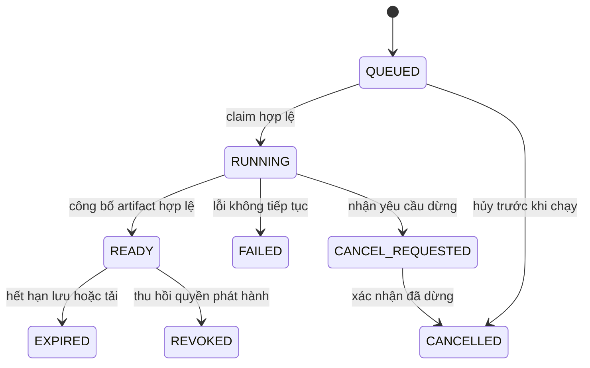

# Export request velocity: kiểm soát tốc độ yêu cầu xuất dữ liệu

## 1. Mục tiêu và phạm vi

**Export request velocity** là tốc độ phát sinh yêu cầu xuất dữ liệu, xét theo chủ thể, tổ chức, tập dữ liệu và khoảng thời gian. Trong chương **Rate Limit Abuse**, đây là một tín hiệu và điểm kiểm soát để bảo vệ cả dữ liệu lẫn tài nguyên xử lý.

Một API xuất báo cáo có thể hoàn toàn hợp lệ về HTTP nhưng vẫn bị lạm dụng:

- Người dùng liên tục tạo các báo cáo gần giống nhau để chiếm worker.
- Tài khoản bị chiếm dùng nhiều lần xuất nhỏ để lấy dần dữ liệu.
- Một tenant tạo lượng công việc lớn khiến tenant khác không được phục vụ.
- Client retry tạo nhiều job hoặc tải lại cùng một tệp không cần thiết.
- Người dùng hủy rồi tạo lại job để né cách tính quota không đúng.
- Một báo cáo đã tạo vẫn được tải sau khi quyền truy cập bị thu hồi.

Vì vậy, “tối đa N request/phút” chỉ là một lớp bảo vệ. Thiết kế đầy đủ còn cần quyền theo đối tượng, giới hạn dữ liệu, state machine, transaction, idempotency và kiểm soát vòng đời tệp.

Sau bài này, bạn có thể:

1. Phân biệt tốc độ gọi API với tốc độ tạo công việc và tốc độ đưa dữ liệu ra ngoài.
2. Đặt ngân sách cho hàng đợi, worker, lượng quét, lượng sinh tệp và tải xuống.
3. Tiếp nhận yêu cầu xuất một cách nhất quán khi có retry và cạnh tranh đồng thời.
4. Giữ quyền truy cập có hiệu lực tại lúc tạo job, chạy job và tải tệp.
5. Kiểm thử các tình huống lạm dụng logic của luồng export bất đồng bộ.

Các ngưỡng và khối lượng trong bài là số giả định để học, không phải cấu hình áp dụng chung.

## 2. Export là một chuỗi nghiệp vụ

Một lần xuất dữ liệu thường gồm:

```text
Gửi yêu cầu
  -> xác thực và kiểm tra phạm vi được xuất
  -> tiếp nhận, đặt trước ngân sách
  -> lưu job và đưa công việc vào hàng đợi
  -> worker truy vấn, tạo tệp
  -> công bố artifact hợp lệ
  -> người dùng yêu cầu tải
  -> kiểm tra quyền hiện tại
  -> truyền dữ liệu
  -> hết hạn và dọn tệp
```

Mỗi giai đoạn có điểm lạm dụng khác nhau.

| Giai đoạn | Rủi ro | Kiểm soát tương ứng |
|---|---|---|
| Nhận request | Burst, payload quá lớn, tham số gây công việc đắt | Giới hạn đầu vào và tốc độ trước công việc tốn tài nguyên |
| Tạo job | Retry sinh nhiều job, vượt quota do đồng thời | Idempotency, transaction, ràng buộc duy nhất |
| Chờ chạy | Một tenant lấp đầy queue | Giới hạn backlog và phân bổ công bằng |
| Chạy | Nhiều truy vấn nặng, output tăng ngoài dự kiến | Giới hạn đồng thời, thời gian và khối lượng |
| Hoàn thành | Worker cũ công bố tệp sai hoặc trùng | State machine, version và fencing |
| Tải xuống | Lộ tệp, tải lặp, vượt quyền hiện tại | Kiểm tra quyền, hạn dùng và giới hạn egress |
| Dọn dẹp | Tệp tồn tại quá lâu, trả quota sai | Chính sách lưu giữ, xác nhận xóa, đối soát |

Một limiter ở controller tạo export không tự bảo vệ các giai đoạn còn lại.

## 3. Các invariant phải được giữ độc lập với rate limit

### 3.1. Invariant về quyền và dữ liệu

- Tenant của job phải đến từ ngữ cảnh máy chủ đã xác thực.
- Chủ thể phải có quyền xuất loại dữ liệu, trường dữ liệu và phạm vi bản ghi tương ứng.
- Người gọi không được tự nâng phạm vi bằng cách sửa tenant ID, bộ lọc hoặc danh sách cột.
- Worker phải thực thi phạm vi được cấp, không chạy truy vấn tùy ý bằng quyền rộng của tài khoản kỹ thuật.
- Một job của tenant A không được đọc hoặc công bố artifact cho tenant B.
- Quyền đọc metadata của job không tự động là quyền tải toàn bộ nội dung tệp.

Nếu người dùng được phép xem một số trường trên giao diện, chưa chắc họ được phép xuất mọi trường của bảng dữ liệu. Quyền export cần được định nghĩa rõ.

### 3.2. Invariant về trạng thái và tác động

- Cùng một yêu cầu được retry trong hợp đồng idempotency không tạo thêm job logic.
- Một thông điệp queue được nhận lại không tự chạy lại toàn bộ tác động.
- Chỉ attempt còn hiệu lực mới được công bố kết quả của job.
- Job bị hủy không được chuyển sang sẵn sàng bởi worker cũ.
- Ngân sách đặt trước chỉ được giải phóng hoặc quyết toán một lần theo định danh reservation.
- Một artifact sẵn sàng về lưu trữ chưa đồng nghĩa với được phép tải trong mọi hoàn cảnh.

Những invariant này cần cơ chế thực thi tương ứng. Không thể thay chúng bằng cảnh báo “người dùng tạo nhiều export”.

### 3.3. Rate limit không sửa được lỗi phân quyền

Một endpoint cho phép xuất dữ liệu của tenant khác vẫn có lỗ hổng dù mỗi tài khoản chỉ được gọi một lần mỗi ngày. Chỉ một lần xuất sai quyền cũng có thể gây thiệt hại lớn.

Ngược lại, một người có quyền hợp lệ vẫn có thể lạm dụng tài nguyên. Do đó cần cả kiểm tra quyền và giới hạn mức sử dụng.

## 4. Đếm đúng đơn vị: request, job, công việc và dữ liệu

### 4.1. Tách các chỉ số

| Chỉ số | Đơn vị và ý nghĩa |
|---|---|
| `export_requests_received` | Số lần gọi API, kể cả retry và yêu cầu bị từ chối |
| `export_jobs_created` | Số job logic mới đã được lưu bền vững |
| `export_attempts_started` | Số attempt worker thực sự bắt đầu |
| `queued_jobs` | Công việc đang chờ, có thể gây tồn đọng |
| `executing_attempts` | Attempt thực sự đang chiếm tài nguyên chạy |
| `rows_scanned` | Lượng đọc để tạo báo cáo, nếu nguồn đo được |
| `rows_exported` | Lượng bản ghi được ghi ra kết quả |
| `bytes_generated` | Dung lượng tạo ra, có định nghĩa rõ trước hay sau nén |
| `stored_artifact_bytes` | Dung lượng còn được giữ trong kho |
| `bytes_transferred` | Dung lượng thực sự truyền qua đường tải xuống |

Không lấy số job hoàn thành làm số lần tải, và không lấy số lần tải làm số người đã đọc dữ liệu.

Một tệp tải nhiều lần hoặc tải các range chồng lặp có thể tạo nhiều chi phí mạng dù nội dung logic chỉ là một artifact.

### 4.2. Công thức velocity

Với khóa quan sát `k`, cửa sổ dài `W` và thời điểm `t`:

```text
new_job_velocity(k, W, t)
  = số job logic mới của k được tiếp nhận trong (t - W, t]
    / W
```

Có thể theo dõi thêm:

```text
generation_velocity = bytes_generated / thời gian
egress_velocity     = bytes_transferred / thời gian
scan_velocity       = rows_scanned / thời gian
```

Phải ghi rõ mẫu số và cách đo. Chỉ số trung bình trong mười phút có thể che một burst rất lớn trong mười giây.

### 4.3. Vì sao số request đơn thuần không đủ?

Giả sử mỗi job quét 2 triệu dòng và tạo tệp 75 MiB. Tám job tạo ra:

```text
Lượng quét      = 8 × 2.000.000 = 16.000.000 dòng
Dung lượng tệp  = 8 × 75        = 600 MiB
```

Tám request không có vẻ nhiều, nhưng tám truy vấn nặng chạy đồng thời có thể ảnh hưởng nghiêm trọng đến hệ thống giao dịch.

Ngược lại, một client có thể gửi hàng chục retry của cùng một ý định xuất. Nếu idempotency hoạt động đúng, hệ thống chỉ có một job logic, dù lớp nhận request vẫn phải chịu chi phí xử lý các lần gọi.

### 4.4. Nén dữ liệu và giới hạn theo byte

Một tệp nén nhỏ có thể chứa lượng dữ liệu lớn. Nếu chỉ giới hạn byte sau nén, ta có thể bỏ sót khối lượng bản ghi nhạy cảm đã được đưa ra ngoài.

Tùy mục tiêu, cần đo riêng:

- Số dòng và trường được xuất.
- Byte dữ liệu trước hoặc sau mã hóa định dạng.
- Byte artifact sau nén.
- Byte truyền thực tế qua mạng.

Một chỉ số không thay thế được tất cả các chỉ số còn lại.

## 5. Ngân sách nhiều chiều và khóa giới hạn

### 5.1. Các loại ngân sách khác nhau

| Ngân sách | Bảo vệ | Cách hiểu |
|---|---|---|
| Request rate | API, xác thực, tra cứu metadata | Mọi lần gọi vẫn có thể bị tính |
| New-job rate | Số ý định xuất mới | Retry cùng job không tạo lượt mới |
| Backlog | Hàng đợi và độ trễ | Giới hạn số job đang chờ |
| Concurrency | Worker và cơ sở dữ liệu | Giới hạn công việc thực sự chạy cùng lúc |
| Scan hoặc compute | Nguồn dữ liệu và tài nguyên tính toán | Tính chi phí truy vấn, không chỉ output |
| Generation quota | Tổng dữ liệu tạo ra | Có thể đặt trước rồi quyết toán |
| Storage quota | Dung lượng artifact còn giữ | Chỉ giảm khi dữ liệu đã được dọn theo hợp đồng |
| Egress quota | Lượng tải ra ngoài | Tính cả tải lại và truyền một phần theo chính sách |

Rate limit là giới hạn theo thời gian. Concurrency là số công việc cùng tồn tại ở trạng thái thực thi. Storage quota là lượng dữ liệu đang giữ. Không nên đặt cùng tên “quota” mà không phân biệt ngữ nghĩa.

### 5.2. Khóa phải đến từ danh tính và phạm vi tin cậy

Có thể kết hợp:

```text
tenant + principal + export_operation
tenant + dataset
tenant
service
```

Với tài khoản dịch vụ, principal cần là danh tính mà hệ thống xác thực thực sự cấp quyền. Không dùng trường `requestedBy` do client tự gửi làm căn cứ tính quota.

Nếu một người có thể chuyển giữa nhiều tenant, cần quyết định rõ ngân sách theo tenant, theo người hay cả hai. Với thao tác ủy quyền, lưu cả người thực hiện và chủ thể được đại diện theo mô hình quyền của hệ thống.

Khóa IP có thể giúp chặn request thô ở rìa, nhưng không thay thế khóa tenant và principal cho người đã xác thực.

### 5.3. Chính sách minh họa

Một chính sách có thể đồng thời đặt:

- Giới hạn request ngắn hạn theo principal.
- Giới hạn job mới theo tenant trong cửa sổ trượt.
- Giới hạn backlog của mỗi tenant.
- Giới hạn worker đồng thời cho mỗi tenant và toàn dịch vụ.
- Giới hạn số dòng, thời gian chạy và dung lượng cho từng job.
- Ngân sách tạo tệp và egress trong một giai đoạn dài hơn.

Việc đạt một điều kiện không có nghĩa là bỏ qua các điều kiện khác. Một tenant còn quota byte vẫn có thể phải chờ vì đã dùng hết số worker được phân bổ.

Với token bucket, cần chỉ rõ burst và tốc độ nạp. Dung lượng bucket không đồng nghĩa với giới hạn chính xác trong mọi cửa sổ trượt có cùng độ dài.

### 5.4. Quyền ưu tiên không phải quyền vô hạn

Nhóm được phép xuất khối lượng lớn có thể có ngân sách riêng, lịch chạy hoặc xét duyệt bổ sung.

Không nên miễn mọi kiểm soát chỉ vì người dùng là quản trị viên. Tài khoản quản trị bị chiếm có khả năng gây thiệt hại lớn hơn, còn truy vấn của họ vẫn tiêu thụ tài nguyên thật.

## 6. Chuẩn hóa yêu cầu và ràng buộc idempotency

### 6.1. Cần xác định “cùng một yêu cầu” là gì

Một ý định xuất có thể gồm:

```text
dataset
format
selected_fields
filters
resolved_time_range
sort_definition
scope_reference
snapshot_or_as_of_reference
```

Máy chủ cần kiểm tra và chuẩn hóa các trường theo hợp đồng API. Dùng một biểu diễn không nhập nhằng để tạo fingerprint.

Không lấy một chuỗi SQL do client gửi làm kế hoạch thực thi. Phạm vi dữ liệu và bộ lọc phải được xây theo mô hình truy vấn được phép.

Với bộ lọc như “bảy ngày gần nhất”, khi tiếp nhận lần đầu cần lưu khoảng thời gian đã được giải quyết hoặc mốc dữ liệu thích hợp. Retry của cùng ý định không được âm thầm trở thành báo cáo cho một khoảng thời gian mới.

Một mốc `as_of` chỉ có ý nghĩa snapshot nếu nguồn dữ liệu thực sự hỗ trợ cách đọc nhất quán đó. Không hứa khả năng tái tạo báo cáo chỉ bằng cách lưu một timestamp.

### 6.2. Ràng buộc key với chủ thể và nội dung

Phạm vi idempotency có thể là:

```text
tenant + principal + operation + idempotency_key
```

Trong phạm vi này:

- Key mới và yêu cầu hợp lệ: có thể tạo job mới nếu đủ ngân sách.
- Key đã có và fingerprint giống: trả lại tham chiếu job cũ sau khi kiểm tra quyền.
- Key đã có nhưng fingerprint khác: trả lỗi xung đột theo hợp đồng.
- Key hết thời hạn lưu: xử lý theo hợp đồng đã công bố; không giả định chống lặp vô hạn.

Không dùng idempotency key làm bằng chứng sở hữu job. Không chia sẻ kết quả giữa các tenant chỉ vì hai yêu cầu có cùng bộ lọc.

Một idempotency hit không được phát lại signed URL đã hết hạn hoặc bỏ qua quyền hiện tại. Nó chủ yếu giúp nhận diện job logic cũ.

### 6.3. Idempotency không miễn chi phí request

Ngay cả khi không tạo thêm job, request vẫn cần xác thực, kiểm tra quyền và tra cứu trạng thái. Vì vậy:

- Lớp giới hạn request có thể tính mọi lần gọi.
- Ngân sách job mới chỉ tính lần tạo ý định mới.
- Chi phí worker thực tế được tính theo các attempt đã chạy.
- Chi phí tải xuống được tính tại đường truyền.

Nếu client đổi key liên tục, đó là nhiều ý định mới theo hợp đồng, không phải retry được miễn quota.

Có thể gộp những yêu cầu tương đương để tối ưu, nhưng phải bảo đảm cùng phạm vi quyền và phiên bản dữ liệu. Gộp theo fingerprint toàn hệ thống có thể làm rò rỉ sự tồn tại hoặc nội dung của dữ liệu tenant khác.

## 7. Tiếp nhận job bằng transaction và outbox

### 7.1. Mục tiêu của bước tiếp nhận

Khi hệ thống trả rằng job đã được tiếp nhận, cần có trạng thái bền vững về:

- Job logic và phạm vi dữ liệu được yêu cầu.
- Ràng buộc idempotency.
- Reservation hoặc quyết định ngân sách tương ứng.
- Công việc cần chuyển đến worker.

Không được chỉ đẩy queue rồi mới cố lưu job, hoặc trừ quota rồi làm mất thông tin chủ sở hữu reservation.

### 7.2. Pseudocode cho trường hợp cùng kho giao dịch

Giả sử job, idempotency binding, ngân sách nghiệp vụ và outbox nằm trong cùng một cơ sở dữ liệu có khả năng giao dịch phù hợp:

```text
authenticate_and_authorize_request()
apply_request_rate_limit()

BEGIN TRANSACTION

  acquire_or_insert_idempotency_binding_with_unique_constraint()

  if binding already exists:
      verify_same_fingerprint()
      load_existing_job()
      verify_current_access_to_job()
      COMMIT
      return existing_job_reference

  lock_relevant_budget_and_backlog_records_in_defined_order()

  require_new_job_budget()
  require_pending_job_capacity()
  require_estimated_resource_reservation()

  create_job_in_QUEUED_state()
  create_reservation_bound_to_job()
  attach_job_to_idempotency_binding()
  append_export_requested_to_outbox()

COMMIT

return job_reference
```

Ràng buộc duy nhất và cách xử lý xung đột phải bảo đảm hai request đồng thời không cùng tạo job cho một key. Cách khóa và thứ tự khóa cần phù hợp cơ sở dữ liệu được chọn.

Nếu ngân sách không đủ, transaction không được để lại một job mồ côi hoặc reservation không có chủ sở hữu. Có thể lưu quyết định từ chối riêng nếu thiết kế yêu cầu, nhưng phải định nghĩa rõ retry của quyết định đó.

### 7.3. Không giả định transaction xuyên mọi hệ thống

Nếu quota nằm trong một dịch vụ khác còn job ở cơ sở dữ liệu riêng, pseudocode trên không tự tạo tính nguyên tử xuyên hai nơi.

Khi đó cần một giao thức như reservation có định danh, xác nhận, hết hạn có kiểm soát và đối soát; hoặc đặt lại ranh giới dữ liệu để thực thi bảo đảm cần thiết.

Một timeout sau lệnh đặt trước có thể chưa cho biết reservation đã được tạo hay chưa. Gửi lại lệnh với định danh mới có thể trừ hai lần. Cần truy vấn hoặc retry theo định danh ổn định của chính thao tác đặt trước.

### 7.4. Outbox không làm queue trở thành exactly-once

Outbox gắn việc lưu job với ý định phát sự kiện. Bên phát và queue vẫn có thể gửi lại cùng công việc.

Consumer cần nhận diện job, version và attempt. Thông điệp nhận lại không được tạo thêm job hoặc công bố thêm artifact trái phép.

## 8. State machine của worker và artifact

### 8.1. Trạng thái minh họa



Đây là mô hình tối giản. Hệ thống có retry có thể thêm trạng thái chờ retry và số attempt, nhưng cần giữ lịch sử job logic ban đầu.

`READY` nghĩa là artifact đã được công bố hợp lệ về kỹ thuật. Quyền tải vẫn phải được kiểm tra theo chính sách tại thời điểm sử dụng.

### 8.2. Claim nguyên tử và fencing

Worker nhận job cần chuyển trạng thái bằng thao tác có điều kiện theo version hoặc attempt đang có hiệu lực.

Ví dụ về ngữ nghĩa:

```text
claim chỉ thành công nếu:
  job.state == QUEUED
  AND job.version == expected_version

khi claim thành công:
  state = RUNNING
  attempt_id = new_attempt
  fencing_version tăng
```

Khi công bố kết quả, worker phải chứng minh attempt và fencing version vẫn còn hiệu lực. Worker cũ không được ghi đè kết quả của attempt mới.

Artifact có thể được ghi vào vùng staging riêng cho từng attempt. Chỉ khi hoàn tất kiểm tra và cập nhật trạng thái có điều kiện thành công mới gắn artifact vào job như kết quả được phát hành.

Tệp staging không được có URL công khai. Kết quả của attempt đã mất hiệu lực phải được dọn theo quy trình.

### 8.3. Lease hết hạn không có nghĩa công việc đã dừng

Nếu worker mất kết nối, lease có thể hết hạn nhưng truy vấn vẫn đang chạy. Khởi động ngay worker thứ hai có thể làm hai attempt cùng tiêu thụ tài nguyên.

Fencing khi finalize ngăn kết quả cũ được công bố, nhưng không tự dừng CPU, I/O hay truy vấn đã chạy.

Vì vậy cần:

- Timeout và cơ chế hủy công việc ở nguồn dữ liệu khi có thể.
- Giới hạn số attempt, backoff và điều kiện retry.
- Theo dõi attempt đang chạy thực tế, không chỉ dòng trạng thái lease.
- Ngân sách cho cả công việc của attempt thất bại hoặc bị thay thế.
- Đối soát khi chưa xác định được worker cũ đã dừng hay chưa.

Không báo cáo concurrency toàn hệ thống được bảo đảm tuyệt đối chỉ từ việc có một key lease với TTL.

### 8.4. Hủy job là một chuyển trạng thái có cạnh tranh

Hủy job đang chờ có thể được xử lý trong transaction nếu chắc chắn chưa có worker claim.

Hủy job đang chạy thường cần đi qua `CANCEL_REQUESTED`. Chỉ giải phóng tài nguyên chạy khi đã xác nhận công việc dừng theo cơ chế thực tế.

Một cuộc đua giữa finalize và cancel phải được giải quyết bằng điều kiện trạng thái và version, không bằng “request nào đến controller trước”.

Nếu job đã sẵn sàng nhưng người dùng muốn thu hồi tệp, đó là chính sách thu hồi artifact, không phải giả vờ rằng công việc chưa từng chạy.

## 9. Đặt trước, đo thực tế và quyết toán ngân sách

### 9.1. Tách quota không hoàn lại và ngân sách tài nguyên

Một lượt tạo job đã được chấp nhận có thể vẫn tính vào giới hạn job mới dù sau đó người dùng hủy. Nếu luôn hoàn lượt này ngay khi hủy, chuỗi tạo-hủy có thể lấp đầy hệ thống mà không tiêu hao quota.

Ngân sách tài nguyên có thể có cách quyết toán khác:

- Phần chưa dùng được trả lại khi đã có bằng chứng không còn tiếp tục dùng.
- Phần đã tiêu thụ vẫn tính, kể cả job lỗi hoặc bị hủy.
- Một reservation chỉ được giải phóng một lần.
- Việc xác nhận xóa tệp mới giảm số byte đang lưu; chỉ đổi trạng thái không làm dung lượng vật lý biến mất.

Cần quy định đơn vị ngân sách. “Byte tạo ra” phục vụ chi phí xử lý khác “byte đã tải ra ngoài” phục vụ egress và phân tích rò rỉ.

### 9.2. Mô hình số dư

Với một loại tài nguyên trong một kỳ tính:

```text
available = limit - consumed - reserved_remaining
```

Trong đó:

- `consumed` là phần đã đo và ghi nhận là sử dụng.
- `reserved_remaining` là phần còn được giữ cho công việc chưa tiêu thụ.
- Hai phần không được cùng tính một lượng sử dụng nếu đang áp dụng mô hình này.

Ví dụ một job đặt trước 80 MiB:

```text
Khi tiếp nhận:
  consumed tăng 0
  reserved_remaining tăng 80 MiB

Đã tạo 30 MiB:
  consumed tăng 30 MiB
  reserved_remaining giảm 30 MiB

Hoàn tất với tổng thực tế 60 MiB:
  consumed của job là 60 MiB
  giải phóng 20 MiB còn lại
```

Việc chuyển số dư cần nhất quán và chống xử lý lặp. Mỗi cập nhật phải có định danh hoặc checkpoint phù hợp để sự kiện nhận lại không cộng thêm chi phí.

Nếu một attempt lỗi đã tốn 30 MiB rồi attempt khác chạy lại, chi phí đã tốn không tự biến mất. Không chỉ tính dung lượng artifact cuối cùng nếu mục tiêu ngân sách là bảo vệ tài nguyên sinh tệp.

### 9.3. Ước lượng thấp và mở rộng reservation

Ước lượng là dự đoán, không phải trần an toàn.

Trước khi xử lý thêm một chunk có khả năng vượt reservation còn lại, worker cần xin thêm ngân sách hoặc dừng theo chính sách. Đồng thời phải có giới hạn cứng theo job về:

- Thời gian chạy.
- Số dòng và lượng dữ liệu được xuất.
- Chi phí truy vấn hoặc lượng quét khi có khả năng đo và kiểm soát.
- Kích thước tệp.
- Số attempt.

Nếu chỉ đo sau mỗi chunk, phải biết lượng vượt tối đa có thể có giữa hai lần đo. Chunk quá lớn hoặc telemetry đến chậm làm quota mất tác dụng tại thời điểm cần bảo vệ.

Không cho phép chạy không giới hạn rồi mới báo “đã vượt quota” khi hoàn tất.

### 9.4. Minh họa tính ngân sách bằng Java

Khi kiểm tra giới hạn kiểu số nguyên, phép cộng không được tràn rồi tạo kết quả cho phép sai.

Ví dụ dùng một đơn vị duy nhất, chẳng hạn byte:

```java
public final class ExportBudgetMath {
    public record BudgetSnapshot(
            long limit,
            long consumed,
            long reservedRemaining) {

        public BudgetSnapshot {
            if (limit < 0 || consumed < 0 || reservedRemaining < 0) {
                throw new IllegalArgumentException("Negative budget value");
            }
        }
    }

    public static boolean canReserve(
            BudgetSnapshot budget,
            long requestedReservation) {

        if (requestedReservation < 0) {
            throw new IllegalArgumentException("Negative reservation");
        }

        if (budget.consumed() > budget.limit()) {
            return false;
        }

        long afterConsumed = budget.limit() - budget.consumed();

        if (budget.reservedRemaining() > afterConsumed) {
            return false;
        }

        long available = afterConsumed - budget.reservedRemaining();
        return requestedReservation <= available;
    }
}
```

Phép trừ chỉ được thực hiện sau khi kiểm tra thứ tự, nên không cần cộng ba giá trị lớn để so sánh.

Ví dụ:

```text
limit              = 500 MiB
consumed           = 300 MiB
reserved_remaining = 120 MiB
available          = 80 MiB

Xin thêm 80 MiB: có thể đặt trước
Xin thêm 81 MiB: không đủ
```

Hàm dùng cú pháp record của Java 17 và chỉ là phép tính trên snapshot. Nó không tạo tính nguyên tử: đọc snapshot, gọi hàm rồi cập nhật riêng rẽ vẫn có thể bị hai request đồng thời cùng dùng một số dư.

Thao tác kiểm tra và cập nhật reservation phải diễn ra trong transaction hoặc cơ chế nguyên tử tương đương. Khi đổi đơn vị MiB sang byte cũng phải kiểm tra phép nhân và giới hạn đầu vào.

Reservation bằng không không đồng nghĩa job miễn mọi kiểm soát; ngân sách job mới, backlog và các giới hạn khác vẫn áp dụng.

## 10. Kiểm soát hàng đợi và phân bổ công bằng

### 10.1. Rate limit và concurrency phải phối hợp

Giới hạn một số job trong mười phút không bảo đảm chúng không cùng chạy tại một thời điểm.

Ngược lại, chỉ giới hạn một worker mỗi tenant nhưng để backlog tăng vô hạn sẽ làm thời gian chờ và dung lượng metadata tăng không kiểm soát.

Một bộ kiểm soát nên trả lời:

- Mỗi principal và tenant có thể có bao nhiêu job mới?
- Bao nhiêu job được xếp hàng?
- Bao nhiêu attempt thực sự được chạy cùng lúc?
- Mỗi attempt được chiếm tài nguyên bao lâu?
- Khi quá tải, job mới bị từ chối hay được hẹn lại theo chính sách nào?

### 10.2. Không để một tenant chiếm toàn queue

Queue FIFO chung có thể khiến hàng trăm job của một tenant đứng trước mọi tenant khác.

Có thể cân nhắc hàng đợi theo tenant hoặc bộ lập lịch phân bổ công bằng. Job lớn và nhỏ cũng cần được xem xét để không có nhóm nào bị chờ vô hạn.

Các lựa chọn cần được đo trong kiến trúc cụ thể. Một thuật toán lập lịch công bằng theo số job chưa chắc công bằng theo chi phí nếu một job nặng gấp hàng trăm lần job khác.

### 10.3. Chi phí ước lượng cũng có thể bị lạm dụng

Không được tin số dòng hoặc thời gian chạy do client tự khai.

Việc ước lượng phải dựa trên kế hoạch máy chủ, metadata hoặc dữ liệu có kiểm soát. Bản thân thao tác đếm dòng hay preview cũng cần giới hạn; nếu lần ước lượng đã quét toàn bộ bảng, API preview có thể trở thành một endpoint tốn tài nguyên khác.

Phải có trần cho độ phức tạp truy vấn, phạm vi thời gian, số trường, kiểu định dạng và các thành phần làm tăng chi phí phù hợp với nghiệp vụ.

## 11. Quyền truy cập tại lúc chạy và lúc tải

### 11.1. Quyền lúc tiếp nhận không đủ cho job chạy muộn

Một job có thể chờ lâu. Trong thời gian đó:

- Người dùng bị chuyển bộ phận.
- Quyền export bị thu hồi.
- Một tập bản ghi trở nên hạn chế hơn.
- Chính sách trường dữ liệu thay đổi.
- Tài khoản bị vô hiệu hóa hoặc tenant bị đình chỉ.

Worker cần kiểm tra lại điều kiện chạy theo chính sách đã xác lập. Với job dài, có thể cần kiểm tra ở các checkpoint hoặc dùng cơ chế hủy khi quyền thay đổi.

Không tái dựng phạm vi bằng dữ liệu tùy ý từ message queue. Message nên tham chiếu job có thẩm quyền; worker lấy và kiểm chứng trạng thái, tenant và phạm vi tại nơi quản lý job.

### 11.2. Phải chọn hợp đồng quyền rõ ràng

Hai hệ thống có thể có hợp đồng khác nhau: một hệ thống cho phép báo cáo lịch sử theo quyền đã được phê duyệt; hệ thống khác yêu cầu quyền hiện tại trong toàn vòng đời.

Không được ngầm biến quyền tại thời điểm tạo thành quyền vĩnh viễn.

Đối với thiết kế yêu cầu quyền hiện tại, có thể lưu tham chiếu phạm vi và version chính sách rồi kiểm tra khi chạy và tải. Version chỉ hữu ích nếu nó bao phủ đầy đủ các thay đổi liên quan, gồm quyền bản ghi và trường dữ liệu.

Nếu phạm vi không còn tương thích, cách an toàn có thể là từ chối cả artifact và yêu cầu tạo báo cáo mới. Tệp CSV đã sinh không tự loại các dòng vừa bị thu hồi quyền.

### 11.3. Quyền tải phải kiểm tra trên đúng job và artifact

Khi yêu cầu tải, cần xác nhận:

```text
người gọi còn được xác thực
AND được phép đọc job trong đúng tenant
AND được phép nhận nội dung artifact theo chính sách
AND artifact còn được phát hành và chưa hết hạn
AND yêu cầu tải đáp ứng ngân sách liên quan
```

Job ID khó đoán không thay thế kiểm tra quyền theo đối tượng. Quyền xem trạng thái của đồng nghiệp cũng không tự động cho phép tải dữ liệu của họ.

Kiểm tra quyền trước mỗi lần phát hành đường tải, và xác định chính sách cho lượt truyền dài. Khi quyền bị thu hồi, hệ thống phải biết ranh giới hiệu lực và lượng dữ liệu có thể đã truyền hoặc đang trên đường; không thể thu hồi các byte người nhận đã có.

### 11.4. Signed URL không tự giải quyết mọi vấn đề

Một signed URL thường là khả năng truy cập có thời hạn trong phạm vi cơ chế ký. Việc người dùng có URL có thể đủ để tải nếu kho không yêu cầu thêm xác thực.

Cần xác định:

- URL có thể bị chuyển cho người khác không?
- Có thể giới hạn người nhận bằng cơ chế thực sự được thực thi không?
- Cơ chế thu hồi trước hạn là gì?
- Ai đo và giới hạn byte truyền?
- URL hoặc query chứa token có lọt vào log hay lịch sử công khai không?

Chỉ rate limit API cấp URL không giới hạn được việc tải trực tiếp nhiều lần từ kho lưu trữ.

Nếu cần kiểm tra quyền trực tuyến hoặc thu hồi nhanh theo chính sách, đường truyền phải đi qua hoặc phối hợp với thành phần thực thi được yêu cầu đó. URL ngắn hạn giảm thời gian phơi lộ nhưng không đồng nghĩa thu hồi tức thời.

## 12. Velocity của tải xuống và xuất nhỏ lặp lại

### 12.1. Một lần tạo tệp, nhiều lần truyền

Artifact 75 MiB được tải bốn lần có thể tạo 300 MiB lưu lượng nếu cả bốn lượt hoàn tất. Tệp vẫn chỉ chiếm khoảng 75 MiB trong kho theo mô hình lưu một bản.

Các range request cần được tính theo byte thực tế truyền, không chỉ số lượng tệp. Nhiều range chồng lặp vẫn tạo chi phí mạng.

Khi đặt trước egress cho một lượt tải, cần xử lý kết nối ngắt giữa chừng và giải phóng phần chưa dùng theo số đo đáng tin cậy. Việc giảm số dư phải chống thực hiện lặp.

Request HEAD, tra cứu trạng thái và cấp lại liên kết có thể không truyền nội dung tệp nhưng vẫn cần quota request để bảo vệ API.

### 12.2. Khối lượng dữ liệu logic và byte mạng khác nhau

Byte egress phản ánh chi phí và tốc độ truyền, không tự cho biết bao nhiêu bản ghi riêng biệt đã bị lộ.

Người dùng có thể chia một phạm vi lớn thành nhiều export nhỏ. Giới hạn mỗi tệp không nhìn thấy toàn bộ quá trình nếu thiếu kiểm soát tích lũy theo principal, tenant và tập dữ liệu.

Có thể theo dõi:

- Tần suất xuất các khoảng thời gian hoặc phân đoạn liên tiếp.
- Tổng dòng và trường nhạy cảm được xuất.
- Sự thay đổi lớn so với hành vi hợp lệ của nhóm.
- Chuỗi export ngay sau đổi quyền, đăng nhập bất thường hoặc đổi thông tin nhận kết quả.

Những tín hiệu này hỗ trợ điều tra; không nên coi mọi lần xuất liên tiếp là rò rỉ. Quy trình phân tích hợp lệ cũng có thể tạo nhiều báo cáo.

### 12.3. Không để luồng tương đương trở thành đường vòng

Cùng một dữ liệu có thể được lấy qua CSV, PDF, API phân trang, báo cáo gửi theo lịch hoặc export trên ứng dụng di động.

Cần nhận diện các luồng tương đương để chính sách quyền và ngân sách không bị chia nhỏ ngoài chủ đích. Không nhất thiết mọi luồng dùng cùng một bộ đếm, nhưng sự khác biệt phải có lý do và được đánh giá.

Export định kỳ cần chủ sở hữu, quyền hiện tại theo hợp đồng và thời hạn. Một lịch đã tạo trước đây không tự giữ quyền xuất mãi mãi.

## 13. Chính sách lỗi, đối soát và triển khai

### 13.1. Không mất kiểm soát khi phụ thuộc lỗi

| Sự cố | Hành vi cần được định nghĩa |
|---|---|
| Không kiểm tra được quyền | Không phát hành dữ liệu chỉ vì dịch vụ quyền đang lỗi |
| Không biết còn ngân sách để nhận job mới | Từ chối hoặc trì hoãn theo chính sách, không tự coi là vô hạn |
| Queue tạm không nhận được message | Job và outbox còn đủ để tiếp tục phát sau |
| Worker chết giữa chừng | Giữ lịch sử attempt, xử lý lease và chi phí đã dùng |
| Chưa biết reservation đã được ghi chưa | Đối soát theo định danh ổn định, tránh đặt trước lặp |
| Không xóa được artifact | Ngăn tải theo trạng thái nhưng vẫn theo dõi dung lượng còn tồn tại |
| Telemetry đến muộn | Không trả quota chỉ vì dashboard chưa thấy sử dụng |

Một phản hồi lỗi kỹ thuật không đồng nghĩa rằng chưa có job hoặc chưa có chi phí. Client cần dùng key ổn định và đọc trạng thái thay vì tạo ý định mới một cách mù quáng.

### 13.2. Đối soát định kỳ

Cần phát hiện:

- Reservation không có job hoặc job không có reservation cần thiết.
- Job terminal nhưng còn reservation chưa quyết toán.
- Artifact staging bị bỏ quên.
- Artifact được ghi là đã xóa nhưng vẫn tồn tại.
- Job mắc kẹt ở trạng thái chạy nhưng không xác định được attempt.
- Chênh lệch giữa byte đo tại worker, kho lưu trữ và đường truyền.

Đối soát phải dựa trên danh tính và state machine, không tự hoàn toàn bộ reservation đã quá một khoảng thời gian nếu công việc vẫn có thể đang chạy.

### 13.3. Version hóa và canary

Version hóa chính sách rate limit, định nghĩa chi phí, quyền và cách quyết toán.

Khi chạy shadow, chỉ ghi quyết định giả định của ứng viên; không đặt trước ngân sách thật hai lần cho cùng job.

Khi canary, chọn nhóm ổn định theo tenant hoặc đơn vị phù hợp. Theo dõi:

- Job mới được nhận và bị từ chối.
- Độ sâu queue và thời gian chờ.
- Tải cơ sở dữ liệu và số attempt thực sự chạy.
- Chênh lệch giữa ước lượng và thực tế.
- Tỷ lệ người dùng hợp lệ gặp hạn chế.
- Lượng dữ liệu tạo ra, lưu và tải xuống.
- Lỗi quyền, artifact bị thu hồi và lỗi quyết toán.

Rollback cấu hình không tự hủy job đang chạy, thu hồi tệp đã tải hay hoàn chi phí. Kế hoạch rollback cần nêu rõ cách xử lý các trạng thái đang tồn tại.

## 14. Bộ tình huống kiểm thử

| Tình huống | Kết quả cần xác nhận |
|---|---|
| Nhiều request đồng thời dùng cùng key và nội dung | Chỉ một job logic, không đặt trước nhiều lần |
| Cùng key nhưng khác bộ lọc hoặc định dạng | Xung đột rõ ràng, không trả kết quả của yêu cầu khác |
| Khác key nhưng cùng nội dung | Áp chính sách job mới hoặc gộp có kiểm soát, không mặc định miễn quota |
| Retry sau timeout ngay sau commit | Truy xuất được job cũ, không sinh job thứ hai |
| Nhiều job tranh phần ngân sách cuối | Không cùng dùng vượt số dư vì kiểm tra và cập nhật rời rạc |
| Giá trị số rất lớn | Không tràn số làm quyết định ngân sách sai |
| Đổi tenant ID trong payload hoặc URL | Không đọc dữ liệu hoặc job tenant khác |
| Yêu cầu trường không được xuất | Bị từ chối hoặc xử lý theo hợp đồng không mở rộng quyền |
| Queue gửi lại cùng message | Không tạo tác động xử lý hoặc công bố trùng trái phép |
| Worker cũ finalize sau khi mất lease | Fencing ngăn công bố kết quả không còn hiệu lực |
| Lease hết hạn nhưng truy vấn chưa dừng | Không giả định tài nguyên đã được giải phóng |
| Hủy trong lúc worker claim | Chuyển trạng thái có kết quả nhất quán |
| Hủy sau khi đã sinh một phần tệp | Không hoàn chi phí đã dùng hoặc công bố staging |
| Sự kiện quyết toán được nhận lại | Không tính hoặc giải phóng ngân sách hai lần |
| Ước lượng thấp hơn thực tế | Xin thêm reservation hoặc dừng trước giới hạn theo chính sách |
| Quyền bị thu hồi khi job còn chờ | Worker không chạy bằng quyền cũ ngoài hợp đồng |
| Quyền bị đổi sau khi tệp sẵn sàng | Tải được kiểm tra lại hoặc artifact bị thu hồi theo chính sách |
| Người khác có job ID hoặc signed URL | Kiểm chứng đúng mô hình quyền và giới hạn của đường tải |
| Tải lại hoặc range chồng lặp | Byte mạng được tính theo thực tế, không chỉ một artifact |
| Một tenant tạo backlog lớn | Tenant khác vẫn được phục vụ trong bảo đảm thiết kế |
| Tệp hết hạn nhưng xóa thất bại | Không tải được theo chính sách; storage quota vẫn phản ánh dữ liệu còn giữ |
| Store quota hoặc dịch vụ quyền lỗi | Không mở luồng xuất vô hạn hoặc xuất sai quyền |
| Poll trạng thái rất nhanh | API trạng thái được bảo vệ mà không tạo thêm job |
| Tạo-hủy liên tục | Không né toàn bộ quota hoặc chiếm tài nguyên miễn phí |

Kiểm thử tích hợp phải bao gồm cơ sở dữ liệu, queue, worker và đường tải phù hợp kiến trúc. Mock một limiter luôn trả cho phép không xác nhận được transaction, cạnh tranh đồng thời hay quyền trên artifact.

Nên có một kịch bản xuyên suốt: tiếp nhận, retry, worker nhận lại message, quyền thay đổi, hủy cạnh tranh với finalize và thử tải tệp sau đó.

## 15. Những lỗi thiết kế thường gặp

| Lỗi | Vì sao nguy hiểm | Hướng sửa |
|---|---|---|
| Chỉ đếm request tạo export | Không nhìn thấy chi phí mỗi job và tải lại | Tách request, job, compute, storage và egress |
| Dùng số dòng output làm chi phí duy nhất | Truy vấn có thể quét rất nhiều để trả ít dòng | Theo dõi hoặc giới hạn chi phí nguồn phù hợp |
| Tin tenant hoặc người yêu cầu từ payload | Gán sai quyền và quota | Dựng ngữ cảnh từ danh tính đã xác thực |
| Trừ quota ở ngoài transaction rồi quên đối soát | Mất reservation hoặc trừ lặp | Định danh thao tác và giữ bảo đảm nhất quán |
| Hoàn mọi quota khi hủy | Tạo vòng tạo-hủy miễn phí | Giữ chi phí đã dùng, giải phóng phần chưa dùng có bằng chứng |
| Xem hết lease là đã dừng | Công việc trùng vẫn tiêu thụ tài nguyên | Fencing, hủy thực tế và đối soát attempt |
| Quyền chỉ kiểm tra lúc tạo | Job và tệp tồn tại lâu hơn quyền | Kiểm tra tại các điểm sử dụng theo hợp đồng |
| Chỉ rate limit endpoint cấp URL | Không giới hạn tải trực tiếp từ kho | Thực thi và đo egress tại đường truyền thực |
| Cho rằng URL ngắn hạn luôn thu hồi được ngay | Dữ liệu còn truy cập được trong thời hạn hiệu lực | Thiết kế cơ chế thu hồi hoặc chấp nhận rõ độ trễ |
| Giới hạn từng tệp nhưng không giới hạn tích lũy | Nhiều lần xuất nhỏ vẫn tạo khối lượng lớn | Thêm ngân sách dài hạn và tín hiệu chuỗi hành vi |
| Dùng snapshot timestamp không có bảo đảm nguồn | Báo cáo không tái tạo được như mô tả | Định nghĩa và thực thi hợp đồng snapshot |
| Log nguyên bộ lọc, URL ký hoặc dữ liệu xuất | Tạo kênh lộ dữ liệu phụ | Lưu tham chiếu và metadata tối thiểu có kiểm soát |

## 16. Bài tập áp dụng

Bạn quản lý hệ thống đa tenant cho phép xuất lịch sử giao dịch thành CSV. Có người dùng cá nhân, tài khoản dịch vụ tạo báo cáo định kỳ và nhóm được phê duyệt xuất khối lượng lớn.

Hãy đề xuất thiết kế bằng cách trả lời:

1. Những kiểm soát nào là invariant và những ngưỡng nào được phép hiệu chỉnh?
2. Đơn vị đếm của request rate, new-job rate, backlog, concurrency và egress là gì?
3. Khóa nào lấy từ danh tính tin cậy, khóa nào liên quan đến dataset hoặc phạm vi quyền?
4. Idempotency ràng buộc tenant, principal, nội dung và mốc dữ liệu như thế nào?
5. Tiếp nhận job đảm bảo điều gì nếu commit thành công nhưng phản hồi HTTP bị mất?
6. Hai request tranh số dư cuối cùng được giải quyết bằng cơ chế nguyên tử nào?
7. Worker cũ tiếp tục chạy sau khi mất lease có thể gây thiệt hại gì, và fencing giải quyết được phần nào?
8. Hủy một job đã tạo 60% tệp sẽ quyết toán ngân sách như thế nào?
9. Khi quyền bị thu hồi sau lúc job hoàn thành, ai ngăn tải artifact?
10. Đường tải trực tiếp, tải lại và range request được đo và giới hạn ở đâu?
11. Triển khai shadow, canary và rollback có làm thay đổi ngân sách hoặc trạng thái hiện có không?
12. Những chỉ số nào chứng minh hệ thống bảo vệ dữ liệu mà vẫn phục vụ người dùng hợp lệ?

Một thiết kế tốt giải thích được cả lúc job được nhận lẫn lúc dữ liệu rời hệ thống. Mọi quyết định phải gắn với đúng chủ thể, đúng phạm vi quyền, trạng thái hợp lệ và chi phí thực tế của công việc.
