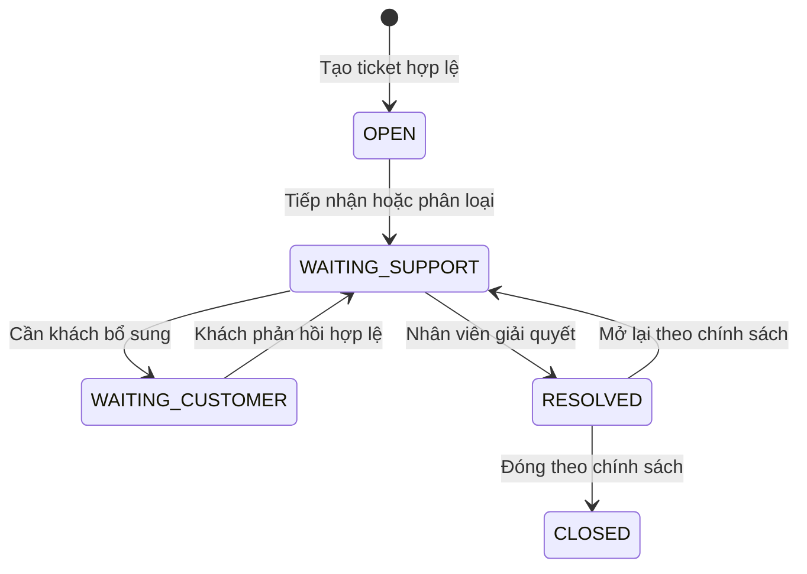
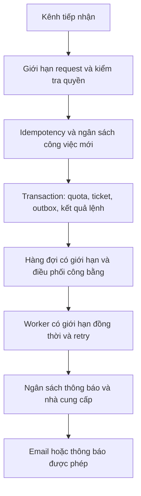

# Support request velocity

## 1. Vì sao luồng hỗ trợ cần giới hạn nghiệp vụ?

**Support request velocity** là tốc độ phát sinh các hành động trong luồng yêu cầu hỗ trợ: tạo ticket, gửi phản hồi, mở lại yêu cầu, tải tệp và kích hoạt thông báo. Bảo vệ luồng này đòi hỏi nhìn vào lượng công việc và hiệu ứng được tạo ra, thay vì chỉ đếm số lần gọi một URL.

Một request tạo ticket có thể đồng thời:

- Ghi dữ liệu và lưu tệp đính kèm.
- Tạo việc trong hàng đợi phân loại, quét tệp hoặc tìm kiếm.
- Gửi thư xác nhận và thông báo cho người theo dõi.
- Phân công nhân viên, khởi động thời hạn phản hồi và chiếm thời gian xử lý.

Giả sử mỗi ticket cần trung bình sáu phút phân loại ban đầu. Một trăm ticket không cần thiết có thể tạo ra khoảng mười giờ công phân loại, dù API chỉ mất vài giây để nhận chúng. Đây là ví dụ giả định để thấy tài nguyên nghiệp vụ có thể cạn trước tài nguyên máy chủ.

Trong chương **Rate Limit Abuse**, chủ đề này gắn trực tiếp với bảo vệ quy tắc nghiệp vụ: ai được yêu cầu hỗ trợ cho đối tượng nào, hành động nào tạo công việc mới, trạng thái nào được chuyển, và một retry được phép tạo bao nhiêu hiệu ứng. Mục tiêu là duy trì khả năng tiếp nhận và xử lý yêu cầu hợp lệ, kể cả khi có lạm dụng tự động.

OWASP API4 đề cập cả tài nguyên hạ tầng lẫn dịch vụ trả phí theo lần gọi như email, SMS và cuộc gọi. Luồng hỗ trợ có thể tiêu thụ đồng thời các tài nguyên đó; xem [OWASP API4:2023 — Unrestricted Resource Consumption](https://api-security.owasp.org/editions/2023/en/0xa4-unrestricted-resource-consumption/).

Sau bài học, người học cần có khả năng xây dựng bất biến cho tốc độ yêu cầu hỗ trợ, chọn khóa giới hạn đáng tin, xử lý retry và cạnh tranh, rồi kiểm thử cả ticket, hàng đợi và thông báo phát sinh.

## 2. Xác định đơn vị cần đếm

Không phải mọi request có cùng chi phí. Cũng không phải mọi request đều tạo một ticket mới.

| Đơn vị | Ví dụ | Kiểm soát phù hợp |
|---|---|---|
| Request tiếp nhận | Gọi API, phát lại webhook, polling trạng thái | Ngân sách request, kích thước đầu vào, timeout |
| Ticket mới | Tạo một yêu cầu xử lý độc lập | Giới hạn tạo mới theo chủ thể và tenant |
| Phản hồi | Thêm nội dung vào ticket đang có | Giới hạn theo người gửi và ticket |
| Mở lại ticket | Chuyển yêu cầu đã giải quyết về trạng thái cần xử lý | Kiểm tra trạng thái, quyền và ngân sách tạo lại công việc |
| Yêu cầu đang hoạt động | Ticket thuộc các trạng thái được định nghĩa là chưa hoàn tất | Quota số lượng tồn tại, cập nhật theo transaction |
| Tệp đính kèm | Tải ảnh, tài liệu, tệp ghi lỗi | Giới hạn số tệp, byte, thời gian và công việc xử lý |
| Thông báo ra ngoài | Thư xác nhận, nhắc việc, SMS | Ngân sách theo sự kiện, người nhận, tenant và nhà cung cấp |

Cần phân biệt ba đại lượng:

```text
Tốc độ đầu vào: số hành động mới trong một khoảng thời gian.
Số công việc đang tồn tại: lượng yêu cầu chưa hoàn tất tại một thời điểm.
Tốc độ xử lý: số công việc worker hoặc nhân viên hoàn thành theo thời gian.
```

Một tài khoản tạo một ticket mỗi giờ vẫn có thể tích lũy quá nhiều yêu cầu chưa xử lý. Ngược lại, một khách hàng có nhiều vấn đề độc lập thật sự không nên bị xem là lạm dụng chỉ vì có nhiều ticket đang mở. Quota và quy trình ngoại lệ cần phản ánh loại dịch vụ, hợp đồng và năng lực vận hành.

## 3. Mô hình lạm dụng và ranh giới tin cậy

Một kịch bản thường gặp là phía gọi tạo nhiều yêu cầu có nội dung gần giống nhau, đổi tiêu đề hoặc dùng nhiều kênh để tránh bộ đếm. Họ có thể dùng tài khoản hợp lệ; xác thực thành công chưa chứng minh số công việc được tạo là hợp lý.

Các tình huống cần xem xét gồm:

1. **Tràn hàng đợi:** tạo ticket nhanh hơn khả năng phân loại, làm yêu cầu thật phải chờ.
2. **Khuếch đại thông báo:** mỗi phản hồi gửi thư đến nhiều người theo dõi hoặc tạo cuộc gọi dịch vụ trả phí.
3. **Lạm dụng danh tính người khác:** điền email của nạn nhân để gửi thư hàng loạt hoặc làm đầy quota của họ.
4. **Né giới hạn qua đối tượng:** liên tục tạo ticket mới khi ticket cũ đã chạm giới hạn phản hồi.
5. **Né giới hạn qua kênh:** chia lưu lượng giữa web, di động, email và API đối tác.
6. **Lạm dụng chuyển trạng thái:** đóng rồi mở lại để tạo thông báo, làm mới SLA hoặc đưa ticket lên đầu hàng đợi.
7. **Retry có hiệu ứng lặp:** một lần gửi từ khách hàng bị biến thành nhiều ticket vì timeout, webhook phát lại hoặc worker chạy lại.

Ranh giới tin cậy cần được xác định rõ:

- `customerId`, `tenantId`, `priority`, `assignee` hoặc `status` do client gửi không tự trở thành dữ liệu được phép dùng.
- Ticket ID không phải bằng chứng về quyền xem hoặc quyền phản hồi ticket.
- Một dịch vụ email đã xác thực webhook chỉ chứng minh nguồn webhook theo hợp đồng tích hợp. Điều đó không tự chứng minh người gửi thư được quyền thao tác mọi ticket được nhắc trong thư.
- Địa chỉ email ở trường `From`, nội dung trích dẫn và header nhận diện luồng không tự là quyền truy cập vào nội dung riêng tư.
- Mã thông báo chống bot là một tín hiệu; nó không cấp thêm quyền với ticket hoặc loại bỏ quota nghiệp vụ.

## 4. Viết các bất biến cụ thể

Một chính sách có thể bắt đầu từ các bất biến sau:

```text
Chỉ chủ thể được phép mới được tạo hoặc phản hồi yêu cầu cho đối tượng liên quan.
Mọi kênh tạo cùng loại công việc phải đi qua chính sách nghiệp vụ chung.
Số hành động mới được chấp nhận không vượt ngân sách đã định nghĩa.
Số ticket đang hoạt động không vượt quota nếu nghiệp vụ có áp dụng quota đó.
Một thao tác idempotent chỉ tạo tối đa một kết quả nghiệp vụ tương ứng.
Retry của sự kiện không tự nhân số thông báo hoặc thay đổi trạng thái.
Client không thể tự tăng ưu tiên, thêm người nhận hoặc chọn nhân viên trái quyền.
```

Ví dụ chính sách minh họa cho một loại tài khoản đã xác thực:

| Phạm vi | Chính sách giả định | Lưu ý |
|---|---|---|
| Tạo ticket mới của một tài khoản | Tối đa 3 ticket trong mọi khoảng 10 phút | Chặn đợt tạo nhanh |
| Tạo ticket mới của một tài khoản | Tối đa 12 ticket trong mọi khoảng 24 giờ | Hạn chế lạm dụng kéo dài |
| Phản hồi của một tài khoản | Tối đa 8 phản hồi trong mọi khoảng 1 phút | Cộng gộp qua các ticket và kênh |
| Phản hồi trên một ticket | Ngưỡng riêng cho lưu lượng đến cùng đối tượng | Không thay thế kiểm tra quyền người gửi |
| Ticket đang hoạt động | Quota theo gói dịch vụ và nhu cầu đã xác định | Không phải một cửa sổ thời gian |
| Request, upload và thông báo | Ngân sách riêng theo tài nguyên | Một ticket không cho phép số hiệu ứng vô hạn |

Các ngưỡng trên chỉ dùng để giải thích, không phải cấu hình mặc định. Cần xác định từ phân bố lưu lượng hợp lệ, các đợt sự cố sản phẩm, nhu cầu khách hàng và năng lực đội hỗ trợ. Tài khoản doanh nghiệp dùng chung một tổ chức có thể cần mô hình theo thành viên kết hợp quota tổ chức.

Với cửa sổ trượt chính xác, giới hạn tạo mới có thể viết:

```text
Với mọi chủ thể s và mọi thời điểm t:
newTicketsAdmitted(s, khoảng (t - 10 phút, t]) <= 3
```

`newTicketsAdmitted` là số thao tác mới được cấp quyền đi tiếp vào bước tạo ticket. Nếu việc ghi ticket thất bại sau khi đã tiêu thụ một lượt, limiter có thể đếm thận trọng nhiều hơn số ticket thực sự tồn tại. Không mặc định hoàn lại lượt khi chưa biết request đã tạo hiệu ứng hay chưa.

Quota ticket đang hoạt động cần một định nghĩa độc lập, chẳng hạn:

```text
activeTickets(s) = số ticket của s có trạng thái OPEN hoặc WAITING_SUPPORT
activeTickets(s) <= activeTicketLimit(s)
```

Đây chỉ là một lựa chọn trạng thái minh họa. Nếu `WAITING_CUSTOMER` cũng phải chiếm quota thì phải đưa nó vào tập trạng thái được đếm. Một thay đổi trạng thái làm thay đổi quota cần được xử lý nhất quán với bản ghi ticket.

## 5. Tính chi phí theo hành động và giới hạn khuếch đại

Chỉ đếm một request là một đơn vị có thể bỏ sót công việc thực tế. Một API nhận mười yêu cầu trong một batch không được tạo mười ticket bằng ngân sách của một ticket.

Có thể sử dụng thêm ngân sách có trọng số cho khối lượng công việc. Ví dụ minh họa:

```text
Tạo ticket mới: 4 đơn vị công việc.
Thêm phản hồi: 1 đơn vị công việc.
Mở lại ticket: 2 đơn vị công việc.
```

Với ngân sách 20 đơn vị trong một khoảng đã chọn, ba ticket mới và bốn phản hồi dùng `3 × 4 + 4 × 1 = 16` đơn vị. Máy chủ phải xác định loại hành động và trọng số từ chính sách; client không được tự khai một ticket là phản hồi để trả chi phí thấp hơn.

Trọng số là mô hình quản lý, không đo chính xác số phút con người sẽ xử lý. Nó cần được hiệu chỉnh và không thay thế các giới hạn khác:

- Số người nhận tối đa của mỗi thông báo.
- Tổng số byte upload theo request, chủ thể và khoảng thời gian.
- Kích thước sau giải nén và chi phí quét hoặc chuyển đổi nếu có xử lý tệp nén.
- Số tác vụ nền phát sinh từ một hành động.
- Số lần retry và số tác vụ đang xử lý đồng thời.
- Ngân sách gửi email, SMS hoặc gọi dịch vụ bên ngoài.

Người nhận thông báo phải được suy ra từ thành viên có quyền theo dõi ticket và chính sách phía máy chủ. Không dùng trực tiếp một danh sách `cc` bất kỳ từ client để gửi nội dung hỗ trợ. Quyền thêm người theo dõi cũng cần được kiểm tra, vì ticket có thể chứa dữ liệu nhạy cảm.

Giới hạn gửi đến một địa chỉ giúp bảo vệ người nhận khỏi thư dồn dập. Tuy nhiên, không được vì địa chỉ bị nhập trong các request vô danh mà trừ hết quota tạo ticket của tài khoản sở hữu địa chỉ đó. **Danh tính người tạo công việc** và **đích nhận thông báo** là hai phạm vi kiểm soát khác nhau.

## 6. Chọn khóa giới hạn từ dữ liệu đáng tin

Đối với người dùng đã đăng nhập, khóa nghiệp vụ có thể là:

```text
tenantId + authenticatedSubjectId + SUPPORT_CREATE
tenantId + authenticatedSubjectId + SUPPORT_REPLY
```

Hai ngân sách trên độc lập theo hành động, nhưng cùng bao trùm các kênh đã liên kết được với một chủ thể. Có thể thêm ngân sách tổng công việc để tránh chuyển qua lại giữa loại hành động nhằm tạo tải quá mức.

| Phạm vi hoặc tín hiệu | Vai trò | Giới hạn của tín hiệu |
|---|---|---|
| Chủ thể đã xác thực | Liên kết hành động qua nhiều phiên, thiết bị và IP | Có thể có nhiều tài khoản hoặc tài khoản dùng chung |
| Tenant hoặc tổ chức | Bảo vệ năng lực và tính công bằng giữa khách hàng | Một thành viên lạm dụng có thể ảnh hưởng đồng nghiệp nếu chỉ có khóa tenant |
| Ticket | Hạn chế phản hồi và chuyển trạng thái trên một yêu cầu | Tạo ticket mới có thể né nếu thiếu khóa chủ thể |
| IP qua proxy tin cậy | Chặn nguồn gửi quá mức trước khi có danh tính | NAT có nhiều người thật, địa chỉ nguồn có thể đổi |
| Session khách vãng lai | Gom một phần hoạt động chưa đăng nhập | Tạo lại session có thể làm mất liên kết |
| Tích hợp hoặc ứng dụng đối tác | Quản lý lưu lượng webhook và API máy với máy | Cần phân biệt retry hợp lệ và công việc mới |
| Người nhận thông báo | Chống gửi dồn vào một đích | Không dùng làm bằng chứng ai đã gửi yêu cầu |

Không chỉ dùng khóa ghép `IP + subjectId` cho mọi kiểm soát. Nếu mỗi cặp có ngân sách mới, đổi IP sẽ làm mới giới hạn của cùng tài khoản. Cần các ngân sách độc lập theo tài khoản và theo nguồn mạng khi chính sách yêu cầu cả hai.

Chỉ tin header địa chỉ chuyển tiếp từ chuỗi proxy đã cấu hình tin cậy. `X-Forwarded-For` do phía gọi tùy ý đặt không phải cơ sở để quyết định nguồn gửi.

Với khách vãng lai, có thể yêu cầu xác minh địa chỉ hoặc tăng bước xác minh khi rủi ro cao. Trước xác minh, nên hạn chế khả năng gửi thông báo đến người khác và không gán quyền thao tác tài khoản chỉ từ email được nhập. Không tự động gộp ticket riêng tư của người có cùng chuỗi email được khai báo nếu chưa có bằng chứng phù hợp.

Nếu cho phép trả lời ticket qua email bằng token, token là một khả năng truy cập cần được thiết kế và bảo vệ: khó đoán, giới hạn đúng ticket, đúng hành động, có thời hạn hoặc cách thu hồi theo mô hình đe dọa. Nó không phải khóa chung để xem mọi yêu cầu của khách hàng.

## 7. Thực thi chung qua nhiều kênh và nhiều instance

Một dịch vụ hỗ trợ thường có nhiều cửa vào:

```text
Form web → API hỗ trợ
Ứng dụng di động → API hỗ trợ
Email đến → bộ tiếp nhận thư → lệnh hỗ trợ
Đối tác → webhook hoặc API → lệnh hỗ trợ
```

Các adapter nên chuyển đầu vào thành lệnh nghiệp vụ được máy chủ xác định như `CreateSupportTicket`, `AppendSupportReply` hoặc `ReopenSupportTicket`. Chính sách chung phải được áp dụng trước khi ghi công việc mới hoặc tạo hiệu ứng bên ngoài.

Không nên yêu cầu email qua quota của form rồi bỏ qua quota của chính kênh email. Khi chưa liên kết an toàn người gửi email với tài khoản, phải áp dụng chính sách cho nguồn chưa xác minh và ngân sách tích hợp tương ứng; không khẳng định đã có quota hợp nhất theo người dùng.

Lựa chọn thuật toán phải khớp cách mô tả chính sách:

- **Cửa sổ cố định:** đơn giản nhưng có thể cho hai đợt sát biên cửa sổ.
- **Cửa sổ trượt chính xác:** phù hợp yêu cầu “tối đa ba lần trong mọi mười phút”, đổi lại cần lưu và cập nhật trạng thái phù hợp.
- **Cửa sổ trượt xấp xỉ:** cần công bố và kiểm thử sai số được chấp nhận.
- **Token bucket:** cho phép burst theo dung lượng bucket và nạp lại theo tốc độ; không đồng nghĩa với một giới hạn cửa sổ trượt tuyệt đối.

Một bucket dung lượng ba có thể cho ba ticket ngay lập tức rồi tiếp tục cấp thêm token theo thời gian. Không được mô tả nó là “không bao giờ quá ba ticket trong mọi mười phút” nếu tốc độ nạp cho phép có lượt tiếp theo trong khoảng ấy.

Trong nhiều instance, thao tác cấp lượt cần nguyên tử ở phạm vi chia sẻ:

```text
tryConsume(trustedScope, action, serverCalculatedCost)
  → ALLOWED
  → DENIED(retryAfter)
  → UNAVAILABLE
```

Không tách thành `read count → if below limit → increment`, vì các request đồng thời có thể cùng được nhận. Một bộ đếm riêng cho từng tiến trình cũng làm tăng tổng ngân sách khi mở rộng số instance.

Kho trạng thái phải có TTL thích hợp, cách xử lý đồng hồ đáng tin và chính sách khi timeout, failover hoặc eviction. Không lấy thời gian từ client để quyết định cửa sổ. Không đổi định dạng khóa theo mỗi lần triển khai đến mức vô tình cấp lại toàn bộ ngân sách.

Nếu kiểm tra nhiều khóa tuần tự, ngân sách ở khóa đầu có thể đã tiêu thụ trước khi khóa sau từ chối. Có thể chấp nhận cách đếm thận trọng này nếu được xác định rõ. Không cộng bù thiếu phối hợp. Nếu cần tất cả hoặc không gì cả, ranh giới nguyên tử phải thực sự bao phủ các khóa theo kiến trúc lưu trữ, kể cả ràng buộc shard hoặc vùng triển khai.

Quota chính xác cho ticket đang hoạt động nên dựa vào dữ liệu nghiệp vụ bền vững và transaction. Bộ đếm rate limit có thể mất dữ liệu không phải nguồn duy nhất đủ tin cậy để quyết định số ticket đang tồn tại.

## 8. Kiểm soát state machine và quyền theo đối tượng

Một state machine minh họa:



Sơ đồ không có nghĩa mọi người đều được thực hiện mọi mũi tên. Mỗi chuyển trạng thái cần có chủ thể được phép, trạng thái trước hợp lệ, điều kiện và hiệu ứng tương ứng.

Ví dụ:

- Khách hàng có thể phản hồi ticket của mình hoặc ticket được chia sẻ hợp lệ, nhưng không được tạo ghi chú nội bộ của nhân viên.
- Chỉ vai trò được cấp quyền mới được thay đổi người xử lý, độ ưu tiên chính thức hoặc quyết định hoàn tất.
- Đóng ticket không tự xóa lịch sử bộ đếm tạo mới.
- Mở lại ticket cần ngân sách và kiểm tra trạng thái; không phải một cách miễn phí để liên tục đưa yêu cầu lên đầu hàng đợi.
- Không làm mới thời hạn xử lý chỉ vì client yêu cầu đổi trạng thái. Cách tính SLA phải theo quy tắc phía máy chủ và có lịch sử kiểm toán.

Nếu một ticket đang ở trạng thái được loại khỏi quota hoạt động rồi được mở lại, hành động đó phải chiếm lại một suất trong cùng transaction chuyển trạng thái. Nếu không còn suất, hệ thống xử lý theo chính sách rõ ràng, chẳng hạn từ chối tạm thời hoặc chuyển sang luồng kiểm tra có kiểm soát.

Với ticket đã đóng không được mở lại, một yêu cầu tiếp nối có thể được tạo và liên kết với ticket cũ. Yêu cầu tiếp nối vẫn chịu chính sách tạo công việc tương ứng; liên kết với ticket cũ không tạo ra ngân sách vô hạn.

Độ ưu tiên do khách khai báo chỉ nên là thông tin đầu vào. Máy chủ cần phân loại và xác minh trước khi cấp quyền vào hàng đợi ưu tiên. Nếu mọi người tự đặt `priority=CRITICAL` để bỏ limiter, giới hạn thông thường sẽ mất tác dụng.

## 9. Idempotency, deduplication và transaction

### 9.1. Tách retry khỏi công việc mới

Khi khách gửi yêu cầu mà không nhận được phản hồi, họ có thể gửi lại. Khi một nhà cung cấp không nhận được xác nhận webhook, họ cũng có thể phát lại. Không nên buộc khách đoán lần trước đã tạo ticket hay chưa.

| Tình huống | Xử lý mong đợi |
|---|---|
| Cùng idempotency key, cùng chủ thể, cùng nội dung | Chỉ một thao tác được quyền thực hiện; phát lại kết quả đã có nếu phù hợp |
| Cùng key nhưng khác nội dung hoặc đối tượng | Từ chối xung đột, không âm thầm bỏ nội dung mới |
| Cùng key còn đang xử lý | Trả trạng thái đang xử lý hoặc yêu cầu kiểm tra lại theo hợp đồng |
| Key mới, nội dung giống | Vẫn chịu ngân sách công việc mới; có thể đề nghị dùng ticket hiện có |
| Cùng sự kiện nhà cung cấp được phát lại | Nhận diện theo định danh sự kiện trong phạm vi tích hợp tin cậy |
| Worker nhận lại cùng sự kiện | Không tạo lại hiệu ứng nghiệp vụ đã xử lý |

Phạm vi idempotency nên gồm tenant, chủ thể hoặc tích hợp, loại hành động và key. Fingerprint nội dung cần bao phủ những trường có ý nghĩa như ticket đích, nội dung, đối tượng liên quan và tham chiếu tệp. Các trường được phép và cách chuẩn hóa phải được định nghĩa rõ.

Không dùng một key chung cho toàn hệ thống rồi trả ticket của người khác khi key trùng. Cũng không dùng idempotency key làm khóa quota chính, vì phía gọi có thể tạo key mới liên tục.

Với webhook, xác minh chữ ký hoặc thông tin xác thực và cơ chế chống phát lại theo hợp đồng nhà cung cấp trước khi dùng định danh sự kiện. Với thư điện tử, không mặc định header `Message-ID` do người gửi đặt là một định danh đáng tin toàn cục. Deduplication cần được giới hạn theo connector và nguồn đã xác minh, kết hợp quy tắc của hệ thống tiếp nhận.

So sánh độ giống nhau của nội dung có thể giúp phát hiện spam hoặc đề nghị gộp yêu cầu, nhưng không thay thế idempotency chính xác. Hai khách hàng khác nhau có thể báo cùng một lỗi sản phẩm bằng cùng một câu. Không tự gộp dữ liệu riêng tư của họ chỉ vì nội dung giống nhau.

### 9.2. Transaction tạo ticket và giữ quota

Đối với quota ticket đang hoạt động, mẫu “đếm hiện có rồi insert” không được bảo vệ có thể vượt ngưỡng khi chạy đồng thời.

Một lựa chọn là cập nhật có điều kiện trên hàng quota đã được khởi tạo từ chính sách tin cậy:

```sql
UPDATE support_active_quota
SET active_count = active_count + 1
WHERE tenant_id = :tenantId
  AND subject_id = :subjectId
  AND active_count < active_limit;
```

Chỉ tiếp tục nếu cập nhật đúng một hàng. Cập nhật quota, insert ticket, insert sự kiện outbox và hoàn tất bản ghi idempotency phải nằm trong cùng transaction cơ sở dữ liệu. Nếu insert ticket thất bại, phần tăng quota cũng rollback.

Đây là mô hình minh họa cho cơ sở dữ liệu có ngữ nghĩa transaction và khóa phù hợp. Cần xử lý hàng quota chưa tồn tại, mức isolation, deadlock, retry và thay đổi gói dịch vụ. Không coi một cột đếm là đúng mãi nếu các đường ghi khác bỏ qua nó; cần kiểm soát mọi đường chuyển trạng thái và có đối soát.

Mã giả Java sau mô tả thứ tự chính. Các API là hợp đồng thiết kế, không phải thư viện có thể sao chép để chạy ngay:

```java
SupportReceipt createTicket(Principal principal, CreateSupportCommand input) {
    inputBounds.check(input);
    var scope = trustedScope.from(principal);
    var command = commands.allowlistedAndNormalized(input);
    authorization.requireCanCreate(scope, command.relatedObject());

    // Request phát lại vẫn chịu ngân sách tiếp nhận.
    enforce(requestBudget.tryConsume(scope, "SUPPORT_REQUEST", 1));

    var claim = idempotency.claim(scope, "SUPPORT_CREATE",
                                  command.key(), command.fingerprint());
    if (claim.isCompleted()) {
        return receipts.requireAccessible(scope, claim.result());
    }
    if (claim.isProcessing()) {
        throw operationInProgress();
    }

    // Chỉ bên đã nhận quyền xử lý mới tiếp tục công việc mới.
    // Crash và timeout được phục hồi theo hợp đồng claim/lease.
    enforce(createBudget.tryConsume(scope, "SUPPORT_CREATE", 1));

    return transactions.required(() -> {
        idempotency.requireCurrentOwnership(claim);
        authorization.recheckRelevantState(scope, command.relatedObject());
        activeQuota.reserveOrReject(scope);

        var ticket = tickets.insertWithUniqueCommandId(
            claim.commandId(), scope, command,
            priorityPolicy.derive(scope, command));

        outbox.insertTicketCreated(ticket.id(), claim.commandId());
        var receipt = receipts.created(ticket);
        idempotency.completeInSameTransaction(claim, receipt);
        return receipt;
    });
}
```

`enforce` phải phân biệt vượt ngưỡng và không xác định được ngân sách. Ngoài đoạn mã chính, cần có xử lý thất bại để claim không bị treo vĩnh viễn. Cơ chế phục hồi phải phân biệt transaction đã commit, chưa commit và chưa biết kết quả; không xóa key rồi chạy lại mù quáng.

Claim bền vững, lease, kiểm tra quyền sở hữu hiện tại và ràng buộc duy nhất trên định danh lệnh giúp xử lý việc hai worker cùng nghĩ mình được thực hiện sau timeout. Nếu hợp đồng cho phép thực hiện lại bước admission sau crash, ngân sách tốc độ có thể bị tính thận trọng thêm một lần; ticket và quota tồn tại vẫn không được nhân đôi.

Không gửi email bên trong transaction cơ sở dữ liệu rồi cho rằng rollback sẽ thu hồi được thư. Outbox ghi ý định gửi cùng transaction với ticket, sau đó worker xử lý hiệu ứng bên ngoài. Việc phát outbox và nhận sự kiện có thể lặp, nên consumer cần deduplication và trạng thái gửi tương ứng.

### 9.3. Giảm quota đúng một lần

Khi chuyển từ trạng thái đang được tính quota sang trạng thái không được tính, phần giảm quota phải đi cùng chuyển trạng thái. Hai lệnh đóng ticket đồng thời không được cùng giảm hai lần. Có thể dùng khóa hàng, version hoặc cập nhật có điều kiện dựa trên trạng thái trước.

Nếu mở lại, thực hiện chiều ngược lại: lấy suất, chuyển trạng thái và ghi sự kiện trong cùng transaction. Không hoàn lại ngân sách tốc độ tạo mới chỉ vì ticket đã đóng; nếu làm vậy, vòng lặp tạo rồi đóng có thể cấp quyền tạo không giới hạn.

## 10. Bảo vệ hàng đợi và hiệu ứng bất đồng bộ

Chuyển việc sang hàng đợi làm phản hồi nhanh hơn, nhưng không làm công việc biến mất. Nếu tốc độ nhận công việc lớn hơn tốc độ xử lý trong thời gian dài, backlog sẽ tăng cho đến khi chạm giới hạn lưu trữ hoặc thời hạn phục vụ.



Các kiểm soát cần bao phủ:

- Giới hạn số công việc chờ và số công việc đang chạy theo tenant hoặc nhóm dịch vụ.
- Điều phối để một nguồn gửi nhiều không chiếm toàn bộ worker.
- Timeout, giới hạn số lần retry và backoff có jitter cho lỗi phù hợp.
- Phân biệt lỗi tạm thời với lỗi dữ liệu không thể khắc phục bằng retry.
- Hàng đợi lỗi hoặc cơ chế kiểm tra thủ công có dung lượng, thời hạn và cách vận hành rõ ràng.
- Ngân sách quét tệp, chuyển đổi, phân loại tự động hoặc gọi dịch vụ bên ngoài.

Chỉ giới hạn đầu vào không đủ nếu một sự kiện sinh ra một số lượng lớn tác vụ con. Chỉ giới hạn worker cũng không đủ nếu hệ thống vẫn nhận vô hạn ticket mới vào kho bền vững.

Đối với email tự động, cần ngăn vòng lặp giữa thư xác nhận, thư trả lời tự động và thông báo phát lại. Hệ thống nên phân biệt thông điệp do chính nó tạo, theo dõi sự kiện đã xử lý và giới hạn số thông báo phát sinh từ một chuỗi. Header tự khai báo có thể giúp phân loại theo chính sách nhưng không phải chứng cứ cấp quyền.

Worker gửi thông báo cần định danh ổn định, chẳng hạn `(eventId, recipientId, notificationType)`, cùng trạng thái và cơ chế xử lý đồng thời. Nếu nhà cung cấp hỗ trợ idempotency, dùng theo đúng hợp đồng của họ. Nếu không hỗ trợ, timeout sau khi gửi có thể để lại kết quả chưa rõ: thư có thể đã được nhận dù worker chưa ghi thành công. Không tuyên bố gửi “đúng một lần” tuyệt đối chỉ nhờ outbox.

Ngân sách theo người nhận giúp hạn chế khuếch đại. Khi dồn hoặc trì hoãn thông báo ít quan trọng, phải giữ ticket và khả năng xem trạng thái theo hợp đồng; không xóa yêu cầu hợp lệ chỉ để giảm số thư.

OWASP khuyến nghị kiểm tra đầu vào ít tốn tài nguyên trước, giới hạn tài nguyên và thiết kế khả năng hoạt động suy giảm khi một phần hệ thống gặp sự cố. Các biện pháp hàng đợi trên là cách áp dụng những nguyên tắc đó vào luồng hỗ trợ; xem [OWASP Denial of Service Cheat Sheet](https://cheatsheetseries.owasp.org/cheatsheets/Denial_of_Service_Cheat_Sheet.html).

## 11. Phản hồi khi vượt ngưỡng và khi hệ thống lỗi

Khi xác định chắc chắn một ngân sách tốc độ đã hết, API có thể trả:

```http
HTTP/1.1 429 Too Many Requests
Retry-After: 120
Cache-Control: no-store
Content-Type: application/json

{
  "code": "SUPPORT_CREATE_RATE_LIMITED",
  "message": "Bạn đã gửi nhiều yêu cầu trong thời gian ngắn. Vui lòng thử lại sau.",
  "retryAfterSeconds": 120
}
```

Giá trị `120` chỉ minh họa. Thời gian chờ phải được tính theo chính sách thực sự chặn. Nếu nhiều giới hạn áp dụng, cần phản ánh thời điểm sớm nhất thỏa các điều kiện đã biết. Không dùng một thời gian chờ giả cho quota ticket đang hoạt động, vì hệ thống có thể chưa biết khi nào một ticket sẽ được giải quyết.

Giao diện nên giữ bản nháp và các tham chiếu tệp còn hợp lệ để người dùng không phải nhập lại. Có thể đề nghị bổ sung vào một ticket hiện có nếu họ có quyền truy cập, nhưng thao tác bổ sung vẫn chịu chính sách riêng.

Các tình huống khác cần phản hồi khác nhau:

| Tình huống | Hành vi phù hợp |
|---|---|
| Vượt ngân sách tốc độ đã xác định | Trả 429 theo hợp đồng, không tạo ticket mới |
| Đạt quota ticket đang hoạt động | Thông báo trạng thái quota và cách xử lý; mã HTTP theo hợp đồng API |
| Kho limiter không khả dụng | Lỗi tạm thời như 503 hoặc cơ chế dự phòng có giới hạn đã thiết kế |
| Cùng key nhưng khác nội dung | Báo xung đột, không bỏ qua nội dung một cách im lặng |
| Đã tiếp nhận bền vững để xử lý sau | Có thể trả 202 cùng mã theo dõi và trạng thái phản ánh đúng việc đã nhận |
| Không có quyền với ticket | Từ chối theo chính sách bảo vệ tài nguyên, không tiết lộ nội dung riêng tư |

Không trả “đã gửi thành công” rồi bỏ yêu cầu mà không có trạng thái hoặc dấu vết. Nếu đưa yêu cầu rủi ro vào khu vực kiểm tra, phải lưu bền vững, giới hạn dung lượng, có vòng đời và cách vận hành tương ứng với điều hệ thống đã thông báo.

Khi kho limiter lỗi, tự động cho qua mọi request có thể làm gián đoạn toàn bộ đội hỗ trợ. Một chính sách có thể tạm dừng tạo mới ở kênh thông thường, đồng thời duy trì đọc trạng thái và một đường tiếp nhận giới hạn. Nếu dùng limiter cục bộ dự phòng, phải hiểu rằng tổng ngân sách có thể tăng theo số instance và sự kiện khởi động lại.

Luồng hỗ trợ liên quan đến tài khoản bị mất quyền truy cập cần được thiết kế riêng theo rủi ro. Không yêu cầu đăng nhập như điều kiện duy nhất để báo việc không thể đăng nhập. Đường tiếp nhận này vẫn cần kiểm tra bằng chứng, ngân sách, chống giả mạo và vận hành; gắn nhãn “khẩn cấp” không tự động được bỏ mọi giới hạn.

Nếu hướng người dùng sang một kênh khác khi bị giới hạn, kênh đó cần cùng chính sách hoặc một chính sách thay thế có chủ đích. Đổi từ form sang email không nên vô tình tạo một đường tạo công việc không giới hạn.

## 12. Phân biệt lạm dụng với một sự cố thật

Khi sản phẩm gặp lỗi diện rộng, nhiều khách hàng có thể gửi yêu cầu trong thời gian ngắn. Đó có thể là lưu lượng hợp lệ cần tiếp nhận, dù hình dạng lưu lượng giống một đợt spam.

Một thiết kế có thể phối hợp:

- Thông báo sự cố đã biết để giảm nhu cầu gửi lặp.
- Liên kết các báo cáo với một sự cố chung khi đã xác minh phù hợp.
- Phân bổ hàng đợi công bằng giữa tenant, thay vì để một nguồn chiếm toàn bộ.
- Giữ nội dung riêng tư và thông tin xác minh riêng cho từng khách hàng.
- Điều chỉnh ngưỡng có kiểm soát, có thời hạn và ghi nhận phiên bản chính sách.
- Cung cấp ngoại lệ có xác minh cho nhu cầu hỗ trợ thực tế vượt ngưỡng thông thường.

Không tự đóng mọi ticket có cùng từ khóa vì chúng có thể phản ánh các tác động khác nhau. Không công khai số ticket, sự tồn tại của tài khoản hoặc nội dung người khác để giải thích quyết định limiter.

Nếu có cơ chế ưu tiên theo gói dịch vụ hoặc sự cố nghiêm trọng, dữ liệu quyết định phải từ hệ thống tin cậy. Client không tự chọn một header để đi vào hàng đợi không bị kiểm soát.

## 13. Quan sát hệ thống và bảo vệ dữ liệu hỗ trợ

| Chỉ số | Câu hỏi cần trả lời |
|---|---|
| Request theo kênh và loại hành động | Lưu lượng đến từ đâu, có chuyển kênh để né kiểm soát không? |
| Ticket mới, phản hồi mới và mở lại được chấp nhận | Hệ thống thực sự tạo bao nhiêu công việc? |
| Replay idempotent, xung đột key, sự kiện trùng | Lượng tăng do retry hay do thao tác mới? |
| Từ chối theo chính sách và lỗi limiter | Đang hết ngân sách hay không quyết định được ngân sách? |
| Tuổi công việc cũ nhất, tốc độ xử lý, số tác vụ đang chạy | Hàng đợi có theo kịp lượng tiếp nhận không? |
| Số thông báo trên mỗi sự kiện và mỗi đích | Có khuếch đại hoặc vòng lặp thông báo không? |
| Quota hoạt động so với trạng thái ticket thực tế | Bộ đếm nghiệp vụ có lệch sau lỗi hoặc chuyển trạng thái không? |
| Tỷ lệ người dùng hợp lệ bị chặn, bỏ dở hoặc gửi qua kênh khác | Chính sách có làm mất khả năng tiếp cận hỗ trợ không? |

Ngưỡng cảnh báo nên gắn với năng lực và chất lượng phục vụ, không chỉ CPU. Một hàng đợi có tuổi công việc tăng liên tục là dấu hiệu đáng chú ý dù lưu lượng mạng thấp.

Nội dung hỗ trợ thường chứa thông tin tài khoản, ảnh màn hình hoặc dữ liệu khách hàng. Không ghi toàn bộ body, tệp, cookie, bearer token hoặc địa chỉ liên hệ vào log limiter theo mặc định. Nếu cần liên kết chủ thể trong điều tra, dùng định danh nội bộ hoặc giả danh hóa với quyền truy cập và thời hạn lưu phù hợp.

Không dùng ticket ID, email, IP hoặc định danh mỗi người làm label metric có số giá trị không giới hạn. Metric nên có chiều được kiểm soát; nhật ký phục vụ điều tra cần phân quyền và giới hạn dung lượng riêng. Các cơ chế deduplication, idempotency và phát hiện nội dung giống nhau cũng cần TTL và quota lưu trữ.

## 14. Kiểm thử hành vi lạm dụng và các bất biến

Chỉ kiểm thử trong môi trường được phép, dùng đích gửi email hoặc SMS kiểm thử. Cần quan sát cả dữ liệu, quota, sự kiện và hiệu ứng bên ngoài; nhận được 429 không chứng minh rằng ticket chưa được tạo.

### 14.1. Bài kiểm thử đồng thời theo tốc độ

Giả sử chính sách thử nghiệm là ba lần tạo mới trong mọi mười phút, cửa sổ trượt chính xác; quota hoạt động và các ngân sách khác còn đủ. Dùng đồng hồ có thể điều khiển để các request nằm trong cùng cửa sổ.

```text
Chuẩn bị:
  Một tài khoản đã xác thực, chưa có lượt tạo trong cửa sổ.
  Mười lệnh tạo ticket, mỗi lệnh có key khác nhau.
  Phân phối request qua các instance phục vụ cùng chính sách.

Thực hiện:
  Gửi đồng thời mười lệnh tại thời điểm kiểm thử t0.

Kỳ vọng khi không có lỗi hạ tầng:
  Ba lệnh được cấp lượt tạo mới và commit ba ticket.
  Bảy lệnh bị từ chối bởi ngân sách tốc độ.
  Có đúng ba ý định TicketCreated trong outbox.
  Quota hoạt động tăng đúng ba nếu trạng thái mới thuộc tập đang đếm.
  Các lệnh bị từ chối không tạo ticket hoặc ý định thông báo.
```

Trước khi ba lượt cũ rời cửa sổ, một lệnh mới phải tiếp tục bị chặn. Kiểm tra riêng điểm đúng bằng mười phút theo quy ước khoảng `(t - 10 phút, t]`. Với token bucket, kỳ vọng phải dựa vào dung lượng và tốc độ nạp, không sao chép kỳ vọng cửa sổ trượt.

### 14.2. Ma trận kiểm thử các đường vòng

| Tình huống | Kết quả cần kiểm chứng |
|---|---|
| Đổi IP hoặc session, giữ tài khoản | Không làm mới ngân sách tài khoản |
| Đổi web sang di động hoặc email đã liên kết an toàn | Hành động cùng loại vẫn chịu ngân sách chung |
| Gửi email chưa xác minh nhưng khai địa chỉ nạn nhân | Không tiêu thụ quota tài khoản nạn nhân hoặc nhận quyền với ticket của họ |
| Đưa `tenantId`, `customerId` khác vào body | Không thay được phạm vi tin cậy của lệnh |
| Dùng ticket ID của người khác để phản hồi | Bị từ chối quyền, không tạo phản hồi hoặc thông báo |
| Dùng một batch chứa nhiều yêu cầu | Tính ngân sách theo số công việc; kích thước batch bị giới hạn |
| Gửi nhiều phản hồi qua nhiều ticket | Ngân sách chủ thể vẫn giới hạn tổng hoạt động |
| Đóng rồi mở lại nhiều lần | Tuân thủ state machine, quota và ngân sách mở lại |
| Tự đặt ưu tiên cao hoặc người xử lý | Không được tự nâng quyền hoặc bỏ qua kiểm soát |
| Thêm nhiều người nhận hoặc người theo dõi | Kiểm tra quyền và giới hạn khuếch đại |
| Gửi nhiều tệp hoặc tệp có chi phí xử lý cao | Bị giới hạn trước khi tạo công việc quá mức |
| Cùng key, cùng nội dung gửi đồng thời | Chỉ một kết quả nghiệp vụ, không nhân ticket hoặc outbox |
| Cùng key, khác nội dung | Báo xung đột thay vì bỏ hoặc ghi đè nội dung |
| Cùng webhook hoặc sự kiện được phát lại | Không tạo lại phản hồi và hiệu ứng đã ghi nhận |
| Worker nhận trùng hoặc timeout sau khi gửi thư | Xử lý theo hợp đồng deduplication và nhà cung cấp; ghi nhận kết quả chưa chắc chắn |
| Kho limiter lỗi, reset hoặc failover | Không tự chuyển thành cho phép không giới hạn |
| Tăng số instance hoặc triển khai phiên bản mới | Không nhân ngân sách của một chủ thể |
| Nhiều khách hàng hợp lệ cùng NAT | Đánh giá chặn nhầm và khả năng xác minh, phục hồi |
| Nhiều khách hàng báo cùng một sự cố thật | Tiếp nhận theo năng lực và chính sách; không gộp lộ dữ liệu riêng tư |

### 14.3. Bài kiểm thử quota và lỗi giữa các bước

1. Đặt quota hoạt động còn một suất, gửi đồng thời hai lệnh mới có key khác nhau. Tối đa một ticket chiếm suất; số đếm và ticket phải khớp.
2. Làm insert ticket thất bại sau bước lấy suất trong transaction. Quota không được tăng vĩnh viễn và không có outbox cho ticket không tồn tại.
3. Ngắt tiến trình sau commit nhưng trước phản hồi HTTP. Retry cùng key phải tìm được ticket đã tạo, không sinh ticket mới.
4. Phát lại outbox và sự kiện consumer. Không được tạo thêm phản hồi, chuyển trạng thái hoặc nhân ý định gửi ngoài hợp đồng.
5. Gửi hai lệnh đóng cùng ticket. Quota giảm tối đa một lần, không âm và không giải phóng thêm suất.
6. Mở lại ticket khi quota đã đầy. Không được chuyển vào trạng thái tính quota mà bỏ qua việc lấy suất.
7. Giả lập kho limiter timeout với kết quả cấp lượt chưa rõ. Hệ thống xử lý thận trọng theo chính sách, không hoàn rồi cấp thêm nhiều lượt do retry.
8. Để claim xử lý hết lease rồi cho tiến trình cũ tiếp tục. Kiểm tra quyền sở hữu và ràng buộc dữ liệu phải ngăn hai kết quả nghiệp vụ cho cùng lệnh.
9. Cho nhà cung cấp email ngừng hoạt động. Retry có giới hạn, backlog được theo dõi và một tenant không chiếm hết worker.

## 15. Những thiết kế thường bỏ sót logic nghiệp vụ

| Thiết kế | Vấn đề | Hướng sửa |
|---|---|---|
| Chỉ vô hiệu hóa nút gửi vài giây | Có thể gọi API trực tiếp | Thực thi kiểm soát phía máy chủ |
| Chỉ giới hạn IP ở gateway | Không theo chủ thể qua IP khác và có thể chặn NAT | Kết hợp danh tính, tenant và đối tượng |
| Chỉ giới hạn endpoint tạo ticket | Spam phản hồi, mở lại hoặc kênh email vẫn tạo tải | Kiểm kê mọi hành động tạo công việc |
| Dựa vào email client khai để trừ quota | Người ngoài có thể làm cạn quota của nạn nhân | Tách danh tính đã xác minh và đích nhận |
| Chỉ tính lượt sau khi gửi thông báo xong | Các request song song đã tạo hiệu ứng trước khi bị chặn | Cấp lượt trước và ghi nhận bền vững phù hợp |
| Mỗi instance có quota độc lập | Mở rộng hạ tầng làm tăng quyền tạo công việc | Phối hợp theo phạm vi chính sách |
| Dùng hàng đợi không giới hạn | Dời điểm cạn tài nguyên sang lưu trữ và vận hành | Giới hạn nhận, backlog, đồng thời và retry |
| Hoàn quota khi đóng mà không kiểm tra trạng thái trước | Đóng lặp có thể cấp dư suất | Cập nhật nguyên tử với chuyển trạng thái |
| Tin CAPTCHA hoặc nhãn khẩn cấp để bỏ mọi quota | Bằng chứng yếu trở thành đường tạo công việc vô hạn | Giữ quyền, ngân sách và xác minh phù hợp |
| Trả thành công rồi bỏ yêu cầu rủi ro | Làm mất yêu cầu hợp lệ và sai hợp đồng tiếp nhận | Ghi nhận và phản hồi đúng trạng thái thực tế |

## 16. Bài tập thiết kế

Một nền tảng có form web, ứng dụng di động và email hỗ trợ. Mỗi tổ chức có nhiều thành viên. Một lần tạo ticket gửi xác nhận cho khách, tạo tác vụ phân loại và có thể quét tệp. Ticket đã giải quyết có thể được mở lại trong một khoảng thời gian do chính sách quy định.

Hãy thiết kế và giải thích:

1. Những hành động nào dùng chung ngân sách, những hành động nào có ngân sách riêng và vì sao.
2. Cách chọn khóa theo thành viên, tổ chức, ticket, tích hợp và người nhận mà không cho người ngoài khóa quota của nạn nhân.
3. Thuật toán giới hạn và ý nghĩa chính xác của cửa sổ hoặc burst.
4. State machine, vai trò được phép chuyển trạng thái và ảnh hưởng đến quota hoạt động.
5. Ranh giới transaction cho ticket, quota, outbox và kết quả idempotent.
6. Cách xử lý worker retry, sự kiện trùng và kết quả gửi email chưa chắc chắn.
7. Chính sách khi limiter hoặc nhà cung cấp thông báo lỗi, cùng đường tiếp nhận cho người đang mất quyền truy cập tài khoản.
8. Các phép đo và bài kiểm thử chứng minh không nhân công việc khi đổi kênh, chạy đồng thời hoặc retry sau crash.

Thiết kế cần chỉ ra được một hành động tạo ra bao nhiêu công việc, ai sở hữu ngân sách và hiệu ứng nào chỉ được ghi nhận một lần. Khả năng hỗ trợ khách hàng được bảo vệ khi giới hạn tốc độ đi cùng quyền theo đối tượng, chuyển trạng thái hợp lệ, dữ liệu nhất quán và khả năng phục hồi sau lỗi.
