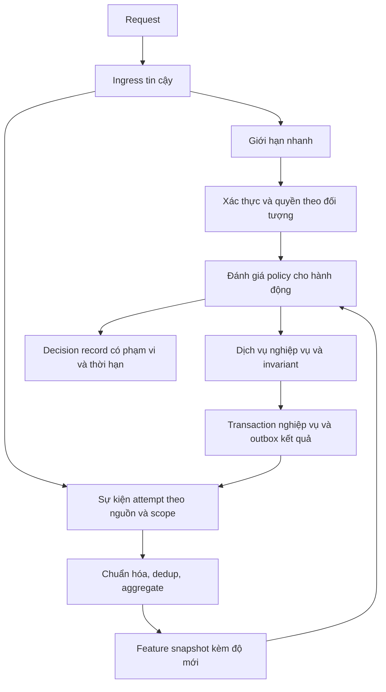
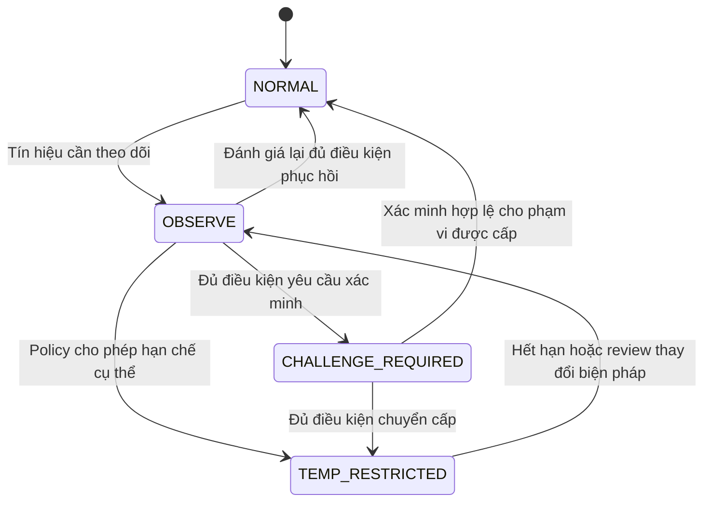

# Velocity signal correlation — Tương quan tín hiệu tốc độ hành vi

## 1. Một bộ đếm riêng lẻ có thể bỏ sót điều gì?

Một chương trình thưởng cho phép mỗi tài khoản gửi tối đa vài yêu cầu trong một khoảng thời gian. Kẻ lạm dụng dùng nhiều tài khoản, đổi địa chỉ IP và chia nhỏ lượt gửi. Từng tài khoản và từng IP đều dưới ngưỡng, nhưng nhiều tài khoản cùng hoạt động trên một nhóm thiết bị, cùng hướng tiền về một người nhận và xuất hiện trong cùng một khoảng ngắn.

**Velocity signal correlation** là việc liên kết các tín hiệu về số lượng, nhịp độ, kết quả và quan hệ giữa các thực thể trong những cửa sổ thời gian xác định để phát hiện mẫu hành vi khó thấy từ một bộ đếm. “Correlation” ở đây là sự liên hệ theo thực thể, thời gian và bối cảnh nghiệp vụ; không nhất thiết là tính hệ số tương quan thống kê, cũng không tự chứng minh quan hệ nhân quả hay gian lận.

Bài thuộc chương **Rate Limit Abuse**, module `SECURITY_APPLICATION_SECURITY_BUSINESS_LOGIC_SECURITY`. Trọng tâm là kết hợp tín hiệu để bảo vệ quy tắc nghiệp vụ, đồng thời giữ quyền theo đối tượng, state machine, transaction và idempotency. Các số liệu, ngưỡng và schema trong bài là minh họa, không phải cấu hình mặc định cho hệ thống thực tế.

Sau bài học, bạn cần có khả năng:

- Định nghĩa mỗi velocity theo đúng sự kiện, thực thể, cửa sổ và đơn vị.
- Liên kết nhiều chiều tín hiệu mà không coi IP hay fingerprint là danh tính chắc chắn.
- Phân biệt request lặp, operation nghiệp vụ và event được phát lại.
- Xử lý sự kiện đến muộn, snapshot cũ và cập nhật đồng thời.
- Chọn phản ứng có phạm vi, có thể giải thích và kiểm thử được.

### Rate limit và tương quan giải quyết hai phần khác nhau

Rate limit trả lời câu hỏi như “chủ thể này còn được gửi thêm request trong cửa sổ hiện tại không?”. Tương quan hỏi thêm “nhiều chủ thể có đang phối hợp theo một mẫu đáng nghi không?”. Bộ phân tích tương quan có thể hỗ trợ chọn hạn mức hoặc yêu cầu xác minh, nhưng không thay thế bộ thực thi hạn mức nguyên tử và các invariant của dịch vụ nghiệp vụ.

Ví dụ, điểm rủi ro thấp không cho phép nhận hai khoản thưởng trái quy tắc. Điểm rủi ro cao cũng không tự cấp quyền khóa mọi chức năng của tài khoản.

## 2. Invariant cần bảo vệ

| Mã | Invariant | Sai sót cần chặn |
| --- | --- | --- |
| V1 | Thực thể và tenant dùng để gán tín hiệu được xác định từ ngữ cảnh có nguồn đáng tin cậy | Client sửa `userId` để đẩy tín hiệu sang nạn nhân |
| V2 | Mỗi feature có định nghĩa sự kiện, đơn vị, cửa sổ và cách xử lý lặp rõ ràng | Cộng số request với số tiền hoặc số session rồi coi là cùng một đại lượng |
| V3 | Event phát lại không tự thành hành vi mới | Consumer restart làm nhân đôi số lần nhận thưởng |
| V4 | Thử lại ở tầng mạng vẫn được phân biệt với hiệu lực nghiệp vụ duy nhất | Dedup mọi retry rồi bỏ sót tải tấn công, hoặc tính một payout thành nhiều payout |
| V5 | Dữ liệu thiếu, cũ hoặc lỗi không được giả thành giá trị bằng không | Feature store lỗi khiến hệ thống coi mọi hành vi là ít rủi ro |
| V6 | Tương quan không tạo quyền và không bỏ qua state machine | Vượt challenge rồi gọi thẳng API trả thưởng ngoài trạng thái hợp lệ |
| V7 | Quyết định và hành động gắn với phiên bản, phạm vi và thời hạn | Một cảnh báo cũ áp dụng vô hạn lên mọi tài nguyên của chủ thể |
| V8 | Hạn mức cứng, ngân sách và chống cấp trùng chịu được xử lý đồng thời | Hai request cùng đọc counter thấp rồi cùng vượt giới hạn |
| V9 | Có kiểm soát tác động lên người dùng hợp lệ | Khóa cả mạng công ty chỉ vì nhiều tài khoản chung IP |

Tín hiệu là đầu vào của chính sách. Quyết định cuối còn phụ thuộc độ tin cậy, độ mới, mức ảnh hưởng, quyền và quy tắc nghiệp vụ cụ thể.

## 3. Thu thập sự kiện và nhận diện thực thể

### 3.1. Hợp đồng sự kiện

```text
VelocityEvent
  eventId, eventType, schemaVersion
  occurredAt, ingestedAt, sourceService
  tenantId, actionFamily
  actorSubjectReference, authenticationContext
  attemptId, logicalOperationId
  resourceType, resourceReference
  deviceReference, deviceConfidence
  networkReference, beneficiaryReference
  outcome, reasonCode
  correlationId
```

Các trường tùy loại sự kiện có thể vắng mặt, nhưng phải có nghĩa rõ ràng. `actorSubjectReference` đến từ xác thực; tenant và tài nguyên được server đối chiếu với scope thực tế. Một request bị từ chối quyền không được ghi như hành động đã được chủ sở hữu tài nguyên thực hiện.

`actionFamily` gom các endpoint thực hiện cùng mục đích nghiệp vụ, chẳng hạn các phiên bản API cùng yêu cầu nhận thưởng. Nếu mỗi endpoint có counter tách rời, người gọi có thể chia lượt qua nhiều đường để né giới hạn. Ngược lại, không gộp những thao tác có chi phí và tác động rất khác nhau chỉ vì cùng URL prefix.

| Định danh | Nhận diện điều gì? | Xử lý lặp |
| --- | --- | --- |
| `attemptId` | Một lần server tiếp nhận request cụ thể | Event của cùng attempt được phát lại không tạo thêm attempt |
| `logicalOperationId` | Một operation nghiệp vụ do server quản lý | Nhiều request retry có thể cùng trỏ đến một operation |
| `eventId` | Một sự kiện bất biến được producer phát ra | Delivery lặp giữ cùng ID để consumer dedup |
| `correlationId` | Liên kết các bước trong một luồng | Hỗ trợ truy vết; không tự bảo đảm duy nhất hay chống lặp |

Client có thể gửi idempotency key, nhưng server phải ràng buộc key với chủ thể, loại thao tác và nội dung hợp lệ. Đổi key không được tạo thêm danh tính, né hạn mức theo tài khoản hoặc vượt khóa duy nhất của khoản thưởng.

### 3.2. Mức tin cậy của các liên kết

| Chiều liên kết | Giá trị sử dụng | Giới hạn cần nhớ |
| --- | --- | --- |
| Tài khoản đã xác thực | Nhóm hành động của cùng tài khoản | Một người có thể có nhiều tài khoản; tài khoản có thể bị chiếm quyền |
| Device token/fingerprint | Nhận diện mẫu dùng chung hoặc thay đổi thiết bị | Có thể bị reset, giả lập hoặc dùng chung; token có chữ ký không chứng minh một người duy nhất |
| IP hoặc nhóm mạng | Nhìn thấy burst và phân tán nguồn | NAT, VPN, proxy và mạng di động làm liên kết thiếu chắc chắn |
| Người nhận/phương tiện nhận thưởng | Phát hiện tập trung lợi ích | Cần token do server quản lý; có trường hợp chia sẻ hợp lệ |
| Đối tượng bị tác động | Nhiều nguồn cùng thử trên một tài nguyên | Tránh coi hành vi do kẻ khác gửi là lỗi của chủ sở hữu |
| Chiến dịch/tenant | Theo dõi tốc độ tiêu thụ và mức phối hợp | Không tự cho phép gộp dữ liệu giữa các tenant |

OWASP mô tả việc phân tán request qua proxy có thể làm lưu lượng mỗi IP thấp dù tổng tấn công lớn. Vì vậy IP cần được xem cùng bối cảnh khác, thay vì là định danh duy nhất. Tham khảo [Credential Stuffing Prevention Cheat Sheet](https://cheatsheetseries.owasp.org/cheatsheets/Credential_Stuffing_Prevention_Cheat_Sheet.html); trong bài này, nguyên tắc nhiều chiều được áp dụng cho hành vi nghiệp vụ.

Địa chỉ mạng phải được suy ra theo chuỗi proxy được cấu hình tin cậy. Không nhận bừa giá trị header do client tự đặt làm IP chuẩn. Với request chưa xác thực, cần các khóa và hạn mức riêng; không gán mọi người chưa đăng nhập vào một chủ thể giả rồi coi đó là một tài khoản.

## 4. Định nghĩa velocity trước khi viết rule

Với thực thể `x`, họ hành động `a`, thời điểm đánh giá `t` và độ dài cửa sổ `W`, có thể định nghĩa:

```text
C_attempt(x, a, W, t)
  = số attempt khác nhau thỏa điều kiện trong khoảng (t - W, t]

C_committed(x, a, W, t)
  = số operation khác nhau đã commit thành công trong khoảng đã định nghĩa

D_account(device, W, t)
  = số tài khoản khác nhau có sự kiện đủ điều kiện liên kết với device

S_amount(beneficiary, currency, W, t)
  = tổng tiền của các operation đã commit đủ điều kiện, theo từng loại tiền
```

Phải nói rõ timestamp nào xác định cửa sổ: lúc nhận request hay lúc commit. Không dùng hai mốc thay nhau giữa các producer. Khoảng `(t - W, t]` chỉ là một quy ước; triển khai có thể chọn quy ước khác nhưng cần nhất quán và kiểm thử ở biên.

Số tiền dùng đơn vị nhỏ nhất phù hợp với loại tiền và không cộng trực tiếp nhiều loại tiền. Nếu cần chuyển đổi, nguồn tỷ giá, thời điểm và cách làm tròn phải là một phần của định nghĩa feature. Hoàn tác hoặc hoàn tiền là sự kiện nghiệp vụ riêng; không xóa lịch sử chi trước đó để số velocity trông thấp hơn.

Tỷ lệ thất bại phải có mẫu số đúng. Ví dụ, số operation bị từ chối trên số operation đã có kết quả trong cùng nhóm đánh giá; cần theo dõi operation chưa có kết quả và độ trễ, thay vì coi chúng là thành công hoặc thất bại. Với ít mẫu, tỷ lệ cao có thể rất thiếu ổn định.

## 5. Kết hợp tín hiệu theo nhiều chiều

### 5.1. Fan-out, fan-in và chuỗi hành vi

| Mẫu | Câu hỏi cần kiểm tra | Bối cảnh phản bác cần xem |
| --- | --- | --- |
| Một thiết bị → nhiều tài khoản | Có nhiều tài khoản thực hiện cùng hành động trong thời gian ngắn không? | Thiết bị dùng chung, hỗ trợ tại quầy, phòng máy |
| Nhiều tài khoản → một người nhận | Lợi ích có tập trung bất thường vào một đích không? | Người đại diện hoặc tài khoản nhận chung được nghiệp vụ cho phép |
| Một tài khoản → nhiều người nhận | Có đang thử hàng loạt đích hoặc chia nhỏ giao dịch không? | Tài khoản doanh nghiệp có hoạt động phân phối hợp lệ |
| Nhiều IP → cùng nhóm tài khoản/thiết bị | Việc đổi mạng có đang che tổng tốc độ không? | VPN doanh nghiệp, chuyển mạng di động |
| Nhiều nguồn → cùng đối tượng | Có đợt thử phối hợp trên một tài nguyên không? | Hoạt động công khai hợp lệ hoặc một sự kiện lưu lượng tăng |
| Đổi thông tin nhạy cảm → yêu cầu chi | Trình tự có phù hợp trạng thái và quyền không? | Người dùng hợp lệ vừa đổi thông tin; vẫn cần xác minh đúng phạm vi |

Chuỗi hành vi cần có quan hệ hợp lệ giữa các sự kiện. “Có một lượt đăng nhập và một yêu cầu chi trong cùng phút” chưa đủ để gắn chúng với nhau. Phải kiểm tra đúng tài khoản, session hoặc operation liên quan, cùng nguồn thời gian và độ tin cậy của thứ tự. Khi thứ tự quan trọng với invariant, dùng state/version nghiệp vụ thay vì suy đoán từ timestamp gần nhau.

Không áp dụng suy luận bắc cầu vô hạn. A từng chung IP với B, B từng chung thiết bị với C không đủ kết luận A và C cùng một người. Đồ thị liên kết cần giới hạn thời gian, loại cạnh, độ tin cậy và phạm vi mở rộng để tránh gom cả một mạng công cộng thành một cụm nghi vấn.

### 5.2. Ví dụ các giới hạn riêng lẻ đều chưa chạm ngưỡng

Giả sử trong một cửa sổ 10 phút, hệ thống thấy:

| Quan sát | Giá trị minh họa |
| --- | --- |
| Tổng request nhận thưởng | 48 attempt khác nhau |
| Tài khoản đã xác thực | 24 tài khoản, mỗi tài khoản 2 attempt |
| IP | 5 IP, có lần lượt 10, 10, 10, 9, 9 attempt |
| Device reference | Cùng một device reference, chất lượng liên kết được ghi rõ |
| Người nhận | Cùng một beneficiary reference do server phân giải |

Nếu hạn mức minh họa là 3 attempt/tài khoản/10 phút và 12 attempt/IP/10 phút, từng khóa riêng vẫn dưới hạn mức. Nhưng `D_account(device, 10m) = 24`, tổng attempt theo thiết bị là 48 và lợi ích dự kiến cùng hướng về một người nhận. Tương quan làm lộ mẫu cần kiểm tra.

Một rule minh họa có thể yêu cầu đồng thời nhiều điều kiện:

```text
Trong cùng tenant và actionFamily:
  distinctAccountsByDevice10m >= 12
  AND claimAttemptsByDevice10m >= 40
  AND có mức tập trung cao vào beneficiary đã được server xác minh
  AND dữ liệu đủ mới, đủ mẫu và liên kết đạt chất lượng yêu cầu
=> yêu cầu xác minh bổ sung hoặc chuyển review theo chính sách
```

Các ngưỡng trên chỉ minh họa cách diễn đạt rule. Không kết luận “48 request là 48 khoản thưởng đã được cấp”; số attempt và số operation commit là hai feature riêng. Kết quả tương quan cũng chưa chứng minh device reference đại diện cho một thiết bị vật lý duy nhất hay có gian lận.

Nếu một mạng công ty có nhiều người dùng nhưng mỗi tài khoản có lịch sử, thiết bị và người nhận riêng, tín hiệu tổng IP cao cần được đọc khác. Có thể vẫn cần bảo vệ tài nguyên trước lưu lượng lớn, nhưng quyết định quản lý tải không nên được ghi như kết luận mọi người trong mạng đều lạm dụng.

### 5.3. Không cộng điểm lặp cho cùng một bằng chứng

`requestsPerDevice1m`, `requestsPerDevice10m` và `requestsPerDevice1h` chứa nhiều sự kiện trùng nhau. Số tài khoản và số session cũng có thể tăng từ cùng một nguồn. Cộng điểm từng feature như thể chúng độc lập sẽ thổi phồng mức tin cậy.

Nên nhóm tín hiệu theo ý nghĩa như cường độ, phân tán thực thể, tập trung lợi ích, kết quả và bối cảnh. Chính sách cần giải thích nhóm nào hỗ trợ quyết định, nhóm nào chỉ bổ sung bối cảnh. Một rule có nhiều điều kiện từ cùng một tập sự kiện không mặc nhiên là nhiều nguồn bằng chứng độc lập.

Có thể dùng nhiều cửa sổ để thấy cả burst lẫn hành vi kéo dài, chẳng hạn 1 phút, 10 phút và 24 giờ. Không cộng thẳng số đếm của các cửa sổ lồng nhau. Hành vi chậm nhưng đều có thể cần cửa sổ dài; cửa sổ dài lại cần xét biến động theo giờ, chiến dịch và loại tài khoản.

## 6. Thời gian, dữ liệu đến muộn và độ mới

### 6.1. Ba mốc thời gian khác nhau

- **Event time**: thời điểm sự kiện xảy ra theo nguồn server có thẩm quyền.
- **Ingestion time**: thời điểm hệ thống thu thập nhận được sự kiện.
- **Processing time**: thời điểm processor thực sự cập nhật aggregate hoặc ra kết quả.

Một event xảy ra lúc 10:00 nhưng đến processor lúc 10:04 không được tùy tiện đổi thành hành vi lúc 10:04 trong feature theo event time. Timestamp từ thiết bị người dùng chỉ là dữ liệu tham khảo nếu chưa có cơ chế xác minh; người gửi không được chọn thời gian quá khứ để làm request mới rơi khỏi cửa sổ.

Trong xử lý stream, watermark hỗ trợ ước lượng tiến độ event time; dữ liệu vẫn có thể đến muộn. Khái niệm này được giải thích trong [Apache Beam Programming Guide — Watermarks and late data](https://beam.apache.org/documentation/programming-guide/#watermarks-and-late-data). Watermark không phải bằng chứng tuyệt đối rằng mọi sự kiện của quá khứ đã đến.

Thiết kế cần quy định sự kiện đến muộn bao lâu còn được cập nhật aggregate, khi nào chuyển sang đối soát, và cách phát lại mà không tính hai lần. Retention của state phải phù hợp cửa sổ dài nhất cùng khoảng trễ cần hỗ trợ; retention dedup còn phụ thuộc khoảng replay thực tế. Dọn state quá sớm có thể làm event cũ được đếm lại hoặc mất khỏi feature cần giữ.

### 6.2. Snapshot cần mang theo chất lượng

```text
VelocitySnapshot
  tenantId, entityScope, actionFamily
  featureSchemaVersion, aggregationVersion
  windowDefinition, featureValues
  asOfEventTime, computedAt, observedLag
  sampleCounts, missingFeatures, sourceHealth
  exactOrApproximate, snapshotVersion
```

`computedAt` mới không bảo đảm dữ liệu bên trong mới nếu pipeline đang chậm. Cần kiểm tra `asOfEventTime`, lag và trạng thái nguồn. Không đổi `missingFeatures` thành 0 hoặc dùng snapshot quá hạn như thể không có hoạt động.

Distinct count có thể là số chính xác hoặc ước lượng. Nếu dùng cấu trúc xấp xỉ, cần ghi rõ giới hạn và vùng không chắc chắn quanh ngưỡng. Một chỉ số ước lượng có thể hỗ trợ phân luồng; không tự thay thế ràng buộc cần đúng tuyệt đối như tổng tiền không vượt ngân sách.

Late event có thể làm thay đổi đánh giá hiện tại hoặc mở yêu cầu xem lại. Nó không làm lịch sử tự biến thành “hệ thống đã biết dữ kiện đó khi ra quyết định trước đây”. Cần giữ snapshot và lý do thực sự đã dùng tại lần đánh giá cũ, đồng thời ghi nhận kết quả đánh giá bổ sung.

### 6.3. Kiểm tra biên cửa sổ

Fixed window có thể cho phép một cụm request ở cuối cửa sổ trước và đầu cửa sổ sau tạo burst lớn trong thời gian ngắn. Sliding window và token bucket có cách biểu diễn khác; chính sách phải biết counter đang đo loại cửa sổ nào.

Nếu dùng các bucket nhỏ để xấp xỉ cửa sổ trượt, phải mô tả sai số ở biên. Không gọi một phép cộng bucket gần đúng là cửa sổ trượt chính xác. Với nhiều máy và region, còn cần xét clock skew, độ trễ đồng bộ và tính nhất quán của snapshot; timestamp client không giải quyết được các vấn đề đó.

## 7. Kiến trúc kết hợp đường xử lý nhanh và phân tích stream



Đường xử lý nhanh bảo vệ burst và hạn mức cần phản ứng ngay. Stream hỗ trợ các quan hệ nhiều thực thể, cửa sổ dài và phân tích sau sự kiện. Một pipeline chậm vài giây không thể được coi là đã tính đầy đủ mọi request hiện tại để giữ một giới hạn cứng tức thời.

Sự kiện trước xác thực có loại và độ tin cậy riêng. Sau khi xác thực, hệ thống mới gắn actor đã xác minh và đối tượng trong scope. Không lấy username do người ngoài gõ vào rồi ghi như hành vi đã xác thực của nạn nhân.

Feature snapshot có thể chưa chứa request đang được đánh giá. Chính sách phải nói rõ dùng trạng thái trước request hay đã bao gồm request hiện tại. Nếu cộng thêm delta trực tiếp để giảm độ trễ, cần nhận diện attempt đã có trong snapshot để không cộng hai lần.

### 7.1. Dedup và cập nhật aggregate cùng ranh giới nguyên tử

Nếu consumer làm `đánh dấu đã xử lý` rồi mới cập nhật counter, crash ở giữa sẽ làm mất tín hiệu. Nếu cập nhật rồi mới đánh dấu, crash có thể làm tín hiệu bị nhân đôi khi replay. Hai bước cần được bảo vệ cùng transaction hoặc cơ chế state/checkpoint có bảo đảm tương ứng.

Pseudocode Java minh họa xử lý **một partition**, không phải API của một thư viện cụ thể:

```java
void processPartitionEvent(PartitionEvent input) {
    VerifiedEvent event = sourcePolicy.verifyAndNormalize(input);
    PartitionKey key = routing.deriveAuthorizedPartition(event);

    partitionStore.atomic(key, state -> {
        if (state.hasSeen(event.eventId())) {
            return; // Delivery lặp, không phải một hành vi mới
        }

        Instant eventTime = timestamps.requireTrustedTime(event);
        retention.requireSupportedEvent(eventTime, state);

        state.updateDefinedWindows(event, eventTime);
        state.markSeen(event.eventId(), retention.dedupPolicy());

        VelocitySnapshot snapshot = state.buildSnapshot(
            aggregationVersion, processingClock.now(), sourceHealth.current()
        );
        state.persistSnapshot(snapshot);
        state.appendOutbox(snapshotChanged(snapshot.id(), snapshot.version()));
    });

    input.acknowledgeAfterDurableCommit();
}
```

Dedup key cần có namespace producer nếu cần tránh xung đột, cùng event ID ổn định theo hợp đồng. Đổi biểu diễn schema không được biến một event phát lại thành sự kiện mới. Nó không thay cho logical operation key: hai event khác nhau có thể cùng mô tả một operation. Feature theo operation phải nhận diện operation đã tính, đồng thời cho phép sự kiện chuyển trạng thái hợp lệ của operation đó được xử lý theo định nghĩa.

Một event có thể cập nhật các partition theo tài khoản, thiết bị và người nhận. Nếu chúng nằm ở nhiều shard, transaction cục bộ của một partition không làm toàn bộ các chiều cập nhật đồng thời. Cần fan-out bền vững, dedup theo từng đích, cơ chế retry/đối soát và thông tin độ trễ của từng chiều. Đánh dấu event hoàn tất ở router trước khi công việc cho mọi đích được lưu bền vững có thể làm mất một phần tín hiệu.

Sự kiện không hợp lệ hoặc quá cũ theo hợp đồng cần được ghi nhận và xử lý riêng, đồng thời phản ánh tình trạng nguồn. Không âm thầm bỏ dữ liệu rồi vẫn công bố snapshot là đầy đủ.

### 7.2. Atomic counter chưa phải toàn bộ limiter

Một lệnh tăng counter nguyên tử không tự làm chuỗi đọc–quyết định–cập nhật của ứng dụng thành nguyên tử. Tương tự, tăng counter và gắn TTL bằng hai lệnh riêng có thể để lại trạng thái lỗi nếu tiến trình dừng giữa chừng. [Tài liệu Redis về INCR](https://redis.io/docs/latest/commands/incr/) trình bày vấn đề này trong mẫu rate limiter và cách phối hợp thao tác phía server.

Bộ thực thi cần giữ đúng hợp đồng tiêu thụ hạn mức, kiểm tra kết quả và vòng đời khóa. Với nhiều khóa hoặc nhiều shard, không giả định một script hay transaction cục bộ bao trùm mọi nơi. Phải xác định mức nhất quán thực tế, cách xử lý lỗi từng phần và sai số được chấp nhận.

Counter theo từng instance làm hạn mức tổng phụ thuộc số instance nếu không có phối hợp. Với nhiều region, snapshot eventually consistent cũng có thể chưa thấy hoạt động ở region khác. Nếu invariant là giới hạn cứng toàn cục, cần nơi quyết định có thẩm quyền hoặc phân bổ quota được kiểm soát; không dựa riêng vào aggregate phân tích đến chậm.

Ngân sách tiền và khóa chống cấp thưởng trùng phải được dịch vụ nghiệp vụ bảo vệ bằng transaction/ràng buộc phù hợp. Một Redis counter phục vụ tín hiệu không thay thế ledger và không biến cập nhật ở DB nghiệp vụ thành một phần của transaction cache.

## 8. Chuyển tương quan thành quyết định có phạm vi

### 8.1. Thứ tự kiểm tra

Một luồng đánh giá có thể gồm:

1. Kiểm tra request, xác thực và quyền trên đối tượng; request sai quyền không được tiếp tục nhờ điểm rủi ro thấp.
2. Thực thi giới hạn nhanh theo scope phù hợp; challenge không tự cấp thêm quota trái chính sách.
3. Đọc feature snapshot cùng độ mới, tình trạng nguồn, cỡ mẫu và chất lượng liên kết.
4. Áp dụng policy để chọn cho tiếp tục, tăng quan sát, yêu cầu xác minh, giới hạn tạm hoặc chuyển review cho hành động đang xét.
5. Dịch vụ nghiệp vụ kiểm tra lại state, version và các invariant ngay khi thực hiện thay đổi.
6. Ghi kết quả thực tế để đánh giá tiếp và đối soát; không ghi “đã chi thành công” chỉ vì request được phép đi tiếp.

Mỗi decision nên lưu entity scope, action, resource/operation liên quan, policy version, snapshot version, các nhóm tín hiệu hỗ trợ, tình trạng thiếu dữ liệu, thời điểm và thời hạn hiệu lực. Nếu có hành động thay đổi quyền hoặc trạng thái, lưu plan/phạm vi riêng và kiểm tra quyền thực thi của nó.

### 8.2. State machine cho phản ứng theo rủi ro



Đây là trạng thái phản ứng của một scope, không phải danh tính tốt/xấu vĩnh viễn của người dùng. Có thể cần ngưỡng kích hoạt và phục hồi khác nhau để tránh chuyển qua lại liên tục, nhưng mọi thời hạn và quy tắc phục hồi phải rõ ràng.

Một challenge thành công cần được server gắn với actor, hành động, đối tượng hoặc operation, nonce và thời hạn theo thiết kế. Client không được tự gửi `challengePassed=true` hay `riskScore=0` để mở khóa. Xác minh cho nhận thưởng không tự cho phép đổi người nhận hoặc rút tiền ở một luồng khác.

Nếu snapshot hoặc state thay đổi trước khi hành động nhạy cảm được commit, cần kiểm tra điều kiện hiệu lực theo chính sách và invariant tại dịch vụ sở hữu tài nguyên. Không để một quyết định cho phép cũ trở thành giấy phép thực thi vô thời hạn.

### 8.3. Khi nguồn tín hiệu lỗi

Thiếu feature không đồng nghĩa không có rủi ro. Chính sách suy giảm cần phân theo mức ảnh hưởng và có giới hạn thời gian: thao tác ít tác động có thể tiếp tục với hạn mức dự phòng; thao tác nhạy cảm có thể cần xác minh hoặc chờ kiểm tra thêm. Việc lựa chọn phải được quy định trước, quan sát được và không bỏ qua quyền hay invariant bắt buộc.

Ngược lại, lỗi pipeline cũng không đủ để kết luận mọi tài khoản vi phạm. Hạn chế tạm cần đúng scope, có hạn, có đường phục hồi và đối soát. Một late event hoặc consumer restart không được tự kéo dài hạn chế từ đầu mãi mãi.

## 9. Chi phí, quyền dữ liệu và khả năng bị đầu độc tín hiệu

### 9.1. Kiểm soát cardinality và hot key

Kẻ gọi API có thể tạo hàng loạt giá trị device, session hoặc tham số khác nhau để làm nở số khóa. Cần chuẩn hóa đầu vào, giới hạn kích thước và kiểm tra nguồn trước khi dùng làm chiều aggregate. Không đưa nguyên query string hay mọi giá trị client khai vào key và nhãn metric.

Các dimension có độ tin cậy thấp có thể cần ngân sách state, TTL, cơ chế lấy mẫu hoặc cấu trúc xấp xỉ phù hợp. Khi giới hạn tài nguyên khiến số đếm bị cắt hoặc chỉ còn là cận dưới, snapshot phải phản ánh điều đó; không coi số bị cắt là giá trị chính xác. Dimension bị thiếu không nên tự được thay bằng cùng một device ID giả cho mọi người.

Một beneficiary hoặc chiến dịch rất phổ biến có thể tạo hot key. Chia tải phải giữ được ngữ nghĩa của aggregate và mức nhất quán đã cam kết. Chia counter thành nhiều phần mà chỉ đọc một phần sẽ làm mất tổng tốc độ. Hạn mức cứng và phân tích gần đúng cần có cách xử lý riêng.

Đồ thị tương quan cần giới hạn số cạnh, độ sâu, thời gian và chi phí truy vấn. Một tài khoản có nhiều quan hệ không được khiến request thông thường tải toàn bộ lịch sử hoặc toàn bộ tenant vào bộ nhớ.

### 9.2. Token hóa và phân quyền

Chỉ thu thập các thuộc tính cần cho mục đích kiểm soát. Dùng tham chiếu hoặc token do hệ thống quản lý cho người nhận và phương tiện thanh toán, tránh đưa dữ liệu nhạy cảm nguyên bản vào counter key, log hoặc dashboard.

Nếu cần khóa giả danh ổn định, có thể dùng HMAC với chuẩn hóa và scope phù hợp thay vì hash thuần các giá trị dễ đoán. Tuy nhiên giả danh hóa không làm dữ liệu tự trở thành vô danh; quyền truy cập, retention và quản lý khóa vẫn cần được bảo vệ. Đổi khóa hoặc cách chuẩn hóa có thể chia đứt lịch sử trong cửa sổ, nên cần version và kế hoạch chuyển đổi.

Feature theo tenant mặc định phải có namespace tenant. Liên kết xuyên tenant, nếu thực sự có mục đích được phép, cần thiết kế và phân quyền riêng; một rule kỹ thuật không tự tạo quyền chia sẻ dữ liệu giữa các khách hàng.

Màn hình điều tra chỉ cho phép người đủ quyền xem thực thể, nguồn và bằng chứng trong scope. API phục vụ người dùng không trả chi tiết hoạt động của tài khoản khác chỉ vì chúng cùng một cụm. Các truy vấn và export tương quan cũng cần kiểm tra quyền theo đối tượng.

### 9.3. Ngăn đầu độc và khóa oan

Nếu số lần thử vào một username do người ngoài khai được dùng để tự động khóa chủ tài khoản, kẻ tấn công có thể chủ động gây từ chối dịch vụ cho nạn nhân. Cần tách actor gửi request, đối tượng bị nhắm tới và mức xác thực của liên kết; chọn phản ứng bảo vệ tài nguyên mà không quy kết nhầm hành vi.

Baseline tự học cũng có thể bị đẩy dần lên bởi lưu lượng lạm dụng kéo dài. Không tự tăng ngưỡng chỉ vì lưu lượng gần đây cao hơn. Dữ liệu hiệu chỉnh cần xét nguồn, nhãn, mùa vụ, thay đổi sản phẩm và khả năng đã bị ảnh hưởng bởi chính sách chặn hiện tại.

Không coi nhiều tín hiệu do cùng một nguồn yếu tạo ra là nhiều xác nhận độc lập. Ví dụ, kẻ gửi có thể tùy ý đổi user-agent, cookie và device ID tự khai; ba giá trị đó không tự thành ba bằng chứng đáng tin cậy.

## 10. Hiệu chỉnh policy và quan sát vận hành

### 10.1. Triển khai có thể đánh giá được

Trước khi bật phản ứng ảnh hưởng lớn, có thể chạy shadow để ghi quyết định dự kiến mà chưa áp dụng biện pháp đó. Shadow không có nghĩa tắt các kiểm tra quyền, hạn mức cứng hay invariant đang bảo vệ hệ thống.

Replay dữ liệu cần đi vào môi trường hoặc namespace đánh giá riêng, không phát lại side effect thật. Để đánh giá quyết định tại thời điểm `t`, chỉ dùng thông tin mà hệ thống thực sự có thể biết ở `t`; đưa dữ liệu đến muộn hoặc kết quả tương lai vào feature cũ sẽ làm chất lượng đánh giá trông tốt giả tạo.

Gắn version cho schema, định nghĩa feature, thuật toán aggregate và policy. Khi đổi rule hoặc cách đếm, so sánh trên các nhóm hành vi và lưu lượng phù hợp, có phương án rollback. Không âm thầm reset mọi counter khi deploy rồi cho rằng hành vi giảm xuống.

### 10.2. Chỉ số cần theo dõi

| Nhóm chỉ số | Câu hỏi vận hành |
| --- | --- |
| Event lag, late rate, tỷ lệ schema lỗi | Hệ thống có đang đánh giá trên dữ liệu thiếu hoặc chậm không? |
| Dedup hit, chênh lệch attempt/operation/outcome | Replay, retry hoặc producer có làm sai cách đếm không? |
| Cardinality, hot key, state eviction, snapshot miss | Chi phí có đang tăng hoặc state bị mất ngoài dự kiến không? |
| Quyết định theo reason code và scope | Rule nào đang làm tăng challenge, hạn chế hoặc review? |
| Kết quả xác minh và review độc lập | Tín hiệu có phân biệt được các mẫu cần quan tâm không? |
| Hành động bị chặn do state/version | Quyết định tương quan có thường lỗi thời trước thực thi không? |
| Độ trễ phục hồi và số hạn chế quá hạn | Người dùng hợp lệ có bị giữ trong trạng thái hạn chế quá lâu không? |

Tỷ lệ challenge thành công, số cảnh báo hoặc tỷ lệ khiếu nại được chấp nhận không tự là precision/false-positive rate. Mỗi chỉ số chịu tác động của cách chọn mẫu, khả năng người dùng phản hồi và các biện pháp đã áp dụng. Cần tập đánh giá có nhãn đủ tin cậy và mô tả giới hạn của phép đo.

Nhiều rule có thể phát cảnh báo cho cùng một cụm. Có thể gộp cảnh báo theo scope, khoảng thời gian và version chính sách để tránh quá tải, nhưng phải giữ các bằng chứng mới và không che mất sự khác biệt giữa các tenant hoặc các hành vi độc lập.

## 11. Kiểm thử các tình huống lạm dụng và lỗi dữ liệu

Kiểm thử cần đối chiếu cả giá trị feature, quyết định và hiệu lực nghiệp vụ. Không chỉ xác nhận một hàm trả về nhãn `HIGH_RISK`.

| Tình huống | Kết quả cần quan sát |
| --- | --- |
| 24 tài khoản, 5 IP, cùng device/beneficiary trong ví dụ | Feature nhiều chiều nhận diện đúng tập sự kiện dù từng counter riêng dưới ngưỡng |
| Nhiều người hợp lệ dùng chung IP | Không coi chung IP là cùng danh tính hoặc tự kết luận tất cả lạm dụng |
| Client sửa actor, tenant hoặc device reference | Không đổi actor có thẩm quyền; dữ liệu tự khai được xử lý theo mức tin cậy đúng |
| Client giả header địa chỉ mạng | Giá trị chuẩn được suy ra theo cấu hình proxy tin cậy |
| Đổi endpoint/version API cho cùng hành động | Họ hành động vẫn được gán đúng, không làm tách tổng hạn mức ngoài ý muốn |
| Cùng event được delivery hai lần | Aggregate không tăng hai lần cho sự kiện đó |
| Một operation có nhiều attempt retry | Attempt count phản ánh các lần tiếp nhận; committed-operation count chỉ tính hiệu lực đúng định nghĩa |
| Đổi idempotency key liên tục | Không tạo danh tính mới, né quota tài khoản hoặc phá khóa nghiệp vụ |
| Hai consumer cùng cập nhật một partition | Dedup và aggregate giữ đúng giá trị, không mất update hoặc ghi side effect trùng |
| Fan-out thành công ở một chiều, lỗi ở chiều khác | Retry/đối soát khôi phục phần còn thiếu; snapshot phản ánh độ trễ/chất lượng thực tế |
| Event đến sai thứ tự hoặc kết quả đến trước attempt | Không tự dựng chuỗi nhân quả sai; phép tính outcome xử lý trạng thái chưa hoàn chỉnh |
| Event ở đúng biên cửa sổ | Được tính theo quy ước biên đã công bố, không thừa hoặc thiếu ở điểm giao |
| Event đến muộn trong khoảng hỗ trợ | Aggregate được cập nhật theo event time và dedup đúng |
| Replay ngoài khoảng giữ dedup/state | Đi theo hợp đồng rebuild/đối soát; không mặc định xem event cũ là hành vi mới |
| Snapshot thiếu hoặc quá cũ | Không được thay bằng toàn số 0; policy suy giảm được kích hoạt và ghi lý do |
| Cùng giá trị định danh ở hai tenant | Không liên kết dữ liệu trái scope |
| Distinct count xấp xỉ nằm gần ngưỡng | Quyết định xử lý vùng không chắc chắn đúng chính sách, không giả như số chính xác |
| Device ID ngẫu nhiên gây cardinality tăng mạnh | Ngân sách state được bảo vệ, lỗi/saturation có thể quan sát được |
| Đạt challenge cho một action rồi gọi action khác | Không tái sử dụng quyền ngoài phạm vi challenge |
| Quyết định cho phép cũ khi tài nguyên đã đổi state/version | Dịch vụ nghiệp vụ chặn hành động không còn hợp lệ |
| Nhiều request đồng thời ở ngưỡng quota/ngân sách | Hạn mức cứng và invariant vẫn được giữ bởi nơi có thẩm quyền |
| Late event hoặc restart làm phát lại cảnh báo | Không tự tạo biện pháp trùng hoặc gia hạn hạn chế vô hạn |

Với các test đồng thời, dùng barrier hoặc điều phối có kiểm soát để đưa request đến cùng điểm tranh chấp; không dựa vào `sleep` ngẫu nhiên. Với cửa sổ thời gian, dùng nguồn clock có thể điều khiển trong test thay vì đợi thời gian thật.

Các điểm crash đáng thử gồm: sau cập nhật aggregate nhưng trước acknowledgment, sau commit nghiệp vụ nhưng trước phát outbox, và sau một hành động hạn chế đã có hiệu lực nhưng trước khi consumer nhận kết quả. Mục tiêu là khôi phục mà không mất tín hiệu hoặc nhân đôi hiệu lực, trong phạm vi bảo đảm đã công bố.

## 12. Điểm kiểm tra khi thiết kế một rule tương quan

- Đã ghi rõ feature đếm attempt, operation, kết quả hay số tiền; đơn vị và mẫu số là gì chưa?
- Thực thể được gán từ đâu, có độ tin cậy nào và có thể bị client thao túng ra sao?
- Cửa sổ, timestamp, dedup, late data và retention có cùng một hợp đồng không?
- Rule có đang cộng điểm nhiều lần cho cùng một nhóm bằng chứng không?
- Snapshot có đủ mới, đủ mẫu và công bố nguồn thiếu/xấp xỉ không?
- Phản ứng có đúng action, đối tượng, thời hạn và có đường phục hồi không?
- Retry và fan-out có giữ đúng số đếm, còn invariant tiền/quyền/trạng thái có được dịch vụ nghiệp vụ bảo vệ riêng không?
- Có thể giải thích quyết định bằng snapshot đã dùng và kiểm chứng bằng các tình huống tấn công logic không?
