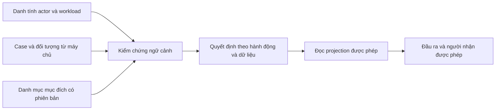

# Purpose limitation: Giới hạn mục đích sử dụng dữ liệu

## 1. Mục tiêu và phạm vi

**Purpose limitation** là nguyên tắc chỉ thu thập và sử dụng dữ liệu cho những mục đích cụ thể đã được xác định và được phép theo chính sách áp dụng. Khi muốn dùng dữ liệu cho một mục đích khác, hệ thống cần có quyết định cho phép phù hợp thay vì suy rằng “đã có dữ liệu thì được dùng”.

Trong chương **Privacy Rules** của module `SECURITY_APPLICATION_SECURITY_BUSINESS_LOGIC_SECURITY`, nguyên tắc này được chuyển thành các quy tắc nghiệp vụ có thể thực thi: ai được dùng dữ liệu nào, để làm việc gì, trên đối tượng nào, trong trạng thái nào và được chuyển đến đâu.

Ví dụ, số điện thoại cung cấp để phối hợp giao một đơn hàng không tự tạo quyền dùng số đó cho mọi chiến dịch quảng bá. Nhân viên có quyền xử lý sự cố giao hàng cũng không mặc nhiên có quyền xuất toàn bộ danh sách liên hệ của khách hàng.

Bài học tập trung vào thiết kế kỹ thuật để thực thi chính sách mục đích đã được xác lập cho sản phẩm. Các mục đích được phép, điều kiện sử dụng và thời hạn lưu cần được chủ sở hữu chính sách xác định; code phải biểu diễn và giữ được các ràng buộc đó.

Sau bài học, bạn cần có khả năng:

- Phân biệt mục đích sử dụng với vai trò, thao tác API và lý do do caller tự khai.
- Biểu diễn mục đích bằng một danh mục có chủ sở hữu, phạm vi và phiên bản.
- Kiểm chứng mục đích từ ngữ cảnh nghiệp vụ có thẩm quyền.
- Áp dụng giới hạn theo đối tượng, trường dữ liệu, người nhận và thời điểm thực thi.
- Giữ ràng buộc khi xử lý bất đồng bộ, retry, export, dữ liệu dẫn xuất và audit.
- Kiểm thử các đường lạm dụng biến một quyền hợp lệ thành quyền dùng dữ liệu ngoài mục đích.

## 2. Mục đích là một phần của quyết định quyền

### 2.1. Có quyền đọc chưa đủ để cho phép mọi cách dùng

RBAC có thể xác định một người là `SUPPORT_AGENT`. Quyền theo đối tượng có thể xác định người đó được xử lý đơn `order-781`. Purpose limitation bổ sung câu hỏi: **đọc và dùng dữ liệu của đơn này để thực hiện công việc cụ thể nào?**

Cùng một dữ liệu có thể được dùng trong nhiều quy trình, nhưng mỗi lần dùng phải đáp ứng điều kiện của quy trình tương ứng. Không thể lấy một mục đích hợp lệ làm nhãn chung cho mọi truy cập của vai trò đó.

| Khái niệm | Câu hỏi cần trả lời | Ví dụ |
| --- | --- | --- |
| Danh tính | Ai đang yêu cầu? | Nhân viên đã xác thực hoặc workload được nhận diện |
| Vai trò/quyền | Chủ thể được thực hiện nhóm thao tác nào? | Được xử lý sự cố giao hàng |
| Quyền đối tượng | Chủ thể được thao tác trên hồ sơ cụ thể nào? | Được phân công case liên quan đến đơn này |
| Hành động | Tác động kỹ thuật hoặc nghiệp vụ là gì? | Xem trạng thái, gửi thông báo, xuất file |
| Mục đích | Tác động đó phục vụ công việc được phép nào? | Giải quyết giao hàng thất bại |
| Phạm vi dữ liệu | Cần dùng những trường, hàng và khoảng thời gian nào? | Trạng thái giao và tuyến liên hệ cho đúng đơn |
| Người nhận | Dữ liệu hoặc kết quả được chuyển đến đâu? | Màn hình hỗ trợ hoặc kênh liên hệ được phê duyệt |

Một lỗi phổ biến là kiểm tra vai trò tại API, sau đó để code bên trong dùng cả hồ sơ khách hàng cho mọi tác vụ. Khi ấy, kiểm tra ở cửa vào không còn bảo vệ được mục đích ở điểm dữ liệu bị sử dụng.

### 2.2. Các điều kiện phải được giữ cùng nhau

```text
Một lần sử dụng dữ liệu được phép khi:
    danh tính và workload hợp lệ
    AND có quyền với đối tượng và tenant thực tế
    AND mục đích đang được phép theo chính sách áp dụng
    AND ngữ cảnh nghiệp vụ đủ điều kiện cho mục đích đó
    AND hành động, trường dữ liệu và người nhận nằm trong phạm vi
    AND các điều kiện thời gian, trạng thái và lựa chọn liên quan còn phù hợp
```

Điều kiện “lựa chọn liên quan” có thể là một tùy chọn sử dụng dữ liệu hoặc sự cho phép mà chính sách yêu cầu cho mục đích cụ thể. Không dùng một biến toàn cục như `consent = true` để suy ra mọi mục đích đều hợp lệ; cũng không mặc định mọi luồng nghiệp vụ đều dùng cùng một loại điều kiện cho phép.

### 2.3. Quan hệ với các cơ chế bảo vệ khác

- **Data minimization:** mục đích xác định công việc cần làm; tối thiểu hóa xác định chỉ lấy và dùng phần dữ liệu cần thiết cho công việc đó.
- **State machine:** quy định case, đơn hàng hoặc yêu cầu phải ở trạng thái nào để việc dùng dữ liệu còn hợp lệ.
- **Phê duyệt:** ràng buộc quyết định được duyệt với mục đích, tập dữ liệu, phạm vi và người nhận cụ thể.
- **Transaction:** giữ các điều kiện quan trọng khỏi thay đổi không hợp lệ giữa lúc kiểm tra và lúc chấp nhận tác động.
- **Idempotency:** tránh tạo tác động lặp khi retry một lần sử dụng đã được chấp nhận; không tự tạo quyền cho mục đích mới.

Mã hóa dữ liệu bảo vệ trước một số kiểu truy cập trái phép. Nó không ngăn một dịch vụ có khóa giải mã sử dụng dữ liệu sai mục đích nếu luồng nghiệp vụ không kiểm tra điều kiện đó.

## 3. Xây dựng danh mục mục đích có thể thực thi

### 3.1. Mục đích phải đủ cụ thể

Các nhãn như `BUSINESS`, `CUSTOMER_SERVICE` hoặc `IMPROVE_PRODUCT` thường quá rộng để suy ra dữ liệu và tác động được phép. Một mã như `DELIVERY_EXCEPTION_SUPPORT` dễ gắn với quy tắc hơn: xử lý một sự cố giao hàng có hồ sơ, đối tượng và người phụ trách xác định.

Mã mục đích chỉ là định danh. Giá trị bảo vệ nằm ở định nghĩa cùng các điều kiện máy chủ thực thi.

| Mục đích minh họa | Ngữ cảnh bắt buộc | Dữ liệu có thể cần | Giới hạn đầu ra |
| --- | --- | --- | --- |
| `ORDER_FULFILLMENT` | Đơn hợp lệ đang được thực hiện | Dữ liệu giao hàng cần thiết cho đơn | Chỉ các thành phần thực hiện giao hàng được phép |
| `DELIVERY_EXCEPTION_SUPPORT` | Case giao hàng còn mở, được phân công | Trạng thái giao, mã liên hệ giới hạn theo case | Màn hình hỗ trợ và hành động liên hệ được phê duyệt |
| `REFUND_REVIEW` | Hồ sơ hoàn tiền đủ điều kiện xem xét | Khoản đã thu, khoản hoàn, dữ liệu phê duyệt cần thiết | Người hoặc dịch vụ xét duyệt đúng phạm vi |
| `PROMOTIONAL_OUTREACH` | Chiến dịch được duyệt và đối tượng đủ điều kiện | Kênh liên hệ được phép cho chiến dịch | Đúng kênh, nội dung và nhóm nhận được duyệt |
| `SECURITY_INVESTIGATION` | Hồ sơ điều tra và quyền điều tra phù hợp | Bằng chứng tối thiểu cần cho phạm vi điều tra | Kho bằng chứng và người xử lý được phân quyền |

Bảng là mô hình sản phẩm minh họa. Từng hệ thống phải xác định cụ thể điều kiện và trường dữ liệu của mình; tên mục đích không tự cấp phép truy cập.

### 3.2. Những thông tin cần quản lý

Một mục đích nên có:

- Mã định danh ổn định, mô tả công việc và chủ sở hữu.
- Trạng thái như `DRAFT`, `ACTIVE`, `SUSPENDED`, `RETIRED`.
- Phiên bản chính sách và thời gian hiệu lực.
- Các loại hành động, workload và vai trò được tham gia.
- Điều kiện liên hệ với tenant, chủ thể dữ liệu và đối tượng nghiệp vụ.
- Tập trường hoặc projection được phép cho từng hành động.
- Người nhận, kênh chuyển dữ liệu và điều kiện xuất dữ liệu.
- Quy tắc thời gian, lưu giữ và sử dụng tiếp ở hệ thống nhận.
- Các điều kiện cho phép, hạn chế hoặc phê duyệt bổ sung.

Ví dụ, mục đích hỗ trợ giao hàng có thể cho phép xem trạng thái nhưng yêu cầu quyền riêng để mở tuyến liên hệ. Cùng mục đích không có nghĩa mọi hành động trong mục đích đó dùng một tập dữ liệu giống nhau.

### 3.3. Quản lý phiên bản và thay đổi mục đích

Lưu phiên bản giúp giải thích tại sao một quyết định trước đây được cho phép. Nó không có nghĩa mọi job được tạo theo phiên bản cũ được tiếp tục vô thời hạn.

Cần xác định chính sách áp dụng khi thực thi: điều kiện nào được cố định khi chấp nhận công việc, điều kiện nào phải xét lại, và thay đổi nào làm dừng công việc đang chờ. Đình chỉ một mục đích hoặc thu hồi một điều kiện cho phép có thể cần ngăn các lần sử dụng chưa xảy ra.

Mở rộng một mục đích để thêm người nhận hoặc tập dữ liệu mới là thay đổi chính sách có tác động. Không sửa mô tả cho rộng hơn rồi mặc định toàn bộ dữ liệu lịch sử đều được dùng theo phạm vi mới.

## 4. Xác định mục đích từ ngữ cảnh đáng tin cậy

### 4.1. Không tin mục đích do client tự gắn

Request sau chỉ thể hiện điều caller yêu cầu:

```http
GET /customers/customer-42/profile
X-Purpose: DELIVERY_EXCEPTION_SUPPORT
```

Header không chứng minh có case hỗ trợ, caller được phân công hoặc khách hàng liên quan đến case. Nếu chỉ kiểm tra mã mục đích nằm trong danh sách hợp lệ, người dùng có thể tự chọn một mục đích có quyền rộng hơn.

Máy chủ nên ánh xạ hành động và luồng nghiệp vụ sang mục đích được phép, sau đó tải ngữ cảnh có thẩm quyền. Với luồng hỗ trợ giao hàng, các bước kiểm chứng có thể là:

1. Xác thực actor và tenant của phiên làm việc.
2. Tải case trong phạm vi tenant được phép; case ID từ request chỉ là khóa tra cứu cần kiểm chứng.
3. Xác minh case thuộc loại sự cố giao hàng và đang ở trạng thái được xử lý.
4. Xác minh actor được phân công hoặc có quan hệ truy cập được chính sách cho phép.
5. Tải đơn và khách hàng qua quan hệ được lưu trên case, đối chiếu tenant thực tế.
6. Xác định hành động, projection và người nhận được phép cho bước hiện tại.
7. Đánh giá chính sách mục đích và các điều kiện bổ sung trước khi đọc hoặc gửi dữ liệu.



### 4.2. “Có ticket” vẫn chưa đủ

Nếu ai cũng có thể tạo ticket rồi tự gắn một customer ID bất kỳ, điều kiện “ticket tồn tại” chỉ chuyển lỗ hổng sang bước tạo ticket. Cần kiểm tra quyền tạo, quan hệ đối tượng, phân công, trạng thái và những phê duyệt mà chính sách yêu cầu.

Trường văn bản “lý do truy cập” giúp audit nhưng không phải bằng chứng độc lập. Một câu như “hỗ trợ khách hàng” do caller nhập không thay thế các quan hệ nghiệp vụ được máy chủ kiểm chứng.

### 4.3. Ngữ cảnh đi qua nhiều dịch vụ

Khi dịch vụ A gọi dịch vụ B, B cần biết workload nào đang gọi, đang đại diện cho actor nào nếu có, thao tác nào và ngữ cảnh nghiệp vụ nào. Chỉ truyền `purpose=...` qua một header nội bộ không đủ nếu mọi workload đều có thể giả mạo header đó.

Có thể dùng ngữ cảnh được xác thực hoặc token có phạm vi hẹp. Thiết kế phải ràng buộc các thuộc tính cần thiết như issuer, audience, tenant, actor/workload, hành động, đối tượng, mục đích và thời hạn. Dịch vụ nhận vẫn kiểm tra điều kiện hiện tại theo trách nhiệm của nó.

Chữ ký hợp lệ chứng minh một bên phát hành đã xác nhận các claim theo cơ chế đã thiết kế; nó không tự chứng minh bên phát hành có quyền cấp mọi phạm vi hoặc case hiện vẫn mở. Token có thời hạn ngắn cũng không tự giải quyết mọi yêu cầu thu hồi ngay.

## 5. Biểu diễn quyết định và nguồn gốc dữ liệu

### 5.1. Quyết định sử dụng dữ liệu minh họa

```json
{
  "decision_id": "decision-291",
  "result": "ALLOW",
  "tenant_id": "tenant-demo",
  "actor_id": "agent-17",
  "workload_id": "support-api",
  "purpose_code": "DELIVERY_EXCEPTION_SUPPORT",
  "policy_version": "delivery-support-6",
  "context_type": "SUPPORT_CASE",
  "context_id": "case-813",
  "context_version": 8,
  "object_type": "ORDER",
  "object_id": "order-781",
  "action": "VIEW_DELIVERY_CONTEXT",
  "allowed_fields": [
    "order_id",
    "delivery_status",
    "delivery_city",
    "contact_route_ref"
  ],
  "recipient": "ASSIGNED_SUPPORT_CONSOLE",
  "evaluated_at": "2026-10-05T09:00:00Z"
}
```

Đây là bản ghi quyết định nội bộ, không phải JSON mà client có thể tự gửi lên để được tin là đã có quyền. Nếu dùng quyết định như một capability, cần thêm cơ chế xác thực, giới hạn sử dụng, thời hạn và thu hồi theo hợp đồng tương ứng.

`contact_route_ref` là tham chiếu đến một tuyến liên hệ có kiểm soát, không phải số điện thoại thô. Việc dùng tham chiếu để gửi thông báo là hành động khác, cần kiểm tra riêng mục đích, nội dung và người nhận. Một mã khó đoán không tự tạo ra quyền liên hệ.

Trong ví dụ, `delivery_city` chỉ được đưa vào khi quy trình xử lý sự cố thực sự cần vùng giao hàng. Nếu bước hiện tại chỉ cần biết kiện hàng đã giao hay chưa, projection nên nhỏ hơn.

### 5.2. Ghi nhận nguồn gốc không đồng nghĩa cấp quyền vĩnh viễn

Nguồn gốc dữ liệu có thể gồm điểm thu thập, đối tượng liên quan, mục đích thu thập, phiên bản thông báo/chính sách và các điều kiện sử dụng được quản lý. Những thông tin đó hỗ trợ đánh giá lần dùng sau.

Một trường `collected_for=ORDER_FULFILLMENT` không có nghĩa dữ liệu được phép dùng cho mọi việc có chữ “order”. Một mảng `allowed_purposes` cũng chỉ có giá trị khi được quản lý theo chính sách, được cập nhật khi điều kiện thay đổi và không thể bị caller tự sửa.

Khi sao chép hoặc dẫn xuất dữ liệu, cần giữ được quan hệ nguồn gốc và hạn chế liên quan. Đổi tên cột, băm định danh hoặc chuyển dữ liệu sang kho phân tích không tự tạo ra một mục đích được phép mới.

## 6. Thực thi tại điểm đọc và điểm sử dụng dữ liệu

### 6.1. Chọn projection trước khi tải dữ liệu

Một API có thể chỉ trả bốn trường nhưng bên trong đã tải cả hồ sơ khách hàng, ghi debug log rồi mới loại bỏ trường thừa. Cách làm đó vẫn tạo ra các lần sử dụng và bản sao dữ liệu ngoài phạm vi cần thiết.

Nên thiết kế repository hoặc lớp truy cập dữ liệu theo projection đã được phê duyệt cho hành động. Tránh dùng `SELECT *`, serialize entity đầy đủ hoặc truyền nguyên hồ sơ sang dịch vụ khác rồi mong dịch vụ nhận tự lọc.

Luồng minh họa:

```text
Xác thực actor và workload
Tải, kiểm chứng case và quan hệ đối tượng trong tenant thực tế
Ánh xạ hành động sang mục đích được phép của luồng
Đánh giá chính sách và nhận phạm vi dữ liệu được phép
Truy vấn projection tương ứng, giữ điều kiện đối tượng/trạng thái cần thiết
Chỉ đưa projection đó vào đầu ra dành cho người nhận được phép
Ghi audit định danh quyết định, không ghi toàn bộ dữ liệu riêng tư
```

Tách module thành các lớp không tự bảo đảm an toàn. Cần ngăn các đường gọi bỏ qua lớp chính sách hoặc dùng repository tổng quát để lấy dữ liệu rộng hơn. Quyền tài khoản cơ sở dữ liệu, quyền export và quyền truy cập kho dữ liệu cũng phải được giới hạn phù hợp với kiến trúc.

### 6.2. Truy vấn theo ngữ cảnh hỗ trợ được kiểm chứng

Giả sử mô hình có case gắn với một đơn và một shipment cụ thể. Chính sách ví dụ chỉ cho agent đang được phân công xem ngữ cảnh giao hàng khi case còn mở hoặc đang xử lý.

```sql
SELECT
    o.order_id,
    s.delivery_status,
    s.delivery_city,
    c.contact_route_ref
FROM support_case c
JOIN orders o
  ON o.tenant_id = c.tenant_id
 AND o.order_id = c.order_id
JOIN shipment s
  ON s.tenant_id = c.tenant_id
 AND s.shipment_id = c.shipment_id
 AND s.order_id = o.order_id
WHERE c.tenant_id = :tenant_id
  AND c.case_id = :case_id
  AND c.assigned_agent_id = :actor_id
  AND c.case_type = 'DELIVERY_EXCEPTION'
  AND c.status IN ('OPEN', 'IN_PROGRESS');
```

`:tenant_id` và `:actor_id` phải đến từ danh tính đã kiểm chứng và phạm vi máy chủ cho phép, không lấy tùy ý từ request. `:case_id` có thể do client chọn nhưng phải được bind an toàn và chỉ tìm thấy dữ liệu khi các điều kiện liên quan cùng khớp.

Truy vấn thể hiện một phần kiểm soát theo hàng và trường; nó không thay thế đánh giá mục đích đang hoạt động, quyền workload, điều kiện thời gian hay người nhận. Nếu sản phẩm có quyền giám sát cho người không trực tiếp được phân công, cần thiết kế một nhánh chính sách rõ ràng thay vì bỏ điều kiện phân công cho tất cả caller.

Nếu case có thể đóng hoặc đổi phân công giữa lần kiểm tra và lần đọc, các điều kiện quan trọng phải được kiểm tra trong truy vấn hoặc được bảo vệ bằng cơ chế nhất quán phù hợp. Việc kiểm tra một lần ở controller rồi đọc dữ liệu bằng một truy vấn không có ràng buộc đối tượng có thể tạo khoảng hở.

### 6.3. Giới hạn cả hành động và nội dung đầu ra

Một tham chiếu liên hệ giúp tránh lộ số điện thoại thô, nhưng vẫn có thể bị lạm dụng để gửi quảng cáo dưới nhãn “hỗ trợ”. Endpoint liên hệ cần kiểm tra thêm:

- Case và người thực hiện còn đủ điều kiện.
- Mục đích cho phép hành động gửi thông báo tại bước hiện tại.
- Người nhận được giải quyết từ đối tượng nghiệp vụ có thẩm quyền.
- Mẫu nội dung, kênh và các tham số nằm trong phạm vi được phép.
- Tần suất và idempotency không tạo thông báo lặp ngoài cam kết.

Ví dụ, dùng mẫu thông báo sự cố giao hàng được quản lý với các tham số giới hạn, thay vì cho caller truyền một số điện thoại bất kỳ và toàn bộ nội dung tự do. Các kiểm soát kỹ thuật làm hẹp khả năng dùng sai; nội dung hoặc trường hợp cần đánh giá nghiệp vụ vẫn phải đi qua quy trình phù hợp.

Quyền xem không tự tạo quyền gửi, export hoặc đổi người nhận. Một phê duyệt export cần ràng buộc rõ tập dữ liệu, mục đích, hành động, phạm vi hàng, trường và nơi nhận. Nếu thay đổi các thuộc tính quan trọng sau phê duyệt, phải đánh giá lại theo chính sách.

### 6.4. Cache không được dùng chung sai phạm vi

Một cache key chỉ có `customer_id` có thể khiến projection dành cho người có quyền rộng bị trả cho caller có quyền hẹp. Cache của kết quả sử dụng dữ liệu phải có phạm vi phù hợp với tenant, đối tượng, projection và những thuộc tính quyết định đầu ra.

Dữ liệu cache và quyền dùng dữ liệu là hai thứ khác nhau. Dù dữ liệu vẫn mới, việc phân công case hoặc trạng thái mục đích có thể đã thay đổi. Không dùng cache hit làm bằng chứng rằng caller hiện tại còn quyền truy cập.

Nếu cache quyết định quyền, cần chính sách thời hạn, vô hiệu hóa và xử lý thay đổi có ảnh hưởng. Với yêu cầu thu hồi nhanh, TTL đơn thuần có thể không đáp ứng ranh giới hiệu lực cần thiết. Cần công bố và thực thi đúng mức nhất quán của sản phẩm.

## 7. Giữ mục đích qua workflow, job và retry

### 7.1. Ngữ cảnh phải theo được toàn bộ vòng đời

Một tác vụ có thể đi qua các bước: yêu cầu → xét quyền → duyệt → xếp hàng → dựng kết quả → gửi hoặc tải xuống. Việc được phép ở bước yêu cầu chưa đủ để suy rằng mọi bước sau đều được phép.

Thông tin job tối thiểu có thể gồm:

```json
{
  "job_id": "job-504",
  "tenant_id": "tenant-demo",
  "purpose_code": "DELIVERY_EXCEPTION_SUPPORT",
  "action": "SEND_DELIVERY_EXCEPTION_NOTICE",
  "context_id": "case-813",
  "context_version": 8,
  "order_id": "order-781",
  "recipient_ref": "contact-route-611",
  "template_id": "delivery-exception-notice",
  "template_version": 3,
  "accepted_policy_version": "delivery-support-6",
  "accepted_decision_id": "decision-304"
}
```

Các trường trên phải do thành phần có thẩm quyền xác lập. Consumer cần xác thực nguồn job và workload thực thi; không tin nội dung message chỉ vì nó đến qua hàng đợi nội bộ.

Ưu tiên giữ định danh cần thiết thay vì đóng gói sẵn toàn bộ hồ sơ cá nhân trong message. Nếu phải lưu dữ liệu nhạy cảm để xử lý, cần phạm vi truy cập, thời hạn và bảo vệ lưu trữ phù hợp; mã hóa message không thay thế kiểm soát mục đích ở consumer.

### 7.2. Kiểm tra lại tại điểm sử dụng

Trước khi dựng nội dung hoặc gửi thông báo, worker cần đánh giá những điều kiện mà chính sách yêu cầu còn đúng tại lúc thực thi:

- Case còn mở và còn liên hệ đúng đối tượng không.
- Mục đích có đang bị đình chỉ hoặc đã ngừng sử dụng không.
- Người nhận, kênh và mẫu nội dung còn trong phạm vi được phép không.
- Điều kiện cho phép liên quan có thay đổi không.
- Phê duyệt còn khớp với phạm vi thực thi không.

Nếu case đã đóng, job có thể cần hủy hoặc chuyển sang chờ xem xét; không tự đổi nhãn sang một mục đích khác để gửi cho xong. Một luồng thông báo kết thúc case hợp lệ, nếu có, phải được định nghĩa bằng chính sách riêng phù hợp với hành động đó.

Đối với một số tác vụ đã được chấp nhận, sản phẩm có thể quy định tiếp tục xử lý sau thay đổi trạng thái. Điều này cần được xác định rõ theo loại tác động, không suy từ việc job đã nằm trong hàng đợi.

### 7.3. Tránh khoảng hở giữa kiểm tra và tác động

Một worker có thể kiểm tra case còn mở, sau đó case đóng trước khi worker gửi thông báo. Muốn giữ ranh giới hiệu lực chặt chẽ, bước chấp nhận tác động phải phối hợp với thay đổi trạng thái hoặc thu hồi liên quan.

Có thể dùng transaction, version, trạng thái operation hoặc giao thức điều phối phù hợp. Với tác động bên ngoài, việc kiểm tra nội bộ rồi gửi mạng vẫn có một ranh giới cần thiết kế. Token phiên bản chỉ giúp nếu thành phần thực thi thật sự kiểm tra và từ chối phiên bản không hợp lệ theo giao thức.

Thông báo đã giao cho nhà cung cấp có thể không thu hồi được. Vì vậy, phải xác định điểm nào được coi là đã cam kết sử dụng, thay đổi chính sách ảnh hưởng từ điểm nào và cách xử lý công việc đang bay. Không tuyên bố thu hồi tức thời toàn bộ chỉ vì vừa cập nhật một cột trạng thái.

### 7.4. Idempotency chỉ bảo vệ tác động lặp trong phạm vi đã định

Khóa idempotency của một thông báo có thể được xác định theo tenant, loại hành động, case, sự kiện nguồn và người nhận được chuẩn hóa. Khi retry, kiểm tra fingerprint để phát hiện payload quan trọng bị thay đổi.

Mục đích cũng cần gắn với operation để không trả nhầm kết quả giữa hai luồng. Tuy nhiên, thêm mục đích vào key không tự cấp quyền cho mục đích đó. Caller thay `DELIVERY_EXCEPTION_SUPPORT` thành `PROMOTIONAL_OUTREACH` vẫn phải đi qua quyết định quyền và chính sách tương ứng.

Nếu lần đầu gửi đã thành công nhưng phản hồi bị mất, retry phải tìm lại operation và đối soát kết quả thay vì gửi thêm. Quyền đọc kết quả của operation cũng phải được kiểm tra; một key không phải giấy phép đọc dữ liệu.

## 8. Sử dụng tiếp, dữ liệu dẫn xuất và hệ thống nhận

### 8.1. Tái sử dụng cần được đánh giá trước khi triển khai

Một nhóm có thể muốn dùng dữ liệu hỗ trợ để phân tích hành vi, huấn luyện mô hình hoặc chọn khách hàng cho chiến dịch. Đây là một yêu cầu sử dụng cần được đánh giá theo mục đích, tập dữ liệu và điều kiện tương ứng.

Cần trả lời:

1. Công việc mới cụ thể là gì và ai chịu trách nhiệm?
2. Dữ liệu nào thực sự cần, bao gồm cả dữ liệu có thể suy ra khi kết hợp?
3. Chính sách hiện có có cho phép cách dùng đó không, hay cần quyết định mới?
4. Ai hoặc hệ thống nào sẽ nhận dữ liệu, đầu ra và dữ liệu dẫn xuất?
5. Các điều kiện thời gian, lựa chọn, lưu giữ và ngừng sử dụng được thực thi thế nào?
6. Có thể dùng dữ liệu ít chi tiết hơn hoặc dữ liệu tổng hợp phù hợp không?

Không giải quyết các câu hỏi này bằng cách thêm một mã mới vào enum rồi cấp quyền cho mọi service account. Danh mục mục đích và triển khai kỹ thuật cần cùng phản ánh quyết định đã được phê duyệt.

### 8.2. Bản sao và dữ liệu suy ra cũng cần phạm vi sử dụng

Những nơi thường bị bỏ sót gồm:

- Data warehouse và bảng tổng hợp theo người dùng.
- File export, email đính kèm và thư mục chia sẻ.
- Search index, cache và bản sao phục vụ báo cáo.
- Embedding, nhãn phân loại hoặc điểm số dẫn xuất từ hồ sơ.
- Payload gửi đến công cụ phân tích hoặc dịch vụ AI bên ngoài.
- Dữ liệu production được sao sang môi trường phát triển hoặc kiểm thử.

Mỗi đường chuyển cần xác định mục đích, dữ liệu, người nhận, thời hạn và quyền sử dụng tiếp. Chuyển qua một dịch vụ trung gian không làm mất các hạn chế của dữ liệu gốc.

Nếu một downstream service nhận dữ liệu hỗ trợ rồi tự làm giàu hồ sơ marketing, việc API hỗ trợ ban đầu kiểm tra đúng vẫn chưa bảo vệ được toàn bộ luồng. Cần quản lý hợp đồng sử dụng, quyền workload và các điểm xuất dữ liệu ở cả phía nhận.

### 8.3. Băm, giả danh và tổng hợp không tự xóa rủi ro

Băm email hoặc thay customer ID bằng mã khác có thể giảm lộ trực tiếp nhưng dữ liệu vẫn có thể liên kết với một người qua các nguồn khác. Không mặc định dữ liệu đã vô danh chỉ vì không còn tên hoặc số điện thoại rõ.

Dữ liệu tổng hợp cũng có thể để lộ thông tin khi nhóm quá nhỏ hoặc khi nhiều truy vấn kết hợp cho phép suy ngược. Cần đánh giá đặc tính dữ liệu và đầu ra theo chính sách trước khi coi nó đủ điều kiện dùng rộng hơn.

Điều này không có nghĩa mọi dữ liệu dẫn xuất đều phải giữ một tập quy tắc giống hệt dữ liệu nguồn. Nó có nghĩa việc giảm hạn chế cần có cơ sở đánh giá, không chỉ một phép biến đổi kỹ thuật được đặt tên là “anonymize”.

### 8.4. Dữ liệu lịch sử thiếu mục đích

Khi hệ thống cũ không ghi ngữ cảnh thu thập hoặc điều kiện sử dụng, không tự điền mục đích rộng nhất để migration chạy qua. Có thể phân loại thành trạng thái cần xác minh, lập bản đồ nguồn và cho phép các luồng đã chứng minh đủ điều kiện.

Với sử dụng nhạy cảm mà điều kiện chưa xác định được, cần một quyết định xử lý rõ ràng từ chủ sở hữu chính sách. Trạng thái `UNKNOWN` không được âm thầm tương đương với `ALLOW_ALL`.

## 9. Thời hạn, lưu giữ và bằng chứng sử dụng

### 9.1. Tách quyền lưu khỏi quyền sử dụng cho một mục đích

Một hồ sơ có thể cần được giữ theo nhiều chính sách đã xác lập. Khi mục đích hỗ trợ kết thúc, dữ liệu có thể vẫn còn được giữ cho một mục đích khác được phép, nhưng điều đó không tạo quyền tiếp tục dùng cho hỗ trợ hoặc quảng bá tùy ý.

Ngược lại, việc một mục đích không còn hiệu lực cũng không có nghĩa mọi bản sao phải được xóa ngay mà không xét các chính sách lưu giữ còn áp dụng. Hệ thống cần biết dữ liệu nào đang được giữ vì lý do nào, ai được truy cập và cho hành động nào.

Những quyền sử dụng khác nhau cần được phân biệt ở lớp chính sách. Một cờ `retained=true` không đủ biểu diễn việc ai được đọc, được export hoặc được dùng dữ liệu để ra quyết định.

### 9.2. Dữ liệu trong job, file và bản sao

Quy trình ngừng sử dụng hoặc xóa theo chính sách cần xét cả job đang chờ, file đã tạo, cache, index và các bản sao downstream. Đánh dấu một hàng nguồn không còn được phép dùng sẽ không tự thay đổi mọi bản sao nếu kiến trúc không có cơ chế truyền và thực thi thay đổi.

Với file export, cần kiểm tra quyền khi tạo và khi cung cấp quyền tải. Link đã ký có thời hạn vẫn có thể sử dụng đến khi hết hạn nếu hệ thống không có cơ chế thu hồi riêng. File đã được tải ra ngoài không thể được coi là đã thu hồi chỉ vì link bị vô hiệu hóa.

Chính sách với backup phải xác định cách xử lý vòng đời và trường hợp khôi phục. Tránh để việc restore làm dữ liệu hoặc quyền sử dụng đã ngừng trở lại trạng thái được phép mà không có bước áp dụng lại các quyết định liên quan.

### 9.3. Audit cần đủ bằng chứng và tối thiểu dữ liệu

Một bản ghi sử dụng dữ liệu nên cho biết:

- Ai và workload nào thực hiện, trong tenant nào.
- Mục đích, hành động, đối tượng và ngữ cảnh nghiệp vụ.
- Phiên bản chính sách, quyết định cho phép/từ chối và mã lý do.
- Projection hoặc nhóm dữ liệu được dùng, người nhận và kết quả thực thi.
- Request, operation hoặc job để nối chuỗi xử lý.

Không cần đưa toàn bộ số điện thoại, địa chỉ hoặc nội dung riêng tư vào audit để chứng minh đã đọc chúng. Nếu cần bằng chứng chi tiết, lưu theo cơ chế được phân quyền và thời hạn riêng phù hợp.

Log audit cũng là dữ liệu có mục đích sử dụng. Người có quyền xem audit không mặc nhiên được trích xuất thông tin trong đó cho một mục đích khác. Đường debug, tracing và telemetry cần tránh vô tình trở thành một bản sao hồ sơ khách hàng không được quản lý.

## 10. Quyền quản trị và ngoại lệ được kiểm soát

### 10.1. Quyền quản lý chính sách khác quyền sử dụng dữ liệu

Người có quyền sửa danh mục mục đích không tự có quyền đọc mọi dữ liệu trong các mục đích đó. Người có quyền export cũng không tự được phê duyệt một mục đích mới cho dữ liệu.

Cần kiểm soát các thao tác nhạy cảm như mở rộng projection, thêm người nhận, bật một purpose đã đình chỉ hoặc đổi quy tắc thời hạn. Với thay đổi có tác động lớn, chính sách có thể yêu cầu phê duyệt độc lập và bằng chứng đánh giá trước khi kích hoạt.

Đường quản trị, công cụ nội bộ và service account phải thực thi cùng các giới hạn tương ứng. Một API công khai chặt chẽ vẫn có thể bị lách nếu dashboard nội bộ cho phép export bằng một tài khoản dịch vụ có quyền không giới hạn.

### 10.2. Ngoại lệ cần phạm vi và vòng đời

Một tình huống khẩn cấp có thể cần quyền truy cập bổ sung theo quy trình được xác lập. Quyết định ngoại lệ nên gắn với hồ sơ, người thực hiện, loại dữ liệu, hành động, mục đích cụ thể, thời hạn và audit.

Không dùng một cờ chung như `skip_privacy_check=true` mà caller tự gửi được. Nếu có cơ chế truy cập khẩn cấp, máy chủ phải kiểm chứng quyền kích hoạt, điều kiện sử dụng và các giới hạn của chính cơ chế đó.

Một ngoại lệ để điều tra sự cố cũng không tự cho phép sao dữ liệu sang máy cá nhân, gửi qua kênh chưa được duyệt hoặc dùng sau khi điều tra kết thúc. Từng đầu ra vẫn cần phù hợp với phạm vi đã cấp.

### 10.3. Các giới hạn của kiểm soát kỹ thuật

Hệ thống không thể đọc được ý định thật trong suy nghĩ của một người chỉ từ một mã mục đích. Một người có case hợp lệ vẫn có thể cố lạm dụng thông tin họ đã thấy. Vì vậy, cần kết hợp ngữ cảnh kiểm chứng được, tối thiểu dữ liệu, giới hạn đầu ra, audit và quy trình xem xét hành vi.

Tài khoản cơ sở dữ liệu có quyền đọc rộng hoặc đường truy cập hạ tầng đặc quyền có thể vượt qua kiểm soát của ứng dụng. Phải xác định các đường đó, giới hạn quyền và theo dõi truy cập phù hợp. Không mô tả kiểm tra ở controller là bảo đảm cho mọi cách tiếp cận dữ liệu trong tổ chức.

## 11. Ca minh họa: hỗ trợ giao hàng không trở thành danh sách quảng bá

### 11.1. Bối cảnh và quy tắc

Agent `agent-17` thuộc `tenant-demo` được phân công case `case-813` xử lý giao hàng thất bại của đơn `order-781`. Số liên hệ gốc nằm trong hệ thống giao nhận; màn hình hỗ trợ chỉ nhận dữ liệu giao hàng cần thiết và `contact_route_ref` nếu bước xử lý có quyền liên hệ.

Quy tắc của sản phẩm minh họa:

1. Mục đích `DELIVERY_EXCEPTION_SUPPORT` chỉ được dùng khi case còn mở hoặc đang xử lý và quan hệ phân công còn hợp lệ.
2. Hành động xem chỉ trả projection đã quy định, không trả toàn bộ hồ sơ khách hàng.
3. Hành động liên hệ dùng tuyến nhận do máy chủ giải quyết và mẫu nội dung được phép cho sự cố giao hàng.
4. Quyền hỗ trợ không bao gồm export danh sách liên hệ cho chiến dịch quảng bá.
5. Job thông báo hỗ trợ chưa cam kết gửi phải xét lại điều kiện case tại lúc thực thi theo giao thức của sản phẩm.

### 11.2. Dòng thời gian

| Thời điểm | Yêu cầu hoặc sự kiện | Quyết định mong đợi |
| --- | --- | --- |
| 09:00 | Agent mở ngữ cảnh giao hàng của case được phân công | Cho phép đúng projection và ghi nhận quyết định |
| 09:01 | Client thêm danh sách trường gồm email, số điện thoại và toàn bộ địa chỉ | Không mở rộng projection theo lựa chọn tùy ý của client |
| 09:02 | Caller dùng quyền hỗ trợ để gọi export danh sách cho chiến dịch | Từ chối vì hành động, mục đích và người nhận không nằm trong phạm vi được cấp |
| 09:02:30 | Một thông báo sự cố hợp lệ được chấp nhận để xử lý bất đồng bộ | Lưu operation, ngữ cảnh và thông tin mẫu cần thiết |
| 09:03 | Case được đóng trước khi thông báo được cam kết gửi | Điều kiện dùng dữ liệu của job cần được xét lại |
| 09:04 | Worker bắt đầu xử lý thông báo đang chờ | Hủy hoặc chuyển xem xét theo chính sách, không tự gửi bằng ngữ cảnh cũ |

Nếu caller đổi header mục đích sang `PROMOTIONAL_OUTREACH`, máy chủ không được suy ra họ đã có quyền chiến dịch. Endpoint hỗ trợ có thể từ chối ngữ cảnh không phù hợp; endpoint chiến dịch phải kiểm tra chính sách và quyền riêng của luồng chiến dịch.

Nếu sau này sản phẩm muốn gửi quảng bá hợp lệ, cần đánh giá chiến dịch, người nhận, điều kiện sử dụng kênh liên hệ và dữ liệu được phép cho mục đích đó. Không tái sử dụng export bị từ chối bằng cách đổi tên file hoặc gọi nó là “thông báo hỗ trợ”.

### 11.3. Bằng chứng xác minh kết quả

Cần kiểm tra cả dữ liệu và tác động:

- Truy vấn hỗ trợ không tải các trường ngoài projection được phép.
- Response, cache và log không chứa bản sao của toàn bộ hồ sơ liên hệ.
- Lần export trái phạm vi không tạo file, link tải hoặc job downstream có dữ liệu.
- Job sau khi case đóng không gửi thông báo mới theo ngữ cảnh không còn hợp lệ.
- Audit nối được actor, case, purpose, policy version, operation và lý do từ chối/hủy.

HTTP 403 ở một endpoint chưa đủ chứng minh toàn bộ chuỗi an toàn. Có thể tác vụ export đã được đưa vào hàng đợi trước khi phản hồi lỗi hoặc file đã tạo nhưng link chưa trả về. Kiểm chứng phải tới nơi dữ liệu được đọc, lưu và chuyển ra ngoài.

## 12. Kiểm thử các tình huống lạm dụng logic

### 12.1. Ma trận tình huống

| Tình huống | Điều cần kiểm chứng |
| --- | --- |
| Caller tự gắn một purpose hợp lệ trong header | Không có quyền nếu thiếu ngữ cảnh và phạm vi được máy chủ kiểm chứng |
| Case thuộc người khác hoặc tenant khác | Không trả dữ liệu hay tiết lộ ngữ cảnh riêng tư ngoài quyền |
| Tự tạo ticket rồi gắn đối tượng tùy ý | Quy tắc tạo case và quan hệ đối tượng ngăn việc tạo ngữ cảnh giả |
| Agent đúng vai trò nhưng không được phân công | Từ chối nếu không có nhánh quyền phù hợp được chính sách cho phép |
| Case đã đóng hoặc đổi phân công | Truy cập mới tuân theo trạng thái và quan hệ hiện tại |
| Purpose ở trạng thái `SUSPENDED` hoặc `RETIRED` | Không phát sinh lần dùng mới trái quy tắc chuyển trạng thái |
| Client yêu cầu thêm trường ngoài projection | Không tải hoặc trả dữ liệu rộng hơn chỉ vì client yêu cầu |
| Đổi người nhận hoặc kênh sau phê duyệt | Phát hiện thay đổi phạm vi và đánh giá/phê duyệt lại khi cần |
| Dùng contact route để gửi mẫu quảng bá | Không biến quyền liên hệ hỗ trợ thành quyền dùng cho chiến dịch |
| Gọi bulk API hoặc export thay vì API xem | Áp dụng quyền, mục đích và giới hạn đầu ra tương ứng |
| Cache được tạo từ một quyền hoặc projection rộng hơn | Không trả dữ liệu rộng cho caller có quyền hẹp |
| Job được phát lại hoặc consumer retry | Không tạo tác động lặp; không bỏ qua kiểm tra còn cần tại lúc dùng |
| Điều kiện cho phép thay đổi khi job còn chờ | Job thực hiện đúng chính sách xét lại, hủy hoặc chuyển xem xét |
| Cùng key nhưng đổi purpose, dữ liệu hoặc người nhận | Phát hiện xung đột theo hợp đồng; không cấp quyền bằng việc đổi key |
| Downstream tự khai một purpose khác | Chỉ chấp nhận ngữ cảnh và quyền thực sự được cấp cho workload đó |
| Dữ liệu lịch sử có purpose `UNKNOWN` | Không mặc định cho phép mọi mục đích |
| Tạo export rồi mất quyền trước khi tải | Kiểm tra lại quyền tại điểm tải theo hợp đồng đã công bố |
| Số liên hệ bị ghi vào debug log | Kiểm soát hoặc phát hiện bản sao dữ liệu vượt phạm vi |
| Băm customer ID rồi đưa sang phân tích | Vẫn đánh giá điều kiện sử dụng và khả năng liên kết dữ liệu |
| Gọi API quản trị để tự mở rộng mục đích | Kiểm tra đúng quyền quản lý chính sách, phạm vi và phê duyệt |

### 12.2. Kiểm chứng tác động, không chỉ phản hồi

Với ca từ chối, kiểm tra không có dữ liệu ngoài phạm vi trong response, file, message, cache và log liên quan. Với tác vụ bất đồng bộ, dùng bộ giả lập hệ thống nhận để đếm và xem đúng dữ liệu được chuyển đi.

Với ca trạng thái thay đổi đồng thời, dùng điểm đồng bộ để kiểm soát thứ tự giữa đóng case, đánh giá quyền và chấp nhận tác động. Thử nghiệm cần xác định ranh giới cam kết của sản phẩm để phân biệt một tác động đã được chấp nhận hợp lệ với một lần sử dụng mới sau khi điều kiện không còn đúng.

Cũng cần kiểm tra luồng hợp lệ vẫn hoạt động: agent đúng phân công xem được dữ liệu cần thiết, job hợp lệ dùng đúng template, retry không tạo tác động lặp và người dùng không bị buộc cung cấp thêm dữ liệu không cần thiết để hoàn tất nghiệp vụ.

### 12.3. Những dấu hiệu thiết kế cần xem lại

- Có `purpose` trong log nhưng repository không nhận hoặc không thực thi phạm vi liên quan.
- Endpoint cho phép chọn purpose tự do nhưng không xác minh ngữ cảnh nghiệp vụ.
- Một DTO hoặc event chứa toàn bộ hồ sơ được dùng cho mọi mục đích.
- Mọi service account cùng dùng một tài khoản cơ sở dữ liệu quyền rộng.
- Job giữ payload cá nhân dài hạn mà không gắn với điều kiện sử dụng hiện tại.
- Quản trị viên có một nút “bỏ qua privacy” không giới hạn phạm vi hoặc thời gian.
- Export, debug và warehouse không nằm trong danh mục đường sử dụng dữ liệu.

Các dấu hiệu trên giúp chọn nơi cần kiểm tra sâu; bản thân sự xuất hiện của một tên trường hoặc lớp trong code chưa chứng minh cơ chế đang đúng hay sai. Kết luận cần dựa trên đường thực thi và tác động thực tế.

## 13. Câu hỏi tự kiểm tra

**Người dùng có vai trò hỗ trợ thì có thể đọc mọi dữ liệu khách hàng để làm việc không?**

Không. Cần đúng đối tượng, ngữ cảnh, mục đích, hành động và phạm vi dữ liệu được phép. Vai trò chỉ là một thành phần của quyết định.

**Tại sao header `X-Purpose` không đủ làm bằng chứng?**

Vì nó có thể chỉ là lời khai của caller. Máy chủ phải kiểm chứng mục đích bằng luồng được phép và ngữ cảnh có thẩm quyền như case, phân công, trạng thái và quan hệ đối tượng.

**Một cờ đồng ý có đủ cho mọi lần sử dụng dữ liệu không?**

Không. Điều kiện cho phép phải được hiểu theo mục đích, phạm vi và chính sách tương ứng. Một cờ chung không biểu diễn được các khác biệt giữa hành động, dữ liệu, kênh, người nhận và thời gian.

**Nếu response đã che số điện thoại thì luồng đã đáp ứng purpose limitation chưa?**

Chưa thể kết luận. Dữ liệu thô có thể đã được tải, log, cache hoặc gửi sang dịch vụ khác ngoài phạm vi. Cần kiểm tra toàn bộ đường đọc và sử dụng.

**Idempotency có làm một lần gửi sai mục đích trở nên hợp lệ không?**

Không. Nó chỉ giúp kiểm soát tác động lặp theo hợp đồng. Một thông báo chỉ gửi đúng một lần vẫn có thể sai mục đích hoặc sai người nhận.

**Case đóng rồi thì mọi dữ liệu của case phải được xóa ngay không?**

Không suy ra như vậy. Quyền tiếp tục dùng cho mục đích hỗ trợ và các chính sách lưu giữ khác cần được đánh giá riêng. Việc dữ liệu còn được giữ cũng không tự cho phép dùng cho mục đích mới.

**Khi nào có thể nói cơ chế giới hạn mục đích được thực thi về mặt kỹ thuật?**

Khi quyết định mục đích gắn với ngữ cảnh được kiểm chứng, phạm vi hàng/trường/hành động/người nhận được giữ tại các điểm sử dụng, thay đổi trạng thái được xử lý theo hợp đồng rõ ràng, và kiểm thử xác minh cả truy cập hợp lệ lẫn các đường dùng sai trên chuỗi xử lý liên quan.
