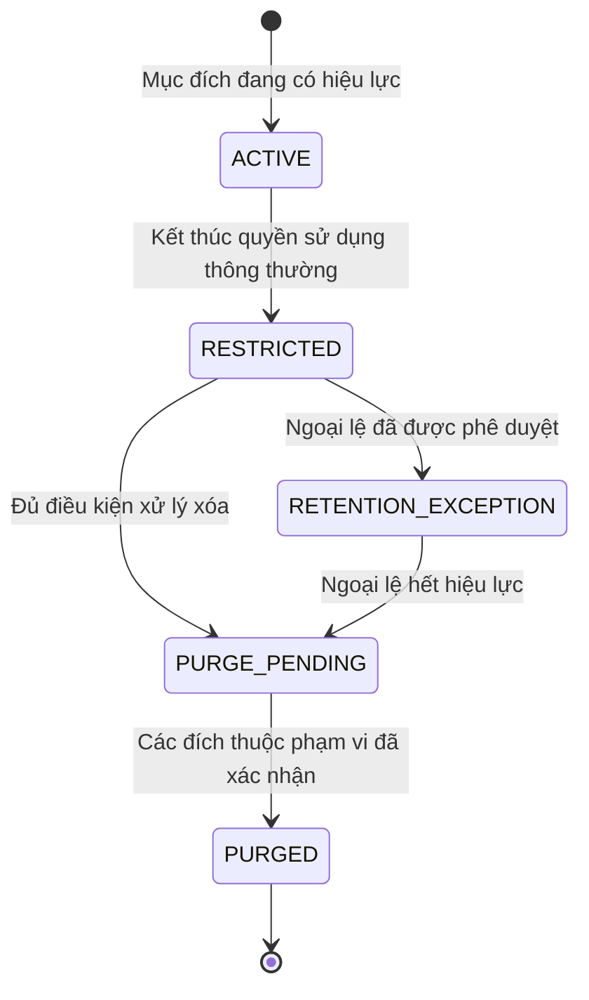
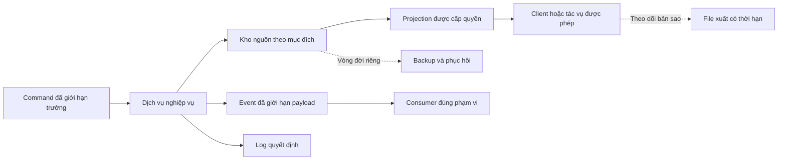

# Data minimization — Tối thiểu hóa dữ liệu trong quy tắc nghiệp vụ

## 1. Mục tiêu: mỗi dữ liệu phải phục vụ một quyết định rõ ràng

Trong chương **Privacy Rules** của module bảo mật logic nghiệp vụ, data minimization là việc giới hạn dữ liệu được thu thập, xử lý, truyền, hiển thị và lưu giữ theo nhu cầu thực tế của một mục đích đã xác định.

Ví dụ, màn hình theo dõi đơn hàng có thể chỉ cần mã đơn, trạng thái và ngày giao dự kiến. Nó không mặc nhiên cần ngày sinh, địa chỉ đầy đủ, tài liệu xác minh hoặc lịch sử thanh toán của khách. Việc một bảng cơ sở dữ liệu có các trường đó không làm chúng trở thành dữ liệu cần thiết cho mọi API đọc đơn.

W3C đưa ra nguyên tắc giảm lượng dữ liệu được trao đổi và lượng thông tin API cần yêu cầu để hoàn thành mục tiêu của người dùng. Đây là cơ sở để xem xét nhu cầu dữ liệu ngay khi thiết kế luồng. Xem [W3C Privacy Principles — Data Minimization](https://www.w3.org/TR/privacy-principles/#data-minimization).

Trong bảo mật logic nghiệp vụ, tối thiểu hóa còn giúp:

- Giảm trường client có thể dùng để sửa giá, giả trạng thái hoặc tự cấp quyền.
- Hạn chế việc nhân viên có quyền với một hồ sơ nhìn thấy thông tin không phục vụ công việc đó.
- Giảm số bản sao dữ liệu nhạy cảm xuất hiện trong log, event, cache và file xuất.
- Giữ quy trình xử lý khiếu nại, chống xử lý trùng và kiểm tra phê duyệt hoạt động bằng bằng chứng phù hợp.

Mục tiêu không phải xóa mọi dữ liệu càng nhanh càng tốt. Mục tiêu là có **đủ dữ liệu cần thiết, đúng phạm vi, đúng độ chi tiết và đúng thời gian** để thực thi quy tắc đã định.

Các biểu mẫu, kiểu dữ liệu, thời hạn và policy trong bài là ví dụ kỹ thuật. Chính sách thực tế cần được xác định theo sản phẩm, hợp đồng xử lý dữ liệu và bối cảnh áp dụng; không suy ra một thời hạn chung từ các con số minh họa.

## 2. Phân biệt những cơ chế thường bị nhầm lẫn

| Cơ chế | Câu hỏi được giải quyết | Giới hạn |
| --- | --- | --- |
| Tối thiểu hóa dữ liệu | Có cần dữ liệu này cho mục đích và thời điểm này không? | Cần hiểu quy trình nghiệp vụ |
| Phân quyền | Ai được thực hiện hành động hoặc đọc trường nào? | Người có quyền vẫn có thể được cấp quá nhiều dữ liệu |
| Mã hóa | Ai có thể giải mã dữ liệu đã lưu hoặc truyền? | Dữ liệu vẫn tồn tại và có thể bị dùng sai sau giải mã |
| Che dữ liệu | Biểu diễn nào được hiển thị ở một ngữ cảnh? | Bản gốc có thể vẫn có trong response hoặc log |
| Giả danh hóa | Có thể thay định danh trực tiếp bằng tham chiếu không? | Vẫn có khả năng liên kết và nhận diện lại |
| Giới hạn lưu giữ | Khi nào dữ liệu không còn được giữ cho mục đích này? | Cần xử lý các bản sao và công việc đang chạy |

Nếu backend gửi toàn bộ hồ sơ rồi frontend chỉ hiển thị vài trường, việc truyền dữ liệu chưa được tối thiểu hóa. Người dùng có thể đọc response bằng công cụ phát triển hoặc client khác.

Nếu đã mã hóa bản scan giấy tờ nhưng mọi service đều có quyền đọc và giải mã, vấn đề lan truyền dữ liệu vẫn còn. Nếu email được hash cố định và dùng chung ở mọi tenant, nó có thể trở thành định danh liên kết trên phạm vi rất rộng.

Các lớp bảo vệ cần phối hợp; không dùng một lớp để tuyên bố những lớp khác không còn cần thiết.

## 3. Bắt đầu từ mục đích và quyết định nghiệp vụ

### 3.1. Hỏi dữ liệu thay đổi quyết định nào

Với mỗi trường, cần trả lời:

1. Chức năng nào cần nó và quyết định nào phụ thuộc vào nó?
2. Có thể dùng dữ liệu ít chi tiết hơn hoặc kết quả xác minh thay thế không?
3. Cần dữ liệu ở bước nào, trong bao lâu và tại service nào?
4. Ai có quyền truy cập, qua đường nào và với bằng chứng công việc gì?
5. Điều gì xảy ra nếu trường bị thiếu, sai hoặc hết hạn?

“Một ngày nào đó có thể dùng” chưa phải nhu cầu đã được xác định. “Chống gian lận” cũng cần được cụ thể hóa thành giả thuyết, tín hiệu và khoảng thời gian quan sát.

### 3.2. Ma trận dữ liệu theo mục đích

Xét một hệ thống bán hàng có chăm sóc khách hàng và giao hàng:

| Mục đích | Dữ liệu có thể cần | Dữ liệu không mặc nhiên cần |
| --- | --- | --- |
| Xem trạng thái đơn | Mã đơn, trạng thái, ngày giao dự kiến | Ngày sinh, tài liệu xác minh, thông tin thanh toán |
| Giao hàng đến địa chỉ | Địa chỉ đã chọn, tên hoặc cách liên hệ cần cho vận chuyển | Lịch sử mua toàn bộ, hồ sơ ưu đãi, điểm rủi ro |
| Nhận hàng tại điểm cố định | Điểm nhận, mã nhận hàng hoặc bằng chứng được thiết kế | Địa chỉ nhà nếu không phục vụ bước nào khác |
| Kiểm tra điều kiện theo chính sách sản phẩm | Kết quả xác minh thuộc tính cần kiểm tra | Toàn bộ hồ sơ nguồn nếu chỉ cần một kết luận |
| Điều tra phát thưởng trùng | Khóa quyền lợi, operation, kết quả và bằng chứng liên quan | Toàn bộ payload thanh toán |
| Xem xét khiếu nại đơn cụ thể | Bằng chứng liên quan trong phạm vi hồ sơ | Mọi đơn và dữ liệu của khách khác |
| Báo cáo vận hành | Số lượng, tỷ lệ và nhóm đủ tổng quát | Danh sách định danh từng khách nếu không cần điều tra |

Bảng là điểm khởi đầu để phân tích, không phải danh sách cấm tuyệt đối. Ví dụ, một yêu cầu khiếu nại có thể cần thêm thông tin giao hàng nhưng phải có phạm vi và quyền tương ứng.

### 3.3. Chủ thể tự khai mục đích chưa tạo quyền

Một request có `purpose=FRAUD_INVESTIGATION` không được tự mở dữ liệu cho người gửi. Mục đích cần gắn với loại thao tác server cho phép và bằng chứng công việc như một case đang mở, được phân công hợp lệ.

Một nhân viên có vai trò SUPPORT cũng không mặc nhiên được đọc mọi đơn. Cần kiểm tra đồng thời tenant, đối tượng, hồ sơ được giao, hành động, trường dữ liệu và trạng thái hiện tại.

## 4. Tối thiểu hóa theo nhiều chiều

Chỉ giảm số cột của một bảng là chưa đủ. Có thể xem xét bảy chiều sau:

| Chiều | Câu hỏi thiết kế | Ví dụ |
| --- | --- | --- |
| Số trường | Có trường nào không ảnh hưởng quyết định không? | Không nhận ngày sinh khi chỉ cập nhật lựa chọn giao hàng |
| Độ chi tiết | Có cần giá trị chính xác đến mức này không? | Báo cáo theo ngày thay vì timestamp từng giây |
| Số đối tượng | Có cần toàn bộ tập bản ghi không? | Chỉ đọc đơn trong case đang xử lý |
| Thời gian | Có cần giữ sau khi mục đích kết thúc không? | Hết quyền truy cập theo thời hạn hồ sơ |
| Người nhận | Service hoặc đối tác nào cần trường nào? | Bên giao hàng không nhận điểm rủi ro nội bộ |
| Số bản sao | Có đang nhân bản qua log, cache và export không? | Không đưa địa chỉ vào event phát cho mọi consumer |
| Khả năng liên kết | Định danh có cho ghép dữ liệu ngoài mục đích không? | Tham chiếu riêng theo tenant và mục đích |

Độ chi tiết thấp hơn vẫn có thể đủ nhận diện khi kết hợp. Một tổ hợp khu vực rất nhỏ, thời điểm hiếm và sản phẩm đặc biệt có thể chỉ tương ứng một người. Cần đánh giá cả tập dữ liệu, không chỉ từng trường riêng lẻ.

## 5. Xem dữ liệu như một phần của invariant

Các invariant minh họa cho hệ thống đơn hàng:

```text
Dữ liệu đầu vào
  chỉ gồm các trường được phép cho lệnh hiện tại.

Dữ liệu được trả
  là giao của nhu cầu công việc, quyền hiện tại,
  phạm vi đối tượng và trạng thái hồ sơ.

Bằng chứng điều kiện
  phải đến từ nguồn tin cậy, đúng chủ thể,
  đúng mục đích và còn hiệu lực.

Bằng chứng chống xử lý trùng
  phải tồn tại đủ để giữ cam kết nghiệp vụ đã định.

Kết thúc mục đích
  không tự mở quyền cho mục đích khác.
```

Ví dụ, quy trình hoàn tiền cần biết khoản nào đã thu, ai được phê duyệt và khoản nào đã hoàn. Giảm dữ liệu không được khiến tổng hoàn vượt tổng đã thu hoặc làm mất điều kiện “người đề nghị không được tự phê duyệt”.

Nếu cần giữ tham chiếu người đề nghị và người duyệt để thực thi phân tách nhiệm vụ, đó là nhu cầu nghiệp vụ cụ thể. Có thể giới hạn nơi lưu, người đọc và độ chi tiết hiển thị thay vì xóa tham chiếu rồi làm hỏng quy tắc.

Tương tự, thay một kết quả xác minh đáng tin bằng boolean do client gửi là mất kiểm soát, không phải tối thiểu hóa an toàn.

## 6. Giới hạn dữ liệu đầu vào và tránh mass assignment

### 6.1. Một API không nên nhận cả entity

Giả sử lệnh chọn phương thức giao hàng nhận payload quá rộng:

```json
{
  "orderId": "order-340",
  "customerId": "customer-17",
  "customerProfile": {
    "birthDate": "1996-01-01",
    "identityDocumentRef": "document-raw-09"
  },
  "shippingAddressRef": "address-21",
  "deliveryOption": "STANDARD",
  "totalPriceMinor": 1,
  "approved": true,
  "riskScore": 0
}
```

Luồng có ít nhất hai vấn đề: mang theo dữ liệu không cần thiết và tạo cơ hội bind các thuộc tính nội bộ mà người gửi không được sửa.

Một command phù hợp hơn có thể là:

```json
{
  "shippingAddressRef": "address-21",
  "deliveryOption": "STANDARD",
  "expectedOrderVersion": 7
}
```

Order ID đến từ route; actor và tenant đến từ ngữ cảnh xác thực. Server vẫn phải kiểm tra địa chỉ được tham chiếu thuộc phạm vi được phép, đơn đang ở trạng thái có thể thay đổi và phí giao hàng được tính đúng.

Dùng một tham chiếu không tự làm dữ liệu an toàn. Nếu người gửi chọn `address-21` của khách khác và server không kiểm tra quyền, luồng vẫn có thể tiết lộ hoặc sử dụng sai địa chỉ.

### 6.2. Cho phép trường một cách tường minh

- Dùng command riêng cho từng hành động nghiệp vụ.
- Chỉ ánh xạ các trường được cho phép, không bind trực tiếp request vào entity lưu trữ.
- Quy định rõ cách xử lý trường không biết; với lệnh nhạy cảm có thể từ chối để nhận ra việc chèn thuộc tính.
- Kiểm tra field-level authorization cho các trường có điều kiện.
- Không lưu raw body để “dễ debug” sau khi đã chủ động loại trường khỏi mô hình.
- Kiểm tra phần lồng nhau, mảng, file đính kèm và trường văn bản tự do.

OWASP API3 đề cập cả việc lộ thuộc tính không được phép đọc và sửa các thuộc tính nhạy cảm qua mass assignment. Khuyến nghị chọn rõ thuộc tính được đọc hoặc cập nhật phù hợp trực tiếp với thiết kế command và response nhỏ. Xem [API3:2023 — Broken Object Property Level Authorization](https://api-security.owasp.org/editions/2023/en/0xa3-broken-object-property-level-authorization/).

Một DTO nhỏ không tự làm serializer từ chối trường lạ. Cần cấu hình hoặc validation thực tế tại lớp giải mã request và kiểm tra hành vi đó ở mức HTTP.

### 6.3. Thu thập theo giai đoạn

Không cần yêu cầu mọi dữ liệu ngay khi tạo tài khoản. Có thể thu địa chỉ tại bước chọn giao hàng, hoặc xác minh một thuộc tính khi người dùng thực sự dùng chức năng cần thuộc tính đó.

Nếu người dùng chọn nhận hàng tại điểm cố định, hệ thống cần xem lại liệu địa chỉ nhà có còn phục vụ mục đích nào trong luồng này. Không giữ trường bắt buộc chỉ vì biểu mẫu cũ đã có.

Các ô ghi chú cũng cần hướng dẫn rõ. Nếu một hệ thống thường xuyên nhận số giấy tờ hoặc thông tin sức khỏe trong ghi chú không liên quan, cần sửa cách hỏi và cách xử lý; không chỉ che ở màn hình sau cùng.

## 7. Trả dữ liệu bằng projection theo công việc

### 7.1. Đừng trả entity rồi trông chờ frontend che

Một endpoint hỗ trợ tra cứu tiến độ đơn không cần dùng cùng response với trang khách tự quản lý địa chỉ hoặc màn hình vận chuyển.

Có thể định nghĩa projection riêng:

```java
import java.time.LocalDate;
import java.util.UUID;

public record OrderSupportSummary(
        UUID orderId,
        String status,
        LocalDate estimatedDeliveryDate) {
}
```

Kiểu record dùng cú pháp Java 17. Nó minh họa hợp đồng gồm ba trường cho công việc xem tiến độ, không chứa địa chỉ, số điện thoại hoặc dữ liệu thanh toán.

Thêm một thuộc tính nhạy cảm vào entity không nên làm API này tự xuất hiện thuộc tính đó. Projection tường minh giảm sự phụ thuộc vào cấu trúc lưu trữ.

### 7.2. Kết hợp projection với phạm vi đối tượng

Một truy vấn minh họa cho nhân viên được giao case:

```sql
SELECT o.id AS order_id,
       o.status,
       o.estimated_delivery_date
FROM orders o
JOIN support_case c
  ON c.tenant_id = o.tenant_id
 AND c.order_id = o.id
WHERE o.tenant_id = :tenant_id
  AND o.id = :order_id
  AND c.id = :case_id
  AND c.assigned_agent_id = :agent_id
  AND c.state = 'OPEN';
```

Các tham số tenant và agent phải được lấy từ ngữ cảnh tin cậy. Việc phân công case là dữ liệu server có kiểm soát; client không được tự gán mình làm người xử lý chỉ để đọc đơn.

Truy vấn chọn đúng trường cần và chỉ lấy đối tượng thuộc case được giao. Nó không thay kiểm tra tài khoản nhân viên còn hoạt động và còn quyền dùng chức năng này.

Một khung điều phối **mã giả Java**:

```java
OrderSupportSummary readSupportSummary(
        AuthenticatedAgent agent,
        UUID caseId,
        UUID orderId) {

    authorization.requireCurrentPermission(
            agent, "READ_ASSIGNED_ORDER_SUMMARY");

    return database.readOnlyTransaction(tx -> {
        SummaryRow row = tx.findAssignedOpenCaseSummary(
                agent.tenantId(),
                agent.id(),
                caseId,
                orderId
        ).orElseThrow(ResourceNotAvailableException::new);

        return new OrderSupportSummary(
                row.orderId(),
                row.status(),
                row.estimatedDeliveryDate());
    });
}
```

Các kiểu repository và exception trong khung cần được triển khai theo ứng dụng. Hợp đồng lỗi cần tránh tiết lộ đối tượng có tồn tại ở tenant khác hay không.

Nếu công việc thực sự cần đọc địa chỉ đầy đủ, dùng hành động và projection riêng có điều kiện cấp quyền tương ứng. Không thêm `includeSensitive=true` do client tự chọn vào endpoint đang có rồi coi đó là đủ kiểm soát.

### 7.3. Cache cũng cần phạm vi và quyền hiện tại

Cache một response đã được cấp quyền cho nhân viên A rồi trả cho nhân viên B là một đường rò rỉ dù query gốc đúng.

Cần xác định:

- Đang cache dữ liệu nguồn hay response đã phụ thuộc người xem.
- Khóa cache có phản ánh tenant, loại projection và các điều kiện ảnh hưởng kết quả không.
- Quyền hiện tại được kiểm tra trước khi trả dữ liệu như thế nào.
- Đóng case, chuyển phân công hoặc hết thời hạn truy cập có vô hiệu hóa đường đọc cũ không.
- Header cache và các tầng proxy có phù hợp với tính riêng tư của response không.

Đưa actor vào cache key chưa giải quyết việc actor đó vừa bị thu hồi quyền. Không dùng một response cũ như một quyết định cho phép vĩnh viễn.

## 8. Dùng kết quả xác minh thay cho hồ sơ nguồn khi có thể

### 8.1. Thay câu hỏi “người này là ai?” bằng câu hỏi cần thiết

Một chức năng có chính sách yêu cầu người mua đạt ngưỡng tuổi có thể chỉ cần kết quả “đạt ngưỡng theo policy này”, không cần mọi service giữ ngày sinh và ảnh tài liệu.

Một assertion minh họa:

```json
{
  "assertion_id": "assertion-260",
  "subject_ref": "subject-ref-18",
  "tenant_id": "tenant-03",
  "audience": "restricted-product-ordering",
  "purpose": "CHECK_PRODUCT_ELIGIBILITY",
  "attribute": "AGE_AT_LEAST_REQUIRED_THRESHOLD",
  "result": true,
  "policy_version": "eligibility-v2",
  "issued_at": "2026-11-22T08:00:00Z",
  "expires_at": "2026-11-22T08:15:00Z",
  "issuer": "trusted-verification-service"
}
```

Đây là mô hình dữ liệu minh họa, không phải token đã có khả năng xác thực. Một JSON có tên issuer đáng tin chưa chứng minh ai phát hành nó. Server cần lấy kết quả qua kênh xác thực được hoặc kiểm tra cơ chế bảo vệ assertion theo giao thức đã thiết kế.

### 8.2. Kết quả ít dữ liệu hơn vẫn phải ràng buộc chặt

Bên dùng assertion phải kiểm tra:

- Nguồn phát và tính toàn vẹn.
- Chủ thể có khớp người đang thực hiện thao tác không.
- Tenant, audience và mục đích có đúng không.
- Policy và ngưỡng được xác minh có phù hợp quyết định hiện tại không.
- Hạn hiệu lực và cơ chế thu hồi nếu giao thức có yêu cầu.
- Assertion có được dùng lại hoặc chỉ dùng cho một operation cụ thể.

Không nhận `eligible=true` từ client rồi bỏ kiểm tra. Không dùng kết quả đủ tuổi để cho phép sửa giá hoặc tự phê duyệt đơn. Nếu quy tắc khác yêu cầu quyền sở hữu, thứ tự trạng thái hay hạn mức, các kiểm tra đó vẫn phải thực thi.

Dịch vụ xác minh có thể vẫn cần dữ liệu gốc trong quy trình riêng. Cần phân tích nơi đó như một phạm vi xử lý riêng; chuyển dữ liệu sang một service khác không tự loại nhu cầu tối thiểu hóa.

### 8.3. Một boolean cũng có thể nhạy cảm

Kết quả xác minh, cờ rủi ro hoặc trạng thái thuộc một nhóm có thể tiết lộ thông tin quan trọng. Không đưa chúng ra endpoint công khai chỉ vì chúng ngắn hơn hồ sơ gốc.

Một API cho thử hàng loạt subject ID rồi trả “đủ điều kiện/không đủ điều kiện” vẫn có thể trở thành công cụ dò thông tin. Cần quyền đối tượng, phạm vi mục đích, kiểm soát truy vấn và hợp đồng lỗi thích hợp.

## 9. Ngăn dữ liệu lan truyền qua event, log và telemetry

### 9.1. Domain event không nên là bản chụp toàn entity

Một event `order.approved` thường không cần mang theo toàn bộ hồ sơ khách, địa chỉ, thông tin thanh toán và ghi chú nội bộ.

Một mô hình tối thiểu hơn cho consumer thực sự cần biết chuyển trạng thái:

```json
{
  "schema_version": 1,
  "event_id": "event-820",
  "event_type": "order.approved",
  "tenant_id": "tenant-03",
  "order_ref": "order-ref-340",
  "operation_id": "operation-73",
  "state_before": "PENDING_APPROVAL",
  "state_after": "APPROVED",
  "occurred_at": "2026-11-22T08:05:00Z",
  "policy_version": "approval-policy-v5"
}
```

Event vẫn có thể là dữ liệu liên quan đến cá nhân qua order ref. Consumer và người đọc topic không mặc nhiên có quyền liên kết nó với hồ sơ khách.

Nếu một consumer giao hàng cần địa chỉ, có thể cho nó lấy projection giao hàng qua API riêng sau khi kiểm tra quyền và trạng thái hiện tại. Tham chiếu trong event không phải một quyền truy cập. Cách này giảm việc mọi consumer nhận sẵn địa chỉ nhưng tạo phụ thuộc vào service nguồn, cần retry và xử lý lỗi rõ ràng.

Nếu bắt buộc đưa dữ liệu giao hàng trực tiếp vào message, phải giới hạn đúng người nhận, trường, thời hạn và bản sao. Không coi mọi dữ liệu trong message bus là nội bộ nên dùng tự do.

### 9.2. Outbox và dead-letter queue cũng là nơi lưu dữ liệu

Outbox giúp gắn sự kiện với transaction đã commit; nó không tự làm payload tối thiểu. Một outbox chứa toàn entity vẫn là một bản sao nhạy cảm.

Tương tự, payload đã được lọc ở consumer có thể còn nguyên trong broker hoặc dead-letter queue. Nên loại phần không cần thiết trước khi lưu hoặc phát. Đặt quyền, lưu giữ và quy trình xóa cho cả outbox, retry queue và dead-letter queue.

Replay sự kiện cũ sau khi mục đích đã kết thúc không được tự cấp quyền lấy lại dữ liệu. Consumer phải xử lý trạng thái “không còn được phép lấy” thay vì mở một đường truy cập đặc biệt để replay bằng được.

### 9.3. Log phải đủ điều tra mà không ghi lại toàn bộ dữ liệu

Một log quyết định có thể gồm actor ref, object ref, hành động, kết quả, mã lý do, thời điểm và policy version. Khi cần biết field nào bị từ chối, thường có thể ghi tên field hoặc mã validation mà không ghi nguyên giá trị.

OWASP khuyến nghị tránh ghi trực tiếp các dữ liệu như access token, mật khẩu, khóa bí mật và dữ liệu thanh toán nhạy cảm. Xem [Logging Cheat Sheet — Data to exclude](https://cheatsheetseries.owasp.org/cheatsheets/Logging_Cheat_Sheet.html#data-to-exclude).

Trong thiết kế của bài, cần rà cả:

- Middleware ghi request và response body.
- Exception chứa entity hoặc payload.
- `toString()` tự sinh của các đối tượng có dữ liệu nhạy cảm.
- Trace attributes, APM và session replay.
- URL, query string và tên file đính kèm.
- Metric labels và thông báo lỗi gửi đến công cụ ngoài.

Nếu đã loại ngày sinh khỏi database nhưng middleware vẫn lưu raw request vào log, mục tiêu giảm lưu giữ chưa đạt. Sampling giảm số bản sao nhưng không thay thế quyết định trường nào được phép ghi.

## 10. Lưu giữ theo vòng đời thay vì một TTL chung

### 10.1. Mỗi loại dữ liệu có vòng đời riêng

| Loại dữ liệu | Sự kiện kích hoạt xem lại nhu cầu | Cách xử lý có thể phù hợp |
| --- | --- | --- |
| Dữ liệu giao hàng | Giao xong và hết nhu cầu vận hành đã định | Giới hạn truy cập, xóa hoặc giảm chi tiết theo policy |
| Hồ sơ hỗ trợ | Case đóng, hết thời gian xử lý tiếp | Thu hồi quyền đọc thông thường |
| Bằng chứng xác minh nguồn | Quy trình xác minh hoàn tất | Giữ tại nơi có trách nhiệm hoặc loại bỏ theo mục đích riêng |
| Assertion kết quả | Hết hiệu lực hoặc bị thu hồi | Không dùng cho quyết định mới |
| Log bảo mật | Hết cửa sổ điều tra được xác định | Xóa hoặc tổng hợp theo chính sách |
| Bản ghi idempotency | Hết cam kết retry và nhu cầu chống trùng | Giữ phần cần cho invariant hoặc xóa theo quy trình |
| File xuất | Hết hạn công việc và tải về | Thu hồi khả năng truy cập và xử lý bản lưu |

Các dòng không mặc định có cùng thời hạn. Dữ liệu đủ cho vận chuyển có thể không còn cần khi xử lý báo cáo tổng hợp. Ngược lại, một tham chiếu giao dịch có thể vẫn cần cho đối soát dù địa chỉ không còn cần trong service đó.

### 10.2. Mô hình trạng thái dữ liệu

Một state machine kỹ thuật minh họa:



RESTRICTED không có nghĩa là dữ liệu được phép tiếp tục phục vụ mọi tính năng. RETENTION_EXCEPTION cần lý do, phạm vi, người phê duyệt, quyền truy cập và thời điểm xem xét lại; không dùng nó làm trạng thái giữ vô hạn mặc định.

PURGED phải phản ánh phạm vi hoàn thành thực tế. Nếu mới xóa bản ghi chính mà còn export, index hoặc retry message chứa bản sao, chưa thể báo đã xử lý toàn bộ các đích đó.

## 11. Phối hợp transaction với tác vụ xóa và công việc đang chạy

Giả sử một job xuất hồ sơ đã được tạo khi case còn mở, rồi case đóng trước khi job thực thi. Nếu job chỉ tin quyền lúc xếp hàng, nó có thể tạo file chứa dữ liệu sau khi mục đích đã kết thúc.

Một luồng xử lý có thể là:

1. Transaction đánh dấu mục đích không còn hoạt động hoặc tăng version quyền xử lý.
2. Vô hiệu hóa quyền đọc thông thường và ghi công việc cần thực hiện vào outbox.
3. Worker lấy tác vụ, kiểm tra version, trạng thái và phạm vi hiện tại trước khi đọc dữ liệu.
4. Mỗi đích xóa hoặc hạn chế được xử lý bằng thao tác có thể retry an toàn.
5. Ghi kết quả từng đích, thử lại phần lỗi và chỉ kết thúc khi đạt tiêu chí đã định.

Một cờ đã hủy trong bảng job không tự thu hồi dữ liệu worker đã đọc. Với thao tác nhạy cảm, cần xác định rõ điểm đọc hoặc phát hành nào phải kiểm tra lại quyền, và có cơ chế đồng bộ hoặc version phù hợp tại điểm đó.

Dữ liệu đã được gửi cho bên nhận không thể bị thu hồi chỉ bằng một transaction cục bộ. Cần theo dõi người nhận và quy trình xử lý bản sao thuộc phạm vi trách nhiệm, thay vì tuyên bố rollback đã xóa mọi nơi.

Các thao tác xóa không nên giữ transaction database mở trong suốt các lời gọi mạng đến nhiều hệ thống. Dùng trạng thái tiến độ bền vững, idempotency và đối soát để hoàn tất theo từng đích.

### 11.1. Backup và phục hồi cũng thuộc vòng đời

Một backup có thể chưa cho phép xóa từng dòng ngay. Thiết kế cần biết dữ liệu tồn tại ở backup nào, ai được phục hồi, bao lâu backup bị loại bỏ và cách áp dụng lại các quyết định xóa hoặc hạn chế trước khi dữ liệu phục hồi được đưa vào phục vụ.

Không chỉ khôi phục database rồi cho worker cũ chạy lại các event chứa dữ liệu đã được loại bỏ. Cần kiểm tra trạng thái, version và danh sách xử lý liên quan khi phục hồi.

## 12. Giữ đủ bằng chứng cho idempotency và invariant

### 12.1. Không xóa khóa duy nhất rồi tạo lại tác động cũ

Một hệ thống phát thưởng có thể cần ngăn cùng sự kiện đủ điều kiện được nhận thưởng hai lần. Nếu xóa toàn bộ ledger và dấu vết chống trùng ngay khi người dùng đóng tài khoản, request hoặc message cũ có thể được xử lý như mới.

Thay vì giữ cả hồ sơ người dùng, có thể xác định bản ghi tối thiểu gồm:

- Phạm vi tenant và loại quyền lợi.
- Tham chiếu sự kiện đủ điều kiện hoặc khóa nghiệp vụ.
- Operation hoặc kết quả tác động đã commit.
- Trạng thái xử lý và thời điểm cần cho cam kết chống trùng.
- Phiên bản quy tắc và bằng chứng liên quan thực sự cần thiết.

Các tham chiếu này vẫn có thể liên quan đến cá nhân, cần được bảo vệ và có chính sách lưu giữ. “Cần chống trùng” không có nghĩa được giữ vô hạn mọi dữ liệu trong payload.

### 12.2. Fingerprint phải tối thiểu nhưng đủ phân biệt ý nghĩa

Fingerprint của lệnh cần bao gồm các trường thay đổi tác động nghiệp vụ. Bỏ quantity hoặc nơi nhận chỉ để làm fingerprint nhỏ hơn có thể khiến payload khác bị coi là retry giống nhau.

Ngược lại, không cần lưu raw body hoặc dữ liệu nguồn không tham gia lệnh. Có thể dùng biểu diễn đã chuẩn hóa và cơ chế băm có khóa phù hợp khi dữ liệu có nguy cơ bị dò. Cần quản lý phiên bản chuẩn hóa và khóa để retry còn trong cam kết không bị coi là operation mới do thay cách tính.

Idempotency không thay quyền hiện tại. Khi replay, kiểm tra actor còn được nhận kết quả hay không, rồi trả projection phù hợp. Lưu tham chiếu kết quả nghiệp vụ thay vì toàn bộ response chứa địa chỉ có thể giảm dữ liệu trong cache idempotency.

Nếu cần replay đúng từng byte, phải phân tích việc response cũ chứa gì, ai được đọc và giữ bao lâu. Không mặc định ưu tiên cache cũ hơn việc thu hồi quyền đọc trường nhạy cảm.

## 13. Che, giả danh hóa và dữ liệu tổng hợp: dùng đúng giới hạn

### 13.1. Che ở đâu thì bảo vệ ở đó

Hiển thị số điện thoại dạng `***1234` có thể phù hợp một công việc xác nhận, nhưng không đạt mục tiêu nếu response vẫn có trường `fullPhone`.

Che cần được thực hiện trước khi dữ liệu đi qua ranh giới mà người nhận không có quyền xem bản gốc. Đồng thời kiểm tra cả field phụ, metadata, lỗi validation, export và đường tải file gốc.

Một giá trị đã che vẫn có thể nhận ra người khi kết hợp với tên, khu vực hoặc đơn hiếm. Không dùng “đã che” như một phân loại an toàn chung cho mọi người nhận.

### 13.2. Tham chiếu riêng theo phạm vi giúp giảm liên kết không cần thiết

Trong một hệ thống phân tích chống lạm dụng, có thể cần liên kết hành vi của cùng chủ thể trong một chiến dịch nhưng không cần ghép mọi hoạt động trên toàn sản phẩm.

Một mô hình khái niệm:

```text
scoped_ref = HMAC(
    managed_scope_key,
    canonical(tenant, purpose, analysis_period, subject_id)
)
```

Biểu diễn canonical phải tránh nhập nhằng giữa các thành phần. Khóa do hệ thống quản lý; tham số purpose và phạm vi không được tự do thay theo yêu cầu của client.

Thiết kế này tạo tham chiếu có phạm vi, không tự chứng minh dữ liệu đã ẩn danh. Người có dữ liệu bổ sung hoặc quyền vào nguồn ánh xạ vẫn có thể liên kết. W3C cũng lưu ý việc nhận diện gián tiếp và khả năng ghép với thông tin khác khi đánh giá dữ liệu đã loại định danh. Xem [Privacy Principles — De-identified Data](https://www.w3.org/TR/privacy-principles/#de-identified-data).

Không dùng hash thuần của email hoặc số điện thoại làm bằng chứng đã ẩn danh: tập giá trị có thể bị dò. HMAC cũng không loại bỏ các dấu hiệu khác như lịch sử hiếm hoặc vị trí chi tiết.

Nếu xoay tham chiếu quá sớm, bộ phát hiện có thể mất khả năng nối hành vi trong cửa sổ cần bảo vệ. Nếu dùng tham chiếu ổn định mãi mãi, phạm vi liên kết lại quá rộng. Cần chọn chu kỳ và cơ chế liên kết theo nhu cầu cụ thể, tách khỏi khóa chống trùng bắt buộc khi cần.

Không dùng một chuỗi rút gọn làm khóa duy nhất tuyệt đối nếu chưa xét va chạm và cách xử lý. Sự tiện lợi của một tham chiếu ngắn không thay thế định danh có thẩm quyền trong nghiệp vụ.

### 13.3. Tổng hợp dữ liệu chưa chắc đã ngăn suy luận

Báo cáo “một người mua sản phẩm X tại khu vực Y vào thời điểm Z” có thể gần với việc tiết lộ bản ghi cá nhân dù không chứa tên.

Có thể giảm rủi ro bằng cách:

- Gộp các nhóm quá nhỏ hoặc không công bố kết quả của chúng.
- Giảm độ chi tiết thời gian, vị trí hoặc thuộc tính không cần thiết.
- Hạn chế khả năng tạo nhiều truy vấn chồng lấn để suy ra từng người.
- Chia sẻ số tổng hợp cần thiết thay vì xuất cả tập bản ghi bên dưới.
- Kiểm tra cả dữ liệu phụ mà người nhận đã có.

Một ngưỡng số lượng nhóm chỉ là một phần kiểm soát; không tự tạo bảo đảm ẩn danh cho mọi tổ hợp và mọi người nhận.

## 14. Theo dõi bản sao và quyền xuất dữ liệu

Một thay đổi ở bảng chính chưa đủ để hoàn thành thay đổi dữ liệu. Cần lập bản đồ những nơi cùng giá trị có thể đi qua:



Các câu hỏi quan trọng:

- Có cache, search index, data warehouse hoặc file tạm không?
- Consumer có tự lưu thêm bản sao lâu hơn nguồn không?
- Công cụ hỗ trợ, giám sát hoặc tích hợp ngoài có nhận raw payload không?
- Ai có quyền tải export và liên kết tải có còn hiệu lực sau khi quyền bị thu hồi không?
- Bản sao có chủ sở hữu, thời hạn và cơ chế đối soát không?

Một đường dẫn tải có thời hạn vẫn có thể bị chia sẻ trước khi hết hạn. Nếu cần kiểm tra quyền hiện tại mỗi lần tải, dùng cơ chế phục vụ đáp ứng yêu cầu đó; không mặc định một URL đã ký luôn có thể thu hồi ngay.

Job export nên lưu tiêu chí và phạm vi đã được kiểm soát thay vì nguyên một hồ sơ lớn. Trước khi tạo và phát hành file, kiểm tra quyền, mục đích và trường được phép tại thời điểm tương ứng.

Không để API thường đã giới hạn trường nhưng endpoint CSV hoặc GraphQL resolver vẫn trả toàn entity. Người nhận có thể chuyển sang đường ít được kiểm soát hơn để lấy cùng dữ liệu.

## 15. Một dòng thời gian minh họa

Xét một khách mua hàng giao tận nhà, sau đó cần hỗ trợ tra cứu tiến độ:

| Thời điểm | Sự kiện nghiệp vụ | Quy tắc dữ liệu |
| --- | --- | --- |
| Tạo tài khoản | Khách chưa chọn mua hàng | Không yêu cầu địa chỉ chỉ để dự phòng |
| Chọn giao tận nhà | Cần địa chỉ giao | Thu hoặc chọn đúng địa chỉ; kiểm tra quyền tham chiếu |
| Xác nhận đơn | Đơn được commit | Ghi sự kiện phù hợp, không phát toàn hồ sơ khách |
| Mở case hỗ trợ | Nhân viên được giao tra cứu tiến độ | Projection chỉ có mã đơn, trạng thái và ngày giao dự kiến |
| Cần xử lý vấn đề địa chỉ | Công việc phát sinh nhu cầu khác | Cấp quyền hành động phù hợp, không tự mở toàn hồ sơ |
| Đóng case | Công việc hỗ trợ thông thường kết thúc | Quyền theo case không còn dùng cho lần đọc sau |
| Job export cũ bắt đầu chạy | Quyền lúc xếp hàng đã cũ | Kiểm tra lại, không xuất chỉ vì job đã được tạo trước đó |
| Hết nhu cầu lưu dữ liệu giao hàng ở một service | Vòng đời dữ liệu chuyển trạng thái | Xử lý theo policy, theo dõi các bản sao liên quan |
| Client replay một operation cũ | Cần xác định tác động đã xảy ra | Giữ chống trùng nhưng áp dụng quyền đọc hiện tại |

Nếu đơn đang có khiếu nại cần giữ một số bằng chứng, quy trình cần xác định rõ tập dữ liệu, thẩm quyền và thời hạn của ngoại lệ. Không giữ cả hồ sơ chỉ vì một phần thông tin còn cần.

Dòng thời gian cũng cho thấy cùng một chủ thể có thể có quyền khác nhau ở từng bước. Một lần được xem địa chỉ không biến thành quyền xem địa chỉ ở mọi công việc tương lai.

## 16. Ma trận kiểm thử chống lạm dụng logic liên quan dữ liệu

Kiểm thử nên quan sát dữ liệu thực sự đi qua ranh giới: HTTP response, câu truy vấn, sự kiện, log, cache và file xuất. Chỉ kiểm tra giao diện đã ẩn trường là chưa đủ.

| Tình huống | Kết quả cần xác minh |
| --- | --- |
| Thêm `approved`, `riskScore` hoặc `totalPriceMinor` vào command không cho sửa | Không thay đổi giá, quyền hoặc trạng thái qua mass assignment |
| Chèn field nhạy cảm vào object lồng nhau | Áp dụng chính sách field tường minh ở mọi cấp cần kiểm soát |
| Dùng address ref của người khác | Bị từ chối theo quyền đối tượng; không sử dụng địa chỉ đó |
| Đổi tenant ID hoặc actor ID trong payload | Không làm thay phạm vi lấy từ ngữ cảnh xác thực |
| Nhân viên đọc đơn không thuộc case được giao | Không trả summary hoặc thông tin phụ của đơn |
| Client tự gửi purpose điều tra | Không mở projection nhạy cảm nếu thiếu quyền và bằng chứng công việc |
| Case vừa đóng hoặc chuyển người xử lý | Lần đọc tiếp theo kiểm tra điều kiện hiện tại |
| Request GraphQL thêm field nhạy cảm | Không lấy được field chỉ vì object cha được phép đọc |
| Tải CSV hoặc export của cùng đối tượng | Áp dụng phạm vi và trường tương ứng, không quay về full entity |
| Entity có thêm thuộc tính nhạy cảm | Response projection hiện có không tự thêm thuộc tính |
| Response đã che một trường | Không còn bản gốc trong field khác, metadata hoặc đường tải phụ |
| Assertion do client tự tạo | Không được coi là kết quả xác minh đáng tin |
| Assertion đúng chữ ký nhưng sai subject, tenant hoặc audience | Không áp dụng cho thao tác hiện tại |
| Assertion hết hạn hoặc khác policy yêu cầu | Không dùng để cho qua điều kiện |
| Kết quả đủ điều kiện hợp lệ nhưng đơn sai trạng thái | State machine vẫn từ chối lệnh |
| Gửi token hoặc dữ liệu nhạy cảm rồi gây validation error | Log và error tracking không chứa nguyên giá trị ngoài policy |
| Middleware bật ghi body | Không làm raw payload vượt qua ranh giới đã giới hạn |
| Outbox hoặc dead-letter queue bị kiểm tra trực tiếp | Chỉ chứa payload đã được cho phép, có quyền và vòng đời |
| Replay event cũ sau khi mục đích kết thúc | Không tự tạo quyền đọc hoặc khôi phục dữ liệu cũ |
| Worker export chạy sau khi quyền bị thu hồi | Không phát hành file dựa trên quyền đã cũ |
| Quy trình xóa lỗi ở một đích | Không báo hoàn tất toàn phạm vi; retry đúng phần còn thiếu |
| Tác vụ xóa được giao lại nhiều lần | Không làm hỏng số dư, invariant hoặc các bản ghi khác |
| Xóa hồ sơ rồi phát lại message trao thưởng cũ | Không phát cùng quyền lợi lần nữa nếu còn trong cam kết chống trùng |
| Replay idempotency sau khi mất quyền xem trường | Không trả response nhạy cảm cũ chỉ vì cache còn tồn tại |
| Xoay khóa hoặc phiên bản fingerprint | Retry trong cam kết không bị nhận nhầm thành operation mới |
| Cùng subject xuất hiện ở hai tenant | Không tự tạo khả năng ghép ngoài phạm vi đã cho phép |
| Báo cáo có nhóm quá nhỏ hoặc truy vấn chồng lấn | Áp dụng kiểm soát suy luận đã định, không mặc định an toàn vì không có tên |
| Khôi phục backup cũ | Áp dụng lại quyết định vòng đời trước khi cho dữ liệu phục vụ |
| Ngoại lệ lưu giữ hết hạn | Có quy trình xem xét và xử lý tiếp, không giữ vô thời hạn mặc định |
| Dữ liệu ít hơn nhưng bằng chứng phê duyệt bị thiếu | Không triển khai thay đổi làm mất kiểm tra phân tách nhiệm vụ |

Với kiểm thử log hoặc event, dùng các giá trị giả có dấu hiệu nhận biết riêng để phát hiện nơi bị sao chép. Không cần dùng dữ liệu cá nhân thật để chứng minh một payload bị ghi ra nhiều đích.

Kiểm thử cạnh tranh cần tạo tình huống có kiểm soát giữa đóng case, đọc dữ liệu và chạy job. Phải định nghĩa điểm nào quyết định quyền có hiệu lực để đánh giá kết quả; không đưa ra một cam kết thu hồi tuyệt đối mà kiến trúc không thực thi được.

Ngoài kiểm tra không có dữ liệu thừa, cần có kiểm tra dương: người được giao vẫn hoàn thành công việc, giao dịch vẫn đối soát được và request trùng vẫn không tạo tác động lần hai.

## 17. Triển khai một thay đổi tối thiểu hóa có thể kiểm chứng

Một lộ trình phù hợp cho hệ thống đang hoạt động:

1. **Chọn một luồng:** viết mục đích, quyết định và các invariant không được làm mất.
2. **Lập bản đồ dữ liệu:** ghi rõ nguồn, người nhận, bản sao, thời hạn và chủ sở hữu.
3. **Thiết kế hợp đồng nhỏ hơn:** command, projection, assertion và event theo công việc.
4. **Thực thi ở server:** kiểm tra trường, đối tượng, tenant, trạng thái và quyền hiện tại.
5. **Xử lý tương thích:** chuyển consumer và client; không duy trì endpoint cũ trả full entity vô thời hạn.
6. **Xem lại dữ liệu đã có:** xử lý bản sao thừa theo kế hoạch, không chỉ ngừng tạo bản sao mới.
7. **Đo và vận hành:** theo dõi cả giảm phơi lộ và khả năng giữ đúng quy tắc nghiệp vụ.

Các chỉ số hữu ích gồm:

| Nhóm | Ví dụ |
| --- | --- |
| Phạm vi thu thập | Số trường chưa có mục đích rõ ràng trong từng command |
| Phạm vi truyền | Số người nhận và số trường của từng loại event |
| Khả năng truy cập | Số đường đọc dữ liệu chi tiết, số quyền theo case đã hết hạn |
| Lưu giữ | Bản ghi quá hạn, job xóa bị kẹt, đích chưa xác nhận |
| Bản sao | Export chưa hết hạn đúng cách, index hoặc queue còn payload cũ |
| Tính đúng nghiệp vụ | Tỷ lệ retry đúng, phát hiện trùng, khả năng đối soát và phê duyệt |
| Trải nghiệm công việc | Số case phải xin bổ sung dữ liệu, thời gian xử lý và lỗi do thiếu dữ liệu |

Giảm số trường không có nghĩa đã giảm rủi ro tương ứng: một field tài liệu gốc có thể nhạy cảm hơn nhiều field trạng thái. Cần xem nội dung, số người nhận, thời gian và khả năng liên kết.

Khi muốn thêm dữ liệu mới, người đề xuất cần nêu quyết định được cải thiện và vì sao dữ liệu hiện có chưa đủ. Nếu không còn ai dùng một field, cần xem lại cả việc thu thập và các bản sao lịch sử thay vì chỉ bỏ khỏi màn hình.

## 18. Những lỗi thiết kế cần tránh

- Thu cả hồ sơ ngay từ đầu chỉ để giảm việc thiết kế biểu mẫu theo bước.
- Dùng cùng một entity cho request, response, event và log.
- Cho client tự khai mục đích hoặc cờ quyền để đọc thêm dữ liệu.
- Chỉ che ở giao diện trong khi response giữ bản gốc.
- Coi mã hóa, hash hoặc tham chiếu ngẫu nhiên là lý do để giữ mọi dữ liệu.
- Xóa bằng chứng chống trùng nhưng vẫn hứa cùng một tác động không xảy ra hai lần.
- Cache response nhạy cảm rồi bỏ qua quyền hiện tại khi replay.
- Dùng một TTL cho hồ sơ nguồn, assertion, log và ledger mà không xét mục đích.
- Tuyên bố xóa hoàn tất khi mới xử lý database chính.
- Phục hồi backup hoặc replay event làm dữ liệu hết mục đích quay lại phục vụ.
- Dùng lý do chống gian lận để thu thập và liên kết không có giới hạn.
- Giảm dữ liệu đến mức không còn thực thi được quyền, phê duyệt hoặc đối soát.

Thiết kế đạt mục đích khi có thể giải thích cho từng dữ liệu: **quyết định nào cần nó, ai được dùng trong phạm vi nào, vì sao độ chi tiết này là đủ, khi nào nhu cầu kết thúc và bằng chứng tối thiểu nào vẫn cần để giữ đúng quy tắc nghiệp vụ**.
