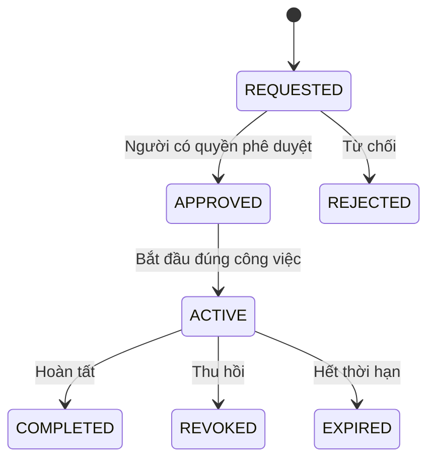
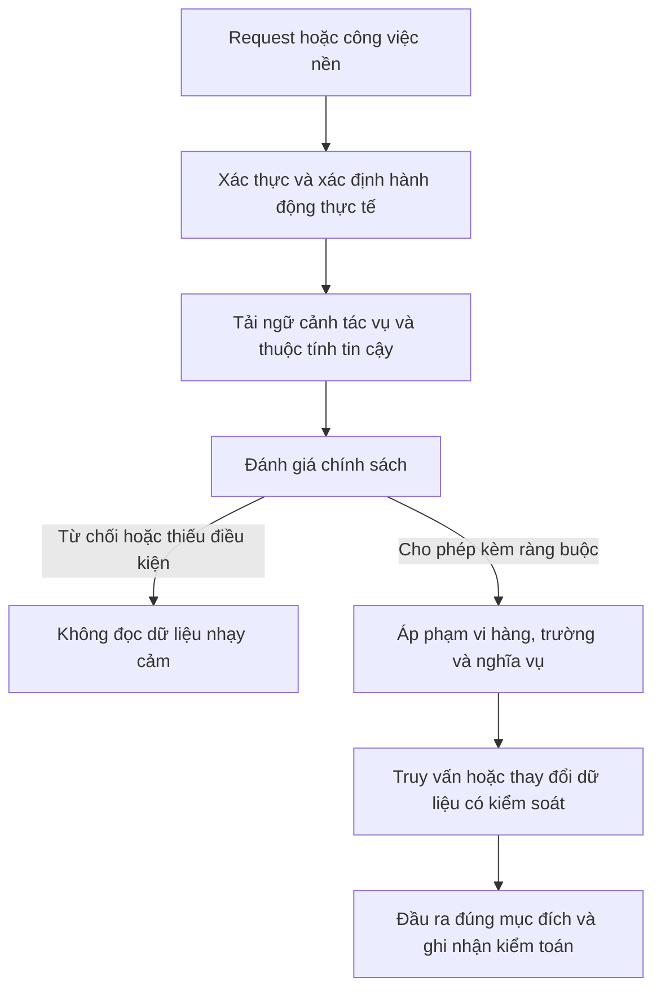

# Purpose based access

## 1. Truy cập dữ liệu theo mục đích nghiệp vụ

**Purpose based access** là kiểm soát quyền truy cập dựa trên mục đích sử dụng dữ liệu đã được hệ thống xác minh trong một ngữ cảnh nghiệp vụ cụ thể. Quyết định cần trả lời đồng thời: ai đang thao tác, thao tác gì, trên đối tượng nào, để thực hiện công việc nào và cần những dữ liệu nào cho công việc đó.

Ví dụ, một nhân viên hỗ trợ có nhiệm vụ xử lý phản ánh giao hàng của khách hàng. Trong tác vụ này, họ có thể cần xem trạng thái giao hàng và một phần thông tin liên hệ. Việc đang có quyền hỗ trợ không tự cấp quyền xuất toàn bộ danh sách khách hàng để chạy một chiến dịch quảng bá.

Hai hành động có thể cùng đọc bảng `customer` nhưng phục vụ các mục đích khác nhau, cần phạm vi dữ liệu khác nhau và có điều kiện phê duyệt khác nhau. Một hệ thống chỉ kiểm tra `role=SUPPORT` trước mọi truy vấn khách hàng dễ cấp quyền rộng hơn công việc đang thực hiện.

Trong chương **Privacy Rules** của module bảo vệ logic nghiệp vụ, mục tiêu là biến quy tắc sử dụng dữ liệu thành điều kiện có thể thực thi và kiểm thử. Chủ đề kết hợp bất biến nghiệp vụ, quyền theo đối tượng, state machine của tác vụ, transaction, idempotency và kiểm thử các đường lạm dụng logic.

Sau bài học, người học cần có khả năng:

- Biểu diễn mục đích bằng chính sách rõ ràng và bằng chứng từ workflow.
- Ràng buộc quyền với chủ thể, tenant, tác vụ, đối tượng, trường dữ liệu và thời hạn.
- Thực thi quyết định ở API, truy vấn, tác vụ nền và đầu ra như file export.
- Kiểm tra việc thay nhãn mục đích, đổi đối tượng, phát lại quyết định hoặc dùng dữ liệu sang công việc khác.

## 2. Vai trò, hành động, mục đích và điều kiện sử dụng dữ liệu

Các khái niệm cần được phân biệt để tránh dùng một nhãn cho mọi quyết định:

| Khái niệm | Câu hỏi | Ví dụ |
|---|---|---|
| Chủ thể | Ai yêu cầu? | Nhân viên hỗ trợ A, worker xuất dữ liệu |
| Vai trò hoặc khả năng | Chủ thể có thể thực hiện loại công việc nào? | Hỗ trợ đơn hàng, xử lý yêu cầu riêng tư |
| Hành động | Muốn làm gì với tài nguyên? | Đọc, cập nhật, tìm kiếm, xuất, gửi cho bên nhận |
| Đối tượng | Dữ liệu thuộc phạm vi nào? | Khách hàng C, đơn O, tenant T |
| Mục đích | Công việc sử dụng dữ liệu để đạt kết quả gì? | Giải quyết phản ánh giao hàng của đơn O |
| Ngữ cảnh tác vụ | Bằng chứng nào chứng minh công việc đang hợp lệ? | Ticket được giao, trạng thái đang xử lý, thời hạn còn hiệu lực |
| Điều kiện dữ liệu | Dữ liệu nào được dùng và đầu ra nào được phép? | Trạng thái đơn, số điện thoại che một phần, không cho export |

Một mục đích nên đủ cụ thể để quyết định quyền. Nhãn như `BUSINESS`, `INTERNAL_USE` hoặc `CUSTOMER_CARE` thường quá rộng nếu không có quy tắc chi tiết phía sau.

Mục đích nghiệp vụ cũng cần được phân biệt với các điều kiện sử dụng dữ liệu do tổ chức xác định. Hệ thống có thể cần kiểm tra trạng thái cho phép liên hệ, phạm vi chia sẻ hoặc phê duyệt xử lý theo chính sách áp dụng. Một chuỗi `purpose=SUPPORT` không tự chứng minh những điều kiện đó đã được đáp ứng. Không mặc định mọi hoạt động đều dùng cùng một cơ chế đồng ý, và cũng không mặc định một lần đồng ý cho phép mọi lần sử dụng về sau.

NIST mô tả ABAC là cách quyết định quyền bằng cách đánh giá thuộc tính của chủ thể, đối tượng, thao tác và điều kiện môi trường theo chính sách. Có thể triển khai mục đích đã xác minh như một phần ngữ cảnh của mô hình này; đây là một lựa chọn thiết kế, không phải khẳng định rằng chỉ cần thêm thuộc tính `purpose` là đã giải quyết xong kiểm soát riêng tư. Xem [NIST SP 800-162 — Guide to Attribute Based Access Control](https://csrc.nist.gov/pubs/sp/800/162/upd2/final).

## 3. Xây dựng ma trận mục đích và phạm vi dữ liệu

Trước khi viết code, cần lập ma trận cho các công việc thực sự tồn tại. Bảng sau là chính sách giả định của một nền tảng bán hàng:

| Mã mục đích | Bằng chứng nghiệp vụ | Đối tượng và dữ liệu cần thiết | Hành động được phép | Giới hạn bổ sung |
|---|---|---|---|---|
| `DELIVERY_SUPPORT` | Ticket giao hàng đang hoạt động, được giao cho người xử lý | Đơn liên quan; trạng thái giao hàng, tên hiển thị, thông tin liên hệ theo bước xử lý | Đọc dữ liệu cần thiết, thêm phản hồi hợp lệ | Không xuất danh sách khách; chỉ mở rộng trường khi bước xử lý cần |
| `REFUND_REVIEW` | Yêu cầu hoàn tiền đã vào bước thẩm định, người xử lý được phân công | Đơn, khoản thanh toán tham chiếu và chứng cứ cần thiết | Xem hồ sơ thẩm định, ghi nhận quyết định theo quyền | Không tự bỏ qua phê duyệt hoặc sửa giá trị đã chốt |
| `PRIVACY_REQUEST_FULFILLMENT` | Yêu cầu đã xác minh người yêu cầu và phạm vi | Dữ liệu của đúng người, theo phạm vi đã duyệt | Tạo kết quả đáp ứng yêu cầu | Kiểm tra riêng quyền export và người nhận |
| `SERVICE_ANALYTICS` | Công việc phân tích đã được duyệt | Tập dữ liệu và phép tổng hợp được phép | Đọc đầu ra phân tích theo chính sách | Không tự mở quyền đọc hồ sơ định danh chi tiết |
| `CAMPAIGN_CONTACT` | Chiến dịch được duyệt, điều kiện liên hệ còn hợp lệ | Danh sách liên hệ thuộc phân khúc được phép | Gửi qua dịch vụ được chỉ định | Kiểm tra lại điều kiện tại thời điểm thực hiện |

Bảng cần được điều chỉnh theo hệ thống cụ thể. Một trường cần cho bước xác minh giao hàng không mặc nhiên cần cho mọi màn hình hỗ trợ. Dữ liệu đã che một phần vẫn có thể là dữ liệu nhạy cảm trong ngữ cảnh nhất định.

Nếu một nhân viên đồng thời có vai trò hỗ trợ và marketing, một request xử lý ticket phải lấy quyền theo ngữ cảnh hỗ trợ đang dùng. Không hợp nhất các trường của tất cả mục đích mà người đó từng được phép thực hiện rồi trả về một hồ sơ đầy đủ.

Với nhiều mục đích trong một batch, cần tách các phần việc và quyết định tương ứng, hoặc định nghĩa một công việc kết hợp được duyệt rõ ràng. Client không được thêm một mục đích rộng vào danh sách để làm tăng quyền của mọi phần tử trong batch.

## 4. Các bất biến phải giữ đúng

Có thể biểu diễn điều kiện cấp quyền theo dạng hội các điều kiện:

```text
ALLOW khi và chỉ khi có quy tắc cho phép và tất cả điều kiện bắt buộc đều đúng:
  chủ thể đã được xác thực phù hợp
  AND thuộc phạm vi tenant được phép
  AND có quyền thực hiện hành động
  AND tác vụ tồn tại, còn hoạt động và được giao hoặc ủy quyền hợp lệ
  AND mục đích của tác vụ cho phép hành động trên đối tượng được yêu cầu
  AND trường dữ liệu và phạm vi kết quả nằm trong giới hạn
  AND các điều kiện sử dụng dữ liệu hiện tại đã được đáp ứng
  AND không có điều kiện từ chối bắt buộc áp dụng.
```

Những bất biến quan trọng gồm:

1. **Không tự chứng nhận mục đích:** giá trị từ client chỉ là dữ liệu đề nghị hoặc tham chiếu để máy chủ xác minh.
2. **Không vượt đối tượng:** quyền trong tác vụ của khách hàng A không áp dụng cho khách hàng B.
3. **Không vượt tenant:** nhiệm vụ hoặc định danh tài nguyên ở tenant khác không mở rộng quyền.
4. **Không vượt hành động:** quyền đọc trong một màn hình không tự cho phép export, chia sẻ hoặc cập nhật.
5. **Không vượt dữ liệu:** chỉ trả hàng và trường cần thiết cho bước đang thực hiện.
6. **Không kéo dài ngữ cảnh:** tác vụ hoàn tất, hết hạn hoặc bị thu hồi không tiếp tục cấp quyền qua một request mới.
7. **Không đổi mục đích qua đầu ra:** cache, file, sự kiện hoặc kết quả tìm kiếm phải được kiểm soát theo phạm vi sử dụng tương ứng.
8. **Không cấp quyền vì thiếu thông tin:** thiếu tác vụ, không nhận diện được mục đích hoặc không lấy được thuộc tính cần thiết phải dẫn đến từ chối hoặc lỗi tạm thời theo hợp đồng.

Việc điều khiển mục đích không thể tự đọc được ý định trong đầu người dùng. Hệ thống thực thi bằng cách ràng buộc quyền với công việc có bằng chứng, giảm dữ liệu có thể lấy, ghi nhận hoạt động và kiểm soát đầu ra. Dữ liệu đã hiển thị cho một người có thể bị nhớ hoặc sao chép, nên thiết kế cần giảm phạm vi và kết hợp trách nhiệm vận hành.

## 5. Tạo bằng chứng mục đích từ workflow

### 5.1. Dữ liệu client gửi và dữ liệu máy chủ tin

Một API có thể nhận request:

```http
GET /support/tasks/T-42/orders/O-17/view
Authorization: Bearer <access-token>
```

`T-42` và `O-17` vẫn là đầu vào chưa tin cậy. Máy chủ phải tải tác vụ trong đúng tenant, kiểm tra người xử lý, trạng thái và quan hệ giữa tác vụ với đơn hàng. Chỉ sau đó mới xác định mục đích hiệu lực.

Ví dụ ngữ cảnh do máy chủ xây dựng:

```json
{
  "subjectId": "agent-7",
  "tenantId": "tenant-a",
  "action": "SUPPORT_ORDER_VIEW",
  "taskId": "T-42",
  "taskVersion": 8,
  "purpose": "DELIVERY_SUPPORT",
  "resourceScope": { "orderIds": ["O-17"] },
  "workflowStep": "INVESTIGATE_DELIVERY",
  "expiresAt": "2026-12-01T09:30:00Z"
}
```

JSON này minh họa dữ liệu nội bộ đã xác minh. Gửi cùng cấu trúc ấy từ trình duyệt không biến nó thành ngữ cảnh đáng tin. `action` phải được ánh xạ từ thao tác API thực tế; không để client đổi thành một hành động ít hạn chế hơn trong khi máy chủ vẫn chạy truy vấn nhạy cảm.

Nguồn thuộc tính có thể được quy định như sau:

| Thuộc tính | Nguồn tin cậy dự kiến | Điều cần kiểm tra |
|---|---|---|
| Chủ thể và phiên | Hệ thống xác thực | Phiên còn hợp lệ, không dùng ID từ body để thay người |
| Tenant | Phiên và quan hệ thành viên đã xác minh | Tenant được chọn phải thuộc phạm vi của chủ thể |
| Phân công tác vụ | Kho workflow | Đúng người hoặc nhóm được ủy quyền hiện tại |
| Mục đích, bước xử lý | Định nghĩa workflow và trạng thái tác vụ | Không cho tự sửa nhãn hoặc bỏ bước phê duyệt |
| Phạm vi đối tượng | Quan hệ dữ liệu của tác vụ | Không dùng ID tùy ý để mở rộng phạm vi |
| Phân loại và điều kiện dữ liệu | Kho chính sách và metadata quản trị | Giá trị hiện tại, nguồn và phiên bản rõ ràng |
| Thời gian và ngữ cảnh môi trường | Hệ thống tin cậy | Không dùng timestamp hoặc thiết bị tự khai như bằng chứng duy nhất |

### 5.2. Không tạo nhiệm vụ giả để lấy quyền

Nếu bất kỳ nhân viên nào cũng có thể mở một ticket cho bất kỳ khách hàng nào rồi tự giao cho mình để xem toàn bộ hồ sơ, việc có `taskId` không còn là rào chắn hữu ích.

Quy trình tạo và phân công tác vụ cũng cần quy tắc: ai được mở, cần chứng cứ liên quan nào, phạm vi ban đầu là gì, khi nào phải phê duyệt và ai được mở rộng dữ liệu. Một ghi chú tự do như “cần cho công việc” có thể hỗ trợ kiểm toán nhưng không thay thế điều kiện cấp quyền.

Các nhãn phân loại hoặc điều kiện dữ liệu cũng cần được bảo vệ. Người muốn đọc một trường hạn chế không được đồng thời có quyền tự đổi nó thành dữ liệu công khai chỉ qua cùng một request.

## 6. State machine của quyền theo mục đích

Một mô hình minh họa cho tác vụ cần phê duyệt:



Trong mô hình này, chỉ `ACTIVE` mới có thể cấp quyền dữ liệu theo mục đích, và vẫn phải thỏa các điều kiện còn lại. Một hệ thống đơn giản có thể không cần trạng thái `APPROVED` riêng, nhưng phải định nghĩa rõ lúc nào công việc có hiệu lực.

Các thao tác sau cần được kiểm soát:

- Phê duyệt và kích hoạt không được thực hiện bởi chủ thể thiếu quyền.
- Đổi người xử lý phải cập nhật quyền của người cũ và người mới theo cùng quy tắc.
- Mở rộng phạm vi khách hàng, trường hoặc hành động cần thẩm quyền tương ứng.
- Hoàn tất hoặc thu hồi phải ngừng cấp quyết định mới theo tác vụ đó.
- Mở lại một tác vụ cần điều kiện hợp lệ và phiên bản mới khi chính sách yêu cầu; request cũ không tự được hồi sinh.
- Việc sửa tên hiển thị của mục đích không được âm thầm thay nghĩa của mã chính sách.

Đối với dữ liệu nhạy cảm, có thể yêu cầu phê duyệt bổ sung hoặc tách người yêu cầu khỏi người phê duyệt. Cơ chế ngoại lệ khẩn cấp cần là một workflow có quyền, thời hạn, phạm vi và kiểm toán riêng; không dùng một cờ `breakGlass=true` do client gửi để bỏ qua toàn bộ chính sách.

## 7. Kiến trúc quyết định và thực thi

Có thể tổ chức hệ thống thành các vai trò:

- **Điểm thực thi chính sách (PEP):** bảo vệ thao tác thực tế ở dịch vụ hoặc tầng truy cập dữ liệu.
- **Điểm quyết định chính sách (PDP):** đánh giá các thuộc tính và trả quyết định.
- **Nguồn thuộc tính:** cung cấp trạng thái tác vụ, phân công, phân loại và điều kiện sử dụng dữ liệu.
- **Nơi quản lý chính sách:** lưu định nghĩa mục đích, quy tắc và phiên bản được duyệt.



Quyết định hữu ích thường cần nhiều hơn một boolean:

```text
effect: ALLOW hoặc DENY
action: hành động đã đánh giá
tenantScope: tenant được phép
resourceConstraint: ràng buộc đối tượng được phép
allowedFields: tập trường được phép đọc hoặc sửa
transformations: che hoặc tổng hợp bắt buộc
outputConstraints: giới hạn bản ghi, export, người nhận
taskVersion và policyVersion: phiên bản đã dùng
validUntil: giới hạn thời gian của quyết định
auditRequirements: nghĩa vụ ghi nhận cần thực thi
```

PEP phải từ chối nếu không thực hiện được một nghĩa vụ bắt buộc. Trả `ALLOW` kèm `mask phone` sẽ không an toàn nếu tầng ứng dụng bỏ qua phần che dữ liệu.

OWASP khuyến nghị mặc định từ chối và kiểm tra quyền trên mọi request. Với mô hình này, các request cần kiểm tra bao gồm API chi tiết, tìm kiếm, GraphQL, đường tải file, tác vụ quản trị và worker nền; xem [OWASP Authorization Cheat Sheet](https://cheatsheetseries.owasp.org/cheatsheets/Authorization_Cheat_Sheet.html).

Không chỉ kiểm tra ở giao diện hoặc gateway rồi cho rằng mọi lời gọi nội bộ đều đúng mục đích. Dịch vụ sở hữu dữ liệu cần có kiểm soát tương ứng với đối tượng và hành động mà nó thực hiện.

## 8. Áp dụng giới hạn hàng, trường và hành động vào dữ liệu

### 8.1. Lọc trước khi lấy dữ liệu nhạy cảm

Một thiết kế dễ bỏ sót là tải toàn bộ hồ sơ rồi xóa một vài trường ở giao diện. Dữ liệu đã có thể đi qua bộ nhớ ứng dụng, log, cache hoặc một serializer khác.

Nên xây dựng truy vấn từ quyết định đã xác minh, chỉ lấy dữ liệu cần thiết. Ví dụ SQL sau minh họa một đường đọc tên hiển thị và trạng thái đơn cho tác vụ giao hàng:

```sql
SELECT o.id AS order_id,
       o.delivery_status,
       c.display_name
FROM workflow_task t
JOIN task_assignment a
  ON a.tenant_id = t.tenant_id
 AND a.task_id = t.id
JOIN task_order_scope s
  ON s.tenant_id = t.tenant_id
 AND s.task_id = t.id
JOIN orders o
  ON o.tenant_id = s.tenant_id
 AND o.id = s.order_id
JOIN customer c
  ON c.tenant_id = o.tenant_id
 AND c.id = o.customer_id
WHERE t.tenant_id = :trustedTenantId
  AND t.id = :requestedTaskId
  AND a.subject_id = :authenticatedSubjectId
  AND a.active = TRUE
  AND t.status = 'ACTIVE'
  AND t.purpose = 'DELIVERY_SUPPORT'
  AND t.expires_at > CURRENT_TIMESTAMP
  AND o.id = :requestedOrderId;
```

`requestedTaskId` và `requestedOrderId` là tham số đầu vào được ràng buộc trong truy vấn; tên gọi không làm chúng đáng tin hơn. Các điều kiện quan hệ và tenant mới giới hạn chúng vào phạm vi cho phép. `trustedTenantId` và `authenticatedSubjectId` đến từ ngữ cảnh đã xác minh.

Truy vấn chỉ minh họa một phần điều kiện. Nó cần đi cùng kiểm tra vai trò, hành động, bước workflow, chính sách hiện tại và các nghĩa vụ khác. Ràng buộc khóa và quan hệ dữ liệu phải ngăn các bản ghi phân công hoặc phạm vi trùng làm tăng kết quả ngoài dự kiến.

Khi projection thay đổi theo mục đích, ánh xạ tên trường qua allowlist do máy chủ quản lý. Không nối trực tiếp `fields` từ request thành tên cột SQL. Dùng tham số cho giá trị và cấu trúc truy vấn được xây dựng có kiểm soát.

### 8.2. Lọc cả đường suy luận gián tiếp

Các đường sau cũng có thể làm lộ dữ liệu:

- `count`, phân trang hoặc tổng số kết quả tính trên tập rộng hơn quyền được xem.
- Bộ lọc hoặc sắp xếp theo một trường mà người dùng không có quyền biết.
- Gợi ý tìm kiếm, đoạn trích, lỗi validation và thông báo “đối tượng tồn tại nhưng bị chặn”.
- GraphQL resolver trả trường riêng qua một nhánh khác.
- Endpoint tải ảnh, tài liệu hoặc lịch sử thay đổi thuộc đối tượng đã bị giới hạn.

Ví dụ, che ngày sinh trong response nhưng cho lọc khách hàng theo ngày sinh chính xác vẫn có thể cung cấp thông tin qua kết quả tìm kiếm. Vì vậy, chính sách phải bao phủ cả trường được trả, trường được dùng để lọc và phép tổng hợp được phép.

Với dữ liệu phân tích, cần đánh giá nguy cơ suy ra một cá nhân từ nhóm quá nhỏ hoặc từ nhiều truy vấn kết hợp. Một ngưỡng kích thước nhóm riêng lẻ không tự chứng minh dữ liệu đã vô danh an toàn cho mọi lần sử dụng.

### 8.3. Giới hạn trường được sửa

Quyền đọc một hồ sơ không tự cho phép sửa mọi thuộc tính của hồ sơ. Với tác vụ cập nhật, cần allowlist trường được thay đổi, kiểm tra giá trị mới và kiểm tra chuyển trạng thái hợp lệ.

Không để một request hỗ trợ tự sửa `purpose`, `customerId`, nhãn phân loại dữ liệu hoặc bằng chứng cho phép liên hệ. Các trường này có thể chính là điều kiện cấp quyền và cần luồng quản trị riêng.

## 9. Minh họa luồng Java và ranh giới nhất quán

Mã giả sau minh họa một đường đọc có tác vụ. Các API là hợp đồng thiết kế, không phải mã hoàn chỉnh có thể sao chép để chạy ngay:

```java
SupportOrderView readDeliveryOrder(Principal principal,
                                  TaskId requestedTask,
                                  OrderId requestedOrder) {
    var scope = trustedScope.from(principal);
    var action = Action.SUPPORT_ORDER_VIEW; // Do endpoint xác định.

    return transactions.withAuthorizationBoundary(() -> {
        var task = tasks.requireCurrentTaskForAccess(scope, requestedTask);
        var metadata = orders.requirePolicyMetadataWithinTask(
            scope, task, requestedOrder);

        var context = purposes.fromVerifiedWorkflow(scope, task, action);
        var decision = policy.requireAllowed(
            context, metadata, SupportOrderFields.forCurrentStep(task));

        var plan = queryPlans.compileAllowlistedProjectionAndScope(
            scope, task, requestedOrder, decision);
        var rows = orders.fetchAuthorizedProjection(plan);
        var view = views.applyRequiredTransformations(rows, decision);

        authorizationBoundary.requireStillValid(context, decision);
        audit.appendRequiredReadEvent(context, decision, view.recordCount());
        return view;
    });
}
```

Các thành phần cần đáp ứng những hợp đồng sau:

- `requireCurrentTaskForAccess` kiểm tra tenant, chủ thể hoặc phân công, trạng thái và thời hạn, thay vì chỉ trả bản ghi theo ID.
- `requirePolicyMetadataWithinTask` chỉ lấy metadata tối thiểu cần cho quyết định trong phạm vi tác vụ; không tải toàn bộ hồ sơ riêng tư trước khi kiểm tra quyền.
- `fromVerifiedWorkflow` lấy mục đích từ trạng thái tin cậy; không chép `X-Purpose` tùy ý của client.
- `compileAllowlistedProjectionAndScope` áp điều kiện hàng và trường của quyết định vào truy vấn thực tế.
- `applyRequiredTransformations` thực hiện nghĩa vụ che hoặc biến đổi và không serialize entity đầy đủ sau đó.
- `withAuthorizationBoundary` và `requireStillValid` phải có cách bảo đảm nhất quán được mô tả cụ thể cho kiến trúc; tên phương thức tự nó không tạo ra bảo đảm.
- Sự kiện từ chối cần có đường ghi nhận riêng phù hợp; không đặt mọi log từ chối trong transaction sẽ bị rollback cùng yêu cầu.

### 9.1. Khi tác vụ và dữ liệu ở cùng cơ sở dữ liệu

Có thể dùng khóa phù hợp, version hoặc cập nhật có điều kiện để phối hợp quyết định với thao tác. Các đường thay đổi phân công, thu hồi và mở rộng phạm vi phải tuân thủ cùng giao thức đồng bộ.

Ví dụ, nếu cập nhật dữ liệu yêu cầu `taskVersion=8`, việc tác vụ đã chuyển sang version 9 trước bước ghi phải khiến thao tác được kiểm tra lại hoặc thất bại theo hợp đồng. Không đọc version rồi bỏ qua nó khi cập nhật.

Khóa hàng tác vụ không tự khóa mọi nguồn thuộc tính. Quyền thành viên hoặc chính sách ở dịch vụ khác vẫn cần cơ chế xử lý thay đổi tương ứng. Mức isolation của transaction cũng cần được hiểu đúng; một annotation transaction không tự đồng bộ mọi dịch vụ.

### 9.2. Khi thuộc tính nằm ở nhiều dịch vụ

Cần xác định thời điểm nào quyết định có hiệu lực, độ trễ thu hồi tối đa chấp nhận được và cách phát hiện thuộc tính cũ. Có thể sử dụng phiên bản chính sách, phiên bản quyền, sự kiện thu hồi và thời hạn ngắn với cơ chế kiểm tra hiện trạng.

Một token đã ký chỉ chứng minh dữ liệu được phát bởi nguồn được tin cậy theo cách xác minh tương ứng. Token còn hạn không tự chứng minh tác vụ hiện vẫn hoạt động. Nếu cần thu hồi trước thời hạn, phải có cơ chế kiểm tra hoặc cưỡng chế thu hồi thích hợp.

Không thể thu hồi một dữ liệu mà người dùng đã nhận bằng cách chỉ đổi trạng thái trong cơ sở dữ liệu. Chính sách thu hồi cần mô tả những request và hiệu ứng tương lai bị chặn, cùng cách xử lý các bản sao do hệ thống quản lý.

Với luồng dài hoặc stream dữ liệu, có thể kiểm tra lại theo từng phần với kích thước và thời gian giới hạn. Không tuyên bố thu hồi tức thời tuyệt đối nếu có khoảng kiểm tra, cache hoặc dữ liệu đã được gửi trước thời điểm thu hồi.

## 10. Truyền ngữ cảnh qua dịch vụ và công việc nền

Một dịch vụ có quyền đọc rộng có thể trở thành điểm bị lợi dụng nếu nó tin mọi lời gọi nội bộ. Ví dụ, API phía trước tự gắn `purpose=DELIVERY_SUPPORT` rồi nhờ dịch vụ khách hàng xuất toàn bộ dữ liệu bằng quyền tài khoản dịch vụ.

Khi ủy quyền, cần giữ rõ:

```text
Ai khởi tạo thao tác?
Dịch vụ hoặc worker nào đang thực thi?
Tác vụ, mục đích, tenant và đối tượng nào được phép?
Những hành động, trường và đầu ra nào được phép?
Ủy quyền có hiệu lực đến khi nào và bị thu hồi bằng cách nào?
```

Ngữ cảnh có thể được truyền bằng tham chiếu đến tác vụ bền vững hoặc bằng bằng chứng ủy quyền được bảo vệ. Nếu dùng token, cần kiểm tra nguồn phát, đối tượng nhận, chủ thể thực thi, phạm vi, thời hạn và hiện trạng thu hồi theo hợp đồng. Không chuyển nguyên token của người dùng cho mọi worker chỉ để có sẵn quyền rộng.

Worker phải xác thực danh tính dịch vụ của chính nó và kiểm tra công việc được giao. Quyền của worker và quyền ủy nhiệm phải cùng cho phép thao tác; một tài khoản dịch vụ có quyền kỹ thuật rộng không được làm tăng phạm vi được giao.

Với công việc export chạy sau khi người dùng bấm nút:

1. Khi tạo job, kiểm tra quyền yêu cầu export và lưu tham chiếu ngữ cảnh đã xác minh.
2. Khi worker bắt đầu, tải lại tác vụ, quyền và điều kiện dữ liệu hiện tại.
3. Khi đọc theo từng phần, bảo đảm phạm vi không mở rộng do phân trang hoặc thay đổi bộ lọc.
4. Trước khi công bố file, kiểm tra quyền và các điều kiện đầu ra theo hợp đồng.
5. Khi tải file, kiểm tra quyền của người tải và trạng thái artifact.

Job đã được nhận vào hàng đợi không có nghĩa được hoàn thành bằng mọi giá sau khi quyền bị thu hồi. Dữ liệu trung gian và file chưa công bố cần có chính sách dọn dẹp, quyền truy cập và thời hạn lưu.

## 11. Idempotency, cache và file kết quả

### 11.1. Kết quả cũ vẫn cần quyền hiện tại

Idempotency giúp retry không tạo thêm job hoặc hiệu ứng nghiệp vụ, nhưng không cấp quyền đọc vĩnh viễn kết quả cũ.

Ví dụ, một người đã tạo file export hợp lệ rồi bị gỡ khỏi tác vụ. Retry cùng idempotency key có thể được nhận diện là cùng thao tác, nhưng hệ thống vẫn phải kiểm tra quyền trước khi trả dữ liệu nhạy cảm hoặc đường tải file. Có thể chỉ trả biên nhận tối thiểu nếu người đó còn quyền xem biên nhận theo chính sách; không mặc định phát lại toàn bộ response đã cache.

Phạm vi và fingerprint idempotency cần ràng buộc với các giá trị có ý nghĩa:

```text
tenant + chủ thể + hành động + tác vụ + mục đích hiệu lực
+ phạm vi đối tượng + projection + bộ lọc + đích nhận được duyệt
```

Phiên bản ngữ cảnh cần được lưu để phát hiện việc nội dung hoặc quyền đã thay đổi. Cùng key nhưng request đổi mục đích, người nhận hoặc bộ lọc không được âm thầm dùng lại hay ghi đè kết quả. Khi quyền hiện tại không còn cho phép, việc nhận ra key trùng không làm mất hiệu lực của quyết định từ chối.

### 11.2. Cache phải mang phạm vi quyền

Cache chỉ theo `customerId` có thể dùng kết quả đầy đủ của tác vụ này để phục vụ một tác vụ khác ít quyền hơn. Tùy thiết kế, khóa và metadata cache cần phản ánh tenant, phạm vi chủ thể hoặc nhóm quyền tương đương đã được chứng minh, mục đích, đối tượng, trường, phép biến đổi và phiên bản chính sách liên quan.

Không đưa bí mật hoặc dữ liệu cá nhân thô vào khóa cache chỉ để phân biệt phạm vi. Cache riêng tư cũng cần quyền truy cập và thời hạn lưu.

Các cache quyết định cho phép cần cơ chế hết hạn hoặc vô hiệu hóa phù hợp với yêu cầu thu hồi. TTL dài hơn độ trễ thu hồi chấp nhận được sẽ tạo ra một khoảng quyền cũ còn hiệu lực. Chỉ gắn `policyVersion` vào khóa không giúp được nếu dịch vụ vẫn lấy phiên bản cũ vô thời hạn.

Phân biệt cache dữ liệu nguồn nội bộ với cache kết quả đã được cấp quyền. Một dịch vụ có cache dữ liệu nguồn vẫn phải áp chính sách hiện tại trước khi phát dữ liệu cho bên gọi.

### 11.3. File là một tài nguyên cần được bảo vệ

Mỗi artifact nhạy cảm nên có chủ sở hữu, tenant, nguồn tác vụ, mục đích, phạm vi dữ liệu, người nhận được phép, trạng thái và thời hạn. Quyền đọc màn hình không tự cho phép tạo hoặc tải artifact.

Nếu dùng URL ký trực tiếp đến kho tệp, phải hiểu thời gian còn hiệu lực và khả năng thu hồi thực tế của cơ chế đó. Một URL vẫn dùng được sau khi API đã từ chối có thể tiếp tục làm lộ file. Khi cần kiểm tra quyền hiện tại ở mỗi lần tải, có thể dùng cổng tải có xác thực hoặc một tham chiếu có khả năng thu hồi phù hợp với kiến trúc.

Không gửi đường tải nhạy cảm đến địa chỉ do client tùy ý thay. Đích nhận phải được xác minh và thuộc phạm vi được duyệt. Hết hạn hoặc thu hồi cần xử lý cả bản ghi artifact và khả năng truy cập dữ liệu bên dưới.

## 12. Sử dụng lại dữ liệu, đầu ra suy ra và nhật ký

Dữ liệu đã được đọc cho một mục đích không tự trở thành dữ liệu dùng tự do trong mọi hệ thống tiếp theo. Cần theo dõi các điểm sao chép hoặc tạo dữ liệu mới:

- Kho phân tích, chỉ mục tìm kiếm và bản sao báo cáo.
- File tạm, tệp đính kèm hoặc nội dung gửi qua thông báo.
- Dữ liệu tổng hợp, vector tìm kiếm hoặc đầu vào cho hệ thống phân loại tự động.
- Nhật ký kỹ thuật và sự kiện kiểm toán.

Việc bỏ tên hoặc thay khách hàng bằng một ID không tự bảo đảm dữ liệu đã vô danh. Cần xem xét khả năng liên kết, các thuộc tính còn lại, phạm vi sử dụng và đầu ra được phép. Đầu ra suy ra cũng có thể chứa thông tin nhạy cảm.

Nếu dữ liệu được chuyển sang một công việc mới, cần đánh giá mục đích mới, điều kiện áp dụng, phạm vi dữ liệu và quyền bên nhận. Không chỉ đổi nhãn metadata trên bản sao để xem như việc sử dụng mới đã hợp lệ.

Chính sách kiểm toán cần ghi đủ để trả lời ai, làm gì, với tác vụ nào, theo mục đích và phiên bản nào, trên phạm vi nào, kết quả gì. Ví dụ:

```json
{
  "eventType": "PURPOSE_ACCESS_DECISION",
  "subjectId": "agent-7",
  "tenantId": "tenant-a",
  "taskId": "T-42",
  "purpose": "DELIVERY_SUPPORT",
  "action": "SUPPORT_ORDER_VIEW",
  "resourceRef": "O-17",
  "decision": "ALLOW",
  "reasonCode": "ASSIGNED_ACTIVE_TASK",
  "policyVersion": "delivery-policy-12",
  "taskVersion": 8,
  "fieldSetId": "delivery-summary-v2",
  "recordCount": 1
}
```

Không cần chép toàn bộ hồ sơ khách hàng vào sự kiện để chứng minh đã kiểm tra quyền. Các định danh trong audit vẫn cần bảo vệ; quyền đọc audit, thời hạn lưu và khả năng phát hiện sửa đổi phải được quản lý.

Nếu ghi audit là nghĩa vụ bắt buộc của một hành động, cần định nghĩa phản ứng khi hệ thống ghi nhận không khả dụng. Không âm thầm bỏ nghĩa vụ, cũng không dùng một bộ đệm không giới hạn làm điểm cạn tài nguyên mới.

Quan sát các mẫu như một nhân viên mở nhiều tác vụ không liên quan, liên tục xin mở rộng trường hoặc export ngay trước khi đóng tác vụ có thể hỗ trợ điều tra. Các tín hiệu hành vi bổ sung cho quyết định quyền; chúng không thay thế kiểm tra bắt buộc trước khi đọc dữ liệu.

## 13. Xử lý lỗi, ngoại lệ và thay đổi chính sách

| Tình huống | Hành vi cần xác định |
|---|---|
| Không nhận diện mục đích hoặc thiếu tác vụ | Từ chối, không suy ra một mục đích mặc định có quyền rộng |
| Không có quyền với đối tượng | Từ chối theo hợp đồng bảo vệ tài nguyên, không tiết lộ dữ liệu trong lỗi |
| Không tải được thuộc tính bắt buộc hoặc PDP lỗi | Lỗi tạm thời hoặc từ chối theo chính sách; không mặc định cho phép |
| Không thực hiện được nghĩa vụ che dữ liệu | Không trả dữ liệu thô để thay thế |
| Tác vụ đã hoàn tất, hết hạn hoặc bị thu hồi | Không cấp quyết định mới từ ngữ cảnh cũ |
| Quyết định đã quá hạn hoặc phiên bản không phù hợp | Đánh giá lại hoặc từ chối |
| Có workflow ngoại lệ hợp lệ | Áp phạm vi, thời hạn và kiểm toán của ngoại lệ đã được duyệt |

Có thể phân biệt lỗi thiếu quyền với lỗi phụ thuộc trong vận hành mà vẫn tránh tiết lộ sự tồn tại của một hồ sơ riêng tư qua response. Mã lý do chi tiết dành cho điều tra cần được bảo vệ, không tự động đưa hết ra client.

Mỗi thay đổi chính sách cần xác định tác động đến tác vụ đang hoạt động, job chờ, cache và artifact đã tạo. Một cách quản lý là dùng mã mục đích ổn định, phiên bản quy tắc và quy trình phát hành có kiểm soát.

Chính sách mới nên được kiểm tra với cả tình huống được phép lẫn bị từ chối. Nếu đánh giá song song để quan sát ảnh hưởng, quyết định đang có hiệu lực vẫn phải được thực thi. Không để cơ chế thử nghiệm trở thành đường trả dữ liệu mà chính sách hiện tại cấm.

Ngoại lệ khẩn cấp cần có điều kiện sử dụng rõ ràng, xác minh phù hợp, phạm vi tối thiểu, thời hạn và kiểm tra sau sử dụng. Việc có lý do khẩn cấp không tự cho phép bỏ kiểm tra tenant, lấy dữ liệu không liên quan hoặc xuất đến đích tùy ý.

## 14. Kiểm thử tình huống tấn công logic

Mỗi bài kiểm thử cần kiểm tra dữ liệu thực sự được đọc và phát ra, thay đổi trạng thái, audit và tác vụ nền. Một response `403` chưa đủ nếu trước đó dữ liệu đã được đưa vào log hoặc file.

### 14.1. Tạo bộ dữ liệu và quyền mẫu

```text
Tenant A:
  Khách C1 có đơn O1; khách C2 có đơn O2.
  Nhân viên S1 có vai trò hỗ trợ.
  Tác vụ T1: DELIVERY_SUPPORT, ACTIVE, giao S1, phạm vi O1.
  Tác vụ T2: ACTIVE nhưng giao cho một nhân viên khác.

Tenant B:
  Khách C3 có đơn O3 và tác vụ riêng.

Chính sách:
  T1 cho xem bản tóm tắt giao hàng của O1.
  T1 không cho export, không trả email đầy đủ, không cho đổi phân loại dữ liệu.
```

Trước hết kiểm tra trường hợp hợp lệ: S1 đọc O1 qua T1 và nhận đúng projection. Truy vấn không tải trường bị cấm, các phép biến đổi được thực thi và audit có ngữ cảnh đúng.

### 14.2. Ma trận kiểm thử quyền và mục đích

| Tình huống | Kỳ vọng |
|---|---|
| Đổi header hoặc body thành mục đích có quyền rộng hơn | Không thay đổi mục đích hiệu lực của T1 |
| Dùng T1 nhưng đổi O1 thành O2 | Không đọc được đơn ngoài phạm vi |
| Dùng tác vụ hoặc đơn của tenant B | Không vượt tenant |
| Dùng T2 được giao cho người khác | Bị từ chối nếu không có ủy quyền hợp lệ |
| Tự tạo và tự giao tác vụ để xem khách bất kỳ | Quy trình tạo và phân công không cấp phạm vi trái quyền |
| Gửi `status=ACTIVE` cho tác vụ chưa được duyệt | Không bỏ qua state machine |
| Xin thêm trường email đầy đủ qua `fields` hoặc GraphQL | Bị từ chối hoặc giới hạn theo hợp đồng; không lộ trường bị cấm |
| Lọc hoặc sort theo trường bị cấm | Không tạo đường suy luận ngoài chính sách |
| Gọi endpoint export bằng quyền xem màn hình | Cần quyền hành động và workflow export riêng |
| Dùng nhiều mục đích trong cùng request | Không hợp quyền thành tập dữ liệu rộng hơn |
| Nhân viên có nhiều vai trò | Quyết định theo công việc đang được xác minh |
| Gọi dịch vụ dữ liệu trực tiếp hoặc qua API nội bộ | Kiểm soát mục đích và đối tượng vẫn được thực thi |
| Gửi ngữ cảnh đã ký cho sai dịch vụ nhận | Bị từ chối theo phạm vi ủy quyền |
| Worker dùng tài khoản dịch vụ có quyền rộng | Không vượt phạm vi tác vụ được giao |
| Truy vấn count, tìm kiếm hoặc tải tệp liên quan | Cùng tuân thủ phạm vi và hành động được phép |
| PDP hoặc nguồn thuộc tính không khả dụng | Không trả dữ liệu bằng nhánh cho phép mặc định |
| Bộ biến đổi hoặc ghi audit bắt buộc lỗi | Xử lý theo nghĩa vụ, không trả dữ liệu thô hoặc bỏ kiểm soát |

### 14.3. Kiểm thử thu hồi, cạnh tranh và retry

1. Đọc hợp lệ bằng T1, sau đó thu hồi T1. Request mới phải bị chặn theo thời điểm hiệu lực và độ trễ thu hồi đã cam kết, kể cả khi cache còn dữ liệu.
2. Đổi người xử lý khi một thao tác đang chạy. Kiểm tra giao thức khóa hoặc version cho kết quả đúng theo ranh giới nhất quán đã định nghĩa.
3. Thay đổi chính sách projection, rồi gọi lại từ một instance chưa nhận sự kiện cập nhật. Không được giữ quyền cũ vượt thời hạn cho phép.
4. Tạo job export hợp lệ, thu hồi tác vụ trước khi worker bắt đầu. Worker không tự tiếp tục bằng quyền rộng của dịch vụ.
5. Thu hồi trong lúc export dài đang chạy. Kiểm tra điểm đánh giá lại, dữ liệu trung gian, bước công bố và độ trễ dừng đã xác định.
6. Tạo artifact, sau đó gỡ quyền người tạo. API tải và mọi đường truy cập file phải phản ánh khả năng thu hồi thực tế được thiết kế.
7. Phát lại cùng idempotency key sau khi mất quyền. Không phát lại nội dung nhạy cảm chỉ vì lần trước đã được phép.
8. Dùng cùng key với mục đích, bộ lọc, projection hoặc người nhận khác. Không ghi đè hoặc phát lại sai phạm vi.
9. Làm transaction thay đổi dữ liệu thất bại sau kiểm tra quyền. Không có hiệu ứng nghiệp vụ hoặc sự kiện thành công trái với kết quả commit.
10. Phát lại sự kiện nền bằng worker khác. Quyền ủy nhiệm và idempotency phải cùng được giữ, không tạo thêm đầu ra hoặc mở rộng người nhận.

Cần có kiểm thử cho cả bản ghi, cột và hiệu ứng gián tiếp. Có thể dùng repository spy, kiểm tra projection truy vấn hoặc quan sát kho file kiểm thử để chứng minh dữ liệu bị cấm chưa đi qua đường xử lý được bảo vệ.

## 15. Những thiết kế dễ làm mất ý nghĩa của mục đích

| Thiết kế | Lỗi logic | Hướng sửa |
|---|---|---|
| Tin `purpose` do client khai | Ai cũng có thể chọn mục đích nhiều quyền | Suy ra và xác minh từ workflow |
| Có vai trò hỗ trợ là đọc mọi khách hàng | Thiếu quan hệ công việc và phạm vi đối tượng | Kết hợp vai trò, tác vụ, tenant và quan hệ |
| Chỉ kiểm tra chuỗi mục đích nằm trong enum | Chuỗi hợp lệ chưa chứng minh công việc hợp lệ | Xác minh bằng chứng và trạng thái tác vụ |
| Cấp toàn bộ trường rồi ẩn trên UI | API, log hoặc serializer vẫn có dữ liệu | Projection và nghĩa vụ được thực thi phía máy chủ |
| Chỉ kiểm tra quyền lúc tạo job | Quyền có thể hết trước khi đọc hoặc công bố | Kiểm tra theo vòng đời công việc và đầu ra |
| Cache theo ID đối tượng | Lẫn dữ liệu giữa mục đích và nhóm quyền | Cache có phạm vi, phiên bản và thu hồi phù hợp |
| Token đã ký là đủ | Có thể sai đối tượng nhận, quá phạm vi hoặc đã bị thu hồi | Kiểm tra toàn bộ ngữ cảnh và hiện trạng cần thiết |
| Retry phát lại nguyên response cũ | Quyền đọc hiện tại có thể không còn | Xác thực quyền trước khi phát lại dữ liệu |
| Đổi nhãn bản sao thành mục đích mới | Không kiểm tra điều kiện sử dụng mới | Đánh giá mục đích và quyền của đầu ra tiếp theo |
| Nhân viên tự phê duyệt mọi mở rộng | Workflow không còn là bằng chứng độc lập | Phân tách thẩm quyền theo mức rủi ro |
| Cờ khẩn cấp bỏ mọi kiểm soát | Ngoại lệ trở thành đường vượt quyền toàn bộ | Workflow ngoại lệ có phạm vi và thời hạn |

## 16. Bài tập thiết kế

Một nền tảng có ba nhóm nhân viên: hỗ trợ giao hàng, thẩm định hoàn tiền và vận hành chiến dịch liên hệ. Một người có thể thuộc nhiều nhóm. Dữ liệu khách hàng dùng chung kho, còn workflow, chính sách và công việc export nằm ở các dịch vụ khác nhau.

Hãy thiết kế:

1. Danh mục mục đích, hành động, trường và phạm vi đối tượng của từng công việc.
2. Nguồn thuộc tính tin cậy và cách ngăn tự tạo tác vụ giả để đọc hồ sơ.
3. State machine cho cấp quyền, đổi người xử lý, mở rộng phạm vi và thu hồi.
4. Quyết định chính sách kèm projection, điều kiện hàng, phép biến đổi và ràng buộc đầu ra.
5. Ranh giới nhất quán cho đọc, cập nhật và thu hồi khi các nguồn thuộc tính nằm ở nhiều dịch vụ.
6. Cách truyền ủy quyền cho worker, xử lý idempotency và kiểm tra trước khi công bố hoặc tải export.
7. Chiến lược cache, audit và xử lý dữ liệu trung gian sau khi quyền thay đổi.
8. Ít nhất một kiểm thử đổi mục đích, một kiểm thử vượt đối tượng và một kiểm thử phát lại kết quả sau thu hồi.

Thiết kế cần chứng minh được mục đích đến từ bằng chứng nào, quyền bị giới hạn ở đâu và điều gì ngăn dữ liệu đi sang một công việc khác ngoài phạm vi được phép. Quyền theo mục đích có hiệu lực khi nó đi cùng workflow có kiểm soát, truy vấn tối thiểu, trạng thái nhất quán và kiểm tra đầu ra xuyên suốt vòng đời dữ liệu.
