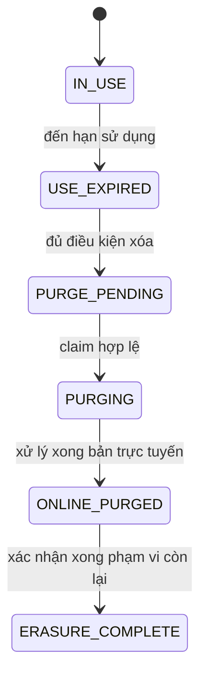

# Retention boundary: ranh giới lưu giữ và sử dụng dữ liệu

## 1. Mục tiêu và phạm vi

Trong chương **Privacy Rules**, retention boundary là ranh giới xác định dữ liệu nào còn được lưu, còn được sử dụng cho mục đích nào, đến thời điểm nào và phải được xử lý ra sao khi hết hạn.

Một hệ thống không bảo vệ quyền riêng tư chỉ bằng việc có tác vụ xóa dữ liệu mỗi đêm. Nếu dữ liệu đã hết thời hạn sử dụng nhưng vẫn được tìm kiếm, xuất báo cáo hoặc gửi đi qua một job cũ, quy tắc nghiệp vụ vẫn bị vi phạm.

Trong phạm vi bảo mật logic nghiệp vụ, cần bảo vệ ít nhất ba điều:

1. Không tiếp tục sử dụng dữ liệu ngoài mục đích và thời hạn được chính sách cho phép.
2. Không xóa hoặc biến đổi dữ liệu theo cách phá vỡ các invariant nghiệp vụ còn hiệu lực.
3. Không để dữ liệu đã xử lý hết hạn xuất hiện trở lại qua retry, replay, đồng bộ hoặc phục hồi.

Bài học tập trung vào thiết kế kỹ thuật. Các khoảng thời gian minh họa không xác định nghĩa vụ lưu giữ của một tổ chức cụ thể; thời hạn thật phải đến từ chính sách đã được người có thẩm quyền xác lập.

Sau bài này, bạn có thể mô tả một retention boundary đầy đủ, thực thi nó tại đường đọc và đường xử lý bất đồng bộ, xây quy trình purge có trạng thái và kiểm thử khả năng chống tái xuất hiện dữ liệu.

## 2. Ba loại ranh giới không nên gộp làm một

### 2.1. Ranh giới sử dụng

**Use boundary** trả lời: tại thời điểm hiện tại, dữ liệu còn được dùng cho mục đích đang yêu cầu hay không?

Ví dụ, thông tin liên hệ từng được dùng để xử lý một vụ hỗ trợ không tự động được phép tiếp tục xuất sang danh sách chăm sóc khách hàng sau khi thời hạn của mục đích đó kết thúc.

Còn lưu một bản dữ liệu không đồng nghĩa còn được phép sử dụng nó cho mọi hoạt động.

### 2.2. Ranh giới lưu trữ và xóa

**Storage boundary** trả lời: bản dữ liệu nào còn tồn tại, tại đâu và đến thời điểm nào theo chính sách của từng lớp lưu trữ?

Cần phân biệt:

- Hết hạn sử dụng.
- Đủ điều kiện bắt đầu xóa.
- Đã ngăn truy cập thông thường.
- Đã xóa khỏi hệ thống trực tuyến.
- Đã xử lý xong các bản sao thuộc phạm vi cam kết, kể cả vòng đời backup.

Các mốc có thể khác nhau, nhưng sự khác nhau phải được mô tả và kiểm soát. Không dùng câu “đã xóa” cho mọi mốc.

### 2.3. Ranh giới thẩm quyền

**Authority boundary** trả lời: ai được đặt, thay đổi, gia hạn, tạm ngừng xóa hoặc xác nhận hoàn tất?

Nếu nhân viên bất kỳ có thể sửa `retained_until` thành một ngày rất xa, quy trình purge đúng về kỹ thuật cũng không còn bảo vệ được chính sách.

Thay đổi retention là một thao tác nghiệp vụ nhạy cảm. Nó cần quyền, phạm vi, lý do, phiên bản và audit tương ứng.

| Câu hỏi | Ví dụ kiểm soát |
|---|---|
| Còn được dùng cho mục đích hỗ trợ không? | Kiểm tra mục đích và thời hạn ở đường đọc |
| Có được trì hoãn xóa không? | Hold có chủ sở hữu và phạm vi được phê duyệt |
| Đã xóa khỏi tìm kiếm chưa? | Xác nhận từ thành phần chỉ mục |
| Backup còn chứa dữ liệu không? | Theo dõi vòng đời backup và quy trình phục hồi |
| Có ai sửa thời hạn không? | Audit thay đổi chính sách và metadata |

## 3. Mô tả một retention boundary đầy đủ

Một quy tắc chỉ ghi “lưu 30 ngày” còn thiếu nhiều thông tin.

### 3.1. Các thành phần cần có

| Thành phần | Câu hỏi phải trả lời |
|---|---|
| Đối tượng | Bản ghi, trường dữ liệu, tệp, sự kiện hay nhóm liên quan nào? |
| Chủ thể và tenant | Dữ liệu thuộc phạm vi quyền nào? |
| Mục đích | Đang được giữ hoặc sử dụng để làm gì? |
| Mốc bắt đầu | Tính từ lúc tạo, đóng vụ việc hay một chuyển trạng thái cụ thể? |
| Quy tắc thời gian | Khoảng thời gian tuyệt đối hay theo lịch? Múi giờ nào? |
| Thời hạn sử dụng | Khi nào phải dừng sử dụng cho mục đích đó? |
| Điều kiện xóa | Khi nào đủ điều kiện purge và có ngoại lệ nào? |
| Bản sao | Database, cache, index, queue, artifact, log và backup nào liên quan? |
| Hold | Ai có thể đặt, gỡ và xem xét lại? |
| Cơ chế thực thi | Gate đồng bộ, job nền, propagation và đối soát nào? |
| Chứng cứ | Xác nhận đến mức nào, trong phạm vi nào? |
| Chính sách lỗi | Làm gì khi thiếu metadata hoặc không kiểm tra được trạng thái? |

Một đối tượng có thể có nhiều nhóm trường với vòng đời khác nhau. Ví dụ, phần dữ liệu phục vụ đối soát có thể cần cách xử lý khác với ghi chú tự do hoặc tệp đính kèm chứa thông tin cá nhân.

Không mặc định lấy thời hạn dài nhất rồi giữ nguyên mọi trường của đối tượng.

### 3.2. Ví dụ hợp đồng kỹ thuật

Giả sử chính sách nội bộ đã chọn cho một loại vụ hỗ trợ:

```text
Mốc tham chiếu:
  closed_at do máy chủ ghi khi vụ việc đóng hợp lệ

Thời hạn dùng nội dung hỗ trợ:
  use_until = closed_at + 30 ngày tuyệt đối

Quy ước:
  now < use_until  -> có thể dùng nếu các điều kiện quyền khác cũng đạt
  now >= use_until -> không dùng theo mục đích hỗ trợ thông thường

Purge:
  bắt đầu khi đã đến erase_eligible_at,
  không có hold có hiệu lực và đạt các điều kiện xử lý

Phạm vi:
  nội dung chính, tệp đính kèm, cache, index và bản xuất liên quan

Backup:
  theo vòng đời riêng đã công bố;
  mọi lần restore phải ngăn dữ liệu đã hết hạn quay lại phục vụ
```

“Có thể dùng” không phải “được phép vô điều kiện”. Người gọi vẫn phải có quyền trên vụ việc, đúng tenant và đúng mục đích.

Mốc 30 ngày là giả định của ví dụ. Nó không phải thời hạn cho mọi loại dữ liệu.

### 3.3. Không để hoạt động không liên quan kéo dài vòng đời

Nếu dùng `updated_at` làm mốc mặc định, những hành động sau có thể vô tình gia hạn dữ liệu:

- Mở xem một bản ghi.
- Đồng bộ lại từ hệ thống khác.
- Sửa một trường kỹ thuật.
- Replay một sự kiện cũ.
- Retry thao tác đóng vụ việc.

Mốc bắt đầu cần gắn với một sự kiện nghiệp vụ có thẩm quyền. Việc mở lại vụ việc, nếu được phép làm thay đổi thời hạn, phải có quy tắc riêng, không âm thầm ghi đè lịch sử.

## 4. Những invariant cần bảo vệ

### 4.1. Invariant quyền riêng tư

1. Dữ liệu hết thời hạn sử dụng không được đi qua đường đọc thông thường chỉ vì chưa purge.
2. Hold bảo toàn dữ liệu trong phạm vi được phê duyệt, không tự cấp quyền sử dụng mới.
3. Tenant và phạm vi quyền không được lấy từ dữ liệu client tự khai mà thiếu kiểm chứng.
4. Worker, export và tác vụ gửi dữ liệu phải kiểm tra boundary khi thực sự sử dụng.
5. Bản sao không được có vòng đời vô hạn chỉ vì nguồn chính đã xử lý.
6. Sự kiện hoặc bản sao cũ không được tự phục hồi dữ liệu đã hết hạn hay đã bị purge.
7. Trạng thái hoàn tất phải phản ánh đúng phạm vi đã xác nhận.

### 4.2. Invariant nghiệp vụ

Xóa dữ liệu cần phối hợp với các quy tắc còn hiệu lực, ví dụ:

- Tổng giao dịch đã ghi nhận vẫn đối soát được theo thiết kế.
- Một lần hoàn tiền không bị thực hiện lại do mất bản ghi chống lặp.
- Quan hệ giữa phê duyệt và thao tác được phê duyệt vẫn có thể được kiểm chứng trong phạm vi được phép giữ.
- Job bị hủy hoặc dữ liệu bị thu hồi không được trở thành kết quả sẵn sàng do worker cũ ghi lại.

Không phải mọi invariant đều cần giữ nguyên toàn bộ dữ liệu cá nhân. Cần thiết kế bản ghi tối thiểu, tham chiếu hoặc cấu trúc riêng phù hợp mục đích còn hiệu lực.

Việc thay tên bằng một mã định danh chưa đủ để gọi là ẩn danh. Nếu vẫn có khả năng liên kết hoặc truy ngược bằng dữ liệu khác, nó còn cần được bảo vệ theo mô hình tương ứng.

### 4.3. Ví dụ vi phạm logic

Một API xuất lịch sử kiểm tra quyền trên vụ việc nhưng bỏ qua thời hạn:

```text
if user.canRead(case):
    export(case.fullContent)
```

Điều kiện này chưa đủ. Gate cần xem xét thêm mục đích, boundary hiện hành, trạng thái xử lý và phạm vi trường:

```text
can_access
  = đúng tenant
    AND có quyền trên đối tượng
    AND được phép dùng cho mục đích đang yêu cầu
    AND dữ liệu còn trong ranh giới sử dụng
    AND trạng thái cho phép trả dữ liệu
```

Nếu metadata retention không có hoặc không nhất quán, không được ngầm coi dữ liệu là không bao giờ hết hạn.

## 5. Thời gian, phiên bản chính sách và chuyển trạng thái

### 5.1. Quy ước thời gian

Cần thống nhất:

- Dùng thời gian máy chủ hoặc nguồn thời gian được kiểm soát.
- Lưu mốc tuyệt đối theo UTC khi phù hợp.
- Biên kết thúc là bao gồm hay không bao gồm.
- Độ lệch đồng hồ chấp nhận được.
- Chính sách với timestamp đến từ hệ thống nguồn.
- Cách xử lý sự kiện đến muộn.

Trong bài này, `use_until` là biên kết thúc không bao gồm: đúng tại mốc đó đã không được sử dụng thông thường.

“30 ngày tuyệt đối” và “một tháng theo lịch” không đồng nghĩa. Nếu chính sách dùng lịch, cần xác định múi giờ và cách tính; không tự chuyển mọi trường hợp thành một số giây cố định.

### 5.2. Lưu đủ để giải thích quyết định

Metadata có thể gồm:

```text
tenant_id
entity_reference
purpose_code
retention_anchor
use_until
erase_eligible_at
policy_version
lifecycle_version
retention_phase
hold_reference
```

Dữ liệu thật có thể cần mô hình phức tạp hơn khi nhiều mục đích cùng tồn tại. Không nhồi các mục đích khác nhau vào một timestamp rồi mất khả năng giải thích.

Thay đổi chính sách cần xác định có tác động hồi tố không, đối tượng nào bị ảnh hưởng và cách di chuyển metadata. Không coi việc triển khai cấu hình mới là bằng chứng mọi bản ghi cũ đã được cập nhật.

### 5.3. Tránh mở lại quyền vì đồng hồ hoặc replay

Một bản ghi đã chuyển sang trạng thái hết hạn không được tự trở lại đang dùng chỉ vì:

- Máy chủ bị lùi giờ.
- Worker đọc snapshot cũ.
- Replay ghi lại policy version trước.
- Một bản backup được phục hồi.

Cần trạng thái và version có tính tiến triển theo quy trình. Nếu tổ chức cho phép gia hạn hoặc tái sử dụng theo một quyết định mới, đó phải là chuyển trạng thái có thẩm quyền và lịch sử riêng.

Một phép so sánh timestamp trên bản ghi cũ không tự tạo bảo đảm chống mở lại này.

## 6. State machine của retention

### 6.1. Tách khỏi trạng thái nghiệp vụ chính

Trạng thái vụ việc như `OPEN`, `CLOSED` không đủ mô tả việc nội dung còn được dùng hay đã xóa.

Một mô hình retention minh họa:



Hold nên được mô hình hóa như điều kiện bảo toàn có phạm vi, không nhất thiết là một trạng thái thay cho mọi trạng thái khác.

Một bản ghi có thể đã hết hạn sử dụng nhưng đang được hold. Nó không quay lại `IN_USE` chỉ vì có hold.

### 6.2. Ý nghĩa của từng trạng thái

| Trạng thái | Ý nghĩa |
|---|---|
| `IN_USE` | Có thể còn được dùng nếu chưa đến hạn và quyền khác đạt |
| `USE_EXPIRED` | Đường dùng thông thường phải từ chối |
| `PURGE_PENDING` | Đã có kế hoạch xử lý, chưa khẳng định xóa |
| `PURGING` | Đang thực thi các bước xóa hoặc biến đổi |
| `ONLINE_PURGED` | Đã xác nhận phạm vi trực tuyến được khai báo |
| `ERASURE_COMPLETE` | Đã đạt tiêu chí hoàn tất của toàn phạm vi cam kết |

Nếu backup vẫn còn dữ liệu, không báo rằng đã xóa mọi bản sao chỉ vì database chính không còn hàng dữ liệu đó.

Thông tin điều phối hoặc dấu ngăn phục hồi có thể được giữ theo mục đích riêng. Phạm vi “hoàn tất” phải nói rõ điều này; không tuyên bố đã loại bỏ mọi định danh nếu vẫn giữ metadata liên kết được.

### 6.3. Chuyển trạng thái phải có điều kiện

Ví dụ về claim purge:

```text
claim chỉ thành công nếu:
  phase == PURGE_PENDING
  AND lifecycle_version == expected_version
  AND không có hold đang có hiệu lực
  AND thời điểm và chính sách hiện hành cho phép purge

khi thành công:
  phase = PURGING
  lifecycle_version tăng
  ghi purge_attempt_id
```

Việc kiểm tra hold và claim phải được đồng bộ bằng transaction hoặc cơ chế tương đương trong ranh giới có thẩm quyền.

Nếu đặt hold và claim xóa ở hai nơi không có giao thức phối hợp, có thể xảy ra cảnh một bên báo “đã hold” còn bên kia đang xóa.

### 6.4. Hold đến sau khi purge đã bắt đầu

Không thể bảo đảm giữ lại dữ liệu đã bị xóa chỉ bằng cách ghi một cờ hold sau đó.

Cần định nghĩa thời điểm hold có hiệu lực và kết quả nếu yêu cầu đến quá muộn. Hệ thống không được xác nhận thành công một hold toàn vẹn khi không còn khả năng đáp ứng.

Tình huống này cần phản hồi xung đột hoặc chuyển xử lý theo quy trình có thẩm quyền, cùng thông tin về tiến độ purge. Không tự restore để “sửa” nếu chưa có quyết định và cơ chế an toàn tương ứng.

## 7. Thực thi boundary tại đường đọc và xử lý

### 7.1. Tác vụ nền không thay thế gate đồng bộ

Giả sử dữ liệu hết hạn lúc 10:00 nhưng purge chạy lúc 02:00 ngày hôm sau. Khoảng chờ này không được biến thành quyền sử dụng thêm.

Đường đọc cần chặn theo boundary dù dữ liệu còn nằm trong kho:

```text
load trong đúng tenant và phạm vi quyền
đọc metadata retention có thẩm quyền
kiểm tra mục đích và use_until
kiểm tra phase và lifecycle_version
chỉ trả các trường được phép
```

Điều kiện phải có mặt ở các đường truy cập tương ứng, không chỉ giao diện chính:

- API chi tiết và API tìm kiếm.
- Export và báo cáo.
- Công cụ hỗ trợ nội bộ.
- Tác vụ phân tích hoặc gửi thông báo.
- Endpoint quản trị.
- Luồng xử lý sự kiện và đồng bộ.

Không đặt toàn bộ bảo vệ vào việc ẩn nút trên giao diện.

### 7.2. Minh họa evaluator bằng Java

Ví dụ chỉ biểu diễn quyết định retention cho một mục đích thông thường. Nó không thay thế kiểm tra quyền, tenant hoặc cơ chế giữ trạng thái nguyên tử.

```java
import java.time.Instant;
import java.util.Objects;

public final class RetentionBoundary {
    public enum Phase {
        IN_USE,
        USE_EXPIRED,
        PURGE_PENDING,
        PURGING,
        ONLINE_PURGED,
        ERASURE_COMPLETE
    }

    public record Snapshot(
            Instant useUntil,
            Instant eraseEligibleAt,
            boolean holdActive,
            Phase phase,
            long lifecycleVersion) {

        public Snapshot {
            Objects.requireNonNull(useUntil);
            Objects.requireNonNull(eraseEligibleAt);
            Objects.requireNonNull(phase);

            // Hop dong don gian cua vi du:
            // khong du dieu kien purge truoc khi het han dung.
            if (eraseEligibleAt.isBefore(useUntil) || lifecycleVersion < 0) {
                throw new IllegalArgumentException("Invalid retention snapshot");
            }
        }
    }

    public record Decision(
            boolean ordinaryUseAllowed,
            boolean purgeCandidate) {
    }

    public static Decision evaluate(Snapshot snapshot, Instant serverNow) {
        Objects.requireNonNull(snapshot);
        Objects.requireNonNull(serverNow);

        boolean ordinaryUseAllowed =
                snapshot.phase() == Phase.IN_USE
                && serverNow.isBefore(snapshot.useUntil());

        boolean phaseCanBeClaimed =
                snapshot.phase() == Phase.IN_USE
                || snapshot.phase() == Phase.USE_EXPIRED
                || snapshot.phase() == Phase.PURGE_PENDING;

        boolean purgeCandidate =
                phaseCanBeClaimed
                && !serverNow.isBefore(snapshot.useUntil())
                && !serverNow.isBefore(snapshot.eraseEligibleAt())
                && !snapshot.holdActive();

        return new Decision(ordinaryUseAllowed, purgeCandidate);
    }
}
```

Những giới hạn cần hiểu:

- `ordinaryUseAllowed=true` chỉ đạt phần retention; người gọi vẫn phải có quyền và đúng mục đích.
- Hold không làm `ordinaryUseAllowed` thành true.
- `purgeCandidate=true` là đầu vào cho quy trình chuyển trạng thái, không phải lệnh xóa ngay.
- Dữ liệu thực tế thiếu snapshot phải đi theo chính sách lỗi; không bỏ qua gate.
- Quyền truy cập đặc biệt để xử lý hold, nếu có, là luồng riêng với quyền và audit riêng.
- Snapshot và quyết định phải gắn với version; dữ liệu không được thay đổi ngoài kiểm soát giữa lúc kiểm tra và sử dụng.
- Khi phát hiện hết hạn, hệ thống cần ghi nhận chuyển trạng thái phù hợp để snapshot cũ hoặc đồng hồ lùi không tự mở lại.
- Điều kiện `eraseEligibleAt >= useUntil` là hợp đồng của ví dụ, không phải công thức cho mọi mô hình dữ liệu.

Ví dụ dùng cú pháp record của Java 17. Nó không cập nhật phase và không tự giải quyết cạnh tranh giữa đọc, hold và purge.

### 7.3. Công việc dài phải có hợp đồng sử dụng rõ

Một job bắt đầu trước hạn không tự có quyền xử lý dữ liệu mãi sau hạn.

Cần xác định checkpoint trước khi truy vấn, ghi output và phát hành artifact. Nếu công việc phải dừng tại boundary, worker cần kiểm tra lại và hủy kết quả chưa được phép phát hành.

Với lượt truyền dài, chính sách phải nêu ranh giới hiệu lực của việc ngừng truyền, chu kỳ kiểm tra và dữ liệu có thể đang trên đường. Không thể lấy lại byte đã đến người nhận.

## 8. Mở rộng boundary đến các bản sao và dữ liệu dẫn xuất

### 8.1. Lập bản đồ dữ liệu

Không thể xác nhận hoàn tất nếu không biết dữ liệu đã đi đâu.

Một bản đồ có thể gồm:

| Nơi dữ liệu tồn tại | Điều cần xử lý |
|---|---|
| Database chính | Trường, hàng, quan hệ và metadata retention |
| Read replica | Độ trễ truyền thay đổi, đường đọc có gate phù hợp |
| Cache | Entry, TTL, invalidation và bản sao trong ứng dụng |
| Search index | Nội dung, snippet, autocomplete và bộ lọc kết quả |
| Object storage | Tệp gốc, phiên bản đối tượng và artifact xuất |
| Queue, outbox, dead-letter queue | Payload, thời hạn và khả năng replay |
| Log, trace, crash dump | Dữ liệu vô tình được sao chép khi quan sát hệ thống |
| Kho phân tích | Bản sao bảng, bảng tạm và kết quả báo cáo |
| Backup, snapshot | Vòng đời và quy trình phục hồi |
| Dữ liệu dẫn xuất | Khả năng nhận diện hoặc liên kết còn tồn tại |

Xóa ở nguồn không tự truyền thành xóa ở mọi nơi. CDC có thể mang một sự kiện xóa, nhưng consumer vẫn cần hiểu, xử lý lặp an toàn và xác nhận trạng thái.

### 8.2. Cache TTL không phải hợp đồng quyền riêng tư hoàn chỉnh

TTL có thể giúp dọn dữ liệu, nhưng cần kiểm tra ngữ nghĩa của thành phần thực tế:

- Entry hết hạn có còn được trả theo cơ chế phục vụ dữ liệu cũ không?
- Client hoặc lớp cache khác còn giữ bản sao không?
- Một lần đọc có tự gia hạn TTL không?
- Cache có lưu đầy đủ trường nhạy cảm không?
- Việc invalidation có thể đến muộn hoặc mất không?

Không mặc định “TTL đã hết” nghĩa là mọi bản sao đã bị xóa hoặc không đường đọc nào còn trả nội dung.

Gate có thẩm quyền cần bảo vệ boundary sử dụng. Với cache chứa payload, metadata đủ để kiểm tra hạn và version phải được xử lý đúng; không để cache hit bỏ qua chính sách.

### 8.3. Search và artifact thường tạo đường đọc phụ

Search có thể tiếp tục hiển thị thông tin qua snippet ngay cả khi trang chi tiết đã từ chối.

Một báo cáo CSV hoặc PDF có thể chứa dữ liệu từ nhiều đối tượng với nhiều thời hạn khác nhau. Không nên gắn thời hạn của file chỉ với ngày tạo file mà bỏ qua boundary của dữ liệu nguồn.

Có thể cần:

- Hạn dùng artifact bị giới hạn bởi các dữ liệu và mục đích liên quan.
- Đánh dấu artifact không còn được phát hành khi nguồn hết hạn hoặc đổi quyền.
- Tạo lại một báo cáo đã loại dữ liệu không còn hợp lệ.
- Gate tại đường tải, không chỉ tại API tạo báo cáo.

Một signed URL còn hiệu lực có thể tiếp tục cho phép truy cập theo cơ chế của nơi lưu trữ. Chỉ đổi trạng thái trong database không chắc đã thu hồi URL.

Nếu yêu cầu cần kiểm tra retention trực tuyến, thành phần phục vụ tệp phải thực sự tham gia thực thi, hoặc hệ thống phải có cơ chế thu hồi phù hợp. TTL ngắn giảm rủi ro nhưng không tự tạo bảo đảm thu hồi tức thời.

### 8.4. Dữ liệu dẫn xuất không mặc nhiên ngoài phạm vi

Một bảng tổng hợp, chỉ số, vector biểu diễn hoặc mã giả danh có thể vẫn liên kết được với người hoặc đối tượng.

Cần xác định mục đích, khả năng liên kết và vòng đời của bản dẫn xuất. Không chỉ đổi tên trường thành `anonymous_id` rồi bỏ toàn bộ kiểm soát.

Nếu tổ chức chọn tạo dữ liệu không còn khả năng nhận diện theo tiêu chí đã xác lập, cần có phương pháp và kiểm chứng riêng. Một bước băm định danh đơn giản không chứng minh điều đó.

## 9. Queue, replay và chống phục hồi dữ liệu cũ

### 9.1. Message đến muộn phải kiểm tra trạng thái hiện tại

Ví dụ:

```text
Ngày 1: tạo vụ hỗ trợ và phát sự kiện chứa nội dung.
Ngày 40: nội dung đã hết hạn và được purge trực tuyến.
Ngày 45: một message cũ trong dead-letter queue được replay.
```

Nếu consumer thực hiện `upsert` toàn bộ payload mà không kiểm tra lifecycle, dữ liệu có thể xuất hiện trở lại.

Consumer cần biết:

- Message thuộc thực thể và lifecycle generation nào.
- Version của sự kiện có còn hợp lệ không.
- Đối tượng còn được phép tồn tại hoặc dùng cho mục đích đó không.
- Dấu hết hạn hoặc xóa có ưu tiên đối với bản cập nhật cũ không.

Ưu tiên message tham chiếu thay vì mang toàn bộ dữ liệu nhạy cảm khi kiến trúc cho phép. Nhưng tham chiếu cũng cần kiểm soát quyền và vòng đời; nó không tự làm queue an toàn.

### 9.2. Tombstone và generation

Một tombstone là dấu tối thiểu cho biết một thực thể hoặc thế hệ dữ liệu đã bị kết thúc hoặc xóa, để từ chối cập nhật cũ.

Ví dụ ngữ nghĩa:

```text
entity_reference = E
lifecycle_generation = 4
deleted_through_version = 120

Sự kiện của E, generation 4, version <= 120:
  không được tái tạo dữ liệu
```

Generation mới chỉ được tạo bằng một thao tác có thẩm quyền theo nghiệp vụ. Consumer không được tự hiểu một payload cũ là “tạo mới hợp lệ”.

Tombstone có thể còn liên kết được với chủ thể. Cần giữ tối thiểu, hạn chế truy cập và xác lập mục đích cùng thời hạn riêng; không giữ toàn bộ dữ liệu vừa xóa bên trong nó.

### 9.3. Thời hạn dấu chống phục hồi

Thời hạn giữ dấu cần phù hợp với các nguồn có thể mang dữ liệu cũ quay lại:

- Thời gian message có thể tồn tại hoặc được replay.
- Vòng đời backup và snapshot có khả năng restore.
- Cửa sổ đồng bộ lại từ các hệ thống khác.
- Khoảng thời gian thực hiện và đối soát phục hồi.

Nếu tombstone bị xóa trước khi các nguồn này hết khả năng tái phát dữ liệu, hệ thống phải có cơ chế khác để ngăn phục hồi.

Không chọn thời hạn theo cảm tính. Cần phân tích toàn bộ đường replay và có chính sách cho chính metadata chống phục hồi.

## 10. Retention của idempotency và lịch sử nghiệp vụ

### 10.1. Xóa bản ghi chống lặp có thể mở lại tác động

Giả sử một thao tác hoàn tiền dùng idempotency key để tránh chi hai lần. Nếu xóa bản ghi chống lặp trong khi lệnh cũ vẫn có thể được gửi lại, hệ thống có thể coi đó là thao tác mới.

Đây là xung đột thiết kế giữa giảm dữ liệu và giữ invariant, không phải lý do giữ vô hạn mọi payload.

Cần xác định riêng:

- Thời hạn request còn được chấp nhận.
- Phạm vi và thời hạn idempotency.
- Ràng buộc nghiệp vụ còn tồn tại sau khi dữ liệu chi tiết bị xóa.
- Dữ liệu tối thiểu cần để chứng minh thao tác đã xử lý.
- Hành vi sau khi key hết hạn.

### 10.2. Không lưu nguyên yêu cầu chỉ để chống lặp

Có thể không cần giữ toàn bộ ghi chú, địa chỉ, tài liệu đính kèm hoặc phản hồi cũ để biết một thao tác đã được thực hiện.

Tùy nghiệp vụ, bản ghi chống lặp có thể gồm tham chiếu thao tác, fingerprint được thiết kế phù hợp, trạng thái và tham chiếu kết quả tối thiểu. Các trường này vẫn cần được phân loại và bảo vệ.

Một digest của payload có thể còn cho phép liên kết hoặc suy đoán nếu đầu vào ít khả năng. Không mặc định nó là dữ liệu vô danh.

Khi trả lại kết quả cho retry, phải kiểm tra quyền hiện tại và boundary của nội dung. Idempotency không cấp quyền đọc lại dữ liệu đã hết hạn.

### 10.3. Khi hết hợp đồng chống lặp

Không dùng timestamp do client tự khai làm bằng chứng request còn mới.

Nếu hệ thống cần ngăn lệnh cũ sau khi bản ghi chống lặp hết hạn, có thể cần định danh lệnh do máy chủ quản lý, bằng chứng thời hạn được kiểm chứng hoặc ràng buộc nghiệp vụ còn đủ để từ chối.

Một bản ghi đã xóa không nên được tạo lại qua endpoint cập nhật chỉ vì hệ thống dùng `upsert` cho tiện. Tạo mới phải đi qua điều kiện và quyền tạo mới.

Giải pháp phải được chọn theo nghiệp vụ; không có một TTL idempotency duy nhất phù hợp mọi loại thao tác.

## 11. Hold và nhiều mục đích lưu giữ

### 11.1. Hold là quyền bảo toàn có phạm vi

Một hold có thể cần:

```text
hold_reference
authorized_owner
reason_code_or_case_reference
covered_entities_or_fields
effective_from
review_due_at
release_authority
policy_version
audit_reference
```

Không cho client tự gửi `hold=true` để tránh purge. Không dùng một nhãn “đặc biệt” không có chủ sở hữu để giữ vô thời hạn.

Lý do chi tiết cũng có thể nhạy cảm. Audit nên lưu tham chiếu và thông tin tối thiểu thay vì sao chép thêm nội dung cá nhân.

### 11.2. Hold không đồng nghĩa tiếp tục mọi mục đích sử dụng

Một nội dung đã hết hạn dùng thông thường nhưng còn được bảo toàn phải bị tách khỏi:

- Tìm kiếm phục vụ người dùng thông thường.
- Export hàng loạt.
- Phân tích cho mục đích không còn được phép.
- Tác vụ thông báo dùng lại nội dung cũ.

Nếu có quyền truy cập đặc biệt để xử lý mục đích hold, phải có đường truy cập, kiểm tra quyền và audit riêng.

Việc gỡ hold không tự xóa ngay nếu còn điều kiện khác; nó cho phép quy trình đánh giá điều kiện purge tiếp tục.

### 11.3. Nhiều mục đích không có nghĩa giữ mọi thứ theo mốc dài nhất

Ví dụ, một cấu trúc giao dịch có thể còn cần một tập trường tối thiểu phục vụ đối soát, trong khi thông tin liên hệ tự do và tệp hỗ trợ đã hết mục đích.

Cách xử lý có thể gồm:

- Tách các nhóm trường và lớp dữ liệu.
- Hạn chế mục đích sử dụng.
- Loại bỏ phần không còn cần thiết.
- Giữ tham chiếu tối thiểu phù hợp.
- Duy trì khả năng kiểm chứng invariant mà không giữ bản sao thừa.

Không áp dụng máy móc công thức “lấy ngày lớn nhất của mọi chính sách” cho toàn đối tượng.

Nếu các quy tắc cấu hình mâu thuẫn, hệ thống phải phát hiện và đưa vào quy trình giải quyết có chủ sở hữu, thời hạn và cảnh báo. Không âm thầm gia hạn quyền sử dụng hoặc trì hoãn vô hạn để tránh quyết định.

## 12. Backup và quy trình restore

### 12.1. Xóa trực tuyến và vòng đời backup

Một số cơ chế backup không cho phép xóa chọn lọc từng bản ghi. Khi đó cần mô tả trung thực:

- Bản nào còn có thể chứa dữ liệu.
- Khi nào bản đó hết vòng đời.
- Ai được truy cập.
- Dữ liệu được phép dùng cho mục đích nào.
- Quy trình nào ngăn restore làm dữ liệu hết hạn quay lại phục vụ.

Không báo `ERASURE_COMPLETE` cho phạm vi bao gồm backup nếu chưa đạt tiêu chí hoàn tất đó.

### 12.2. Restore phải ở vùng cách ly trước khi phục vụ

Một quy trình minh họa:

```text
1. Phục hồi vào môi trường cách ly.
2. Nạp policy version và trạng thái retention hiện hành.
3. Áp nhật ký xóa, tombstone và thay đổi quyền sau mốc backup.
4. Tính lại boundary khi cần bằng quy tắc được phê duyệt.
5. Dọn hoặc khóa dữ liệu không còn được sử dụng.
6. Kiểm tra các chỉ mục, artifact và tác vụ chờ đi kèm.
7. Chỉ mở phục vụ sau khi các điều kiện kiểm chứng đạt.
```

Không mở hệ thống trước rồi chờ purge nền “đuổi kịp”. Trong khoảng đó, dữ liệu cũ có thể bị đọc, xuất hoặc gửi đi.

Nếu thiếu nhật ký cần thiết để áp quyết định xóa sau mốc backup, không tự coi bản phục hồi là đủ điều kiện đưa vào sử dụng.

### 12.3. Vai trò của mã hóa và hủy khóa

Mã hóa giúp bảo vệ dữ liệu nhưng không tự rút ngắn retention.

Hủy khóa chỉ đáp ứng mục tiêu xóa bằng mật mã nếu mô hình thực sự bảo đảm các bản cần xử lý không còn giải mã được. Cần xét bản sao khóa, backup khóa, cache bản rõ, khóa dùng chung và các đường khôi phục.

Xóa một khóa ứng dụng trong khi bản rõ vẫn nằm ở cache hoặc artifact không chứng minh đã xử lý toàn bộ dữ liệu. Việc hủy khóa cũng cần kiểm tra hold và thẩm quyền tương tự hành động purge khác.

## 13. Quy trình purge phân tán và chứng cứ hoàn tất

### 13.1. Kế hoạch theo thành phần

Purge nhiều hệ thống thường không nằm trong một transaction chung.

Có thể cần một manifest điều phối:

```text
purge_request_id
entity_or_scope_reference
lifecycle_version
policy_version
required_components
component_statuses
attempt_history
verification_status
```

Mỗi thành phần cần thao tác có thể retry an toàn. Request xóa được nhận lại không được xóa nhầm thế hệ dữ liệu mới hoặc làm sai số liệu.

Một thành phần chỉ báo hoàn tất sau khi đạt tiêu chí của nó, ví dụ nội dung không còn được phục vụ và bản dữ liệu thuộc phạm vi xử lý đã được loại bỏ theo cơ chế lưu trữ.

Không suy rộng từ “API trả 200” sang “mọi bản sao đã biến mất”.

### 13.2. Tách ngăn sử dụng khỏi dọn dữ liệu

Ngay khi boundary sử dụng hết hiệu lực, đường đọc cần từ chối theo chính sách.

Sau đó, quy trình dọn có thể tiếp tục xử lý từng thành phần. Nếu một thành phần thất bại:

- Giữ trạng thái chưa hoàn tất.
- Retry với giới hạn và cảnh báo.
- Không mở lại quyền sử dụng.
- Không báo xóa hoàn chỉnh.
- Đưa công việc quá hạn vào đối soát và xử lý có chủ sở hữu.

Nếu thành phần vẫn có đường phục vụ trực tiếp ngoài gate chung, phải có kiểm soát tại chính thành phần đó. Một cờ trong dịch vụ điều phối không bảo vệ được URL công khai còn truy cập.

### 13.3. Audit tối thiểu nhưng đủ kiểm chứng

Chứng cứ có thể lưu:

- Chính sách và version đã áp.
- Phạm vi thành phần.
- Thời điểm chuyển trạng thái.
- Kết quả từng bước.
- Người hoặc dịch vụ có thẩm quyền.
- Tham chiếu lỗi và lần đối soát.

Không giữ một bản sao đầy đủ dữ liệu vừa xóa trong log để “chứng minh đã xóa”.

Audit, manifest và tombstone cũng có vòng đời riêng. Quyền xem chúng phải phù hợp vì chúng có thể tiết lộ mối quan hệ hoặc sự tồn tại của đối tượng.

### 13.4. Các chỉ số vận hành

| Nhóm | Chỉ số gợi ý |
|---|---|
| Thực thi sử dụng | Lượt bị chặn do hết hạn, đường truy cập bỏ qua gate được phát hiện |
| Tiến độ | Số đối tượng quá hạn sử dụng nhưng chưa xử lý xong |
| Độ trễ | Thời gian từ đủ điều kiện purge đến hoàn tất từng phạm vi |
| Bản sao | Thành phần chưa xác nhận, artifact mồ côi, index tồn dư |
| Hold | Số hold, tuổi hold, lịch xem xét quá hạn |
| Chất lượng chính sách | Thiếu anchor, version không xác định, quy tắc mâu thuẫn |
| Chống phục hồi | Message cũ bị từ chối, đối tượng xuất hiện lại, kết quả diễn tập restore |
| Audit | Trạng thái hoàn tất thiếu chứng cứ hoặc sai phạm vi |

“Đã xóa nhiều bản ghi” không chứng minh boundary được thực thi. Cần đo cả việc dữ liệu hết hạn còn có thể được sử dụng hay không.

## 14. Bộ tình huống kiểm thử

| Tình huống | Kết quả cần xác nhận |
|---|---|
| Trước `use_until` một đơn vị thời gian | Gate retention có thể đạt, nhưng vẫn cần quyền và mục đích |
| Đúng tại `use_until` | Không cho sử dụng thông thường |
| Purge nền chưa chạy | Dữ liệu hết hạn vẫn bị chặn trên đường đọc |
| Cache còn payload | Cache hit không bỏ qua boundary |
| Search index chưa xóa | Không rò nội dung qua kết quả hoặc snippet |
| Export bắt đầu trước hạn, chạy qua hạn | Thực thi hợp đồng checkpoint và không phát hành trái chính sách |
| Signed URL còn hiệu lực sau thu hồi | Kiểm chứng đúng khả năng thực thi hoặc khoảng trễ đã chấp nhận |
| Đồng hồ lùi sau khi đã ghi hết hạn | Không tự mở lại phase sử dụng |
| Replay sự kiện cũ | Không kéo dài anchor hoặc phục hồi nội dung |
| Retry đóng vụ việc | Không tự ghi lại mốc hết hạn từ thời điểm retry |
| Đặt hold cạnh tranh với claim purge | Có kết quả nhất quán và thời điểm hiệu lực rõ |
| Hold được đặt sau khi đã xóa một phần | Không báo giữ toàn vẹn nếu không đáp ứng được |
| Gỡ hold bằng người không đủ quyền | Bị từ chối và ghi nhận phù hợp |
| Worker cũ ghi output sau khi lifecycle đổi | Version hoặc fencing ngăn phát hành |
| Message cũ chạy `upsert` | Không tái tạo thế hệ đã kết thúc |
| Cùng sự kiện xóa được nhận nhiều lần | Không xóa nhầm hoặc chuyển trạng thái sai |
| Đối tượng mới có generation khác | Dấu xóa cũ không xóa nhầm dữ liệu mới |
| Idempotency hết hạn nhưng lệnh cũ còn được gửi | Không lặp tác động nghiệp vụ ngoài hợp đồng |
| Retry yêu cầu đọc kết quả cũ | Không trả nội dung đã hết hạn chỉ vì key khớp |
| Một thành phần purge lỗi | Không báo hoàn tất toàn bộ; có retry và đối soát |
| Backup cũ được restore | Áp trạng thái hiện hành trước khi mở phục vụ |
| Thiếu nhật ký xóa cần cho restore | Không tự mở hệ thống như thể dữ liệu đã hợp lệ |
| Thay policy version | Kiểm tra tác động hồi tố và metadata cũ theo kế hoạch |
| Payload sửa tenant hoặc hạn lưu | Không đổi phạm vi hoặc thời hạn ngoài thẩm quyền |
| Xóa dữ liệu chi tiết của một giao dịch | Invariant đối soát, quyền và chống lặp vẫn được giữ theo thiết kế |
| Audit chứa dữ liệu quá mức | Phát hiện bản sao nhạy cảm ngoài phạm vi cho phép |

Kiểm thử tích hợp cần bao gồm đường đọc thật, cache, index, worker và các kho liên quan. Một unit test so sánh timestamp không chứng minh hệ thống đã bảo vệ mọi bản sao.

Nên diễn tập một chuỗi hoàn chỉnh: tạo dữ liệu, đóng nghiệp vụ, hết hạn, giữ cache cũ, replay message, purge một phần, restore backup và thử đọc hoặc export lại.

## 15. Những lỗi thiết kế thường gặp

| Lỗi | Hậu quả | Hướng sửa |
|---|---|---|
| Chỉ có cron xóa | Dữ liệu vẫn được dùng giữa lúc hết hạn và lúc cron chạy | Gate đồng bộ tại điểm sử dụng |
| Dùng `updated_at` làm anchor cho mọi dữ liệu | Replay hoặc sửa kỹ thuật gia hạn vòng đời | Mốc nghiệp vụ có thẩm quyền |
| Một timestamp cho mọi mục đích | Không giải thích được phần dữ liệu nào còn được dùng | Mô hình hóa mục đích và nhóm trường |
| Hold làm sống lại quyền đọc | Bảo toàn biến thành quyền sử dụng mới | Tách hold khỏi quyền và mục đích |
| Chỉ xóa database chính | Cache, export và index vẫn lộ dữ liệu | Bản đồ bản sao và kế hoạch theo thành phần |
| Gọi mọi trạng thái là “đã xóa” | Người vận hành hiểu sai phạm vi hoàn tất | Trạng thái và tiêu chí rõ |
| Xóa tombstone quá sớm | Replay hoặc restore làm dữ liệu quay lại | Phù hợp cửa sổ phục hồi và cơ chế thay thế |
| Xóa bản ghi idempotency không xét giao thức | Một lệnh cũ có thể gây tác động lần nữa | Thiết kế thời hạn và ràng buộc nghiệp vụ |
| Cho phép mọi cập nhật tạo lại bản ghi | Upsert vượt qua quyết định xóa | Phân biệt tạo mới, cập nhật và generation |
| Restore rồi mới purge sau | Có khoảng dữ liệu hết hạn được phục vụ | Cách ly và kiểm chứng trước khi mở |
| Ghi toàn bộ payload vào audit xóa | Tạo kho dữ liệu phụ không được xử lý | Chứng cứ tối thiểu, có vòng đời |
| Thay định danh bằng hash rồi gọi là vô danh | Bỏ sót khả năng liên kết | Phân loại và kiểm chứng riêng |
| Trì hoãn xử lý mâu thuẫn vô hạn | Boundary không còn thực chất | Chủ sở hữu, thời hạn giải quyết và cảnh báo |

## 16. Bài tập áp dụng

Bạn phụ trách một nền tảng hỗ trợ khách hàng đa tenant. Nội dung vụ việc có tệp đính kèm, search index, cache, báo cáo CSV và backup định kỳ. Một số thao tác giải quyết vụ việc có liên quan đến hoàn tiền.

Hãy thiết kế retention boundary bằng cách trả lời:

1. Những nhóm trường và bản sao nào thuộc phạm vi?
2. Mục đích, anchor, thời hạn sử dụng và điều kiện purge được xác lập từ đâu?
3. Đúng tại thời điểm hết hạn, API chi tiết, tìm kiếm và export sẽ làm gì?
4. Một job tạo trước hạn nhưng chạy sau hạn có được tiếp tục không, theo hợp đồng nào?
5. Hold được đặt, gỡ và kiểm chứng bởi ai? Nó ảnh hưởng quyền sử dụng như thế nào?
6. State machine giải quyết cuộc đua giữa hold, purge và worker cũ ra sao?
7. Cần giữ gì để retry hoàn tiền không tạo tác động hai lần mà không lưu thừa nội dung cá nhân?
8. Message cũ và bản backup cũ bị ngăn phục hồi dữ liệu bằng cơ chế nào?
9. Khi nào được báo `ONLINE_PURGED`, khi nào được báo `ERASURE_COMPLETE`?
10. Audit tối thiểu gồm gì, và chính audit được giữ đến bao giờ?
11. Chỉ số và diễn tập nào phát hiện được dữ liệu hết hạn quay trở lại?
12. Nếu một thành phần không thể hoàn tất purge đúng tiến độ, ai xử lý và người dùng còn truy cập được gì?

Một thiết kế đầy đủ cần giải thích cả thời điểm dừng sử dụng lẫn vòng đời xử lý các bản sao. Boundary phải được thực thi bằng quyền, trạng thái, thời gian và cơ chế chống replay; một lịch xóa đơn lẻ không đủ để bảo vệ quy tắc nghiệp vụ này.
