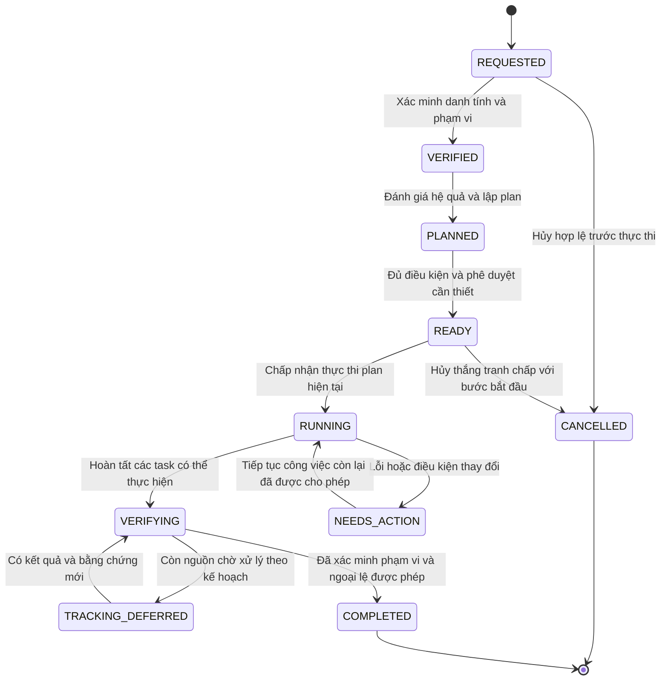

# Deletion consequence — Hệ quả của việc xóa dữ liệu

## 1. Xóa dữ liệu là một thay đổi nghiệp vụ

Một người dùng yêu cầu xóa tài khoản. Hệ thống xóa hàng `user`, nhưng một khoản thưởng vẫn đang chờ chi, một nhân viên khác vẫn giữ URL tải hồ sơ và hàng đợi vẫn có event cập nhật địa chỉ. Sau đó consumer xử lý event cũ rồi tạo lại hồ sơ, hoặc luồng trả thưởng mất khóa chống trùng và cấp tiền lần nữa.

Vấn đề không chỉ là câu lệnh xóa thành công hay thất bại. **Deletion consequence** là các hệ quả của việc xóa đối với dữ liệu liên quan, quyền, trạng thái nghiệp vụ, nghĩa vụ đang xử lý và khả năng vận hành hệ thống sau đó. Một luồng xóa an toàn cần xác định trước cái gì phải biến mất, cái gì phải được tách hoặc thay đổi, cái gì được giữ theo chính sách và cách chứng minh kết quả thực tế.

Bài thuộc chương **Privacy Rules**, module `SECURITY_APPLICATION_SECURITY_BUSINESS_LOGIC_SECURITY`. Trọng tâm là business invariants, state machine, quyền theo đối tượng, transaction, idempotency và kiểm thử lạm dụng logic trong luồng xóa. Các trạng thái và chính sách dưới đây là mô hình kỹ thuật minh họa; phạm vi, căn cứ giữ/xóa và thời hạn phải được xác định cho hệ thống thực tế.

Sau bài học, bạn cần có khả năng:

- Đánh giá tác động trước khi xóa chủ thể hoặc tài nguyên.
- Giữ đúng quy tắc tiền, quyền, phê duyệt và chống trùng trong khi giảm dữ liệu cá nhân.
- Thiết kế workflow xóa có version, ranh giới không thể hoàn tác và kết quả theo từng nguồn dữ liệu.
- Ngăn request đồng thời, event cũ và restore backup làm dữ liệu xuất hiện trở lại.
- Phân biệt đã nhận yêu cầu, đã xử lý dữ liệu đang dùng và đã hoàn tất toàn bộ phạm vi cam kết.

Ví dụ xuyên suốt: tài khoản **U-42** có khoản thưởng **R-204**, hồ sơ hỗ trợ **C-17**, ảnh xác minh và các bản sao trong search index, cache, hàng đợi và backup. Yêu cầu **D-81** phải có kế hoạch cho từng nhóm, thay vì chỉ xóa một bảng.

## 2. Những thao tác dễ bị gọi chung là “xóa”

| Thao tác | Tác dụng chính | Hệ quả cần kiểm tra |
| --- | --- | --- |
| Vô hiệu hóa/soft delete | Đánh dấu không còn hoạt động hoặc ẩn khỏi một số luồng | Dữ liệu còn tồn tại; API, export và job nền có thể vẫn truy cập |
| Hard delete | Loại bản ghi hoặc object khỏi nguồn đang xử lý | Không tự xử lý mọi replica, version, log hay backup |
| Redaction | Loại bỏ hoặc thay thế những trường cụ thể | Nội dung còn lại có thể vẫn nhận diện hoặc tiết lộ chủ thể |
| Tách liên kết | Bỏ quan hệ giữa hồ sơ cá nhân và bản ghi nghiệp vụ | Bản ghi nghiệp vụ vẫn cần nghĩa rõ ràng; liên kết khác có thể còn tồn tại |
| Giả danh hóa | Thay định danh bằng token/tham chiếu | Không mặc nhiên là ẩn danh; mapping hoặc dữ liệu phụ có thể nối lại |
| Tombstone | Giữ dấu vết tối thiểu rằng một định danh/phiên bản đã bị xóa | Có thể cần để chặn replay; bản thân dấu vết cũng cần mục đích và retention |
| Xóa khóa mã hóa | Làm mất khả năng giải mã dữ liệu trong phạm vi khóa | Chỉ có ý nghĩa nếu không còn bản rõ hoặc bản khóa có thể khôi phục, và phạm vi khóa đúng |

Không coi `deleted_at != null` là bằng chứng dữ liệu đã được loại khỏi mọi nơi. Ngược lại, cũng không mặc định mọi quan hệ dữ liệu đều phải bị cascade vì người dùng yêu cầu xóa hồ sơ.

Nếu hệ thống dùng object storage có versioning, cần hiểu semantics của thao tác xóa. Chẳng hạn, trong S3 bucket bật versioning, một `DELETE` không chỉ định version thường tạo delete marker và không xóa vĩnh viễn các version đã có. Tham khảo [Amazon S3 — Deleting object versions](https://docs.aws.amazon.com/AmazonS3/latest/userguide/DeletingObjectVersions.html). Đây là ví dụ cụ thể cho sự khác biệt giữa “không thấy qua đường đọc mặc định” và “đã xử lý các bản dữ liệu thuộc phạm vi xóa”.

## 3. Invariant phải giữ trong suốt luồng xóa

| Mã | Invariant | Tình huống phải ngăn |
| --- | --- | --- |
| D1 | Người yêu cầu có quyền trên đúng chủ thể, tenant và loại tài nguyên | Sửa `subjectId` để xóa dữ liệu người khác |
| D2 | Phạm vi được server xác định, không lấy danh sách đường dẫn tùy ý từ client | Dùng prefix object storage của tenant khác trong yêu cầu xóa |
| D3 | Xóa dữ liệu cá nhân không tự xóa nghĩa vụ hay làm sai ledger | Mất bản ghi hoàn tiền khiến một giao dịch được hoàn lần nữa |
| D4 | Phê duyệt và quyền sở hữu còn ý nghĩa sau khi người dùng rời hệ thống | Xóa approver làm quy trình hiểu nhầm rằng không cần phê duyệt |
| D5 | Các luồng ghi phối hợp với trạng thái xóa và generation | Event cũ tạo lại hồ sơ đã xóa |
| D6 | Retry chỉ tiếp tục cùng công việc hợp lệ | Gửi lại D-81 tạo hai lần chuyển quyền hoặc hai hành động bù trừ |
| D7 | Hệ quả không thể hoàn tác có ranh giới và bằng chứng rõ ràng | Nhận hủy đơn sau khi dữ liệu đã bị xóa rồi báo đã khôi phục đầy đủ |
| D8 | Kết quả phản ánh đúng từng nguồn và ngoại lệ | Báo “đã xóa hết” khi backup hoặc nhà cung cấp vẫn chưa được xử lý |
| D9 | Audit và marker chỉ giữ dữ liệu cần thiết trong phạm vi cho phép | Sao chép nguyên hồ sơ cá nhân vào log để chứng minh đã xóa |
| D10 | Restore và replay không làm dữ liệu cũ quay lại phục vụ | Khôi phục backup rồi bỏ qua các yêu cầu xóa đã hoàn thành sau mốc backup |

Các invariant này không phải lý do giữ toàn bộ dữ liệu vô hạn. Phải thiết kế bản ghi nghiệp vụ, tham chiếu và thời hạn lưu sao cho chỉ giữ phần cần thiết, thay vì phụ thuộc lâu dài vào hồ sơ cá nhân đầy đủ.

## 4. Lập bản đồ hệ quả trước khi thực thi

### 4.1. Một chủ thể có nhiều loại quan hệ

Không chỉ tìm các bảng có cột `user_id`. Cần xác định dữ liệu do chủ thể sở hữu, dữ liệu nói về chủ thể, dữ liệu dùng chung và dữ liệu nghiệp vụ chỉ đang tham chiếu đến họ.

| Nhóm dữ liệu của U-42 | Câu hỏi cần trả lời | Hướng xử lý minh họa |
| --- | --- | --- |
| Hồ sơ, địa chỉ, ảnh đại diện | Có còn mục đích được phép giữ trường nào không? | Xóa hoặc redaction theo từng trường và nguồn |
| Phiên, refresh token, API key | Có thể tiếp tục đọc/ghi sau khi yêu cầu được thực thi không? | Thu hồi và kiểm tra hiệu lực theo cơ chế xác thực thực tế |
| R-204 và ledger | Tiền đang ở trạng thái nào; khóa chống trùng nằm ở đâu? | Xử lý operation theo quy tắc, giảm thông tin cá nhân được giữ |
| C-17 và bằng chứng | Phần nào thuộc U-42, phần nào là thông tin của người khác? | Xử lý theo trường/phạm vi, tách quyền truy cập |
| Workspace dùng chung | U-42 có phải owner duy nhất không? | Chuyển quyền hoặc xử lý vòng đời workspace theo chính sách |
| Approval đang mở | Ai có quyền tiếp tục; quyết định cũ còn hợp lệ không? | Hủy/chuyển nhiệm vụ hoặc đánh giá lại có audit |
| Search, cache, file export | Có bản sao hoặc URL còn đọc được không? | Xóa/invalidate, chặn đường đọc và kiểm tra kết quả |
| Event, log, backup, bên nhận dữ liệu | Bản sao tồn tại ở đâu, ai xử lý, thời hạn nào? | Công việc theo từng nguồn, có trạng thái và trách nhiệm rõ |

Trì hoãn xử lý một loại chứng từ không đồng nghĩa giữ nguyên mọi trường trong hồ sơ. Nếu có dữ liệu được giữ theo căn cứ áp dụng, cần xác định chính xác loại dữ liệu, mục đích, người được đọc và thời điểm xem lại/xóa. Một trường ghi chú “security” không tự làm toàn bộ hồ sơ thành ngoại lệ.

### 4.2. Cascade chỉ thực thi quan hệ đã cấu hình

`ON DELETE CASCADE`, `RESTRICT`, `NO ACTION` hoặc `SET NULL` thể hiện các lựa chọn khác nhau về quan hệ dữ liệu. Chúng không tự hiểu hậu quả nghiệp vụ. Tài liệu [PostgreSQL — Foreign Keys](https://www.postgresql.org/docs/current/ddl-constraints.html#DDL-CONSTRAINTS-FK) mô tả các hành vi này; cần chọn chúng theo ý nghĩa của từng quan hệ.

Cascade có thể hợp lý với dữ liệu phụ thuộc hoàn toàn vào một tài nguyên, nhưng nguy hiểm nếu kéo theo ledger, lịch sử phê duyệt hoặc dữ liệu dùng chung cần được xử lý riêng. `SET NULL` cũng có thể làm mất dấu quyền sở hữu hoặc điều kiện unique nếu logic trước đây dựa vào liên kết đó.

Cần kiểm tra cả cascade ở DB, ORM, trigger, job nền và event consumer. Giữ foreign key nguyên vẹn chỉ chứng minh một phần tính toàn vẹn tham chiếu, không chứng minh đã giữ đúng invariant về tiền, quyền hoặc quyền riêng tư.

## 5. Giữ invariant nghiệp vụ sau khi dữ liệu biến mất

### 5.1. Tiền, thưởng và idempotency

R-204 đang được chi thì yêu cầu xóa U-42 đến. Không được xóa khoản thưởng hoặc receipt chỉ để thao tác xóa tài khoản hết lỗi foreign key. Trước hết phải xác định operation đã được chấp nhận chưa, có thể hủy không, kết quả đã biết chưa và hệ thống nào có thẩm quyền trả lời.

Nếu payout đã commit nhưng phản hồi bị mất, xóa tài khoản không biến operation đó thành chưa từng xảy ra. Cần đối soát bằng operation ID cũ; không tạo payout mới hoặc tự hoàn tiền như một tác dụng phụ của việc xóa hồ sơ.

Khóa chống cấp thưởng trùng nên gắn với điều kiện/entitlement nghiệp vụ phù hợp, thay vì phụ thuộc hoàn toàn vào một hàng profile có thể bị xóa. Bản ghi còn giữ phải được đánh giá về dữ liệu cá nhân và retention; một ID ngẫu nhiên vẫn có thể liên kết lại với chủ thể qua nguồn khác.

Nếu quy tắc là “một người chỉ nhận một lần”, việc xóa tài khoản rồi đăng ký lại đặt ra bài toán định danh và chính sách giữ dữ liệu. Không thể hứa xóa toàn bộ dấu vết nhưng âm thầm giữ fingerprint hoặc hash email vĩnh viễn để thi hành quy tắc đó. Cần làm rõ dữ liệu tối thiểu nào được phép giữ, giữ bao lâu và giới hạn của khả năng chống lạm dụng; nếu không còn dữ liệu cần thiết, phải thiết kế lại điều kiện nghiệp vụ tương ứng.

Xóa một coupon hoặc liên kết sử dụng coupon cũng không được tự phục hồi lượt ưu đãi đã tiêu thụ. Các bản ghi chống lặp cần có vòng đời độc lập phù hợp, đồng thời không trở thành kho lưu hồ sơ cá nhân ngoài mục đích.

### 5.2. Quyền và phê duyệt

Nếu U-42 là owner duy nhất của workspace, cần quy trình chuyển quyền hoặc kết thúc workspace rõ ràng. Người nhận quyền mới phải đủ điều kiện; client không được gửi một `newOwnerId` bất kỳ rồi được cấp quyền. Kiểm tra owner duy nhất và thay đổi membership cần chịu được request đồng thời.

Nếu U-42 từng phê duyệt một hành động, xóa profile không làm phê duyệt tự biến thành “không cần kiểm tra”. Bản ghi quyết định cần giữ ý nghĩa đã xác định theo chính sách: phạm vi, phiên bản, thời điểm và mức thẩm quyền cần thiết. Những thông tin hiển thị không còn cần thiết có thể bị redaction; không sửa lịch sử thành một người khác đã phê duyệt.

Với nhiệm vụ đang chờ U-42 duyệt, có thể phải hủy, phân công lại hoặc yêu cầu phê duyệt mới. Việc chuyển nhiệm vụ không tự tính là đã hoàn tất bước duyệt. Tất cả thay đổi phải đi qua state machine và quyền theo đối tượng.

### 5.3. Số liệu lịch sử và dữ liệu dùng chung

Một hóa đơn hoặc đơn hàng đã xác nhận cần giữ ý nghĩa lịch sử theo thiết kế. Xóa hồ sơ, sản phẩm hoặc chương trình giá không được khiến hệ thống tính lại số tiền cũ theo giá hiện tại hoặc biến giá thiếu thành 0. Snapshot nghiệp vụ cần được tách khỏi dữ liệu cá nhân có thể xóa, với các trường giữ lại đã được xác định rõ.

Tài liệu hoặc hội thoại dùng chung có thể chứa thông tin của nhiều người. Xóa toàn bộ tài nguyên chỉ vì có một người yêu cầu có thể làm mất dữ liệu của người khác; ngược lại, đổi tên người gửi chưa chắc loại hết thông tin cá nhân trong nội dung và tệp. Cần đánh giá quyền sở hữu, nội dung và phạm vi xử lý, không dùng một quy tắc cascade chung cho mọi loại dữ liệu.

## 6. State machine và ranh giới không thể hoàn tác



Sơ đồ là mô hình minh họa; các chuyển trạng thái bổ sung như hủy ở `VERIFIED` hay `PLANNED` vẫn phải được quy định và kiểm tra phía server. Không cho client tự đặt `state=COMPLETED`, đánh dấu đã xác minh hay bỏ qua bước đánh giá hệ quả.

Trước khi bắt đầu, có thể cần xác nhận lại một plan có tác động không thể hoàn tác theo chính sách sản phẩm. Xác nhận phải gắn với đúng chủ thể, phạm vi, plan version và thời hạn; nếu plan thay đổi đáng kể thì xác nhận cũ không tự áp dụng cho bản mới.

Một khi task không thể hoàn tác đã thực hiện, hủy yêu cầu không thể khôi phục dữ liệu đã xóa. Hệ thống phải báo đúng trạng thái và khả năng dừng các task còn lại. Không dùng rollback của workflow để chép lại hồ sơ từ snapshot sau khi đã xác nhận xóa.

`NEEDS_ACTION` phải có lý do, người chịu trách nhiệm và thời điểm xử lý tiếp. Một vướng mắc ở một nguồn không tự cho phép giữ mọi nguồn khác không thời hạn. Có thể tiếp tục phần độc lập an toàn, đồng thời theo dõi phần chưa giải quyết.

`COMPLETED` có nghĩa phạm vi đã cam kết được xử lý và các ngoại lệ giữ lại đã được khai báo, kiểm tra theo chính sách. Nó không có nghĩa mọi bit liên quan đều biến mất nếu còn ngoại lệ. Nếu backup hoặc bên nhận dữ liệu vẫn đang chờ xử lý trong phạm vi cam kết, phải báo riêng trạng thái đó và tiếp tục theo dõi thay vì tuyên bố đã xóa toàn bộ.

## 7. Plan, manifest và generation

```text
DeletionRequest
  requestId, tenantId, subjectId, subjectGeneration
  requesterSubjectId, verifiedAuthorityReference
  scopeVersion, policyVersion
  state, version, createdAt

DeletionPlan
  planId, planVersion, requestId
  dataInventoryVersion, consequenceAssessmentVersion
  confirmedScopeDigest
  approvalReferences
  deletionEpoch, irreversibleStartedAt
  tasks, retainedItems, deferredItems

DeletionTask
  taskId, planId, planVersion
  dataOwnerService, dataCategory, targetReference
  action, expectedGeneration, expectedResourceVersion
  operationId, state, attemptCount
  lastErrorCategory, resultReference, verifiedAt
```

`subjectId` là định danh nội bộ ổn định, không phải email có thể đổi hoặc tái sử dụng. `subjectGeneration` phân biệt các vòng đời có thể trùng định danh bên ngoài. `deletionEpoch` hoặc một fencing token tương đương giúp nhận biết các lệnh thuộc lần thực thi hiện tại.

Nếu cùng email được đăng ký lại hợp lệ, tài khoản mới phải có danh tính/generation mới theo mô hình. Event, URL, job và lệnh xóa của U-42 cũ không được áp dụng sang tài khoản mới chỉ vì email giống nhau.

Manifest cần mô tả nguồn dữ liệu, loại hành động, trạng thái và bằng chứng kết quả mà không sao chép toàn bộ dữ liệu cần xóa vào chính manifest. Các mục giữ lại phải có phạm vi trường, mục đích, quyền truy cập và retention/reference chính sách; các mục trì hoãn phải có chủ sở hữu và điều kiện hoàn tất.

`confirmedScopeDigest` hỗ trợ phát hiện nội dung plan thay đổi, nhưng không tự chứng minh có quyền hoặc phê duyệt. Server phải đọc plan đã lưu và đối chiếu với principal, version và các bằng chứng xác nhận hợp lệ. Không nhận danh sách đường dẫn, câu SQL hoặc bucket prefix do client tự khai để thực thi trực tiếp.

Một task có operation ID ổn định qua các lần retry. Nếu plan thay đổi, chỉ tạo task mới cho công việc thực sự mới và giữ liên kết với kết quả trước đó; không phát lại mọi task như chưa từng xóa gì.

## 8. Chấp nhận thực thi bằng transaction và idempotency

### 8.1. Kiểm tra quyền trên từng thao tác

Gửi yêu cầu, xác nhận plan, bắt đầu xóa, hủy, đọc tiến độ và thao tác hỗ trợ là các quyền riêng. Server kiểm tra đúng tenant, chủ thể và scope ở từng endpoint. Một UUID khó đoán hoặc một đường link trong email không tự cấp quyền xóa.

Nếu cần xác thực tăng cường, bằng chứng xác thực phải gắn với hành động và phạm vi theo thiết kế. Đổi `subjectId`, plan hoặc phạm vi không được dùng lại một xác nhận vốn dành cho đối tượng khác. Người hỗ trợ cũng phải có quyền rõ ràng; `admin=true` hoặc `force=true` trong body không tạo ngoại lệ.

Khi thu hồi phiên đăng nhập của U-42, có thể cần kênh theo dõi yêu cầu riêng: capability giới hạn hoặc phiên hỗ trợ đã xác minh, chỉ được xem trạng thái thích hợp của D-81. Kênh này không được khôi phục quyền tài khoản hoặc trả lại hồ sơ đã xóa.

### 8.2. Ghi mốc bắt đầu, không giả vờ đã xóa xong

Pseudocode Java sau minh họa chấp nhận thực thi trong một DB điều phối. Các lớp và repository biểu diễn hợp đồng, không phải mã hoàn chỉnh của một framework:

```java
StartReceipt beginDeletion(Principal actor, StartDeletion command) {
    AuthorizedScope scope = access.resolveDeletionScope(actor, command.tenantId());
    ReceiptKey key = receiptKey(scope, actor, "BEGIN_DELETION", command.key());
    String requestHash = canonicalHash(command);

    return transactions.required(() -> {
        SubjectLifecycle subject = lifecycles.lockByTenantAndId(
            scope.tenantId(), command.subjectId()
        );
        DeletionRequest request = requests.lockByTenantAndId(
            scope.tenantId(), command.requestId()
        );
        request.requireSameSubject(subject.id(), subject.generation());
        access.requireCanExecuteDeletion(actor, subject, request);

        StoredReceipt previous = receipts.find(key);
        if (previous != null) {
            previous.requireSameRequestHash(requestHash);
            access.requireCanReadDeletionReceipt(actor, request, previous);
            return previous.result();
        }

        request.requireState(READY);
        request.requireVersion(command.expectedRequestVersion());
        subject.requireVersion(command.expectedSubjectVersion());

        DeletionPlan plan = plans.loadCurrentFor(request.id());
        plan.requireVersion(command.expectedPlanVersion());
        policy.requireExecutable(actor, subject, request, plan);
        confirmations.requireValidIfRequired(actor, plan);

        long epoch = subject.beginErasure(); // Tăng version và đặt mốc điều phối
        request.markRunning(plan.id(), epoch);
        plans.recordAcceptedExecution(plan.id(), plan.version(), epoch);
        lifecycles.save(subject);
        requests.save(request);

        audit.appendDeletionAccepted(actor, request, plan, epoch);
        outbox.appendPrepareDeletion(request.id(), plan.id(), epoch);
        StartReceipt result = StartReceipt.accepted(request.id(), plan.id(), epoch);
        receipts.insertUnique(key, requestHash, result);
        return result;
    });
}
```

Transaction commit mốc bắt đầu, audit, receipt và outbox cùng nhau. Nó chưa chứng minh các nguồn đã xóa dữ liệu. Nếu rollback trước commit, các bản ghi này không được tồn tại một phần và chưa được phát lệnh qua một đường ngoài transaction.

Receipt key phải có scope tenant, chủ thể và loại thao tác, đồng thời lưu hash của nội dung có nghĩa, gồm cả ID trên route. Cùng key với nội dung khác bị từ chối. Dùng key mới vẫn chịu state/version và ràng buộc một lần thực thi hợp lệ cho cùng yêu cầu/lượt đời chủ thể.

Nếu hai transaction tranh một receipt key, unique constraint cần làm transaction thua rollback trước khi server đọc lại kết quả. Không bắt lỗi unique rồi tiếp tục commit phần thay đổi còn lại. Retry cũng phải có quyền đọc kết quả ở thời điểm retry; idempotency không thay thế xác thực.

### 8.3. Cần ranh giới theo từng dịch vụ

Transaction trên không bao trùm file storage, DB của dịch vụ khác hoặc nhà cung cấp ngoài hệ thống. Coordinator phải theo dõi các task bền vững, phát lại an toàn và đối soát kết quả. Outbox có thể phát event lặp, nên worker cần kiểm tra task, operation ID, plan version và epoch trước khi thực hiện.

Trước khi một task tác động dữ liệu, xác minh target thuộc đúng tenant, chủ thể/generation và phạm vi hiện tại. Không dùng lệnh “xóa mọi dữ liệu dưới prefix email” nếu prefix có thể trùng, bị tái sử dụng hoặc chứa tài nguyên của người khác.

Task đã hoàn tất trả lại kết quả của operation trước đó cho retry được phép. Tài nguyên không còn tồn tại có thể là kết quả idempotent phù hợp nếu đúng target và ngữ nghĩa task; không biến mọi lỗi `not found`, sai quyền hoặc lỗi kết nối thành bằng chứng đã xóa thành công.

Nếu lệnh remote có thể đã thực hiện nhưng phản hồi mất, ghi `UNKNOWN` và tra cứu/đối soát bằng cùng operation ID hoặc tham chiếu đích cụ thể. Không tạo lệnh mới với scope rộng hơn để “dọn cho chắc”.

## 9. Chặn ghi đồng thời và ngăn dữ liệu sống lại

### 9.1. Đặt hàng rào ghi trước khi dọn dữ liệu

Các luồng cập nhật profile, upload, export, cấp quyền và job nền cần biết chủ thể đang trong vòng đời xóa. Chỉ chặn màn hình hoặc đăng xuất không ngăn service account và consumer tiếp tục ghi.

Một giao thức minh họa:

1. Coordinator chấp nhận plan và tạo epoch mới.
2. Từng dịch vụ sở hữu dữ liệu cài guard/fence bền vững cho đúng chủ thể và generation.
3. Dịch vụ kiểm tra các operation đang bay, hủy hoặc hoàn tất/đối soát chúng theo quy tắc; xác nhận mốc mà ghi cũ không còn được chấp nhận.
4. Coordinator chỉ cho các task phụ thuộc đi tiếp sau khi đủ điều kiện chuẩn bị của nguồn tương ứng.
5. Worker xóa/redact theo manifest, xử lý bản sao và thu thập kết quả.
6. Bước verify kiểm tra lại scope, đường đọc và khả năng tái tạo dữ liệu.

Đổi lifecycle trong DB trung tâm không tức thì khóa mọi DB khác. Trong khoảng truyền fence, có thể còn operation commit; kế hoạch cần xử lý các dữ liệu đó và chỉ báo đã đạt hàng rào khi các nguồn thực sự xác nhận. Một cache trạng thái `ACTIVE` cũ không phải căn cứ tiếp tục ghi vô hạn.

Với transaction đang chạy, kiểm tra vòng đời chỉ ở đầu request có thể chưa đủ. Dịch vụ sở hữu dữ liệu cần kiểm tra generation/epoch hoặc điều kiện tương đương tại điểm chấp nhận ghi, phối hợp với các transaction khác của chính nó. Nếu kiểm tra nằm ở dịch vụ khác rồi ghi ở DB riêng, phải xét khoảng đua giữa hai bước.

### 9.2. Thu hồi quyền có semantics thực tế

Xóa refresh token không mặc nhiên làm mọi access token đã phát hết hiệu lực ngay. Tùy cơ chế, cần kiểm tra revocation/version trực tuyến, thay đổi authorization state, thời hạn token hoặc kết hợp các cách đó. Phải xác định độ trễ và đường kiểm tra, đặc biệt cho thao tác nhạy cảm.

URL chia sẻ, pre-signed URL, cache CDN và phiên export cũng có vòng đời riêng. Kế hoạch phải nêu khả năng thu hồi, hết hạn hoặc chặn tại nguồn theo cơ chế thực sự có; không hứa một thao tác xóa DB sẽ thu hồi mọi URL đã cấp. Dữ liệu đã được người khác tải về không tự biến mất vì server xóa bản gốc.

### 9.3. Event cũ, retry và tài khoản đăng ký lại

Một event `ProfileUpdated` cũ không được làm consumer `upsert` hồ sơ U-42 sau khi đã xóa. Consumer phải xét định danh đời chủ thể, deletion marker/epoch và thẩm quyền tái tạo. Những event không còn hợp lệ có thể bị loại hoặc chuyển xử lý riêng với metadata tối thiểu, thay vì chép lại payload cá nhân vào một dead-letter queue không có retention.

Tombstone hoặc suppression record giúp ngăn tái tạo, nhưng phải được giữ theo phạm vi và thời gian đủ cho hợp đồng replay/backup cần hỗ trợ. Nếu marker bị dọn trước khi vẫn còn nguồn có thể phát event cũ, cần cơ chế khác chặn replay ngoài phạm vi, không mặc định coi bản cũ là dữ liệu của chủ thể mới.

Đăng ký mới cùng email không được nhận các job xóa, token, quyền owner hoặc event của tài khoản cũ. Dùng email làm khóa nối cho mọi consumer sẽ tạo nguy cơ vừa xóa nhầm người mới, vừa làm lộ dữ liệu người cũ.

### 9.4. Tiếp tục xử lý thay vì hồi sinh dữ liệu đã xóa

Workflow phân tán có thể xóa xong profile nhưng chưa xóa search index. Cách phục hồi thường là retry phần còn thiếu hoặc điều chỉnh plan được phép, không khôi phục profile để “rollback saga”.

Nếu một thay đổi nghiệp vụ khác cần bù trừ, ví dụ chuyển quyền sai, phải có hành động riêng được cấp quyền và kiểm tra invariant. Không dùng cơ chế bù trừ chung để lấy lại bản sao hồ sơ đã cam kết xóa. Mọi quyết định sửa plan phải giữ lịch sử phần đã thực hiện và không giả vờ toàn bộ thao tác vẫn có thể hoàn tác.

## 10. Bản sao, backup và các nguồn nằm ngoài DB chính

### 10.1. Search, cache, export và log

Xóa trong nguồn chính cần kéo theo xử lý các bản sao phục vụ đọc như search index, cache, materialized view và file export. Cache invalidation là công việc riêng; cache miss không được tự nạp lại dữ liệu từ replica hoặc nguồn chưa áp dụng trạng thái xóa.

Một replica còn lag có thể trả dữ liệu mà primary đã xóa. Bước verify cần dựa trên hợp đồng đồng bộ, checkpoint hoặc điều kiện an toàn của các đường đọc, không chỉ chạy một câu `SELECT` trên primary rồi kết luận xong.

Log, tracing, event payload và dead-letter queue có thể chứa bản sao ngoài dự kiến. Nên giảm dữ liệu cá nhân ngay từ thiết kế producer, dùng tham chiếu có quyền và retention phù hợp. Việc event store được thiết kế append-only không tự tạo quyền giữ mọi payload cá nhân mãi mãi; cần chiến lược dữ liệu, redaction, mã hóa hoặc tách payload phù hợp với kiến trúc.

File export tồn tại như một object riêng cần có chủ sở hữu, TTL/quy trình xóa và kiểm soát link. Dọn index chỉ loại đường tìm kiếm, không nhất thiết loại file hoặc bản version vẫn có thể tải trực tiếp.

### 10.2. Backup cần kế hoạch riêng

Một backup có thể chứa nhiều chủ thể và nhiều mốc dữ liệu. Khả năng sửa chọn lọc phụ thuộc hệ thống lưu trữ, định dạng và cơ chế bảo vệ backup; không giả định có thể xóa một hàng trong mọi snapshot.

Kế hoạch cần chỉ rõ backup nào thuộc phạm vi, quyền sử dụng trong thời gian chờ, thời hạn và cơ chế loại bỏ, cách ghi nhận tiến độ và cách xử lý khi restore. Nếu phương án được phê duyệt là chờ hết vòng đời backup, người yêu cầu phải được thông tin đúng về phần còn lại đó; “đã lên lịch” không đồng nghĩa “đã xóa vật lý”.

Một restore an toàn về mặt nghiệp vụ cần có các bước như:

1. Khôi phục vào môi trường chưa mở cho người dùng và chưa chạy các job có thể phát side effect.
2. Nạp danh mục yêu cầu xóa/marker và policy có thẩm quyền, bao gồm các yêu cầu mới hơn mốc của backup.
3. Áp dụng lại các thay đổi xóa/redaction/suppression cần thiết cho đúng chủ thể và generation.
4. Rebuild hoặc đồng bộ các bản sao từ trạng thái đã được xử lý, không từ dữ liệu cũ chưa lọc.
5. Kiểm tra quyền, đường đọc, event replay và checkpoint trước khi mở lại dịch vụ.

Nếu danh mục yêu cầu xóa cũng chỉ được restore từ chính backup cũ, các yêu cầu phát sinh sau mốc đó có thể bị mất. Cần cách khôi phục nguồn điều phối mới nhất và chứng minh đã đối chiếu đủ phạm vi trước khi phục vụ dữ liệu trở lại. Danh mục này cũng có dữ liệu nhạy cảm hoặc có thể liên kết với chủ thể, nên cần tối thiểu hóa và bảo vệ riêng.

### 10.3. Dịch vụ bên ngoài và xóa khóa

Với bên nhận dữ liệu hoặc nhà cung cấp ngoài hệ thống, phân biệt đã gửi yêu cầu, đã được tiếp nhận và đã có kết quả xử lý theo hợp đồng. Timeout không chứng minh đã xóa; acknowledgment tiếp nhận cũng không tự là bằng chứng hoàn tất. Cần theo dõi ngoại lệ, retry phù hợp và kết quả có thể đối soát.

Xóa khóa mã hóa có thể là một phần của thiết kế, nhưng chỉ khi kiểm soát được phạm vi khóa và các bản sao khóa. Khóa dùng chung cho nhiều người có thể không cho phép xóa riêng U-42; bản rõ trong cache/log/export hoặc khóa còn phục hồi từ backup làm thay đổi kết luận. Metadata và quan hệ nghiệp vụ cũng có thể còn nhận diện chủ thể dù payload không còn giải mã được.

Không tự coi “đã mất một khóa trong DB hiện tại” là bằng chứng mọi bản dữ liệu đã không thể truy cập. Cách kết luận cần dựa trên thiết kế khóa, các nguồn bản sao và tiêu chí xử lý dữ liệu đã được xác định.

## 11. Bằng chứng hoàn tất và audit tối thiểu

### 11.1. Verify theo từng nguồn

Mỗi task cần kết quả cụ thể như đã xóa đúng object/version, đã redaction các trường được chỉ định, đã thu hồi quyền hoặc đã ghi nhận ngoại lệ giữ lại có căn cứ. Những kết quả này khác nhau và không nên bị gom thành một cờ `success=true` duy nhất.

Verify nên kiểm tra các target từ manifest có nguồn, đúng tenant và generation. Không xóa quét theo email để “bắt mọi bản còn sót” nếu email đã được người khác dùng lại hoặc có tài nguyên dùng chung. Các truy vấn kiểm chứng cũng phải có quyền, giới hạn dữ liệu và phạm vi phù hợp.

Với D-81, báo cáo có thể nêu:

| Hạng mục | Kết quả minh họa |
| --- | --- |
| Profile và ảnh thuộc U-42 cũ | Đã xử lý và kiểm tra theo các nguồn/phiên bản trong manifest |
| Search và cache | Đã đồng bộ tới mốc kiểm chứng; không phục vụ profile cũ |
| Phiên và quyền | Đã xử lý theo phạm vi và semantics thu hồi đã công bố |
| Ledger của R-204 | Giữ các trường nghiệp vụ tối thiểu theo policy được phê duyệt; quyền đọc bị giới hạn |
| Backup thuộc kế hoạch | Đang theo dõi tới điều kiện loại bỏ; chưa tuyên bố hoàn tất phần này |
| Một bên nhận dữ liệu chưa phản hồi | Chưa biết kết quả; có người chịu trách nhiệm và bước đối soát tiếp |

Hệ thống có thể thông báo đã xử lý xong dữ liệu đang phục vụ trong phạm vi kiểm chứng, đồng thời giữ request ở trạng thái theo dõi phần trì hoãn. Không bắt người dùng suy diễn rằng mọi bản sao đều đã mất từ một thông báo chung “tài khoản không tồn tại”.

### 11.2. Audit không được trở thành bản sao hồ sơ

Audit có thể gồm request/plan/task/operation ID, tenant, actor thực hiện, version/epoch, loại hành động, thời gian, outcome và tham chiếu bằng chứng. Không chép địa chỉ, giấy tờ, ảnh, token hoặc toàn bộ bản ghi trước khi xóa vào log để “phục vụ đối chiếu”.

Hash hoặc ID cũng có thể là dữ liệu có khả năng liên kết; chúng cần được đánh giá theo mục đích và nguồn đối chiếu thực tế. Một hash của dataset hay một chứng thư do chính job tạo chỉ hỗ trợ truy vết, không tự chứng minh không còn bản sao ở nơi khác.

Người thực thi không được tự sửa audit để che task thất bại. Quyền đọc, sửa policy giữ lại, xác nhận ngoại lệ và xem bằng chứng phải được phân tách phù hợp với mức tác động. Báo cáo cho người yêu cầu chỉ hiển thị thông tin họ được quyền biết, không tiết lộ dữ liệu của người khác trong workspace hoặc case dùng chung.

Các chỉ số nên theo dõi gồm tuổi task, số `UNKNOWN`, độ trễ của từng nguồn, phần giữ lại quá hạn xem lại, restore chưa đối chiếu và dữ liệu bị phát hiện tái tạo sau xóa. Số request được đánh dấu hoàn tất không tự chứng minh chất lượng xóa.

## 12. Kiểm thử tình huống tấn công logic

Các ca dưới đây là đặc tả kiểm thử cho môi trường thử nghiệm có dữ liệu giả lập. Cần kiểm tra trạng thái cuối và invariant, không chỉ việc API trả về thành công.

| Tình huống | Kết quả cần quan sát |
| --- | --- |
| A sửa subject/request ID thành của B | Không đọc hoặc xóa được dữ liệu ngoài quyền; không lộ chi tiết của B |
| Tenant hợp lệ nhưng ghép target tenant khác | Server từ chối liên kết sai scope |
| Client gửi đường dẫn, SQL hoặc bucket prefix tùy ý | Không được thực thi trực tiếp; target đến từ manifest được kiểm soát |
| Body thêm `force`, `verified`, `COMPLETED` | Không bỏ qua xác minh, quyền hoặc state machine |
| Cùng key và nội dung gửi lại sau timeout | Trả cùng receipt/công việc đã chấp nhận, không tạo hành động trùng |
| Cùng key nhưng đổi chủ thể hoặc plan | Báo xung đột, không ghi đè yêu cầu trước |
| Dùng key mới để bắt đầu lại request đang chạy | State/version và ràng buộc workflow ngăn lần thực thi mới ngoài quy trình |
| Xóa owner duy nhất khi request khác đang đổi membership | Không để workspace rơi vào trạng thái quyền trái invariant |
| Xóa approver khi task đang chờ duyệt | Task được xử lý theo quy tắc, không tự coi đã duyệt |
| Payout đã commit nhưng phản hồi mất | Đối soát cùng operation; không tạo chi/hoàn tiền trùng do xóa profile |
| Cascade DB/ORM đi qua quan hệ nghiệp vụ | Không làm mất ledger, entitlement hoặc dữ liệu dùng chung ngoài plan |
| Hủy đua với bước bắt đầu thực thi | Chỉ chuyển trạng thái hợp lệ thắng; không báo khôi phục phần đã xóa |
| Worker cũ giữ plan version/epoch lỗi thời | Không tác động target bằng quyền thực thi cũ |
| Request cập nhật đang bay khi fence được cài | Ghi được tuần tự hóa hoặc xử lý trong bước đối soát; không bị bỏ sót khỏi scope |
| Consumer nhận event cập nhật cũ sau khi xóa | Không upsert lại hồ sơ hoặc đưa payload vào kho không có kiểm soát |
| Tài khoản mới dùng lại cùng email | Không nhận job xóa, token hoặc dữ liệu của chủ thể cũ |
| Task remote hoàn tất nhưng mất phản hồi | Theo dõi `UNKNOWN` rồi xác nhận đúng target/operation, không báo thành công mù |
| Xóa object có nhiều version | Kiểm tra các version thuộc phạm vi, không chỉ kiểm tra đường GET mặc định |
| Cache/replica chưa theo kịp primary | Không tuyên bố hoàn tất đường phục vụ trước điều kiện đồng bộ đã cam kết |
| Restore backup cũ | Áp dụng các yêu cầu xóa mới hơn backup trước khi mở đọc hoặc chạy side effect |
| Restore đồng thời làm mất danh mục xóa mới | Quy trình khôi phục phát hiện thiếu và ngăn mở dịch vụ quá sớm |
| Phần giữ lại hoặc backup chưa hoàn tất | Báo cáo thể hiện đúng ngoại lệ/phần chờ, không gộp thành đã xóa toàn bộ |
| Audit ghi nguyên payload cá nhân | Kiểm tra thất bại; audit phải tuân thủ schema tối thiểu đã quy định |

Dùng barrier hoặc điều phối có kiểm soát để kiểm thử tranh chấp, thay vì `sleep` ngẫu nhiên. Thử crash ở sau commit mốc bắt đầu nhưng trước phát outbox, sau tác động remote nhưng trước lưu kết quả và giữa các task độc lập. Mục tiêu là tiếp tục đúng công việc còn thiếu mà không tái tạo dữ liệu hoặc nhân đôi hiệu lực nghiệp vụ.

Kiểm tra cả đường hỗ trợ, thao tác hàng loạt và job vận hành. Chặn tốt API công khai nhưng cho một công cụ nội bộ xóa theo email không kiểm tra tenant vẫn để hở cùng một invariant.

## 13. Điểm kiểm tra trước khi thực thi một yêu cầu xóa

- Đã xác minh ai có quyền yêu cầu và đúng chủ thể/generation nào chưa?
- Manifest đã bao gồm nguồn chính, quan hệ dùng chung, bản sao và công việc đang bay chưa?
- Có biết tác động lên tiền, điều kiện hưởng lợi, owner và phê duyệt không?
- Phần xóa, redaction, giữ lại và trì hoãn có scope, policy và người chịu trách nhiệm rõ ràng không?
- Transaction, receipt, outbox và operation có giữ đúng trạng thái qua retry/crash không?
- Các dịch vụ có fence, xử lý event cũ và bảo vệ tài khoản đăng ký lại không?
- Backup/restore và các nguồn bên ngoài có đường đối soát, không chỉ một lời gọi xóa không biết kết quả không?
- Kết quả đã được verify theo từng nguồn, với audit tối thiểu và thông báo đúng phạm vi thực tế chưa?
