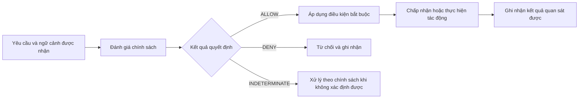

# Privacy decision audit: Kiểm toán quyết định sử dụng dữ liệu riêng tư

## 1. Mục tiêu và phạm vi

**Privacy decision audit** là việc ghi nhận, liên kết và kiểm chứng bằng chứng về các quyết định cho phép, từ chối hoặc chưa thể xác định một lần sử dụng dữ liệu riêng tư. Bằng chứng cần giải thích được quyết định dựa trên ai, mục đích nào, đối tượng nào, chính sách nào và những điều kiện nghiệp vụ nào.

Trong chương **Privacy Rules** của module `SECURITY_APPLICATION_SECURITY_BUSINESS_LOGIC_SECURITY`, audit phục vụ bảo vệ logic nghiệp vụ: phát hiện truy cập sai đối tượng, dùng dữ liệu sai mục đích, bỏ qua phê duyệt, tái sử dụng quyết định cũ hoặc tạo tác động lặp khi retry. Nó cần gắn với business invariants, state machine, transaction và idempotency thay vì chỉ ghi một dòng “đã truy cập”.

Ví dụ, một agent được phép xem trạng thái giao hàng để xử lý case được phân công. Cần biết hệ thống đã kiểm tra case và quyền nào, đã cho xem những trường nào, có áp dụng hạn chế đầu ra không và tác động nào thực sự xảy ra sau quyết định.

Bài học tập trung vào bằng chứng kỹ thuật để kiểm chứng chính sách riêng tư đã được xác lập cho sản phẩm. Việc đặt tên một sự kiện là `privacy.audit` không tự chứng minh chính sách đầy đủ hoặc hệ thống tuân thủ mọi yêu cầu áp dụng.

Sau bài học, bạn cần có khả năng:

- Phân biệt yêu cầu, quyết định, thực thi điều kiện và kết quả sử dụng dữ liệu.
- Thiết kế sự kiện audit đủ để giải thích mà không sao chép dữ liệu riêng tư quá mức.
- Liên kết policy version, ngữ cảnh lịch sử, operation và các lần retry.
- Giữ bằng chứng qua transaction, outbox, hàng đợi và tác động bên ngoài.
- Điều tra quyết định sai hoặc đường thực thi bỏ qua quyết định.
- Kiểm thử độ đầy đủ, tính toàn vẹn và giới hạn quan sát của audit.

## 2. Những câu hỏi audit phải trả lời

### 2.1. Một quyết định cần được giải thích theo ngữ cảnh

| Câu hỏi | Bằng chứng thường cần |
| --- | --- |
| Ai yêu cầu và ai thực thi? | Actor đã xác thực, workload, quan hệ đại diện nếu có |
| Dữ liệu thuộc phạm vi nào? | Tenant, loại đối tượng, định danh nội bộ hoặc tham chiếu giới hạn |
| Dữ liệu được dùng để làm gì? | Mục đích, hành động, case hoặc workflow liên quan |
| Vì sao được cho phép hoặc từ chối? | Policy version, rule ID, reason code, các điều kiện quyết định |
| Quyền trên đối tượng có đúng không? | Phân công, quan hệ sở hữu/ủy quyền và phiên bản ngữ cảnh |
| Có yêu cầu phê duyệt không? | Approval ID, revision, phạm vi và trạng thái được kiểm chứng |
| Điều kiện đầu ra là gì? | Projection, quy tắc che dữ liệu, người nhận, kênh, thời hạn |
| Các điều kiện đã được thực thi chưa? | Sự kiện enforcement và tham chiếu tác động tương ứng |
| Điều gì thực sự xảy ra? | Kết quả đọc, tạo file, phát hành đầu ra hoặc xác nhận từ hệ thống nhận |
| Bằng chứng có đầy đủ không? | Trạng thái thu thập, khoảng trống, lỗi pipeline và giới hạn lưu giữ |

Mã HTTP, vai trò hiện tại hoặc một trường `purpose` do client gửi lên chỉ trả lời được một phần rất nhỏ. Chúng không thay thế chuỗi bằng chứng có thẩm quyền.

### 2.2. Phân biệt audit quyết định và log truy cập

Access log có thể cho biết một request gọi endpoint nào và nhận mã phản hồi gì. Decision audit cần cho biết **quy tắc nào đã được đánh giá trên dữ kiện nào**. Audit kết quả cần cho biết **dữ liệu hoặc tác động nào đã đi qua điểm sử dụng**.

Một sự kiện `ALLOW` không chứng minh dữ liệu đã được đọc hoặc gửi. Một sự kiện `DENY` không chứng minh hệ thống chưa làm gì trước đó. Nếu ứng dụng tải toàn bộ hồ sơ, ghi debug log rồi mới từ chối, dữ liệu đã bị sử dụng ở một đường khác cần được xem xét.

### 2.3. Quyết định đúng và thực thi đúng là hai thuộc tính riêng

Có thể gặp ít nhất bốn trường hợp:

| Quyết định | Thực thi | Ý nghĩa |
| --- | --- | --- |
| Đúng | Đúng | Luồng phù hợp với chính sách đã áp dụng |
| Sai | Theo đúng quyết định sai | Cần sửa logic chính sách hoặc dữ kiện đầu vào |
| Đúng | Bỏ qua điều kiện của quyết định | Cần sửa điểm enforcement hoặc đường truyền ngữ cảnh |
| Không có quyết định hợp lệ | Vẫn có tác động | Có thể tồn tại đường bypass hoặc thiếu bằng chứng cần điều tra |

Trường hợp cuối cần phân biệt bypass thực sự với sự kiện chưa đến kho audit. Không quy kết vi phạm chỉ từ một truy vấn trên dữ liệu đang thu thập dở.

## 3. Mô hình hóa chuỗi bằng chứng

### 3.1. Tách các loại sự kiện

Một chuỗi tối thiểu có thể gồm:



| Sự kiện minh họa | Điều được khẳng định | Điều chưa được khẳng định |
| --- | --- | --- |
| `PRIVACY_REQUEST_RECEIVED` | Hệ thống nhận một yêu cầu | Yêu cầu có hợp lệ hoặc được phép không |
| `PRIVACY_DECISION_EVALUATED` | Engine đã ra kết quả từ bộ dữ kiện được ghi nhận | Tác động đã xảy ra hoặc điều kiện đã được áp dụng |
| `PRIVACY_OBLIGATION_APPLIED` | Một điều kiện cụ thể đã được enforcer áp dụng tại điểm quan sát | Tất cả điều kiện khác đều đã hoàn tất |
| `PRIVACY_EFFECT_RECORDED` | Có một kết quả thực thi được thành phần nguồn quan sát | Mọi hệ thống bên ngoài đều hoàn tất như dự kiến |
| `PRIVACY_EFFECT_RECONCILED` | Một kết quả đã được đối chiếu với nguồn liên quan | Không còn rủi ro ngoài phạm vi đối chiếu |

Tên sự kiện là ví dụ. Điều quan trọng là ngữ nghĩa rõ, có phiên bản và không biến một log ở đầu hàm thành bằng chứng cho kết quả cuối hàm.

### 3.2. Kết quả quyết định cần thể hiện sự không chắc chắn

- `ALLOW`: chính sách cho phép trong phạm vi và các điều kiện đi kèm.
- `DENY`: chính sách từ chối theo dữ kiện đã đánh giá.
- `INDETERMINATE`: không thể xác định vì thiếu hoặc lỗi dữ kiện, dịch vụ chính sách, phiên bản hay ngữ cảnh bắt buộc.

Khi engine timeout, không tạo một bản ghi giả rằng “chính sách cho phép”. Hãy lưu kết quả không xác định và hành vi enforcer đã chọn theo chính sách lỗi, chẳng hạn từ chối export nhạy cảm mới.

Một hệ thống có thể có các trạng thái chi tiết khác, nhưng cần phân biệt được từ chối do chính sách với không thể ra quyết định. Nếu gộp cả hai, đội vận hành khó phát hiện lỗi hạ tầng và người xem audit có thể hiểu sai lý do.

### 3.3. Điều kiện bắt buộc phải được thể hiện riêng

**Obligation** là điều kiện enforcer phải áp dụng nếu muốn sử dụng quyết định `ALLOW`. Ví dụ:

- Chỉ đọc các trường trong projection được phép.
- Che một số giá trị trước khi đưa vào đầu ra.
- Chỉ gửi tới nhóm nhận hoặc kênh đã được duyệt.
- Không xuất quá phạm vi hàng được cấp.
- Yêu cầu phê duyệt còn khớp với dữ liệu ở điểm chấp nhận tác động.

Nếu một obligation bắt buộc không áp dụng được, không được tiếp tục như thể `ALLOW` là quyền vô điều kiện. Audit cần thể hiện obligation thất bại và kết quả thực tế của operation.

Thông tin “đã che dữ liệu” cần gắn với đầu ra hoặc bước xử lý cụ thể. Che ở giao diện không chứng minh file export, log hoặc message downstream cũng đã được che.

## 4. Thiết kế nội dung sự kiện audit

### 4.1. Những trường cốt lõi

| Nhóm | Ví dụ trường | Lưu ý |
| --- | --- | --- |
| Định danh sự kiện | `event_id`, `event_type`, `schema_version` | ID ổn định qua các lần giao lại cùng sự kiện |
| Nguồn và thời gian | `producer`, `occurred_at`, `observed_at` | Thời gian nhận không đồng nghĩa thời gian xảy ra |
| Liên kết xử lý | `request_id`, `attempt_id`, `operation_id`, `decision_id` | Mỗi loại ID có ngữ nghĩa riêng |
| Chủ thể | `actor_ref`, `workload_id`, `delegation_ref` | Lấy từ ngữ cảnh đã xác thực |
| Phạm vi | `tenant_id`, `object_type`, `object_ref` | Không tin tenant tùy ý từ client |
| Mục đích và hành động | `purpose_code`, `action`, `recipient_scope` | Phải khớp tác động đang thực hiện |
| Cơ sở quyết định | `policy_version`, `rule_ids`, `reason_codes`, `input_evidence_refs` | Giữ đủ lịch sử để giải thích |
| Giới hạn sử dụng | `obligations`, `fieldset_id`, `approval_ref` | Tách yêu cầu với kết quả áp dụng |
| Kết quả | `decision_result`, `effect_outcome`, `error_class` | Không gộp kết quả engine với kết quả nghiệp vụ |

Các tham chiếu giả danh và định danh nội bộ vẫn có thể liên kết tới một người. Chúng giúp hạn chế lộ trực tiếp, không mặc nhiên khiến audit trở thành dữ liệu vô danh.

### 4.2. Ví dụ sự kiện quyết định

```json
{
  "schema_version": 1,
  "event_id": "event-decision-291",
  "event_type": "PRIVACY_DECISION_EVALUATED",
  "producer": "support-api",
  "occurred_at": "2026-10-05T09:00:00.120Z",
  "observed_at": "2026-10-05T09:00:00.180Z",
  "tenant_id": "tenant-demo",
  "actor_ref": "agent-17",
  "workload_id": "support-api",
  "request_id": "request-902",
  "attempt_id": "attempt-1",
  "operation_id": "operation-504",
  "decision_id": "decision-291",
  "purpose_code": "DELIVERY_EXCEPTION_SUPPORT",
  "action": "VIEW_DELIVERY_CONTEXT",
  "object_type": "ORDER",
  "object_ref": "order-781",
  "context_ref": "case-813",
  "context_revision": 8,
  "policy_version": "delivery-support-6",
  "decision_result": "ALLOW",
  "rule_ids": ["assigned-agent-open-case"],
  "reason_codes": ["CONTEXT_AND_SCOPE_VALID"],
  "input_evidence_refs": [
    "case-813@8",
    "agent-assignment-42@3",
    "purpose-catalog@12"
  ],
  "obligations": [
    {
      "obligation_id": "fieldset",
      "profile": "support-delivery-v3"
    },
    {
      "obligation_id": "recipient",
      "scope": "ASSIGNED_SUPPORT_CONSOLE"
    }
  ]
}
```

`operation_id` có thể được cấp để liên kết xử lý trước khi operation được chấp nhận. Bản thân sự tồn tại của ID trong audit không chứng minh có một giao dịch nghiệp vụ đã commit.

Projection `support-delivery-v3` phải có định nghĩa bất biến theo phiên bản, chẳng hạn chỉ gồm mã đơn, trạng thái giao và khu vực cần cho công việc. Nếu định nghĩa profile thay đổi tại chỗ mà giữ nguyên ID, audit lịch sử sẽ không còn giải thích được tập dữ liệu đã cho phép.

### 4.3. Liên kết với kết quả thực thi

Một sự kiện sau đó có thể ghi:

```json
{
  "schema_version": 1,
  "event_id": "event-effect-612",
  "event_type": "PRIVACY_EFFECT_RECORDED",
  "producer": "support-api",
  "tenant_id": "tenant-demo",
  "operation_id": "operation-504",
  "decision_id": "decision-291",
  "purpose_code": "DELIVERY_EXCEPTION_SUPPORT",
  "action": "VIEW_DELIVERY_CONTEXT",
  "object_type": "ORDER",
  "object_ref": "order-781",
  "effect_outcome": "RESPONSE_EMITTED",
  "applied_fieldset": "support-delivery-v3",
  "recipient_scope": "ASSIGNED_SUPPORT_CONSOLE",
  "obligation_event_refs": ["event-obligation-610", "event-obligation-611"],
  "occurred_at": "2026-10-05T09:00:00.145Z"
}
```

`RESPONSE_EMITTED` cần được định nghĩa là mốc thành phần nguồn quan sát được, ví dụ đã chuyển response sang tầng vận chuyển. Nó không chứng minh người dùng đã nhận, mở hoặc đọc mọi dữ liệu.

Với file export hoặc gửi tới nhà cung cấp, dùng outcome phù hợp như đã tạo file, đã cấp quyền tải, nhà cung cấp đã nhận hoặc đã đối soát. Không dùng một nhãn `SUCCESS` chung để che các ranh giới khác nhau.

### 4.4. Không sao chép toàn bộ dữ liệu để chứng minh quyết định

Ưu tiên lưu kết quả điều kiện và tham chiếu phiên bản, chẳng hạn case đang xử lý, actor được phân công và profile dữ liệu được phép. Nếu cần snapshot để giải thích một quyết định, chỉ giữ các dữ kiện cần thiết theo chính sách truy cập và lưu giữ riêng.

Không đưa token, cookie, mật khẩu, số thẻ, toàn bộ địa chỉ, nội dung trao đổi riêng tư hoặc payload không kiểm soát vào audit. Một mã băm cũng không luôn an toàn: giá trị đầu vào ít khả năng có thể bị thử đoán, còn một mã ổn định có thể cho phép liên kết nhiều bản ghi.

Các trường văn bản tự do từ client phải được coi là dữ liệu không đáng tin cậy. Ghi có cấu trúc, giới hạn kích thước và xử lý ký tự điều khiển phù hợp để tránh giả dòng log hoặc làm hỏng hệ thống tra cứu.

## 5. Giữ được căn cứ lịch sử của quyết định

### 5.1. Phiên bản chính sách phải trỏ tới nội dung xác định

Để giải thích một quyết định, cần tìm được bộ quy tắc, profile dữ liệu và cấu hình đã được dùng tại lúc đánh giá. Chỉ lưu chuỗi `policy-v6` sẽ không đủ nếu nội dung mang tên đó bị ghi đè sau triển khai.

Những phụ thuộc ảnh hưởng quyết định cũng cần được nhận diện: phiên bản danh mục mục đích, mô hình quyền, logic evaluator, feature flag và cách hiểu dữ kiện đầu vào. Khi quyết định phụ thuộc vào dịch vụ bên ngoài, cần giữ bằng chứng tối thiểu phù hợp về kết quả đã được dùng.

Không phải lúc nào cũng có thể chạy lại chính xác quyết định cũ. Nếu thiếu snapshot, phiên bản nguồn hoặc phụ thuộc không còn tái tạo được, audit phải thể hiện giới hạn đó. Tham chiếu một bản ghi hiện tại không thay thế trạng thái lịch sử đã mất.

### 5.2. Dữ kiện cần phản ánh thời điểm đánh giá

Ví dụ agent hiện không còn được phân công case không chứng minh lần truy cập hôm qua trái quyền. Ngược lại, agent hiện được phân công không làm một lần đọc trái quyền trước đó trở nên hợp lệ.

Các dữ kiện như trạng thái case, quan hệ phân công, phạm vi approval và điều kiện sử dụng dữ liệu phải có lịch sử hoặc bằng chứng phiên bản đủ dùng. Cần phân biệt:

- Dữ kiện nào engine thực sự nhận được khi đánh giá.
- Dữ kiện nào đã tồn tại tại nguồn lúc đó.
- Dữ kiện nào chỉ được phát hiện hoặc sửa sau này.

Engine có thể áp dụng đúng quy tắc trên dữ kiện cache cũ nhưng tạo kết quả không đáp ứng hợp đồng hiệu lực của sản phẩm. Audit cần giúp xác định vấn đề nằm ở chính sách, nguồn dữ kiện hay cơ chế đồng bộ.

### 5.3. Bổ sung sự kiện thay vì sửa lại lịch sử

Quyết định đã ghi nên được giữ như một sự kiện về điều hệ thống đã đánh giá lúc đó. Khi đánh giá lại, tạo `decision_id` mới và liên kết với quyết định trước. Khi phát hiện dữ liệu sai, ghi sự kiện sửa chính với lý do và tham chiếu liên quan.

Không đổi một bản ghi `ALLOW` thành `DENY` để lịch sử trông như đã xử lý đúng. Cũng không xóa kết quả lỗi rồi chỉ giữ lần retry thành công. Cần thấy được cả diễn biến và kết quả cuối cùng.

“Không sửa tại chỗ” không có nghĩa lưu mọi dữ liệu audit mãi mãi. Chính sách thời hạn, ngừng lưu và xử lý dữ liệu vẫn cần được áp dụng; thiết kế phải giữ được ý nghĩa của lịch sử và ghi rõ giới hạn sau khi dữ liệu hết thời hạn.

### 5.4. Quyết định audit không phải giấy phép tái sử dụng

Client hoặc worker không được tự đưa một `decision_id` cũ vào request để có quyền dùng dữ liệu mới. Enforcer cần xác minh nguồn quyết định, phạm vi tenant, actor/workload, hành động, đối tượng, người nhận, thời hạn và những điều kiện còn phải đúng tại lúc dùng.

Nếu hệ thống dùng decision token làm capability, phải thiết kế cơ chế xác thực và giới hạn của capability đó. Bản ghi audit chỉ chứng minh một quyết định từng tồn tại, không mặc nhiên là một capability hợp lệ.

## 6. Ghi audit cùng vòng đời transaction và tác động

### 6.1. Những khoảng hở thường gặp

| Cách ghi | Rủi ro về bằng chứng |
| --- | --- |
| Log “thành công” trước commit | Transaction có thể rollback nhưng audit trông như đã có tác động |
| Commit tác động rồi mới gửi log không bền vững | Tiến trình dừng có thể làm mất kết quả audit |
| Gửi dữ liệu ra ngoài rồi mới kiểm tra quyền | Sự kiện từ chối không ngăn tác động đã xảy ra |
| Ghi audit trong transaction rồi rollback toàn bộ khi từ chối | Có thể mất bằng chứng của lần từ chối |
| Dùng bộ đệm trong bộ nhớ rồi coi là đã lưu bền vững | Dừng tiến trình có thể tạo khoảng trống không được nhận diện |

Cần định nghĩa chính xác mỗi điểm ghi và mức bảo đảm của nó. Không dùng một thông điệp chung “audit đã bật” để thay cho thiết kế này.

### 6.2. Với operation có thay đổi dữ liệu nội bộ

Một mô hình dùng transactional outbox có thể là:

```text
Nhận và kiểm chứng yêu cầu, cấp các định danh liên kết cần thiết
Đánh giá chính sách trên ngữ cảnh có thẩm quyền

BEGIN TRANSACTION
    Phối hợp hoặc kiểm tra lại các revision quan trọng tại điểm chấp nhận
    Nếu điều kiện thay đổi: đánh giá lại hoặc từ chối theo thiết kế
    Xác minh và áp dụng các obligation bắt buộc cho bước này

    Ghi operation và thay đổi nghiệp vụ được chấp nhận
    Ghi tham chiếu quyết định, policy version và phạm vi sử dụng
    Ghi sự kiện OPERATION_ACCEPTED vào outbox
COMMIT

Publisher phát sự kiện outbox với event_id ổn định
Consumer nhận và chuẩn hóa bằng chứng, xử lý giao trùng
```

Mô hình này gắn bản ghi chấp nhận nội bộ với sự kiện cần phát trong cùng transaction. Nó không làm việc ghi vào kho audit từ xa hoặc tác động ở nhà cung cấp bên ngoài trở thành nguyên tử với transaction đó.

Sự kiện đánh giá chính sách có thể tồn tại dù transaction nghiệp vụ sau đó rollback. Điều đó hợp lệ nếu sự kiện chỉ khẳng định “đã đánh giá”, còn audit chấp nhận hoặc kết quả thể hiện đúng chuyện xảy ra sau đó.

Nếu quyết định được tính bên ngoài transaction, cần xử lý các dữ kiện có thể đổi trước commit. Không lưu một decision reference rồi mặc định mọi điều kiện đã được bảo vệ.

### 6.3. Với đọc hoặc cung cấp dữ liệu

Đường đọc không phải lúc nào cũng có một transaction ghi nghiệp vụ để gắn outbox. Đối với lần cung cấp dữ liệu nhạy cảm cần audit bền vững, có thể thiết kế các mốc:

1. Ra quyết định trên ngữ cảnh được kiểm chứng.
2. Lưu bền vững quyết định hoặc ý định sử dụng tối thiểu trước bước sử dụng yêu cầu bằng chứng đó.
3. Đọc projection được phép, áp dụng điều kiện đầu ra.
4. Ghi nhận trạng thái sẵn sàng cung cấp theo cơ chế bảo đảm đã chọn.
5. Cung cấp dữ liệu và ghi kết quả quan sát được.

Một bản ghi “đã sẵn sàng cung cấp” không được đặt tên thành “người dùng đã nhận”. Không thể mặc định việc commit log và truyền response qua mạng là một hành động nguyên tử.

Nếu tiến trình dừng giữa các mốc, audit có thể chỉ chứng minh ý định hoặc một kết quả chưa xác định. Cần giữ trạng thái đó để đối chiếu, thay vì tự điền thành công hoặc thất bại chắc chắn.

### 6.4. Khi hạ tầng audit hoặc chính sách gặp lỗi

Phân biệt lỗi engine chính sách với lỗi lưu audit. Engine có thể ra `ALLOW` nhưng đường lưu bằng chứng bắt buộc không sẵn sàng; sản phẩm cần quy định có được tiếp tục hành động đó không.

Với export hoặc chuyển dữ liệu nhạy cảm, chính sách có thể yêu cầu từ chối tác động mới khi chưa lưu được bằng chứng bắt buộc. Các hành động ít rủi ro hơn có thể có cơ chế đệm bền vững hoặc chính sách tiếp tục khác. Quyết định này phải được xác định trước theo hành động, không dùng một lựa chọn ngầm cho toàn hệ thống.

Nếu phải phục hồi bằng chứng sau lỗi, ghi rõ nguồn, khoảng thời gian và mức độ chắc chắn. Không dựng lại các quyết định cụ thể từ số đếm tổng rồi trình bày như log nguyên gốc.

## 7. Liên kết retry, job và thứ tự sự kiện

### 7.1. Phân biệt các định danh

- `request_id` nhận diện một lần yêu cầu ở lớp vận chuyển; giá trị do client cấp không phải bằng chứng danh tính.
- `attempt_id` phân biệt các lần thử xử lý.
- `operation_id` liên kết công việc nghiệp vụ, có thể trải qua nhiều attempt.
- `decision_id` nhận diện một lần đánh giá chính sách.
- `event_id` nhận diện một sự kiện audit, giữ nguyên khi chính sự kiện đó được giao lại.
- `job_id` hoặc reference ngoài liên kết bước bất đồng bộ và tác động ở hệ thống nhận.

Một operation có thể có nhiều decision: quyết định lúc tạo, lúc worker thực thi và lúc người dùng tải kết quả. Đừng loại trùng theo operation ID rồi chỉ giữ một quyết định cuối cùng.

### 7.2. Loại trùng sự kiện không phải loại trùng diễn biến

Publisher có thể gửi lại cùng sự kiện sau khi mất acknowledgment. Kho audit nên nhận diện cùng `event_id` trong phạm vi nguồn phát đã quy định để không đếm hai lần. Tuy nhiên, hai attempt khác nhau với hai decision ID là hai lần đánh giá cần giữ, dù cùng request hoặc operation.

Raw idempotency key có thể chứa dữ liệu caller tự chọn. Audit thường chỉ cần tham chiếu được thiết kế an toàn, có phạm vi tenant và cơ chế quản lý tương ứng. Nếu dùng giá trị dẫn xuất bằng khóa để liên kết, cần quản lý phiên bản khóa và quyền truy cập; giá trị đó vẫn có thể là dữ liệu liên kết nhạy cảm.

Retry trả kết quả operation cũ không được tạo thêm export hoặc gửi thông báo lần nữa. Quyền đọc kết quả hiện tại cũng cần được kiểm tra và có audit theo hành động đọc tương ứng.

### 7.3. Job phải ghi được quyết định tại điểm sử dụng

Job cần liên kết quyết định đã chấp nhận công việc với các quyết định thực thi sau đó. Nếu case đóng, purpose bị đình chỉ hoặc người nhận thay đổi, audit phải thể hiện worker xử lý theo hợp đồng nào: tiếp tục một tác động đã cam kết, đánh giá lại, hủy hoặc chuyển xem xét.

Một sự kiện từ lúc enqueue không đủ chứng minh điều kiện còn đúng khi dựng file hoặc gửi dữ liệu. Khi có đánh giá lại, tạo decision ID mới và giữ liên kết tới decision trước cùng operation.

### 7.4. Không suy thứ tự nhân quả chỉ từ timestamp

Thời gian nguồn có thể lệch giữa dịch vụ; sự kiện đến kho có thể bị đảo thứ tự. `observed_at` cho biết lúc được nhận, không tự chứng minh thứ tự tác động.

Dùng quan hệ cha–con, operation, transaction reference, revision và sequence có ngữ nghĩa được thiết kế. Một số tăng dần ở một producer không tạo ra thứ tự commit toàn cục giữa mọi dịch vụ. Nếu hệ thống có khoảng trống sequence hợp lệ, phải phân biệt chúng với mất sự kiện.

Khi dựng dòng thời gian, ghi rõ mốc đã được xác nhận và mốc còn suy luận. Không sửa timestamp để ép các sự kiện khớp một câu chuyện điều tra có sẵn.

## 8. Đối chiếu quyết định với tác động thực tế

### 8.1. Tìm kết quả không nối được với quyết định phù hợp

Giả sử kho điều tra có hai view đã chuẩn hóa và loại trùng theo định danh sự kiện. `privacy_decision_view` chứa kết quả đánh giá; `privacy_effect_view` chứa các tác động quan sát được. Những trường được so sánh dưới đây là bắt buộc, không null theo schema minh họa.

```sql
SELECT
    e.event_id,
    e.operation_id,
    e.decision_id,
    e.action,
    e.object_ref,
    e.effect_outcome,
    d.decision_result
FROM privacy_effect_view e
LEFT JOIN privacy_decision_view d
  ON d.tenant_id = e.tenant_id
 AND d.decision_id = e.decision_id
WHERE e.tenant_id = :tenant_id
  AND e.occurred_at >= :window_start_utc
  AND e.occurred_at < :window_end_utc
  AND e.effect_outcome IN (
      'RESPONSE_EMITTED',
      'EXPORT_PUBLISHED',
      'PROVIDER_ACCEPTED'
  )
  AND (
      d.decision_id IS NULL
      OR d.decision_result <> 'ALLOW'
      OR d.operation_id <> e.operation_id
      OR d.action <> e.action
      OR d.object_type <> e.object_type
      OR d.object_ref <> e.object_ref
      OR d.purpose_code <> e.purpose_code
  );
```

Các placeholder phải được bind bằng cơ chế tham số của công cụ sử dụng. Phạm vi truy vấn và quyền người điều tra cần được kiểm tra, không lấy tenant tùy ý từ một giao diện tra cứu chung.

Không giới hạn quyết định vào cùng cửa sổ ngắn với effect: một job có thể được chấp nhận trước cửa sổ khảo sát. Ngoài ra, thời hạn lưu khác nhau giữa các view hoặc dữ liệu thu thập chậm có thể làm phép join không tìm thấy quyết định.

Kết quả truy vấn là danh sách cần xác minh, chưa phải danh sách vi phạm đã kết luận. Cần kiểm tra nguồn gốc, độ trễ thu thập, dữ liệu hết thời hạn và những decision có hiệu lực cho đúng giai đoạn thực thi.

### 8.2. Có ALLOW khớp vẫn chưa đủ

Sau khi nối được decision, cần kiểm tra:

- Các obligation bắt buộc có bằng chứng áp dụng thành công tại đúng điểm sử dụng không.
- Trường dữ liệu thực tế có nằm trong phạm vi được cấp không.
- Người nhận và kênh có khớp phạm vi cho phép không.
- Điều kiện ngữ cảnh có còn được giữ theo hợp đồng lúc chấp nhận tác động không.
- Approval có ràng buộc đúng tập dữ liệu, mục đích và người nhận không.

Hai fieldset ID khác nhau chưa tự chứng minh lộ dữ liệu; đầu ra có thể là một tập con hẹp hơn hợp lệ. Cần so ngữ nghĩa của các profile theo phiên bản, không chỉ so chuỗi tên.

Ngược lại, cùng một profile ID cũng không chứng minh dữ liệu thực tế đúng nếu serializer hoặc exporter đã bỏ qua profile. Có thể cần kiểm thử enforcer, manifest đầu ra hoặc bằng chứng được kiểm soát khác để xác minh.

### 8.3. Xác định nguyên nhân theo tầng

| Quan sát | Những giả thuyết cần kiểm tra |
| --- | --- |
| Effect chưa có decision | Thu thập chậm, mất sự kiện, hết hạn dữ liệu hoặc đường bypass |
| Decision cho phép sai đối tượng | Tenant/đối tượng từ client bị tin nhầm, lỗi join hoặc dữ kiện sai |
| Decision đúng nhưng trường đầu ra quá rộng | Sai projection, serialize entity đầy đủ hoặc dùng exporter khác |
| Worker dùng quyết định cũ | Thiếu đánh giá lại, cache cũ hoặc hợp đồng hiệu lực không được thực thi |
| Một operation có nhiều tác động ngoài | Lỗi idempotency, retry sau timeout hoặc đối soát thiếu |
| Nhiều `INDETERMINATE` | Lỗi phụ thuộc, thiếu phiên bản hoặc dữ kiện không còn truy xuất được |

Kết luận nên tách quan sát, suy luận và điều đã xác nhận. Nếu chỉ chứng minh được một khoảng trống bằng chứng, hãy ghi đúng khoảng trống đó cùng bước xác minh tiếp theo.

## 9. Bảo vệ chính hệ thống audit

### 9.1. Kiểm soát nguồn ghi và người đọc

Nguồn phát sự kiện cần được xác thực và chỉ được ghi những loại sự kiện trong phạm vi được cấp. Dịch vụ thu thập nên kiểm tra schema, kích thước, trường bắt buộc và quan hệ với danh tính nguồn phát. Không cho client gửi một JSON `ALLOW` rồi lưu nó như quyết định đáng tin cậy của engine.

Các trường như actor, tenant hoặc policy version phải có nguồn rõ ràng. Việc sự kiện được gửi từ một workload đã xác thực không tự chứng minh mọi giá trị trong payload đều đã được kiểm chứng; producer cũng phải được thiết kế đúng.

Quyền ghi audit nên tách khỏi quyền sửa hoặc xóa. Quyền đọc cần theo tenant, loại hồ sơ, nhiệm vụ điều tra và phạm vi dữ liệu. Người xem dashboard tổng hợp không nhất thiết được xem toàn bộ định danh hoặc bằng chứng riêng tư.

Việc đọc và export audit cũng là hành động sử dụng dữ liệu cần được cấp quyền và ghi nhận phù hợp. Không ghi lại nguyên kết quả tra cứu vào một log truy cập audit khác rồi tạo thêm bản sao ngoài quản lý.

### 9.2. Tính toàn vẹn, tính đầy đủ và tính đúng là ba điều khác nhau

- **Toàn vẹn:** sự kiện đã lưu có bị thay đổi trái phép không.
- **Đầy đủ:** những sự kiện cần có có được ghi và thu thập đủ trong phạm vi đã xác định không.
- **Đúng:** nội dung sự kiện có phản ánh chính xác điều hệ thống đã đánh giá và thực hiện không.

Có thể dùng quyền chỉ ghi thêm, lưu trữ chống sửa theo cấu hình, checksum, chữ ký hoặc chuỗi băm để hỗ trợ phát hiện thay đổi. Nếu dùng chuỗi băm, cần thiết kế thứ tự trong từng luồng, checkpoint và cơ chế bảo vệ điểm neo; không mặc định có một chuỗi toàn cục cho mọi producer.

Checksum của bản export audit chỉ giúp kiểm tra thay đổi sau khi lấy bản đó. Chữ ký hợp lệ cho biết nội dung được ký bởi một khóa trong mô hình tin cậy; nó không tự chứng minh producer không bị lỗi hoặc bị chiếm quyền. Một chuỗi băm vẫn không cho biết sự kiện chưa bao giờ được tạo có bị thiếu hay không.

Do đó, cần đối chiếu thêm với operation, dữ liệu đã commit, outbox, hệ thống nhận và các nguồn quan sát độc lập phù hợp. Không dựa vào duy nhất lời tự khai “đã áp dụng chính sách” của đoạn code đang bị nghi ngờ bỏ qua chính sách.

### 9.3. Hạn chế dữ liệu nhạy cảm trong mọi nhánh lỗi

Lọc dữ liệu ở sự kiện chính chưa đủ nếu exception log, dead-letter queue hoặc thông báo lỗi chứa payload gốc. Cần xem cả đường validation thất bại, retry, debug và công cụ hỗ trợ.

Các tham chiếu bằng chứng chi tiết phải được tra qua quyền riêng; không đưa đường dẫn công khai hoặc link tải lâu dài vào sự kiện mà nhiều người có thể đọc. Tài khoản producer cũng không nên có quyền đọc ngược toàn bộ kho audit chỉ vì cần ghi sự kiện.

## 10. Lưu giữ, sửa chính và vận hành audit

### 10.1. Giữ bằng chứng theo chính sách cụ thể

Mỗi nhóm audit cần thời hạn và mục đích lưu rõ ràng. Các bản sao, index tìm kiếm, file trích xuất và backup phải có vòng đời tương ứng; không chỉ dọn bảng chính rồi để các bản sao tồn tại không kiểm soát.

Lưu định nghĩa policy và bằng chứng ngữ cảnh cần đủ để giải thích những sự kiện còn trong phạm vi kiểm toán. Nếu một phần bằng chứng đã hết thời hạn, hồ sơ phải thể hiện rằng khả năng giải thích hoặc tái hiện đã bị giới hạn.

Với sự kiện xóa hoặc hạn chế dữ liệu, audit có thể cần giữ kết quả, phạm vi và tham chiếu tối thiểu mà không giữ lại toàn bộ dữ liệu đã xử lý. Tham chiếu giả danh vẫn cần được đánh giá và quản lý theo khả năng liên kết; không coi nó là một lý do tự động để lưu vô hạn.

### 10.2. Khi phát hiện quyết định sai

Một quy trình xử lý có thể gồm:

1. Giữ các bằng chứng liên quan theo phạm vi và quyền điều tra được cấp.
2. Xác định rule, phiên bản, dữ kiện hoặc enforcer gây sai lệch.
3. Khoanh vùng các operation có cùng điều kiện, tách tác động đã xác nhận với nguy cơ.
4. Hạn chế đường tiếp tục sử dụng dữ liệu nếu rủi ro còn tiếp diễn.
5. Sửa chính sách hoặc code, kiểm thử tình huống gây lỗi và luồng hợp lệ.
6. Ghi sự kiện sửa chính, kết quả đối chiếu và phần chưa xác định.

Đánh giá lại lịch sử có hai câu hỏi khác nhau: “Theo dữ kiện và chính sách lúc đó, engine có quyết định đúng không?” và “Theo chính sách hiện tại, hành động tương tự có được phép không?”. Không lấy câu trả lời của câu thứ hai để viết lại câu thứ nhất.

Nếu chạy lại evaluator, dùng môi trường chỉ đánh giá và không tạo tác động nghiệp vụ. Nêu rõ những dữ kiện được tái tạo, những dữ kiện chỉ xấp xỉ và giới hạn của kết quả.

### 10.3. Chỉ số cần phản ánh cả chất lượng bằng chứng

Những chỉ số hữu ích gồm:

- Tỷ lệ tác động quan sát được nối được với decision đúng phạm vi và giai đoạn.
- Tỷ lệ obligation bắt buộc có bằng chứng áp dụng hoặc có lỗi rõ ràng.
- Độ trễ từ sự kiện nguồn đến kho audit, số sự kiện chờ và lỗi thu thập.
- Số decision `INDETERMINATE`, nguyên nhân và hành vi enforcer tương ứng.
- Số lần trùng sự kiện, thiếu liên kết hoặc thiếu phiên bản chính sách.
- Số operation có tác động ngoài không khớp hợp đồng idempotency.

Đếm decision sau loại trùng sự kiện, nhưng không loại bỏ các attempt đánh giá thật. Tách tỷ lệ theo attempt với tỷ lệ theo operation để tránh hiểu sai khi retry tăng mạnh.

Tỷ lệ coverage chỉ phản ánh tập tác động mà hệ thống quan sát được. Nếu một đường sử dụng dữ liệu hoàn toàn không phát effect event, nó có thể không nằm trong mẫu số. Cần đối chiếu các nguồn khác và kiểm thử độ bao phủ, thay vì kết luận đầy đủ từ một chỉ số đẹp.

Các dashboard tổng hợp nên dùng chiều có số lượng giá trị được kiểm soát như loại hành động, kết quả và nhóm lỗi. Để định danh chi tiết trong hệ thống log/truy vết được phân quyền thay vì gắn mọi customer ID vào nhãn time series.

## 11. Ca minh họa: export được yêu cầu trước khi case đóng

### 11.1. Chính sách của ví dụ

Agent `agent-17` được phân công case giao hàng `case-813` của `order-781`, thuộc `tenant-demo`. Sản phẩm cho phép export một bản tóm tắt để chuyển cấp xử lý, với các điều kiện:

- Mục đích là `DELIVERY_EXCEPTION_SUPPORT`.
- Agent có quyền export và case còn ở trạng thái được xử lý.
- Có phê duyệt khớp phạm vi export và nhóm nhận.
- File chỉ chứa mã đơn và trạng thái giao theo profile `support-summary-v2`.
- Trước khi dùng dữ liệu để dựng và phát hành file, worker phải kiểm tra lại các điều kiện được quy định.

Hợp đồng ví dụ không coi enqueue là đã cam kết phát hành dữ liệu. Nếu case đóng trước bước thực thi, export đang chờ phải dừng. Một sản phẩm có ranh giới cam kết khác cần được đánh giá theo hợp đồng riêng của nó.

### 11.2. Chuỗi bằng chứng đúng

| Thời điểm | Sự kiện | Bằng chứng và ý nghĩa |
| --- | --- | --- |
| 09:00:00 | Agent yêu cầu export | Có request, actor/workload và ngữ cảnh case revision 8 |
| 09:00:01 | Decision A cho phép ở bước chấp nhận yêu cầu | Policy version, approval revision và obligation được ghi |
| 09:00:02 | Operation được chấp nhận, outbox commit | Công việc đã được xếp xử lý; chưa có file phát hành |
| 09:01:00 | Case đóng, chuyển revision 9 | Có lịch sử trạng thái và thời điểm thay đổi |
| 09:02:00 | Worker đánh giá tại bước thực thi | Decision B từ chối với lý do case không còn đủ điều kiện |
| 09:02:01 | Job bị hủy theo chính sách | Có outcome hủy; không phát hành file hoặc link tải |

Đối với workflow nhiều giai đoạn, schema cần ghi được giai đoạn đánh giá, chẳng hạn `REQUEST_ACCEPTANCE` và `EXPORT_EXECUTION`, hoặc một biểu diễn tương đương. Cả hai decision phải liên kết tới cùng operation nhưng có định danh riêng.

Decision A không nhất thiết sai: nó cho phép chấp nhận yêu cầu theo trạng thái lúc đó. Decision B thể hiện việc xét lại điều kiện ở giai đoạn khác. Nếu chỉ giữ một bản ghi cuối hoặc gộp tất cả thành `operation=DENY`, người điều tra sẽ mất diễn biến cần giải thích.

### 11.3. Nhánh lỗi cần phát hiện

Giả sử worker bỏ bước xét lại và dùng Decision A để phát hành file sau khi case đã đóng. Phép join đơn giản vẫn có thể tìm được một `ALLOW` cùng đối tượng và mục đích. Cần kiểm tra thêm decision có đúng giai đoạn, còn được sử dụng theo hợp đồng và có bằng chứng điều kiện ở điểm thực thi không.

Một nhánh lỗi khác là exporter thêm số điện thoại vào file dù decision chỉ cho hai trường. Nếu exporter vẫn tự ghi `applied_fieldset=support-summary-v2`, log của nó không đủ để bác bỏ lộ dữ liệu. Cần kiểm tra bộ tạo file, manifest hoặc bằng chứng đầu ra trong phạm vi được cấp, đồng thời có kiểm thử xác minh schema dữ liệu xuất.

Khi kết luận, ghi riêng:

- Điều kiện hoặc obligation bị vi phạm.
- Tác động đã được xác nhận: file đã tạo, đã công bố quyền tải hay đã được tải.
- Những người nhận hoặc bản sao đã xác định.
- Phần chưa biết, chẳng hạn chưa có bằng chứng file được mở.
- Biện pháp hạn chế tiếp diễn và sửa chữa cơ chế gây lỗi.

Không biến “link đã tạo” thành “khách hàng đã bị lộ toàn bộ dữ liệu”, cũng không coi “chưa thấy download log” là bằng chứng file chưa từng được lấy nếu hệ thống không quan sát đầy đủ đường tải.

## 12. Kiểm thử độ đúng và độ đầy đủ của audit

### 12.1. Ma trận tình huống

| Tình huống | Điều cần kiểm chứng |
| --- | --- |
| Request hợp lệ, policy cho phép | Có decision đúng tenant, đối tượng, mục đích và phiên bản |
| Request bị từ chối | Giữ được lý do và bằng chứng tối thiểu, không mất do rollback |
| Engine timeout hoặc thiếu dữ kiện | Ghi `INDETERMINATE` và hành vi thật, không giả thành `ALLOW` |
| ALLOW có obligation nhưng áp dụng thất bại | Không tiếp tục tác động trái điều kiện; audit thể hiện thất bại |
| Transaction rollback sau khi đánh giá | Không xuất hiện bằng chứng commit thành công giả |
| Commit xong thì tiến trình dừng trước lúc phát sự kiện | Outbox giữ được sự kiện cần phát theo thiết kế |
| Publisher gửi lại cùng event | Loại trùng sự kiện mà vẫn giữ đủ lần thử nghiệp vụ khác nhau |
| Worker nhận lại cùng job | Không tạo tác động lặp; liên kết được attempt, decision và operation |
| Case đóng giữa enqueue và thực thi | Có quyết định đúng giai đoạn và kết quả theo hợp đồng |
| Caller tái sử dụng decision ID cho đối tượng khác | Bị từ chối, không dùng audit record như giấy phép chung |
| Retry đọc kết quả operation cũ | Kiểm tra quyền đọc hiện tại; không thực hiện lại export |
| Client giả actor, tenant hoặc purpose trong payload audit | Nguồn được kiểm chứng hoặc sự kiện bị từ chối/phân loại không tin cậy |
| Sự kiện đến đảo thứ tự | Dựng được liên kết mà không bịa thứ tự nhân quả |
| Kho thu thập có độ trễ | Báo trạng thái bằng chứng đang chờ, không kết luận bypass vội |
| Profile hoặc policy bị sửa dưới cùng ID | Phát hiện hoặc ngăn thay đổi làm mất ý nghĩa lịch sử |
| File chứa trường ngoài phạm vi cho phép | Kiểm tra đầu ra thực tế, không chỉ nhãn fieldset producer tự ghi |
| Lỗi sinh exception hoặc dead-letter message | Không rò payload riêng tư, token hoặc bí mật vào nhánh lỗi |
| Người đọc audit không có quyền tenant | Không trả dữ liệu hoặc cho export trái phạm vi |
| Bằng chứng hết thời hạn lưu | Thể hiện giới hạn tra cứu/tái hiện, không giả vờ còn đầy đủ |
| Kho audit không sẵn sàng | Thực thi đúng chính sách lỗi theo loại hành động |

### 12.2. Xác minh tới nơi tạo tác động

Kiểm thử nên quan sát cả dữ liệu đã commit, outbox, kho audit và hệ thống nhận giả lập. Với export, kiểm tra nội dung file và quyền tải. Với gửi thông báo, kiểm tra số lần gửi, người nhận và loại dữ liệu được chuyển.

Các ca crash cần được đặt tại mốc có ý nghĩa: trước commit, sau commit trước publish, sau khi gửi ra ngoài nhưng trước khi ghi kết quả. Khi một mốc không thể xác định chắc chắn, audit phải giữ được trạng thái chưa rõ và đường đối soát phù hợp.

Các ca đồng thời nên điều khiển được thứ tự giữa thay đổi ngữ cảnh và điểm chấp nhận tác động. Việc mọi lần chạy ngẫu nhiên đều tạo log không đủ chứng minh không có cửa sổ mất bằng chứng hoặc dùng quyết định cũ.

### 12.3. Kiểm thử khả năng giải thích

Chọn một operation mẫu và yêu cầu dựng lại câu trả lời chỉ từ các bằng chứng được lưu:

```text
Ai và workload nào yêu cầu?
Đối tượng, tenant, mục đích và hành động là gì?
Policy và dữ kiện phiên bản nào đã được dùng?
Điều kiện bắt buộc là gì và đã được áp dụng ở đâu?
Mỗi giai đoạn có quyết định nào?
Tác động nào đã xác nhận, tác động nào còn chưa rõ?
Có khoảng trống nào do thu thập, lưu giữ hoặc nguồn quan sát không?
```

Nếu phải hỏi tác giả code nhớ lại cấu hình hôm đó hoặc tìm dữ liệu đã bị ghi đè, thiết kế audit chưa đủ cho mục tiêu giải thích đã đặt ra. Cần bổ sung bằng chứng tối thiểu phù hợp, không mặc định giải pháp là log toàn bộ dữ liệu.

## 13. Câu hỏi tự kiểm tra

**Một dòng `ALLOW` có đủ chứng minh dữ liệu được sử dụng đúng không?**

Không. Cần đúng phạm vi và giai đoạn, áp dụng đầy đủ obligation và có bằng chứng về tác động thực tế. Engine đúng nhưng exporter bỏ qua projection vẫn có thể gây lộ dữ liệu.

**Không tìm thấy decision khi join audit thì có thể kết luận bypass ngay không?**

Không. Cần kiểm tra độ trễ thu thập, phạm vi truy vấn, định danh, thời hạn lưu và nguồn gốc sự kiện. Đó là tín hiệu cần xác minh trước khi kết luận.

**Tại sao phải giữ cả decision lúc enqueue và lúc worker thực thi?**

Vì chúng đánh giá ở các giai đoạn có điều kiện khác nhau. Dữ kiện có thể thay đổi trong thời gian chờ; hợp đồng của sản phẩm quyết định điều kiện nào phải xét lại.

**Chuỗi băm hoặc chữ ký có chứng minh audit nói đúng mọi việc không?**

Không. Chúng hỗ trợ xác minh tính toàn vẹn hoặc nguồn ký trong mô hình tin cậy đã thiết kế. Producer vẫn có thể ghi sai, bỏ sót hoặc không quan sát được một tác động.

**Có nên giữ nguyên payload cá nhân để sau này điều tra dễ hơn không?**

Chỉ giữ những bằng chứng cần thiết theo chính sách. Thường có thể dùng rule, revision, profile, kết quả điều kiện và tham chiếu được phân quyền thay cho bản sao toàn bộ dữ liệu. Payload dư thừa làm tăng rủi ro riêng tư trong chính kho audit.

**Sửa chính sách hôm nay có làm các quyết định trước đây đổi kết quả không?**

Không thay đổi sự kiện lịch sử đã xảy ra. Có thể đánh giá lại và ghi kết quả mới, nhưng phải giữ được sự phân biệt giữa chính sách/dữ kiện lúc đó với đánh giá theo chính sách hiện tại.

**Khi nào audit giúp bảo vệ logic nghiệp vụ một cách thực chất?**

Khi có thể nối quyết định với đúng dữ kiện, điều kiện bắt buộc và tác động, nhận diện được các đường dùng sai hoặc thiếu bằng chứng, rồi dùng kết luận đó để sửa cơ chế quyền, workflow, transaction và idempotency liên quan.
