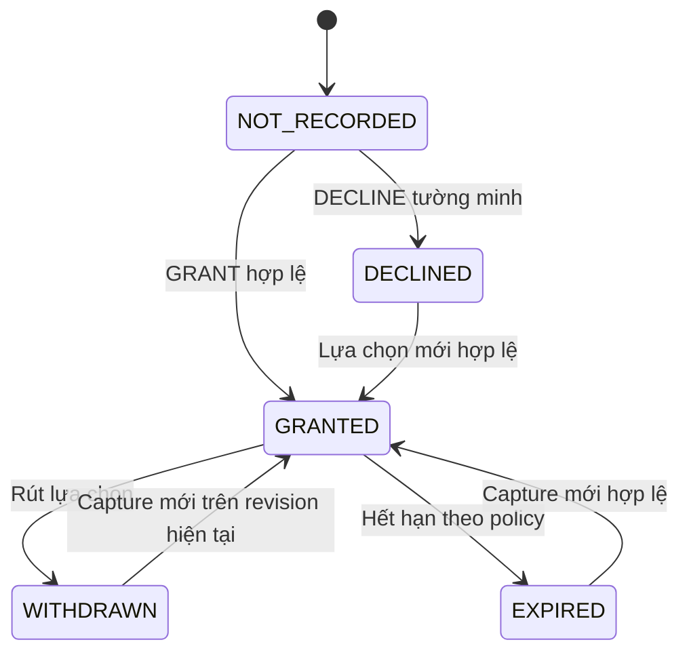

# Consent capture — Ghi nhận sự đồng ý đúng phạm vi và có bằng chứng

## 1. Mục tiêu và phạm vi

Trong chương **Consent Rules** của module bảo mật logic nghiệp vụ, consent capture là quy trình tiếp nhận lựa chọn của một chủ thể và ghi nhận nó cùng nội dung, phạm vi, thời điểm và ngữ cảnh tương ứng.

Một cột `consent=true` không trả lời được người dùng đã đồng ý với điều gì, qua kênh nào, theo thông báo nào và lựa chọn đó còn có hiệu lực hay không. Nếu hệ thống dùng boolean này như một quyền chung, một lần đồng ý nhận email có thể bị diễn giải thành cho phép chia sẻ dữ liệu hoặc thực hiện hành động hoàn toàn khác.

Bài học tập trung thiết kế kỹ thuật: business invariants, state machine, quyền theo đối tượng, transaction, idempotency và kiểm thử lạm dụng. Mục đích nào được xử lý dựa trên consent, điều kiện áp dụng và phạm vi cho phép phải được xác định trong policy của sản phẩm.

W3C khuyến nghị thiết kế yêu cầu consent để hiểu ý định đồng ý hoặc không đồng ý của người dùng, thay vì tối đa hóa phần xử lý được chấp thuận. Việc kiểm tra và rút lại lựa chọn cũng cần dễ tiếp cận. Xem [Privacy Principles — Consent, Withdrawal, Opt-Outs, and Objections](https://www.w3.org/TR/privacy-principles/#consent).

Sau bài này, người học có thể:

- Mô hình hóa consent theo chủ thể, mục đích, phạm vi và phiên bản.
- Phân biệt thông báo đã được cung cấp, quyết định đã ghi nhận và quyền xử lý hiện tại.
- Thiết kế luồng ghi nhận có chống giả mạo, chống sửa tham số và chống replay.
- Bảo đảm state, bằng chứng và sự kiện nhất quán khi có request đồng thời.
- Kiểm thử việc consent cũ bị dùng lại, mở rộng phạm vi hoặc gắn sai chủ thể.

Tên trường, thời hạn và policy trong bài là ví dụ thiết kế. Một bản ghi đúng cấu trúc chưa tự chứng minh toàn bộ trải nghiệm xin đồng ý đã phù hợp với ý định người dùng.

## 2. Phân biệt các khái niệm dễ bị gộp

| Khái niệm | Điều nó thể hiện | Điều không được suy ra |
| --- | --- | --- |
| Xác thực | Hệ thống đã xác định danh tính theo cơ chế đăng nhập | Người đó đồng ý với mọi xử lý trong phiên |
| Quyền đối tượng | Actor được thao tác một tài nguyên cụ thể | Actor được ghi consent thay cho mọi chủ thể |
| Cung cấp thông báo | Một phiên bản nội dung đã được cấp cho client | Người dùng chắc chắn đã đọc và hiểu |
| Consent decision | Lựa chọn cho phạm vi được hỏi đã được tiếp nhận | Lựa chọn có hiệu lực cho mục đích hoặc thời gian khác |
| Xác nhận điều khoản | Một thao tác liên quan thỏa thuận sử dụng | Tự động là consent cho mọi xử lý dữ liệu tùy chọn |
| Quyền hệ điều hành | Ứng dụng được dùng camera, vị trí hoặc thông báo | Dữ liệu được phép dùng cho mọi mục đích backend |
| Xác minh email | Một người kiểm soát được địa chỉ tại bước xác minh | Đã đồng ý nhận mọi loại nội dung gửi tới địa chỉ đó |

Consent không thay kiểm tra quyền, trạng thái, giá hoặc phê duyệt. Một người đồng ý chia sẻ thông tin giao hàng vẫn không được sửa giá đơn, duyệt hồ sơ của người khác hay yêu cầu hoàn tiền trùng.

Ngược lại, không nên biểu diễn mọi hoạt động xử lý bằng cùng một checkbox consent. Cần tách phần dựa trên lựa chọn tùy chọn với những xử lý có quy tắc riêng của sản phẩm. Việc rút một lựa chọn không tự định nghĩa lại mọi nghiệp vụ khác.

## 3. Viết một yêu cầu consent có thể hiểu và ghi nhận

### 3.1. Cụ thể hóa điều đang được hỏi

Một yêu cầu cần có đủ ngữ cảnh để người dùng biết mình đang lựa chọn:

- Ai sử dụng dữ liệu hoặc vận hành chức năng.
- Mục đích cụ thể.
- Dữ liệu hoặc nhóm dữ liệu liên quan.
- Kênh, người nhận hoặc phạm vi chia sẻ nếu ảnh hưởng lựa chọn.
- Hệ quả của việc đồng ý hoặc không đồng ý.
- Cách xem lại và thay đổi lựa chọn.

Ví dụ:

> Nhận email giới thiệu ưu đãi của cửa hàng này tại địa chỉ bạn đã chọn. Bạn có thể đổi lựa chọn trong phần quản lý thông báo.

Câu này rõ phạm vi hơn “Tôi đồng ý mọi điều khoản và nhận thông tin từ chúng tôi cùng các đối tác”.

Nội dung thực tế có thể cần thêm chi tiết, nhưng không nên chỉ đưa một liên kết dài rồi giả định mọi ý định đã được xác định. Phần giải thích tại điểm lựa chọn và bản thông báo chi tiết cần nhất quán.

### 3.2. Lựa chọn phải tách được theo mục đích

Trong ví dụ sản phẩm, ba mục đích là độc lập:

| Mã mục đích | Lựa chọn được hỏi |
| --- | --- |
| `PROMOTIONAL_EMAIL` | Nhận email ưu đãi |
| `PERSONALIZED_RECOMMENDATIONS` | Dùng lịch sử để cá nhân hóa gợi ý |
| `PARTNER_DATA_SHARING` | Chia sẻ nhóm dữ liệu được nêu với bên nhận được xác định |

Không dùng đồng ý mục thứ nhất để bật hai mục còn lại. Nếu giao diện có nút chọn nhiều mục, cần lưu từng lựa chọn với phạm vi cụ thể; không chỉ ghi “đã bấm đồng ý tất cả” mà mất danh sách tại thời điểm đó.

Lựa chọn chưa được gửi hoặc không có trong payload không được tự chuyển thành GRANT. Cũng không nên coi việc bỏ trống là một quyết định từ chối đã được xác nhận nếu chưa có hành động thể hiện điều đó. NOT_RECORDED và DECLINED có ngữ nghĩa khác nhau.

### 3.3. Trải nghiệm không được làm sai ý nghĩa bản ghi

Với lựa chọn tùy chọn trong ví dụ, giao diện không chọn sẵn đồng ý, không đổi nghĩa của nút qua màu hoặc nhãn khó hiểu và không tự gửi GRANT khi người dùng đóng hộp thoại.

Nếu người dùng từ chối một mục tùy chọn, luồng phải xử lý đúng hệ quả đã giải thích. Không thông báo rằng mục này tùy chọn rồi âm thầm chặn chức năng không liên quan để ép chọn lại.

Tương tác bằng bàn phím, trình đọc màn hình và thiết bị di động cũng cần ghi nhận cùng một ý nghĩa. Một bản ghi kỹ thuật không sửa được lỗi giao diện khiến lựa chọn thực tế khác điều server lưu.

## 4. Invariant của hệ thống ghi nhận consent

Các invariant minh họa:

```text
1. Actor không được ghi quyết định cho subject ngoài quyền đại diện.

2. Quyết định phải gắn với context do server cấp:
   tenant, subject, purpose, scope và nội dung đã công bố.

3. GRANT chỉ được ghi từ một hành động gửi lựa chọn tường minh;
   thiếu quyết định không mặc định thành GRANT.

4. Context hết hạn, đã dùng hoặc không còn phù hợp policy
   không được tạo quyết định mới qua đường ghi nhận cũ.

5. Ghi state hiện tại, bằng chứng và outbox phải nhất quán.

6. Retry cùng operation không tạo thêm quyết định hoặc tăng revision.

7. Request cũ không được ghi đè lựa chọn mới hơn.

8. Receipt về một quyết định quá khứ không tự là quyền xử lý hiện tại.
```

Quyền đại diện là một quy trình riêng: cần xác định ai có quyền đại diện, cho chủ thể nào, phạm vi nào và bằng chứng nào. Không dùng `onBehalfOf` trong payload như một cách tự cấp quyền.

Một tài khoản nội bộ cũng không được sửa trực tiếp cột consent thành true để thuận tiện vận hành. Trường hợp ghi nhận qua tổng đài hoặc kênh được ủy quyền cần loại nguồn, actor và bằng chứng phù hợp với policy của kênh đó.

## 5. Mô hình consent theo phạm vi

### 5.1. Tránh boolean toàn tài khoản

Một khóa phạm vi có thể gồm:

```text
tenant
+ subject
+ purpose
+ processing_scope
+ communication_channel
+ destination_or_recipient_scope
```

Không phải sản phẩm nào cũng cần mọi chiều. Ví dụ, nếu hỏi nhận email ưu đãi tại một địa chỉ đã chọn, địa chỉ hoặc phiên bản liên hệ có thể là phần quan trọng của phạm vi. Nếu hỏi cá nhân hóa trên tài khoản, phạm vi có thể khác.

Server xác định cách ánh xạ các chiều này. Client không được tự đổi `purpose` sang mã rộng hơn hoặc gửi wildcard người nhận để mở thêm quyền.

### 5.2. Tách actor và subject

- **Subject:** người mà lựa chọn áp dụng tới.
- **Actor:** người hoặc hệ thống thực hiện thao tác ghi nhận.
- **Source:** kênh ghi nhận, chẳng hạn cài đặt tài khoản hoặc tổng đài.
- **Authority:** cơ sở kỹ thuật để actor được ghi cho subject.

Trong luồng tự phục vụ sau đăng nhập, actor và subject thường trùng nhau. Trong luồng đại diện, chúng có thể khác và không được mất dấu sự khác biệt này.

Việc một người tải lên dữ liệu có cả người khác không có nghĩa họ đã ghi nhận consent của tất cả những người xuất hiện trong dữ liệu. Không suy rộng từ quyền gửi nội dung thành quyền đại diện cho mọi chủ thể liên quan.

### 5.3. Thay đổi địa chỉ hoặc mục đích cần quy tắc rõ

Nếu người dùng đổi email, hệ thống cần biết consent đang áp dụng cho loại liên hệ của tài khoản hay cho đúng địa chỉ đã chọn. Không tự chọn cách diễn giải thuận tiện nhất cho việc gửi.

Nếu thêm mục đích chia sẻ với đối tác mới, không chỉ đổi nhãn của một purpose cũ rồi dùng toàn bộ lựa chọn cũ. Cần chính sách tương thích phiên bản và quy trình ghi nhận bổ sung khi phạm vi đã thay đổi.

## 6. Tạo capture context do server quản lý

### 6.1. Context ràng buộc nội dung với hành động

Trước khi gửi lựa chọn, client nhận một capture context. Trong ví dụ, mỗi context chỉ phục vụ một mục đích để dễ kiểm soát:

```json
{
  "captureContextId": "capture-684",
  "purposeCode": "PROMOTIONAL_EMAIL",
  "scopeRef": "email-scope-12",
  "noticeVersion": "promo-notice-v3",
  "locale": "vi",
  "presentationVariant": "account-settings-v2",
  "expectedConsentRevision": 4,
  "expiresAt": "2026-11-22T09:15:00Z"
}
```

Server lưu hoặc có thể xác minh các ràng buộc: tenant, subject, actor được phép, purpose, scope, phiên bản thông báo, biến thể giao diện, thời điểm cấp và hạn context.

Context ID cần khó đoán trong triển khai thực tế. ID ngắn trong ví dụ chỉ nhằm diễn giải. Context không thay xác thực và quyền đối tượng; biết ID không được tự ghi lựa chọn cho người khác.

### 6.2. Bản thông báo phải có thể tái dựng

Một phiên bản cần trỏ đến nội dung bất biến hoặc bản lưu có kiểm soát, bao gồm ngôn ngữ và phần giải thích liên quan. Có thể lưu digest để phát hiện nội dung bị thay đổi.

Digest không tự cho biết người dùng đã được cung cấp nội dung gì nếu bản nội dung đã mất. Không ghi `version=latest` rồi cập nhật cùng tài liệu mà không lưu lịch sử.

Một sự kiện “context đã được cấp” chỉ là bằng chứng server đã cung cấp cấu hình cho client. Nó không chứng minh người dùng đã đọc, hiểu hoặc giao diện không có lỗi. Mức bằng chứng cần được mô tả đúng.

### 6.3. Context có hạn và có kiểm tra phiên bản

Ví dụ context có hạn 15 phút. Khi xử lý một quyết định mới, server kiểm tra hạn bằng thời gian tin cậy và kiểm tra context còn được chấp nhận theo policy hay không.

Một thay đổi nội dung câu chữ không nhất thiết có cùng tác động với thay đổi mục đích xử lý. Cần phân biệt phiên bản nội dung hiển thị và phiên bản phạm vi xử lý. Quy tắc chấp nhận context cũ phải rõ ràng, không phụ thuộc việc client tự gửi số phiên bản mới nhất.

Nếu dùng context ký thay vì lưu toàn bộ ở server, vẫn cần thiết kế trạng thái dùng một lần, idempotency và kiểm tra revision. Chữ ký bảo vệ nội dung token không tự ngăn token cũ được dùng lại sau một lựa chọn mới.

## 7. API chỉ nhận lựa chọn, không nhận kết luận có hiệu lực

Một command minh họa:

```http
POST /me/consent-decisions
Idempotency-Key: operation-905
Content-Type: application/json
```

```json
{
  "captureContextId": "capture-684",
  "decision": "GRANT"
}
```

Nếu dùng phiên cookie, request còn cần đi qua cơ chế chống CSRF đã cấu hình. Idempotency key và context ID không thay thế cơ chế đó.

Các trường sau không để client tự quyết định:

- Subject và tenant thực tế.
- Trạng thái có hiệu lực cuối cùng.
- Purpose hoặc scope khác với context.
- Thời điểm server ghi nhận và thời điểm có hiệu lực.
- Phiên bản thông báo thay thế.
- Actor đại diện hoặc mức bằng chứng được coi là đủ.
- Thời hạn consent và quyền sử dụng dữ liệu sau đó.

Schema phải xử lý rõ trường lạ và giá trị decision không hợp lệ. Không dùng quy tắc chuyển đổi kiểu như “chuỗi khác rỗng là true”; `"false"`, `null` và thiếu trường cần có hành vi được định nghĩa.

Nếu một command gồm nhiều mục đích, từng quyết định phải gắn đúng context hoặc bộ context có cấu trúc. Cần quy định tất cả cùng thành công hay trả kết quả riêng theo từng mục; không trả “đã lưu toàn bộ” khi mới commit một phần.

## 8. Bảo vệ hành động ghi nhận khỏi giả mạo

### 8.1. Kiểm tra quyền theo subject và context

Trong luồng `/me`, server lấy subject từ danh tính đã xác thực. Context cũng phải thuộc đúng subject và tenant đó.

Với thao tác đại diện, server kiểm tra quyền cụ thể trước khi cho đọc nội dung hoặc gửi quyết định. Tránh lỗi chỉ kiểm tra người gọi có vai trò SUPPORT rồi cho ghi với subject ID bất kỳ.

Capture context cần được ràng buộc với phiên hoặc cơ chế xác thực phù hợp. Khi chuyển tài khoản trên cùng trình duyệt, một form cũ không được ghi lựa chọn cho tài khoản khác.

### 8.2. Ngăn request ngoài ý muốn từ trình duyệt

Consent là thay đổi trạng thái. Không cho request GET tải trang hoặc tải ảnh tự thực hiện GRANT.

Với cơ chế tự gửi cookie, áp dụng bảo vệ CSRF phù hợp như cơ chế sẵn có của framework, token được kiểm tra ở server và các lớp kiểm tra nguồn phù hợp. Không coi CORS hoặc việc dùng JSON tự nó giải quyết mọi đường request.

OWASP khuyến nghị bảo vệ request thay đổi trạng thái và tránh dùng GET cho các thao tác đó. Xem [Cross-Site Request Forgery Prevention Cheat Sheet](https://cheatsheetseries.owasp.org/cheatsheets/Cross-Site_Request_Forgery_Prevention_Cheat_Sheet.html).

Nếu có luồng qua liên kết email, việc quét liên kết bởi hệ thống bảo mật không được tự tạo GRANT. Liên kết có thể mở bước xác nhận; hành động cuối cần được thiết kế rõ, ràng buộc đúng người nhận và thao tác.

### 8.3. Không để client tắt các bước bắt buộc

Các tham số như `skipNotice=true`, `verifiedConsent=true` hoặc `source=ADMIN` không được làm thay đổi quy trình kiểm tra nếu người gọi không có thẩm quyền tương ứng.

OWASP Transaction Authorization nhấn mạnh việc thực thi kiểm tra ở server và kiểm soát thứ tự trạng thái. Áp dụng nguyên tắc đó vào capture giúp ngăn bỏ qua bước, sửa phạm vi và tái dùng xác nhận cho dữ liệu khác. Xem [Transaction Authorization Cheat Sheet](https://cheatsheetseries.owasp.org/cheatsheets/Transaction_Authorization_Cheat_Sheet.html).

Chống CSRF, xác thực và context có chữ ký hỗ trợ bảo vệ kênh kỹ thuật. Chúng không chứng minh người dùng đã hiểu nội dung, không loại bỏ tác động của XSS và không thay thiết kế giao diện đúng ý nghĩa.

## 9. Mô hình lưu trữ: bằng chứng và trạng thái hiện tại có vai trò riêng

| Dữ liệu | Trách nhiệm |
| --- | --- |
| `purpose_definition` | Định nghĩa mục đích và phạm vi xử lý có phiên bản |
| `notice_artifact` | Nội dung thông báo bất biến, ngôn ngữ và digest |
| `capture_context` | Ràng buộc lần hỏi với subject, scope, hạn và expected revision |
| `consent_head` | Trạng thái mới nhất và revision trong một phạm vi |
| `consent_decision` | Bản ghi quyết định đã được ghi nhận |
| `idempotency_operation` | Fingerprint và kết quả operation |
| `outbox_event` | Sự kiện cần phát sau commit |

Trong mô hình ví dụ, scope đã chuẩn hóa là bất biến. Nếu mục đích hoặc người nhận được mở rộng thành một phạm vi mới, cần ánh xạ và policy rõ ràng; không sửa nội dung scope cũ để làm bằng chứng cũ mang nghĩa rộng hơn.

### 9.1. Một bản ghi quyết định minh họa

```json
{
  "decision_id": "decision-410",
  "tenant_id": "tenant-08",
  "subject_ref": "subject-ref-51",
  "actor_ref": "subject-ref-51",
  "actor_kind": "SELF",
  "purpose_code": "PROMOTIONAL_EMAIL",
  "scope_ref": "email-scope-12",
  "decision": "GRANT",
  "notice_artifact_ref": "promo-notice-v3-vi",
  "presentation_variant": "account-settings-v2",
  "source": "AUTHENTICATED_ACCOUNT_SETTINGS",
  "capture_context_ref": "capture-684",
  "recorded_at": "2026-11-22T09:02:00Z",
  "previous_revision": 4,
  "revision": 5,
  "operation_id": "operation-905",
  "policy_version": "consent-policy-v6"
}
```

Server tạo hoặc xác minh các trường bằng dữ liệu tin cậy, không chép tất cả từ request. Nội dung thông báo có digest và bản lưu tại artifact được tham chiếu; ví dụ không lặp lại toàn bộ nội dung trong từng quyết định.

### 9.2. Không ghi đè lịch sử để sửa hiện tại

Khi có lựa chọn mới, ghi quyết định mới và cập nhật head. Không sửa bản ghi GRANT cũ thành WITHDRAW để làm mất dấu điều đã xảy ra.

“Bất biến” trong mô hình nghiệp vụ nghĩa là ứng dụng không sửa lịch sử quyết định theo đường cập nhật thông thường. Vẫn cần quyền ghi, kiểm soát quản trị, phát hiện sửa trái phép và vòng đời lưu giữ. Không mặc định một bảng append-only ở lớp ứng dụng là bằng chứng không thể bị can thiệp.

### 9.3. Receipt chỉ xác nhận điều đã ghi

Receipt có thể gồm decision ID, phạm vi, phiên bản nội dung, thời điểm ghi nhận và revision. Nếu ký receipt, chữ ký giúp kiểm tra nguồn và tính toàn vẹn của receipt theo giao thức đó.

Receipt không tự là bearer token cho phép xử lý dữ liệu. Sau khi consent bị rút, receipt GRANT cũ vẫn mô tả một sự kiện quá khứ; nó không được dùng để bật lại quyền hiện tại.

## 10. State machine và điều kiện có hiệu lực

Một state machine khái niệm cho cùng một scope:



Đây không phải danh sách đầy đủ mọi trạng thái của mọi sản phẩm. Điều quan trọng là từng transition có điều kiện rõ.

- NOT_RECORDED không được diễn giải là GRANTED.
- DECLINED thể hiện từ chối yêu cầu đang được hỏi.
- WITHDRAWN thể hiện rút lựa chọn từng được ghi nhận.
- EXPIRED chỉ áp dụng khi policy có giới hạn hiệu lực.
- GRANTED vẫn cần đúng scope, policy và thời điểm khi được dùng.

Trong thiết kế ví dụ, lệnh capture dùng GRANT hoặc DECLINE. Nếu đang GRANTED và người dùng muốn tắt lựa chọn hiện tại, giao diện gửi thao tác WITHDRAW qua luồng rút lựa chọn riêng. Server không tùy tiện đổi ngữ nghĩa DECLINE của một yêu cầu mới thành rút mọi grant cũ ở phạm vi khác.

Thời hạn context là thời hạn gửi quyết định, khác với thời hạn consent có hiệu lực. Context hết hạn không tự chứng minh grant đã hết hạn, và grant còn hiệu lực không làm context đã dùng có thể được dùng lại.

Khi kiểm tra quyền xử lý, phải so sánh hạn thực tế và scope đang yêu cầu; không chờ worker đổi cột trạng thái rồi mới coi grant là hết hạn.

## 11. Transaction và idempotency tại điểm ghi nhận

### 11.1. Các thay đổi phải cùng commit

Một capture thành công gồm:

1. Ghi quyết định cùng bằng chứng.
2. Cập nhật head và tăng revision.
3. Đánh dấu context đã dùng cho operation.
4. Lưu kết quả idempotency.
5. Ghi outbox.

Nếu bước nào lỗi, không được để head GRANTED trong khi không có bằng chứng hoặc context vẫn dùng lại được. Không gửi sự kiện thành công trước commit.

### 11.2. Khóa theo cùng scope

Trong mô hình một nguồn ghi có thẩm quyền, có thể dùng thứ tự:

```text
idempotency operation
→ consent head của scope
→ capture context
```

Mọi đường ghi, gồm capture, withdrawal và thao tác quản trị có phép, phải tuân thủ giao thức đồng bộ tương ứng. Nếu nhiều scope được cập nhật cùng lúc, cần thứ tự khóa ổn định.

Head phải tồn tại hoặc được tạo an toàn với unique constraint. Hai request cùng thấy “chưa có consent” không được tạo hai head độc lập cho cùng scope.

### 11.3. Revision ngăn form cũ ghi đè lựa chọn mới

Giả sử context được cấp khi revision bằng 4. Người dùng đổi lựa chọn trên thiết bị khác, head tăng lên 5. Request từ context revision 4 đến sau phải bị coi là stale; không dùng “request đến sau thì thắng” để mặc định thay đổi ý định.

Một cập nhật có điều kiện minh họa:

```sql
UPDATE consent_head
SET state = :new_state,
    revision = revision + 1,
    last_decision_id = :decision_id,
    updated_at = :server_time
WHERE tenant_id = :tenant_id
  AND subject_id = :subject_id
  AND scope_id = :scope_id
  AND revision = :expected_revision;
```

Các tham số được bind; new state và server time được server xác định. Phải kiểm tra đúng một hàng được cập nhật. Kết quả bằng 0 không được bỏ qua rồi vẫn trả “đã ghi nhận”.

Câu SQL là một phần của transaction gồm bằng chứng, context, idempotency và outbox. Nó không tự xử lý toàn bộ quyền, trạng thái hoặc phiên bản nội dung.

### 11.4. Kiểm tra replay trước khi áp dụng điều kiện của một capture mới

Nếu operation đã commit nhưng client mất phản hồi, retry cùng key cần lấy lại kết quả, ngay cả khi context đã được dùng hoặc vừa hết hạn.

Trình tự cần phân biệt:

- Xác thực và kiểm tra quyền nhận kết quả của operation.
- Cùng key nhưng fingerprint khác: từ chối xung đột.
- Operation đã hoàn tất: trả receipt cũ, không tăng revision và không dùng context lần nữa.
- Operation mới: kiểm tra toàn bộ điều kiện context, scope, revision và policy.

Kết quả replay có thể kèm trạng thái hiện tại đọc từ head, tách rõ với receipt quá khứ. Trạng thái hiện tại là snapshot tại thời điểm đọc, không phải lời hứa nó sẽ không thay đổi sau phản hồi.

## 12. Minh họa điều phối bằng mã giả Java

Đoạn sau là **mã giả theo phong cách Java**, minh họa thứ tự kiểm tra và ranh giới transaction. Các repository và kiểu dữ liệu cần được triển khai theo ứng dụng.

```java
CaptureResult captureConsent(
        AuthenticatedActor actor,
        CaptureCommand cmd,
        String idempotencyKey) {

    validateDecisionAndFormat(cmd);
    authorization.requireCapturePermission(actor);

    return database.inTransaction(tx -> {
        Operation op = tx.lockOrCreateOperation(
                actor.tenantId(),
                actor.id(),
                "CAPTURE_CONSENT",
                idempotencyKey,
                fingerprint(cmd));

        op.requireSameFingerprint(fingerprint(cmd));

        if (op.completed()) {
            Receipt receipt = tx.loadReceipt(op.resultRef());
            authorization.requireReadReceipt(actor, receipt);
            ConsentHead current = tx.readHead(receipt.scope());
            return CaptureResult.replayed(receipt, current);
        }

        CaptureContext discovered = tx.findContextForActor(
                actor.tenantId(),
                actor.id(),
                cmd.captureContextId());

        authorization.requireActForSubject(
                actor, discovered.subjectRef());

        tx.ensureHeadExists(discovered.scope());
        ConsentHead head = tx.lockHead(discovered.scope());
        CaptureContext context = tx.lockContext(discovered.id());

        Instant now = tx.databaseTimeAfterLocks();
        context.requireSameImmutableScope(discovered);
        context.requireUsableBy(actor, now);
        context.requireExpectedRevision(head.revision());

        ConsentPolicy policy = tx.loadPolicy(context.policyRef());
        policy.requireAcceptableContext(context, now);
        ConsentState next = policy.nextStateForCapture(
                head, cmd.decision(), now);

        DecisionRecord record = tx.appendDecision(
                actor, context, cmd.decision(),
                head.revision() + 1, now);

        tx.updateHeadOrFail(
                head.scope(), head.revision(), next, record);
        tx.consumeContextOrFail(context.id(), op.id());
        tx.appendOutbox("consent.decision.recorded", record);
        tx.completeOperation(op, record.id());

        return CaptureResult.created(
                Receipt.from(record),
                tx.readHead(head.scope()));
    });
}
```

Các phương thức `requireUsableBy`, `nextStateForCapture` và kiểm tra quyền là một phần bắt buộc của hợp đồng, không phải các lời gọi có thể bỏ trống trong triển khai.

Fingerprint phải phân biệt context và quyết định. Cùng key với GRANT rồi đổi sang DECLINE không được xem là retry giống nhau. Key mới không cho phép dùng lại context đã tiêu thụ.

Thời gian hết hạn được kiểm tra tại mốc có thẩm quyền sau khi lấy khóa cần thiết. Không dùng timestamp client khai để lách hạn. Transaction cần ngắn; không giữ khóa trong lúc gọi dịch vụ ngoài hoặc chờ tương tác người dùng.

Nếu không rõ commit đã xảy ra chưa, client tra cứu hoặc retry cùng operation. Không tự tạo một GRANT mới để “bù” cho lỗi mạng.

## 13. Dùng consent tại điểm thực hiện nghiệp vụ

### 13.1. Capture thành công chưa có nghĩa mọi xử lý đều được cho phép

Với một thao tác dựa trên consent, điều kiện dùng có thể gồm:

```text
đúng tenant và subject
AND đúng purpose và scope
AND trạng thái hiện tại là GRANTED
AND chưa hết hiệu lực
AND policy hiện tại chấp nhận phạm vi đã ghi nhận
AND actor thực hiện xử lý có quyền tương ứng
AND đối tượng và bước nghiệp vụ cho phép
```

Nếu một chức năng có quy tắc xử lý khác, phải đánh giá theo policy của chức năng đó. Không dùng việc thiếu consent tùy chọn để tự động phá mọi luồng giao dịch; cũng không lấy nhu cầu giao dịch làm lý do bật xử lý tùy chọn.

Consent cho nhận email ưu đãi không cho phép công cụ gửi email đọc mọi hồ sơ khách. Service gửi vẫn chỉ nhận projection cần thiết và vẫn chịu phân quyền.

### 13.2. Chặn xử lý tùy chọn trước khi có kết quả ghi nhận

Một lỗi phổ biến là bật công cụ phân tích hoặc đưa người dùng vào danh sách gửi ngay khi mở form, trong khi việc ghi nhận diễn ra sau.

Nếu policy yêu cầu GRANT cho xử lý đó, nó chỉ được bắt đầu sau khi có quyết định đã commit và được kiểm tra phù hợp. Client báo “đã chọn” hoặc request đang chờ không đủ để coi việc capture thành công.

Khi capture lỗi, không dùng fallback `consent=true` để giữ luồng tùy chọn hoạt động. Giao diện cần phản ánh rằng lựa chọn chưa được lưu, cho phép tra cứu và thử lại an toàn.

### 13.3. Queue không phải quyết định quyền vĩnh viễn

Một job được tạo khi head đang GRANTED có thể chạy sau khi người dùng đã rút lựa chọn. Worker không nên chỉ tin snapshot lúc xếp hàng.

Cần thiết kế điểm kiểm tra hiện tại trước thao tác nhạy cảm, ràng buộc job với scope và revision liên quan, đồng thời có chính sách hủy hoặc bỏ qua công việc không còn được phép.

Một lần đọc “đang GRANTED” rồi gọi hệ thống ngoài vẫn có khoảng tranh chấp với withdrawal. Nếu cần cam kết thứ tự chặt hơn, phải có giao thức điều phối tại điểm cấp phép hoặc thực thi. Không mô tả một phép đọc đơn lẻ như bảo đảm dừng tức thì mọi tác động.

Tác động đã gửi ra ngoài có thể không thu hồi được bằng rollback cục bộ. Luồng phải định nghĩa rõ điểm có hiệu lực và cách xử lý phần đang bay, thay vì đưa ra cam kết kiến trúc không đáp ứng.

## 14. Sự kiện, cache và request đến sai thứ tự

Một sự kiện tối thiểu cho thay đổi quyết định có thể gồm:

```json
{
  "event_id": "consent-event-602",
  "event_type": "consent.decision.recorded",
  "tenant_id": "tenant-08",
  "subject_ref": "subject-ref-51",
  "scope_ref": "email-scope-12",
  "decision_id": "decision-410",
  "revision": 5,
  "state": "GRANTED",
  "recorded_at": "2026-11-22T09:02:00Z"
}
```

Consumer khử trùng theo event ID và chỉ cập nhật bản chiếu theo revision hợp lệ. Event GRANTED revision 5 đến sau WITHDRAWN revision 6 không được bật lại trạng thái.

Tuy nhiên, revision không tự loại bỏ độ trễ: consumer có thể mới nhận revision 5 trong khi nguồn đã lên 6 nhưng sự kiện 6 chưa đến. Nếu cần biết quyền hiện tại, phải có nguồn xác thực hoặc giao thức bảo đảm độ tươi tương ứng; không coi eventual consistency là thu hồi tức thì.

Các trường hợp cần xử lý:

- Event được giao lại: không tạo quyết định hoặc side effect thêm lần nữa.
- Event thiếu hoặc sai thứ tự: đối soát bản chiếu với nguồn có thẩm quyền.
- Cache không rõ độ tươi: không tự cho phép xử lý tùy chọn dựa trên dữ liệu không xác định.
- Restore hoặc replay lịch sử: không ghi đè head mới bằng GRANT cũ.
- Consumer giữ thông tin liên hệ cũ: kiểm tra lại phạm vi khi liên hệ thay đổi.

Một receipt ký hoặc event hợp lệ về mặt nguồn phát vẫn có thể đã cũ. Tính toàn vẹn và tính hiện hành là hai điều kiện khác nhau.

## 15. Phiên bản nội dung, dữ liệu cũ và các kênh ghi nhận

### 15.1. Không mở rộng phạm vi bằng sửa nội dung tại chỗ

Giả sử phiên bản ban đầu chỉ hỏi nhận email ưu đãi của cửa hàng. Phiên bản sau bổ sung chia sẻ với một nhóm bên nhận khác.

Không thay artifact cũ rồi tuyên bố mọi GRANT trước đó bao gồm phần bổ sung. Lựa chọn cũ tiếp tục được diễn giải đúng phạm vi đã ghi. Nếu phạm vi mới cần một lựa chọn mới theo policy, phải tạo quy trình hỏi và ghi nhận tương ứng.

Thay đổi bản dịch hoặc câu chữ cũng cần quản lý phiên bản để tái dựng trải nghiệm. Policy cần nêu thay đổi nào được coi là tương thích, ai phê duyệt và context nào còn được tiếp nhận.

### 15.2. Không nâng dữ liệu không rõ nguồn thành GRANTED

Các dữ liệu sau chưa tự đủ để kết luận đã có một lựa chọn cùng phạm vi:

- Người dùng từng tạo tài khoản.
- Một địa chỉ email đã được xác minh.
- Người dùng đã mua hàng.
- Một cột cũ có giá trị mặc định true.
- Một file import có trường `subscribed` nhưng không có nguồn và nội dung.
- Một nhân viên nói đã xin phép nhưng không có quy trình hoặc bằng chứng tương ứng.

Khi di chuyển dữ liệu, giữ trạng thái không xác định hoặc phân loại cần xem xét nếu không chứng minh được ý nghĩa. Không tự bịa thời điểm, phiên bản thông báo hoặc actor để làm đầy schema mới.

### 15.3. Khách chưa đăng nhập và lựa chọn trên thiết bị

Một lựa chọn được lưu cho trình duyệt không mặc định là lựa chọn của mọi tài khoản đăng nhập trên thiết bị đó. Cần xác định subject đang là người dùng đã xác thực, phiên khách hay một ngữ cảnh thiết bị.

Khi liên kết hoặc hợp nhất tài khoản, phải có quy tắc giải quyết scope và xung đột. Không lấy GRANT rộng nhất trong hai nguồn làm mặc định. Người dùng chung máy không nên bị gắn lựa chọn của người trước.

### 15.4. Xác nhận nhiều bước nếu policy yêu cầu

Một số sản phẩm chọn quy trình xác nhận qua email. Khi đó, thao tác ban đầu có thể chỉ tạo PENDING_CONFIRMATION; chưa kích hoạt grant cuối trước khi đủ điều kiện xác nhận.

Token xác nhận cần đúng subject hoặc địa chỉ, scope, nội dung, operation và hạn; chống phát lại theo giao thức. Việc chứng minh quyền kiểm soát địa chỉ cần được phân biệt với việc thể hiện lựa chọn cho mục đích đã hỏi.

Đây là một lựa chọn mô hình theo sản phẩm, không phải giả định rằng mọi consent đều cần cùng một phương pháp hay mọi email đã xác minh đều là consent.

## 16. Bằng chứng đủ dùng và có vòng đời

Bằng chứng cần giúp trả lời: ai thao tác, cho ai, đã được hỏi phạm vi nào, đã chọn gì, qua kênh nào và server ghi nhận lúc nào.

Không mặc định cần ghi toàn bộ phiên truy cập, vị trí chính xác, fingerprint thiết bị hoặc ảnh tài liệu để chứng minh mọi lựa chọn. Mỗi dữ liệu bổ sung cần có mục đích, quyền truy cập và thời hạn phù hợp.

IP và User-Agent, nếu được lưu có lý do, chỉ là ngữ cảnh kỹ thuật; chúng không chứng minh một người đã đọc và hiểu. Một IP dùng chung cũng không đủ xác định chủ thể.

OWASP khuyến nghị tránh ghi trực tiếp mật khẩu, access token, khóa bí mật và dữ liệu nhạy cảm không cần thiết trong log. Xem [Logging Cheat Sheet — Data to exclude](https://cheatsheetseries.owasp.org/cheatsheets/Logging_Cheat_Sheet.html#data-to-exclude).

Trong thiết kế capture:

- Không ghi session cookie, CSRF token hoặc token xác nhận còn dùng được vào audit log.
- Lưu nội dung thông báo theo artifact có quản trị, tránh lặp toàn bộ ở nhiều log.
- Tách bằng chứng chi tiết khỏi event phát cho mọi consumer.
- Chỉ cho người có quyền đọc receipt và lịch sử của subject.
- Theo dõi sửa dữ liệu, thao tác quản trị và quyền truy cập bằng chứng.
- Có vòng đời cho context, ledger, idempotency, outbox, bản sao và backup.

Rút consent và xóa toàn bộ bằng chứng không nhất thiết là cùng một thao tác nghiệp vụ. Cần xác định phần bằng chứng tối thiểu còn cần cho xử lý tranh chấp, chống replay và đối soát, cùng giới hạn sử dụng của phần đó. Không giữ vô hạn mọi thông tin chỉ vì gọi nó là audit.

Nếu bỏ ledger quá sớm hoặc khôi phục backup cũ mà không áp dụng lại trạng thái mới, hệ thống có thể đánh mất withdrawal và bật lại GRANT. Vòng đời bằng chứng phải được thiết kế cùng giao thức khôi phục.

## 17. Kiểm thử tình huống tấn công logic và lỗi vận hành

### 17.1. Ma trận hành vi cần kiểm tra

| Tình huống | Kết quả cần xác minh |
| --- | --- |
| Không gửi decision hoặc gửi null | Không mặc định thành GRANT |
| Gửi chuỗi sai kiểu, enum không hợp lệ hoặc thêm cờ skip | Không thay đổi quy trình kiểm tra |
| Chỉ tải trang hoặc đóng hộp thoại | Không sinh GRANT ngoài ý định |
| Từ chối mục tùy chọn | Lưu đúng lựa chọn, không bật mục khác |
| Gửi subject hoặc tenant khác trong payload | Không thay phạm vi từ ngữ cảnh tin cậy |
| Dùng context của tài khoản khác | Bị từ chối, không cập nhật subject đó |
| Đổi tài khoản nhưng giữ form cũ | Context không được dùng cho tài khoản mới |
| Nhân viên tự nhận quyền đại diện | Không ghi consent nếu thiếu thẩm quyền và quy trình |
| Cross-site request dùng phiên cookie | Bị cơ chế CSRF phù hợp ngăn thay đổi trái phép |
| GET từ crawler hoặc trình quét liên kết | Không tạo GRANT |
| Sửa purpose, scope hoặc notice version ngoài context | Không mở rộng quyền và không thay bằng chứng |
| Context hết hạn hoặc không còn được chấp nhận | Operation mới bị từ chối theo policy |
| Hai request cùng key và payload | Chỉ một quyết định và một lần tăng revision |
| Cùng key nhưng đổi GRANT thành DECLINE | Xung đột idempotency, không sửa operation cũ |
| Key mới nhưng dùng context đã tiêu thụ | Không tạo quyết định mới từ cùng context |
| Mất phản hồi sau commit | Retry trả receipt cũ, không lặp tác động |
| Retry sau khi context đã hết hạn nhưng operation đã commit | Có thể lấy lại kết quả theo quyền, không tạo capture mới |
| Hai context cùng expected revision gửi song song | Không âm thầm áp dụng cả hai như thể cùng còn mới |
| Tab cũ gửi GRANT sau khi lựa chọn mới được ghi | Không ghi đè head mới bằng context stale |
| Withdrawal xảy ra rồi retry operation GRANT cũ | Trả bằng chứng quá khứ, không khôi phục GRANTED |
| Event GRANT cũ đến sau event WITHDRAW mới | Consumer không hạ revision hoặc bật lại |
| Cache còn GRANTED khi nguồn đã đổi | Đường xử lý đáp ứng hợp đồng độ tươi; không giả định cache luôn hiện hành |
| Job được xếp hàng trước khi rút lựa chọn | Kiểm tra điều kiện ở điểm dùng và xử lý job không còn hợp lệ |
| Grant đúng nhưng yêu cầu xử lý purpose khác | Không dùng được cho purpose đó |
| Consent hợp lệ nhưng đơn sai quyền hoặc sai trạng thái | Quyền đối tượng và state machine vẫn từ chối |
| Thông báo mới thêm người nhận hoặc mục đích | Grant cũ không bị tự mở rộng |
| Artifact nội dung bị sửa hoặc mất | Phát hiện vấn đề, không bịa lại bằng chứng |
| Lỗi sau insert decision nhưng trước update head hoặc outbox | Transaction không để lại trạng thái thành công nửa chừng |
| Consumer nhận trùng event | Không tạo thêm side effect |
| Capture service hoặc kho dữ liệu không truy cập được | Không fallback tự cấp consent cho xử lý tùy chọn |
| Log hoặc trace bị kiểm tra trực tiếp | Không chứa token còn hiệu lực hoặc raw dữ liệu thừa |
| Import dữ liệu cũ không rõ nguồn | Không biến thành GRANTED có bằng chứng giả |
| Restore backup hoặc replay toàn bộ lịch sử | Không làm mất lựa chọn mới hơn |
| Một batch có nhiều purpose và một mục lỗi | Kết quả đúng hợp đồng atomic hoặc từng phần đã công bố |

Các kiểm thử đồng thời cần tạo tranh chấp thật giữa transaction hoặc nhiều kết nối, không chỉ mock cùng một giá trị revision. Kiểm thử thời gian nên kiểm soát được mốc đánh giá để xét ngay trước, bằng và sau hạn context.

Kiểm thử UI cần xác minh nhãn, trạng thái mặc định, thao tác đóng, bàn phím và nội dung thực tế theo locale. Backend chỉ thấy request không thể tự chứng minh giao diện đã thể hiện đúng mọi lựa chọn.

### 17.2. Dòng thời gian quan trọng nhất: replay sau withdrawal

| Thời điểm | Hành vi | Kết quả đúng |
| --- | --- | --- |
| 09:00 | Cấp context A trên revision 4 | Chưa tạo grant mới |
| 09:02 | Gửi GRANT với key K; transaction commit | Ghi decision D và head revision 5 |
| 09:02 | Client mất phản hồi | Không kết luận transaction thất bại |
| 09:03 | Người dùng rút lựa chọn trên thiết bị khác | Head thành WITHDRAWN revision 6 |
| 09:04 | Client retry key K | Trả receipt D của revision 5, không cập nhật head |
| 09:05 | Event GRANT revision 5 được giao lại | Không ghi đè revision 6 |
| 09:06 | Worker định xử lý theo danh sách cũ | Đánh giá điều kiện hiện tại theo giao thức điểm dùng |

Dòng thời gian cho thấy idempotency và revision có nhiệm vụ khác nhau. Idempotency trả lại kết quả operation; revision ngăn operation hoặc sự kiện cũ ghi đè trạng thái mới. Cả hai vẫn cần phối hợp với quyền và kiểm tra tại điểm thực hiện.

## 18. Triển khai và theo dõi chất lượng capture

Một lộ trình triển khai:

1. Xác định purpose, scope, subject và những xử lý thật sự phụ thuộc consent.
2. Phiên bản hóa thông báo, giao diện liên quan và quy tắc chấp nhận context.
3. Thiết kế command nhỏ, quyền theo đối tượng và cơ chế chống request ngoài ý muốn.
4. Ghi transaction cho head, bằng chứng, context, idempotency và outbox.
5. Bảo vệ mọi đường dùng consent, gồm cache, worker, batch và hệ thống ngoài.
6. Kiểm thử replay, stale context, race, đổi tài khoản và khôi phục dữ liệu.
7. Di chuyển dữ liệu cũ theo mức bằng chứng thực tế.
8. Theo dõi lỗi ghi nhận, độ trễ đồng bộ và khả năng người dùng xem lại lựa chọn.

Các chỉ số phù hợp gồm:

| Nhóm | Ví dụ |
| --- | --- |
| Tính đúng capture | Quyết định thiếu artifact, scope hoặc actor tin cậy |
| Đồng thời và retry | Stale revision, context bị dùng lại, xung đột idempotency |
| Vận hành | Thời gian commit, lỗi outbox, độ trễ consumer |
| Điểm sử dụng | Thao tác bị chặn do scope sai, hết hạn hoặc đã rút |
| Trải nghiệm | Lỗi lưu lựa chọn, khó xem lại, khác biệt giữa locale |
| Quản trị | Thay đổi notice không có phiên bản, import không có nguồn |

Không tối ưu duy nhất tỷ lệ GRANT. Một hệ thống có tỷ lệ đồng ý rất cao do mặc định, nhãn khó hiểu hoặc bỏ qua lựa chọn không phải là hệ thống capture đáng tin.

Không đưa subject ID, token hoặc địa chỉ liên hệ làm nhãn metric vô hạn. Bằng chứng điều tra nằm trong nơi có quyền truy cập và vòng đời phù hợp.

Khi thay đổi hoặc rollback policy, cần giữ nguyên ý nghĩa các quyết định đã ghi. Rollback phần mềm không được tự khôi phục các GRANT đã bị rút hoặc xóa lịch sử đã commit.

## 19. Những lỗi thiết kế cần nhận ra sớm

- Dùng một boolean consent cho mọi mục đích.
- Coi tài khoản đã đăng nhập, email đã xác minh hoặc điều khoản đã xác nhận là đủ cho mọi xử lý.
- Cho client khai subject, mục đích, thời điểm và phiên bản tùy ý.
- Tạo GRANT khi thiếu lựa chọn, đóng hộp thoại hoặc chỉ tải trang.
- Chỉ bảo vệ giao diện nhưng API cho bỏ qua context.
- Lưu hash nội dung mà không còn bản nội dung để tái dựng.
- Ghi head thành công nhưng thiếu bằng chứng hoặc outbox tương ứng.
- Gọi retry như một quyết định mới rồi tăng revision nhiều lần.
- Dùng receipt hoặc JWT cũ như quyền hiện tại sau withdrawal.
- Để event đến sau thắng mà không kiểm tra revision và độ tươi.
- Mở rộng phạm vi grant bằng sửa notice hoặc migration dữ liệu.
- Thu thập quá nhiều dữ liệu để chứng minh consent nhưng không có mục đích và thời hạn.

Một quy trình capture đạt mục đích khi có thể trả lời bằng dữ liệu đáng tin: **ai đã thực hiện lựa chọn cho ai, đã được hỏi điều gì, đã chọn phạm vi nào, server ghi nhận lúc nào, vì sao bản ghi không bị lặp hoặc ghi đè, và quyền xử lý hiện tại được kiểm tra ở đâu**.
