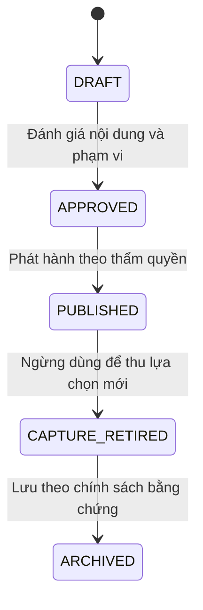
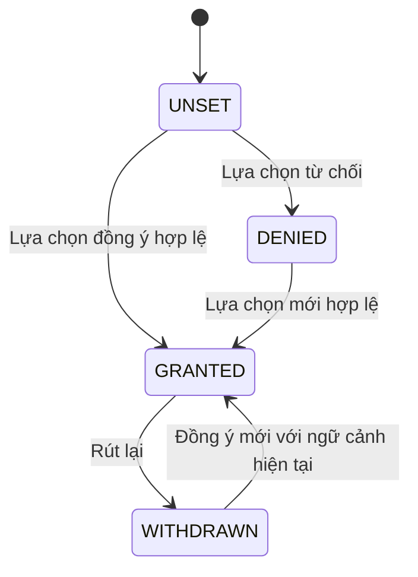

# Consent version

## 1. Phiên bản đồng ý bảo vệ điều gì?

**Consent version** là cách định danh và quản lý phiên bản của nội dung, phạm vi và quy trình lấy sự đồng ý. Hệ thống cần biết một người đã thực hiện lựa chọn nào, cho mục đích nào, sau khi được cung cấp nội dung nào, vào thời điểm nào và lựa chọn đó hiện còn cho phép hoạt động nào.

Một cột `consent = true` không trả lời được các câu hỏi ấy. Một cặp `consent = true, version = latest` cũng có thể sai nếu máy chủ tự gán phiên bản mới nhất mà người dùng chưa từng được cung cấp.

Ví dụ, phiên bản đầu tiên xin nhận bản tin qua email. Phiên bản sau bổ sung tin nhắn SMS và chia sẻ dữ liệu với một nhóm đối tác. Người đã chọn nhận email theo nội dung cũ không tự có thêm hai lựa chọn mới chỉ vì hệ thống phát hành một tài liệu mới.

Trong chương **Consent Rules** của module bảo vệ logic nghiệp vụ, quản lý phiên bản đồng ý cần phối hợp với bất biến nghiệp vụ, state machine, quyền theo đối tượng, transaction, idempotency và kiểm thử tình huống lạm dụng. Mục tiêu là giữ đúng mối liên hệ giữa bằng chứng đã thu thập và quyền sử dụng dữ liệu thực sự được cấp.

Ví dụ pháp lý để tham chiếu: Điều 7 GDPR yêu cầu bên kiểm soát dữ liệu có khả năng chứng minh sự đồng ý khi xử lý dựa trên sự đồng ý, đồng thời quy định quyền rút lại. Nguồn này áp dụng trong phạm vi GDPR; bài học dùng các mô hình kỹ thuật minh họa, không mặc định mọi sản phẩm có cùng quy tắc áp dụng. Xem [GDPR, Điều 7 trên EUR-Lex](https://eur-lex.europa.eu/eli/reg/2016/679/).

Sau bài học, người học cần thiết kế được dữ liệu phiên bản, ghi nhận đúng lựa chọn, đánh giá hiệu lực hiện tại và ngăn việc đổi phiên bản hoặc phát lại request làm tăng quyền ngoài ý muốn của người dùng.

## 2. Phân biệt các loại phiên bản

Từ `version` dễ bị dùng cho nhiều đối tượng khác nhau. Nên đặt tên rõ ràng:

| Loại | Nội dung được định danh | Ví dụ | Vai trò |
|---|---|---|---|
| Phiên bản định nghĩa đồng ý | Mục đích, phạm vi xử lý và các lựa chọn có ý nghĩa | `newsletter-email-def-3` | Xác định người dùng được đề nghị cho phép điều gì |
| Phiên bản tài liệu hoặc thông báo | Nội dung cụ thể được cung cấp | `newsletter-notice-3.1` | Truy vết nội dung và bản dịch đã dùng |
| Phiên bản giao diện hoặc quy trình | Cách hiển thị và thu lựa chọn | `preference-form-8` | Giải thích luồng tương tác và cách ghi nhận |
| Revision trạng thái của chủ thể | Thứ tự thay đổi lựa chọn trên một phạm vi | `revision=17` | Kiểm soát cạnh tranh, ngăn request cũ ghi đè |
| Phiên bản chính sách đánh giá | Quy tắc xác định bản ghi nào cho phép một hoạt động | `consent-evaluator-6` | Truy vết quyết định sử dụng dữ liệu |
| Phiên bản schema hoặc API | Cấu trúc truyền và lưu dữ liệu | `api-v2` | Tương thích kỹ thuật, không tự mô tả phạm vi đồng ý |

Một bản dịch sửa dấu câu có thể tạo phiên bản tài liệu mới trong khi định nghĩa phạm vi không đổi. Một thay đổi thêm mục đích sử dụng cần được đánh giá về nội dung nghiệp vụ, dù đội phát triển vẫn giữ nguyên endpoint hoặc schema.

Revision trạng thái cũng độc lập với phiên bản định nghĩa. Người dùng có thể đồng ý rồi rút lại cùng một định nghĩa; mỗi hành động làm tăng revision dù nội dung đề nghị không đổi.

Không so sánh phiên bản tài liệu bằng chuỗi để suy ra quyền, chẳng hạn `acceptedVersion >= requiredVersion`. Thứ tự phát hành không chứng minh phạm vi tương đương hoặc bao hàm nhau. Các phiên bản theo ngôn ngữ, sản phẩm và mục đích cũng không nhất thiết nằm trên cùng một trục số.

## 3. Xác định phạm vi đồng ý trước khi đánh số phiên bản

Một phạm vi có thể cần các chiều sau, tùy chính sách của sản phẩm:

```text
Chủ thể dữ liệu và bên kiểm soát dữ liệu.
Mục đích sử dụng.
Loại hoạt động và nhóm dữ liệu liên quan.
Kênh liên hệ hoặc đích xử lý khi có ý nghĩa.
Nhóm bên nhận hoặc đối tác được xác định theo chính sách.
Điều kiện, thời hạn và cách rút lại.
```

Không phải mọi hệ thống đều cần mọi chiều trong khóa chính. Tuy nhiên, các khác biệt có ý nghĩa đối với lựa chọn phải được biểu diễn và kiểm tra. Nếu email và SMS là hai lựa chọn độc lập, một bản ghi cho email không thể dùng làm quyền gửi SMS.

Ví dụ danh mục giả định:

| Định nghĩa | Phạm vi | Lựa chọn |
|---|---|---|
| `NEWSLETTER_EMAIL_V1` | Gửi bản tin của nền tảng qua email | Đồng ý hoặc từ chối riêng |
| `NEWSLETTER_EMAIL_V2` | Phạm vi email đã được đánh giá lại và mô tả bằng nội dung mới | Thu lựa chọn theo chính sách chuyển đổi đã duyệt |
| `PROMOTION_SMS_V1` | Gửi ưu đãi qua SMS | Lựa chọn độc lập với email |
| `PARTNER_OFFERS_V1` | Một phạm vi chia sẻ hoặc liên hệ đối tác được mô tả cụ thể | Không được tự suy ra từ nhận bản tin |

Việc chấp nhận điều khoản dịch vụ, xác nhận đã đọc thông báo riêng tư và đồng ý cho một mục đích xử lý cần được phân biệt trong mô hình. Không tự chuyển một hành động xác nhận chung thành tất cả các lựa chọn đồng ý.

Các hoạt động không dựa trên sự đồng ý cần được xác định và quản lý bằng quy tắc tương ứng. Không dùng một cờ “đã đồng ý” để giải thích mọi hoạt động xử lý, cũng không tự đổi cơ sở xử lý trong code chỉ để tiếp tục một hoạt động sau khi người dùng rút lại.

## 4. Các bất biến nghiệp vụ

Một thiết kế có thể bắt đầu từ các bất biến sau:

1. **Không nâng phiên bản thay người dùng:** bản ghi lựa chọn tham chiếu chính xác phiên bản và nội dung được dùng để thu lựa chọn.
2. **Không mở rộng phạm vi ngầm:** thay đổi tài liệu, schema hoặc chính sách không tự thêm mục đích, kênh hay bên nhận vào một grant cũ.
3. **Không cấp quyền từ thiếu dữ liệu:** chưa có lựa chọn, bằng chứng không đủ hoặc không xác định được phiên bản không được diễn giải thành đồng ý.
4. **Không vượt chủ thể và tenant:** một người chỉ được thay đổi lựa chọn của mình hoặc của người mà họ có thẩm quyền đại diện được xác minh.
5. **Không để request cũ hồi sinh quyền:** lệnh đồng ý được tạo trước một lần rút lại không được ghi đè trạng thái mới do đến trễ.
6. **Không nhân hiệu ứng khi retry:** một thao tác idempotent không tạo nhiều sự kiện đồng ý hoặc nhiều tác vụ kích hoạt.
7. **Không đồng nhất biên nhận với hiệu lực hiện tại:** từng có bản ghi đồng ý không chứng minh bây giờ vẫn cho phép xử lý.
8. **Không sửa lịch sử để khớp hiện tại:** phiên bản đã phát hành và sự kiện đã ghi cần được quản lý để có thể truy vết đáng tin cậy.

Với một hoạt động đã được chính sách xác định là cần sự đồng ý, điều kiện cho phép có thể biểu diễn:

```text
ALLOW khi:
  có bản ghi lựa chọn hợp lệ cho đúng chủ thể và phạm vi
  AND trạng thái hiện tại của phạm vi là GRANTED
  AND chưa hết thời hạn theo chính sách nếu có
  AND định nghĩa và bằng chứng được phép dùng cho hoạt động này
  AND hoạt động yêu cầu nằm trong phạm vi đã cấp
  AND các kiểm soát quyền và dữ liệu khác đều thỏa mãn.
```

Sự đồng ý của một khách hàng không cấp quyền cho mọi nhân viên đọc dữ liệu của họ. Quyền của người truy cập, mục đích công việc và phạm vi dữ liệu vẫn cần được kiểm tra riêng.

## 5. Mô hình dữ liệu có thể truy vết

Có thể tách thành bốn nhóm dữ liệu:

### 5.1. Định nghĩa và nội dung đã phát hành

```text
consent_definition
  definition_id
  controller_id, tenant_scope
  purpose_id, scope_schema
  definition_version
  lifecycle_status
  capture_policy_id

consent_notice_artifact
  artifact_id
  definition_id
  notice_version, locale
  content_digest
  immutable_content_reference
  form_version
```

`content_digest` giúp phát hiện nội dung thay đổi nếu cách tạo digest và nguồn đối chiếu được bảo vệ. Nó không tự chứng minh người dùng đã đọc hay hiểu nội dung, cũng không thay thế bản nội dung có thể truy xuất được.

Nếu màn hình gồm nhiều phần hoặc tài liệu liên quan, cần lưu manifest của đúng tập nội dung đã dùng. Không chỉ giữ một URL trỏ vào trang luôn bị ghi đè bằng nội dung mới nhất.

### 5.2. Bản ghi lựa chọn và bằng chứng

```text
consent_event
  event_id, aggregate_id, revision
  subject_id, actor_id, actor_authority_reference
  tenant_id, controller_id, purpose_id, channel_scope
  decision: GRANT | DENY | WITHDRAW
  definition_id, notice_artifact_id
  presentation_id, interaction_method
  server_recorded_at
  client_observed_at_if_needed
  command_id, evidence_reference
```

`subject_id` là người có lựa chọn được ghi nhận; `actor_id` là người hoặc hệ thống thực hiện lệnh. Hai giá trị có thể khác khi có đại diện hợp lệ. Nguồn bằng chứng về quyền đại diện cần được xác minh; một trường `actingFor` từ client chưa đủ.

Thời gian máy chủ ghi nhận dùng cho xử lý theo thứ tự đã thiết kế. Thời gian phía client, nếu được lưu, chỉ là một dữ kiện bổ sung; không dùng nó để tùy ý đưa một grant cũ lên sau lần rút lại.

### 5.3. Trạng thái hiện tại theo phạm vi

```text
consent_state
  aggregate_id
  tenant_id, controller_id, subject_id, purpose_id, channel_scope
  state: UNSET | GRANTED | DENIED | WITHDRAWN
  current_grant_event_id
  revision
  valid_until_if_applicable
  updated_at
```

Khóa aggregate cần phản ánh phạm vi thay đổi lựa chọn đã định nghĩa. Một ràng buộc duy nhất tương ứng giúp tránh tạo hai trạng thái hiện tại độc lập cho cùng phạm vi.

Nếu phạm vi cần nhiều grant tồn tại song song, có thể dùng mô hình chi tiết hơn. Dù chọn mô hình nào, việc rút lại phải xác định được những grant bị ảnh hưởng và không tự làm một grant cũ khác có hiệu lực trở lại.

### 5.4. Chính sách áp dụng phiên bản

Chính sách phải trả lời riêng:

- Phiên bản nào đang được phép dùng để **thu lựa chọn mới**?
- Grant theo phiên bản nào còn đáp ứng **một hoạt động cụ thể**?
- Thay đổi nào cần lấy lựa chọn mới và phạm vi nào bị ảnh hưởng?
- Khi nào một phiên bản chỉ được lưu để tra cứu bằng chứng?

Một phiên bản ngừng thu mới không nhất thiết làm mọi grant lịch sử hết hiệu lực. Ngược lại, một tài liệu vẫn được lưu đầy đủ không có nghĩa grant theo tài liệu đó cho phép một hoạt động mới rộng hơn.

## 6. Vòng đời phiên bản và vòng đời lựa chọn

### 6.1. Vòng đời định nghĩa



Trong mô hình này, định nghĩa đã phát hành không được sửa tại chỗ. Nếu cần điều chỉnh nội dung, tạo phiên bản mới và đánh giá ảnh hưởng. Quyền soạn, duyệt và phát hành phải được phân định; client không được tự đặt một định nghĩa thành `PUBLISHED`.

`CAPTURE_RETIRED` chỉ mô tả khả năng thu lựa chọn mới. Hiệu lực của grant cũ do chính sách sử dụng dữ liệu quyết định, không được suy ra chỉ từ tên trạng thái tài liệu.

### 6.2. Vòng đời lựa chọn của chủ thể



Mỗi chuyển trạng thái cần tạo sự kiện và tăng revision theo phạm vi. Mũi tên từ `WITHDRAWN` sang `GRANTED` phải là một lựa chọn mới được xác minh, không phải request cũ phát lại hoặc một lần migration.

`RECONSENT_REQUIRED` có thể là kết quả đánh giá đối với một hoạt động hoặc trạng thái bổ sung của workflow. Cần tránh ghi đè lịch sử grant cũ thành “đã đồng ý bản mới”. Ví dụ, grant email cũ có thể vẫn dùng được cho phạm vi email cũ theo chính sách, trong khi hoạt động chia sẻ đối tác mới vẫn bị chặn.

Hết hạn cũng cần được đánh giá từ thời gian và chính sách đáng tin. Không chỉ chờ một cron job đổi cờ rồi tiếp tục cho phép trong khoảng job chưa chạy.

## 7. Ràng buộc lựa chọn với nội dung đã cung cấp

Một luồng thu lựa chọn có thể làm như sau:

1. Máy chủ chọn định nghĩa và artifact được phép hiển thị trong ngữ cảnh sản phẩm, tenant và ngôn ngữ.
2. Máy chủ tạo `presentationId` hoặc token được bảo vệ, ràng buộc với chủ thể hoặc phiên phù hợp, tập định nghĩa, artifact, phạm vi lựa chọn, thời hạn và revision trạng thái được quan sát.
3. Giao diện hiển thị đúng nội dung và ghi nhận từng lựa chọn theo hợp đồng.
4. Client gửi lựa chọn cùng tham chiếu presentation và idempotency key.
5. Máy chủ tải bằng chứng presentation, xác minh quyền, phạm vi, thời hạn, phiên bản và revision trước khi ghi.

Ví dụ request cho một phạm vi:

```json
{
  "presentationId": "presentation-81",
  "definitionId": "NEWSLETTER_EMAIL_V2",
  "noticeArtifactId": "notice-email-v2-vi-1",
  "choice": "GRANT",
  "expectedRevision": 12,
  "idempotencyKey": "cmd-6df2"
}
```

Các ID vẫn là dữ liệu chưa tin cậy. Máy chủ phải đối chiếu chúng với presentation đã phát và phạm vi của chủ thể. Không tin một `noticeHash` hoặc `version` do client tự gửi mà không đối chiếu nguồn nội dung phía máy chủ.

Presentation do máy chủ phát là một phần bằng chứng về quy trình. Nó không tự chứng minh con người đã đọc đầy đủ nội dung. Chất lượng và tính rõ ràng của giao diện vẫn cần được thiết kế và kiểm tra.

Không chọn sẵn mọi mục rồi biến trường bị thiếu thành `GRANT`. Với nhiều lựa chọn, phải định nghĩa rõ trường vắng mặt là không thay đổi, chưa chọn hay dữ liệu không hợp lệ. Một lệnh cập nhật một mục không được tự bật các mục còn lại.

Luồng dựa trên cookie phiên cần các kiểm soát chống request giả mạo phù hợp. Xác thực, quyền theo chủ thể và kiểm tra presentation vẫn phải được thực thi dù client là web, ứng dụng di động hay một tích hợp nội bộ.

## 8. Quyết định khi nào cần lấy lựa chọn mới

Không nên dùng quy tắc duy nhất “cứ tăng version là hỏi lại tất cả” hoặc “đã đồng ý một lần thì dùng cho mọi bản sau”. Cần đánh giá nội dung thay đổi và hoạt động muốn thực hiện.

| Thay đổi | Câu hỏi cần đánh giá | Cách xử lý kỹ thuật có thể áp dụng |
|---|---|---|
| Sửa chính tả hoặc bố cục | Có thay đổi ý nghĩa và lựa chọn không? | Tạo artifact mới, giữ nguyên tham chiếu artifact lịch sử |
| Cập nhật bản dịch | Phạm vi và ý nghĩa có còn tương đương không? | Duyệt bản dịch, quản lý quan hệ với định nghĩa rõ ràng |
| Bổ sung một kênh liên hệ | Người dùng đã chọn kênh mới chưa? | Tách phạm vi và thu lựa chọn cho kênh mới |
| Thêm mục đích sử dụng | Grant cũ có bao phủ hoạt động mới không? | Không cấp quyền mới khi chưa có điều kiện và lựa chọn phù hợp |
| Thay đổi nhóm dữ liệu hoặc bên nhận | Bản mô tả cũ có còn phù hợp với xử lý dự kiến không? | Đánh giá lại phạm vi và chính sách chấp nhận grant |
| Thu hẹp hoạt động | Có thay đổi điều kiện khác ảnh hưởng hiệu lực không? | Duyệt quy tắc áp dụng, không sửa lại nội dung grant cũ |
| Sửa lỗi quy trình thu lựa chọn | Bằng chứng cũ còn đáp ứng yêu cầu không? | Khoanh vùng ảnh hưởng, có thể cần thu lại lựa chọn |

Trong bối cảnh GDPR, EDPB nêu rằng khi hoạt động xử lý thay đổi đáng kể thì có thể cần lấy sự đồng ý mới, và việc duy trì bằng chứng phải cho thấy nội dung đã cung cấp lúc thu lựa chọn. Đây là căn cứ tham khảo cho đánh giá thay đổi; không phải quy tắc tự động suy ra từ số phiên bản. Xem mục 5.1 của [EDPB Guidelines 05/2020 on consent](https://www.edpb.europa.eu/system/files/documents/files/file1/edpb_guidelines_202005_consent_en.pdf).

Hệ thống nên có quyết định chuyển đổi được duyệt, ví dụ:

```text
Hoạt động gửi bản tin email theo phạm vi cũ:
  Có thể chấp nhận grant V1 nếu các điều kiện hiện tại còn thỏa chính sách.

Hoạt động gửi SMS mới:
  Grant email V1 không đáp ứng.
  Cần một lựa chọn hợp lệ cho phạm vi SMS.
```

Quan hệ tương thích cần được quản lý rõ theo hoạt động và phạm vi. Không tự suy diễn rằng V2 luôn bao hàm V1 hoặc V3 luôn chặt chẽ hơn V2. Nếu không xác định được quan hệ áp dụng, chặn hoạt động cần sự đồng ý đó và đưa người dùng vào luồng lấy lựa chọn phù hợp.

Một thay đổi phạm vi có thể khiến kết quả đánh giá là `NEEDS_NEW_CHOICE` mà không xóa bằng chứng trước đây. Trạng thái này không được làm hệ thống tự bật lựa chọn khi người dùng tiếp tục sử dụng sản phẩm hoặc chỉ đóng hộp thoại.

## 9. Transaction để ghi nhận đúng phiên bản và lựa chọn

Một lệnh đồng ý thường cần cập nhật nhiều nơi:

```text
Kiểm tra quyền và presentation.
Kiểm tra định nghĩa được phép thu mới.
Kiểm tra revision trạng thái.
Ghi sự kiện lựa chọn.
Cập nhật trạng thái hiện tại.
Đánh dấu presentation đã được sử dụng theo hợp đồng.
Ghi outbox và hoàn tất idempotency.
```

Các bước ghi liên quan phải có ranh giới nhất quán. Không để trạng thái là `GRANTED` nhưng không có bằng chứng, hoặc phát sự kiện kích hoạt trong khi transaction ghi lựa chọn đã rollback.

Mã giả Java sau minh họa lệnh cấp một grant. Các API là hợp đồng thiết kế, không phải lớp thư viện có thể sao chép để chạy ngay:

```java
ConsentReceipt grant(Principal principal, GrantCommand input) {
    inputBounds.check(input);
    var actorScope = consentAuthority.resolveForAuthenticatedActor(principal);
    var command = commands.normalizeAndFingerprint(input);

    return transactions.required(() -> {
        var claim = idempotency.claimForUpdate(
            actorScope, "CONSENT_GRANT", command.key(), command.fingerprint());
        if (claim.isCompleted()) {
            // Trả biên nhận cũ không có nghĩa grant hiện còn hiệu lực.
            return receipts.withAuthorizedCurrentState(actorScope, claim.result());
        }

        var presentation = presentations.requireScopedAndLock(
            actorScope, command.presentationId());
        var captureRules = registry.lockCaptureRules(presentation.definitionId());
        var state = states.lockOrInitialize(
            actorScope, presentation.consentScope());

        presentation.requireUnconsumedAndUnexpired(clock.instant());
        presentation.requireMatches(command);
        captureRules.requireCapturable(presentation, clock.instant());

        // Revision đã quan sát nằm trong presentation được bảo vệ.
        // Client không thể chỉ đổi expectedRevision để hồi sinh form cũ.
        state.requireRevision(presentation.observedRevision());
        presentation.requireExpectedRevision(command.expectedRevision());
        authority.requireCanRecordForSubject(actorScope, presentation.subject());

        var event = events.appendGrant(
            state.key(), state.revision() + 1, presentation,
            actorScope, claim.commandId(), clock.instant());
        states.applyGrant(state, event);
        presentations.consume(presentation, claim.commandId());
        outbox.insertConsentStateSnapshot(event, state);

        var receipt = receipts.forRecordedEvent(event);
        idempotency.completeInSameTransaction(claim, receipt);
        return receipt;
    });
}
```

Triển khai cần quy định cách tạo hàng trạng thái lần đầu dưới ràng buộc duy nhất, cách khóa claim đồng thời và thứ tự lấy khóa nhất quán. Nếu claim được quản lý bằng lease ngoài transaction này, cần thêm kiểm tra quyền sở hữu hiện tại và cơ chế phục hồi để hai tiến trình không cùng tạo hiệu ứng.

`presentation.requireMatches` cần ràng buộc đúng định nghĩa, artifact, locale và lựa chọn được phép. Nó không được chỉ kiểm tra presentation tồn tại. `captureRules` phải được phối hợp với thao tác phát hành hoặc ngừng thu phiên bản để không có khoảng kiểm tra một chính sách rồi commit theo chính sách khác ngoài hợp đồng.

Outbox ghi ý định phát sự kiện cùng transaction với dữ liệu. Việc phát outbox vẫn có thể lặp, nên consumer cần định danh sự kiện và quy tắc áp dụng trạng thái phù hợp.

Không gửi trực tiếp một yêu cầu kích hoạt đến hệ thống bên ngoài rồi kỳ vọng rollback cơ sở dữ liệu sẽ thu hồi được yêu cầu đó. Cần outbox hoặc một giao thức nhất quán và bù trừ được thiết kế cho kiến trúc thực tế.

## 10. Xử lý form cũ, cạnh tranh và thứ tự thao tác

### 10.1. Phiên bản đổi trong lúc người dùng đang xem

Giả sử người dùng được cung cấp V1 rồi hệ thống phát hành V2 trước khi họ bấm đồng ý.

Có hai chính sách thu lựa chọn thường cần cân nhắc:

- V1 còn được phép thu trong một thời gian chuyển tiếp: có thể ghi grant theo đúng V1 và artifact đã hiển thị nếu các điều kiện khác thỏa mãn.
- V1 đã ngừng thu: từ chối grant mới theo V1 và cung cấp một presentation mới; không tự ghi người dùng đã đồng ý V2.

Mã lỗi có thể biểu diễn như sau theo hợp đồng API:

```http
HTTP/1.1 409 Conflict
Content-Type: application/json
Cache-Control: no-store

{
  "code": "CONSENT_PRESENTATION_OUTDATED",
  "message": "Nội dung lựa chọn đã thay đổi. Vui lòng xem lại trước khi xác nhận.",
  "nextAction": "LOAD_CURRENT_PRESENTATION"
}
```

Tải một presentation mới không phải hành động đồng ý. Giao diện phải thu lựa chọn theo nội dung mới thay vì tự gửi lại các ô đã chọn cho một phạm vi đã mở rộng.

### 10.2. Grant cũ đến sau lần rút lại

```text
Revision 12: trạng thái hiện tại trước khi mở form.
Form P được phát, ràng buộc observedRevision = 12.
Người dùng rút lại; trạng thái chuyển sang WITHDRAWN, revision = 13.
Request GRANT từ form P đến trễ.
```

Request cuối phải bị từ chối hoặc yêu cầu một tương tác mới theo chính sách, vì presentation gắn với revision 12. Chỉ kiểm tra số `expectedRevision` do client gửi sẽ yếu nếu client có thể đổi nó thành 13 mà vẫn dùng form P.

Sau khi đã rút lại, người dùng vẫn có thể đồng ý mới. Khi đó cần presentation hiện hành gắn với revision và ngữ cảnh mới, cùng lựa chọn thực sự được ghi nhận. Không dùng timestamp tự khai hoặc thứ tự ID tài liệu để đoán ý định mới nhất.

### 10.3. So sánh và cập nhật trạng thái

Nếu dùng optimistic concurrency, một phần cập nhật có thể tương đương:

```sql
UPDATE consent_state
SET state = 'GRANTED',
    current_grant_event_id = :newGrantEventId,
    revision = revision + 1,
    updated_at = :serverNow
WHERE aggregate_id = :authorizedAggregateId
  AND revision = :expectedRevision;
```

Chỉ chấp nhận nếu cập nhật đúng một hàng. Sự kiện tương ứng và trạng thái phải được ghi trong cùng transaction. Nếu số hàng là không, không tự đọc revision mới rồi thử lại grant mù quáng; cần đánh giá lại presentation và điều kiện tương tác.

Một ràng buộc duy nhất trên `(aggregate_id, revision)` của sự kiện giúp bảo vệ thứ tự của cùng phạm vi. Revision không được reset khi triển khai, migration hoặc đổi phiên bản tài liệu.

## 11. Rút lại và idempotency qua nhiều phiên bản

### 11.1. Rút lại đúng phạm vi

Luồng rút lại cần nhận diện phạm vi muốn dừng mà không buộc người dùng đồng ý phiên bản hiện hành trước. Việc V1 đã ngừng thu không phải lý do chặn rút lại một grant V1.

Khi rút lại theo một mục đích và kênh, hệ thống phải xử lý những grant thuộc phạm vi đó theo chính sách. Không chỉ tắt hàng có `version=latest` rồi vô tình để grant V1 tiếp tục cấp quyền. Cũng không tự quay về V1 khi V2 bị rút lại.

Một chính sách bảo thủ có thể tuần tự hóa lệnh rút lại mới trên trạng thái hiện tại, trong khi lệnh grant phải có revision đã quan sát. Nếu dùng điều kiện revision cho cả hai, cần cung cấp cách hoàn tất rút lại khi có xung đột, không biến form lỗi hoặc yêu cầu chấp nhận bản mới thành rào cản.

Rút lại sự đồng ý và xóa mọi dữ liệu là hai thao tác cần mô hình riêng. Phải đánh giá dữ liệu nào dừng sử dụng, dữ liệu nào cần xóa hoặc hạn chế, và bằng chứng nào được giữ theo chính sách áp dụng. Không giữ hoạt động quảng bá chỉ vì còn giữ bằng chứng lịch sử.

### 11.2. Retry không được tái thực hiện lựa chọn

| Trường hợp | Hành vi mong đợi |
|---|---|
| Cùng key, cùng nội dung, lệnh đã hoàn tất | Trả biên nhận theo quyền hiện tại, không tạo sự kiện mới |
| Cùng key, đổi quyết định hoặc phiên bản | Báo xung đột, không ghi đè nội dung đã xử lý |
| Hai request cùng key chạy đồng thời | Chỉ một lệnh tạo hiệu ứng nghiệp vụ |
| Key mới nhưng presentation đã dùng | Không tạo thêm grant ngoài hợp đồng presentation |
| Retry grant sau khi đã rút lại | Nhận diện kết quả cũ, không áp lại GRANTED |
| Retry rút lại cũ sau một grant mới | Không áp lại thao tác đã hoàn tất chỉ vì request được phát lại |

Fingerprint idempotency cần bao gồm chủ thể được tác động, phạm vi, loại hành động, định nghĩa, artifact, presentation, lựa chọn và revision liên quan. Key phải được giới hạn theo actor và tenant hoặc phạm vi tương đương đã xác minh để tránh lẫn kết quả giữa người dùng.

Biên nhận có thể cho biết “lệnh X đã ghi sự kiện GRANT ở revision 12”, trong khi trạng thái hiện tại là `WITHDRAWN` ở revision 13. Hai dữ kiện này không mâu thuẫn. API cần tách kết quả thao tác lịch sử khỏi kết luận được phép xử lý hiện tại.

Ngay cả khi bản ghi idempotency hết thời hạn, ràng buộc command, presentation và dữ liệu nghiệp vụ phải ngăn một lệnh cũ tạo lại quyền trái với quy trình. Cần xác định thời hạn chống phát lại theo mô hình đe dọa và chính sách lưu bằng chứng.

## 12. Đánh giá phiên bản tại nơi sử dụng dữ liệu

Một dịch vụ gửi bản tin không nên chỉ hỏi `hasEverConsented(subject)` hoặc so sánh `version` với con trỏ phiên bản mới nhất.

Nó cần đánh giá một yêu cầu có phạm vi cụ thể:

```text
evaluateConsent(
  subject,
  controller,
  purpose = NEWSLETTER,
  channel = EMAIL,
  operationScope,
  currentServerTime,
  currentPolicy
)
  → ALLOWED(grantEventId, stateRevision, policyVersion)
  → DENIED(reason)
  → NEEDS_NEW_CHOICE(reason)
  → UNAVAILABLE
```

`UNAVAILABLE` không phải `ALLOWED`. Khi không xác định được điều kiện đồng ý bắt buộc, dịch vụ cần dừng hoặc trì hoãn hoạt động tương ứng theo hợp đồng. Các hoạt động khác của sản phẩm được đánh giá bằng quy tắc riêng, không tự động bị coi là cần cùng grant đó.

### 12.1. Cache và projection

Cache cần có phạm vi chủ thể, bên kiểm soát, mục đích, kênh và phiên bản trạng thái hoặc chính sách liên quan. Một cache chỉ theo `subjectId` có thể lẫn grant email với SMS.

Sự kiện nên chứa revision tăng đơn điệu trong phạm vi aggregate. Nếu consumer nhận snapshot trạng thái đầy đủ, có thể áp dụng snapshot mới hơn và bỏ snapshot cũ hơn theo hợp đồng. Nếu sự kiện chỉ chứa delta, nhận thiếu một revision có thể cần tải lại trạng thái hoặc chờ phần thiếu; không tùy ý bỏ qua khoảng trống.

Ví dụ:

```text
Consumer nhận WITHDRAWN revision 13 trước.
Sau đó nhận GRANTED revision 12 do hàng đợi phát lại.

Projection không được quay lại GRANTED revision 12.
```

Cache cho phép cần TTL hoặc cơ chế vô hiệu hóa khớp yêu cầu thu hồi. Chỉ phát sự kiện rút lại không đảm bảo mọi dịch vụ nhận tức thời; cần quan sát độ trễ, đối soát và phản ứng khi consumer bị dừng.

### 12.2. Hàng đợi và thời điểm hiệu ứng

Việc một người có tên trong danh sách chiến dịch hôm qua không chứng minh hôm nay vẫn được phép gửi. Worker cần kiểm tra điều kiện ở bước thực hiện phù hợp, không chỉ lúc tạo danh sách.

Giữa lần kiểm tra cuối và lời gọi nhà cung cấp vẫn có thể có cạnh tranh. Phải định nghĩa thời điểm quyết định có hiệu lực và bảo đảm kỹ thuật tương ứng. Nếu cần thứ tự chặt giữa rút lại và phát lệnh, cần phối hợp ở tầng điều phối hoặc nơi thực thi; chỉ thêm một lần đọc cache không giải quyết triệt để.

Một thông điệp đã được nhà cung cấp nhận có thể không thu hồi được chỉ bằng cách đổi cờ trong cơ sở dữ liệu. Hệ thống cần phân biệt công việc còn chờ, lệnh đang phát và hiệu ứng đã xảy ra; không cam kết khả năng hủy tức thời ngoài mức kiến trúc thực sự hỗ trợ.

Thay đổi yêu cầu phiên bản trong thời gian job chạy cũng cần được xét đến. Một job tạo khi V1 còn đáp ứng không tự được dùng V1 cho phạm vi mới mà chính sách hiện tại đã yêu cầu lựa chọn khác.

## 13. Phát hành, rollback và migration

### 13.1. Phát hành phiên bản mới

Một quy trình có thể gồm:

1. Soạn định nghĩa và artifact theo từng ngôn ngữ cần hỗ trợ.
2. Đánh giá thay đổi phạm vi, bằng chứng và các grant lịch sử bị ảnh hưởng.
3. Duyệt chính sách thu mới và chính sách sử dụng grant cũ riêng biệt.
4. Kiểm tra giao diện, API, evaluator và consumer đã hiểu phiên bản mới.
5. Phát hành theo thời điểm và phạm vi đã định nghĩa; ghi nhận ai đã duyệt và thực hiện.
6. Theo dõi lỗi presentation cũ, nhu cầu lấy lựa chọn mới và độ trễ cập nhật hệ thống phụ thuộc.

Không cập nhật hàng loạt `acceptedVersion = currentVersion` để dọn dữ liệu. Cách đó làm bằng chứng nói rằng người dùng đã chấp nhận nội dung mà họ chưa thực hiện lựa chọn.

### 13.2. Rollback không đảo lịch sử lựa chọn

Nếu V2 có lỗi hiển thị và sản phẩm quay lại dùng V1 để thu lựa chọn, cần duyệt lại việc V1 có còn được phép thu và có phạm vi phù hợp không. Rollback ứng dụng không tự giải quyết đánh giá này.

Các sự kiện đã ghi theo V2 vẫn tham chiếu V2. Người đã rút lại vẫn ở trạng thái rút lại. Không phục hồi một snapshot cơ sở dữ liệu cũ làm mất các lần rút lại mới hơn rồi tiếp tục gửi bằng trạng thái cũ.

Kế hoạch phục hồi cần xét cả kho nội dung, event, projection, cache và hệ thống bên ngoài. Revision và khả năng nhận diện sự kiện đã xử lý phải được giữ nhất quán để phát lại dữ liệu không hồi sinh quyền.

### 13.3. Dữ liệu cũ chỉ có boolean

Khi migration từ `marketingConsent=true`, cần xác định có bằng chứng nào về chủ thể, mục đích, phạm vi, nội dung và quy trình thu lựa chọn. Có thể liên kết tài liệu lịch sử nếu nguồn dữ liệu cho phép chứng minh việc liên kết đó.

Nếu không xác định được, đánh dấu trạng thái hoặc mức bằng chứng phù hợp và chặn hoạt động cần grant mà dữ liệu cũ không chứng minh được. Không bịa phiên bản, locale, thời điểm hoặc artifact để làm bản ghi trông đầy đủ.

Khi hợp nhất tài khoản, không lấy phép OR mọi boolean rồi coi toàn bộ mục đích đã được đồng ý. Cần xác minh quan hệ chủ thể, lịch sử rút lại và phạm vi từng grant. Một email giống nhau hoặc cùng thiết bị không tự chứng minh hai bản ghi là cùng một người.

## 14. Kiểm toán và bảo vệ bằng chứng

Bằng chứng phải đủ để giải thích quyết định nhưng không thu thập vô hạn dữ liệu phụ. Những câu hỏi cần trả lời gồm:

- Ai có lựa chọn được ghi nhận và ai thực hiện thao tác?
- Mục đích, kênh và định nghĩa nào được áp dụng?
- Artifact, locale, form và presentation nào đã dùng?
- Lệnh có khớp revision và chính sách thu lựa chọn tại thời điểm xử lý không?
- Khi sử dụng dữ liệu, evaluator đã dựa vào grant và revision nào?
- Một lần rút lại đã lan truyền đến các hệ thống phụ thuộc đến đâu?

Định nghĩa đã phát hành và sự kiện được quản lý theo nguyên tắc không sửa lịch sử tùy tiện. Có thể dùng quyền ghi hạn chế, kiểm toán thay đổi, cơ chế chống sửa và quy trình đối soát phù hợp. Hash của nội dung đơn lẻ không chống được việc người có quyền sửa cả nội dung lẫn hash đối chiếu.

“Lịch sử không sửa tùy tiện” không có nghĩa lưu mọi dữ liệu mãi mãi. Chính sách lưu giữ và xóa cần xác định cho nội dung, bằng chứng, định danh và bản sao. Việc giữ bằng chứng để kiểm toán không biến nó thành nguồn dữ liệu được dùng cho chiến dịch mới.

Các chỉ số vận hành hữu ích:

| Chỉ số | Điều có thể phát hiện |
|---|---|
| Grant theo từng định nghĩa và artifact | Client đang thu bằng phiên bản nào |
| Lỗi presentation hết hạn hoặc ngừng thu | Giao diện cũ, cache lệch hoặc rollout chưa đồng bộ |
| Xung đột revision | Nhiều tab, request đến trễ hoặc tích hợp cập nhật sai |
| Key trùng khác nội dung, presentation bị dùng lại | Lỗi retry hoặc hành vi phát lại không hợp lệ |
| Hoạt động bị chặn vì thiếu lựa chọn mới | Ảnh hưởng của thay đổi phạm vi |
| Độ trễ sự kiện rút lại và tuổi projection | Rủi ro sử dụng trạng thái cũ |
| Chênh lệch event, state và projection | Lỗi transaction, consumer hoặc migration |

Không đưa dữ liệu chủ thể, token presentation hoặc nội dung bằng chứng nhạy cảm vào label metric không giới hạn. Nhật ký và kho bằng chứng cần phân quyền, thời hạn lưu và giới hạn dung lượng riêng.

## 15. Kiểm thử tình huống tấn công logic

Kiểm thử cần xác nhận cả event, trạng thái hiện tại, outbox, projection và hiệu ứng bên ngoài. Một response từ chối chưa đủ nếu trạng thái hoặc chiến dịch đã được kích hoạt trước đó.

### 15.1. Ma trận phiên bản và quyền

| Tình huống | Kỳ vọng cần kiểm chứng |
|---|---|
| Chấp nhận V1 khi máy chủ đang quảng bá V2 nhưng V1 còn được phép thu | Ghi chính xác V1 và artifact đã cung cấp, không đổi thành V2 |
| Gửi V1 sau khi đã ngừng thu | Từ chối grant mới theo chính sách; yêu cầu xem lại nội dung nếu cần |
| Sửa `definitionId`, artifact hoặc digest trong request | Không vượt được ràng buộc presentation |
| Chuyển locale nhưng giữ artifact của ngôn ngữ khác | Phát hiện bất nhất theo hợp đồng, không ghi bằng chứng sai |
| Thêm kênh SMS vào grant email | Không tự cấp thêm phạm vi |
| Bỏ các mục lựa chọn khỏi body | Không mặc định bật những mục bị thiếu |
| Dùng presentation của người hoặc tenant khác | Bị từ chối quyền |
| Đại diện tự khai quyền thay chủ thể | Cần thẩm quyền được xác minh |
| Client tự đặt trạng thái định nghĩa thành PUBLISHED | Không bỏ qua quy trình phát hành |
| Sửa bản nội dung đã phát hành tại cùng ID | Bị chặn hoặc phát hiện, không làm thay đổi bằng chứng lịch sử |
| Tăng số phiên bản tài liệu nhưng không đổi phạm vi | Không tự sửa các grant cũ; evaluator theo chính sách đã duyệt |
| Thêm mục đích vào hoạt động nhưng giữ tên version cũ | Phạm vi thực tế vẫn bị đánh giá, không dựa riêng vào nhãn |
| Rollback ứng dụng về bản cũ | Không làm mất rút lại hoặc tự phục hồi grant lịch sử |
| Migration boolean thiếu bằng chứng | Không bịa grant hợp lệ cho nội dung hiện hành |

### 15.2. Cạnh tranh, retry và sự kiện đến sai thứ tự

1. Phát form P ở revision 12, rút lại thành revision 13, rồi gửi grant từ P. Trạng thái vẫn không được quay về `GRANTED` bằng request cũ.
2. Thay `expectedRevision` trong request thành 13 nhưng giữ P. Máy chủ vẫn kiểm tra revision đã ràng buộc trong presentation và từ chối.
3. Gửi đồng thời hai grant cùng key. Chỉ có một kết quả nghiệp vụ, một revision mới và một sự kiện tương ứng.
4. Dùng cùng key với quyết định hoặc phiên bản khác. Hệ thống báo xung đột, không ghi đè lựa chọn.
5. Commit grant rồi ngắt kết nối trước phản hồi. Retry trả biên nhận đã có, không tạo event thứ hai.
6. Sau grant, thực hiện rút lại rồi retry grant cũ. Biên nhận lịch sử không được tái áp dụng trạng thái.
7. Phát lại lệnh rút lại đã hoàn tất sau một grant mới. Idempotency ngăn tái thực hiện lệnh cũ.
8. Ngừng thu V1 trong lúc lệnh V1 đang xử lý. Kết quả phải tuân thủ ranh giới đồng bộ của capture policy, không được ghi V2 thay thế.
9. Làm ghi event hoặc outbox thất bại trong transaction. Không để trạng thái `GRANTED` được commit riêng.
10. Consumer nhận snapshot rút lại revision 13 trước grant revision 12. Projection giữ trạng thái mới hơn.
11. Với consumer dùng delta, bỏ một revision rồi phát phần tiếp theo. Hệ thống phát hiện khoảng trống và phục hồi theo hợp đồng.
12. Giả lập cache hoặc dịch vụ consent không khả dụng. Hoạt động bắt buộc có grant không được chuyển thành cho phép mặc định.

### 15.3. Kiểm thử tại nơi tạo hiệu ứng

- Tạo danh sách gửi khi grant còn hợp lệ, rút lại trước khi worker xử lý, rồi kiểm tra việc đánh giá lại và hành vi dừng theo hợp đồng.
- Thay đổi yêu cầu phạm vi trong lúc job chạy; kiểm tra job không dùng grant cũ để làm phần việc mới rộng hơn.
- Theo dõi một lệnh đã được nhà cung cấp nhận để xác minh hệ thống ghi nhận đúng giới hạn hủy và không báo đã thu hồi một hiệu ứng không thể thu hồi.
- Hết hạn grant theo đồng hồ máy chủ trong khi projection chưa có sự kiện hết hạn; evaluator vẫn không cho phép quá thời hạn.
- Đối chiếu grant được dùng với định nghĩa và artifact gốc thay vì một trang nội dung đã bị cập nhật.

## 16. Bài tập thiết kế

Một nền tảng có ba lựa chọn độc lập: bản tin email, ưu đãi SMS và một chương trình chia sẻ dữ liệu đối tác được mô tả riêng. Website và ứng dụng di động có tốc độ cập nhật khác nhau. Một số người dùng đang mở form cũ trong khi phiên bản mới được phát hành; việc gửi thông báo chạy qua hàng đợi.

Hãy thiết kế:

1. Các ID phiên bản, artifact ngôn ngữ, revision và phạm vi aggregate.
2. Quy tắc phát hành, ngừng thu, đánh giá grant cũ và yêu cầu lựa chọn mới.
3. Presentation ràng buộc nội dung, chủ thể, phạm vi và revision như thế nào.
4. Transaction cho event, trạng thái, presentation, outbox và idempotency.
5. Cách ngăn grant đến trễ ghi đè rút lại, kể cả khi client sửa revision.
6. Cách rút lại qua nhiều phiên bản mà không tự phục hồi một grant cũ.
7. Giao thức projection, cache và kiểm tra trước hiệu ứng ở worker.
8. Kế hoạch rollback, migration dữ liệu boolean và kiểm thử lỗi giữa các bước.

Thiết kế cần chỉ ra được người dùng đã chọn điều gì theo nội dung nào, sự kiện nào tạo ra trạng thái hiện tại và hoạt động nào thực sự được phép. Quản lý phiên bản đồng ý có hiệu lực khi bằng chứng lịch sử, lựa chọn hiện tại và quyền sử dụng dữ liệu được giữ nhất quán xuyên suốt vòng đời xử lý.
