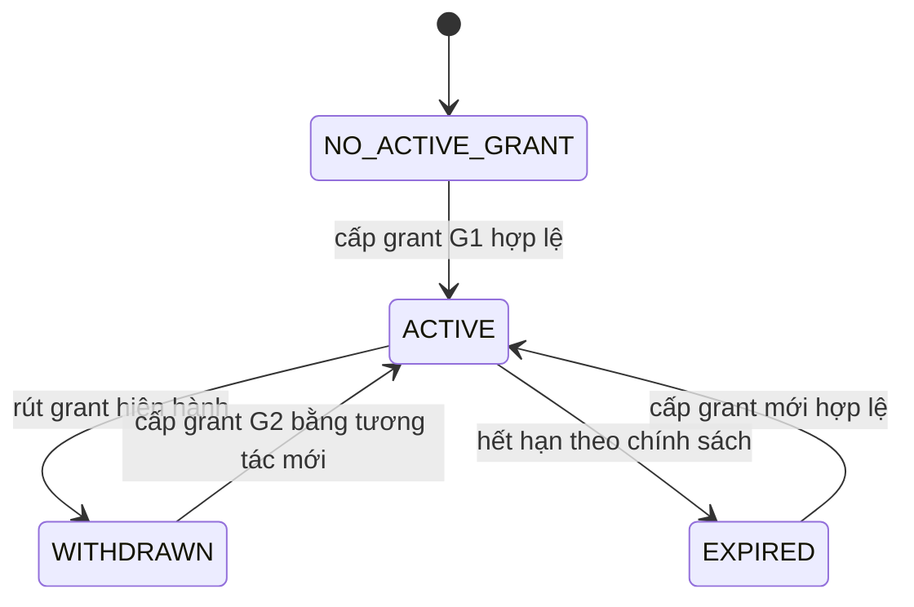

# Consent withdrawal: rút lại sự đồng ý trong luồng nghiệp vụ

## 1. Mục tiêu và phạm vi

Trong chương **Consent Rules**, consent withdrawal là việc chủ thể có thẩm quyền rút lại sự đồng ý đã cấp cho một phạm vi xử lý cụ thể. Hệ thống phải chuyển quyết định đó thành thay đổi có hiệu lực tại các điểm thực sự sử dụng dữ liệu.

Ẩn nút “đăng ký nhận tin” hoặc cập nhật một cột `consent=false` chưa đủ. Công việc cũ có thể còn trong queue, cache vẫn trả trạng thái được phép, hoặc một sự kiện đến muộn có thể ghi đè quyết định mới.

Bài học tập trung vào bảo mật logic nghiệp vụ:

- Ai được rút lại sự đồng ý cho ai và trong phạm vi nào?
- Thời điểm nào quyết định có hiệu lực?
- Công việc đang chờ, đang chạy và đã gửi ra ngoài được xử lý ra sao?
- Retry, replay và cấp lại sự đồng ý có làm trạng thái cũ sống lại không?
- Làm thế nào chứng minh các hệ thống liên quan đã áp dụng thay đổi?

Các mục đích, thời hạn và hành động trong bài là mô hình kỹ thuật minh họa. Chính sách áp dụng thật phải được tổ chức xác lập; bài không đặt ra thời hạn hoặc yêu cầu pháp lý cho một bối cảnh cụ thể.

Sau bài này, bạn có thể thiết kế state machine, transaction, outbox, điểm kiểm tra quyền và bộ kiểm thử cho một quy trình rút consent có thể truy vết.

## 2. Phân biệt consent với các khái niệm liên quan

### 2.1. Consent không phải quyền truy cập

Một nhân viên có quyền sử dụng công cụ gửi thông báo không có nghĩa mọi người nhận đều đã đồng ý với mọi loại thông báo.

Ngược lại, chủ thể đã đồng ý nhận một nội dung không có nghĩa nhân viên được đọc mọi dữ liệu của họ.

Một thao tác có thể cần đồng thời:

```text
đúng tenant
AND actor có quyền thực hiện thao tác
AND dữ liệu được dùng đúng mục đích
AND consent cần thiết đang có hiệu lực cho đúng phạm vi
AND các điều kiện trạng thái và retention đều đạt
```

Rút consent làm thay đổi một điều kiện trong tập điều kiện này. Nó không thay thế kiểm tra quyền theo đối tượng.

### 2.2. Rút consent không tự đồng nghĩa xóa mọi dữ liệu

Cần phân biệt:

| Thao tác | Ý nghĩa kỹ thuật |
|---|---|
| Rút consent | Không còn cho phép hoạt động dựa trên grant bị rút trong phạm vi xác định |
| Xóa dữ liệu | Xử lý các bản dữ liệu theo quy trình và chính sách xóa |
| Hạn chế sử dụng | Ngăn một số mục đích hoặc đường xử lý |
| Đóng tài khoản | Thay đổi vòng đời tài khoản |
| Thu hồi quyền nhân viên | Thay đổi quyền thực hiện thao tác của actor |
| Hủy job | Dừng một ý định xử lý cụ thể |

Rút consent có thể kích hoạt các quy trình khác, nhưng không nên gộp tất cả thành một thao tác xóa không có phạm vi.

Lịch sử tối thiểu về việc rút, dấu ngăn gửi lại và dữ liệu nghiệp vụ có chính sách độc lập cần được thiết kế riêng. Không dùng lý do “giữ audit” để giữ nguyên toàn bộ payload không còn cần thiết.

### 2.3. Không tự đổi mục đích để tiếp tục hoạt động

Nếu một luồng tiếp thị không còn đủ điều kiện consent, hệ thống không được tự gắn nhãn nó thành “thông báo giao dịch” để tiếp tục gửi.

Một luồng có chính sách độc lập phải có mục đích, nội dung, điều kiện và thẩm quyền được xác lập riêng. Nó không phải nhánh dự phòng tùy tiện khi consent bị rút.

## 3. Xác định phạm vi rút consent

### 3.1. Một cờ toàn cục thường thiếu ngữ nghĩa

Một người có thể đồng ý với mục đích này nhưng không đồng ý với mục đích khác, hoặc chỉ đồng ý qua một kênh.

Một khóa phạm vi minh họa:

```text
ConsentScope =
  tenant
  + subject
  + purpose
  + channel
```

Tùy nghiệp vụ có thể cần thêm loại dữ liệu, nhóm bên nhận hoặc bối cảnh. Không nhất thiết mọi hệ thống dùng cùng số chiều, nhưng ngữ nghĩa phải rõ và ổn định.

Ví dụ:

```text
tenant: cửa hàng A
subject: khách hàng U
purpose: product_recommendation
channel: email
```

Rút grant này không tự rút mọi grant qua SMS hoặc cho một mục đích khác. Nếu giao diện có “rút tất cả”, máy chủ phải định nghĩa tập phạm vi mà lựa chọn đó bao phủ.

### 3.2. Phạm vi phải đến từ dữ liệu tin cậy

- Tenant và actor đến từ ngữ cảnh xác thực đã được kiểm chứng.
- Subject phải là người gọi hoặc đối tượng mà người gọi được phép đại diện.
- Purpose và channel phải thuộc danh mục được máy chủ hiểu.
- Quan hệ đại diện phải được kiểm tra theo mô hình quyền của hệ thống.
- Grant được tham chiếu phải thuộc đúng subject và tenant.

Không tin trường `subjectId` trong body như bằng chứng người gọi có quyền thay đổi consent của chủ thể đó.

Một nhân viên hỗ trợ có quyền xem trạng thái chưa chắc có quyền rút hoặc cấp lại consent thay khách hàng.

### 3.3. Thay danh mục mục đích cần kế hoạch chuyển đổi

Nếu hai mục đích được hợp nhất hoặc một mục đích được chia nhỏ, không được tự coi grant cũ là đồng ý cho toàn bộ phạm vi mới.

Cần chính sách ánh xạ, version và điều kiện chuyển đổi. Tên hiển thị mới không phải bằng chứng phạm vi đồng ý vẫn tương đương.

## 4. Mô hình grant, generation và revision

### 4.1. Grant là một sự đồng ý cụ thể

Có thể mô hình hóa:

```text
grant_id
scope
purpose_definition_version
granted_at
expires_at, nếu chính sách có
status
withdrawn_at
revision
evidence_reference
```

Trong đó:

- `grant_id` nhận diện một lần cấp sự đồng ý cụ thể.
- `revision` sắp thứ tự thay đổi trong cùng luồng trạng thái có thẩm quyền.
- `evidence_reference` tham chiếu bằng chứng cần thiết, không nhất thiết chứa bản sao toàn bộ tương tác.
- Trạng thái hiện tại không được suy ra chỉ từ việc từng có sự kiện grant trong lịch sử.

### 4.2. Cấp lại consent tạo generation mới

Một mô hình trạng thái minh họa:



Mũi tên từ `WITHDRAWN` sang `ACTIVE` không có nghĩa sửa lịch sử G1 thành chưa từng bị rút. Grant cũ vẫn đã bị rút; trạng thái hiện hành trỏ đến grant mới.

Nhờ đó, job gắn với G1 không tự được chạy lại khi có G2.

### 4.3. Revision và grant ID giải quyết hai vấn đề khác nhau

- Revision giúp bỏ qua sự kiện cũ hoặc phát hiện cạnh tranh.
- Grant ID giúp phân biệt hai lần đồng ý khác nhau cho cùng scope.

Chỉ so sánh `consent=true` là không đủ. Một job của grant cũ có thể nhìn thấy cờ true của grant mới rồi tiếp tục trái ý định ban đầu.

Revision chỉ có ý nghĩa trong phạm vi sắp thứ tự đã định nghĩa. Không so một số revision của subject A với subject B như thể đó là đồng hồ toàn cục.

## 5. Ngữ nghĩa của lệnh withdrawal và retry

### 5.1. Chọn rõ lệnh đang nhắm tới điều gì

Có hai hợp đồng khác nhau:

1. Rút một grant cụ thể mà người dùng đã nhìn thấy.
2. Rút grant đang có hiệu lực trong một tập scope tại thời điểm commit.

Cả hai đều có thể được thiết kế, nhưng không được dùng lẫn mà thiếu thông tin cho người gọi.

Trong ví dụ xuyên suốt, lệnh nhắm vào **grant cụ thể**:

```text
scope
target_grant_id
idempotency_key
```

Nếu grant đó vẫn đang active, lệnh rút nó. Nếu nó đã bị rút, lệnh có thể trả kết quả đã áp dụng mà không tạo tác động mới.

Nếu đã có grant mới G2, một lệnh cũ nhắm G1 không được âm thầm rút G2 hoặc báo rằng “không còn consent nào” trong khi G2 đang active. API cần phản hồi phù hợp và cung cấp trạng thái hiện hành theo quyền.

Với hợp đồng “rút mọi scope hiện hành”, cần xử lý tập scope và điểm commit theo chính ngữ nghĩa đó. Không suy diễn từ một request cũ vốn chỉ nói về G1.

### 5.2. Idempotency không phải phép phát lại trạng thái lịch sử

Có thể ràng buộc key theo:

```text
tenant + authorized_actor + operation + idempotency_key
```

và lưu fingerprint gồm subject, scope, grant đích cùng nội dung lệnh cần thiết.

- Cùng key và cùng nội dung: không lặp tác động.
- Cùng key nhưng nội dung khác: lỗi xung đột.
- Retry không ghi lại `withdrawn_at` thành thời điểm mới.
- Retry không phát thêm lệnh gửi hoặc tạo grant mới.
- Trả kết quả lịch sử cần phân biệt với trạng thái consent hiện tại.

Ví dụ, một lệnh cấp G1 từng thành công không được trở thành cách kích hoạt lại G1 khi replay sau withdrawal. Kết quả “đã cấp lúc trước” không đồng nghĩa “đang được phép sử dụng”.

### 5.3. Lệnh cũ và cạnh tranh với cấp lại consent

Một lệnh withdrawal bị trễ và một tương tác cấp lại consent có thể cùng tới hệ thống.

Cần thứ tự có thẩm quyền và kiểm tra grant đích. Không dựa vào timestamp client để quyết định tương tác nào mới hơn.

Nếu có xung đột, phản hồi phải phản ánh đúng kết quả. Không báo đã rút toàn bộ trong khi lệnh chỉ được áp dụng lên một grant cũ.

Cấp lại consent phải xuất phát từ hành động mới đáp ứng chính sách của luồng cấp. Một message đồng bộ, retry hoặc cập nhật hồ sơ thông thường không được tự tạo sự đồng ý mới.

## 6. Thời điểm có hiệu lực và giới hạn của propagation

### 6.1. Tách ba mốc

| Mốc | Ý nghĩa |
|---|---|
| `received_at` | Dịch vụ nhận lệnh |
| `effective_at` | Trạng thái rút được commit tại nguồn có thẩm quyền |
| `propagation_completed_at` | Các thành phần trong phạm vi đã xác nhận áp dụng theo tiêu chí |

Nhận request không có nghĩa đã commit. Commit ở nguồn không có nghĩa mọi queue, cache hoặc đối tác đã xử lý xong.

Phản hồi cần phân biệt “đã áp dụng tại nguồn, đang đồng bộ phần còn lại” với “toàn bộ phạm vi đã hoàn tất”.

Nếu hệ thống chỉ nhận một tác vụ chưa thực thi, không nên mô tả rằng consent đã được rút có hiệu lực.

### 6.2. Điểm cắt của hành động phải được định nghĩa

Giả sử hệ thống gửi email:

```text
T0: job được tạo khi G1 active
T1: withdrawal G1 được commit
T2: worker chuẩn bị gửi
```

Job được tạo trước T1 không tự có quyền gửi tại T2. Worker phải kiểm tra lại và từ chối nếu chưa vượt điểm cắt đã xác lập.

Nhưng nếu một tác động đã đi qua điểm không thể hủy trước T1, không thể hứa nó sẽ biến mất sau withdrawal. Ví dụ, dữ liệu đã được bên nhận chấp nhận không thể bị lấy lại chỉ bằng một cập nhật database.

### 6.3. Đọc trạng thái rồi gửi không tạo tính nguyên tử

Mẫu có cuộc đua:

```text
worker đọc G1 active
withdrawal commit
worker gửi ra ngoài dựa trên lần đọc cũ
```

Cần định nghĩa thứ tự giữa withdrawal và việc cho phép bắt đầu tác động.

Một thiết kế có thể tuần tự hóa việc claim quyền dispatch và withdrawal tại nguồn có thẩm quyền:

- Withdrawal commit trước claim: claim bị từ chối.
- Claim hợp lệ commit trước withdrawal: tác vụ được phân loại là đang thực hiện theo hợp đồng, với khả năng hủy được xác định riêng.

Claim phải sát thời điểm dispatch, có phạm vi nhỏ và thời hạn phù hợp. Không đặt trước quyền gửi cho cả chiến dịch nhiều ngày rồi coi tất cả là đang thực hiện.

Ngay cả cơ chế này cũng không làm transaction trong database bao trùm mạng và hệ thống đối tác. Nó xác lập thứ tự và ranh giới trách nhiệm; khả năng dừng tác động ngoài hệ thống cần giao thức tương ứng.

### 6.4. Không che khoảng trễ bằng lời hứa quá rộng

Nếu hệ thống cho phép cache cũ trong một khoảng thời gian hoặc chỉ đồng bộ đối tác theo lô, phải mô tả phạm vi bảo đảm tương ứng.

Một sự kiện withdrawal bất đồng bộ giúp truyền thay đổi, nhưng không tự bảo đảm mọi tác động sau `effective_at` bị chặn.

Với hành động yêu cầu quyết định hiện hành, cần gate tại điểm thực thi hoặc cơ chế cấp phép có bảo đảm nhất quán phù hợp.

## 7. Transaction tại nguồn có thẩm quyền

### 7.1. Điều kiện trước khi cập nhật

Trước transaction, máy chủ cần:

- Xác thực hoặc kiểm chứng capability của luồng withdrawal.
- Kiểm tra actor được phép tác động đến subject và scope.
- Kiểm tra định dạng, kích thước và grant đích.
- Bảo vệ request khỏi giả mạo tương ứng với cơ chế xác thực.
- Chuẩn hóa fingerprint theo hợp đồng.

Việc rút consent cần có đường thực hiện phù hợp; không nên biến thành yêu cầu quyền quản trị hoặc một chuỗi thao tác không cần thiết. Cách xác minh chủ thể vẫn phải ngăn người khác tùy tiện thay đổi lựa chọn của nạn nhân.

### 7.2. Pseudocode

Giả sử trạng thái consent, binding idempotency, audit và outbox cùng nằm trong một kho giao dịch phù hợp:

```text
authenticate_or_verify_withdrawal_capability()
authorize_subject_and_scope()

BEGIN TRANSACTION

  acquire_or_insert_idempotency_binding()

  if binding already exists:
      require_same_fingerprint()
      return_historical_command_result_with_current_state_semantics()
      COMMIT

  lock_current_scope_state()

  require_target_grant_matches_command_contract()

  if target grant is already withdrawn:
      store_idempotent_command_result()
      COMMIT
      return already_applied

  require_valid_transition_to_WITHDRAWN()

  update grant:
      status = WITHDRAWN
      withdrawn_at = authoritative_time
      revision = revision + 1

  append_minimal_audit_record()
  append_withdrawal_event_to_outbox()
  store_command_result()

COMMIT

return effective_result
```

Trong một triển khai thật, các nhánh trả kết quả cần được cấu trúc phù hợp với giao dịch của framework. Điểm cốt lõi là không có khoảng trạng thái “đã rút nhưng không còn dấu để phát sự kiện” do ghi riêng rẽ.

Nếu các dữ liệu nằm ở nhiều hệ thống, cần giao thức phối hợp và đối soát riêng; không giả định pseudocode này tạo transaction xuyên dịch vụ.

### 7.3. Outbox và consumer

Outbox giúp gắn thay đổi bền vững với ý định phát sự kiện. Message vẫn có thể được chuyển đến nhiều lần.

Một sự kiện có thể gồm:

```text
event_id
scope_reference
grant_id
revision
new_status
effective_at
policy_version
correlation_reference
```

Không đưa toàn bộ hồ sơ cá nhân vào event nếu consumer chỉ cần biết scope và grant đã mất hiệu lực.

Consumer cần khử trùng lặp, xử lý đúng thứ tự trong cùng scope và đồng bộ lại khi thấy khoảng trống version. Không ghi đè một trạng thái mới bằng event cũ chỉ vì event đó vừa đến.

## 8. Xử lý job đang chờ, đang chạy và trạng thái chưa rõ

### 8.1. Công việc phải gắn với grant cụ thể

Một job có thể lưu:

```text
job_id
subject_and_tenant_reference
purpose
channel
grant_id
consent_revision_at_creation
job_state
dispatch_attempt_reference
```

Revision lúc tạo giúp truy vết, không phải giấy phép chạy vĩnh viễn.

Khi xử lý, worker cần xác nhận công việc vẫn phù hợp với scope, grant và trạng thái hiện hành. Không lấy một cờ `eligible=true` trong payload cũ làm bằng chứng cuối cùng.

### 8.2. Cách xử lý theo trạng thái

| Trạng thái công việc | Phản ứng cần định nghĩa |
|---|---|
| `QUEUED` | Hủy hoặc đánh dấu không còn đủ điều kiện; gate cuối vẫn phải chặn |
| `PREPARING` | Dừng tại checkpoint, không phát hành kết quả chưa được phép |
| `DISPATCH_AUTHORIZED` | Xử lý theo hợp đồng điểm cắt và khả năng hủy thực tế |
| `PROVIDER_ACCEPTED` | Yêu cầu hủy nếu giao thức hỗ trợ; không tự khẳng định đã thu hồi |
| `DELIVERED` | Không đổi lịch sử thành chưa từng gửi; ngăn hoạt động tiếp theo trong phạm vi |
| `DELIVERY_UNKNOWN` | Đối soát kết quả; không tự gửi lại chỉ vì timeout |
| `FAILED_RETRYABLE` | Kiểm tra consent lại trước retry; không mặc định dùng quyền cũ |

Đánh dấu mọi job là `CANCELLED` ngay khi nhận event withdrawal có thể làm báo cáo sai. Có job đã giao ra ngoài hoặc chưa xác định được kết quả.

Trạng thái consent và trạng thái thực hiện phải được liên kết nhưng không được thay thế nhau.

### 8.3. Retry ra đối tác và idempotency

Nếu một lệnh gửi bị timeout, hệ thống chưa chắc biết đối tác đã nhận hay chưa.

Cần:

- Giữ định danh ổn định của thao tác gửi.
- Dùng cơ chế chống lặp của đối tác nếu có và đúng hợp đồng.
- Đối soát trạng thái thay vì phát lệnh mới tùy tiện.
- Kiểm tra withdrawal trước khi thực hiện một retry còn có thể tạo tác động.
- Không dùng idempotency như lý do bỏ qua consent gate.

Một retry chỉ để đọc trạng thái thao tác đã gửi khác với retry có thể gửi nội dung thêm lần nữa.

### 8.4. Không tự làm sống lại job khi có grant mới

Giả sử:

```text
G1 active -> tạo job J1
G1 withdrawn -> J1 bị hủy
G2 active -> người dùng cấp lại consent
```

J1 không tự trở lại hàng đợi chỉ vì consent hiện tại là active.

Nếu hệ thống muốn tạo công việc dưới G2, cần một quyết định đủ điều kiện mới theo chính sách, gắn với grant và phạm vi mới. Nội dung cũ, thời gian gửi và dữ liệu đã hết hạn cũng cần được đánh giá lại.

## 9. Gate kiểm tra grant bằng Java

Ví dụ sau biểu diễn một bước đánh giá trước khi xin quyền dispatch. Nó không tự gọi đối tác và không tạo bảo đảm nguyên tử giữa database với mạng.

```java
import java.time.Instant;
import java.util.Objects;

public final class ConsentGate {
    public enum Status {
        ACTIVE,
        WITHDRAWN,
        EXPIRED
    }

    public record Scope(
            String tenantId,
            String subjectId,
            String purpose,
            String channel) {

        public Scope {
            Objects.requireNonNull(tenantId);
            Objects.requireNonNull(subjectId);
            Objects.requireNonNull(purpose);
            Objects.requireNonNull(channel);
        }
    }

    public record Snapshot(
            Scope scope,
            String grantId,
            long revision,
            Status status,
            Instant expiresAt) {

        public Snapshot {
            Objects.requireNonNull(scope);
            Objects.requireNonNull(grantId);
            Objects.requireNonNull(status);

            if (grantId.isBlank() || revision < 0) {
                throw new IllegalArgumentException("Invalid consent snapshot");
            }
        }
    }

    public record WorkBinding(Scope scope, String grantId) {
        public WorkBinding {
            Objects.requireNonNull(scope);
            Objects.requireNonNull(grantId);
        }
    }

    public record Decision(
            boolean eligible,
            String reason,
            long observedRevision) {
    }

    public static Decision evaluate(
            Snapshot current,
            WorkBinding work,
            Instant serverNow) {

        Objects.requireNonNull(work);
        Objects.requireNonNull(serverNow);

        if (current == null) {
            return new Decision(false, "NO_CURRENT_GRANT", -1);
        }

        if (!current.scope().equals(work.scope())) {
            return new Decision(false, "SCOPE_MISMATCH", current.revision());
        }

        if (!current.grantId().equals(work.grantId())) {
            return new Decision(false, "OLD_GRANT", current.revision());
        }

        if (current.status() != Status.ACTIVE) {
            return new Decision(false, "GRANT_NOT_ACTIVE", current.revision());
        }

        // expiresAt == null chi hop le khi policy cho phep grant khong co han.
        if (current.expiresAt() != null
                && !serverNow.isBefore(current.expiresAt())) {
            return new Decision(false, "GRANT_EXPIRED", current.revision());
        }

        return new Decision(true, "ELIGIBLE_FOR_DISPATCH_CHECK", current.revision());
    }
}
```

Những điều kiện tích hợp quan trọng:

- Snapshot phải đến từ nguồn đủ tin cậy cho mức bảo đảm của hành động.
- Scope phải được chuẩn hóa và kiểm chứng ở tầng dựng dữ liệu; record không tự xác thực quyền.
- `expiresAt=null` phải có nghĩa được chính sách cho phép, không phải dữ liệu thiếu được ngầm cho qua.
- `eligible=true` không phải lệnh gửi ngay hoặc kết luận mọi điều kiện khác đã đạt.
- Claim dispatch cần kiểm tra lại revision, grant và trạng thái trong cơ chế tuần tự hóa đã chọn.
- Nếu revision thay đổi giữa evaluate và claim, phải đánh giá lại hoặc từ chối theo hợp đồng.
- Worker không được dùng kết quả gate từ nhiều giờ trước để gửi.
- Quyền theo đối tượng, retention và điều kiện nội dung vẫn phải được kiểm tra riêng.

Ví dụ dùng cú pháp record của Java 17. Một unit test cho hàm này không chứng minh cuộc đua giữa withdrawal và dispatch đã được xử lý.

## 10. Cache, projection và sự kiện đến sai thứ tự

### 10.1. Cache cũ có thể tiếp tục cho phép hoạt động

Sau khi withdrawal commit, một positive cache cũ có thể vẫn nói G1 active.

Cần xác định rõ:

- Hành động nào được dùng cache và với độ cũ tối đa bao nhiêu.
- Hành động nào phải dùng quyết định hiện hành tại nguồn.
- Cách invalidation hoặc version được truyền.
- Cách xử lý khi không thể xác định độ mới.
- Hành vi khi dịch vụ consent không sẵn sàng.

Đối với hoạt động cần consent hiện hành, không được ngầm chuyển từ lỗi kiểm tra sang “dùng lần active cuối cùng vô thời hạn”.

Negative cache cũ có thể làm chậm việc dùng grant mới, ảnh hưởng khả năng phục vụ. Đây là vấn đề khác với positive cache cũ tiếp tục cho phép hoạt động đã bị rút. Cả hai đều cần quan sát và hợp đồng rõ.

### 10.2. Projection phải chống ghi lùi

Ví dụ trong cùng scope:

```text
revision 10: G1 active
revision 11: G1 withdrawn
revision 12: G2 active
```

Consumer đã có revision 12 không được áp event revision 10 để khôi phục G1.

Tuy nhiên, việc không ghi đè projection hiện tại không đồng nghĩa có thể bỏ mọi tác động điều phối của event cũ. Một event rút G1 vẫn có thể cần hủy job gắn G1 nếu bước dọn đó chưa chạy.

Nên phân biệt:

- Cập nhật trạng thái consent hiện hành theo revision.
- Xử lý tác vụ theo grant cụ thể với cơ chế idempotency riêng.

Gate cuối gắn grant giúp ngăn J1 sử dụng G2, nhưng không thay thế việc dọn backlog và đối soát.

### 10.3. Khoảng trống sự kiện và khôi phục

Nếu consumer thấy revision nhảy từ 10 lên 13, nó không nên tự suy đoán rằng mọi bước giữa đã hoàn tất.

Có thể cần đọc lại trạng thái hiện hành và danh sách tác vụ phải xử lý theo giao thức. Một snapshot active hiện tại cũng chưa đủ để biết job của grant cũ nào cần hủy nếu hệ thống đã làm mất lịch sử điều phối.

Backup, import danh sách hoặc đồng bộ hồ sơ không được coi là nguồn tự cấp lại consent. Quyết định hiện hành và generation phải được bảo vệ khi phục hồi.

## 11. Phối hợp với hệ thống nhận và dữ liệu đã được chuyển

### 11.1. Lập phạm vi propagation

Một workflow có thể liên quan:

- Dịch vụ consent có thẩm quyền.
- Bộ lập lịch và hàng đợi.
- Worker chuẩn bị nội dung.
- Cache hoặc projection phục vụ quyết định.
- Nhà cung cấp truyền thông.
- Kho phân tích hoặc hệ thống khác sử dụng cùng mục đích.

Cần biết thành phần nào có thể dừng việc mới, hủy việc chờ, xử lý dữ liệu đã nhận hoặc chỉ xác nhận trạng thái.

Không gửi cùng một lệnh “delete everything” cho mọi thành phần nếu ngữ nghĩa thực tế chỉ là không tiếp tục dùng grant cho một mục đích.

### 11.2. Xác nhận phải phản ánh đúng điều đã xảy ra

Có thể theo dõi:

```text
withdrawal_operation_id
scope_reference
grant_id
effective_revision
required_components
component_status
last_attempt_at
verified_at
unresolved_effects
```

Các trạng thái thành phần có thể là chờ, đã áp dụng, lỗi, cần đối soát hoặc không thể hủy tác động đã hoàn tất.

Queue xác nhận đã nhận message không đồng nghĩa bên thực thi đã chặn gửi. Đối tác trả thành công cho một yêu cầu cũng cần được diễn giải đúng theo hợp đồng, không tự suy rộng.

### 11.3. Dấu chặn và dữ liệu tối thiểu

Một hệ thống có thể cần giữ một dấu tối thiểu để ngăn import danh sách cũ làm hoạt động bắt đầu lại.

Dấu này cần mục đích, thời hạn, quyền truy cập và phạm vi rõ ràng. Nó không phải lý do giữ toàn bộ hồ sơ người dùng mãi mãi.

Nếu dùng mã giả danh hoặc HMAC để giảm dữ liệu thô, vẫn phải đánh giá khả năng liên kết và bảo vệ khóa. Không mặc định metadata chống gửi lại là vô danh.

### 11.4. Đừng hứa thu hồi điều không thể thu hồi

Nội dung đã đến người nhận hoặc đã được xử lý bên ngoài không tự biến mất khi cờ consent đổi trạng thái.

Hệ thống cần ngăn hoạt động tiếp theo trong phạm vi, thực hiện các quy trình bổ sung theo chính sách và ghi nhận điều chưa giải quyết được. Không sửa audit để tạo cảm giác chưa từng có hoạt động.

## 12. Bảo vệ endpoint withdrawal

### 12.1. Quyền theo đối tượng và đại diện

Các tình huống cần kiểm tra:

- Người dùng rút cho chính họ.
- Người đại diện rút trong phạm vi được ủy quyền.
- Nhân viên xử lý theo một quy trình có thẩm quyền.
- Chủ thể dùng luồng không có session qua capability được kiểm chứng.

Quyền quản trị một tenant không tự động chứng minh được phép tạo sự đồng ý thay mọi chủ thể. Quyền rút và quyền cấp có thể khác nhau.

Mọi thay đổi phải được gắn với actor thực sự, subject và cơ chế thẩm quyền tương ứng.

### 12.2. Capability hoặc token rút nhanh

Một luồng rút không đăng nhập có thể dùng token được máy chủ xác minh, giới hạn theo subject, mục đích, kênh và hành động.

Token đó không được:

- Dùng để cấp lại consent.
- Trở thành token đăng nhập.
- Cho phép đọc toàn bộ hồ sơ.
- Mở rộng phạm vi theo body do người gọi sửa.
- Tác động tenant hoặc grant ngoài hợp đồng.

Cần kiểm soát replay theo ngữ nghĩa idempotent, thời hạn và quy trình thay thế khi token không còn dùng được.

Vì token có thể mang quyền thay đổi trạng thái, phải tránh lộ qua log, analytics hoặc các đường thu thập URL không phù hợp.

Nếu luồng có preview hoặc bước xác nhận, cần xét việc phần mềm tự mở liên kết không được vô tình thực hiện thay đổi ngoài thiết kế. Cách tương tác phải khớp với hợp đồng của kênh đã chọn.

### 12.3. Chống giả mạo và lạm dụng tài nguyên

Với session cookie, cần bảo vệ request thay đổi trạng thái theo mô hình chống giả mạo của ứng dụng.

Rate limit có thể bảo vệ endpoint khỏi spam, nhưng không được biến thành một cờ làm mất khả năng rút consent trong thời gian không xác định. Cần phản hồi và đường thử lại phù hợp, đặc biệt với nhiều người dùng chung nguồn.

Thông báo lỗi và tra cứu trạng thái không nên làm lộ consent của một subject mà người gọi không có quyền xem.

## 13. Audit, receipt và retention

### 13.1. Ghi đủ để giải thích

Một audit tối thiểu có thể gồm:

```text
command_reference
actor_reference
subject_and_scope_reference
target_grant_id
previous_status
new_status
effective_revision
effective_at
authority_method
policy_version
propagation_reference
```

Không cần sao chép toàn bộ nội dung đã xử lý, hồ sơ cá nhân hoặc token rút vào audit.

Thời hạn của audit, idempotency binding và dấu chặn cần được thiết kế theo mục đích tương ứng. Xóa chúng quá sớm có thể làm mất khả năng chống replay; giữ nguyên mọi payload vô hạn cũng không phải giải pháp.

### 13.2. Receipt phải có ngữ nghĩa rõ

Một kết quả cho người dùng có thể phân biệt:

- Lệnh đã được nhận nhưng chưa áp dụng.
- Grant đã bị rút có hiệu lực tại nguồn.
- Các thành phần còn đang xử lý.
- Có tác động đã vượt điểm có thể hủy.
- Có grant mới hiện hành khác grant của lệnh cũ, nếu người gọi được phép biết.

Không dùng một dấu tích duy nhất để biểu đạt mọi mức hoàn tất.

Thông tin hiện hành phải đến từ trạng thái hiện hành. Receipt của một lệnh cũ không được hiểu thành bảo đảm rằng không bao giờ có grant mới sau đó.

### 13.3. Thay đổi mục đích hoặc dữ liệu sau withdrawal

Các quy trình xóa, giảm dữ liệu, retention hoặc hạn chế sử dụng cần được liên kết đúng phạm vi và có trạng thái riêng.

Không hủy tùy tiện một giao dịch tài chính đã hoàn tất chỉ vì một consent tiếp thị bị rút. Nếu một loại tác vụ có điều kiện consent riêng, phải định nghĩa quan hệ đó tại chính nghiệp vụ.

Sự liên kết giữa các quy trình phải dựa trên chính sách rõ ràng, không dựa vào suy đoán rằng mọi thứ đều là cùng một “consent”.

## 14. Chính sách lỗi, đối soát và quan sát

### 14.1. Chính sách khi phụ thuộc lỗi

| Sự cố | Hành vi cần xác lập |
|---|---|
| Nguồn consent chưa commit được | Không báo đã áp dụng có hiệu lực |
| Không kiểm tra được consent tại gate bắt buộc | Trì hoãn hoặc từ chối hoạt động cần consent theo chính sách |
| Outbox chưa phát được event | Giữ ý định bền vững, retry và theo dõi độ trễ |
| Một consumer không áp dụng được | Không báo propagation hoàn tất; có đối soát |
| Đối tác timeout sau lệnh gửi | Phân loại kết quả chưa rõ, không gửi lại mù quáng |
| Cache không xác định được độ mới | Không mặc định active vô hạn |
| Audit hoặc projection lệch | Đối soát từ nguồn có thẩm quyền và lịch sử thao tác |
| Restore từ bản cũ | Áp quyết định và generation hiện hành trước khi mở xử lý |

Với luồng không phụ thuộc consent đang rút, hệ thống vẫn áp dụng chính sách độc lập của luồng đó. Không dùng lỗi consent như lý do bỏ qua quyền hoặc chuyển mục đích một cách tùy tiện.

### 14.2. Đối soát cần phát hiện điều gì?

- Grant đã rút nhưng còn job có khả năng dispatch.
- Job gắn grant cũ lại được kích hoạt dưới grant mới.
- Consumer báo áp dụng nhưng projection hoặc gate vẫn active sai.
- Lệnh withdrawal không có event cần thiết.
- Event đã phát nhưng chưa có xác nhận xử lý.
- Thao tác gửi có kết quả chưa rõ sau withdrawal.
- Import hoặc restore làm trạng thái active cũ xuất hiện lại.

Đối soát không được tự tạo grant để “sửa” một trạng thái không khớp. Khi thiếu bằng chứng, không suy ra sự đồng ý.

### 14.3. Chỉ số vận hành

| Nhóm | Chỉ số gợi ý |
|---|---|
| Tiếp nhận | Lệnh thành công, xung đột, retry và lỗi quyền |
| Hiệu lực | Độ trễ từ nhận đến commit tại nguồn |
| Propagation | Thành phần chưa xác nhận, tuổi tác vụ và lỗi lặp |
| Thực thi | Dispatch bị chặn do withdrawn, expired hoặc old grant |
| Cuộc đua | Tác vụ đã claim trước withdrawal, tác vụ sau boundary bị từ chối |
| Tác động ngoài hệ thống | Đã chấp nhận, đã hủy, chưa rõ kết quả, không thể thu hồi |
| Chống replay | Event cũ, grant cũ, import và restore bị ngăn |
| Khả năng phục vụ | Người dùng không hoàn tất được withdrawal, luồng thử lại và lỗi kéo dài |

“Đã xử lý nhiều event withdrawal” không chứng minh đúng. Cần kiểm tra hoạt động thực tế sau boundary và phân loại riêng công việc đã ở trạng thái đang thực hiện theo hợp đồng.

### 14.4. Version hóa và rollback

Version hóa scope, chính sách, giao thức sự kiện và logic gate.

Rollback phần mềm không được khôi phục consent đã rút từ một snapshot cũ. Trạng thái người dùng đã lựa chọn phải được bảo toàn qua triển khai.

Nếu chạy shadow cho logic mới, chỉ ghi quyết định giả định; không tạo grant, withdrawal hoặc lệnh gửi thật lần thứ hai.

## 15. Bộ tình huống kiểm thử

| Tình huống | Kết quả cần xác nhận |
|---|---|
| Rút đúng grant active | Chuyển trạng thái hợp lệ, có effective revision và outbox |
| Retry cùng key, cùng nội dung | Không lặp tác động hoặc đổi thời điểm rút |
| Cùng key, khác scope hoặc grant | Xung đột, không tác động nhầm đối tượng |
| Hai withdrawal đồng thời | Kết quả nhất quán, không phát tác động trùng ngoài hợp đồng |
| Rút grant của tenant khác | Bị từ chối theo quyền đối tượng |
| Actor không có quyền đại diện | Không thay đổi consent của subject khác |
| Job còn chờ khi withdrawal commit | Không dispatch dựa trên snapshot lúc tạo |
| Gate đọc active rồi withdrawal xảy ra | Claim cuối giải quyết theo revision và điểm cắt |
| Claim commit trước withdrawal | Phân loại đúng tác vụ đang thực hiện, kiểm chứng khả năng hủy |
| Đối tác nhận xong nhưng phản hồi mất | Không tự gửi lại tạo tác động mới |
| G1 withdrawn rồi G2 active | Job G1 không tự được phép chạy |
| Withdrawal cũ nhắm G1 đến sau G2 | Thực thi đúng hợp đồng, không báo sai trạng thái G2 |
| Event active cũ đến sau withdrawal | Không ghi lùi projection |
| Event rút G1 đến sau event cấp G2 | Không hạ G2; vẫn xử lý việc dọn G1 nếu cần |
| Consumer bỏ lỡ một revision | Có cơ chế đồng bộ lại, không đoán trạng thái |
| Cache vẫn giữ active cũ | Gate có mức nhất quán đúng với hành động |
| Dịch vụ consent lỗi | Không gửi theo active cũ vô hạn trong luồng cần consent hiện hành |
| Token rút bị sửa scope | Không mở rộng quyền thay đổi |
| Token rút dùng để cấp lại | Bị từ chối |
| Import danh sách hoặc restore cũ | Không cấp lại consent từ dữ liệu lịch sử |
| Replay lệnh grant cũ sau withdrawal | Không kích hoạt lại grant đã rút |
| Rút email cho một purpose | Không tác động scope khác ngoài lựa chọn được xác lập |
| Chọn rút tất cả | Phạm vi và mức hoàn tất đúng hợp đồng |
| Một thành phần propagation lỗi | Không báo hoàn tất toàn bộ, có retry và đối soát |
| Rollback ứng dụng | Không phục hồi trạng thái active cũ |
| Receipt cũ được đọc sau cấp lại | Phân biệt lịch sử thao tác và trạng thái hiện hành |
| Nội dung marketing đổi nhãn thành giao dịch | Máy chủ không cho tự chọn nhãn để né gate |

Kiểm thử cần bao gồm transaction thật, queue, worker và giao thức đối tác ở mức phù hợp. Mock một hàm luôn trả `eligible=true` hoặc chỉ kiểm tra cột boolean không xác nhận được quy trình.

Một kịch bản hữu ích là: cấp G1, tạo job, trì hoãn worker, rút G1, replay event active cũ, cấp G2 rồi cho job G1 chạy. Kết quả đúng phải giữ G2 mà vẫn ngăn công việc cũ dựa trên G1.

## 16. Những lỗi thiết kế thường gặp

| Lỗi | Hậu quả | Hướng sửa |
|---|---|---|
| Chỉ cập nhật boolean | Không phân biệt scope, grant và lịch sử | Mô hình grant, scope, revision |
| Chỉ kiểm tra lúc tạo job | Việc cũ tiếp tục sau withdrawal | Gate tại điểm thực thi |
| Đọc active rồi gửi mà không định nghĩa cuộc đua | Không biết withdrawal thắng hay dispatch thắng | Điểm cắt và cơ chế claim có thẩm quyền |
| Coi transaction database bao trùm đối tác | Hứa khả năng dừng không tồn tại | Giao thức gửi, đối soát và trạng thái in-flight rõ |
| Grant mới làm sống lại queue cũ | Phát sinh hoạt động không được quyết định mới bao phủ | Gắn job với grant cụ thể |
| Bỏ mọi event cũ mà không xét tác vụ theo grant | Có thể bỏ sót hủy job G1 | Tách projection hiện tại khỏi tác vụ idempotent theo grant |
| Nhận message đồng nghĩa hoàn tất | Báo sai propagation | Xác nhận kết quả thực thi theo thành phần |
| Lỗi kiểm tra thì dùng active cuối cùng mãi | Tiếp tục hoạt động đã bị rút | Chính sách lỗi và giới hạn độ cũ |
| Rút consent là xóa mọi bản ghi ngay | Có thể phá invariant và mất dấu chống replay | Các workflow riêng, phạm vi và retention riêng |
| Tự đổi purpose khi bị chặn | Né quyết định của chủ thể | Danh mục và điều kiện do máy chủ kiểm soát |
| Import hồ sơ được coi là đồng ý mới | Dữ liệu cũ khôi phục consent | Luồng cấp consent có bằng chứng mới |
| Rollback cả trạng thái người dùng | Consent bị phục hồi trái ý định | Bảo toàn trạng thái có thẩm quyền qua triển khai |

## 17. Bài tập áp dụng

Bạn vận hành hệ thống đa tenant gửi gợi ý sản phẩm qua email và SMS. Job được xếp hàng, một đối tác thực hiện truyền thông, còn người dùng có thể thay đổi lựa chọn trên nhiều thiết bị.

Hãy thiết kế quy trình bằng cách trả lời:

1. Scope có những chiều nào và lựa chọn “rút tất cả” bao phủ gì?
2. Actor được rút cho subject dựa trên bằng chứng nào?
3. Grant ID và revision được cấp, lưu và sử dụng ra sao?
4. Lệnh nhắm grant cụ thể hay trạng thái hiện hành tại commit?
5. Khi nào được thông báo đã có hiệu lực và khi nào được báo hoàn tất propagation?
6. Điểm cắt giữa job còn chờ và tác động đang thực hiện nằm ở đâu?
7. Nếu claim trước withdrawal nhưng đối tác nhận sau withdrawal, hệ thống mô tả và xử lý thế nào?
8. Một timeout của đối tác có thể được retry mà không lặp tác động ra sao?
9. G2 được cấp sau khi rút G1 có làm các job G1 chạy lại không?
10. Consumer nhận event sai thứ tự vừa giữ trạng thái mới vừa dọn job cũ như thế nào?
11. Audit, dấu chống import lại và dữ liệu liên quan được giữ theo mục đích nào?
12. Những kiểm thử nào chứng minh rollback, restore và retry không tạo lại sự đồng ý?

Một thiết kế hoàn chỉnh phải gắn quyết định của chủ thể với đúng scope, đúng grant và đúng thời điểm thực thi. Rút consent chỉ có ý nghĩa vận hành khi các đường xử lý thực sự ngừng dựa vào grant đã bị rút, đồng thời phản ánh trung thực những tác động đã vượt điểm có thể hủy.
