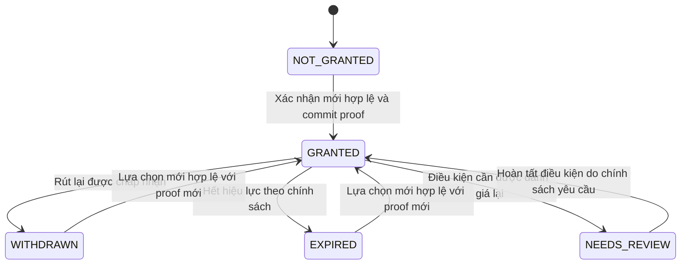

# Consent proof: Bằng chứng cho quyết định đồng ý

## 1. Mục tiêu và phạm vi

**Consent proof** là tập bằng chứng giúp giải thích một quyết định đồng ý đã được ghi nhận như thế nào: ai thực hiện, cho phạm vi nào, dựa trên nội dung nào, bằng hành động nào và tại thời điểm nào trong lịch sử nghiệp vụ.

Trong chương **Consent Rules** của module `SECURITY_APPLICATION_SECURITY_BUSINESS_LOGIC_SECURITY`, bằng chứng đồng ý cần được bảo vệ như một phần của logic nghiệp vụ. Các nguy cơ gồm tự khai danh tính người khác, thay phạm vi sau khi xác nhận, bỏ qua bước kiểm chứng, phát lại yêu cầu cũ hoặc làm một consent đã rút lại trở thành có hiệu lực lần nữa.

Bài học mô tả cơ chế kỹ thuật để ghi và kiểm chứng bằng chứng theo chính sách của sản phẩm. Những mục đích nào cần consent, điều kiện chấp nhận và thời hạn tương ứng phải được xác lập trong chính sách. Việc có một checkbox hoặc một bản ghi trong cơ sở dữ liệu không tự chứng minh toàn bộ điều kiện của chính sách đã được đáp ứng.

Sau bài học, bạn cần có khả năng:

- Xác định những khẳng định mà một consent proof có thể hỗ trợ và giới hạn của chúng.
- Gắn bằng chứng với chủ thể, mục đích, dữ liệu, kênh, người nhận và phiên bản nội dung.
- Thiết kế luồng ghi nhận chống thay payload, giả chủ thể và replay.
- Phân biệt bằng chứng lịch sử với trạng thái consent hiện có hiệu lực.
- Giữ nhất quán giữa proof, state machine, transaction, idempotency và hệ thống nhận.
- Kiểm thử việc rút lại, xác nhận muộn, thay đổi nội dung và yêu cầu đồng thời.

## 2. Consent proof cần chứng minh điều gì?

### 2.1. Những câu hỏi có thể kiểm chứng

| Câu hỏi | Bằng chứng phù hợp | Giới hạn cần hiểu |
| --- | --- | --- |
| Ai thực hiện? | Danh tính đã xác thực hoặc cơ chế kiểm chứng kênh được sản phẩm chấp nhận | Một phiên hợp lệ không tự chứng minh không có chiếm tài khoản |
| Người đó đại diện cho ai? | Quan hệ chủ thể và hồ sơ ủy quyền/đại diện nếu áp dụng | Caller tự gửi `subject_id` không tạo ra quan hệ đại diện |
| Đồng ý điều gì? | Mục đích, loại dữ liệu, hành động, kênh và nhóm nhận được chuẩn hóa | Một cờ `true` không biểu diễn được phạm vi |
| Dựa trên nội dung nào? | Artifact thông báo, ngôn ngữ, biến thể giao diện và phiên bản bất biến | Lưu URL hiện tại không giữ được nội dung lịch sử |
| Hành động xác nhận là gì? | Sự kiện xác nhận và control tương ứng được máy chủ kiểm tra | Truy cập trang hoặc tải một ảnh không tự chứng minh lựa chọn |
| Khi nào được ghi nhận? | Thời gian máy chủ, revision và kết quả commit | Đồng hồ trình duyệt không phải nguồn quyết định thứ tự đáng tin cậy |
| Đã bị thay đổi hoặc rút lại chưa? | Chuỗi sự kiện và trạng thái hiện tại theo cùng phạm vi | Proof của lần cấp ban đầu không trả lời một mình được câu hỏi này |

Mức độ tin cậy phải phù hợp với kiểu ràng buộc chủ thể. Với người dùng đã đăng nhập, có thể gắn hành động với tài khoản trong phiên được kiểm chứng. Với đăng ký qua email không đăng nhập, kiểm chứng quyền kiểm soát hộp thư chỉ hỗ trợ khẳng định tương ứng về kênh đó; không tự chứng minh một danh tính ngoài đời hoặc quyền thay mặt một tài khoản khác.

### 2.2. Phân biệt sự kiện trình bày, xác nhận và hiệu lực

- **Nội dung được phát hành:** hệ thống có một artifact thông báo xác định.
- **Nội dung được cung cấp trong luồng:** máy chủ phục vụ một phiên bản cho lần trình bày cụ thể.
- **Lựa chọn được gửi:** client gửi hành động xác nhận hoặc từ chối.
- **Lựa chọn được chấp nhận:** máy chủ kiểm tra điều kiện và commit thay đổi trạng thái.
- **Consent đang có hiệu lực:** lịch sử và chính sách hiện tại vẫn cho phép sử dụng trong phạm vi đó.

Log “đã gửi HTML” không chứng minh người dùng đã đọc và hiểu nội dung. Consent proof cần ghi đúng điều hệ thống quan sát, không nâng một dấu vết kỹ thuật thành bằng chứng tuyệt đối về ý chí của con người.

### 2.3. Bằng chứng không thay thế các kiểm soát khác

Consent không tự cấp quyền sửa đơn, đổi giá, bỏ qua phê duyệt hay đọc đối tượng của tenant khác. Một tác vụ dùng dữ liệu vẫn phải có quyền theo đối tượng, đúng mục đích, trạng thái hợp lệ và các invariant liên quan.

Tương tự, không coi việc thiếu consent cho một mục đích là kết luận cho mọi mục đích khác. Sản phẩm cần đánh giá từng luồng theo chính sách của nó, thay vì dùng một cờ chung để bật hoặc tắt toàn bộ nghiệp vụ.

## 3. Chuẩn hóa phạm vi trước khi thu thập bằng chứng

### 3.1. Một lựa chọn phải có nghĩa xác định

Ví dụ phạm vi minh họa:

```text
Tenant/sản phẩm: tenant-demo / customer-portal
Chủ thể dữ liệu: subject-42
Mục đích: PROMOTIONAL_OUTREACH
Dữ liệu: CONTACT_EMAIL
Kênh: EMAIL
Nhóm sử dụng/nhận được phép: FIRST_PARTY_MARKETING
Ngôn ngữ nội dung: vi-VN
Phiên bản thông báo: promo-email-notice@4
```

Sản phẩm có thể cần thêm các chiều khác, nhưng phải định nghĩa rõ cách kết hợp và so khớp. Không suy rằng đồng ý email đồng nghĩa đồng ý SMS, hoặc đồng ý một nhóm nhận đồng nghĩa cho mọi đối tác tương lai.

Chủ thể dữ liệu và người thực hiện có thể khác nhau khi có quy trình đại diện. Khi ấy, proof phải biểu diễn riêng hai bên và tham chiếu bằng chứng quyền đại diện mà chính sách yêu cầu. Không chỉ đổi `actor_id` thành `subject_id` để trông như chủ thể tự xác nhận.

### 3.2. Gắn phạm vi với danh mục có phiên bản

Mã mục đích, nhóm dữ liệu, nhóm nhận và kênh phải có định nghĩa được quản lý. Nếu nội dung của `FIRST_PARTY_MARKETING` được âm thầm mở rộng mà giữ nguyên mã, bằng chứng cũ có thể bị diễn giải rộng hơn lựa chọn ban đầu.

Cần giữ phiên bản của các định nghĩa ảnh hưởng đến ý nghĩa lựa chọn. Thay đổi nào cần thu thập lại hoặc đánh giá lại phải được chính sách xác định; không tự chuyển consent lịch sử sang một phạm vi mới chỉ vì cấu trúc dữ liệu mới có thêm trường.

### 3.3. Tách các lựa chọn độc lập

Trong luồng minh họa, lựa chọn quảng bá được trình bày riêng và không được chọn sẵn. Các lựa chọn khác nhau về mục đích hoặc kênh phải có biểu diễn đủ rõ để máy chủ biết chính xác điều được xác nhận.

Không gộp việc chấp nhận điều khoản sử dụng, nhận thông báo nghiệp vụ và đăng ký quảng bá vào một trường `accepted_all`. Nếu chính sách có các điều kiện khác nhau, proof phải giữ được sự khác nhau đó.

## 4. Cấu trúc một bộ bằng chứng

### 4.1. Những thành phần nên có

| Thành phần | Nội dung |
| --- | --- |
| Định danh | Proof ID, event ID, command/operation ID liên kết |
| Ràng buộc chủ thể | Tenant, product scope, subject, actor, cách xác thực/kiểm chứng phù hợp |
| Phạm vi lựa chọn | Purpose, data categories, channel, recipient scope và phiên bản định nghĩa |
| Nội dung trình bày | Artifact ID bất biến, ngôn ngữ, biến thể form/control, tham chiếu digest |
| Hành động | Grant, decline, confirm hoặc withdraw; control và giá trị được xác nhận |
| Ngữ cảnh | Presentation/challenge reference, nguồn thu thập, revision kỳ vọng |
| Thời gian và thứ tự | Server received/recorded time, revision hoặc sequence theo phạm vi |
| Cơ sở chính sách | Policy version, điều kiện được kiểm tra, reference đại diện nếu có |
| Kết quả | Trạng thái chuyển thành, kết quả commit, sự kiện phát đi |

Chỉ lưu các yếu tố cần cho mục tiêu bằng chứng. IP, user agent hoặc thiết bị có thể hữu ích trong một số điều tra nhưng không phải bằng chứng định danh chắc chắn, và chính chúng cũng có thể là dữ liệu nhạy cảm cần quản lý.

### 4.2. Ví dụ sự kiện cấp consent

```json
{
  "schema_version": 1,
  "event_id": "consent-event-501",
  "proof_id": "consent-proof-501",
  "event_type": "CONSENT_GRANTED",
  "tenant_id": "tenant-demo",
  "product_scope": "customer-portal",
  "subject_ref": "subject-42",
  "actor_ref": "subject-42",
  "actor_binding_method": "AUTHENTICATED_ACCOUNT",
  "purpose_code": "PROMOTIONAL_OUTREACH",
  "data_categories": ["CONTACT_EMAIL"],
  "channel": "EMAIL",
  "recipient_scope": "FIRST_PARTY_MARKETING",
  "scope_definition_version": "promo-email-scope@2",
  "notice_artifact_ref": "promo-email-notice@4",
  "notice_digest_ref": "artifact-digest-74",
  "locale": "vi-VN",
  "presentation_ref": "presentation-811",
  "form_variant": "web-promo-email-v3",
  "affirmation": {
    "action": "EXPLICIT_CONFIRM",
    "control_ref": "promo-email-opt-in",
    "selected_value": true
  },
  "challenge_ref": "challenge-712",
  "policy_version": "consent-capture-policy@6",
  "previous_revision": 4,
  "new_revision": 5,
  "server_received_at": "2026-10-05T09:00:00.100Z",
  "recorded_at": "2026-10-05T09:00:00.120Z",
  "resulting_state": "GRANTED"
}
```

Đây là sự kiện do máy chủ tạo sau khi kiểm chứng và commit theo luồng được thiết kế. Không phải payload mà client tự gửi lên để được tin là đã có proof. `notice_digest_ref` trỏ đến metadata digest của artifact, không phải giá trị digest minh họa đã được tính cho một nội dung có thật trong ví dụ.

Nếu đang chờ bước xác nhận bổ sung, phải ghi đúng trạng thái chờ. Không phát `CONSENT_GRANTED` rồi mới hy vọng người dùng hoàn tất xác nhận sau.

### 4.3. Giữ nội dung đã trình bày theo phiên bản bất biến

Artifact nên đủ để tái hiện ý nghĩa lựa chọn: nội dung thông báo, tên lựa chọn, cách gắn control với mục đích, ngôn ngữ và các phần ảnh hưởng phạm vi. Với form có nhiều biến thể, chỉ lưu version của một trang chung có thể không đủ.

Nếu nội dung có phần động, giữ các tham số cần giải thích mà không sao chép thông tin cá nhân dư thừa. Một URL có nội dung thay đổi hoặc một đường dẫn tới “thông báo hiện tại” không giữ được bằng chứng lịch sử.

Digest hỗ trợ kiểm tra artifact có thay đổi so với nội dung được tham chiếu hay không. Nó không chứng minh artifact thật sự được hiển thị trên màn hình, người dùng đã đọc hay hành động không bị ép buộc.

### 4.4. Receipt dành cho người dùng khác với quyền thực thi

Một consent receipt có thể cho người dùng xem phạm vi, nội dung tham chiếu, thời điểm và cách quản lý lựa chọn. Nó không nên chứa session token, challenge token hoặc các bí mật của luồng xác nhận.

Proof ID và receipt ID chỉ là định danh. Biết ID không tự tạo quyền đọc hồ sơ hoặc quyền sử dụng dữ liệu. API tra receipt cần kiểm tra chủ thể/đại diện, tenant và quyền hiện tại của người yêu cầu.

## 5. Luồng thu thập bằng chứng đáng tin cậy

### 5.1. Gắn lựa chọn với một lần trình bày cụ thể

Một luồng minh họa có thể thực hiện:

1. Máy chủ xác định chủ thể, tenant và phạm vi lựa chọn được phép quản lý.
2. Máy chủ chọn artifact đã phát hành, ngôn ngữ và biến thể form phù hợp.
3. Tạo presentation/challenge reference gắn với phạm vi, actor binding, artifact và revision hiện tại.
4. Client trình bày lựa chọn; hành động xác nhận gửi lại reference và lựa chọn cụ thể.
5. Máy chủ kiểm tra danh tính, phạm vi, thời hạn, revision và tính hợp lệ của challenge.
6. Chỉ sau khi các điều kiện đạt, máy chủ commit proof và trạng thái mới.
7. Trả receipt và trạng thái hiện tại; phát sự kiện thay đổi cho các hệ thống liên quan.

Challenge giúp ràng buộc giao thức với đúng nội dung và ngữ cảnh. Nó không tự chứng minh giao diện đã hiển thị đúng trên một client bị sửa hoặc người dùng đã hiểu mọi câu chữ.

Các trường client gửi như `subject_id`, `notice_version`, `purpose` hoặc `recipient_scope` không được tùy ý thay thế dữ liệu đã gắn trên challenge. Nếu không khớp, từ chối hoặc yêu cầu một lần trình bày mới theo chính sách.

### 5.2. Kiểm tra hành động xác nhận thực sự được gửi

Với form yêu cầu xác nhận chủ động, không suy `true` từ việc thiếu trường, gửi một request rỗng, truy cập trang hoặc hoàn tất một tác vụ khác. Máy chủ cần kiểm tra giá trị và control được phép cho phiên bản form tương ứng.

Giá trị không xác định hoặc một mã mục đích lạ phải được xử lý rõ ràng. Không ánh xạ mọi giá trị không rỗng thành đồng ý và không dùng giá trị mặc định để tự mở rộng các lựa chọn chưa được chọn.

Luồng web cần có các biện pháp phù hợp chống gửi yêu cầu giả qua phiên người dùng, giả nguồn form và nhúng giao diện ngoài phạm vi cho phép. Truyền qua kênh được bảo vệ và kiểm soát phiên là phần cần thiết của ràng buộc actor; chúng vẫn không loại bỏ mọi rủi ro chiếm phiên hoặc thao tác trên thiết bị dùng chung.

### 5.3. Khi có bước xác nhận qua kênh

Sản phẩm có thể yêu cầu xác nhận bổ sung qua email hoặc một kênh khác. Token xác nhận nên:

- Khó đoán, có thời hạn và chỉ dùng theo số lần được thiết kế.
- Ràng buộc tenant, chủ thể/kênh, phạm vi, artifact và revision kỳ vọng.
- Được kiểm tra nguồn phát và trạng thái sử dụng trên máy chủ.
- Không xuất hiện nguyên giá trị trong log, analytics hoặc receipt.
- Bị vô hiệu hóa hoặc mất hiệu lực khi ngữ cảnh liên quan không còn phù hợp.

Không nên coi một lượt GET vào link là đủ để cấp consent trong luồng yêu cầu lựa chọn chủ động. Công cụ quét email, preview hoặc prefetch có thể tự mở link. Có thể dùng link để mở trang xác nhận, rồi yêu cầu hành động xác nhận rõ và kiểm tra lại ngữ cảnh theo thiết kế.

Việc hoàn tất bước này có thể chứng minh quyền kiểm soát kênh ở mức giao thức đã chọn. Không trình bày nó như bằng chứng tuyệt đối rằng một người có tên cụ thể đã đọc nội dung hoặc rằng mọi điều kiện khác đều tự động hợp lệ.

### 5.4. Đừng tạo bằng chứng giả từ import

Một file có cột `consent=true` không đủ để tạo các proof như thể người dùng vừa xác nhận. Khi nhập dữ liệu từ nguồn khác, cần lưu nguồn, cách kiểm chứng, phạm vi và bằng chứng mà nguồn cung cấp.

Nếu chỉ có một khẳng định chưa xác minh, phải biểu diễn đúng mức độ bằng chứng và áp dụng chính sách tương ứng. Không điền thời điểm import thành thời điểm người dùng đồng ý, hoặc gán thông báo mới nhất cho các lựa chọn lịch sử không biết phiên bản.

## 6. Bằng chứng lịch sử và trạng thái có hiệu lực

### 6.1. Hai loại dữ liệu có vai trò khác nhau

**Lịch sử proof** mô tả sự kiện đã được ghi nhận. **Trạng thái hiện tại** là kết quả áp dụng lịch sử và chính sách cho một phạm vi cụ thể. Không dùng sự tồn tại của một event `CONSENT_GRANTED` làm phép kiểm tra duy nhất cho lần sử dụng hôm nay.

| Trạng thái hiện tại minh họa | Ý nghĩa cho tác vụ yêu cầu consent |
| --- | --- |
| `NOT_GRANTED` | Chưa có grant đáp ứng điều kiện cho phạm vi |
| `GRANTED` | Có grant và chưa bị mất hiệu lực theo các điều kiện áp dụng |
| `WITHDRAWN` | Đã rút lại trong phạm vi được ghi nhận |
| `EXPIRED` | Đã hết hiệu lực theo thời hạn/chính sách của grant |
| `NEEDS_REVIEW` | Không đủ căn cứ để tiếp tục coi là grant hợp lệ theo chính sách hiện tại |

Không đọc được trạng thái là lỗi hoặc kết quả chưa xác định của bước kiểm tra, không phải một trạng thái `GRANTED` ngầm định.

### 6.2. Tách vòng đời challenge khỏi vòng đời consent

Challenge có thể ở các trạng thái đã phát hành, đã dùng, hết hạn hoặc hủy. Trong khi chờ xác nhận, chủ thể chưa tự nhiên có grant mới. Một challenge xác nhận lại đang chờ cũng không đủ để suy ra grant cũ đã hết hoặc vẫn còn hiệu lực; điều đó phụ thuộc chính sách riêng của grant cũ.



Sơ đồ mô tả trạng thái sử dụng, không cho phép một worker tự chọn cạnh chuyển trạng thái. Mỗi chuyển cần có điều kiện, quyền và sự kiện tương ứng. Khi cần lựa chọn mới, không dùng lại hành động xác nhận cũ.

### 6.3. Thứ tự phải được xác định theo phạm vi

Một khóa phạm vi có thể được tạo từ tenant, product, subject, mục đích, nhóm dữ liệu, kênh, nhóm nhận và định nghĩa phạm vi được chuẩn hóa. Những tập giá trị cần được chuẩn hóa để thứ tự phần tử khác nhau không vô tình tạo hai phạm vi tương đương.

Mỗi phạm vi có revision tăng theo thay đổi đã commit. Timestamp hỗ trợ giải thích, nhưng không thay thế cơ chế thứ tự khi hai thiết bị gửi yêu cầu gần nhau hoặc đồng hồ client sai.

Ví dụ:

```text
Revision 5: GRANTED, proof A
Revision 6: WITHDRAWN, sự kiện rút lại B
```

Một challenge được phát hành dựa trên revision 4 hoặc 5 không được tự đặt lại trạng thái thành `GRANTED` sau revision 6. Cần một lần lựa chọn mới trên ngữ cảnh phù hợp nếu chủ thể muốn đồng ý lại.

### 6.4. Rút lại không xóa ý nghĩa lịch sử của proof cũ

Proof A vẫn có thể chứng minh hệ thống đã ghi nhận một grant ở revision 5. Sau B, nó không chứng minh có quyền tiếp tục dùng dữ liệu cho phạm vi đó.

Receipt hoặc API nên phân biệt “sự kiện cấp consent lúc đó” với “trạng thái hiện tại”. Nếu trả một bản receipt lịch sử có chữ `GRANTED` mà không có ngữ cảnh, người dùng hoặc hệ thống nhận có thể hiểu nhầm grant vẫn đang hoạt động.

Một yêu cầu rút lại cũng cần chỉ rõ phạm vi/generation mà nó tác động theo hợp đồng. Các xung đột phiên bản phải có đường xử lý rõ để người dùng cập nhật lựa chọn, đồng thời tránh để một thông điệp cũ làm mất hoặc khôi phục một lựa chọn mới không liên quan.

## 7. Transaction và idempotency của việc ghi proof

### 7.1. Invariant cần giữ

1. Không có trạng thái `GRANTED` mới được commit mà thiếu proof đáp ứng chính sách.
2. Proof phải ràng buộc đúng actor/subject, phạm vi, artifact và hành động được kiểm chứng.
3. Cùng một command được retry không tạo thêm chuyển trạng thái nghiệp vụ.
4. Challenge cũ hoặc đã dùng không tạo grant mới ngoài hợp đồng.
5. Sự kiện rút lại không bị ghi đè bởi retry của một grant trước đó.
6. Sự kiện phát cho hệ thống nhận phải liên kết được với thay đổi đã commit.

Artifact được tham chiếu nên được phát hành bền vững trước khi dùng để thu thập consent. Transaction cập nhật consent không thể tự làm một tài liệu ở kho ngoài trở thành bất biến hoặc bền vững nếu vòng đời artifact chưa được thiết kế.

### 7.2. Luồng ghi grant minh họa

```text
Xác thực actor và quyền quản lý lựa chọn cho subject
Xác định scope chuẩn từ ngữ cảnh máy chủ và challenge

BEGIN TRANSACTION
    Phối hợp trên bản ghi phạm vi theo cơ chế khóa/version đã thiết kế
    Kiểm tra command idempotency trong đúng tenant, subject và scope

    Nếu command đã được chấp nhận:
        Kiểm tra fingerprint
        Trả proof lịch sử tương ứng cùng trạng thái hiện tại
        Không áp dụng lại chuyển trạng thái

    Kiểm tra challenge, thời hạn và revision kỳ vọng
    Kiểm tra lựa chọn, artifact và phạm vi không bị thay đổi
    Kiểm tra các điều kiện của chính sách thu thập

    Đánh dấu challenge đã dùng theo quy tắc một lần
    Ghi proof/event bất biến cho lần xác nhận này
    Cập nhật trạng thái hiện tại và tăng revision
    Ghi kết quả command và outbox thay đổi consent
COMMIT
```

Đây là giả mã về trách nhiệm. Triển khai cần ràng buộc duy nhất và xử lý request đồng thời; không chỉ “đọc xem key tồn tại chưa” rồi ghi ngoài cơ chế phối hợp. Mọi đường thay đổi cùng phạm vi, gồm quản trị và import được phép, phải giữ các invariant tương ứng.

Nếu transaction rollback, không được công bố consent đã có hiệu lực. Các lần từ chối vẫn có thể cần audit riêng; nếu chỉ ghi trong transaction sau đó rollback thì bằng chứng từ chối sẽ bị mất.

### 7.3. Retry không được biến thành một lần đồng ý mới

Giả sử grant A đã thành công, sau đó chủ thể rút lại. Request grant A được gửi lại vì client mất phản hồi không được tạo revision `GRANTED` mới. Hệ thống có thể trả kết quả command cũ kèm trạng thái hiện tại `WITHDRAWN`.

Nếu cùng key nhưng đổi mục đích, người nhận hoặc artifact, cần trả xung đột theo hợp đồng idempotency. Dùng key mới cũng không bỏ qua yêu cầu về challenge mới và hành động xác nhận phù hợp.

Đối với yêu cầu rút lại, hành vi retry cũng phải rõ ràng: cùng command không tạo nhiều lần chuyển, và không được lẫn với một yêu cầu rút lại mới sau một lần đồng ý lại. Cần dùng định danh command, scope và generation/revision theo thiết kế.

### 7.4. Outbox hỗ trợ truyền thay đổi, không tạo đồng bộ tức thời

Ghi outbox cùng transaction giúp không mất ý định phát sự kiện sau commit. Publisher vẫn có thể giao trùng; consumer cần xử lý bằng event ID và revision theo phạm vi.

Không gọi mô hình đó là mọi hệ thống chỉ thấy sự kiện đúng một lần hoặc cùng lúc. Bảo đảm của trạng thái dùng để thực thi cần được thiết kế riêng với độ trễ, lỗi consumer và cơ chế đối chiếu.

## 8. Dùng proof để ra quyết định hiện tại

### 8.1. Bằng chứng lịch sử là đầu vào, không phải kết quả cuối

Một tác vụ thuộc loại yêu cầu consent cần đánh giá:

```text
Phạm vi tác vụ có khớp scope đã được cấp không?
Proof có đủ và có nguồn đáng tin cậy theo chính sách không?
Trạng thái hiện tại của đúng scope có còn là GRANTED không?
Grant có còn đáp ứng điều kiện thời gian và phiên bản áp dụng không?
Quyền đối tượng, mục đích và các điều kiện nghiệp vụ khác có hợp lệ không?
```

Không kiểm tra bằng cách tìm bất kỳ proof nào của subject hoặc lấy event `GRANTED` mới nhất mà bỏ qua sự kiện rút lại. Một subject có thể đồng ý một kênh và từ chối kênh khác.

Nếu một giao tiếp không thuộc phạm vi yêu cầu consent đang xét, cần dùng chính sách của giao tiếp đó. Không tự chuyển mục đích quảng bá thành “thông báo nghiệp vụ” để lách trạng thái consent.

### 8.2. Consumer phải giữ thứ tự theo scope

Sự kiện revision 5 có thể đến sau revision 6 do retry hoặc đảo thứ tự trên đường truyền. Consumer không được ghi đè trạng thái mới bằng sự kiện cũ chỉ vì nó được nhận sau.

Cần lưu revision hoặc cơ chế thứ tự tương ứng cho từng scope, nhận diện event trùng và có đường đối chiếu với nguồn có thẩm quyền khi thiếu dữ liệu. Nếu nhận revision cao nhưng thiếu các revision trung gian, có thể cập nhật projection theo hợp đồng của nguồn, nhưng không được giả định lịch sử bằng chứng đã đầy đủ.

Một snapshot hiện tại và một ledger sự kiện có thể phục vụ hai mục tiêu khác nhau: snapshot hỗ trợ kiểm tra hiệu lực, ledger giải thích diễn biến. Cả hai phải có cách xác định nguồn và phiên bản; không trộn thứ tự nhận message với thứ tự quyết định nghiệp vụ.

### 8.3. Cache và thay đổi đang truyền

Cache `GRANTED` có thể còn tồn tại sau khi nguồn chính đã ghi `WITHDRAWN`. TTL ngắn chỉ giới hạn một phần độ trễ, không tạo ra bảo đảm thu hồi ngay tại mọi nơi.

Với tác vụ cần ranh giới hiệu lực chặt, quyết định cuối cùng phải dựa trên nguồn có thẩm quyền hoặc cơ chế phối hợp/version đáp ứng hợp đồng đó. Nếu dùng đồng bộ cuối cùng, cần công bố phạm vi độ trễ được chấp nhận, đo độ trễ và xử lý consumer mất kết nối.

Không coi cache miss hoặc lỗi đọc là bằng chứng subject đã đồng ý. Với tác vụ yêu cầu consent mà chưa xác định được điều kiện, phải thực hiện chính sách xử lý không xác định đã được thiết kế.

### 8.4. Công việc đã xếp hàng và tác động bên ngoài

Một chiến dịch có thể chụp danh sách đủ điều kiện rồi gửi nhiều phút sau. Nếu chính sách yêu cầu consent còn hiệu lực tại bước gửi, worker phải kiểm tra lại theo giao thức của sản phẩm; danh sách từ lúc enqueue không đủ.

Đọc trạng thái rồi gọi nhà cung cấp vẫn có khoảng hở nếu trạng thái thay đổi giữa hai bước. Cần xác định điểm cam kết gửi và phối hợp bước đó với rút lại consent bằng cơ chế phù hợp. Version hoặc fencing token chỉ có tác dụng nếu điểm thực thi thật sự kiểm tra theo giao thức đã thiết kế.

Thông điệp đã được nhà cung cấp chấp nhận có thể tới người nhận sau lúc rút lại. Proof và audit cần phân biệt thời điểm ghi nhận rút lại, thời điểm cam kết gửi và thời điểm giao thực tế. Không hứa đã thu hồi mọi thông điệp chỉ vì vừa cập nhật một bản ghi nội bộ.

Nếu phản hồi từ nhà cung cấp bị mất, cần đối soát theo operation/reference ngoài để tránh gửi lại. Consent proof không giải quyết thay cho idempotency của tác động gửi.

## 9. Tính toàn vẹn, quyền truy cập và giới hạn của bằng chứng

### 9.1. Bảo vệ chuỗi bằng chứng

Các sự kiện proof nên được lưu theo mô hình không sửa lịch sử tùy ý. Quyền phát hành artifact, ghi event, đọc bằng chứng và thực hiện quy trình dọn dữ liệu cần được phân tách phù hợp.

Có thể dùng checksum, chữ ký hoặc chuỗi băm để hỗ trợ kiểm tra thay đổi. Cần bảo vệ khóa, metadata digest và các điểm neo liên quan theo mô hình tin cậy đã chọn. Nếu cùng một người có thể sửa cả artifact, digest và bản ghi tham chiếu mà không có dấu vết, giá trị kiểm chứng sẽ giảm đáng kể.

Chữ ký hoặc digest giúp xác minh nội dung/nguồn theo phạm vi kỹ thuật. Chúng không tự chứng minh actor thực sự là chủ tài khoản, giao diện không gây hiểu nhầm hoặc mọi điều kiện của chính sách đã được đáp ứng.

### 9.2. Phân biệt tính toàn vẹn với chất lượng thu thập

Một bản ghi sai được ký đúng vẫn là bản ghi sai. Ví dụ, server tin `subject_id` từ payload và tạo proof cho người khác; việc ký proof sau đó không sửa được lỗi ràng buộc chủ thể.

Khi có tranh chấp hoặc nghi ngờ, cần đối chiếu luồng xác thực, challenge, artifact và dữ kiện liên quan trong phạm vi được phép. Giữ nguyên sự kiện lịch sử và thêm kết quả điều tra cùng nội dung đính chính, thay vì sửa dữ liệu để tạo cảm giác lúc đầu hệ thống đã đúng.

Nếu bằng chứng thiếu, hỏng hoặc nguồn không đáng tin cậy, phải phản ánh đúng trạng thái đó. Một trường `proof_exists=true` không đủ nếu artifact không tìm được hoặc không khớp phạm vi đã ghi.

### 9.3. Tối thiểu hóa dữ liệu trong proof

Không cần lưu số điện thoại, email nguyên văn, ảnh giấy tờ hoặc nội dung hồ sơ không liên quan chỉ để chứng minh đã thu thập một lựa chọn. Có thể dùng tham chiếu được phân quyền, phương thức ràng buộc và dữ kiện tối thiểu cần thiết.

Nếu chính sách yêu cầu bằng chứng chi tiết cho một trường hợp đại diện hoặc xác minh đặc biệt, lưu chúng ở kho có quyền và thời hạn riêng, không rải vào log request và các event chung.

Các định danh giả danh vẫn có thể liên kết với một người. Băm một email không mặc nhiên làm nó vô danh; dữ liệu đầu vào dễ đoán có thể bị thử đối chiếu. Token xác nhận và session secret phải được coi là bí mật, không phải metadata audit thông thường.

### 9.4. Cấp quyền tra cứu và xuất bộ bằng chứng

Người dùng chỉ được tra receipt thuộc phạm vi họ có quyền quản lý. Người hỗ trợ hoặc điều tra cần quyền theo nhiệm vụ, tenant và hồ sơ liên quan. Không dùng quyền xem một receipt làm quyền export toàn bộ lịch sử của tổ chức.

Một bộ bằng chứng xuất ra có thể gồm:

- Proof/event và phạm vi lựa chọn đã được chuẩn hóa.
- Artifact thông báo và biến thể form liên quan.
- Phương thức ràng buộc actor/subject, không kèm bí mật phiên.
- Chính sách và revision được dùng khi ghi nhận.
- Các sự kiện rút lại, hết hiệu lực hoặc đồng ý lại liên quan.
- Trạng thái hiện tại cùng thời điểm đánh giá.
- Giới hạn bằng chứng và tham chiếu audit cần thiết.

Bản export cũng là dữ liệu riêng tư cần kiểm soát người nhận, quyền tải và thời hạn. Không đưa raw token hoặc thông tin của subject khác vào file chỉ vì chúng xuất hiện chung một trace.

## 10. Thay đổi nội dung, lưu giữ và phục hồi

### 10.1. Thay đổi thông báo hoặc phạm vi

Một sửa lỗi chính tả và một thay đổi thêm mục đích/người nhận có tác động khác nhau. Chính sách cần xác định cách phân loại thay đổi và điều kiện sử dụng grant cũ.

Về kỹ thuật, luôn giữ được artifact cũ theo phiên bản nếu nó còn cần cho thời hạn bằng chứng. Không thay nội dung `notice@4` bằng thông báo mới rồi trỏ mọi proof cũ vào đó.

Khi cần lựa chọn mới, tạo luồng trình bày và proof mới. Không đổi `notice_version` trên event lịch sử để biến nó thành bằng chứng cho một nội dung chưa được xác nhận.

### 10.2. Lưu giữ bằng chứng khác với tiếp tục sử dụng dữ liệu

Sau khi rút lại, có thể vẫn cần giữ bằng chứng về việc từng cấp và rút lại theo chính sách lưu giữ đã xác lập. Việc còn giữ proof không tự cho phép tiếp tục xử lý dữ liệu cho mục đích đã rút lại.

Ngược lại, rút lại một scope không tự đồng nghĩa xóa mọi hồ sơ liên quan hoặc vô hiệu hóa mọi mục đích khác. Hệ thống phải áp dụng đúng phạm vi và chính sách tương ứng, tránh suy từ một thay đổi lựa chọn thành những tác động nghiệp vụ không được yêu cầu.

Lịch sử proof, artifact, trạng thái hiện tại và các bản export có thể có nhu cầu lưu khác nhau. Cần thiết kế quan hệ thời hạn để không giữ proof nhưng mất hoàn toàn ý nghĩa nội dung, hoặc dọn trạng thái rút lại rồi để hệ thống tái hiểu một grant cũ là còn hiệu lực.

### 10.3. Migration và restore không được tự tạo grant

Dữ liệu cũ thiếu artifact, nguồn hoặc phạm vi phải được phân loại đúng. Có thể cần quy trình xác minh hoặc thu thập lại theo chính sách, nhưng không tự điền bằng thông báo hiện tại và thời điểm migration.

Khi phục hồi backup hoặc dựng lại projection, phải áp dụng cả trạng thái rút lại và những thay đổi mới hơn checkpoint. Không dựng trạng thái từ một phần ledger đã hết thời hạn rồi mặc định event grant còn sót lại là toàn bộ lịch sử.

Nếu chỉ còn một snapshot hiện tại có nguồn được kiểm chứng, hãy ghi rõ giới hạn giải thích lịch sử. Không sinh các event giả cho những bước chưa biết chỉ để bộ bằng chứng trông đầy đủ.

### 10.4. Chỉ số giúp phát hiện sai lệch

Các chỉ số hữu ích gồm:

- Số scope `GRANTED` nhưng thiếu proof hoặc thiếu artifact bắt buộc.
- Số lần challenge hết hạn, đã dùng hoặc sai revision vẫn cố được xác nhận.
- Số lần retry command cũ và xung đột fingerprint.
- Độ trễ truyền thay đổi tới các điểm thực thi liên quan.
- Công việc đang chờ chưa đối chiếu trạng thái sau rút lại.
- Số proof không đủ điều kiện xác minh và nguyên nhân.

Tách request, command, sự kiện và scope khi đếm. Một client retry nhiều lần không có nghĩa chủ thể đã đồng ý nhiều lần. Các chỉ số tổng hợp nên hạn chế chiều có số lượng giá trị quá lớn; giữ định danh chi tiết trong kho tra cứu được phân quyền.

## 11. Ca minh họa: rút lại rồi nhận retry của lần đồng ý cũ

### 11.1. Bối cảnh

Subject `subject-42` quản lý lựa chọn quảng bá email trong `customer-portal` của `tenant-demo`. Phạm vi bao gồm `PROMOTIONAL_OUTREACH`, dữ liệu liên hệ email, kênh email và nhóm nhận đã xác định. Tác vụ quảng bá trong ví dụ yêu cầu scope còn hiệu lực tại điểm cam kết gửi theo chính sách sản phẩm.

Thông báo `promo-email-notice@4` và form tương ứng đã được phát hành. Trước lần xác nhận đang xét, revision của scope là 4 và chưa có grant hiện hành. Client gửi command A với challenge ràng buộc đúng revision, artifact và actor.

### 11.2. Dòng thời gian và bằng chứng

| Thời điểm | Sự kiện | Kết quả đúng |
| --- | --- | --- |
| 09:00 | Command A xác nhận hợp lệ | Commit proof A và `GRANTED` revision 5 |
| 09:05 | Một job quảng bá được tạo theo chính sách | Lưu liên kết scope/operation; chưa coi là đã gửi |
| 09:10 | Command B rút lại được chấp nhận | Ghi sự kiện B, chuyển `WITHDRAWN` revision 6 |
| 09:11 | Client gửi lại command A vì mất phản hồi | Trả proof A lịch sử và trạng thái hiện tại; không tạo grant mới |
| 09:12 | Worker chuẩn bị gửi job đang chờ | Kiểm tra nguồn có thẩm quyền, không cam kết gửi khi scope đã rút lại |
| 09:20 | Subject mở form mới và chủ động xác nhận lại bằng command C hợp lệ | Tạo proof C mới, chuyển `GRANTED` revision 7 |
| 09:21 | Consumer nhận lại event revision 5 | Không ghi đè projection revision 7; xử lý giao trùng/cũ đúng giao thức |

Lần đồng ý lại ở 09:20 cần bằng chứng của chính hành động mới đó. Nó không được tạo bởi retry command A, một lịch tự động hoặc thông điệp cấp consent đến muộn.

Nếu thay vì cấp lại email, subject muốn đồng ý SMS, đó là phạm vi cần được đánh giá riêng. Proof A và C của email không đủ để cho phép gửi SMS.

### 11.3. Cách đọc bộ bằng chứng

- Proof A giải thích grant revision 5, gắn với nội dung đã xác nhận lúc 09:00.
- Sự kiện B xác định rút lại theo phạm vi tại revision 6.
- Audit của retry cho thấy command A không được áp dụng lại.
- Audit worker cho thấy job không tạo tác động mới trong khoảng scope đã rút lại theo hợp đồng.
- Proof C giải thích lần cấp mới ở revision 7, không sửa nội dung proof A.
- Metadata nhận event muộn giải thích vì sao một sự kiện cũ xuất hiện sau sự kiện mới trong kho thu thập.

Không sắp các event theo thời gian nhận rồi kết luận subject đã đồng ý lại lúc 09:21. Cần phân biệt thời điểm quyết định được nguồn commit với thời điểm một bản sao sự kiện được consumer quan sát.

### 11.4. Những kết quả sai cần phát hiện

| Kết quả sai | Lỗi logic có thể liên quan |
| --- | --- |
| Retry A chuyển revision 6 thành `GRANTED` | Không phân biệt retry với lựa chọn mới hoặc không kiểm tra generation |
| Worker gửi dựa trên danh sách chụp lúc 09:05 | Thiếu xét lại hiệu lực tại điểm sử dụng theo chính sách |
| Event revision 5 ghi đè revision 7 | Dùng thứ tự nhận message thay cho thứ tự phạm vi |
| Receipt A được dùng làm quyền gửi SMS | Không so khớp scope hoặc coi proof như giấy phép chung |
| Proof A được cập nhật thành notice mới | Sửa lịch sử thay vì tạo bằng chứng mới |
| Hệ thống xóa B rồi chỉ thấy A khi restore | Vòng đời lưu giữ/khôi phục làm mất trạng thái rút lại |

Mỗi kết luận cần kiểm tra tác động thực tế, chẳng hạn operation gửi, dữ liệu đã commit và xác nhận từ nhà cung cấp. Một phản hồi thành công ở API quản lý lựa chọn không tự chứng minh mọi worker đã áp dụng thay đổi đúng thời điểm.

## 12. Kiểm thử các tình huống lạm dụng

### 12.1. Ma trận kiểm thử

| Tình huống | Điều cần kiểm chứng |
| --- | --- |
| Actor xác nhận đúng scope và artifact | Proof, trạng thái, command result và outbox được commit nhất quán |
| Caller đổi `subject_id` sang người khác | Kiểm tra quyền quản lý/đại diện; không tạo proof giả chủ thể |
| Trùng subject ID ở tenant khác | Không đọc hoặc cập nhật lựa chọn ngoài tenant được phép |
| Client thay purpose, data categories hoặc recipient scope | Phát hiện khác với challenge; không mở rộng phạm vi |
| Thiếu control, giá trị không hợp lệ hoặc request rỗng | Không suy ra hành động đồng ý |
| Trình quét tự mở link xác nhận | Không tạo grant chỉ từ lượt tải trang trong luồng yêu cầu xác nhận chủ động |
| Challenge hết hạn hoặc đã dùng | Không tạo grant mới ngoài hợp đồng |
| Hai request dùng cùng challenge chạy đồng thời | Chỉ có chuyển trạng thái được phép; không tạo hai lần chấp nhận độc lập |
| Hai request cùng command key và payload | Trả kết quả nhất quán, không tăng revision lần nữa |
| Cùng command key nhưng đổi payload quan trọng | Từ chối xung đột theo hợp đồng idempotency |
| Grant cũ được retry sau rút lại | Không khôi phục consent; receipt lịch sử được phân biệt với trạng thái hiện tại |
| Xác nhận muộn từ form trước revision mới | Không ghi đè lựa chọn mới bằng ngữ cảnh cũ |
| Đồng ý lại bằng một hành động mới hợp lệ | Tạo proof mới và liên kết đúng lịch sử |
| Artifact hoặc metadata bắt buộc không xác minh được | Không công bố grant đủ bằng chứng khi điều kiện chưa đạt |
| Transaction lỗi sau khi ghi proof nhưng trước commit | Không để trạng thái/proof một phần được công bố là thành công |
| Tiến trình dừng sau commit trước publish | Outbox giữ được thay đổi cần phát theo thiết kế |
| Consumer nhận event cũ hoặc giao trùng | Không lùi revision; không giả lịch sử đã đầy đủ khi còn khoảng trống |
| Cache còn `GRANTED` sau rút lại | Điểm thực thi tuân thủ đúng hợp đồng hiệu lực, không dựa vào cache sai phạm vi |
| Job chờ gửi khi trạng thái thay đổi | Xét lại các điều kiện theo chính sách và ghi kết quả thực tế |
| Notice hoặc định nghĩa scope có phiên bản mới | Không diễn giải proof cũ thành phạm vi mới ngoài chính sách |
| Import chỉ có cột boolean | Không tạo bằng chứng giả về nội dung, chủ thể hoặc thời điểm chưa được xác minh |
| Restore từ checkpoint cũ | Áp dụng thay đổi mới và trạng thái rút lại đúng nguồn có thẩm quyền |
| Tra proof hoặc export của subject khác | Kiểm tra quyền, không coi proof ID khó đoán là quyền truy cập |
| Exception, log hoặc dead-letter message | Không lộ raw token xác nhận, session secret hoặc payload riêng tư dư thừa |

### 12.2. Kiểm tra dữ liệu sau cùng và tác động ngoài

Với ca cấp mới, kiểm tra cả proof event, revision hiện tại, trạng thái challenge và kết quả command. Với ca từ chối, cần xác minh không tạo grant hoặc outbox kích hoạt sử dụng dữ liệu trái phép; audit lần thử có thể vẫn tồn tại theo chính sách.

Với retry, không chỉ so mã HTTP. Kiểm tra số lần chuyển trạng thái, số proof nghiệp vụ được chấp nhận và số tác động gửi ở hệ thống nhận giả lập. Một command có nhiều attempt audit không đồng nghĩa có nhiều grant hợp lệ.

Với cạnh tranh, dùng điểm đồng bộ để đặt rút lại, xác nhận muộn và commit vào thứ tự cần kiểm chứng. Gửi nhiều request ngẫu nhiên có thể không chạm đúng khoảng hở hoặc tạo kết quả khó giải thích.

### 12.3. Kiểm tra khả năng giải thích bằng chứng

Chọn một subject và scope, rồi thử trả lời chỉ từ dữ liệu đã được lưu:

```text
Ai xác nhận và theo cơ chế ràng buộc nào?
Phạm vi chính xác là gì?
Nội dung và biến thể lựa chọn nào được gắn với lần trình bày?
Hành động nào được máy chủ kiểm chứng và commit?
Những revision nào đã thay đổi hiệu lực sau đó?
Tại thời điểm tác vụ sử dụng dữ liệu, scope có đáp ứng chính sách không?
Bộ bằng chứng còn thiếu hoặc không thể khẳng định điều gì?
```

Nếu câu trả lời phụ thuộc vào bản thông báo hiện tại, trí nhớ của người triển khai hoặc một cờ boolean không có nguồn, cần cải thiện mô hình bằng chứng. Giải pháp nên bổ sung đúng dữ kiện cần thiết thay vì log toàn bộ hồ sơ cá nhân.

## 13. Câu hỏi tự kiểm tra

**Một cột `consent=true` có đủ làm consent proof không?**

Không. Nó không giải thích chủ thể, phạm vi, nội dung, hành động, nguồn và lịch sử thay đổi cần thiết để kiểm chứng quyết định.

**Có proof cấp consent nghĩa là được sử dụng dữ liệu ngay bây giờ không?**

Chưa đủ. Cần so khớp scope, kiểm tra trạng thái hiện tại và các điều kiện áp dụng, đồng thời giữ quyền đối tượng và quy tắc nghiệp vụ khác.

**Vì sao retry grant cũ sau rút lại không phải một lần đồng ý mới?**

Vì đó là phát lại cùng command/hành động lịch sử. Một lần cấp mới cần ngữ cảnh và bằng chứng cho lựa chọn mới phù hợp với revision hiện tại theo chính sách.

**Lưu digest của thông báo có chứng minh người dùng đã đọc không?**

Không. Digest hỗ trợ kiểm tra tính toàn vẹn nội dung được tham chiếu. Nó không chứng minh việc hiển thị thực tế, đọc hiểu hoặc mọi điều kiện của lựa chọn.

**Xác nhận hộp thư có chứng minh chủ tài khoản ngoài đời đã đồng ý không?**

Chỉ hỗ trợ khẳng định ở mức cơ chế kiểm chứng kênh đã thiết kế. Muốn ràng buộc tới tài khoản hoặc quyền đại diện cần các bước và bằng chứng tương ứng; không được tự suy rộng từ quyền kiểm soát hộp thư.

**Sau rút lại có nên sửa proof cũ thành `DENIED` không?**

Không sửa sự kiện lịch sử để thay đổi điều đã xảy ra. Ghi sự kiện rút lại, cập nhật trạng thái hiện tại và giữ quan hệ lịch sử theo chính sách lưu giữ.

**Bằng chứng nào giúp phân biệt hai lần cấp trước và sau rút lại?**

Các proof/command riêng, challenge hoặc lần trình bày riêng, revision theo scope và chuỗi sự kiện rút lại ở giữa. Timestamp hỗ trợ giải thích nhưng không thay thế cơ chế thứ tự có thẩm quyền.

**Khi nào consent proof có giá trị đối với bảo mật logic nghiệp vụ?**

Khi nó ràng buộc đúng lựa chọn với actor/subject, scope và artifact, được ghi nhất quán với trạng thái, không bị replay để mở lại quyền, và được kiểm chứng cùng hiệu lực hiện tại tại các điểm sử dụng dữ liệu liên quan.
