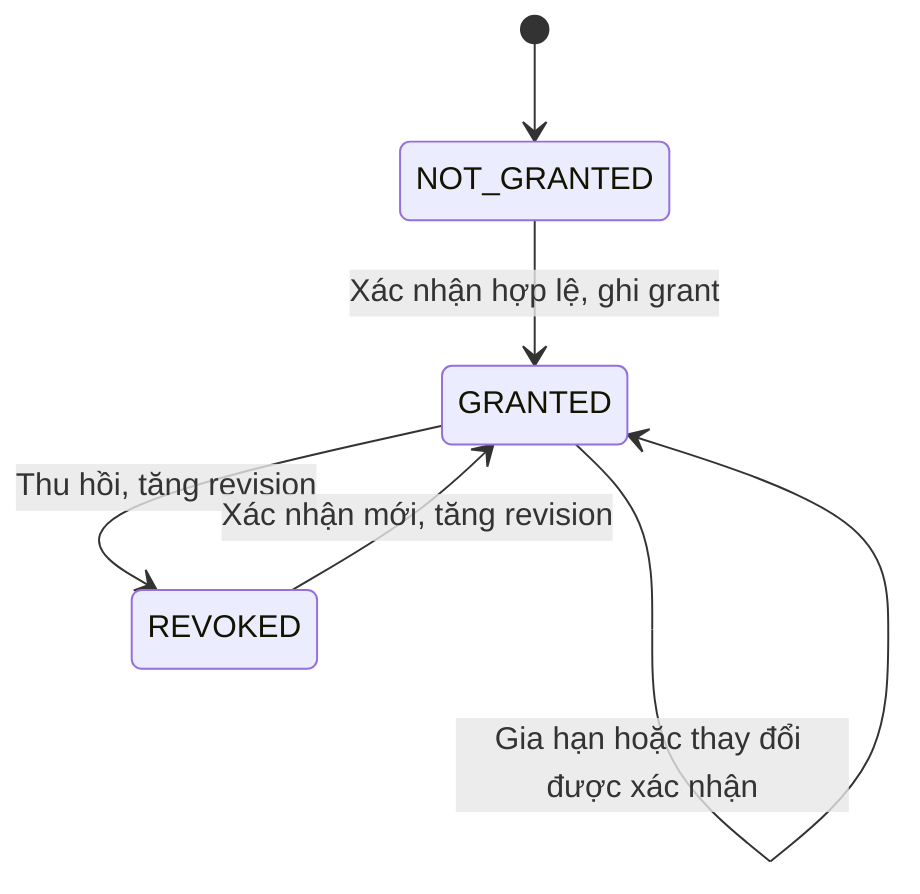

# Consent dependent feature: kiểm soát tính năng phụ thuộc vào sự đồng ý

## 1. Tính năng phụ thuộc consent là gì?

Trong chương **Consent Rules**, *consent dependent feature* là tính năng chỉ được thực hiện một hoạt động cụ thể khi có sự đồng ý phù hợp của chủ thể dữ liệu. Điều kiện này phải được thực thi ở nơi hoạt động nghiệp vụ diễn ra, bao gồm API, tác vụ nền, lịch chạy và đường xuất dữ liệu.

Ví dụ, một nền tảng mua sắm cung cấp gợi ý sản phẩm dựa trên lịch sử mua hàng. Người dùng có thể sử dụng tài khoản, đặt hàng và xem lịch sử của mình mà chưa bật gợi ý cá nhân hóa. Để xây dựng hồ sơ gợi ý từ lịch sử mua hàng, hệ thống yêu cầu consent cho mục đích `purchase-personalization`.

Hai hành động sau cần được phân biệt:

- **Bật tùy chọn giao diện** thể hiện mong muốn sử dụng tính năng.
- **Cấp consent** tạo quyết định có phạm vi xác định, được ghi nhận và có thể thu hồi.

Một công tắc giao diện không tự chứng minh rằng hệ thống được phép đọc dữ liệu, tạo hồ sơ hoặc gửi dữ liệu cho đối tác. Ngược lại, consent đang có hiệu lực cũng không tự cấp quyền truy cập tài khoản hoặc đối tượng của người khác.

Mục tiêu bảo vệ logic nghiệp vụ là giữ được quy tắc: mọi đường thực thi cùng một hoạt động phải tuân theo cùng điều kiện consent, kể cả khi người gọi bỏ qua giao diện, đổi tham số, gửi lại yêu cầu hoặc kích hoạt một công việc đã xếp hàng từ trước.

## 2. Xác định bất biến trước khi thiết kế endpoint

### 2.1. Quy tắc cho phép thực hiện

Giả sử tính năng cá nhân hóa sử dụng lịch sử mua hàng của một tài khoản. Tại điểm quyết định thực hiện một đơn vị xử lý, có thể biểu diễn điều kiện cho phép như sau:

```text
canExecute = authenticatedActor
          AND actorMayPerformActionOnObject
          AND objectBelongsToExpectedTenantAndSubject
          AND featureIsAvailable
          AND consentIsGranted
          AND consentScopeMatchesOperation
          AND consentPolicyVersionIsAccepted
          AND consentIsNotExpiredAtDecisionTime
```

Các điều kiện kết hợp bằng **AND**. Feature flag đang bật, gói thuê bao hợp lệ hoặc vai trò quản trị không thay thế điều kiện consent của hoạt động đã được thiết kế là phụ thuộc consent.

`consentScopeMatchesOperation` phải so khớp các chiều thực sự ảnh hưởng đến quyết định: chủ thể, tenant, mục đích, nhóm dữ liệu và bên nhận nếu có. Không cần đưa mọi chiều thành chuỗi do client tự khai báo; máy chủ có thể ánh xạ hoạt động sang một scope đã định nghĩa.

Ví dụ:

| Trạng thái | Tạo gợi ý từ lịch sử mua hàng | Kết quả nghiệp vụ |
|---|---|---|
| Có quyền trên tài khoản, consent cá nhân hóa hợp lệ | Cho phép | Dùng đúng dữ liệu thuộc scope |
| Có quyền trên tài khoản, chưa đồng ý | Không cho phép | Hiển thị gợi ý phổ biến không dùng lịch sử cá nhân |
| Consent nhận thông báo hợp lệ, thiếu consent cá nhân hóa | Không cho phép | Hai mục đích không thay thế nhau |
| Có consent, gọi API với tài khoản của người khác | Không cho phép | Kiểm tra quyền theo đối tượng thất bại |
| Feature flag tắt, consent còn hiệu lực | Không chạy tính năng | Consent không buộc hệ thống phải cung cấp tính năng |
| Kho consent lỗi hoặc trạng thái không xác định | Không chạy nhánh phụ thuộc consent | Có thể dùng nhánh cơ bản đã được phép |

Không được lấy fallback làm cách tiếp tục cùng một hoạt động bằng tên khác. Nếu gọi là “gợi ý phổ biến” nhưng vẫn đọc lịch sử mua hàng để sắp xếp kết quả, nhánh đó vẫn phụ thuộc consent cá nhân hóa.

### 2.2. Một tính năng có nhiều hoạt động

Tên tính năng thường rộng hơn phạm vi consent. Chia tính năng thành các hoạt động có điều kiện rõ ràng:

```text
Trang gợi ý
├── Đọc danh mục sản phẩm công khai: không cần consent cá nhân hóa
├── Xếp hạng bằng lịch sử mua hàng: cần purchase-personalization
└── Gửi hồ sơ cho đối tác: cần scope cho bên nhận và mục đích tương ứng
```

Nếu một hoạt động cần hai consent độc lập, cả hai phải hợp lệ. Nếu hai cách triển khai thay thế nhau, chọn nhánh đã thỏa điều kiện rồi chỉ dùng dữ liệu của nhánh đó. Không dùng quy tắc “có bất kỳ consent nào là đủ”.

Đặc tả cũng cần chỉ ra consent chi phối bước nào: thu thập dữ liệu mới, đọc dữ liệu đã lưu, tạo dữ liệu dẫn xuất, trả kết quả hay gửi ra ngoài. Kiểm tra lúc thu thập không tự cho phép mọi lần sử dụng về sau.

## 3. Những cách lạm dụng cần ngăn chặn

Một luồng bình thường có thể là mở trang cài đặt, đọc mô tả, đồng ý rồi bật gợi ý. Kẻ lạm dụng không bị ràng buộc bởi thứ tự giao diện đó.

| Cách lạm dụng | Giả định sai trong hệ thống | Điều kiện cần giữ |
|---|---|---|
| Gọi thẳng API tạo hồ sơ, bỏ qua màn hình consent | Chỉ ai đi qua màn hình mới biết API | API tự xác minh consent |
| Gửi `consentGranted: true` trong request | Boolean từ client là bằng chứng đồng ý | Chỉ dùng bản ghi có thẩm quyền của máy chủ |
| Thay `subjectId` hoặc `tenantId` | Đăng nhập rồi được thao tác mọi đối tượng | Liên kết actor, đối tượng và consent đúng chủ thể |
| Chọn `purpose` dễ được chấp nhận hơn | Client được quyết định mục đích xử lý | Mục đích bắt nguồn từ hoạt động do máy chủ định nghĩa |
| Gửi lại request cũ sau khi thu hồi | Idempotency bảo đảm yêu cầu cũ vẫn được phép | Kiểm tra điều kiện hiện tại trước khi phục vụ hoạt động |
| Gửi lại thông điệp hàng đợi | Đã được xếp hàng nghĩa là luôn được chạy | Worker kiểm tra lại consent và phiên bản quyết định |
| Thu hồi rồi cấp lại để đánh thức job cũ | Chỉ cần trạng thái hiện tại là `GRANTED` | Job phải thuộc đúng lần consent có hiệu lực |
| Dùng đường batch hoặc công cụ nội bộ | Chỉ endpoint công khai cần kiểm tra | Mọi đường vào đều giữ bất biến nghiệp vụ |

Có thể dùng bảng này để xác định ranh giới tin cậy. Dữ liệu từ form, URL, cookie, token cũ và thông điệp hàng đợi đều không tự chứng minh consent hiện tại.

## 4. Mô hình consent đủ để ra quyết định

### 4.1. Bản ghi trạng thái hiện tại

Với ví dụ cá nhân hóa, một khóa consent có thể là:

```text
ConsentKey = tenantId + subjectId + purpose + scopeId
```

`scopeId` tham chiếu phạm vi được máy chủ quản lý, chẳng hạn nhóm dữ liệu lịch sử mua hàng cho dịch vụ gợi ý nội bộ. Nếu bên nhận hoặc nhóm dữ liệu thay đổi, cần xác định lại scope thay vì âm thầm mở rộng consent cũ.

Một mô hình quan hệ tối giản:

```sql
CREATE TABLE consent_current (
    tenant_id       UUID         NOT NULL,
    subject_id      UUID         NOT NULL,
    purpose         VARCHAR(100) NOT NULL,
    scope_id        VARCHAR(100) NOT NULL,
    state           VARCHAR(20)  NOT NULL,
    policy_version  VARCHAR(100),
    revision        BIGINT       NOT NULL,
    granted_at      TIMESTAMP WITH TIME ZONE,
    revoked_at      TIMESTAMP WITH TIME ZONE,
    expires_at      TIMESTAMP WITH TIME ZONE,
    PRIMARY KEY (tenant_id, subject_id, purpose, scope_id),
    CHECK (state IN ('NOT_GRANTED', 'GRANTED', 'REVOKED')),
    CHECK (revision >= 0),
    CHECK (
        state <> 'GRANTED'
        OR (policy_version IS NOT NULL AND granted_at IS NOT NULL)
    ),
    CHECK (
        expires_at IS NULL
        OR (granted_at IS NOT NULL AND expires_at > granted_at)
    )
);
```

Đây là schema minh họa cho quy tắc quyết định; triển khai thực tế còn cần ràng buộc liên kết chủ thể, tenant và lịch sử sự kiện. Khóa chính ngăn tạo hai trạng thái hiện tại khác nhau cho cùng một phạm vi consent.

Hai loại phiên bản phục vụ hai việc khác nhau:

- `policy_version` cho biết nội dung và phạm vi mà người dùng đã đồng ý. Máy chủ quyết định phiên bản nào còn đáp ứng hoạt động hiện tại.
- `revision` tăng đơn điệu mỗi khi quyết định thay đổi, kể cả thu hồi và cấp lại. Nó giúp nhận ra job hoặc kết quả thuộc một lần consent cũ.

Không tái sử dụng revision khi xóa rồi tạo lại bản ghi. Nếu cần làm mới bản ghi, phải giữ thế hệ quyết định có thể phân biệt với mọi job cũ, ví dụ bằng một mã thế hệ mới do máy chủ cấp.

`expires_at` có thể rỗng nếu sản phẩm không quy định hạn theo thời gian. Khi có hạn, dùng đồng hồ tin cậy phía máy chủ tại điểm kiểm tra; không dùng thời gian do client cung cấp. Job đang chờ phải tự kiểm tra hạn, không đợi một tác vụ quét đổi trạng thái.

Nếu không tìm thấy bản ghi, kết quả quyết định là chưa được phép. Không tự tạo trạng thái `GRANTED` để hoàn tất yêu cầu sử dụng tính năng.

### 4.2. Bằng chứng quyết định và lịch sử

Ngoài trạng thái hiện tại, ghi sự kiện grant/revoke cùng giao dịch để có thể giải thích quyết định:

```text
consent_event:
  eventId, tenantId, subjectId, purpose, scopeId,
  previousState, nextState, revision,
  policyVersion, actorId, recordedAt, interactionId
```

`interactionId` có thể nối đến lượt xác nhận đã hiển thị nội dung đồng ý tương ứng. Server kiểm tra luồng xác nhận, quyền của actor và phiên bản nội dung; không nhận một chuỗi phiên bản tùy ý rồi coi đó là bằng chứng.

Nếu chấp nhận hình thức đại diện, phải mô hình hóa quyền đại diện và phạm vi của nó. Không mặc định quản trị viên có thể bấm đồng ý thay mọi người.

Chỉ lưu thông tin bằng chứng cần thiết. Tránh ghi nguyên lịch sử mua hàng, token đăng nhập hoặc nội dung nhạy cảm vào log quyết định consent.

## 5. State machine của consent và của tính năng

### 5.1. Chuyển trạng thái consent

Có thể biểu diễn các quyết định chính như sau:



Nhánh `GRANTED → GRANTED` chỉ dành cho một quyết định mới có ý nghĩa đã được xác nhận. Retry của cùng một thao tác grant phải trả lại kết quả cũ, không tự tăng revision liên tục và làm vô hiệu mọi job đang chờ.

Hết hạn hoặc phiên bản chính sách không còn được chấp nhận làm consent **không đủ điều kiện sử dụng**, ngay cả khi cột `state` vẫn là `GRANTED`. Có thể vật chất hóa trạng thái này để hỗ trợ giao diện, nhưng điểm thực thi vẫn phải kiểm tra thời gian và chính sách hiện tại.

Không phải mọi sửa câu chữ đều buộc xin lại consent. Cần xác định thay đổi nào làm khác mục đích, dữ liệu, bên nhận hoặc điều kiện sử dụng; từ đó máy chủ quyết định có cần xác nhận mới hay không. Không để client tự bỏ qua quyết định này.

### 5.2. Trạng thái tính năng là trạng thái khác

Một người dùng có thể có consent hợp lệ nhưng chủ động tắt cá nhân hóa. Trạng thái tính năng và consent vì vậy không phải cùng một cột:

```text
featurePreference = ON hoặc OFF
consentDecision   = được phép hoặc không được phép

featureEffective = featurePreference == ON
                AND consentDecision == được phép
                AND các điều kiện truy cập khác hợp lệ
```

Khi thu hồi consent, trạng thái hiệu lực của tính năng phải tắt theo ranh giới thực thi đã công bố. Sản phẩm có thể giữ sở thích `ON` để giải thích lịch sử cài đặt, nhưng không được dùng nó để chạy tiếp hoặc tự cấp lại consent.

Khi người dùng cấp lại consent, nên xác định rõ có tự khôi phục tính năng hay cần bật lại. Trong mọi trường hợp, việc đó không làm job cũ thuộc revision trước tự sống lại.

## 6. Đặt kiểm tra ở đúng điểm thực thi

### 6.1. Trách nhiệm của từng lớp

| Vị trí | Trách nhiệm |
|---|---|
| Giao diện | Hiển thị điều kiện, trạng thái và hành động xác nhận/thu hồi rõ ràng |
| API sử dụng tính năng | Xác thực actor, quyền theo đối tượng, ánh xạ scope và kiểm tra consent |
| Dịch vụ nghiệp vụ | Bảo vệ bất biến cho mọi đường gọi, kể cả batch hoặc công cụ nội bộ |
| Worker | Kiểm tra lại trạng thái hiện tại, revision, quyền và hạn trước khi xử lý |
| Đường đọc kết quả | Kiểm tra nếu việc cung cấp kết quả vẫn là hoạt động phụ thuộc consent |
| Bộ gửi dữ liệu ra ngoài | Kiểm tra ở ranh giới gửi và tuân theo cơ chế thu hồi đã định nghĩa |

Middleware có thể hỗ trợ điều kiện chung, nhưng thường chưa biết đầy đủ chủ thể, đối tượng hay mục đích của một thao tác nghiệp vụ. Vì vậy, một annotation `@RequireConsent` chỉ có ích khi nó ánh xạ chính xác các thông tin đó và được gọi ở mọi đường thực thi liên quan.

Một endpoint sử dụng tính năng có thể nhận:

```http
POST /profiles/{profileId}/recommendations/refresh
Idempotency-Key: <request-key>
```

Máy chủ lấy tenant từ ngữ cảnh xác thực đã kiểm chứng, tra profile trong tenant đó, kiểm tra quyền thực hiện hành động và lấy chủ thể từ đối tượng đã xác minh. Mục đích và scope xuất phát từ định nghĩa nghiệp vụ `refresh recommendations`.

Endpoint sử dụng tính năng không cần nhận các trường có thẩm quyền như:

```json
{
  "consentGranted": true,
  "subjectId": "some-other-user",
  "purpose": "an-easier-purpose",
  "policyVersion": "any-version-the-client-wants"
}
```

Một API cấp consent có thể cần nhận thông tin lựa chọn của người dùng, nhưng phải kiểm tra nó trong luồng xác nhận riêng. Không dùng việc gọi API tạo gợi ý làm hành động đồng ý ngầm.

### 6.2. Tách thao tác grant, revoke và sử dụng

Ba thao tác có ý nghĩa nghiệp vụ khác nhau:

1. **Grant:** kiểm tra actor, chủ thể, scope và lượt xác nhận; ghi quyết định cùng bằng chứng.
2. **Revoke:** kiểm tra quyền thu hồi; ghi quyết định mới, tăng revision và phát tín hiệu dừng những hoạt động liên quan.
3. **Use:** đọc quyết định có thẩm quyền và thực hiện đúng hoạt động đã được phép.

Nếu sử dụng cookie làm phiên đăng nhập, endpoint thay đổi consent cũng cần cơ chế chống yêu cầu giả mạo phù hợp. Nếu luồng xác nhận gồm nhiều bước, yêu cầu xác nhận phải gắn với đúng người dùng, scope và phiên bản nội dung; không chấp nhận một mã xác nhận của phiên hoặc scope khác.

## 7. Transaction và cuộc đua với thu hồi consent

### 7.1. Lỗ hổng kiểm tra rồi mới dùng

Đoạn logic sau có một khoảng trống:

```text
T1: API đọc consent = GRANTED
T2: Người dùng thu hồi; hệ thống commit REVOKED
T1: API đọc lịch sử mua hàng và ghi hồ sơ cá nhân hóa
```

Kiểm tra ở T1 đã đúng tại thời điểm đọc, nhưng không đủ để giữ quy tắc giữa kiểm tra và tác động. Chỉ đặt hai lệnh trong một transaction cũng chưa tự giải quyết mọi cuộc đua; cần cơ chế đồng bộ giữa đường sử dụng và đường thu hồi.

Với đơn vị xử lý ngắn, cùng một cơ sở dữ liệu, có thể khóa hàng consent bằng `SELECT ... FOR UPDATE` và giữ khóa trong suốt transaction thực hiện tác động nội bộ. Đường revoke và grant phải dùng cùng cơ chế khóa.

```text
Trường hợp worker lấy khóa trước:
  Worker: khóa consent → kiểm tra → xử lý ngắn → commit
  Revoke: chờ khóa → ghi REVOKED, tăng revision → commit

Trường hợp revoke lấy khóa trước:
  Revoke: khóa consent → ghi REVOKED, tăng revision → commit
  Worker: lấy khóa → thấy không hợp lệ → hủy job, không xử lý
```

Theo cách này, tác động nội bộ đã được tuần tự hóa trước hoặc sau quyết định thu hồi. Sau khi transaction thu hồi commit, một transaction mới không thể sử dụng consent cũ nếu mọi đường đều tuân thủ giao thức khóa đó.

Khi hàng consent chưa tồn tại, khóa một truy vấn không trả hàng không phải lúc nào cũng tạo điểm đồng bộ mong muốn. Có thể tạo hàng mặc định `NOT_GRANTED` theo khóa duy nhất khi khởi tạo chủ thể, hoặc dùng cơ chế tạo hàng an toàn trước khi khóa. Nhánh sử dụng thấy thiếu hàng chỉ cần từ chối; tuyệt đối không tự tạo grant.

### 7.2. Xác định ranh giới của lời hứa thu hồi

Cần mô tả rõ một đơn vị xử lý là gì. Ví dụ, mỗi job xử lý một profile nhỏ trong một transaction. Thời hạn được đánh giá trước khi bắt đầu đơn vị đó; khi consent hết hạn, đơn vị tiếp theo phải dừng. Nếu yêu cầu sản phẩm là không được tiếp tục sau thời điểm hết hạn tuyệt đối, cần cơ chế giới hạn thời gian và ngắt phù hợp, không chỉ một lần kiểm tra đầu job.

Với thuật toán chạy lâu hoặc lời gọi dịch vụ bên ngoài, không giữ khóa cơ sở dữ liệu hàng phút để tạo cảm giác nguyên tử. Chia công việc thành các đơn vị có điểm kiểm tra, thiết kế cơ chế hủy và định nghĩa phần đã được chấp nhận xử lý trước khi thu hồi.

Kiểm tra lại trước khi lưu kết quả không làm cho việc đọc hoặc phân tích dữ liệu trước đó trở nên hợp lệ. Nếu hoạt động cần consent là chính bước phân tích, phải kiểm tra trước bước đó.

## 8. Luồng tác vụ nền có revision và idempotency

### 8.1. Khi nhận yêu cầu

Trong transaction nhận yêu cầu:

1. Xác minh actor được phép làm mới gợi ý cho profile thuộc đúng tenant và chủ thể.
2. Khóa consent tương ứng, kiểm tra trạng thái, scope, chính sách và thời hạn.
3. Xử lý idempotency key theo phạm vi actor, tenant, hành động và đối tượng.
4. Tạo job chứa các định danh có thẩm quyền cùng `consentRevision` và `policyVersion` đã kiểm tra.
5. Ghi outbox cùng transaction; commit rồi mới công bố thông điệp.

Payload nghiệp vụ do máy chủ tạo có thể là:

```json
{
  "jobId": "job-701",
  "tenantId": "tenant-01",
  "subjectId": "user-42",
  "profileId": "profile-42",
  "purpose": "purchase-personalization",
  "scopeId": "purchase-history-internal",
  "consentRevision": 12,
  "policyVersion": "purchase-personalization-v3"
}
```

Các định danh ở đây là giá trị minh họa. Job được lưu bởi máy chủ sau khi kiểm tra quyền; worker không coi payload bất kỳ từ hàng đợi là bản ghi consent. Nếu thông điệp chỉ mang `jobId`, worker tra dữ liệu job từ kho có thẩm quyền.

Outbox giúp không mất sự kiện khi transaction đã commit nhưng tiến trình chết trước khi gửi. Nó không bảo đảm consent còn hợp lệ khi thông điệp được tiêu thụ, cũng không tự bảo đảm dịch vụ bên ngoài chỉ nhận một lần.

### 8.2. Khi worker thực hiện

Mã giả theo phong cách Java dưới đây minh họa một đơn vị xử lý **ngắn, hoàn toàn trong cùng cơ sở dữ liệu**. Các repository và transaction là hợp đồng thiết kế, không phải mã có thể chép vào chạy ngay:

```java
@Transactional
public void processRecommendationJob(UUID jobId) {
    // Header được lưu bởi server và không thay đổi sau khi tạo job.
    JobHeader header = jobs.readImmutableHeader(jobId);

    // Mọi luồng grant/revoke/use khóa theo cùng ConsentKey.
    Consent consent = consents.lockExisting(header.consentKey());
    RecommendationJob job = jobs.lock(jobId);

    if (job.isTerminal()) {
        return; // Thông điệp trùng không tạo thêm tác động.
    }

    Instant decisionTime = databaseClock.currentTime();
    RequiredPolicy required = policies.forPurchasePersonalization();

    boolean allowed = consent != null
        && consent.isGranted()
        && consent.matches(job.consentKey())
        && consent.revision() == job.consentRevision()
        && required.accepts(consent.policyVersion())
        && consent.policyVersion().equals(job.policyVersion())
        && !consent.isExpiredAt(decisionTime);

    if (!allowed) {
        job.cancel("CONSENT_NOT_CURRENT");
        return;
    }

    Profile profile = profiles.lockOwnedBy(
        job.tenantId(), job.subjectId(), job.profileId());

    // Kiểm tra quyền thực hiện hiện tại; không chỉ tin kết quả lúc enqueue.
    if (!jobAuthority.mayRefreshNow(job, profile)) {
        job.cancel("AUTHORITY_CHANGED");
        return;
    }

    if (!featurePolicy.isAvailableFor(profile)) {
        job.cancel("FEATURE_UNAVAILABLE");
        return;
    }

    // Chỉ đọc dữ liệu cá nhân sau khi đã qua toàn bộ điều kiện.
    var purchases = purchasesRepository.readForSubject(
        job.tenantId(), job.subjectId());
    var recommendations = localRanker.rankSmallProfile(purchases);

    recommendationResults.insertOnce(
        job.id(), profile.id(), recommendations,
        consent.revision(), consent.policyVersion());
    job.markCompleted();
}
```

Để mã giả giữ được bất biến:

- Khóa consent, job và đối tượng theo thứ tự thống nhất trên các đường liên quan để giảm nguy cơ deadlock.
- `lockOwnedBy` không trả về profile thuộc tenant hoặc chủ thể khác; trường hợp thiếu hoặc lệch liên kết phải dừng an toàn.
- `insertOnce` dựa trên ràng buộc duy nhất của cơ sở dữ liệu, chẳng hạn khóa duy nhất theo `job_id`; việc kiểm tra trong bộ nhớ không đủ chống hai consumer.
- Ghi kết quả và `markCompleted` nằm trong cùng transaction. Khi rollback, cả hai cùng không có hiệu lực.
- Consumer chỉ xác nhận thông điệp sau khi transaction commit. Nếu nhận lại thông điệp, trạng thái terminal hoặc ràng buộc duy nhất ngăn tạo tác động lặp.
- Cấu hình chính sách và feature flag cần có ngữ nghĩa thay đổi được xác định. Nếu yêu cầu vô hiệu hóa tức thì giống revoke, một lần đọc cache cũ không đáp ứng yêu cầu đó.

Mã này không gọi API bên ngoài trong transaction. Nó cũng không áp dụng nguyên trạng cho mô hình cần lấy dữ liệu từ nhiều kho độc lập; trường hợp đó cần giao thức phối hợp riêng.

### 8.3. Thu hồi rồi cấp lại không khôi phục job cũ

Giả sử:

```text
10:00  Grant thành công, revision = 12
10:01  Tạo job A, consentRevision = 12
10:02  Revoke thành công, revision = 13
10:03  Grant mới thành công, revision = 14
10:04  Job A được giao lại cho worker
```

Ở 10:04, trạng thái hiện tại là `GRANTED`, nhưng job A vẫn phải bị hủy vì `12 != 14`. Nếu muốn xử lý theo quyết định mới, tạo job mới sau khi kiểm tra lại đầy đủ.

So sánh revision không thay thế kiểm tra trạng thái, scope và thời hạn. Nó chỉ bổ sung khả năng nhận ra một quyết định đã bị thay thế.

### 8.4. Idempotency không phải giấy phép tiếp tục

Idempotency key ngăn một yêu cầu tạo nhiều tác động. Nó không mở rộng thời gian hay phạm vi consent.

| Tình huống | Hành vi cần thiết |
|---|---|
| Cùng key, cùng payload, consent vẫn phù hợp | Trả cùng receipt hoặc trạng thái job, không tạo job trùng |
| Cùng key, payload khác | Báo xung đột, không tái diễn giải thao tác cũ |
| Cùng key sau revoke | Không tạo tác động mới và không phục vụ dữ liệu bị gate bằng kết quả cache cũ |
| Cấp lại consent rồi gửi lại key của job đã hủy | Có thể trả receipt của job đã hủy; yêu cầu mới cần key mới |
| Hai request đồng thời với cùng key | Ràng buộc duy nhất và transaction quyết định một thao tác duy nhất |

Fingerprint phải bao gồm nội dung nghiệp vụ có ý nghĩa, không chỉ URL. Bản ghi idempotency cũng phải được bảo vệ theo tenant, actor và đối tượng; biết key không được quyền đọc kết quả của người khác.

Một receipt chỉ chứa mã job và trạng thái có thể có chính sách đọc khác với kết quả cá nhân hóa. Đừng lưu chung toàn bộ dữ liệu nhạy cảm vào phản hồi idempotency rồi trả lại vô điều kiện sau khi thu hồi.

## 9. Cache, kết quả đã tạo và token cũ

### 9.1. Cache quyết định consent

Cache một quyết định `GRANTED` quá lâu tạo khoảng thời gian tiếp tục xử lý sau thu hồi. Một sự kiện invalidation có thể bị chậm, trùng hoặc đến sai thứ tự.

Với yêu cầu chặn chặt tại ranh giới transaction, quyết định cho phép cần đến từ nguồn có thẩm quyền và cơ chế đồng bộ tương ứng. Đọc replica có độ trễ hoặc cache TTL đơn thuần không bảo đảm chặn ngay sau revoke commit.

Nếu sản phẩm chấp nhận một độ trễ xác định, phải mô tả giới hạn đó và thiết kế toàn bộ luồng theo giới hạn. Không gắn nhãn “thu hồi tức thì” cho cache vẫn cho phép dùng kết quả dương cũ trong vài phút.

Nếu dùng sự kiện cập nhật cache:

```text
Chỉ áp dụng sự kiện khi event.revision > cached.revision.
Nếu không thể xác minh quyết định cho phép, không chạy hoạt động bị gate.
```

Revision ngăn sự kiện grant cũ ghi đè revoke mới, nhưng không tự khắc phục việc sự kiện revoke chưa đến. Cache quyết định từ chối cũ chủ yếu ảnh hưởng khả dụng; cache quyết định cho phép cũ có thể vi phạm bất biến bảo vệ.

### 9.2. Cache kết quả cá nhân hóa

Một cache key có thể gồm tenant, subject, feature và revision. Nhờ vậy, quyết định mới không vô tình dùng kết quả thuộc thế hệ cũ. Tuy nhiên, biết key hoặc tìm thấy bản ghi cache không đủ cho phép trả dữ liệu.

Đường đọc vẫn cần kiểm tra quyền và consent nếu việc cung cấp kết quả thuộc hoạt động bị gate. Invalidation giúp thu dọn; gate khi đọc bảo vệ trường hợp xóa cache chưa kịp hoàn tất.

Không đặt kết quả cá nhân hóa vào cache công khai hoặc URL tĩnh có thời gian sống dài nếu yêu cầu thu hồi đòi hỏi chặn truy cập sớm hơn. Một URL đã phát hành mà không đi qua điểm kiểm soát không thể được bảo vệ chỉ bằng việc sửa trạng thái consent trong cơ sở dữ liệu.

### 9.3. Token chứa consent

Một token đã ký có thể chứng minh token do máy chủ phát hành, nhưng claim `consent=true` không tự chứng minh quyết định vẫn còn hiệu lực. Token sống lâu có thể mang trạng thái trước khi thu hồi.

Có thể dùng claim revision như dữ liệu hỗ trợ rồi kiểm tra với quyết định hiện tại. Nếu hệ thống chọn kiểm tra offline, thời gian sống token và cơ chế thu hồi trở thành giới hạn thực tế của lời hứa chặn. Không coi chữ ký hợp lệ là lý do bỏ qua sự thay đổi consent.

## 10. Hoạt động liên dịch vụ và gửi dữ liệu ra ngoài

Giả sử dịch vụ gợi ý gửi hồ sơ sang một bên nhận. Trước khi gửi cần xác minh consent cho đúng mục đích, dữ liệu và bên nhận. Consent cá nhân hóa nội bộ không mặc nhiên cho phép bước gửi này.

Một thiết kế có thể ghi một tác vụ gửi cùng outbox, rồi kiểm tra lại tại dispatcher. Tuy nhiên, vẫn tồn tại ranh giới giữa kiểm tra ở dispatcher và việc dịch vụ bên ngoài tiếp nhận yêu cầu:

```text
Dispatcher kiểm tra hợp lệ
→ yêu cầu bắt đầu truyền ra ngoài
→ người dùng thu hồi
→ bên nhận xử lý yêu cầu đã được chấp nhận trước đó
```

Transaction cơ sở dữ liệu cục bộ không thể thu hồi một gói tin đã gửi. Cần thống nhất hợp đồng nghiệp vụ: tại điểm nào thao tác được coi là đã được chấp nhận, cách hủy yêu cầu đang chờ, cách thông báo thu hồi và cách đối tác ngừng xử lý tiếp.

Nếu cần một điểm phân xử chặt, có thể thiết kế dịch vụ cấp quyền thực hiện một lần hoặc giao thức đặt chỗ rồi xác nhận, với khả năng kiểm tra thu hồi ở bên nhận. Một token cấp trước rồi luôn được chấp nhận offline vẫn có cửa sổ hết hiệu lực riêng; tên gọi “one-time token” không tự giải quyết revoke.

Đối với chống trùng, gửi mã thao tác ổn định và dùng khả năng idempotency của bên nhận nếu có. Sau timeout, kết quả có thể chưa rõ: bên nhận đã xử lý nhưng phản hồi bị mất. Retry với mã mới có thể tạo tác động lần hai. Outbox và retry vì thế cần đi cùng cơ chế đối soát, không được diễn giải là bảo đảm exactly-once xuyên mọi dịch vụ.

## 11. Trải nghiệm người dùng và hành vi khi bị từ chối

Giao diện cần phản ánh quyết định có thẩm quyền:

- Cho biết hoạt động nào cần consent và dữ liệu nào liên quan trước khi xác nhận.
- Phân biệt “chưa đồng ý”, “đã thu hồi”, “cần xác nhận lại” và “chưa kiểm tra được trạng thái”.
- Hiển thị tính năng cơ bản nếu nhánh đó không sử dụng dữ liệu bị gate.
- Sau revoke, ngừng cập nhật kết quả cá nhân hóa và xóa dữ liệu hiển thị trong bộ nhớ giao diện theo chính sách của tính năng.
- Đồng bộ lại trạng thái khi tab cũ hoạt động trở lại; không tin công tắc còn bật từ phiên trước.

Máy chủ có thể trả mã lỗi nghiệp vụ như:

```json
{
  "code": "CONSENT_REQUIRED",
  "feature": "purchase-recommendations",
  "requiredPurpose": "purchase-personalization",
  "nextAction": "REVIEW_CONSENT"
}
```

Chọn HTTP status theo hợp đồng API, nhưng phía client phải dựa vào mã nghiệp vụ ổn định thay vì phân tích câu thông báo. Với lỗi không có quyền trên đối tượng, tránh tiết lộ trạng thái consent của chủ thể khác. Các thông tin chi tiết như revision hoặc bằng chứng xác nhận không cần đưa vào thông báo công khai.

Không dùng việc không truy cập được kho consent làm lý do tự bật tính năng. Nếu có thể, cung cấp trải nghiệm cơ bản và cho phép thử kiểm tra lại sau.

## 12. Kiểm thử các tình huống tấn công logic

Kiểm thử nên quan sát tác động thật: có đọc dữ liệu bị gate không, có ghi hồ sơ không, có tạo job mới hoặc gửi dữ liệu ra ngoài không. Chỉ kiểm tra status code chưa đủ nếu tác động đã xảy ra trước khi trả lỗi.

| Tình huống | Kết quả cần quan sát |
|---|---|
| Chủ thể hợp lệ, đúng scope, còn hạn | Tác động đúng một lần theo điều kiện đã cho phép |
| Không có hàng consent | Từ chối; không tự tạo grant hoặc đọc lịch sử mua hàng |
| Request gửi `consentGranted=true` | Không thay đổi quyết định máy chủ |
| Consent cho mục đích khác | Không được dùng thay cho mục đích yêu cầu |
| Thay profile hoặc tenant trong request | Không tiếp cận đối tượng hoặc consent của người khác |
| Consent còn trạng thái `GRANTED` nhưng đã hết hạn | Từ chối dựa trên thời gian có thẩm quyền |
| Phiên bản chính sách không còn đáp ứng hoạt động | Yêu cầu xác nhận phù hợp trước khi thực hiện |
| Feature flag tắt nhưng consent hợp lệ | Không chạy tính năng |
| Revoke sau enqueue, trước khi worker lấy khóa | Job bị hủy, không đọc dữ liệu bị gate |
| Revoke rồi grant mới trước khi job cũ chạy | Job cũ bị hủy do lệch revision |
| Hai consumer nhận cùng job | Chỉ có một kết quả hoặc tác động nội bộ |
| Gửi lại idempotency key sau revoke | Không tạo lại tác động, không trả dữ liệu bị gate từ cache cũ |
| Sự kiện grant cũ đến sau sự kiện revoke mới | Cache giữ quyết định có revision cao hơn |
| Replica hoặc cache vẫn có grant cũ | Không vượt được điểm kiểm soát có thẩm quyền |
| Kho consent lỗi | Nhánh bị gate dừng; nhánh cơ bản vẫn có thể phục vụ |
| Quyền hoặc chủ sở hữu đối tượng đổi khi job đang chờ | Worker kiểm tra lại và dừng khi không còn được phép |

Với cuộc đua revoke/use, dùng latch hoặc barrier điều phối hai transaction thay vì dựa vào `sleep` để hy vọng tái hiện lỗi:

```text
Ca A:
  1. Cho revoke giữ khóa consent.
  2. Khởi động worker; worker phải chờ.
  3. Commit revoke rồi cho worker tiếp tục.
  4. Xác nhận job bị hủy và không có tác động được bảo vệ.

Ca B:
  1. Cho worker giữ khóa và vượt qua gate hợp lệ.
  2. Khởi động revoke; revoke phải chờ.
  3. Cho worker commit tác động nội bộ.
  4. Revoke mới được commit; mọi đơn vị xử lý tiếp theo phải bị chặn.
```

Hai ca kiểm tra thứ tự thực thi đã cam kết, không giả định thu hồi có thể hoàn tác một hoạt động đã hoàn thành. Các nhánh batch, lịch chạy, retry và API nội bộ phải có ca kiểm tra tương ứng vì chúng thường bỏ qua controller của luồng thông thường.

Đối với dữ liệu đã tạo trước revoke, cần kiểm thử theo chính sách riêng của sản phẩm: dừng sử dụng, ngừng hiển thị, xóa hoặc xử lý lưu giữ theo quy tắc đã xác định. Revoke không tự đồng nghĩa mọi dữ liệu phải bị xóa ngay, nhưng cũng không tự cho phép tiếp tục sử dụng chúng cho mục đích đã thu hồi.

## 13. Quan sát vận hành và giải thích quyết định

Một bản ghi quyết định nội bộ nên giúp trả lời: ai yêu cầu hoạt động gì, trên đối tượng nào, theo scope nào và vì sao được phép hoặc bị từ chối.

```text
correlationId: req-801
operation: refresh-purchase-recommendations
tenantId: tenant-01
subjectId: user-42
jobId: job-701
purpose: purchase-personalization
scopeId: purchase-history-internal
requiredRevision: 12
observedRevision: 13
decision: DENY
reason: CONSENT_NOT_CURRENT
```

Phân quyền đọc log và giới hạn thời gian lưu phù hợp vì chính các định danh này cũng có thể nhạy cảm. Dùng mã lý do nhất quán để phân biệt từ chối do thiếu consent, thay đổi quyền, hết hạn, lỗi kho trạng thái và job trùng.

Các tín hiệu hữu ích gồm số job bị hủy do revision cũ, độ trễ xử lý sự kiện thu hồi, số lần từ chối vì không xác minh được trạng thái và số lần phát hiện truy cập sai chủ thể. Tăng đột biến có thể đến từ lỗi luồng sản phẩm, cache chậm hoặc hành vi lạm dụng; cần đối chiếu theo correlation ID thay vì chỉ nhìn tổng số lỗi.

## 14. Tự đối chiếu thiết kế

Trước khi coi một tính năng là được bảo vệ bởi consent, cần trả lời được:

1. Hoạt động cụ thể nào phụ thuộc consent, và có fallback nào không dùng dữ liệu đó?
2. Ai là actor, ai là chủ thể, đối tượng thuộc tenant nào và quyền theo đối tượng được kiểm tra ở đâu?
3. Mục đích, phạm vi dữ liệu và bên nhận được máy chủ xác định như thế nào?
4. Grant, revoke, hết hạn và thay đổi chính sách ảnh hưởng trạng thái hiệu lực ra sao?
5. Điểm nào phân xử cuộc đua giữa sử dụng và thu hồi?
6. Job, token, cache và idempotency có phân biệt được lần consent cũ với lần mới không?
7. Khi một dependency không xác minh được quyết định, hoạt động bị gate có thực sự dừng không?
8. Những tác động đã thực hiện được chứng minh, kiểm tra và giải thích bằng dữ liệu nào?

Một thiết kế đạt yêu cầu phải giữ được các điều kiện này cả khi người gọi không đi qua giao diện dự kiến. Sự đồng ý trở thành một bất biến được thực thi xuyên suốt vòng đời tính năng, từ yêu cầu ban đầu đến xử lý nền và cung cấp kết quả.
