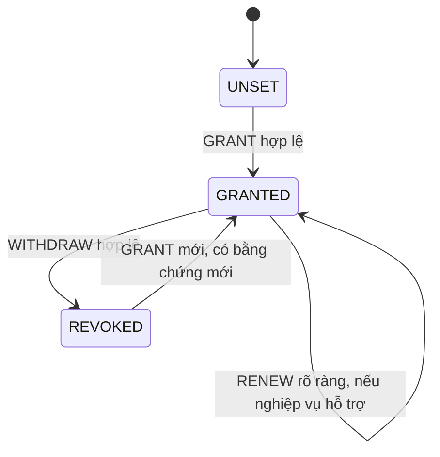
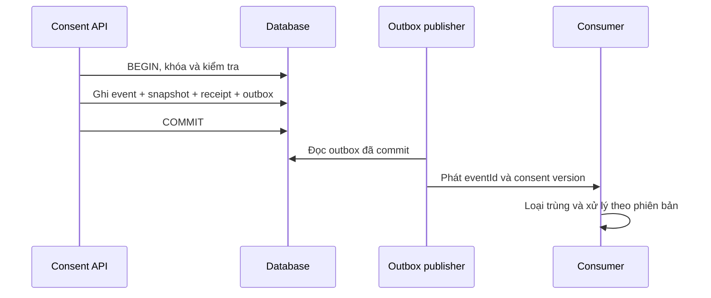

# Consent audit history: Lịch sử kiểm toán sự đồng ý

Trong chương **Consent Rules**, lịch sử kiểm toán sự đồng ý giúp trả lời: ai đã đồng ý với mục đích nào, dựa trên nội dung nào, thay đổi qua những trạng thái nào và hệ thống đã dùng căn cứ gì khi thực hiện một hành động. Đây là một phần của bảo mật logic nghiệp vụ: kẻ tấn công có thể khai thác một API hoàn toàn hợp lệ để giả mạo sự đồng ý, phát lại yêu cầu cũ hoặc tiếp tục xử lý sau khi người dùng rút lại sự đồng ý.

Bài học tập trung vào các bất biến nghiệp vụ, quyền theo đối tượng, state machine, transaction và idempotency khi xây dựng lịch sử consent. Mục tiêu là một hệ thống có thể giải thích và kiểm chứng quyết định của mình, thay vì chỉ có một cột `consent = true`.

## 1. Lịch sử consent giải quyết vấn đề gì?

Giả sử một nền tảng có chức năng gửi bản tin sản phẩm. Người dùng đồng ý lúc 09:00, rút lại lúc 09:10, nhưng một yêu cầu đồng ý cũ được gửi lại lúc 09:11 do ứng dụng mất kết nối. Nếu API chỉ cập nhật một boolean, yêu cầu cũ có thể bật lại việc gửi tin và xóa dấu vết của lần rút lại.

Một hệ thống đúng cần phân biệt ba lớp thông tin:

| Lớp | Câu hỏi chính | Ví dụ |
| --- | --- | --- |
| Trạng thái hiện tại | Hiện tại consent có cho phép mục đích này không? | Đã rút lại; không được gửi bản tin |
| Lịch sử thay đổi | Những thay đổi hợp lệ nào đã tạo ra trạng thái đó? | Đồng ý ở phiên bản 1, rút lại ở phiên bản 2 |
| Dấu vết quyết định sử dụng | Tác vụ đã dựa vào consent nào tại mốc quyết định? | Job J được kiểm tra theo phiên bản 2 và bị chặn |

Lịch sử thay đổi không thay thế log quyết định của từng tác vụ. Ngược lại, log gửi email cũng không thay thế bằng chứng về hành động đồng ý. Cần liên kết chúng bằng mã tham chiếu và phiên bản consent khi điều tra.

Consent cũng không thay thế quyền truy cập. Người dùng đồng ý nhận thông báo không có nghĩa là một nhân viên được đọc mọi dữ liệu của họ. Một hành động có thể cần đồng thời quyền của tác nhân, phạm vi tài nguyên phù hợp và consent còn hiệu lực theo quy tắc của sản phẩm.

## 2. Xác định đúng đối tượng và phạm vi consent

Trước khi thiết kế lịch sử, cần xác định consent thuộc về ai và áp dụng cho việc gì. Một khóa nghiệp vụ minh họa là:

```text
ConsentKey = (
    tenantId,
    subjectId,
    purposeCode,
    scopeKey
)
```

Trong đó:

- `tenantId`: tổ chức hoặc không gian dữ liệu sở hữu bản ghi.
- `subjectId`: chủ thể của sự đồng ý; nên dùng mã nội bộ thay cho email hoặc số điện thoại trong khóa.
- `purposeCode`: mục đích được hệ thống quản lý, chẳng hạn `PRODUCT_NEWSLETTER`.
- `scopeKey`: phạm vi bổ sung đã được định nghĩa, chẳng hạn một sản phẩm cụ thể hoặc `GLOBAL` trong tenant đó.

Không mặc định rằng consent cho mục đích A áp dụng cho mục đích B. Cũng không mặc định rằng `GLOBAL` có nghĩa là mọi tenant, mọi sản phẩm hoặc mọi mục đích. Ý nghĩa của từng phạm vi phải do máy chủ xác định rõ.

Kênh thao tác như web, ứng dụng di động hoặc quầy hỗ trợ thường là bằng chứng về cách ghi nhận consent. Chỉ đưa kênh vào khóa consent nếu nghiệp vụ thực sự yêu cầu người dùng đồng ý riêng theo kênh. Nếu không, việc tạo một bản consent độc lập cho mỗi kênh có thể khiến lần rút lại trên web không chặn được tác vụ từ ứng dụng di động.

API không được tin `tenantId`, `subjectId`, `purposeCode` hoặc `scopeKey` chỉ vì chúng nằm trong request body. Máy chủ phải đối chiếu với danh tính đã xác thực, tài nguyên thực tế và tập giá trị được hỗ trợ.

## 3. Bất biến nghiệp vụ cần bảo vệ

Bất biến là điều phải luôn đúng sau mỗi transaction đã commit, kể cả khi nhiều yêu cầu chạy đồng thời hoặc client gửi lại yêu cầu.

| Bất biến | Hành vi lạm dụng cần ngăn |
| --- | --- |
| Mỗi sự kiện thuộc đúng một `ConsentKey` | Gắn lịch sử của người này sang người khác hoặc sang tenant khác |
| Chỉ tác nhân đủ quyền mới được thay đổi consent | Đổi `subjectId` để đồng ý thay người khác |
| Mỗi thay đổi đã commit có đúng một sự kiện nghiệp vụ tương ứng | Sửa trạng thái hiện tại mà không để lại dấu vết |
| Mỗi sự kiện đã áp dụng có một số thứ tự duy nhất trong cùng khóa | Hai yêu cầu cùng ghi phiên bản kế tiếp |
| Phiên bản hiện tại phản ánh sự kiện đã áp dụng cuối cùng | Lịch sử ghi đã rút lại nhưng snapshot vẫn cho phép |
| Phát lại cùng lệnh không tạo thêm thay đổi | Timeout làm phát sinh thêm lần đồng ý hoặc gia hạn |
| Lệnh dựa trên phiên bản cũ không được âm thầm thắng phiên bản mới | Request đồng ý cũ ghi đè lần rút lại mới |
| Nội dung được đồng ý có thể được xác định lại | Đổi văn bản chính sách nhưng vẫn dùng cùng mã phiên bản |
| Thời điểm do client gửi không tự quyết định thứ tự áp dụng | Backdate một lần đồng ý để hợp thức hóa hành động trước đó |
| Ghi nhận thất bại không trở thành sự kiện đồng ý thành công | Request bị từ chối vẫn xuất hiện như một lần cấp consent |

Phạm vi của “đúng một sự kiện” ở đây là một thay đổi trạng thái hoặc một lần gia hạn được nghiệp vụ công nhận. Một lần đọc dữ liệu, một request không hợp lệ hoặc một lần retry được trả lại kết quả cũ không cần tạo thêm sự kiện chuyển trạng thái.

Các lần thử bị từ chối vẫn có thể được ghi trong nhật ký an ninh riêng, với thông tin tối thiểu cần thiết. Không trộn chúng vào chuỗi sự kiện đã áp dụng rồi khiến quá trình dựng lại trạng thái hiểu nhầm rằng consent đã được cấp.

## 4. Mô hình trạng thái và hiệu lực

Một mô hình đơn giản có ba trạng thái được lưu:

- `UNSET`: chưa có quyết định được áp dụng cho khóa này.
- `GRANTED`: đã ghi nhận sự đồng ý.
- `REVOKED`: đã ghi nhận việc rút lại.



`RENEW` là một hành động riêng và phải có căn cứ mới. Không coi việc đọc consent, retry request hoặc đăng nhập lại là một lần gia hạn. Nếu sản phẩm không có nghiệp vụ gia hạn, không cần cung cấp chuyển tiếp này.

Trạng thái lưu trữ `GRANTED` chưa đủ để kết luận consent còn hiệu lực. Ví dụ:

```text
isUsable(consent, action, now) =
    consent.state == GRANTED
    AND (consent.expiresAt IS NULL OR now < consent.expiresAt)
    AND purposeMatches(consent, action)
    AND scopeMatches(consent, action)
    AND policyCompatibilityAllows(consent, action)
```

Hàm trên chỉ là điều kiện về consent; quyền thực hiện hành động vẫn phải được kiểm tra riêng. `now` phải đến từ nguồn thời gian đáng tin của máy chủ, không lấy từ request.

Trong mô hình này, hết hạn là điều kiện hiệu lực được tính từ `expiresAt`, không phải một trạng thái bắt buộc chờ background job cập nhật. Vì vậy job chạy trễ không làm consent hết hạn tiếp tục được sử dụng. Nếu sản phẩm cần một sự kiện `EXPIRE` để phục vụ lịch sử, phải thiết kế thêm quy tắc áp dụng và idempotency cho sự kiện đó; không tự suy ra rằng nó đã tồn tại.

Nếu có `expiresAt`, có thể dùng khoảng hiệu lực nửa mở: hợp lệ trước thời điểm hết hạn và không hợp lệ tại chính thời điểm đó. Với hai thay đổi có cùng timestamp, số thứ tự phiên bản là căn cứ sắp xếp trong cùng khóa.

## 5. Mỗi sự kiện cần lưu những gì?

Một sự kiện lịch sử nên chứa đủ thông tin để giải thích thay đổi mà không sao chép toàn bộ request hoặc dữ liệu cá nhân không cần thiết.

| Nhóm | Trường minh họa | Ý nghĩa |
| --- | --- | --- |
| Định danh | `eventId`, `ConsentKey`, `sequence` | Định vị sự kiện và vị trí của nó trong chuỗi |
| Chuyển tiếp | `eventType`, `beforeState`, `afterState` | Cho biết hành động nào đã được áp dụng |
| Tác nhân | `actorId`, `actorType`, `subjectId` | Phân biệt người thao tác với chủ thể của consent |
| Phạm vi đồng ý | `purposeCode`, `scopeKey` | Xác định consent dành cho việc gì |
| Nội dung được chấp nhận | `policyVersion`, `policyDigest`, `locale` | Tham chiếu bản nội dung cụ thể đã được trình bày |
| Bằng chứng | `captureMethod`, `evidenceRef` | Dẫn đến bằng chứng xác nhận thích hợp |
| Thời gian | `recordedAt`, `effectiveAt`, `clientOccurredAt` nếu cần | Phân biệt thời điểm ghi nhận, áp dụng và thông tin từ client |
| Liên kết yêu cầu | `commandId`, `correlationId` | Theo dõi retry và điều tra nhiều dịch vụ |
| Điều kiện hiệu lực | `expiresAt` nếu có | Dựng lại các điều kiện của quyết định |
| Định dạng | `eventSchemaVersion` | Diễn giải sự kiện cũ sau khi phần mềm thay đổi |

### 5.1. Danh tính tác nhân phải lấy từ ngữ cảnh tin cậy

Không lấy `actorId` hoặc `actorType = ADMIN` trực tiếp từ JSON do client cung cấp. Với nhân viên hoặc người đại diện được phép thao tác, cần lưu được căn cứ ủy quyền, phạm vi và danh tính thực của người thao tác. Tài khoản hỗ trợ không mặc nhiên được tạo sự đồng ý thay người dùng.

Nếu hệ thống có luồng sửa dữ liệu bởi quản trị viên, luồng đó phải có loại sự kiện và quy tắc riêng. Việc khắc phục một lỗi dữ liệu không được tự động mang nghĩa người dùng vừa thể hiện một sự đồng ý mới.

### 5.2. Phiên bản chính sách cần dẫn đến nội dung bất biến

`policyVersion = v3` không giúp nhiều nếu nội dung mang mã `v3` có thể bị thay thế. Nên giữ bản nội dung đã công bố hoặc tham chiếu bất biến đến nó, kèm ngôn ngữ và phạm vi áp dụng.

Digest giúp kiểm tra một nội dung có khớp bản tham chiếu hay không. Digest không tự chứng minh ai đã đồng ý, có đúng quyền hay không hoặc giao diện đã hiển thị nội dung gì. Những vấn đề đó cần bằng chứng và luồng ghi nhận phù hợp.

Máy chủ nên kiểm tra rằng phiên bản được chấp nhận là phiên bản được phép trong luồng hiện tại. Không tự động thay mã phiên bản cũ do client gửi bằng mã mới rồi ghi như thể người dùng đã chấp nhận bản mới.

### 5.3. Phân biệt thời gian quan sát và thứ tự áp dụng

`clientOccurredAt` có thể hữu ích để chẩn đoán thiết bị ngoại tuyến, nhưng không được dùng để tự chèn một sự kiện vào trước lần rút lại đã commit. Một báo cáo cũ vừa được tiếp nhận chưa đương nhiên là một thay đổi được phép áp dụng.

Trong luồng trực tuyến minh họa, thời điểm hiệu lực được máy chủ xác định khi áp dụng lệnh. Luồng nhập dữ liệu lịch sử hoặc nhận báo cáo ngoại tuyến cần quy tắc đối soát riêng; không tái sử dụng API thông thường để backdate trạng thái.

`sequence` xác định thứ tự thay đổi trong cùng `ConsentKey`. Timestamp phục vụ tra cứu thời gian và tương quan, nhưng không tạo thứ tự toàn cục đáng tin giữa nhiều máy chủ. Khi cần truy vấn chính xác “hệ thống biết gì tại mốc nào”, phải quy định rõ ý nghĩa của thời gian ghi nhận và cách xử lý đồng hồ lệch, transaction chồng lấn hoặc sự kiện đến trễ.

## 6. Tách snapshot, lịch sử và sổ lệnh

Một mô hình dữ liệu quan hệ có thể dùng các bảng logic sau:

| Bảng | Khóa hoặc ràng buộc chính | Vai trò |
| --- | --- | --- |
| `consent_current` | Khóa chính là `ConsentKey`; có `version` | Snapshot dùng để kiểm tra điều kiện hiện tại |
| `consent_event` | Duy nhất theo `(ConsentKey, sequence)`; mã sự kiện duy nhất | Lịch sử các thay đổi đã áp dụng |
| `consent_command` | Duy nhất theo `(tenantId, actorId, idempotencyKey)` | Lưu fingerprint và kết quả lệnh để xử lý retry |
| `consent_outbox` | Mã thông điệp duy nhất; tham chiếu sự kiện | Chuyển thông báo thay đổi ra ngoài sau commit |

Bảng `consent_event` nên lưu cả phiên bản chính sách và điều kiện hiệu lực cần thiết ở thời điểm thay đổi, thay vì chỉ tham chiếu đến một bản ghi có thể bị sửa tại chỗ. Khi dựng lại trạng thái, không lấy cấu hình hiện tại rồi giả định đó là cấu hình tại thời điểm sự kiện cũ.

Các ràng buộc tối thiểu cần cân nhắc:

```text
PRIMARY KEY consent_current (ConsentKey)
UNIQUE consent_event (ConsentKey, sequence)
UNIQUE consent_event (tenantId, eventId)
UNIQUE consent_command (tenantId, actorId, idempotencyKey)
CHECK sequence > 0
CHECK version >= 0
CHECK state IN (UNSET, GRANTED, REVOKED)
```

Đây là ký hiệu thiết kế, không phải migration có thể chạy trực tiếp. Trong triển khai thực tế, `ConsentKey` được mở thành các cột cụ thể và các khóa tham chiếu phải giữ đủ chiều tenant.

Ràng buộc duy nhất bảo vệ tính duy nhất khi chạy đồng thời. Nó không tự kiểm tra rằng chuỗi trạng thái hợp lệ hoặc rằng sự kiện có đủ bằng chứng. Những điều kiện đó phải được kiểm tra trong đường ghi được kiểm soát.

Không cho các dịch vụ khác tùy ý cập nhật trực tiếp `consent_current`. Nếu có nhiều đường ghi, mỗi đường đều phải duy trì cùng bất biến về sự kiện, phiên bản và quyền.

## 7. Transaction ghi consent và idempotency

### 7.1. Phân biệt retry với một ý định mới

`idempotencyKey` nhận diện một lần thực hiện lệnh, không phải nhận diện vĩnh viễn một chủ thể hoặc một mục đích. Client giữ nguyên khóa khi gửi lại cùng lệnh vì chưa nhận được kết quả; một ý định mới phải có khóa mới.

Máy chủ tạo fingerprint từ biểu diễn chuẩn của các trường ảnh hưởng đến nghiệp vụ, chẳng hạn:

```text
operation + ConsentKey + expectedVersion
+ acceptedPolicyVersion + evidenceReference + requestedParameters
```

Fingerprint phải bao gồm đối tượng, thao tác và tham số có ý nghĩa. Chuẩn hóa có quy tắc rõ ràng để cùng một lệnh không bị coi là khác chỉ vì thứ tự thuộc tính JSON. Không đưa thời điểm do máy chủ tự sinh cho mỗi lần thử vào fingerprint.

Quy tắc xử lý:

| Tình huống | Kết quả |
| --- | --- |
| Cùng khóa, cùng fingerprint, lệnh cũ đã thành công | Trả lại kết quả đã lưu, không áp dụng lại |
| Cùng khóa nhưng khác fingerprint | Từ chối xung đột; không sửa trạng thái |
| Khóa mới nhưng `expectedVersion` đã cũ | Từ chối xung đột phiên bản |
| Khóa mới, quyền và chuyển tiếp hợp lệ | Thực hiện đúng một thay đổi mới |

Thời gian lưu sổ lệnh cần phù hợp với khoảng thời gian retry được hỗ trợ. Xóa sổ lệnh quá sớm có thể làm mất khả năng nhận diện một request đã từng thành công. Kiểm tra phiên bản và quy tắc trạng thái vẫn cần tồn tại độc lập với idempotency.

### 7.2. Một đường ghi có khóa theo đối tượng

Mã giả dưới đây mô tả cách xử lý `GRANT`, `WITHDRAW` hoặc `RENEW` bằng transaction cơ sở dữ liệu. Đây là thuật toán, không phải mã Java hoàn chỉnh.

```text
handle(command, authenticatedActor):
    key = resolveAndValidateTarget(command, authenticatedActor)
    fingerprint = canonicalFingerprint(command, key)

    begin transaction

    ensureCurrentRowExists(key, state = UNSET, version = 0)
    current = lockCurrentRow(key)  // khóa được giữ đến commit/rollback

    authorizeMutation(authenticatedActor, key, command.operation)

    receipt = findCommandReceipt(
        key.tenantId, authenticatedActor.id, command.idempotencyKey
    )

    if receipt exists:
        require receipt.fingerprint == fingerprint
        commit transaction
        return receipt.originalResult

    claimCommandKeyWithUniqueConstraint(command, fingerprint)
    // Nếu gặp khóa trùng do một transaction khác vừa commit:
    // đọc lại receipt và áp dụng quy tắc replay/xung đột ở trên.

    require current.version == command.expectedVersion
    require transitionIsAllowed(current, command)
    require policyAndEvidenceAreValid(current, command)

    next = applyTransition(current, command, trustedServerTime())
    next.version = current.version + 1
    event = buildEvent(current, next, command, authenticatedActor)

    insertConsentEvent(event)
    updateConsentCurrent(next)
    saveCommandResult(command, fingerprint, event.id, next.version)
    insertOutboxMessage(event)

    commit transaction
    return savedCommandResult
```

Có một số chi tiết quan trọng trong thuật toán:

1. **Khóa vẫn phải tồn tại khi chưa có consent.** Chỉ `SELECT ... FOR UPDATE` trên một hàng chưa tồn tại không đủ để bảo đảm hai request đầu tiên được tuần tự hóa theo cách trên. Cần cơ chế tạo hàng `UNSET` có khóa duy nhất, xử lý cạnh tranh tạo hàng rồi khóa hàng đã tồn tại, hoặc dùng cơ chế tương đương của cơ sở dữ liệu.
2. **Kiểm tra quyền trước khi trả receipt.** Biết một idempotency key không phải là quyền xem kết quả của lệnh. Lần retry vẫn phải được xác thực và kiểm tra quyền hiện tại.
3. **Receipt thành công và thay đổi consent commit cùng nhau.** Không lưu kết quả thành công ở một transaction khác sau khi cập nhật trạng thái, vì crash ở giữa sẽ làm retry không biết lệnh đã được áp dụng.
4. **Mọi lỗi trước commit phải rollback.** Không được bắt lỗi ghi sự kiện rồi vẫn commit snapshot. Nếu transaction rollback, cả sự kiện, trạng thái, receipt thành công và outbox của lần thử đó phải không được áp dụng.
5. **Khóa duy nhất vẫn cần thiết.** Khóa hàng không thay thế ràng buộc duy nhất của sổ lệnh hoặc số thứ tự sự kiện. Một idempotency key có thể bị dùng nhầm cho đối tượng khác; nhánh xung đột phải so fingerprint và không được tiếp tục ghi mù.

Khi dùng cơ chế `INSERT` gặp trùng khóa, cách phục hồi transaction phụ thuộc cơ sở dữ liệu và API truy cập dữ liệu. Cần chọn cách xử lý xung đột được hỗ trợ; không tiếp tục trên một transaction đã bị đánh dấu thất bại. Các đường ghi cũng cần thứ tự lấy khóa nhất quán để giảm deadlock và retry transaction có kiểm soát khi cần.

Có thể dùng optimistic locking thay cho khóa hàng, nhưng khi đó cập nhật có điều kiện theo `version` và các bản ghi sự kiện, receipt, outbox vẫn phải nằm trong cùng transaction. Nếu cập nhật không khớp phiên bản thì rollback, không phát sự kiện thành công.

### 7.3. Replay thành công không có nghĩa consent vẫn đang được cấp

Giả sử lệnh đồng ý `G1` đã tạo phiên bản 1. Sau đó lệnh rút lại `W1` tạo phiên bản 2. Khi client retry `G1`, server có thể trả lại receipt thành công của phiên bản 1 mà không thay đổi phiên bản 2.

Response nên cho biết đây là kết quả của lệnh nào và phiên bản đã được lệnh đó tạo ra. Client cần đọc trạng thái hiện tại khi cần hiển thị hoặc ra quyết định mới. Dịch vụ gửi bản tin không được xem receipt cũ là bằng chứng consent hiện tại còn hiệu lực.

## 8. Theo dõi một chuỗi thao tác cụ thể

Giả sử mọi thao tác dưới đây cùng thuộc một `ConsentKey`:

| Mốc | Yêu cầu | Kết quả đúng | Snapshot sau xử lý |
| --- | --- | --- | --- |
| 09:00 | `GRANT`, key `G1`, expected version 0, policy v3 | Tạo sự kiện sequence 1 | `GRANTED`, version 1 |
| 09:10 | `WITHDRAW`, key `W1`, expected version 1 | Tạo sự kiện sequence 2 | `REVOKED`, version 2 |
| 09:11 | Retry nguyên lệnh `G1` | Trả receipt của sequence 1, không có sự kiện mới | `REVOKED`, version 2 |
| 09:12 | Lệnh grant cũ nhưng đổi key thành `G2`, expected version 1 | Từ chối vì phiên bản hiện tại là 2 | `REVOKED`, version 2 |
| 09:15 | Người dùng chủ động đồng ý lại, key `G3`, expected version 2, policy v4 | Kiểm tra bằng chứng mới rồi tạo sequence 3 | `GRANTED`, version 3 |

Sự kiện sequence 3 không sửa sequence 2 thành “chưa từng rút lại”. Nó ghi nhận một quyết định mới. Khoảng sau lần rút lại và trước lần đồng ý lại vẫn phải được giải thích là không có consent dùng được cho mục đích này.

Nếu một tác vụ đã chạy trong khoảng đó, cần xem log quyết định của tác vụ, phiên bản mà nó đã kiểm tra và mốc cam kết xử lý. Việc xuất hiện một lần đồng ý lại sau này không tự hợp thức hóa hành động đã xảy ra trước đó.

## 9. Đưa thay đổi tới dịch vụ khác mà không mất sự kiện

Ghi database xong rồi gọi trực tiếp message broker có một khoảng lỗi: database đã commit nhưng tiến trình dừng trước khi publish. Gọi broker trước commit lại tạo tình huống consumer nhận một sự kiện mà transaction sau đó rollback.

Transactional outbox giải quyết khoảng lỗi giữa việc ghi trạng thái và ghi ý định phát thông điệp:



Publisher có thể phát lại khi chưa biết lần phát trước đã thành công hay chưa. Consumer cần cơ chế loại trùng theo mã sự kiện và cập nhật theo phiên bản, thay vì giả định mỗi thông điệp chỉ đến một lần.

Nếu consumer dựng trạng thái bằng cách áp dụng delta tuần tự, phát hiện khoảng trống phiên bản phải dẫn tới chờ, retry hoặc đồng bộ lại. Nếu mỗi thông điệp mang snapshot đầy đủ và consumer chỉ cần trạng thái mới nhất, có thể bỏ qua phiên bản cũ theo quy tắc đã định nghĩa. Không dùng cách bỏ qua tùy ý này khi consumer cần xử lý mọi chuyển tiếp nghiệp vụ.

### 9.1. Cache và TOCTOU khi rút lại consent

Một cache cập nhật chậm có thể vẫn giữ `GRANTED` sau khi nguồn chính đã ghi `REVOKED`. Việc lưu lịch sử chính xác không tự làm cache hoặc hàng đợi trở nên nhất quán tức thời.

Đối với công việc đang chờ:

- Kiểm tra consent cho đúng mục đích và phạm vi tại mốc thực hiện mà sản phẩm quy định.
- Không chỉ dựa vào việc job đã được tạo khi consent còn hiệu lực.
- Nếu nguồn quyết định không sẵn sàng, áp dụng quy tắc chặn hoặc chờ đối với hành động bắt buộc phải có consent; không tự chuyển thiếu thông tin thành đồng ý.
- Ghi phiên bản và kết quả kiểm tra vào dấu vết quyết định của tác vụ.

Một lần đọc ngay trước khi gửi chỉ thu hẹp cửa sổ TOCTOU: consent vẫn có thể bị rút lại giữa lần đọc và tác động bên ngoài. Nếu yêu cầu nghiệp vụ cần ranh giới chặt, phải quy định mốc cam kết và giao thức tuần tự hóa giữa cấp phép thực hiện với rút lại, chẳng hạn một bước cấp phép bền vững dưới cùng cơ chế khóa, rồi một executor có kiểm tra phiên bản hoặc fencing được thực thi tại điểm tạo tác động.

Chỉ đính kèm `consentVersion` vào message không tự tạo fencing. Thành phần thực hiện phải thực sự đối chiếu và từ chối phiên bản không còn hợp lệ theo giao thức. Một tác động đã được hệ thống bên ngoài chấp nhận cũng không tự được thu hồi chỉ vì một sự kiện rút lại vừa xuất hiện. Cần xác định rõ thao tác nào còn hủy được, thao tác nào đã qua mốc cam kết và ghi lại kết quả đó.

## 10. Bảo vệ tính toàn vẹn và quyền riêng tư của lịch sử

### 10.1. Append-only là một cơ chế kiểm soát, không phải một nhãn

Không cung cấp API sửa hoặc xóa tùy ý một sự kiện cũ. Khi cần đính chính, tạo một sự kiện hiệu chỉnh có tham chiếu đến sự kiện gốc, tác nhân, lý do và quyền tương ứng. Luồng hiệu chỉnh phải có ngữ nghĩa rõ ràng khi dựng lại trạng thái; không dùng nó để ngụy tạo hành động đồng ý của người dùng.

Ở tầng dữ liệu, có thể phân tách quyền ghi sự kiện, quyền đọc phục vụ nghiệp vụ và quyền quản trị. Quyền truy cập trực tiếp của tài khoản vận hành cần được kiểm soát và có dấu vết riêng. Nếu cùng một tài khoản có thể sửa toàn bộ lịch sử lẫn bằng chứng kiểm tra, khả năng phát hiện sửa đổi sẽ hạn chế.

Chuỗi hash giữa các sự kiện có thể giúp phát hiện thay đổi khi có điểm đối chiếu được bảo vệ độc lập. Nếu kẻ tấn công có thể viết lại toàn bộ chuỗi và mọi điểm đối chiếu, họ có thể tính lại hash. Chữ ký hoặc HMAC cũng cần bảo vệ khóa và quy trình kiểm tra; không thay thế được kiểm soát quyền hay tính hợp lệ của sự kiện đầu vào.

### 10.2. Chỉ lưu bằng chứng cần thiết

Không ghi access token, session cookie, mã OTP thô hoặc toàn bộ body request vào sự kiện. Những dữ liệu đó có thể tạo thêm rủi ro chiếm quyền hoặc lộ thông tin mà không giúp dựng lại consent.

Đối với địa chỉ IP, user agent hoặc tài liệu bằng chứng, chỉ thu thập khi có mục đích rõ ràng, phân quyền đọc và thời hạn lưu phù hợp với yêu cầu đã được xác định. Có thể tách kho bằng chứng nhạy cảm khỏi chuỗi sự kiện và dùng `evidenceRef` để liên kết.

Cần xác định trước điều gì còn giải thích được khi bằng chứng bị xóa theo chính sách lưu trữ. Digest của một tài liệu đã mất không cho phép đọc lại nội dung của tài liệu đó. Không mô tả một sự kiện có hash là đã có đầy đủ bằng chứng nếu hệ thống không còn truy xuất được dữ liệu cần kiểm chứng.

### 10.3. API xem lịch sử cũng phải kiểm tra quyền theo đối tượng

Người dùng được xem lịch sử của mình không mặc nhiên được xem lịch sử cùng `subjectId` ở một tenant khác. Truy vấn và pagination phải giữ đầy đủ ranh giới tenant và chủ thể.

Một trang quản trị có thể cần thông tin điều tra chi tiết hơn giao diện người dùng. Phân quyền và lọc trường ở máy chủ; không tải toàn bộ bằng chứng về trình duyệt rồi chỉ ẩn bằng CSS. Quyền đọc lịch sử và quyền thay đổi consent là hai quyền riêng cần được xét theo ngữ cảnh.

## 11. Kiểm thử các tình huống tấn công logic

Kiểm thử phải quan sát cả response, snapshot, sự kiện, receipt và thông điệp outbox. Chỉ kiểm tra HTTP status không đủ để phát hiện một request bị báo lỗi nhưng đã ghi trạng thái trái phép.

| Tình huống | Thiết lập hoặc thao tác | Điều cần chứng minh |
| --- | --- | --- |
| Sửa đối tượng | Người A gửi request với `subjectId` của B | Bị từ chối; không có thay đổi nghiệp vụ cho B |
| Vượt tenant | Dùng mã đối tượng hợp lệ ở tenant khác | Không đọc được lịch sử và không ghi được consent ngoài phạm vi |
| Giả mạo tác nhân | Gửi `actorType = ADMIN` hoặc `actorId` khác | Danh tính ghi nhận lấy từ nguồn tin cậy; request không tự nâng quyền |
| Sửa phiên bản chính sách | Gửi mã bản cũ không còn được phép hoặc mã không tồn tại | Không ghi thành công dưới một phiên bản khác với nội dung thực sự được chấp nhận |
| Retry đồng thời | Nhiều request cùng key và fingerprint | Một thay đổi, một sự kiện, một receipt thành công; kết quả retry nhất quán |
| Tái sử dụng key | Cùng key nhưng đổi subject, purpose hoặc operation | Xung đột; không thực hiện payload mới |
| Request cũ đến sau rút lại | Retry grant cũ, rồi thử grant với key mới nhưng expected version cũ | Cả hai không bật lại consent đã rút |
| Cạnh tranh phiên bản | Hai lệnh khác nhau cùng expected version | Tối đa một lệnh tạo phiên bản kế tiếp; lệnh còn lại xung đột |
| Cạnh tranh lần đầu | Hai request khi chưa có `consent_current` | Không tạo hai hàng hiện tại hoặc hai sự kiện cùng sequence |
| Crash giữa transaction | Gây lỗi sau insert event nhưng trước cập nhật snapshot | Rollback toàn bộ; không còn lịch sử đã áp dụng một nửa |
| Mất response sau commit | Commit xong nhưng client timeout rồi retry | Trả lại receipt; không lặp sự kiện hoặc gia hạn |
| Hết hạn nhưng job trễ | Thời gian hiện tại đạt `expiresAt`, snapshot còn `GRANTED` | Predicate hiệu lực chặn tác vụ mà không chờ job |
| Thông điệp trùng hoặc lệch thứ tự | Phát lại event và đảo thứ tự nhận | Không lặp tác động và không đưa projection về phiên bản cũ |
| Cache cũ sau rút lại | Giữ cache granted trong lúc nguồn chính đã revoked | Hành vi tuân thủ ranh giới nhất quán đã công bố; đường nhạy cảm không tin cache cũ vô điều kiện |
| Backdate | Gửi `clientOccurredAt` trước một lần rút lại đã commit | Không tự chèn hiệu lực vào quá khứ hoặc hợp thức hóa xử lý trước đó |
| Truy cập lịch sử trái phép | Đổi khóa truy vấn hoặc cursor sang đối tượng khác | Quyền được kiểm tra trên đối tượng thực; không lộ bằng chứng |

Với kiểm thử concurrency, dùng một rào đồng bộ để các request tranh chấp cùng điều kiện ban đầu. Với fault injection, lỗi phải thực sự xảy ra ở các ranh giới ghi và commit cần khảo sát. Sau khi chạy, đếm bản ghi theo khóa nghiệp vụ và đối chiếu phiên bản; đừng chỉ dựa vào thứ tự log của các thread.

Các kỳ vọng “không có thay đổi” trong bảng nói về dữ liệu nghiệp vụ của consent. Việc ghi một security log về lần thử bị chặn là độc lập và phải tránh lộ thông tin nhạy cảm.

## 12. Tiêu chí đánh giá một thiết kế

Một thiết kế lịch sử consent có thể được đánh giá bằng các câu hỏi cụ thể:

- Từ một `ConsentKey`, có dựng lại được chuỗi thay đổi đã áp dụng và giải thích phiên bản hiện tại không?
- Mỗi lần đồng ý có dẫn đến đúng nội dung, mục đích, phạm vi và bằng chứng được chấp nhận trong luồng đó không?
- Một request cũ, một idempotency key bị lạm dụng hoặc hai lệnh chạy đồng thời có thể ghi đè lần rút lại không?
- Quyền có được kiểm tra cho cả thay đổi, retry và đọc lịch sử theo đúng đối tượng không?
- Khi transaction lỗi hoặc tiến trình dừng, snapshot, sự kiện, receipt và outbox có cùng kết quả commit hoặc rollback không?
- Khi consent hết hạn hoặc bị rút lại, dịch vụ tạo tác động dùng ranh giới quyết định nào và có dấu vết kiểm chứng được không?

Trả lời được các câu hỏi này bằng dữ liệu và hành vi kiểm thử giúp lịch sử consent trở thành một cơ chế bảo vệ quy tắc nghiệp vụ, đồng thời cung cấp căn cứ điều tra khi có tranh chấp về cách hệ thống đã xử lý một yêu cầu.
