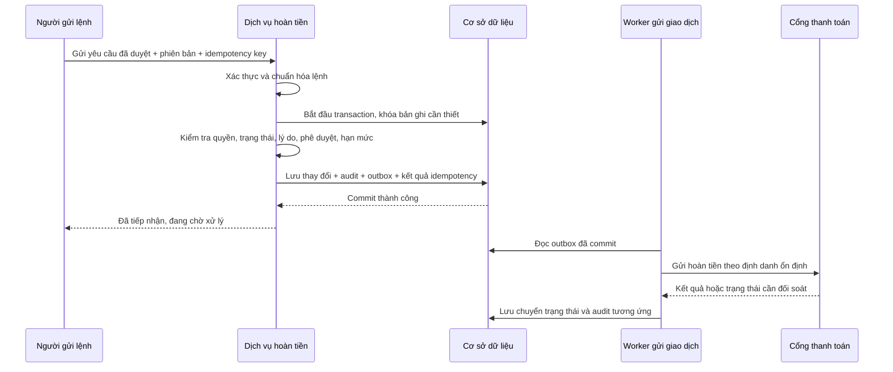

# Ghi nhận lý do nghiệp vụ (Business reason recording)

## 1. Vì sao audit cần ghi lại lý do?

Trong chương **Auditability**, ghi nhận lý do nghiệp vụ giúp giải thích một quyết định: tại sao thao tác được yêu cầu, hệ thống dựa vào căn cứ nào để cho phép hoặc từ chối, ai chịu trách nhiệm và quyết định đó dẫn đến thay đổi gì. Một dòng như `refund updated by user-17` cho biết có thay đổi, nhưng chưa đủ để đánh giá thay đổi ấy có tuân thủ quy tắc nghiệp vụ hay không.

Đối với bảo mật logic nghiệp vụ, câu hỏi cần trả lời thường là:

- Khoản hoàn tiền được thực hiện vì khách trả hàng hay vì nhân viên muốn vượt hạn mức?
- Giá được sửa theo chính sách đã phê duyệt hay theo một giá trị do client gửi lên?
- Phê duyệt có áp dụng cho đúng đơn hàng, số tiền và phiên bản yêu cầu hiện tại không?
- Hai bản ghi là hai quyết định riêng biệt hay một yêu cầu được gửi lại?
- Khi điều tra sau này, có phân biệt được điều người dùng khai báo với điều hệ thống đã kiểm chứng không?

**Lý do nghiệp vụ là dữ liệu giải thích quyết định; nó không tự cấp quyền và không thay thế việc kiểm tra quy tắc nghiệp vụ.** Một người không được phép hoàn tiền vẫn phải bị từ chối dù họ nhập lý do rất thuyết phục.

Sau bài này, người học cần biết thiết kế dữ liệu lý do có cấu trúc, gắn lý do với đối tượng và quyết định cụ thể, lưu nhất quán cùng thay đổi nghiệp vụ, và sử dụng dấu vết ấy để kiểm tra các tình huống lạm dụng.

## 2. Phân biệt lý do khai báo, căn cứ quyết định và kết quả

Ba loại thông tin sau thường bị trộn thành một trường `reason`:

| Thành phần | Trả lời câu hỏi | Ví dụ | Mức tin cậy cần thể hiện |
| --- | --- | --- | --- |
| Lý do người yêu cầu khai báo | Người đó nói vì sao cần thao tác? | `DAMAGED_ITEM`, sản phẩm được báo là hư hỏng | Là lời khai, chưa tự chứng minh sự việc |
| Căn cứ hệ thống sử dụng | Hệ thống dựa vào dữ liệu, quyền và chính sách nào? | Hồ sơ trả hàng đã xác nhận; phê duyệt áp dụng cho phiên bản 3 | Là dữ liệu đã kiểm tra theo một quy trình cụ thể |
| Kết quả quyết định | Hệ thống đã chấp nhận, từ chối hay mới ghi nhận chờ xử lý? | Đã giữ chỗ hạn mức hoàn tiền, chưa xác nhận tiền đã được trả | Phải phản ánh đúng kết quả ở giai đoạn được ghi |

Một giá trị `CUSTOMER_REQUEST` không chứng minh khách hàng thực sự yêu cầu. Một tham chiếu `approval_id` cũng không đủ nếu phê duyệt thuộc đơn khác, đã bị thu hồi hoặc chỉ duyệt số tiền thấp hơn.

Tương tự, câu “đã gửi sang cổng thanh toán” không đồng nghĩa “khách đã nhận tiền”. Bản ghi cần nêu rõ đang mô tả việc nhận yêu cầu, giữ chỗ hạn mức, gửi giao dịch hay xác nhận kết quả bên ngoài.

### 2.1. Ví dụ xuyên suốt: hoàn tiền có phê duyệt

Giả sử một hệ thống bán hàng có các quy tắc minh họa:

1. Nhân viên chỉ được gửi yêu cầu hoàn tiền cho đơn thuộc tenant và phạm vi công việc của mình.
2. Số tiền hoàn phải lớn hơn 0 và không vượt số tiền còn có thể hoàn. Các khoản đang chờ xử lý có giữ chỗ cũng được tính vào giới hạn.
3. Khoản hoàn từ **200.000 VND trở lên** cần người có quyền phù hợp phê duyệt; người yêu cầu không được tự phê duyệt.
4. Phê duyệt gắn với đúng đơn, số tiền, tiền tệ, lý do, bằng chứng liên quan và phiên bản yêu cầu. Thay đổi nội dung quan trọng phải làm mất hiệu lực phê duyệt cũ.
5. Mỗi ý định gửi khoản hoàn được xử lý theo một quy ước idempotency rõ ràng.

Các giá trị trên là chính sách giả định của ví dụ, không phải hạn mức áp dụng chung cho mọi sản phẩm.

Với yêu cầu hoàn **450.000 VND** có mã lý do `DAMAGED_ITEM`, hệ thống cần lưu được cả lời khai này lẫn kết quả kiểm tra hồ sơ trả hàng và phê duyệt. Nếu tài khoản nhân viên gửi thêm `approved=true` hoặc `reason=MANAGER_OVERRIDE`, server không được dùng các trường đó để bỏ qua bước kiểm tra.

## 3. Thiết kế hợp đồng dữ liệu cho lý do

### 3.1. Dùng mã lý do có ý nghĩa ổn định

Mã lý do giúp thống kê và đặt quy tắc; phần giải thích bổ sung giúp hiểu ngữ cảnh. Một cấu trúc cơ bản có thể là:

```json
{
  "reason_code": "DAMAGED_ITEM",
  "reason_catalog_version": "refund-reasons-v3",
  "reason_detail": "Hồ sơ trả hàng đã xác nhận sản phẩm bị nứt khi tiếp nhận.",
  "evidence_refs": [
    { "type": "RETURN_CASE", "id": "RET-204", "version": 2 }
  ]
}
```

Danh mục lý do nên thuộc phạm vi một hành động cụ thể. Mã `DAMAGED_ITEM` có thể phù hợp với hoàn tiền nhưng không phù hợp với việc mở khóa tài khoản quản trị. Cần giữ được cách diễn giải mã ở thời điểm phát sinh sự kiện; không tái sử dụng một mã cũ cho ý nghĩa hoàn toàn khác.

Khi đổi danh mục, hệ thống phải quy định cách xử lý yêu cầu đang chờ: giữ cách hiểu cũ, chuyển đổi theo quy tắc đã xác định hoặc yêu cầu xét duyệt lại. Không âm thầm diễn giải bản ghi lịch sử theo danh mục mới.

### 3.2. Văn bản tự do không trở thành mật khẩu vượt quyền

Các lý do như “khẩn cấp”, “sếp yêu cầu”, “test”, “xử lý ngoại lệ” không đủ làm căn cứ cho thao tác nhạy cảm. Nếu cho phép `OTHER`, có thể yêu cầu mô tả và tuyến phê duyệt riêng, thay vì biến nó thành cửa thoát khỏi mọi kiểm tra.

Giới hạn độ dài, định dạng và các trường bắt buộc giúp giữ chất lượng dữ liệu. Tuy nhiên, một chuỗi đủ dài vẫn có thể hoàn toàn vô nghĩa. Không thể chứng minh lý do là đúng chỉ bằng biểu thức chính quy hoặc số ký tự tối thiểu.

Với quy trình có ngoại lệ hợp lệ, nên mô hình hóa rõ hành động ngoại lệ, quyền sử dụng, hạn mức, điều kiện phê duyệt và thời hạn hiệu lực. Việc gõ một từ khóa vào ô mô tả không được kích hoạt quyền ngoại lệ.

### 3.3. Xác định nguồn của từng trường

| Trường | Nguồn phù hợp | Kiểm tra quan trọng |
| --- | --- | --- |
| `reason_code`, `reason_detail` | Người yêu cầu hoặc một quy tắc tự động được định danh | Hợp lệ với hành động; ghi rõ nguồn khai báo |
| `actor_id`, `tenant_id` | Ngữ cảnh danh tính đã xác thực | Không lấy trực tiếp từ body rồi tin là đúng |
| `approved_by`, `approval_id` | Hồ sơ phê duyệt được server tra cứu | Đúng đối tượng, phiên bản, phạm vi và còn hiệu lực |
| `policy_version`, `decision_code` | Thành phần đánh giá chính sách phía server | Phản ánh quy tắc thực sự đã áp dụng |
| Giá, số tiền tối đa, trạng thái trước thay đổi | Dữ liệu nghiệp vụ phía server | Không dùng bản chụp do client tự cung cấp làm sự thật |
| `evidence_refs` | Tham chiếu được nhận rồi phân giải tại server | Đúng tenant, đối tượng liên quan, phiên bản và quyền sử dụng |
| Thời gian ghi nhận | Đồng hồ phía hệ thống | Phân biệt với thời gian do thiết bị người dùng khai báo |

Bằng chứng có thể chứa lời khai từ bên ngoài. Cần phân biệt “server đã kiểm tra người dùng được phép tham chiếu hồ sơ này” với “nội dung hồ sơ đã được xác minh là đúng”. Hai mức kiểm chứng đó có ý nghĩa khác nhau.

Không nên chấp nhận một URL bất kỳ rồi cho server tự tải nội dung để làm bằng chứng. Có thể dùng kho hồ sơ nội bộ với ID, quyền truy cập và quy trình tiếp nhận rõ ràng.

## 4. Gắn lý do với đúng quyết định và phiên bản

Một lý do có ích cho kiểm toán phải gắn được với một tập dữ liệu xác định:

```text
Hành động + đối tượng + phiên bản + tham số quan trọng
+ lý do + bằng chứng + chính sách + người có trách nhiệm
```

Nếu chỉ lưu `order_id` và một câu mô tả, người điều tra có thể không biết câu đó giải thích cho lần đổi giá nào trong ba lần thay đổi liên tiếp.

### 4.1. Phê duyệt phải bao phủ nội dung đã duyệt

Giả sử quản lý duyệt hoàn 100.000 VND vì giao hàng thiếu. Sau đó nhân viên sửa thành 450.000 VND với lý do sản phẩm hư hỏng. Phê duyệt cũ không được tiếp tục có hiệu lực chỉ vì `refund_request_id` giữ nguyên.

Một cách thiết kế là lưu phiên bản yêu cầu và dấu vân tay của nội dung cần phê duyệt. Dấu vân tay được tính từ biểu diễn chuẩn hóa của các trường quan trọng, chẳng hạn:

```text
order_id, amount_minor, currency, reason_code,
reason_detail, evidence_versions, refund_request_version
```

Nếu sản phẩm có thêm trường ảnh hưởng quyết định, như tài khoản nhận tiền, trường đó cũng phải thuộc phạm vi phê duyệt. Quy tắc chuẩn hóa phải nhất quán; không dùng hash của JSON tùy ý vốn có thể thay đổi thứ tự trường hoặc cách biểu diễn số.

Dấu vân tay chỉ hỗ trợ phát hiện nội dung đã thay đổi. Nó không tự chứng minh người phê duyệt có quyền, không thay thế kiểm tra thu hồi và không tự chống được việc kẻ tấn công sửa cả dữ liệu lẫn hash trong cùng kho lưu trữ.

### 4.2. Chụp dữ liệu đủ để giải thích lịch sử

Có thể lưu mã chính sách và phiên bản, phiên bản yêu cầu, kết quả kiểm tra, các giá trị quan trọng trước/sau và tham chiếu đến bằng chứng có phiên bản. Khi cần, lưu thêm mô tả ngắn đã được duyệt, theo chính sách dữ liệu của hệ thống.

Chỉ lưu ID của một hồ sơ có thể sửa hoặc xóa tùy ý khiến việc tái dựng quyết định trở nên khó khăn. Ngược lại, sao chép toàn bộ đơn hàng, thông tin khách và tệp đính kèm vào mọi bản ghi audit tạo ra dư thừa dữ liệu nhạy cảm. Cần chọn tập thông tin tối thiểu nhưng đủ giải thích quyết định.

Nếu bằng chứng có thời hạn lưu ngắn hơn audit, phải xác định trước sau thời hạn đó còn có thể xác minh điều gì. Không hứa rằng có thể tái dựng đầy đủ khi tài liệu gốc đã bị xóa.

## 5. Một bản ghi audit có cấu trúc

Ví dụ dưới đây mô tả việc **giữ chỗ hạn mức và chuyển yêu cầu sang chờ gửi hoàn tiền**. Nó chưa khẳng định cổng thanh toán đã hoàn tiền thành công.

```json
{
  "event_id": "evt-7d2f",
  "schema_version": 1,
  "occurred_at": "2026-11-22T03:15:24Z",
  "recorded_at": "2026-11-22T03:15:24Z",
  "tenant_id": "tenant-08",
  "action": "REFUND_RESERVE",
  "target": {
    "type": "REFUND_REQUEST",
    "id": "RFD-42",
    "version_before": 3,
    "version_after": 4,
    "order_id": "ORD-105"
  },
  "actor": {
    "initiated_by": "user-cs-17",
    "executed_by": "service-refunds"
  },
  "reason": {
    "source": "STAFF_DECLARED",
    "code": "DAMAGED_ITEM",
    "catalog_version": "refund-reasons-v3",
    "detail": "Hồ sơ trả hàng đã xác nhận sản phẩm bị nứt khi tiếp nhận.",
    "evidence_refs": [
      { "type": "RETURN_CASE", "id": "RET-204", "version": 2 }
    ]
  },
  "decision": {
    "outcome": "COMMITTED",
    "code": "REFUND_RESERVATION_ACCEPTED",
    "policy_version": "refund-policy-v5",
    "approval_id": "APR-19",
    "approved_by": "user-manager-53",
    "approved_request_version": 3
  },
  "change": {
    "state_before": "APPROVED",
    "state_after": "SUBMISSION_PENDING",
    "amount_minor": 450000,
    "currency": "VND",
    "remaining_refundable_minor_before": 700000,
    "remaining_refundable_minor_after": 250000
  },
  "correlation_id": "corr-f91a",
  "idempotency_record_id": "idem-901"
}
```

Ở ví dụ này, `amount_minor` sử dụng đơn vị nhỏ nhất mà quy ước tiền tệ của hệ thống cho phép; với VND trong ví dụ là một đồng. Không dùng số thực dấu phẩy động để biểu diễn số tiền.

Các trường danh tính, chính sách, trạng thái và quyết định được server tạo hoặc kiểm chứng. Client không gửi nguyên event này để server lưu như một sự thật đã được xác nhận.

`event_id` nhận diện sự kiện; `correlation_id` giúp nối các bước liên quan; `idempotency_record_id` liên kết kết quả với ý định gửi lệnh. Chúng có vai trò khác nhau. Biết một trong các ID không đồng nghĩa có quyền đọc dữ liệu liên quan.

Trong hệ thống bất đồng bộ, thời gian phát sinh và thời gian tiếp nhận có thể khác nhau. Timestamp hỗ trợ điều tra nhưng không bảo đảm thứ tự nhân quả tuyệt đối giữa nhiều máy. Phiên bản đối tượng và liên kết tới sự kiện trước giúp giải thích thứ tự trong phạm vi một đối tượng.

## 6. Ghi lý do trong luồng xử lý nghiệp vụ

Một luồng phù hợp cho ví dụ hoàn tiền là:



Sơ đồ mô tả nhánh chấp nhận. Các nhánh từ chối và rollback cần được xử lý theo mục 8.

### 6.1. Kiểm tra trước, ghi cùng thay đổi

Với thao tác nhạy cảm mà audit là điều kiện bắt buộc, thay đổi nghiệp vụ và bản ghi audit tối thiểu cần nằm trong cùng transaction của cùng cơ sở dữ liệu, hoặc một cơ chế có bảo đảm tương đương được thiết kế rõ ràng.

Nếu bản ghi audit bắt buộc không thể lưu, transaction phải rollback. Không trả thành công rồi cố ghi lý do ở một bước có thể bị bỏ qua. Đồng thời, không nên buộc transaction chờ một dịch vụ phân tích log từ xa: có thể lưu bản ghi tối thiểu hoặc outbox tại chỗ rồi chuyển tiếp sau commit.

Nếu audit và nghiệp vụ ở hai cơ sở dữ liệu độc lập, gọi hai lệnh ghi liên tiếp không tự tạo ra tính nguyên tử. Khi dùng outbox, điều được bảo đảm ở thời điểm commit là sự thay đổi và ý định phát sự kiện đã cùng được lưu bền vững. Việc chuyển sang kho audit đích vẫn cần retry, phát hiện tồn đọng và khử trùng theo `event_id`.

### 6.2. Giữ đúng business invariant khi có yêu cầu đồng thời

Hai yêu cầu đều có lý do hợp lệ vẫn có thể cộng lại vượt số tiền được hoàn. Ghi lý do không ngăn được lỗi tranh chấp này.

Hệ thống phải bảo vệ phép kiểm tra và cập nhật hạn mức bằng cơ chế phù hợp, như khóa trên bản ghi tổng hợp, cập nhật có điều kiện kèm kiểm tra số dòng bị tác động, hoặc kiểm soát phiên bản với xử lý xung đột. Mọi luồng thay đổi cùng hạn mức phải tuân thủ cùng quy ước.

Bản ghi audit nên lấy số dư trước/sau từ chính phép cập nhật đã được bảo vệ đó. Không tính lại bằng một truy vấn tùy ý sau commit rồi gán kết quả cho giao dịch vừa xảy ra.

### 6.3. Minh họa bằng mã giả theo phong cách Java

Đoạn sau thể hiện ranh giới và trách nhiệm xử lý, không phải mã hoàn chỉnh có thể chạy độc lập. Các repository và helper là thành phần của ứng dụng giả định.

```java
Receipt submitRefund(SubmitRefund command, AuthenticatedPrincipal principal) {
    // Fingerprint được server tính từ nội dung lệnh đã chuẩn hóa.
    String fingerprint = fingerprints.forSubmitRefund(command);

    return tx.required(() -> {
        IdempotencyEntry entry = idempotency.lockOrCreate(
            principal.tenantId(),
            principal.subjectId(),
            "REFUND_SUBMIT",
            command.idempotencyKey(),
            fingerprint
        );
        entry.requireSameFingerprint(fingerprint);

        RefundRequest request = refundRequests.lockById(
            principal.tenantId(), command.refundRequestId()
        );
        authorization.requireCanSubmit(principal, request);

        if (entry.isCompleted()) {
            // Quyền với đối tượng vẫn được kiểm tra trước khi trả kết quả cũ.
            return entry.savedReceipt();
        }

        request.requireVersion(command.expectedVersion());
        request.requireState(RefundState.APPROVED);

        RefundPolicy policy = policies.currentFor(request);
        reasons.validateForSubmission(request.recordedReason(), policy);
        approvals.requireCurrentlyValidFor(request, policy);

        Order order = orders.lockById(request.tenantId(), request.orderId());
        order.requireRefundableState();

        RefundSnapshot before = RefundSnapshot.capture(request, order);
        order.reserveRefund(request.amount());
        request.markSubmissionPending();

        orders.save(order);
        refundRequests.save(request);

        // Lấy lý do từ yêu cầu đã duyệt, không lấy lý do mới từ lệnh submit.
        audit.append(AuditEvent.refundReserved(
            principal, request, policy, before, order
        ));
        outbox.enqueueRefundSubmission(request);

        Receipt receipt = Receipt.accepted(request.id(), request.version());
        idempotency.complete(entry, receipt);
        return receipt;
    });
}
```

Để đoạn mã giả có ý nghĩa bảo mật, phần triển khai cần thỏa các điều kiện sau:

- `principal` đến từ cơ chế xác thực đáng tin cậy; tra cứu theo tenant không thay thế kiểm tra quyền trên từng đối tượng.
- `lockOrCreate` dựa trên ràng buộc duy nhất cho phạm vi khóa và xử lý được tranh chấp khi hai transaction cùng tạo. Nó không được ghi kết quả hoàn thành trong một transaction độc lập với nghiệp vụ.
- `authorization` kiểm tra cả quyền hành động lẫn phạm vi đối tượng. Quy tắc đọc lại kết quả idempotency khi quyền đã bị thu hồi phải được xác định rõ.
- `approvals` kiểm tra người duyệt, tách biệt trách nhiệm, phiên bản, nội dung đã duyệt, hiệu lực và điều kiện thu hồi theo chính sách tại thời điểm thực thi. Các luồng sửa yêu cầu hoặc thu hồi phê duyệt phải phối hợp khóa/phiên bản để tránh kiểm tra một trạng thái rồi dùng trạng thái khác.
- `reserveRefund` kiểm tra số tiền dương, cùng tiền tệ và tổng hạn mức còn lại dưới cơ chế khóa chung với các luồng liên quan. Tất cả luồng giữ chỗ, giải phóng và xác nhận hoàn tiền phải cùng bảo vệ invariant này.
- Các lời gọi lưu audit, outbox, nghiệp vụ và idempotency cùng tham gia transaction. Đối tượng event chứa dữ liệu đã chụp, không giữ tham chiếu có thể bị sửa tiếp ngoài ý muốn.
- Mọi nhánh lấy khóa cần tuân thủ thứ tự nhất quán trong toàn ứng dụng để hạn chế deadlock. Khi phải retry transaction, không tạo thêm tác dụng phụ bên ngoài.

Lệnh gửi chỉ chứa ID và phiên bản yêu cầu cùng khóa idempotency. Lý do nằm trong yêu cầu đã được duyệt. Nếu người dùng muốn đổi lý do, họ phải đi qua luồng sửa yêu cầu và xét duyệt lại phù hợp.

Không gọi cổng thanh toán trong transaction rồi giả định rollback cơ sở dữ liệu sẽ đảo ngược việc hoàn tiền bên ngoài. Tác dụng phụ đó cần giao thức riêng, định danh ổn định và đối soát.

## 7. Idempotency: một ý định, một thay đổi nghiệp vụ

Khi client mất kết nối sau commit, người dùng có thể gửi lại lệnh. Hệ thống cần phân biệt:

| Tình huống | Cách xử lý mong muốn | Ý nghĩa đối với audit |
| --- | --- | --- |
| Cùng khóa, cùng nội dung, kết quả đã hoàn thành | Trả kết quả đã lưu theo chính sách quyền hiện tại | Không tạo thêm một sự kiện hoàn tiền nghiệp vụ |
| Cùng khóa, nội dung quan trọng khác | Từ chối xung đột | Có thể ghi một lần thử xung đột, không ghi như giao dịch mới thành công |
| Cùng khóa, yêu cầu đầu vẫn đang xử lý | Chờ có giới hạn hoặc trả trạng thái đang xử lý theo hợp đồng API | Không tự khởi tạo tác dụng phụ thứ hai |
| Khác khóa nhưng cùng một yêu cầu hoàn đã được gửi | State machine và ràng buộc nghiệp vụ ngăn gửi lại | Không dựa riêng vào khóa để chống hoàn trùng |
| Đã gửi bên ngoài nhưng chưa biết kết quả | Giữ trạng thái chờ xác minh và đối soát | Không ghi là thất bại chắc chắn rồi hoàn thêm một lần |

Phạm vi khóa thường cần gắn với tenant, chủ thể hoặc client và hành động, tùy hợp đồng sản phẩm. Không dùng khóa như một bí mật cấp quyền đọc kết quả của người khác.

Fingerprint phải phản ánh ý nghĩa lệnh. Với bước tạo hoặc sửa yêu cầu, số tiền, tiền tệ, lý do và bằng chứng liên quan có thể là dữ liệu quan trọng. Với bước gửi yêu cầu đã duyệt trong ví dụ, ID cùng phiên bản giúp ràng buộc với nội dung đã lưu; quy trình phải bảo đảm phiên bản thay đổi khi nội dung quan trọng đổi.

Có thể lưu dấu vết kỹ thuật `REQUEST_REPLAYED` để điều tra, nhưng phải phân biệt nó với một lần giữ chỗ hay hoàn tiền mới. Thời hạn lưu khóa và cách xử lý sau khi khóa hết hạn phải phù hợp vòng đời nghiệp vụ; xóa khóa không làm một khoản đã hoàn trở thành được phép hoàn lại.

Outbox có thể phát lại sự kiện. Bên nhận cần khử trùng bằng định danh ổn định. Với cổng thanh toán, sử dụng khả năng idempotency theo đúng hợp đồng của cổng nếu có; khi không có hoặc kết quả không chắc chắn, cần cơ chế đối soát. Không tuyên bố xử lý đúng một lần trên mọi hệ thống chỉ vì có một bảng idempotency nội bộ.

## 8. Ghi nhận từ chối, rollback và hành động tự động

### 8.1. Lưu cả lý do yêu cầu và lý do từ chối

Khi một lệnh bị chặn, hai thông tin sau đều có ích:

```text
requested_reason_code = DAMAGED_ITEM
outcome               = REJECTED
decision_code         = APPROVAL_SCOPE_MISMATCH
```

Ví dụ này nói người dùng yêu cầu vì sản phẩm hư hỏng, nhưng hệ thống từ chối vì phê duyệt không bao phủ nội dung yêu cầu. Nếu chỉ lưu `reason=invalid`, người điều tra mất cả ngữ cảnh lẫn căn cứ từ chối.

Không cần trả toàn bộ chi tiết kiểm tra quyền hoặc nội dung audit cho client. Thông điệp bên ngoài và dữ liệu điều tra nội bộ có thể khác nhau, miễn là chúng không tạo ra mô tả sai về kết quả.

### 8.2. Bản ghi bị rollback không còn là audit bền vững

Nếu lưu sự kiện từ chối bên trong transaction rồi ném exception làm rollback, sự kiện đó cũng bị mất. Những lần thử bị chặn có thể cần được ghi qua một đường riêng sau rollback hoặc một cơ chế thu thập sự kiện an ninh độc lập.

Đường này phải giới hạn dữ liệu, kiểm soát tải và đánh dấu rõ `REJECTED` hay `ERROR`; không giả là thay đổi nghiệp vụ đã commit. Cũng không ghi “từ chối thành công” trước khi biết hệ thống thực sự đã ngăn tác dụng phụ.

Mỗi cơ chế có giới hạn riêng: lỗi tiến trình giữa rollback và gửi sự kiện có thể làm mất dấu vết nếu thiết kế chỉ cố ghi sau đó. Với yêu cầu bảo đảm cao hơn, cần mô hình tiếp nhận/ghi nhận bền vững được thiết kế riêng, cùng giám sát và đối soát. Một transaction audit độc lập không tự chứng minh transaction nghiệp vụ đã commit.

Nếu kết quả commit chưa rõ vì lỗi kết nối, phải xác minh bằng định danh lệnh hoặc bản ghi idempotency. Không gán ngay `REJECTED` cho tình huống chưa biết kết quả.

### 8.3. Hành động tự động cũng phải có căn cứ

Một tác vụ tự hủy đơn không có người gõ lý do vẫn có lý do nghiệp vụ, chẳng hạn `PAYMENT_TIMEOUT`. Cần lưu danh tính dịch vụ, mã và phiên bản quy tắc, mốc thời gian được đánh giá, cùng các giá trị quan trọng đã dùng.

Nếu dịch vụ thực thi theo yêu cầu con người, nên giữ được cả người khởi tạo lẫn dịch vụ thực thi. Không thay mọi danh tính bằng `SYSTEM`, vì điều đó cắt đứt trách nhiệm và chuỗi nguyên nhân.

## 9. Bảo vệ chính dữ liệu lý do

Dữ liệu lý do có thể chứa nội dung do người dùng kiểm soát và thông tin nhạy cảm. Một chức năng audit yếu có thể trở thành nơi gây rò rỉ hoặc che giấu hành vi.

### 9.1. Tránh log injection và thực thi nội dung khi hiển thị

- Dùng định dạng có cấu trúc và bộ mã hóa phù hợp; không nối chuỗi đầu vào vào một dòng log thủ công.
- Xử lý ký tự điều khiển và giới hạn kích thước ở ranh giới tiếp nhận. Không để xuống dòng do người dùng nhập tạo thành một sự kiện giả.
- Dùng truy vấn có tham số khi lưu hoặc tìm kiếm; reason là dữ liệu, không phải đoạn SQL.
- Khi hiển thị trên trang audit, escape nội dung theo ngữ cảnh đầu ra. Không render HTML do người dùng nhập như nội dung được tin cậy.
- Nếu có xuất sang bảng tính, xử lý nguy cơ giá trị được diễn giải thành công thức theo định dạng xuất. Một chuỗi an toàn trong JSON không tự an toàn trong mọi nơi tiêu thụ.

Chuẩn hóa nội dung để an toàn không được âm thầm làm đổi ý nghĩa lời khai. Nếu cần giữ bản gốc để điều tra, phải có mục đích, phân quyền và chính sách lưu phù hợp; không mặc định giữ mọi dữ liệu thô.

### 9.2. Không biến ô lý do thành kho bí mật

Không ghi mật khẩu, access token, khóa API hoặc toàn bộ thông tin thanh toán vào lý do. Hạn chế dữ liệu cá nhân và thông tin sức khỏe không cần thiết. Thay vì dán toàn bộ trao đổi với khách hàng, nên tham chiếu hồ sơ được bảo vệ nếu đáp ứng được nhu cầu kiểm toán.

Kiểm tra và che dữ liệu nhạy cảm giúp giảm rủi ro, nhưng không thay thế việc thiết kế biểu mẫu và hướng dẫn nhập liệu đúng. Các bản xuất, chỉ mục tìm kiếm, bản sao phân tích và bản sao lưu cũng thuộc phạm vi quản lý dữ liệu audit.

### 9.3. Phân quyền đọc và sửa audit

Người được xử lý hoàn tiền không mặc nhiên được xem mọi lý do của mọi tenant. Quyền đọc audit cần theo vai trò, tenant, đối tượng và mục đích sử dụng. Cần kiểm soát cả chức năng tìm kiếm, tải tệp bằng chứng và xuất hàng loạt.

Tài khoản ứng dụng nên có quyền tối thiểu, ưu tiên chỉ thêm bản ghi audit theo giao thức đã thiết kế. Việc sửa hoặc xóa lịch sử cần cơ chế riêng có kiểm soát. Với hành động hiệu chỉnh, thêm sự kiện mới liên kết bản ghi cũ giúp giữ được lịch sử giải thích.

Nếu có quyền quản trị cơ sở dữ liệu rất cao, chỉ đặt tên bảng là `append_only` hoặc chỉ tính hash không đủ chống sửa dấu vết. Mức bảo vệ cao hơn có thể cần tách quyền quản trị, chuyển bản sao ra hệ thống độc lập, hoặc cơ chế lưu giữ không cho sửa trong thời hạn quy định. Lựa chọn phải phù hợp mô hình đe dọa của hệ thống.

Thời hạn lưu và xóa phải được xác định theo nhu cầu vận hành và yêu cầu áp dụng cho sản phẩm. Không tự đặt một thời hạn chung cho mọi dữ liệu, mọi tổ chức.

## 10. Sử dụng lý do để phát hiện lạm dụng

Một mã lý do có cấu trúc cho phép đặt câu hỏi trên nhiều quyết định, thay vì chỉ đọc từng câu mô tả:

- Một tài khoản dùng `OTHER` cho phần lớn khoản hoàn trong khi các tài khoản cùng nhiệm vụ hiếm khi dùng mã này?
- Có nhiều khoản sát dưới ngưỡng phê duyệt, cùng khách hàng, cùng đơn hoặc cùng người khởi tạo trong một khoảng thời gian?
- Người duyệt và người yêu cầu có trùng danh tính hoặc liên hệ bất thường theo quy tắc tách biệt trách nhiệm của tổ chức?
- Một bằng chứng được tái sử dụng cho nhiều đối tượng không liên quan?
- Có nhiều lần bị từ chối do sai phạm vi rồi ngay sau đó thành công qua một luồng ngoại lệ?
- Khoản hoàn tăng đột biến nhưng phần giải thích bị sao chép lặp lại và thiếu hồ sơ tương ứng?

Đây là tín hiệu để điều tra, không tự chứng minh có gian lận. Cần đối chiếu khối lượng công việc, phân công và ngữ cảnh nghiệp vụ. Không biến một thống kê thô thành căn cứ kết tội tự động.

Phân tích cũng không thay thế kiểm soát trực tiếp. Ví dụ, báo cáo phát hiện nhiều lần hoàn trùng không bù được việc thiếu transaction hoặc kiểm tra hạn mức ở thời điểm xử lý.

## 11. Những lỗi thiết kế thường gặp

| Lỗi | Hậu quả | Cách điều chỉnh |
| --- | --- | --- |
| Lưu mỗi `reason_detail` tự do | Khó thống kê, dễ có mô tả mơ hồ | Kết hợp mã lý do có phiên bản và mô tả có mục đích |
| Tin `approved_by` từ request body | Người dùng có thể tự tạo danh tính phê duyệt | Tra cứu và kiểm chứng phê duyệt tại server |
| Cho `reason=EMERGENCY` bỏ qua kiểm tra quyền | Lý do trở thành đường vượt quyền | Mô hình hóa ngoại lệ thành hành động có quyền và điều kiện riêng |
| Lưu lý do sau khi trả thành công | Có thay đổi nhưng thiếu căn cứ điều tra | Ghi dữ liệu audit bắt buộc cùng transaction |
| Lưu lý do duy nhất ở một hồ sơ có thể sửa | Lịch sử đổi theo dữ liệu hiện tại | Dùng phiên bản hoặc snapshot có giới hạn |
| Chỉ kiểm tra approval ID tồn tại | Dùng nhầm hoặc tái sử dụng phê duyệt | Ràng buộc với đối tượng, nội dung, phiên bản và hiệu lực |
| Bắt nhập lý do chỉ trên giao diện | API, job hoặc công cụ nội bộ có thể bỏ qua | Kiểm tra trong dịch vụ nghiệp vụ chung cho các đường vào |
| Mỗi retry đều phát một event thành công mới | Báo cáo đếm thừa giao dịch | Phân biệt retry kỹ thuật với thay đổi nghiệp vụ |
| Dùng `correlation_id` làm bằng chứng được phép thao tác | Nhầm liên kết quan sát với quyền truy cập | Kiểm tra danh tính, quyền và phạm vi độc lập |
| Ghi toàn bộ request vào audit | Lộ bí mật, dữ liệu cá nhân và đầu vào không kiểm soát | Chọn trường theo schema và mục đích điều tra |

## 12. Kiểm thử các tình huống tấn công logic

Kiểm thử cần xác nhận đồng thời **kết quả nghiệp vụ** và **dấu vết giải thích kết quả**. Chỉ kiểm tra HTTP status hoặc chỉ tìm thấy một dòng log là chưa đủ.

| Tình huống | Kết quả nghiệp vụ mong muốn | Điều cần kiểm tra trong audit |
| --- | --- | --- |
| Gọi API trực tiếp, bỏ trường lý do bắt buộc | Không thực hiện thao tác | Nếu chính sách ghi lần thử, có mã từ chối phù hợp và không có sự kiện thành công |
| Gửi lý do hợp lệ nhưng đối tượng thuộc tenant khác | Không thay đổi và không lộ dữ liệu đối tượng | Dấu vết dùng dữ liệu tối thiểu; không lấy lý do làm quyền truy cập |
| Gửi mã lý do không thuộc hành động | Từ chối theo hợp đồng | Phân biệt mã do client yêu cầu với mã quyết định của server |
| Gửi approval ID thuộc đơn khác | Từ chối | Ghi kết quả kiểm tra phạm vi, không ghi như đã được phê duyệt |
| Sửa số tiền, lý do hoặc bằng chứng sau khi được duyệt | Không thực thi bằng phê duyệt cũ | Thể hiện phiên bản mới hoặc nguyên nhân không còn phù hợp |
| Người yêu cầu tự phê duyệt | Từ chối nếu vi phạm tách biệt trách nhiệm | Có thể nối được danh tính người yêu cầu và người duyệt |
| Hai yêu cầu đồng thời vượt tổng hạn mức | Tổng khoản đã hoàn và giữ chỗ vẫn trong giới hạn | Chỉ các thay đổi đã commit có sự kiện tương ứng, số dư trước/sau nhất quán |
| Mất phản hồi sau commit rồi retry cùng khóa | Trả kết quả cũ, không giữ chỗ thêm | Chỉ có một sự kiện nghiệp vụ cho thay đổi đó |
| Dùng lại khóa với payload khác | Từ chối xung đột | Không tạo sự kiện thành công cho nội dung mới |
| Gửi cùng yêu cầu bằng một khóa mới | State machine ngăn thực hiện lặp | Không có khoản giữ chỗ thứ hai cho cùng bước chuyển trạng thái |
| Kho audit bắt buộc tại chỗ không ghi được | Transaction nhạy cảm rollback theo thiết kế | Không có bản ghi thành công mô tả thay đổi chưa commit |
| Kho phân tích audit từ xa tạm mất kết nối | Outbox đã commit được giữ lại để chuyển tiếp | Không mất sự kiện; phát lại không nhân đôi bản ghi đích |
| Reason chứa xuống dòng, HTML hoặc dữ liệu rất lớn | Được giới hạn và xử lý theo hợp đồng | Không tạo dòng giả, không thực thi nội dung, không làm hỏng trang xem |
| Reason chứa token thử nghiệm | Chặn hoặc xử lý theo chính sách dữ liệu | Không để bí mật xuất hiện trong audit và các bản xuất |
| Chưa rõ cổng thanh toán đã nhận lệnh hay chưa | Không tự hoàn lại như một yêu cầu mới | Trạng thái thể hiện chưa xác định và có liên kết đối soát |

Với kiểm thử đồng thời, nên chủ động phối hợp các transaction để chúng cùng đọc hoặc cùng tranh chấp điểm quan trọng; việc gửi tuần tự hai request không kiểm tra được cùng một lỗi. Với kiểm thử lỗi audit/outbox, cần gây lỗi đúng vị trí lưu hoặc chuyển tiếp và xác nhận trạng thái thật trong cơ sở dữ liệu.

Dữ liệu kiểm thử cần dùng danh tính, tenant và bằng chứng giả lập. Không đưa bí mật thật vào test chỉ để kiểm tra chức năng che dữ liệu.

## 13. Đưa vào sản phẩm mà vẫn giữ lý do có chất lượng

Biểu mẫu nên hỏi theo ngữ cảnh: “Vì sao cần hoàn khoản này?” và yêu cầu đúng loại bằng chứng liên quan. Danh sách quá dài hoặc bắt nhập một đoạn văn cho mọi thao tác nhỏ dễ dẫn đến nội dung sao chép và đối phó.

Có thể phân mức yêu cầu theo mức nhạy cảm của hành động. Ví dụ, một thay đổi không đáng kể có mã lý do và ngữ cảnh tự động; một ngoại lệ về giá hoặc hoàn tiền lớn cần mô tả, bằng chứng và phê duyệt riêng. Dù giao diện khác nhau, cùng một invariant phải được kiểm tra tại server cho API, trang quản trị, batch job và công cụ hỗ trợ nội bộ.

Các trạng thái nên được trình bày đúng: “đã lưu yêu cầu”, “đang chờ duyệt”, “đã tiếp nhận xử lý”, “đã xác nhận hoàn tiền”. Không dùng một nhãn “thành công” cho mọi giai đoạn nếu nó khiến người dùng hoặc người điều tra hiểu sai.

Khi lý do đã gắn với quyết định có hiệu lực, sửa lời giải thích cần đi qua hành động hiệu chỉnh có dấu vết. Nếu sửa làm thay đổi căn cứ phê duyệt, phải xét lại phê duyệt theo chính sách, thay vì chỉ sửa một trường văn bản trong trang quản trị.

## 14. Các nguyên tắc cần giữ

Ghi nhận lý do nghiệp vụ có giá trị khi giúp nối được **lời khai, căn cứ kiểm chứng, chủ thể chịu trách nhiệm, đối tượng có phiên bản và kết quả thực tế**. Một ô văn bản bắt buộc chỉ là điểm bắt đầu.

Trong bảo mật logic nghiệp vụ, hãy giữ các nguyên tắc sau:

1. Lý do giải thích yêu cầu; quyền theo đối tượng và business invariant quyết định yêu cầu có được thực hiện không.
2. Phê duyệt bao phủ một nội dung xác định. Sửa nội dung quan trọng không được tiếp tục dựa vào phê duyệt cũ.
3. Audit của thay đổi đã commit phải nhất quán với transaction. Sự kiện từ chối, rollback và kết quả chưa rõ cần ngữ nghĩa riêng.
4. Idempotency và state machine bảo vệ việc thực hiện lặp; dấu vết phải phân biệt một lần thử với một thay đổi nghiệp vụ mới.
5. Dữ liệu lý do cần được bảo vệ về tính toàn vẹn, quyền truy cập và mức thu thập, giống các dữ liệu nghiệp vụ nhạy cảm khác.
6. Kiểm thử phải chứng minh cả việc chặn lạm dụng và khả năng giải thích chính xác điều đã xảy ra.
