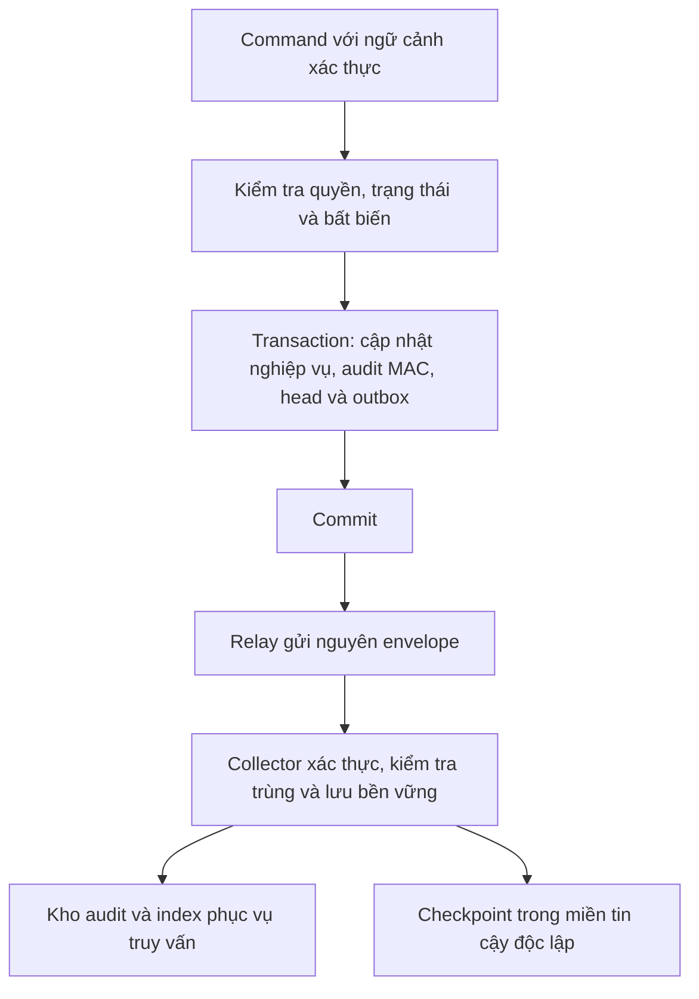

# Audit event integrity

## 1. Tính toàn vẹn của sự kiện audit bảo vệ điều gì?

**Audit event integrity** là khả năng bảo vệ và kiểm chứng rằng bằng chứng về một hành động nghiệp vụ vẫn giữ đúng nội dung đã được ghi nhận, có nguồn gốc phù hợp và không bị thay thế âm thầm trong vòng đời của nó. Với một chuỗi sự kiện, thiết kế còn cần giúp phát hiện mất bản ghi, phát lại, đảo thứ tự hoặc cắt bỏ một đoạn lịch sử trong phạm vi đã cam kết.

Trong chương **Auditability** của module bảo vệ logic nghiệp vụ, bài này tập trung vào độ tin cậy của bằng chứng về quy tắc, quyền và trạng thái. Audit cần trả lời được những câu hỏi như:

- Ai sửa giá của đơn hàng, từ mức nào sang mức nào, theo chính sách nào?
- Ai phê duyệt yêu cầu hoàn tiền và phê duyệt phiên bản hồ sơ nào?
- Một command đã cấp quyền lợi một lần hay được thực hiện lại sau retry?
- Người thao tác có quyền trên đúng đối tượng và tenant vào thời điểm quyết định không?
- Có ai sửa hoặc xóa dấu vết sau một lần bỏ qua bước phê duyệt không?

Giả sử hồ sơ hoàn tiền được chuyển từ `PENDING_APPROVAL` sang `APPROVED` bởi `user-18`. Sau đó, người có quyền quản trị cơ sở dữ liệu đổi trường người duyệt trong audit thành `user-11`, hoặc xóa bản ghi để không còn bằng chứng tự phê duyệt. Quy tắc nghiệp vụ có thể đã bị vi phạm; nếu audit cũng dễ sửa thì quá trình điều tra tiếp tục mất căn cứ.

Một dòng log có cấu trúc, một ID duy nhất hay một bảng tên `audit_log` chưa tự cung cấp tính toàn vẹn. Cần xác định kẻ tấn công có thể làm gì, dữ liệu nào được bảo vệ, bằng chứng nào được neo ở nơi đáng tin và ai thực sự kiểm chứng chúng.

NIST SP 800-53 Rev. 5, kiểm soát AU-9, đề cập bảo vệ thông tin audit khỏi truy cập, sửa đổi và xóa trái phép. AU-9(3) đề cập cơ chế mật mã để bảo vệ tính toàn vẹn. Kiến trúc và ví dụ trong bài là phương án học tập, không phải một giao thức do NIST quy định. Xem [NIST SP 800-53 Rev. 5, AU-9](https://nvlpubs.nist.gov/nistpubs/SpecialPublications/NIST.SP.800-53r5.pdf#page=101).

## 2. Phân biệt các thuộc tính thường bị gộp chung

| Thuộc tính | Câu hỏi cần trả lời | Một giới hạn cần nhớ |
|---|---|---|
| Toàn vẹn nội dung | Nội dung đã thay đổi từ khi được bảo vệ chưa? | Hash đặt cạnh dữ liệu có thể bị thay cùng dữ liệu |
| Xác thực nguồn | Bằng chứng có đến từ nguồn hoặc khóa được tin cậy không? | Nguồn đã bị chiếm quyền vẫn có thể tạo dữ liệu sai |
| Đầy đủ trong phạm vi | Những sự kiện phải có của một luồng hoặc khoảng đã cam kết có còn đủ không? | Chữ ký trên từng bản ghi riêng lẻ không tự phát hiện bản ghi bị bỏ đi |
| Thứ tự và liên kết | Sự kiện thuộc vị trí, chuỗi và command nào? | Timestamp giữa nhiều máy không tự tạo tổng thứ tự đáng tin |
| Khả dụng | Khi cần điều tra có đọc và kiểm chứng được bằng chứng không? | Dữ liệu còn nguyên nhưng mất khóa giải mã vẫn có thể không dùng được |
| Bí mật | Ai được xem thông tin audit? | HMAC hoặc chữ ký không mã hóa nội dung |
| Tính đúng đắn nghiệp vụ | Sự kiện mô tả đúng quyết định và hiệu ứng thực tế không? | Một lời khai sai vẫn có thể có chữ ký hợp lệ |

Cần phân biệt **chống thay đổi bằng kiểm soát ghi** và **phát hiện thay đổi bằng bằng chứng kiểm chứng**. Chính sách chỉ cho ghi thêm làm giảm khả năng sửa lịch sử qua một danh tính nhất định. Hash, MAC, chữ ký và checkpoint có thể giúp phát hiện việc lịch sử không khớp với cam kết trước đó. Hai lớp này bổ sung cho nhau và có ranh giới tin cậy khác nhau.

Chữ ký của `refund-service` chỉ gắn bản ghi với khóa dịch vụ theo chính sách tin cậy. Nó không chứng minh người dùng đã trực tiếp ký giao dịch, không chứng minh phiên đăng nhập không bị chiếm và không thay thế kiểm tra phân quyền theo đối tượng.

Đặc biệt, một hệ thống có thể bảo vệ rất tốt mọi sự kiện đã nhận nhưng vẫn thiếu sự kiện cho một endpoint không gọi audit. Muốn kết luận về tính đầy đủ nghiệp vụ, phải có kiểm soát điểm phát sinh và đối soát với nguồn thay đổi nghiệp vụ đáng tin.

## 3. Mô hình đe dọa và ranh giới tin cậy

Trước khi chọn thuật toán, cần xác định năng lực của từng bên có thể tác động đến audit.

| Bên hoặc sự cố | Khả năng có thể xảy ra | Lớp kiểm soát cần xem xét |
|---|---|---|
| Client không tin cậy | Gửi giả actor, tenant, số tiền, lý do hoặc ký tự chèn log | Tạo ngữ cảnh từ máy chủ, allowlist bằng chứng, schema có giới hạn |
| Kẻ nghe hoặc can thiệp đường truyền | Đọc, thay hoặc gửi lại thông điệp | Kênh được bảo vệ, xác thực nguồn, kiểm tra replay |
| Relay hoặc consumer lỗi | Gửi trùng, nhận lệch thứ tự, dừng giữa các bước | Outbox bền vững, deduplication, acknowledgement sau khi lưu |
| Người có quyền sửa bảng audit | Sửa payload, thay hash, xóa bản ghi | Bằng chứng mật mã và checkpoint ngoài phạm vi quyền đó |
| Người quản trị nền tảng log | Đổi retention, sửa index, tắt thu thập | Phân tách nhiệm vụ, bản gốc độc lập, giám sát thay đổi cấu hình |
| Tiến trình nghiệp vụ bị chiếm | Bỏ phát sự kiện hoặc phát lời khai giả | Đối soát độc lập, giới hạn quyền ký, nguồn bằng chứng bổ sung |
| Kẻ có khóa ký hoặc khóa MAC | Tạo bằng chứng mới vượt kiểm tra mật mã | Cô lập khóa, thu hồi, giới hạn phạm vi và điều tra thời gian bị ảnh hưởng |
| Lỗi dung lượng hoặc khôi phục | Mất phần đuôi, quay về snapshot cũ | Theo dõi vị trí đã cam kết, kiểm tra phục hồi, cảnh báo độ trễ |

Một dịch vụ ký chỉ hữu ích trong phạm vi nó thật sự hạn chế điều được phép ký. Nếu ứng dụng có thể yêu cầu ký bất kỳ payload nào mà không có chính sách nguồn hoặc schema, kẻ chiếm ứng dụng có thể sử dụng chính dịch vụ đó như một công cụ hợp thức hóa bản ghi giả.

Tách hệ thống lưu audit khỏi cơ sở dữ liệu nghiệp vụ giúp giảm phạm vi ảnh hưởng của một số kiểu chiếm quyền. Tuy nhiên, hai hệ thống cùng dùng một tài khoản quản trị toàn quyền, cùng khóa hoặc cùng bản sao lưu có thể vẫn chung một điểm thất bại.

Các giả định quan trọng nên được ghi rõ: ai quản lý khóa, ai được thay chính sách lưu giữ, ai xác thực checkpoint và năng lực nào của quản trị viên nằm ngoài cơ chế bảo vệ hiện tại.

## 4. Hợp đồng dữ liệu trước khi bảo vệ bằng mật mã

### 4.1. Tạo bằng chứng từ trạng thái đáng tin

Một sự kiện phê duyệt có thể mang dữ liệu nghiệp vụ sau:

```json
{
  "schemaVersion": 1,
  "eventId": "evt-refund-42-approval-7",
  "producerId": "refund-service",
  "tenantId": "tenant-a",
  "actionId": "PAYMENT.REFUND.APPROVE",
  "commandId": "cmd-approval-61",
  "attemptId": "attempt-92",
  "initiatorId": "user-18",
  "executorId": "refund-service",
  "targetType": "refund-request",
  "targetId": "refund-42",
  "policyVersion": "refund-policy-v7",
  "phase": "LOCAL_COMMIT",
  "outcome": "COMMITTED",
  "occurredAt": "2026-11-22T02:15:00Z",
  "evidence": {
    "requesterId": "user-11",
    "approverId": "user-18",
    "resourceVersionBefore": 6,
    "resourceVersionAfter": 7,
    "fromState": "PENDING_APPROVAL",
    "toState": "APPROVED",
    "approvedAmountMinor": "250000",
    "currency": "VND"
  }
}
```

Đây là schema minh họa. Trường số tiền được biểu diễn bằng chuỗi số nguyên theo hợp đồng, để không vô tình mất chính xác qua các lớp xử lý số. Với VND trong ví dụ, giá trị này biểu diễn 250.000 đồng. Bên đọc phải biết đơn vị, tiền tệ và cách diễn giải trường, thay vì tự suy ra từ tên.

Máy chủ xác định actor từ ngữ cảnh đã xác thực, tải đối tượng theo tenant đã kiểm tra, áp dụng quyền và lấy số tiền từ hồ sơ nghiệp vụ. Không dùng trực tiếp `approvedBy`, `tenantId` hay `outcome` do client khai rồi ký chúng.

`COMMITTED` phải có ngữ nghĩa gắn với transaction cục bộ. Sự kiện được tạo trong transaction chỉ trở thành bằng chứng commit khi nó được lưu bền vững cùng thay đổi và có thể được đọc sau commit. Trước thời điểm đó, nó mới là dữ liệu đang chuẩn bị.

Sự kiện phê duyệt không khẳng định tiền đã được trả. Hiệu ứng bên ngoài cần bằng chứng riêng từ luồng thực thi và đối soát với nhà cung cấp.

### 4.2. Xác định chính xác phần được bảo vệ

Một envelope có thể gồm:

```text
businessEvent
integrity:
  formatVersion
  algorithm
  keyId
  chainId
  sequence
  previousTag
  tag
```

Trong một thiết kế dùng HMAC chuỗi, thông điệp được MAC phải bao gồm phiên bản định dạng, thuật toán đã cho phép, định danh khóa, chuỗi, vị trí, tag trước và toàn bộ payload nghiệp vụ theo encoding đã thống nhất. Trường `tag` hiện tại nằm ngoài chính thông điệp đang tính tag để tránh tự tham chiếu.

Các thuộc tính quan trọng như tenant, producer, event ID, outcome, policy và phiên bản đối tượng phải nằm trong phần được bảo vệ. Ký mỗi số tiền nhưng để actor hoặc đối tượng bên ngoài chữ ký vẫn cho phép thay đổi ý nghĩa nghiệp vụ.

Các nhãn bổ sung khi ingest hoặc lập chỉ mục nên nằm trong lớp metadata riêng. Không thêm hoặc sửa một trường bên trong payload đã ký rồi tiếp tục trình bày nó như bản gốc.

### 4.3. Chọn quy tắc byte ổn định

Hai JSON có cùng ý nghĩa có thể có byte khác nhau do thứ tự thuộc tính hoặc cách biểu diễn. Có hai hướng phổ biến:

- Bảo vệ đúng byte đã phát sinh và lưu nguyên byte đó để kiểm chứng.
- Dùng một quy tắc canonicalization có phiên bản, để các bên tạo cùng byte cho cùng dữ liệu hợp lệ.

Nếu chọn JSON Canonicalization Scheme, cần dùng triển khai đúng RFC 8785. JCS yêu cầu không có tên thuộc tính trùng, có giới hạn biểu diễn số và không tự chuẩn hóa Unicode. Số nguyên lớn hoặc số cần độ chính xác cao có thể cần biểu diễn bằng chuỗi theo schema. Chỉ sắp xếp key bằng một serializer thông thường chưa đủ để tuyên bố tuân thủ JCS. Xem [RFC 8785, mục 3](https://www.rfc-editor.org/rfc/rfc8785.html#section-3).

Schema còn phải quy định ý nghĩa của `null` và trường vắng mặt, định dạng timestamp, đơn vị tiền và các enum. Canonicalization giải quyết cách biểu diễn; nó không tự quyết định hai dữ liệu nghiệp vụ có nên được coi là tương đương hay không.

Với dữ liệu không hợp lệ, cần từ chối hoặc đưa vào vùng cách ly theo chính sách. Không parse theo cách bỏ trường trùng rồi ký kết quả như thể thông điệp đầu vào không có vấn đề.

## 5. Hash, HMAC và chữ ký số có năng lực khác nhau

| Cơ chế | Cung cấp trong điều kiện phù hợp | Không tự cung cấp |
|---|---|---|
| Hash mật mã của payload | Dấu vân tay để so sánh với giá trị gốc đáng tin | Xác thực nguồn nếu kẻ sửa có thể tính lại hash |
| HMAC với khóa bí mật | Phát hiện sửa nội dung bởi bên không có khóa | Phân biệt ai trong các bên cùng giữ khóa đã tạo tag |
| Chữ ký số | Kiểm chứng bằng khóa công khai theo nguồn khóa đáng tin | Chứng minh payload phản ánh đúng thực tế nghiệp vụ |
| Hash hoặc MAC chain | Ràng buộc nội dung với vị trí và phần trước của chuỗi | Tự phát hiện mọi kiểu cắt đuôi hoặc viết lại toàn bộ lịch sử |
| Lưu trữ chỉ ghi thêm | Hạn chế sửa/xóa qua các quyền và chính sách đã cấu hình | Bảo đảm endpoint đã tạo đủ sự kiện hoặc mọi quản trị viên đều bị chặn |

### 5.1. Vì sao hash đặt cạnh bản ghi là chưa đủ?

```text
payload = sự kiện hoàn tiền
digest = SHA-256(payload)
```

Nếu kẻ tấn công sửa được cả hai cột, họ có thể thay payload rồi tính digest mới. Việc kiểm tra lại `SHA-256(payload) == digest` chỉ chứng minh hai dữ liệu hiện tại khớp nhau.

Giá trị hash trở thành bằng chứng hữu ích hơn khi giá trị đối chiếu hoặc cam kết chứa nó đã được bảo vệ độc lập: chẳng hạn manifest được ký và giữ trong miền quản trị khác.

### 5.2. Giới hạn của HMAC

HMAC dùng khóa bí mật chung. Người có quyền tạo tag thường cũng có khả năng tạo một tag hợp lệ cho thông điệp mới. Nếu verifier giữ cùng khóa bí mật, verifier đó cũng nằm trong tập bên có năng lực giả tạo MAC.

Do đó không gọi HMAC là bằng chứng chống chối bỏ của một cá nhân. Nó phù hợp khi mô hình tin cậy chấp nhận các bên giữ khóa và cần chống sửa bởi các bên khác.

Không tự ghép `SHA-256(secret || payload)` để thay cho HMAC. Dùng primitive được thư viện mật mã hỗ trợ và quản lý khóa theo chính sách của hệ thống.

### 5.3. Giới hạn của chữ ký số

Chữ ký số cho phép phân phối khóa công khai để kiểm chứng mà không trao khả năng ký. Tuy nhiên, verifier phải có nguồn tin cậy cho việc khóa nào thuộc producer nào, được phép ký loại sự kiện nào và trong giai đoạn nào.

Không nhận một khóa công khai tùy ý đi kèm bản ghi rồi xem chữ ký hợp lệ là nguồn đã được xác thực. Không để trường `algorithm` do bản ghi khai tự chọn một thuật toán bị cấm hoặc cơ chế bỏ kiểm tra.

Cả HMAC lẫn chữ ký đều cần kiểm tra schema, phạm vi producer, tenant, replay và đối soát. Chúng bảo vệ lời khai đã nhận trong mô hình khóa đã chọn; chúng không thay thế transaction, state machine hay phân quyền theo đối tượng.

## 6. Ràng buộc chuỗi và neo checkpoint độc lập

### 6.1. Liên kết các bản ghi trong một phạm vi rõ ràng

Một công thức minh họa với HMAC-SHA-256:

```text
P_i = byte payload đã chuẩn hóa

M_i = Encode(
  "audit-mac-v1",
  "HmacSHA256",
  keyId_i,
  chainId,
  sequence_i,
  previousTag_i,
  P_i
)

T_i = HMAC-SHA-256(K_i, M_i)

previousTag_1 = 32 byte 0, nếu genesis của chuỗi quy định như vậy
previousTag_i = T_(i-1), với i > 1
```

`Encode` phải có framing không nhập nhằng: ví dụ trường độ dài trước dữ liệu, thứ tự cố định và encoding UTF-8. Ghép chuỗi bằng dấu phân cách tùy ý có thể gây nhập nhằng nếu chính dữ liệu chứa dấu đó.

Chuỗi phải có danh tính và genesis đã được chấp nhận từ trước. Nếu người kiểm tra cho phép bất kỳ bản ghi nào tự khai là khởi đầu một chuỗi mới, kẻ tấn công có thể né việc kiểm tra phần lịch sử bị thiếu.

Khi kiểm tra toàn chuỗi, verifier tính lại tag của mỗi bản ghi, kiểm tra vị trí liên tiếp và đối chiếu `previousTag` với tag của bản ghi trước. Một bản ghi có MAC hợp lệ riêng lẻ chưa chứng minh rằng các bản ghi đứng trước nó vẫn còn đủ.

### 6.2. Vì sao cần checkpoint?

Giả sử lịch sử từng có 1.000 bản ghi nhưng kẻ tấn công xóa từ 901 đến 1.000. Phần 1 đến 900 vẫn có thể kiểm tra chuỗi thành công. Nếu verifier không biết vị trí cuối đã được cam kết, nó có thể hiểu nhầm đây là toàn bộ lịch sử.

Một checkpoint độc lập có thể cam kết:

```text
checkpointVersion
chainId
lastSequence
lastTag
checkpointCreatedAt
previousCheckpointReference
checkpointAuthority
checkpointSignature
```

Checkpoint phải được xác thực và lưu ngoài phạm vi sửa đổi của bên bị xét trong mô hình đe dọa. `lastSequence` và `lastTag` cho phép phát hiện kho hiện tại không còn khớp với phần lịch sử từng được cam kết.

Cũng cần bảo vệ độ mới của checkpoint: kẻ tấn công có thể phát lại một checkpoint cũ có chữ ký hợp lệ. Verifier nên biết mốc mới nhất đã chấp nhận hoặc đối chiếu với nguồn checkpoint độc lập, đồng thời áp dụng chính sách về khoảng thời gian chưa có checkpoint mới.

Checkpoint không tự phục hồi dữ liệu đã mất. Nó cũng không tự chứng minh chưa từng có sự kiện nào bị bỏ sót trước khi đi vào chuỗi. Khoảng sau checkpoint cuối vẫn là một khoảng rủi ro cần theo dõi, đối soát và giới hạn theo chính sách.

### 6.3. Cạnh tranh và chia chuỗi

Nếu hai writer cùng đọc tag cuối rồi cùng thêm một bản ghi kế tiếp, chúng có thể tạo hai nhánh lịch sử. Cần tuần tự hóa thao tác cấp vị trí, thêm sự kiện và cập nhật head, ví dụ bằng khóa hoặc compare-and-set trong transaction, kèm ràng buộc duy nhất theo `(chainId, sequence)`.

Không bắt buộc tạo một chuỗi toàn hệ thống. Có thể chia theo producer, tenant hoặc partition phù hợp tải ghi. Đổi lại, verifier cần manifest hoặc registry cho biết những chuỗi nào phải tồn tại. Việc kiểm tra một chuỗi không chứng minh một chuỗi khác không bị xóa toàn bộ.

Sequence trong một chuỗi biểu diễn thứ tự của phạm vi đó, không mặc định là thứ tự commit toàn hệ thống hoặc thời gian thực. Với nhiều dịch vụ, cần dùng thêm command, phiên bản đối tượng và liên kết nhân quả để dựng workflow.

## 7. Ví dụ Java tính MAC cho một mắt xích

Ví dụ sau dùng API JDK 17 để minh họa cách đóng khung dữ liệu trước khi tính HMAC-SHA-256. Đây là helper mật mã cho định dạng học tập ở mục 6, chưa phải hệ thống audit hoàn chỉnh. Nó giả định payload đã được validate và canonicalize theo hợp đồng của ứng dụng.

```java
import java.io.ByteArrayOutputStream;
import java.io.DataOutputStream;
import java.io.IOException;
import java.nio.charset.StandardCharsets;
import java.security.GeneralSecurityException;
import java.security.MessageDigest;
import java.util.Objects;
import javax.crypto.Mac;
import javax.crypto.SecretKey;

public final class AuditMac {
    private static final int TAG_BYTES = 32;
    private static final int MAX_PAYLOAD_BYTES = 65_536;

    private AuditMac() {}

    public static byte[] compute(
            SecretKey key,
            String keyId,
            String chainId,
            long sequence,
            byte[] previousTag,
            byte[] canonicalPayload
    ) throws GeneralSecurityException, IOException {
        Objects.requireNonNull(key);
        requireId(keyId);
        requireId(chainId);
        Objects.requireNonNull(previousTag);
        Objects.requireNonNull(canonicalPayload);

        if (sequence < 1 || previousTag.length != TAG_BYTES) {
            throw new IllegalArgumentException("Invalid chain position");
        }
        if (canonicalPayload.length == 0
                || canonicalPayload.length > MAX_PAYLOAD_BYTES) {
            throw new IllegalArgumentException("Invalid payload size");
        }

        ByteArrayOutputStream buffer = new ByteArrayOutputStream();
        try (DataOutputStream out = new DataOutputStream(buffer)) {
            field(out, utf8("audit-mac-v1"));
            field(out, utf8("HmacSHA256"));
            field(out, utf8(keyId));
            field(out, utf8(chainId));
            out.writeLong(sequence);
            field(out, previousTag);
            field(out, canonicalPayload);
        }

        Mac mac = Mac.getInstance("HmacSHA256");
        mac.init(key);
        return mac.doFinal(buffer.toByteArray());
    }

    public static boolean verify(
            SecretKey key,
            String keyId,
            String chainId,
            long sequence,
            byte[] previousTag,
            byte[] canonicalPayload,
            byte[] receivedTag
    ) throws GeneralSecurityException, IOException {
        if (receivedTag == null || receivedTag.length != TAG_BYTES) {
            return false;
        }
        byte[] expected = compute(
                key, keyId, chainId, sequence, previousTag, canonicalPayload
        );
        return MessageDigest.isEqual(expected, receivedTag);
    }

    private static void field(DataOutputStream out, byte[] value)
            throws IOException {
        out.writeInt(value.length);
        out.write(value);
    }

    private static byte[] utf8(String value) {
        return value.getBytes(StandardCharsets.UTF_8);
    }

    private static void requireId(String value) {
        Objects.requireNonNull(value);
        if (!value.matches("[A-Za-z0-9._:/-]{1,128}")) {
            throw new IllegalArgumentException("Invalid identifier");
        }
    }
}
```

Định dạng trên dùng số nguyên độ dài 4 byte và sequence 8 byte theo cách ghi của `DataOutputStream`; bên kiểm tra phải dùng đúng cùng quy ước. ID giới hạn vào tập ký tự ASCII để tránh cách mã hóa bất ngờ ở các trường này. Tag 32 byte phải được giữ nguyên khi mã hóa ra dạng lưu trữ, ví dụ Base64 có quy ước rõ.

Helper tạo `Mac` riêng cho từng lần gọi và dùng `MessageDigest.isEqual` để so sánh kết quả. API và tên thuật toán có thể đối chiếu tại [JDK 17 Mac](https://docs.oracle.com/en/java/javase/17/docs/api/java.base/javax/crypto/Mac.html) và [JDK 17 MessageDigest](https://docs.oracle.com/en/java/javase/17/docs/api/java.base/java/security/MessageDigest.html#isEqual(byte%5B%5D,byte%5B%5D)).

Những trách nhiệm còn nằm ngoài helper:

- Lấy khóa từ nguồn được bảo vệ và kiểm tra khóa được phép dùng cho producer, chain và giai đoạn tương ứng.
- Validate schema và chuẩn hóa payload; không truyền một JSON chưa kiểm tra từ client vào hàm rồi xem là bằng chứng hợp lệ.
- Cấp sequence, đọc tag trước và cập nhật head bằng cơ chế an toàn khi nhiều writer cạnh tranh.
- Xác thực genesis, kiểm tra chuỗi liên tục, phát hiện event trùng và đối chiếu checkpoint độc lập.
- Chọn giới hạn payload phù hợp; giới hạn 65.536 byte chỉ là giá trị minh họa.
- Xử lý lỗi primitive hoặc khóa theo chính sách. Không bắt ngoại lệ rồi ghi tag rỗng, đổi sang hash thường hoặc bỏ kiểm tra.

Kết quả `verify() == true` chỉ có nghĩa tag khớp với các đầu vào và khóa đã cung cấp. Hàm không biết sequence đó có đúng vị trí tiếp theo, checkpoint có bị phát lại hay nội dung sự kiện có phản ánh một giao dịch đã commit hay không.

Khóa dùng cho helper cần được sinh bởi cơ chế mật mã phù hợp và cấp qua hạ tầng quản lý khóa. Không lấy mật khẩu người dùng, hằng chuỗi trong mã nguồn hoặc giá trị do request cung cấp làm khóa MAC.

## 8. Gắn bằng chứng với transaction và luồng chuyển tiếp

### 8.1. Một kiến trúc tham chiếu theo chuỗi tại nguồn

Trong phương án này, mỗi partition của producer có một chuỗi riêng. Thay đổi nghiệp vụ, bản ghi audit đã được niêm phong bằng MAC, outbox và head của chuỗi dùng chung transaction cục bộ. Khóa MAC nằm ngoài quyền đọc/sửa của tài khoản chỉ quản trị dữ liệu.



Luồng minh họa:

```text
BEGIN
  nhận diện command và kiểm tra fingerprint idempotency
  tải đúng đối tượng và kiểm tra quyền theo tenant
  kiểm tra state machine, phiên bản và bất biến
  khóa head của partition audit theo thứ tự khóa đã thống nhất
  tạo eventId ổn định cho sự kiện logic
  chuẩn bị thay đổi nghiệp vụ và payload bằng chứng
  tính MAC bằng keyId được cho phép
  lưu thay đổi nghiệp vụ
  lưu nguyên payload và integrity envelope
  lưu outbox tham chiếu cùng eventId và cùng envelope
  cập nhật head với sequence và tag mới
  lưu kết quả command cho idempotency
COMMIT
```

Tất cả bước lưu trên phải dùng cùng transaction thực sự. Nếu `auditRecords.insert` dùng một datasource hoặc transaction khác, việc đặt hai lời gọi gần nhau trong mã không tạo tính nguyên tử.

Có thể tính MAC trước khi commit vì nó là dữ liệu chuẩn bị, nhưng chỉ phát bản ghi như bằng chứng commit sau khi transaction đã commit. Nếu transaction rollback, audit thành công, outbox và cập nhật head cũng rollback. Một log của dịch vụ ký ghi rằng đã tính tag không được diễn giải thành nghiệp vụ đã commit.

Nếu hệ thống dùng dịch vụ ký từ xa, lời gọi đó không tự tham gia transaction cơ sở dữ liệu. Cần tính đến độ trễ, timeout, khóa đang giữ và chính sách thử lại. Không công bố trước bản ghi thành công chỉ để giảm thời gian giữ transaction.

Thiết kế này phải được đánh giá theo tải và mô hình đe dọa. Khi chọn phương án khác, cần chỉ rõ khoảng trống mới xuất hiện. Chẳng hạn, chỉ niêm phong ở collector không bảo vệ được việc payload bị sửa trong outbox trước khi collector nhận: collector có thể bảo vệ rất tốt một lời khai đã bị sửa sẵn.

Nếu cần chống kiểu sửa trước khi thu thập, có thể niêm phong tại nguồn với khóa nằm ngoài quyền của bên sửa dữ liệu, rồi cho collector kiểm tra bằng chứng nguồn. Việc ứng dụng và khóa cùng bị chiếm vẫn là giới hạn khác, cần đối soát độc lập.

### 8.2. Relay không được tạo lại danh tính hoặc chữ ký khi retry

Relay nên chuyển nguyên payload và integrity envelope đã lưu. Trạng thái gửi như số lần thử, lần gửi gần nhất hay `deliveredAt` nằm ngoài phần bằng chứng bất biến.

Một lần giao lại cùng sự kiện phải giữ `eventId`, sequence, payload và tag cũ. Không phát sinh event ID mới hoặc ký lại dưới khóa mới chỉ vì lần chuyển trước bị timeout. Làm vậy sẽ biến một sự kiện logic thành nhiều lời khai khác nhau và gây khó phát hiện replay.

Collector chỉ acknowledgement sau khi bản gốc và trạng thái tiếp nhận liên quan đã được lưu bền vững. Nếu acknowledgement mất, relay có thể gửi lại; đây là tình huống bình thường cần xử lý trùng, không phải bằng chứng có hai thay đổi nghiệp vụ.

### 8.3. Yêu cầu trùng và hành động trùng là hai lớp khác nhau

`eventId` giúp xử lý trùng trong đường audit. Nó không ngăn người gọi gửi hai command khác nhau để hoàn tiền hai lần. Transaction và bất biến như tổng hoàn không vượt số tiền được phép vẫn phải được thực thi trong luồng nghiệp vụ.

Khóa idempotency cần ràng buộc với scope và fingerprint của lệnh theo hợp đồng. Cùng command đã hoàn thành thường có một kết quả commit và một bộ sự kiện thành công đã lưu. Retry có thể tạo một sự kiện quan sát replay riêng nếu chính sách yêu cầu, nhưng không tạo lại sự kiện thay đổi trạng thái như một lần commit mới.

Cũng cần kiểm tra quyền hiện tại trước khi trả kết quả command cũ cho người gọi. Audit toàn vẹn không bù cho việc dùng idempotency key như một đường đọc dữ liệu trái quyền.

### 8.4. Bằng chứng của quyết định từ chối

Quyết định từ chối có giá trị điều tra dù không có thay đổi nghiệp vụ. Không ghi nó vào transaction rồi rollback chính transaction ấy và mặc định bản ghi vẫn tồn tại.

Có thể dùng kênh security audit độc lập hoặc bước ghi sau khi transaction lỗi đã kết thúc. Cần quy định sự kiện tối thiểu, giới hạn đầu vào, mức bền vững và hành vi khi kênh này không khả dụng. Dữ liệu audit không được tiết lộ thuộc tính của một đối tượng mà người gọi không có quyền xem.

Mất khả năng ghi audit không được biến một yêu cầu trái quyền thành được phép. Với hành động hợp lệ bắt buộc có bằng chứng, chính sách có thể yêu cầu từ chối thay đổi nếu không thể lưu bằng chứng bền vững. Không cần suy từ đó rằng mọi sự cố hệ thống log tập trung đều phải dừng toàn ứng dụng: cần phân biệt lỗi lưu bằng chứng tại nguồn với lỗi chuyển tiếp khi bản gốc vẫn còn an toàn.

## 9. Quy trình kiểm chứng và xử lý phát lại

Một collector hoặc công cụ kiểm chứng cần hợp đồng rõ ràng, thay vì chỉ gọi một hàm kiểm tra chữ ký.

### 9.1. Kiểm tra trước khi chấp nhận bản ghi

1. **Xác thực đầu vào:** kiểm tra danh tính kênh gửi, kích thước, schema và định dạng. Producer trong payload phải phù hợp với nguồn được phép gửi; kênh TLS không tự làm mọi trường trở thành đáng tin.
2. **Tra cứu chính sách tin cậy:** lấy thuật toán, khóa và phạm vi cho phép từ registry đã bảo vệ. Không tải khóa từ URL tùy ý trong sự kiện và không mặc định tin khóa gửi kèm.
3. **Khôi phục đúng byte được bảo vệ:** dùng bản gốc hoặc canonicalization đúng phiên bản. Kiểm tra actor, target, outcome và mọi bằng chứng bắt buộc đều nằm trong phạm vi bảo vệ.
4. **Kiểm tra MAC hoặc chữ ký:** chỉ chấp nhận cơ chế đã cho phép. Khóa không biết, thuật toán không hợp lệ hoặc tag sai phải được phân loại riêng.
5. **Kiểm tra danh tính sự kiện và chuỗi:** so sánh `eventId`, chain, sequence và liên kết với vị trí đã biết.
6. **Lưu bản gốc và kết quả kiểm chứng:** ghi bền vững trước khi acknowledgement; không chỉ lưu một bản đã biến đổi để phục vụ index.
7. **Đối chiếu checkpoint và độ mới:** kiểm tra khoảng đã cam kết, lịch sử checkpoint và tình trạng các chuỗi phải tồn tại.

Việc chưa có bản ghi trước đó không tự chứng minh bản ghi đang nhận là giả mạo: đường truyền có thể làm lệch thứ tự. Có thể giữ trong vùng chờ có giới hạn và timeout để chờ phần thiếu. Chỉ đánh dấu phạm vi liên tục đã kiểm chứng khi đã nối được đầy đủ; không bỏ qua lỗ hổng để tăng tốc ingest.

### 9.2. Phân biệt các dạng trùng và xung đột

| Trường hợp | Cách xử lý minh họa |
|---|---|
| Cùng producer, event ID và cùng envelope đã được bảo vệ | Xử lý idempotent, không đếm thành một hiệu ứng mới |
| Cùng producer và event ID nhưng payload hoặc envelope khác | Cách ly, cảnh báo xung đột, giữ bằng chứng của cả lần nhận |
| Cùng chain và sequence nhưng tag hoặc nội dung khác | Phát hiện fork hoặc thay thế; không tự chọn bản đến sau |
| Nhận sequence lớn hơn vị trí đang chờ | Theo dõi khoảng thiếu, buffer có giới hạn và đối soát |
| Nhận lại bản cũ sau khi đã kiểm chứng | Không làm lùi head hoặc checkpoint đã chấp nhận |
| Producer không được đăng ký hoặc tự tạo chain mới | Kiểm tra quy trình đăng ký và genesis; không tự tin cậy |

Scope của event ID phải được định nghĩa rõ, chẳng hạn `(producerId, eventId)`. Collector không nên tin một event ID duy nhất trên toàn hệ thống nếu producer được phép tự đặt ID nhưng không có namespace phù hợp.

### 9.3. Kết quả kiểm chứng phải diễn đạt đúng phạm vi

Một báo cáo kiểm chứng nên cho biết chain và khoảng sequence, checkpoint tham chiếu, phiên bản chính sách/khóa, các bản ghi thiếu hoặc xung đột và thời điểm thực hiện.

Không dùng một cờ `verified=true` mơ hồ cho cả các trạng thái sau:

- Tag của một bản ghi hợp lệ.
- Một khoảng chuỗi đã nối liên tục.
- Kho đã khớp với checkpoint mới nhất được tin cậy.
- Dữ liệu đã được đối soát với toàn bộ thay đổi nghiệp vụ trong phạm vi yêu cầu.

Nếu người điều tra chỉ lấy các bản ghi liên quan đến một đơn hàng, kết quả lọc có thể không gồm mọi mắt xích của chuỗi. Cần kèm bằng chứng hoặc phạm vi đủ để kiểm chứng theo thiết kế, hoặc báo rõ chỉ kiểm chứng từng bản ghi. Không tuyên bố kết quả truy vấn lọc là một lịch sử hoàn chỉnh chỉ vì từng chữ ký đều hợp lệ.

## 10. Vận hành khóa, lưu giữ và khôi phục

### 10.1. Vòng đời khóa là một phần của tính toàn vẹn

`keyId` dùng để tìm chính sách khóa, không phải căn cứ tự chứng minh khóa đáng tin. Cần quản lý tối thiểu:

- Producer, tenant hoặc chain nào được phép dùng khóa.
- Thuật toán và phiên bản định dạng được phép.
- Mốc kích hoạt, chuyển khóa và trạng thái thu hồi.
- Quyền tạo MAC/chữ ký và quyền kiểm chứng.
- Nguồn tin cậy của metadata khóa, bao gồm lịch sử thay đổi.
- Kế hoạch kiểm chứng dài hạn đối với bằng chứng còn trong thời gian lưu giữ.

Khi đổi khóa giữa chuỗi, bản ghi mới có thể dùng key ID mới nhưng vẫn liên kết với tag trước đó theo hợp đồng. Verifier phải chấp nhận việc chuyển khóa dựa trên chính sách hoặc bằng chứng chuyển đổi đã được bảo vệ, không chỉ dựa vào khai báo trong bản ghi.

Nếu tạo epoch hoặc chain mới, phải đăng ký genesis và mối liên hệ với chuỗi trước. Không đặt lại sequence về 1 rồi tự coi lịch sử cũ là không còn liên quan.

Với chữ ký số, khóa công khai cũ và chính sách tin cậy thường vẫn cần cho kiểm chứng bản ghi lịch sử sau khi khóa ký đã ngừng sử dụng. Với HMAC, việc kiểm chứng quá khứ cần quyền dùng khóa bí mật tương ứng, nên hạ tầng kiểm chứng phải được bảo vệ như một bên có năng lực tạo MAC.

Khi nghi lộ khóa, cần xác định khoảng thời gian và phạm vi bằng chứng chịu ảnh hưởng. Timestamp do chính producer khai không đủ chứng minh một bản ghi đã tồn tại trước lúc lộ khóa; kẻ có khóa có thể tạo bản ghi ghi lùi thời gian. Checkpoint hoặc biên nhận từ miền tin cậy độc lập giúp cung cấp mốc đối chiếu có giá trị hơn.

Không ký lại toàn bộ lịch sử bằng khóa mới rồi xóa bản gốc để xử lý sự cố. Cách đó có thể phá mất khả năng phân biệt bằng chứng ban đầu với dữ liệu được tái dựng sau sự cố.

### 10.2. Bảo vệ bản gốc và các bản sao phục vụ truy vấn

OWASP khuyến nghị có cơ chế phát hiện sửa/xóa log, sớm lưu hoặc sao chép sang phương tiện chỉ đọc, hạn chế quyền truy cập và bảo vệ đường truyền. Xem [OWASP Logging Cheat Sheet, Protection](https://cheatsheetseries.owasp.org/cheatsheets/Logging_Cheat_Sheet.html#protection).

Một phương án triển khai có thể tách:

| Thành phần | Trách nhiệm và giới hạn |
|---|---|
| Bản gốc đã niêm phong | Giữ payload và envelope để kiểm chứng |
| Kho lưu giữ | Áp dụng quyền ghi, chống sửa và chính sách retention theo nền tảng |
| Search index | Phục vụ truy vấn; có thể tái dựng từ bản gốc |
| Registry/checkpoint | Lưu cam kết, nguồn khóa, các chain và mốc đã chấp nhận |
| Báo cáo/export | Dẫn chiếu bản gốc, phạm vi và kết quả kiểm chứng |

Tài khoản ứng dụng thường chỉ cần thêm bằng chứng, không cần quyền sửa hoặc xóa lịch sử. Người điều tra cần quyền đọc đúng phạm vi, không mặc định có quyền thay retention hoặc chỉnh cấu hình thu thập.

Không gọi mọi cơ chế “append-only” là không thể sửa bởi bất kỳ ai. Quyền quản trị, chế độ lưu giữ, khả năng thay chính sách và cơ chế bypass phụ thuộc nền tảng. Cần kiểm tra đúng năng lực trong mô hình đe dọa đã chọn.

Search index có thể bị sửa mà bản gốc vẫn nguyên. Vì vậy, một báo cáo quan trọng nên có cách đối chiếu kết quả truy vấn với bản gốc và bằng chứng bảo vệ tương ứng. Ngược lại, hash của file export chỉ chứng minh file hiện tại khớp một cam kết nếu cam kết đó được bảo vệ; nó không tự chứng minh truy vấn đã chọn đầy đủ bản ghi liên quan.

### 10.3. Retention và bảo vệ dữ liệu

Không thu thập dữ liệu nhạy cảm không cần thiết rồi xem tính bất biến là lý do giữ nó mãi. Cần chọn trường bằng chứng tối thiểu, quyền đọc, thời gian lưu và quy trình hết hạn ngay từ thiết kế.

Không ghi mật khẩu, bearer token hoặc khóa mật mã vào audit. Lý do tự do phải có giới hạn, được lọc theo hợp đồng và mã hóa đúng định dạng để không chèn bản ghi giả. Một tag hợp lệ trên thông tin nhạy cảm không làm việc thu thập đó trở nên cần thiết.

Khi được phép xóa theo chính sách, nên thực hiện thành công việc có phạm vi, phê duyệt khi cần, manifest và bằng chứng kết quả riêng. Không trình bày một khoảng đã xóa hợp lệ như thể chưa từng có sự kiện nào tồn tại. Registry/checkpoint và quy tắc kiểm chứng phải biết cách diễn giải khoảng đã hết hạn, thay vì đánh đồng nó với xóa trái phép.

Giữ digest không giúp khôi phục nội dung đã xóa. Digest của dữ liệu có ít khả năng cũng không tự bảo đảm ẩn danh, vì người biết tập giá trị ứng viên có thể thử đối chiếu.

### 10.4. Khôi phục không được âm thầm làm lùi lịch sử

Snapshot cơ sở dữ liệu có thể chứa một head và một tập audit cũ vẫn tự nhất quán. Nếu chỉ kiểm tra MAC trong snapshot, công cụ có thể không nhận ra các bản ghi mới hơn đã mất.

Sau phục hồi, cần đối chiếu với checkpoint hoặc vị trí mới nhất từ nguồn độc lập, phục hồi các bản gốc còn thiếu và kiểm tra head/epoch trước khi cho writer tiếp tục. Không dùng lại sequence cũ cho một nội dung mới trong cùng chain.

Một bản phục hồi thiếu dữ liệu cần được đánh dấu và xử lý như sự kiện mất bằng chứng trong phạm vi xác định. Không tạo lại các bản ghi “giống như ban đầu” từ trạng thái hiện tại rồi coi chúng là lịch sử gốc.

Thay đổi cấu hình audit, khóa, verifier và retention cũng là hành động trọng yếu. Bằng chứng về chúng nên đi qua miền kiểm soát phù hợp để một người tắt pipeline không đồng thời xóa được mọi dấu vết của việc tắt đó.

## 11. Kiểm thử các tình huống tấn công và sự cố

Các kiểm thử sau là tiêu chí thiết kế cho hệ thống sẽ triển khai, không phải tuyên bố rằng ví dụ trong tài liệu đã được chạy trên một môi trường ứng dụng.

| Tình huống | Kết quả cần xác minh |
|---|---|
| Đổi người duyệt, số tiền hoặc tenant sau khi niêm phong | MAC/chữ ký không còn khớp; bản ghi không được xem là bằng chứng hợp lệ |
| Chỉ tính lại hash thường sau khi sửa payload | Không vượt qua MAC/chữ ký và cam kết độc lập |
| Chuyển một event sang chain hoặc sequence khác | Vi phạm phần được bảo vệ hoặc chính sách phạm vi |
| Xóa một bản ghi giữa chuỗi | Verifier phát hiện lỗ hổng hoặc liên kết trước không khớp |
| Xóa phần đuôi nhưng giữ nguyên phần đầu hợp lệ | Đối chiếu checkpoint phát hiện không đạt vị trí đã cam kết |
| Xóa toàn bộ một chain | Registry/manifest và đối soát phát hiện chain phải có nhưng không còn |
| Phát lại checkpoint cũ còn chữ ký hợp lệ | Không làm lùi mốc tin cậy; kiểm tra độ mới phát tín hiệu phù hợp |
| Nhận lại cùng event và envelope | Xử lý idempotent, không đếm thêm thay đổi nghiệp vụ |
| Cùng event ID nhưng khác nội dung | Cách ly và giữ bằng chứng xung đột; không ghi đè bản cũ |
| Hai writer cùng thêm sau một head | Chỉ một vị trí kế tiếp được commit; writer còn lại xử lý cạnh tranh |
| Nhận lệch thứ tự | Giữ trạng thái chờ có giới hạn, không đánh dấu toàn khoảng liên tục quá sớm |
| Transaction nghiệp vụ rollback | Không có sự kiện commit hoặc outbox thành công được công bố |
| Ghi audit bắt buộc hoặc tính MAC thất bại | Thay đổi cục bộ không được báo thành công ngoài chính sách |
| Collector lưu xong nhưng acknowledgement mất | Relay gửi lại vẫn giữ nguyên định danh và tag |
| Khóa hoặc thuật toán không được phép | Bị từ chối hoặc cách ly theo chính sách, không fallback bỏ kiểm tra |
| Đổi thứ tự thuộc tính JSON với cùng dữ liệu | Kết quả phù hợp chiến lược đã chọn: byte nguyên gốc hoặc canonicalization đúng phiên bản |
| JSON có key trùng, số mất chính xác hoặc Unicode không hợp lệ | Bị xử lý theo schema trước khi trở thành bằng chứng được chấp nhận |
| Lý do chứa xuống dòng, delimiter hoặc bí mật | Không chèn log giả; không làm rò dữ liệu bị cấm |
| Phục hồi snapshot cũ nhưng chuỗi nội bộ vẫn hợp lệ | Checkpoint độc lập hoặc đối soát phát hiện rollback lịch sử |
| Producer bị chiếm và phát payload giả có tag hợp lệ | Kiểm tra mật mã có thể qua; nguồn đối soát độc lập phải chỉ ra giới hạn hoặc sai khác |

Nên kiểm thử trên các ranh giới thật sự cần bảo đảm: commit, rollback, quyền lưu trữ, cấp sequence, bảo quản khóa và phục hồi. Một unit test gọi `verify` thành công chỉ chứng minh một phần rất nhỏ của đường bằng chứng.

Đặc biệt cần kiểm thử hành vi khi không xác định được kết quả. Timeout lúc commit có thể khiến phía gọi chưa biết transaction thành công hay chưa. Không tự ghi một sự kiện “chắc chắn thất bại” rồi thực hiện lại command với định danh mới; cần tra cứu kết quả idempotency và đối soát trước.

Các chỉ số nên được theo dõi gồm tag sai, khóa không biết, fork, event ID xung đột, gap chưa giải quyết, độ trễ relay, tuổi checkpoint và sai khác khi đối soát. Các cảnh báo về tính toàn vẹn không nên chỉ phụ thuộc vào đúng pipeline đang gặp sự cố.

## 12. Ví dụ điều tra một yêu cầu hoàn tiền

Giả sử hệ thống có chuỗi `refund-service:tenant-a:epoch-3`, và checkpoint độc lập đã cam kết đến sequence 782. Một sự kiện tại vị trí 781 ghi rằng `user-18` duyệt `refund-42`, phiên bản 6 sang 7, số tiền 250.000 VND.

**Tình huống thứ nhất: người sửa dữ liệu đổi người duyệt trong bản audit.** Công cụ đọc bản gốc, tra khóa theo registry và tính lại MAC trên payload cùng envelope. Tag không khớp. Người điều tra giữ bản gốc bị sửa để phân tích, lấy bản sao được bảo vệ khác khi có và đối chiếu dấu vết quyền ghi. Không sửa tag để làm báo cáo xanh trở lại.

**Tình huống thứ hai: người sửa dữ liệu xóa các vị trí 781 và 782.** Kho còn đến 780 có thể tự kiểm tra chuỗi thành công, nhưng không đạt checkpoint 782 đã được tin cậy. Kết quả điều tra phải ghi rõ mất phần lịch sử đã cam kết, thay vì báo toàn bộ audit hợp lệ.

**Tình huống thứ ba: ứng dụng bị chiếm trước khi tạo sự kiện.** Kẻ tấn công tạo một lời khai sai nhưng có MAC hợp lệ bằng quyền khóa của ứng dụng. Kiểm tra mật mã không đủ phát hiện lời khai sai này. Cần đối chiếu với sổ thay đổi nghiệp vụ, phê duyệt ở nguồn độc lập, bằng chứng nhà cung cấp hoặc các kiểm soát ngoài tiến trình đã bị chiếm. Nếu không có nguồn độc lập thích hợp, phải ghi nhận giới hạn bằng chứng.

**Tình huống thứ tư: relay gửi lại sự kiện 781 sau một lần mất acknowledgement.** Collector thấy cùng event ID, sequence, payload và tag nên xử lý idempotent. Không có căn cứ kết luận đã phê duyệt hai lần. Nếu có hai command thực sự tạo hai hiệu ứng, đó là câu hỏi nghiệp vụ phải được đối soát riêng.

Kết quả điều tra nên phân biệt dữ liệu có bị thay sau khi niêm phong hay không, phần lịch sử nào còn đủ theo cam kết, nguồn nào đã đưa lời khai và những điều gì chưa thể chứng minh. Không dùng trạng thái chữ ký hợp lệ để suy rộng thành mọi hành động đều đúng quyền và đúng quy tắc.

## 13. Tiêu chí hoàn thiện thiết kế

Một thiết kế audit event integrity có thể được đánh giá qua các tiêu chí cụ thể sau:

- Hợp đồng xác định hành động, actor, tenant, đối tượng, phiên bản, kết quả và phần dữ liệu được bảo vệ.
- Bằng chứng được tạo từ quyết định nghiệp vụ đáng tin và gắn đúng với commit, từ chối hoặc hiệu ứng bên ngoài.
- Encoding và canonicalization có phiên bản; verifier không tự sửa nghĩa dữ liệu để làm tag khớp.
- Thuật toán và khóa có nguồn tin cậy, phạm vi dùng rõ ràng và quy trình chuyển/thu hồi.
- Sequence, genesis và cơ chế ghi khi cạnh tranh được định nghĩa; không giả định một ID tự tăng của cơ sở dữ liệu luôn không có khoảng trống.
- Relay giữ nguyên event ID và envelope; collector xử lý trùng, xung đột và lệch thứ tự một cách có kiểm soát.
- Checkpoint và registry được bảo vệ độc lập, có kiểm tra độ mới và phạm vi chuỗi phải tồn tại.
- Bản gốc, index, bản export và bản phục hồi có trách nhiệm kiểm chứng riêng, không bị đánh đồng.
- Chính sách lưu giữ và dữ liệu nhạy cảm được định nghĩa trước; mọi sửa cấu hình quan trọng đều có bằng chứng.
- Có giám sát đường audit và đối soát với nguồn nghiệp vụ để phát hiện cả sự kiện chưa bao giờ được ghi.

Tính toàn vẹn của audit là một thuộc tính của toàn bộ đường bằng chứng, từ quyết định nghiệp vụ đến lưu giữ và kiểm chứng. Primitive mật mã chỉ có giá trị khi dữ liệu đầu vào, khóa, điểm commit và nguồn đối chiếu cùng có ranh giới tin cậy rõ ràng.
