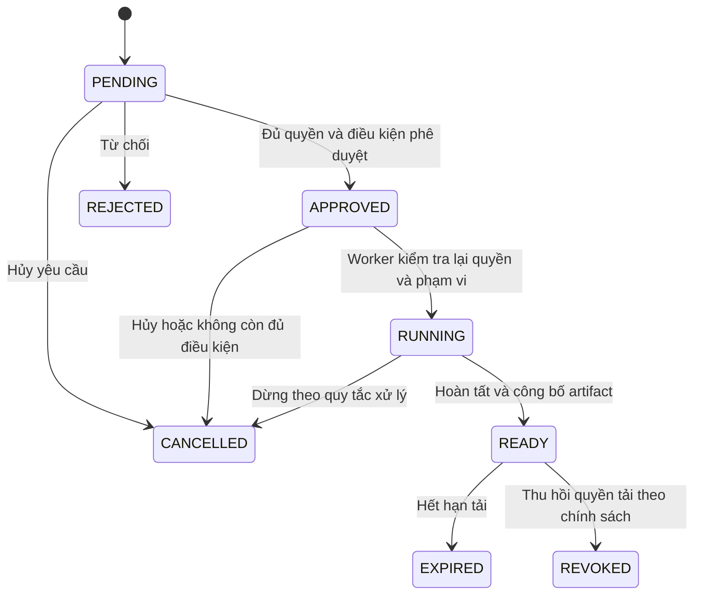

# Audit access control: Kiểm soát quyền truy cập dữ liệu kiểm toán

Trong chương **Auditability**, kiểm soát truy cập audit bảo vệ khả năng giải thích và kiểm chứng hành vi của hệ thống. Bản ghi kiểm toán có thể chứa người thao tác, đối tượng bị tác động, thay đổi trước và sau, lý do phê duyệt, số tiền hoặc dữ liệu nhạy cảm. Nếu chỉ bảo vệ API nghiệp vụ mà mở rộng quyền xem audit quá mức, kẻ tấn công vẫn có thể khai thác lịch sử để lấy thông tin hoặc che giấu hành vi của mình.

Trong phạm vi bảo mật logic nghiệp vụ, vấn đề không dừng ở việc yêu cầu đăng nhập trước khi mở trang lịch sử. Hệ thống cần bảo vệ các bất biến như: không xem audit của đối tượng ngoài quyền, không dùng export để vượt giới hạn của màn hình, không tự phê duyệt yêu cầu xuất dữ liệu và không tiếp tục dùng quyền đã bị thu hồi trong một job chạy nền.

Bài học trình bày cách thiết kế quyền theo đối tượng, giới hạn trường dữ liệu, luồng phê duyệt, transaction, idempotency và kiểm thử các tình huống lạm dụng liên quan đến audit.

## 1. Vì sao audit cần chính sách truy cập riêng?

Giả sử nhân viên hỗ trợ được xem trạng thái một đơn hàng để trả lời khách hàng. Lịch sử của đơn hàng còn chứa giá trước điều chỉnh, nhận xét nội bộ và thông tin về quyết định hoàn tiền. Quyền xem đơn hàng hiện tại không tự động cho phép đọc mọi trường trong lịch sử đó.

Một ví dụ khác là người quản lý được xem thay đổi của nhóm mình. Nếu endpoint `/audit/events/{eventId}` chỉ kiểm tra vai trò `MANAGER`, người đó có thể thay `eventId` để đọc sự kiện thuộc nhóm khác. UUID khó đoán chỉ làm giảm khả năng dò tìm; nó không thay thế kiểm tra quyền theo đối tượng.

Cần phân biệt các hành động:

| Hành động | Điều cần kiểm soát |
| --- | --- |
| Tìm kiếm lịch sử | Phạm vi đối tượng, khoảng thời gian, bộ lọc, giới hạn chi phí |
| Xem chi tiết sự kiện | Quyền trên sự kiện và tài nguyên liên quan |
| Xem dữ liệu trước/sau | Quyền đến từng nhóm trường và mức nhạy cảm |
| Mở bằng chứng đính kèm | Quyền với cả bản ghi lẫn tài liệu bằng chứng |
| Xem thống kê hoặc số lượng | Phạm vi hàng trước khi tổng hợp |
| Xuất dữ liệu | Phạm vi, trường, phê duyệt, quota, quyền lúc chạy và lúc tải |
| Thay đổi chính sách audit | Quyền quản trị riêng và dấu vết của chính thay đổi đó |
| Ghi hoặc hiệu chỉnh lịch sử | Đường ghi được kiểm soát; không đồng nghĩa với quyền đọc hoặc xóa |

Một màn hình đã ẩn nút không bảo vệ các API tương ứng. Cùng chính sách phải được thực thi ở máy chủ cho tìm kiếm, xem chi tiết, tải tệp, tác vụ nền và mọi đường truy cập khác.

## 2. Xác định tài nguyên và ngữ cảnh quyết định quyền

Quyết định quyền có thể được mô tả bằng bốn thành phần:

```text
Decision = authorize(
    principal,
    action,
    resource,
    trustedContext
)
```

- `principal`: tác nhân đã xác thực, có thể là người dùng hoặc dịch vụ.
- `action`: hành động cụ thể như `AUDIT_SEARCH`, `AUDIT_READ_DETAIL`, `AUDIT_EXPORT`.
- `resource`: sự kiện, tập đối tượng, bằng chứng hoặc tệp export cần truy cập.
- `trustedContext`: tenant, quan hệ với đối tượng, trạng thái tài khoản, phạm vi được giao, hồ sơ điều tra và phiên bản chính sách thích hợp.

### 2.1. Vai trò là điều kiện ban đầu, chưa đủ cho quyết định cuối

Một vai trò như `AUDITOR` có thể cho phép sử dụng chức năng xem audit. Phạm vi dữ liệu vẫn cần xét theo tenant, nhóm đối tượng, hồ sơ được phân công và trường dữ liệu.

Có thể kết hợp quyền theo vai trò với quyền theo thuộc tính hoặc quan hệ:

```text
allowRead(event, principal) =
    principal has AUDIT_READ capability
    AND event.tenantId == trustedTenant(principal)
    AND principal may inspect event.resource
    AND event.classification is within principal.clearance
```

Đây là mô tả quy tắc, không phải lý do để tin các thuộc tính do client tự khai. `trustedTenant` phải được máy chủ phân giải từ danh tính, tư cách thành viên và ngữ cảnh được phép chọn. Header `X-Tenant-Id` hoặc tham số URL chỉ là đầu vào cần xác minh.

### 2.2. Người tạo sự kiện không mặc nhiên được xem toàn bộ sự kiện

Một nhân viên có thể là `actorId` trong audit vì từng thao tác trên một tài nguyên, nhưng sau đó chuyển nhóm hoặc mất quyền. Điều kiện `event.actorId == currentUser.id` không tự cấp lại quyền đọc dữ liệu cũ.

Tương tự, chủ thể bị tác động không mặc nhiên được xem mọi thông tin điều tra nội bộ xuất hiện trong cùng sự kiện. Nếu sản phẩm cung cấp lịch sử cho người dùng, nên định nghĩa một hình chiếu dữ liệu phù hợp thay vì trả nguyên bản ghi nội bộ.

### 2.3. Sự kiện có nhiều đối tượng cần quy tắc rõ ràng

Một sự kiện chuyển tiền có thể liên quan hai tài khoản; một thay đổi nhóm có thể liên quan nhiều người. Quyền đọc một đối tượng không đương nhiên cho phép thấy toàn bộ phần còn lại.

Có hai hướng thiết kế thường dùng:

- Chỉ cho xem sự kiện đầy đủ khi đủ quyền với tất cả đối tượng và trường liên quan.
- Tạo hình chiếu theo đối tượng, trong đó phần không được phép bị loại bỏ hoặc thay bằng biểu diễn an toàn theo chính sách.

Không nên lấy “đối tượng đầu tiên trong danh sách” làm căn cứ duy nhất rồi trả toàn bộ payload. Metadata, tên hiển thị, đường dẫn tài liệu và phần chênh lệch trước/sau đều có thể tiết lộ đối tượng khác.

## 3. Các bất biến cần duy trì

| Bất biến | Ví dụ vi phạm logic nghiệp vụ |
| --- | --- |
| Mọi kết quả nằm trong phạm vi được phép của tác nhân | Bộ lọc tenant có trên màn hình nhưng thiếu ở API tải CSV |
| Quyền đọc chi tiết không được suy ra từ việc biết mã sự kiện | Đổi `eventId` để xem lịch sử đối tượng khác |
| Chính sách trường dữ liệu áp dụng ở mọi định dạng | JSON đã che số tiền nhưng export vẫn chứa giá trị gốc |
| Phê duyệt gắn với đúng yêu cầu và phạm vi bất biến | Được duyệt xuất một nhóm rồi sửa job thành toàn tổ chức |
| Người yêu cầu không tự đáp ứng điều kiện người phê duyệt độc lập | Dùng hai tài khoản cùng một người để vượt nguyên tắc phân tách nhiệm vụ |
| Job nền không biến quyền cũ thành quyền vĩnh viễn | Quyền đã thu hồi nhưng job vẫn xuất dữ liệu bằng tài khoản dịch vụ rộng quyền |
| Retry không tạo thêm job hoặc tiêu thụ quota nhiều lần | Client timeout rồi tạo nhiều bản export cùng dữ liệu |
| Chính sách và dấu vết thay đổi của nó được bảo vệ | Người đang bị điều tra tự cấp quyền đọc hoặc xóa dấu vết |
| Số lượng, facet và lỗi API không làm lộ dữ liệu ngoài phạm vi | Kết quả rỗng nhưng `totalCount` đếm cả sự kiện bị cấm |
| Truy cập audit nhạy cảm có dấu vết phù hợp | Tải tệp hàng loạt mà không xác định được ai đã tải, dựa vào quyền nào |

Những bất biến này phải giữ đúng với API trực tiếp, giao diện quản trị, worker, công cụ hỗ trợ và truy vấn bằng tài khoản dịch vụ. Một đường truy cập “nội bộ” vẫn có thể trở thành đường vòng nếu được gọi qua đầu vào của người dùng.

## 4. Áp dụng quyền trước khi tìm kiếm và tổng hợp

### 4.1. Tránh lọc dữ liệu sau khi phân trang

Một triển khai dễ sai có dạng:

```text
rows = repository.search(clientQuery)
page = paginate(rows)
return page.filter(row -> userCanRead(row))
```

Cách này có thể tải dữ liệu ngoài quyền vào tầng ứng dụng, tạo trang thiếu bất thường, trả `totalCount` sai và để lộ thông tin qua facet hoặc gợi ý tìm kiếm. Nếu vòng lặp chỉ kiểm tra quyền trên một số trường, payload phụ còn có thể lọt ra ngoài.

Nên tạo kế hoạch truy vấn đã có ràng buộc quyền từ đầu:

```text
trustedContext = resolveAuthenticatedContext()
validatedQuery = validateAndNormalize(clientQuery)
readPlan = authorizeAndBuildReadPlan(trustedContext, validatedQuery)
page = repository.searchWithin(readPlan)
return projectAllowedFields(page, readPlan)
```

`readPlan` là dữ liệu nội bộ do máy chủ tạo. Không nhận một `allowedObjectIds` hoặc biểu thức quyền từ client rồi coi đó là kế hoạch tin cậy.

### 4.2. Minh họa truy vấn với phạm vi theo đối tượng

Giả sử mỗi sự kiện trong ví dụ có một đối tượng chính, và bảng phạm vi có tối đa một hàng quyền hiện hành cho mỗi tác nhân, tenant và đối tượng:

```sql
SELECT
    e.event_id,
    e.occurred_at,
    e.event_type,
    e.object_type,
    e.object_id,
    e.result
FROM audit_event e
JOIN audit_read_scope s
  ON s.tenant_id = e.tenant_id
 AND s.object_type = e.object_type
 AND s.object_id = e.object_id
 AND s.principal_id = :authenticatedPrincipalId
WHERE e.tenant_id = :trustedTenantId
  AND s.can_read_audit = TRUE
  AND (s.expires_at IS NULL OR :decisionTime < s.expires_at)
  AND e.event_type IN (:eventTypeA, :eventTypeB)
  AND e.occurred_at >= :fromTime
  AND e.occurred_at < :toTime
ORDER BY e.occurred_at, e.event_id
```

Các giá trị phải được bind bằng cơ chế tham số của thư viện truy cập dữ liệu. Tên cột sắp xếp hoặc tên trường cần qua danh sách cho phép, không nối chuỗi tùy ý từ request. Giới hạn số hàng, khoảng thời gian và thời gian chạy truy vấn phải do máy chủ áp đặt theo kế hoạch đã được phép.

`audit_read_scope` ở đây là mô hình minh họa nguồn quyền có hiệu lực tại mốc quyết định. Nếu nó chỉ là projection cập nhật chậm, cần giải quyết độ trễ thu hồi quyền trước khi dùng cho đường đọc nhạy cảm. SQL có điều kiện quyền nhưng đọc nguồn quyền lỗi thời vẫn có thể cho kết quả sai.

Với sự kiện có nhiều đối tượng, phải thay điều kiện một đối tượng trong ví dụ bằng quy tắc đầy đủ hoặc một hình chiếu an toàn. Truy vấn minh họa cũng không trả `raw_payload`; phần dữ liệu chi tiết cần chính sách trường riêng.

Một lỗi cần kiểm thử đặc biệt là kết hợp `AND` và `OR` không có nhóm đúng:

```sql
-- Sai: nhánh event_type = :typeB có thể vượt các điều kiện trước.
WHERE tenant_id = :trustedTenantId
  AND object_id = :allowedObjectId
  AND event_type = :typeA
   OR event_type = :typeB
```

Phải diễn đạt đúng ý định bằng nhóm điều kiện hoặc tập giá trị, chẳng hạn `AND event_type IN (:typeA, :typeB)`. Query builder không tự bảo đảm biểu thức quyền được kết hợp đúng nếu ứng dụng xây sai cây điều kiện.

### 4.3. Áp dụng cùng phạm vi cho các kết quả dẫn xuất

`totalCount`, biểu đồ theo loại sự kiện, giá trị gợi ý và facet phải được tính sau khi áp dụng cùng điều kiện quyền với danh sách. Nếu không, người dùng có thể suy ra rằng một giao dịch, nhân viên hoặc hồ sơ bị ẩn đang tồn tại.

API xem chi tiết nên kiểm tra tenant và đối tượng trước khi trả nội dung. Thiết kế phản hồi cho trường hợp không tồn tại và không được phép cần tránh tiết lộ ngoài ý muốn; mã lỗi cụ thể phụ thuộc hợp đồng API. Không đưa tên đối tượng bị cấm hoặc payload nhạy cảm vào thông báo lỗi.

## 5. Kiểm soát đến trường dữ liệu và bằng chứng

Quyền theo hàng trả lời “được xem sự kiện nào”. Quyền theo trường trả lời “được xem phần nào của sự kiện đó”. Hai quyết định đều cần thiết.

Ví dụ một sự kiện điều chỉnh giá:

| Trường | Nhân viên hỗ trợ | Người kiểm toán được giao phạm vi phù hợp |
| --- | --- | --- |
| Mã sự kiện, thời gian, loại thao tác | Có thể được xem | Được xem |
| Kết quả thành công hoặc thất bại | Có thể được xem | Được xem |
| Giá trị giá trước và sau | Chỉ khi có quyền với dữ liệu giá | Theo quyền cụ thể |
| Ghi chú điều tra nội bộ | Thường bị loại khỏi hình chiếu hỗ trợ | Theo phạm vi hồ sơ |
| Định danh kỹ thuật của tác nhân | Hình chiếu cần thiết cho hỗ trợ | Chi tiết hơn nếu được phép |
| Token, mật khẩu, bí mật xác thực | Không đưa vào audit | Không đưa vào audit |

Bảng này minh họa cách phân chia; chính sách thực tế phải xuất phát từ yêu cầu của sản phẩm. Không mặc định một chức danh được xem mọi loại dữ liệu.

Một số nguyên tắc triển khai:

- Ưu tiên danh sách trường được phép thay vì lấy toàn bộ payload rồi xóa một vài khóa đã biết. Trường mới xuất hiện sẽ không tự lộ ra nếu chưa được duyệt.
- Áp dụng cùng hình chiếu cho JSON, CSV, báo cáo tải xuống, thông báo và phần xem trước.
- Kiểm tra cả dữ liệu lồng nhau, mảng, nhãn hiển thị và diff trước/sau. Che trường hiện tại nhưng để nguyên `beforeValue` vẫn làm lộ thông tin.
- Dùng tham chiếu bằng chứng có kiểm tra quyền khi mở. Một đường dẫn tải trực tiếp không được trở thành cách bỏ qua quyền của sự kiện.
- Không chỉ che ở giao diện. Dữ liệu không được phép không nên nằm trong response hoặc tệp được gửi cho người dùng.

Việc che một giá trị cũng cần ngữ nghĩa rõ ràng. Giá trị bị che không nên bị diễn giải thành `null`, chuỗi rỗng hoặc “chưa từng có thay đổi”. Có thể dùng cấu trúc phản hồi chỉ rõ trường không được cung cấp trong hình chiếu này, nếu thông tin đó phù hợp với chính sách.

## 6. Thiết kế đường đọc ở tầng dịch vụ

Mã giả sau mô tả trách nhiệm của một dịch vụ đọc audit:

```text
readAudit(query, authenticatedContext):
    context = resolveTrustedPrincipalAndTenant(authenticatedContext)
    require context.accountIsActive

    normalized = validateQuery(query)
    policy = loadAuthoritativePolicy(context)
    plan = authorizeSearch(context, normalized, policy)

    require plan.action == AUDIT_SEARCH
    reserveQueryBudget(context, plan)

    rows = searchAuthorizedRows(plan)
    result = projectAllowedFields(rows, plan.allowedFields)

    recordAccessDecisionDurably(
        actor = context.principal,
        tenant = context.tenant,
        action = AUDIT_SEARCH,
        decision = ALLOW,
        policyRevision = policy.revision,
        scopeDigest = plan.scopeDigest,
        resultCount = result.count,
        correlationId = context.correlationId
    )

    return result
```

Đây là thuật toán minh họa, chưa phải mã Java hoàn chỉnh. Các điểm cần giữ khi triển khai:

1. Tầng dịch vụ thực thi quyền, kể cả khi request đã qua một bộ lọc bảo mật ở controller. Bộ lọc vai trò chung không thay thế quyền theo đối tượng.
2. Dữ liệu dùng để tạo `plan` phải đến từ nguồn quyền được kiểm soát. Một reason string do người dùng tự nhập chưa chứng minh họ có quyền điều tra; nếu dùng mã hồ sơ, phải xác minh quyền với hồ sơ đó.
3. Repository nhận kế hoạch nội bộ hoặc các tham số an toàn tương đương. Tránh để cùng một hàm dễ dàng được gọi với truy vấn bỏ điều kiện tenant.
4. Response cuối cùng dùng danh sách trường đã được phép. Không serialize trực tiếp entity nội bộ vốn chứa nhiều dữ liệu hơn.
5. Nếu quyền có thể thay đổi trong lúc một truy vấn dài chạy, cần quy định mốc quyết định. Đường đọc nhạy cảm có thể cần hủy hoặc kiểm tra lại trước khi trả dữ liệu; không mặc định một lần kiểm tra lúc bắt đầu đủ cho mọi yêu cầu.

Cơ chế kiểm soát quyền ở cơ sở dữ liệu có thể bổ sung lớp bảo vệ. Nếu truyền danh tính qua ngữ cảnh kết nối, phải bảo đảm gán đúng cho từng request và xóa hoặc khôi phục trước khi trả kết nối về pool. Một session database dùng nhầm tenant có thể phá vỡ chính lớp bảo vệ này.

## 7. Export audit là một quy trình nghiệp vụ riêng

Export gom nhiều bản ghi thành một tài nguyên mới. Phạm vi lớn và thời gian thực hiện dài khiến nó cần quy tắc riêng, dù người yêu cầu đã có quyền xem từng trang.

### 7.1. Đóng băng nội dung yêu cầu được phê duyệt

Một yêu cầu export nên có:

```text
ExportRequest:
    jobId
    tenantId
    requesterPrincipalId
    action = AUDIT_EXPORT
    normalizedFilter
    allowedFieldProjection
    timeRange
    dataCutoffOrSnapshotReference
    purposeOrCaseReference
    requestFingerprint
    policyRevisionAtRequest
    state
    version
```

Fingerprint cần gắn với các trường ảnh hưởng đến phạm vi và nội dung export: tenant, đối tượng, bộ lọc, khoảng thời gian, trường dữ liệu, mục đích và mốc dữ liệu. Dùng biểu diễn chuẩn khi tính fingerprint. Không coi hash là đủ nếu người dùng còn có thể sửa cả yêu cầu lẫn bản ghi phê duyệt.

Nếu muốn đổi phạm vi sau khi đã phê duyệt, tạo yêu cầu mới hoặc đưa yêu cầu trở lại bước phê duyệt theo một chuyển tiếp được định nghĩa rõ. Không cho sửa JSON của job đã duyệt rồi giữ nguyên trạng thái `APPROVED`.

Mốc dữ liệu cần có ý nghĩa cụ thể. Một timestamp theo thời điểm ghi nhận nghiệp vụ không tự bảo đảm bản ghi đến muộn sẽ được bao gồm. Nếu cần tập dữ liệu tái lập, dùng snapshot hoặc watermark phù hợp với kho dữ liệu và ghi lại cách diễn giải nó.

### 7.2. State machine ngăn bỏ qua phê duyệt



Không cho client đặt trực tiếp `state = READY` hoặc gọi endpoint worker để bỏ qua `APPROVED`. Các chuyển tiếp do máy chủ kiểm soát và có kiểm tra phiên bản.

Nếu yêu cầu cần người phê duyệt độc lập, phải kiểm tra danh tính người thật hoặc định danh chuẩn mà hệ thống dùng cho nguyên tắc này. Hai tài khoản hoặc hai vai trò của cùng một người không tự tạo được hai bên độc lập. Đồng thời, người phê duyệt phải có quyền trên đúng tenant và phạm vi export.

Phê duyệt nên gắn với `requestFingerprint` và phiên bản yêu cầu. Trong một transaction, hệ thống kiểm tra trạng thái hiện tại, điều kiện độc lập, quyền phê duyệt, sau đó ghi kết quả chuyển trạng thái và sự kiện tương ứng. Có thể dùng khóa hàng hoặc cập nhật có điều kiện theo phiên bản; nếu không khớp, không ghi sự kiện thành công.

Khi cần phát lệnh chạy job, ghi bản ghi outbox trong cùng transaction với chuyển trạng thái. Worker xử lý thông điệp lặp bằng mã job và trạng thái đã lưu, không tạo thêm nhiều artifact vì cùng một lần phê duyệt được phát lại.

### 7.3. Không để tài khoản dịch vụ mở rộng quyền người yêu cầu

Worker thường có quyền kỹ thuật để đọc kho audit. Quyền đó phục vụ thực thi, không có nghĩa worker được xuất mọi dữ liệu theo tham số từ client.

Tại mốc bắt đầu chạy, worker cần nạp yêu cầu đã lưu và kiểm tra:

- Trạng thái, phiên bản và fingerprint còn khớp với phê duyệt.
- Người yêu cầu còn hoạt động và còn quyền với phạm vi liên quan theo chính sách hiện hành.
- Điều kiện phê duyệt còn được đáp ứng theo quy tắc của sản phẩm.
- Phạm vi và danh sách trường thực thi không rộng hơn nội dung đã được duyệt.
- Quota, thời hạn và điều kiện bảo mật của job vẫn hợp lệ.

Ngữ cảnh ủy nhiệm cần được ràng buộc với người yêu cầu, tenant, job và hành động. Không để một chuỗi `requesterId` tùy ý biến service identity thành quyền truy cập của người khác. Cũng không cần giữ token đăng nhập dài hạn của người dùng chỉ để worker tiếp tục chạy.

Với job kéo dài, xác định thêm các mốc kiểm tra quyền hoặc tín hiệu hủy. Một thiết kế có thể yêu cầu cả kiểm tra lúc chạy lẫn trước công bố artifact. Nếu dùng chính sách chụp quyền tại thời điểm phê duyệt cho một trường hợp đặc biệt, đó phải là quy tắc được định nghĩa rõ; không để nó xuất hiện ngầm do worker chỉ đọc dữ liệu đã cache.

### 7.4. Quyền tải artifact được kiểm tra riêng

Tệp export phải giữ mức bảo vệ tương ứng với nội dung bên trong. Biết `jobId` hoặc đường dẫn tệp không đủ để tải.

Endpoint tải cần xác thực người dùng, tenant, quyền với artifact và trạng thái còn được phép tải. Kho lưu trữ nên để riêng tư. Nếu dùng URL ký có thời hạn, cần hiểu khả năng thu hồi: một URL đã phát có thể còn dùng được đến khi hết hạn nếu hệ thống lưu trữ không hỗ trợ chặn sớm theo cách đang dùng.

Nếu cần kiểm tra quyền ở mỗi lần tải, có thể dùng gateway tải có xác thực và kiểm tra lại trạng thái artifact. Thời hạn ngắn giảm khoảng rủi ro của URL tạm nhưng không tự tạo kiểm tra quyền liên tục.

Thu hồi quyền tải không lấy lại bản sao mà người dùng đã tải xong. Nhật ký nên phân biệt cấp quyền tải, bắt đầu truyền và hoàn tất truyền theo quan sát của máy chủ, thay vì khẳng định người dùng đã đọc nội dung.

## 8. Idempotency, quota và cache không được trở thành đường vòng

### 8.1. Tạo export có idempotency

Có thể đặt ràng buộc duy nhất:

```text
UNIQUE (tenantId, requesterPrincipalId, idempotencyKey)
```

Trong transaction tạo job:

1. Kiểm tra quyền hiện tại đối với yêu cầu.
2. Tìm hoặc chiếm khóa idempotency bằng ràng buộc duy nhất.
3. Nếu cùng khóa và cùng fingerprint, trả kết quả đã lưu theo quyền hiện tại, không tạo job mới.
4. Nếu cùng khóa nhưng khác fingerprint, từ chối xung đột.
5. Nếu là yêu cầu mới, tạo job, ghi nhận quota và receipt trong cùng transaction hoặc cơ chế nhất quán tương đương.

Không bỏ qua xác thực hoặc kiểm tra quyền chỉ vì tìm thấy receipt. Một lần retry sau khi mất quyền không được dùng receipt để đọc metadata hoặc tải artifact ngoài phạm vi hiện tại.

Quota cũng là bất biến nghiệp vụ. Hai request đồng thời không được cùng đọc “còn một lượt” rồi tạo hai export. Cần cập nhật có điều kiện hoặc khóa phù hợp, và định nghĩa rõ job bị hủy hay thất bại được hoàn quota khi nào. Idempotency không thay thế giới hạn theo người, tenant hoặc mức dữ liệu.

### 8.2. Cache và cursor phải giữ ngữ cảnh quyền

Cache kết quả chỉ theo URL hoặc bộ lọc có thể trả dữ liệu của người A cho người B. Khóa cache cần phản ánh tenant, tác nhân hoặc lớp quyền tương đương đã được chứng minh, phạm vi, hình chiếu trường và các phiên bản liên quan.

Phiên bản chính sách trong cache key không đủ nếu quyền thành viên thay đổi mà phiên bản đó không tăng. Cơ chế vô hiệu hóa cần bao phủ các yếu tố thực sự quyết định quyền, hoặc đường đọc nhạy cảm phải kiểm tra lại từ nguồn phù hợp.

Cursor phân trang không phải một vé quyền. Cursor cần được bảo vệ khỏi sửa đổi và ràng buộc với ngữ cảnh thích hợp như tenant, truy vấn chuẩn hóa và thứ tự sắp xếp. Máy chủ vẫn phải kiểm tra quyền hiện tại khi dùng cursor. Một cursor hợp lệ về chữ ký không cấp lại quyền đã mất.

Trường hợp quyền đổi giữa các trang cần quy tắc rõ: dựng lại phạm vi, từ chối và yêu cầu bắt đầu lại, hoặc dùng cơ chế khác đã được sản phẩm định nghĩa. Không tự tiếp tục với tập quyền cũ chỉ vì trang đầu tiên từng được cho phép.

## 9. Ghi dấu vết của chính việc truy cập audit

Nhật ký truy cập audit giúp phát hiện lạm dụng chức năng điều tra. Nó khác với sự kiện nghiệp vụ gốc đang được người dùng xem.

Một bản ghi quyết định truy cập có thể gồm:

| Nhóm | Thông tin minh họa |
| --- | --- |
| Danh tính | Tác nhân đã xác thực, tác nhân ủy nhiệm nếu có, loại dịch vụ |
| Phạm vi | Tenant, loại tài nguyên, mã job hoặc digest của phạm vi truy vấn |
| Hành động | Search, xem chi tiết, phê duyệt, xuất, tải bằng chứng |
| Quyết định | Cho phép hoặc từ chối, mã lý do an toàn |
| Căn cứ | Phiên bản chính sách, hồ sơ được phân công, tham chiếu phê duyệt |
| Kết quả quan sát | Số kết quả đã chuẩn bị, mã artifact, trạng thái truyền nếu biết |
| Tương quan | Request ID, correlation ID, thời điểm ghi nhận |

Không sao chép toàn bộ dữ liệu vừa trả về vào nhật ký truy cập. Bộ lọc tìm kiếm cũng có thể chứa thông tin nhạy cảm; cân nhắc lưu cấu trúc đã lọc, tham chiếu hoặc fingerprint thay vì chuỗi tìm kiếm thô. Không ghi token hoặc session cookie.

Dùng cấu trúc dữ liệu thay vì ghép chuỗi log từ reason do người dùng nhập. Kiểm soát ký tự xuống dòng, độ dài và trường văn bản giúp giảm khả năng giả mạo dòng log hoặc làm bẩn công cụ xem.

### 9.1. Phân biệt điều hệ thống biết với điều hệ thống suy đoán

Một bản ghi `ALLOW` có thể chứng minh hệ thống đã cho phép tại mốc quyết định. Bản ghi `RESPONSE_PREPARED` có thể chứng minh dữ liệu đã được chuẩn bị. Nếu tiến trình dừng hoặc kết nối đứt, không nên tự khẳng định client đã nhận và đọc đủ dữ liệu.

Với đường truy cập nhạy cảm, có thể yêu cầu lưu dấu vết bền vững trước khi trả dữ liệu hoặc cấp quyền tải. Nếu nơi nhận log trung tâm không sẵn sàng, một hàng đợi cục bộ bền vững hoặc outbox có thể là một phần thiết kế; log chỉ nằm trong bộ nhớ chưa đáp ứng điều kiện đó. Quy tắc chặn, chờ hoặc tiếp tục phải được xác định theo loại thao tác và yêu cầu auditability.

### 9.2. Tránh vòng lặp ghi audit vô hạn

Đọc audit cần sinh dấu vết, nhưng dịch vụ ghi dấu vết không nên kích hoạt lại cùng luồng đọc rồi tự ghi lặp vô hạn. Tách đường ghi nội bộ, loại sự kiện và quyền dịch vụ với mục đích rõ ràng.

Không cho client gắn `internal = true` để tắt audit truy cập. Chỉ thành phần được tin cậy mới được dùng đường ghi nội bộ. Các nhật ký về truy cập audit và thay đổi chính sách cũng cần quyền đọc riêng, vì chúng có thể tiết lộ hoạt động điều tra.

## 10. Bảo vệ quyền quản trị và đường ghi audit

Quyền đọc, quyền tạo sự kiện và quyền quản trị kho audit cần được phân biệt. Một dịch vụ ghi sự kiện nghiệp vụ không nhất thiết cần đọc toàn bộ lịch sử. Một người kiểm toán có quyền đọc không nhất thiết được sửa thời hạn lưu hoặc thay chính sách phân quyền.

Đối với các thao tác quản trị nhạy cảm:

- Kiểm tra quyền trên đúng phạm vi tenant hoặc nền tảng; không dùng tenant rỗng như một ký hiệu “được xem tất cả”.
- Ghi thay đổi chính sách, người thực hiện, căn cứ và phiên bản trước/sau ở mức cần thiết.
- Áp dụng điều kiện phê duyệt độc lập nếu quy trình yêu cầu, đặc biệt khi thay đổi có thể làm lộ hoặc mất bằng chứng.
- Giữ đường hiệu chỉnh lịch sử có ngữ nghĩa rõ ràng; không biến quyền quản trị thành một API sửa hoặc xóa tùy ý mà không để lại dấu vết.
- Kiểm soát cả tài khoản truy cập database, công cụ hỗ trợ và bản sao phân tích, vì API an toàn không bảo vệ được một bản sao được cấp quyền quá rộng.

Quyền truy cập khẩn cấp, nếu sản phẩm cần, phải là một quy trình có phạm vi, thời hạn, lý do được xác minh và dấu vết. Nó không nên là một query parameter bật tắt kiểm tra quyền. Thay đổi trạng thái khẩn cấp cũng cần được bảo vệ để người đang truy cập không tự mở rộng hoặc kéo dài quyền.

Với đường ghi, danh tính tác nhân, tenant và mã tương quan cần lấy từ ngữ cảnh tin cậy hoặc sự kiện nguồn đã được xác thực. Nếu người dùng tự truyền `actorId` rồi hệ thống ghi nguyên trạng, bản audit có thể trông hợp lệ nhưng gán hành vi cho người khác.

## 11. Kiểm thử các tình huống lạm dụng

Kiểm thử cần quan sát response, hàng dữ liệu được truy xuất hoặc trả về, trạng thái job, artifact, quota và nhật ký quyết định. HTTP 403 không đủ nếu một file đã được tạo ở nơi tải công khai trước khi trả lỗi.

| Tình huống | Cách thử | Điều cần chứng minh |
| --- | --- | --- |
| Vượt tenant | Đổi tenant trong header, query, đường dẫn hoặc job | Không đọc, đếm hoặc xuất được dữ liệu ngoài tenant hợp lệ |
| Vượt đối tượng | Biết `eventId` của đối tượng khác rồi gọi endpoint chi tiết | Mã sự kiện không thay thế quyền; không lộ payload hoặc bằng chứng |
| Lạm dụng actor | Tìm mọi sự kiện có `actorId` là mình sau khi đã mất quyền nhóm | Không khôi phục quyền đọc chỉ vì từng là tác nhân |
| Lộ qua tổng hợp | So sánh danh sách với count, facet và gợi ý | Các kết quả dẫn xuất dùng cùng phạm vi được phép |
| Lỗi nhóm điều kiện | Kết hợp tenant với nhiều nhánh `OR` của bộ lọc | Không có nhánh nào bỏ qua điều kiện quyền |
| Lộ trường nhạy cảm | So sánh JSON, diff, CSV và tải bằng chứng | Hình chiếu trường nhất quán, không lộ qua dữ liệu lồng nhau |
| Sự kiện nhiều đối tượng | Chỉ có quyền với một phía của sự kiện | Áp dụng đúng quy tắc toàn sự kiện hoặc hình chiếu an toàn |
| Bỏ qua phê duyệt | Gọi trực tiếp endpoint chạy job hoặc đặt state ở request | Không chuyển trạng thái ngoài state machine |
| Tự phê duyệt | Người yêu cầu dùng tài khoản hoặc vai trò khác của cùng danh tính | Không vượt điều kiện độc lập của quy trình |
| Sửa phạm vi sau duyệt | Đổi bộ lọc, projection hoặc mốc dữ liệu của job | Phê duyệt cũ không hợp lệ cho nội dung mới |
| Thu hồi quyền lúc chờ | Thu hồi quyền sau APPROVED, trước khi worker chạy | Worker không xuất bằng service identity rộng quyền |
| Thu hồi lúc tải | Thu hồi quyền sau READY, trước khi gọi tải | Endpoint tải kiểm tra lại; hành vi URL đã cấp đúng với thiết kế |
| Retry đồng thời | Nhiều request tạo export cùng key và fingerprint | Một job, một receipt; quota không bị nhân hoặc vượt |
| Dùng lại key khác nội dung | Giữ key nhưng đổi đối tượng hoặc trường cần xuất | Từ chối xung đột, không mở rộng job cũ |
| Race phê duyệt và hủy | Hai lệnh cùng phiên bản chạy đồng thời | Chỉ chuyển tiếp hợp lệ thắng; sự kiện khớp trạng thái commit |
| Cache sai quyền | Hai người hoặc hai tenant dùng cùng bộ lọc | Không dùng chung dữ liệu ngoài lớp quyền đã chứng minh tương đương |
| Cursor cũ | Dùng lại cursor sau khi mất quyền hoặc đổi tenant | Cursor không cấp lại quyền và không chuyển phạm vi |
| Gián đoạn ghi dấu vết | Làm nơi ghi log hoặc outbox lỗi tại ranh giới đã chọn | Hành vi chặn/chờ/tiếp tục đúng hợp đồng, không báo đã ghi bền vững khi chưa ghi |
| Đường vòng nội bộ | Gọi worker, công cụ hỗ trợ hoặc truy vấn sao chép bằng phạm vi giả | Mọi đường thực thi vẫn giữ tenant và quyền đối tượng |

Với kiểm thử cạnh tranh, cần đồng bộ các request để chúng thực sự tranh cùng điều kiện ban đầu. Sau đó đối chiếu số job, phiên bản, receipt, quota và sự kiện. Với kiểm thử thu hồi quyền, cần điều khiển được mốc trước thực thi, trước công bố hoặc trước tải để chứng minh chính xác ranh giới đã chọn.

Các lần bị từ chối có thể tạo security log riêng. Kỳ vọng “không có thay đổi trái phép” không có nghĩa là phải xóa dấu vết của lần tấn công.

## 12. Tiêu chí hoàn thành một thiết kế

Một thiết kế kiểm soát truy cập audit cần trả lời được bằng quy tắc và dữ liệu cụ thể:

- Ai được thực hiện từng hành động, trên đối tượng nào và được xem những trường nào?
- Điều kiện tenant và đối tượng có đi xuyên suốt search, count, detail, bằng chứng, export và download không?
- Phê duyệt gắn với phạm vi nào, phiên bản nào, và thay đổi nào buộc phải phê duyệt lại?
- Quyền được kiểm tra ở những mốc nào khi job kéo dài hoặc quyền bị thu hồi?
- Retry và request đồng thời có giữ được trạng thái, quota và dấu vết nhất quán không?
- Nhật ký truy cập có mô tả đúng điều hệ thống quan sát được mà không sao chép thêm dữ liệu nhạy cảm không?
- Những tài khoản có thể thay chính sách hoặc tác động vào kho audit được kiểm soát và theo dõi thế nào?

Khi các câu hỏi này có câu trả lời kiểm chứng được, audit vừa hỗ trợ điều tra nghiệp vụ vừa tránh trở thành một kênh truy cập dữ liệu vượt quyền hoặc một công cụ che giấu hành vi lạm dụng.
