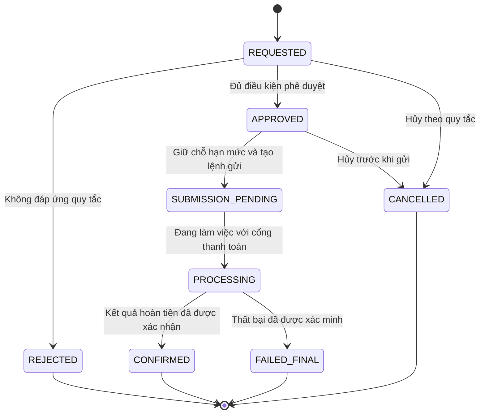
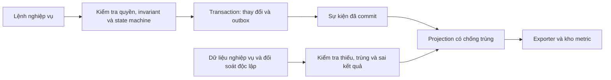

# Đo lường kết quả nghiệp vụ (Business outcome metric)

## 1. Kết quả kỹ thuật chưa nói hết kết quả nghiệp vụ

Trong chương **Observability**, business outcome metric là số đo mô tả kết quả có ý nghĩa đối với quy trình nghiệp vụ: đơn đã được chấp nhận hợp lệ, khoản hoàn đã được xác nhận, yêu cầu bị chặn vì vi phạm quy tắc, hoặc quy trình còn mắc ở một trạng thái chưa hoàn tất.

Một API trả `200 OK` vẫn có thể vừa chấp nhận số tiền bị sửa, bỏ qua phê duyệt hoặc thực hiện thao tác trên đối tượng không thuộc quyền người gọi. Ngược lại, `202 Accepted` có thể là kết quả đúng của việc tiếp nhận hoàn tiền bất đồng bộ, trong khi tiền chưa được hoàn. Chỉ nhìn tỷ lệ phản hồi thành công, độ trễ và mức dùng CPU sẽ không phân biệt được những trường hợp này.

Trong bảo mật logic nghiệp vụ, số đo cần giúp trả lời:

- Hệ thống tạo ra bao nhiêu kết quả nghiệp vụ hợp lệ, và còn bao nhiêu quy trình chưa biết kết quả?
- Có thay đổi nào vi phạm business invariant, như hoàn vượt số tiền đã thanh toán hoặc thực thi khi thiếu phê duyệt?
- Các lần thử sai quyền theo đối tượng, sửa giá và gửi lặp có bị chặn đúng không?
- Một sự thay đổi trên dashboard là hành vi bất thường hay lỗi thu thập, retry và xử lý bất đồng bộ?

**Metric giúp phát hiện và định lượng vấn đề; việc bảo vệ quy tắc vẫn phải được thực hiện trong luồng xử lý nghiệp vụ.** Không dùng cảnh báo “hoàn tiền vượt hạn mức” để thay thế kiểm tra hạn mức trong transaction.

## 2. Định nghĩa kết quả từ state machine

### 2.1. Chọn đúng mốc có ý nghĩa

Xét quy trình hoàn tiền minh họa:



Đây là mô hình giả định để giải thích cách đo; một sản phẩm có thể cần thêm trạng thái. Nếu timeout khiến chưa biết cổng thanh toán đã xử lý hay chưa, quy trình vẫn ở trạng thái chờ xác minh phù hợp, không tự chuyển sang `FAILED_FINAL` rồi gửi một khoản mới.

Các mốc khác nhau trả lời những câu hỏi khác nhau:

| Mốc | Có thể khẳng định | Chưa thể khẳng định |
| --- | --- | --- |
| Yêu cầu được tạo | Có một đối tượng quy trình mới được lưu | Yêu cầu hợp lệ hoặc đã được duyệt |
| Yêu cầu được duyệt | Điều kiện phê duyệt ở bước đó đã được đáp ứng | Tiền đã được hoàn |
| Đã giữ chỗ và tạo lệnh gửi | Hệ thống đã cam kết bước xử lý nội bộ | Cổng thanh toán đã xác nhận kết quả |
| Khoản hoàn được xác nhận | Có kết quả hoàn tiền theo tiêu chí xác nhận của hệ thống | Toàn bộ trải nghiệm khách hàng đều tốt |
| Yêu cầu bị từ chối | Một quyết định từ chối đã được ghi nhận | Hệ thống chắc chắn đang bị tấn công |

Một metric tên `refund_success_total` quá mơ hồ nếu nhóm API hiểu là “đã tiếp nhận”, còn nhóm vận hành hiểu là “đã xác nhận hoàn tiền”. Cần đặt tên và mô tả theo mốc cụ thể, chẳng hạn `business_refund_confirmed_total`.

### 2.2. Phân biệt lần thử và quy trình

Một người dùng có thể nhấn nút ba lần do mất kết nối, tạo ba lần gọi API nhưng chỉ một yêu cầu hoàn tiền. Một worker cũng có thể nhận lại cùng thông điệp nhiều lần. Các trường hợp đó không tạo thêm kết quả nghiệp vụ nếu hệ thống xử lý idempotency đúng.

Vì vậy, cần tách ít nhất hai đơn vị:

- **Lần thử xử lý lệnh:** dùng để quan sát lưu lượng, retry, từ chối và xung đột.
- **Đối tượng hoặc bước chuyển nghiệp vụ duy nhất:** dùng để đếm quy trình mới, kết quả cuối và giá trị tiền thực tế.

Khóa idempotency hỗ trợ nhận diện cùng ý định trong phạm vi hợp đồng API. Nó không thay thế state machine: dùng khóa mới cũng không được làm một yêu cầu đã gửi trở thành được phép gửi thêm lần nữa.

## 3. Viết hợp đồng metric trước khi instrument

Mỗi metric cần có một định nghĩa đủ cụ thể để hai nhóm độc lập có thể đếm ra cùng kết quả.

| Nội dung hợp đồng | Câu hỏi cần trả lời |
| --- | --- |
| Ý nghĩa nghiệp vụ | Đang đo tiếp nhận, giữ chỗ, xác nhận hay từ chối? |
| Đơn vị quan sát | Một request, một quy trình, một lần chuyển trạng thái hay một phát hiện vi phạm? |
| Nguồn có thẩm quyền | Dữ liệu đã commit, ledger, kết quả đối soát hay bộ đếm tại API? |
| Thời điểm tính | Sau commit nào, sau xác nhận nào; dùng thời gian sự kiện hay thời gian nhận? |
| Quy tắc duy nhất | Điều gì ngăn retry, phát lại hoặc chạy lại job làm tăng số đếm? |
| Phạm vi và đơn vị đo | Hành động nào; số lượng, giây hay số tiền theo từng tiền tệ? |
| Chiều phân tích | Những nhãn hữu hạn nào cần thiết và được phép? |
| Kết quả chưa rõ | Quy trình pending, timeout và dữ liệu đến muộn được xử lý ra sao? |
| Hiệu chỉnh | Làm gì khi có đối soát hoặc sửa một kết quả đã công bố? |
| Độ mới và độ bao phủ | Làm sao biết pipeline không bị dừng hoặc bỏ sót nguồn? |

Ví dụ hợp đồng cho `business_refund_confirmed_total`:

```text
Ý nghĩa: số khoản hoàn lần đầu đạt trạng thái CONFIRMED đã được xác minh.
Đơn vị: một refund_id tại bước chuyển sang CONFIRMED hợp lệ.
Nguồn: sự kiện bền vững xuất phát từ thay đổi nghiệp vụ đã commit.
Duy nhất: producer + loại sự kiện + refund_id + phiên bản chuyển trạng thái.
Không tính: nhận request, retry, replay, giữ chỗ, timeout chưa rõ kết quả.
Nhãn: channel thuộc danh mục hữu hạn; không dùng refund_id làm nhãn.
Hiệu chỉnh: có sự kiện hiệu chỉnh và quy trình đối soát riêng.
Độ mới: theo dõi tồn đọng và thời gian áp dụng sự kiện vào projection.
```

Từ “thành công” phải đi kèm tiêu chí có thể kiểm chứng. Với hoàn tiền, tiêu chí xác nhận phụ thuộc giao thức thanh toán của sản phẩm; không mặc định mọi phản hồi mạng thành công đều là bằng chứng tiền đã được hoàn.

## 4. Chọn loại metric và chiều phân tích

### 4.1. Một bộ metric minh họa

Các tên dưới đây là quy ước minh họa, không phải tên bắt buộc của một thư viện.

| Metric | Loại | Đơn vị và ý nghĩa |
| --- | --- | --- |
| `business_command_attempts_total` | Counter | Số lần xử lý lệnh theo disposition hữu hạn như `accepted`, `replayed`, `rejected`, `error`, `unknown` |
| `business_refund_started_total` | Counter | Số đối tượng quy trình hoàn tiền mới đã commit, mỗi đối tượng tính một lần |
| `business_refund_terminal_outcomes_total` | Counter | Số quy trình lần đầu đạt kết quả cuối, theo `confirmed`, `rejected`, `failed_final`, `cancelled` |
| `business_refund_inflight` | Gauge | Số quy trình hiện ở từng trạng thái chưa kết thúc |
| `business_refund_duration_seconds` | Histogram | Phân bố thời gian từ tạo yêu cầu đến kết quả cuối, phân theo outcome |
| `business_rule_rejections_total` | Counter | Số lần thử bị chặn theo mã quy tắc do server xác định |
| `business_invariant_violations_total` | Counter | Số phát hiện mới đã được xác minh về trạng thái vi phạm invariant |
| `business_refund_confirmed_amount_minor_total` | Counter | Tổng số tiền hoàn được xác nhận, tính theo đơn vị tiền nhỏ nhất và tách tiền tệ |
| `business_outbox_pending` | Gauge | Số sự kiện bền vững đang chờ chuyển tiếp hoặc áp dụng, theo stream đã định nghĩa |
| `business_event_projection_lag_seconds` | Gauge | Tuổi của sự kiện cũ nhất đang chờ áp dụng trong stream |
| `business_telemetry_last_reconciled_timestamp_seconds` | Gauge | Timestamp lần đối soát thành công gần nhất của stream |

Counter biểu diễn số tích lũy tăng dần trong một vòng đời đo; tốc độ và số tăng trong một khoảng thời gian được suy ra từ các mẫu quan sát. Gauge mô tả trạng thái hiện tại và có thể tăng hoặc giảm. Histogram giữ phân bố quan sát, không chỉ một giá trị trung bình.

`business_command_attempts_total` là số đo ở đường vào, có thể thiếu các request bị lỗi trước khi đi tới điểm instrument. Nó không tự trở thành nguồn chính xác cho sổ nghiệp vụ. Metric kết quả bền vững cần dựa trên các sự kiện hoặc bản ghi được thiết kế cho mục đích đó.

Nếu đã dùng `business_refund_terminal_outcomes_total{outcome="confirmed"}`, có thể suy ra số khoản xác nhận từ chính series này. Không bắt buộc tạo thêm một counter `business_refund_confirmed_total` độc lập rồi để hai bộ đếm lệch nhau.

### 4.2. Giữ nhãn hữu hạn và xuất phát từ server

Nhãn hữu ích có thể là `action`, `outcome`, `channel`, `rule_code` và `currency`, với danh mục được kiểm soát. Không đưa `user_id`, `order_id`, `refund_id`, token, correlation ID, địa chỉ email hoặc lý do văn bản tự do vào nhãn metric.

Mỗi tổ hợp nhãn tạo ra một chuỗi thời gian riêng. Ví dụ, 4 hành động × 5 kết quả × 3 kênh đã có thể tạo 60 tổ hợp trước khi nhân với môi trường và các chiều khác. Histogram còn phát sinh nhiều series cho các bucket và số tích lũy. Thêm nhãn có hàng triệu giá trị làm chi phí và khả năng truy vấn trở nên khó kiểm soát.

Các ID phục vụ điều tra nên nằm trong log, trace hoặc bản ghi audit có phân quyền. Nếu hệ thống hỗ trợ liên kết từ điểm metric sang một trace mẫu, liên kết đó cũng cần kiểm soát truy cập và không thay thế dữ liệu audit đầy đủ.

Mã kết quả và mã quy tắc phải do server lựa chọn. Không cho client gửi `outcome=confirmed`, tự khai `tenant_id` đáng tin cậy, hoặc biến một chuỗi tùy ý thành tên nhãn. Danh mục mã lỗi nên có giá trị gom nhóm cho đầu vào không hợp lệ, tránh phát sinh series mới theo từng chuỗi do kẻ tấn công tạo.

Không cần thêm tenant làm nhãn ở mọi metric. Khi phải phân tích theo tenant có số lượng lớn, có thể dùng báo cáo trên kho dữ liệu được phân quyền, phân nhóm hữu hạn hoặc cơ chế truy vấn phù hợp khác. Dashboard metric cũng có thể tiết lộ số giao dịch và giá trị kinh doanh, nên phải có giới hạn truy cập.

## 5. Tỷ lệ kết quả cần đúng mẫu số và cửa sổ thời gian

### 5.1. Không chia hai nhóm không tương ứng

Giả sử trong 10 phút có 20 yêu cầu hoàn tiền mới được tạo, trong khi 90 khoản hoàn cũ được xác nhận. Phép chia `90 / 20 = 450%` không phải tỷ lệ hoàn tiền thành công. Tử số và mẫu số thuộc các nhóm quy trình khác nhau.

Có hai cách nhìn phổ biến, cần đặt tên rõ:

- **Theo sự kiện trong cửa sổ:** trong 10 phút đã xuất hiện bao nhiêu kết quả cuối của từng loại? Cách này mô tả nhịp xử lý hiện tại, có thể bao gồm yêu cầu được tạo từ trước.
- **Theo cohort:** trong các yêu cầu được tạo trong cùng một khoảng thời gian, đến một thời điểm chốt có bao nhiêu yêu cầu đạt mỗi kết quả? Cách này mô tả kết quả của cùng một nhóm đầu vào.

Ví dụ, một cohort có 100 yêu cầu; sau thời gian quan sát đã có:

| Trạng thái | Số yêu cầu |
| --- | ---: |
| `CONFIRMED` | 70 |
| `REJECTED` | 10 |
| `FAILED_FINAL` | 5 |
| `CANCELLED` | 5 |
| Chưa kết thúc | 10 |

Tỷ lệ đã xác nhận trên toàn cohort là `70 / 100 = 70%`. Tỷ trọng xác nhận trong các kết quả đã kết thúc là `70 / 90 ≈ 77,8%`. Nếu chỉ xét hai kết quả thanh toán cuối `CONFIRMED` và `FAILED_FINAL`, tỷ lệ là `70 / 75 ≈ 93,3%`.

Cả ba phép tính đều có thể hữu ích, nhưng trả lời ba câu hỏi khác nhau. Không trình bày số thứ ba như tỷ lệ hoàn tất của toàn bộ cohort vì nó loại bỏ yêu cầu bị từ chối, bị hủy và đang chờ.

Với mỗi tỷ lệ, cần công bố:

```text
Tử số và mẫu số thuộc những trạng thái nào?
Đơn vị có phải cùng một quy trình duy nhất không?
Khoảng thời gian chọn cohort và thời điểm chốt là gì?
Dữ liệu pending, đến muộn, bị hủy và chưa xác định được xử lý ra sao?
Nếu mẫu số bằng 0 thì hiển thị không có dữ liệu, hay theo quy ước nào?
```

Không gán 100% thành công cho khoảng thời gian không có yêu cầu. Cũng cần hiển thị số tuyệt đối đi cùng tỷ lệ: 1/1 và 10.000/10.000 đều là 100% nhưng cung cấp mức bằng chứng khác nhau.

### 5.2. Từ chối đúng không phải thất bại của bảo mật

Tỷ lệ chấp nhận giảm có thể do hệ thống đang chặn đúng một đợt thử sửa giá. Tỷ lệ chấp nhận tăng cũng có thể do một bản phát hành làm mất kiểm tra quyền hoặc phê duyệt. Vì vậy, không tối ưu mọi chỉ số theo mục tiêu “càng nhiều thành công càng tốt”.

Cần xem đồng thời kết quả hợp lệ, lý do từ chối, vi phạm invariant, lưu lượng thử và độ trễ. Việc xác định một yêu cầu có phải hoạt động hợp lệ hay không còn cần ngữ cảnh và điều tra; không suy ra chỉ từ HTTP status hoặc một nhãn do client gửi.

### 5.3. Sự kiện đến muộn và dữ liệu tiền tệ

Một counter tăng khi projection áp dụng sự kiện thường mô tả thời điểm hệ thống đo nhìn thấy sự kiện. Nó không tự chuyển sự kiện về đúng cửa sổ thời gian nghiệp vụ trong quá khứ. Nếu cần báo cáo theo ngày phát sinh, nên dùng dữ liệu có `occurred_at`, quy tắc chốt và khả năng cập nhật báo cáo khi sự kiện đến muộn.

Không cộng trực tiếp giá trị VND và USD, cũng không lấy số tiền hoàn trong tuần chia số tiền bán của một nhóm đơn không tương ứng rồi gọi đó là tỷ lệ của cohort. Muốn so sánh giá trị, phải thống nhất nhóm đối tượng, tiền tệ, đơn vị, mốc thời gian và cách xử lý điều chỉnh.

Metric tiền là tín hiệu quan sát. Sổ cái hoặc dữ liệu nghiệp vụ có cơ chế đối soát mới là căn cứ cho tính toán tài chính của sản phẩm; một bộ đếm trên dashboard không thay thế chúng.

## 6. Phân biệt bị chặn và vi phạm đã xảy ra

Hai metric dễ bị hiểu lẫn là số lần bị từ chối và số trạng thái vi phạm invariant.

| Tín hiệu | Ví dụ | Ý nghĩa |
| --- | --- | --- |
| Quy tắc đã chặn một lần thử | Thiếu phê duyệt, sai quyền trên đối tượng, khóa idempotency xung đột | Có đầu vào không được chấp nhận; cần xét ngữ cảnh để biết nguyên nhân |
| Invariant bị vi phạm trong dữ liệu đã commit | Tổng hoàn và giữ chỗ vượt khoản được hoàn; thực thi không có phê duyệt hợp lệ tại thời điểm thực thi | Có dấu hiệu kiểm soát thất bại hoặc dữ liệu bị sai; cần xác minh và xử lý |
| Tín hiệu quy trình bất thường | Nhiều khoản sát ngưỡng phê duyệt, nhiều retry, tồn đọng tăng | Là dấu hiệu điều tra, chưa tự chứng minh vi phạm |

Một số invariant có thể theo dõi trong ví dụ:

```text
refunded_amount + reserved_refund_amount <= refundable_amount
mỗi refund_request chỉ có một bước gửi đang có hiệu lực
thao tác yêu cầu phê duyệt phải có quyết định phê duyệt đúng phạm vi
người yêu cầu và người duyệt khác nhau khi chính sách yêu cầu tách biệt
mọi kết quả xác nhận có thể nối tới một lệnh và một đối tượng hợp lệ
```

Phép kiểm tra phê duyệt lịch sử phải dùng dữ liệu và chính sách ở thời điểm thực thi. Một phê duyệt bị thu hồi hôm nay không tự chứng minh giao dịch hôm qua sai nếu khi đó nó còn hiệu lực và chính sách cho phép. Tương tự, kiểm tra giá đơn hàng phải đối chiếu quyết định định giá và ưu đãi áp dụng lúc chốt, không so máy móc với giá catalog hiện tại.

Nếu một job quét mỗi phút đều nhìn thấy cùng một trạng thái sai, không nên tăng counter “vi phạm mới” mỗi phút. Có thể lưu một phát hiện với khóa ổn định theo invariant và đối tượng/phiên bản hoặc một quy tắc nhận diện đợt vi phạm; counter chỉ tăng khi có phát hiện mới. Số phát hiện còn mở có thể là gauge riêng. ID đối tượng nằm trong kho phát hiện có phân quyền, không nằm trong nhãn metric.

Một bộ kiểm tra độc lập với chính nhánh xử lý có thể tìm ra điểm mù của instrumentation. Nếu endpoint bỏ qua kiểm tra quyền và cũng bỏ qua đoạn code ghi metric từ chối, số từ chối bằng 0 không cho biết hệ thống an toàn.

## 7. Thu thập từ thay đổi đã commit và xử lý trùng

### 7.1. Ranh giới đáng tin cậy

Với kết quả quan trọng, một cách thiết kế là lưu thay đổi nghiệp vụ và outbox trong cùng transaction. Consumer đọc sự kiện bền vững rồi cập nhật projection phục vụ metric.



Sơ đồ thể hiện đường đếm kết quả đã commit. Metric lần thử ở API là một đường quan sát khác và không được cộng tùy ý vào số kết quả nghiệp vụ.

Nếu tăng bộ đếm trước commit, transaction rollback vẫn có thể để lại một “thành công” giả. Nếu chỉ tăng bộ đếm trong bộ nhớ sau commit, tiến trình có thể chết ở giữa và làm mất lần tăng đó. Outbox giúp lưu bền vững ý định phát sự kiện cùng thay đổi; việc giao nhận và áp dụng sau đó vẫn cần retry, chống trùng và giám sát.

Một sự kiện đầu vào cho projection có thể có cấu trúc như sau:

```json
{
  "event_id": "evt-rfd-42-v7",
  "schema_version": 1,
  "producer": "refund-service",
  "event_type": "REFUND_TERMINAL",
  "refund_id": "RFD-42",
  "aggregate_version": 7,
  "tenant_id": "tenant-08",
  "previous_state": "PROCESSING",
  "new_state": "CONFIRMED",
  "outcome": "confirmed",
  "process_started_at": "2026-11-22T03:00:00Z",
  "occurred_at": "2026-11-22T03:15:00Z",
  "amount_minor": 450000,
  "currency": "VND",
  "channel": "support",
  "decision_ref": "decision-63"
}
```

`refund_id` và `tenant_id` giúp kiểm chứng, chống trùng và điều tra trong dữ liệu sự kiện, nhưng không vì vậy mà phải xuất chúng thành nhãn metric. Nguồn sự kiện cần được xác thực và phân quyền xuất bản. Một JSON có trường `producer` đúng tên không tự trở thành sự kiện đáng tin cậy.

Timestamp dùng tính thời gian nghiệp vụ phải có nguồn và quy ước nhất quán. Không dùng thời gian do client tự khai làm căn cứ duy nhất. Chênh lệch đồng hồ hoặc timestamp sai cần được phát hiện, thay vì âm thầm đổi thời lượng âm thành 0 để che vấn đề.

### 7.2. Minh họa projection bằng mã giả Java

Trong ví dụ, một đối tượng hoàn tiền chỉ có một kết quả cuối trong vòng đời đã định nghĩa. Nếu sản phẩm cho phép mở lại quy trình, cần mô hình vòng đời và hiệu chỉnh riêng, không tự coi mọi lần chạm trạng thái cuối là một khoản hoàn mới.

```java
ApplyResult applyTerminalOutcome(RefundTerminalEvent event) {
    validateSourceAndSchema(event);
    TerminalFact fact = terminalMapper.toVerifiedFact(event);

    return projectionTx.required(() -> {
        if (appliedEvents.containsSamePayloadOrThrow(event)) {
            return ApplyResult.DUPLICATE;
        }

        boolean newFact = terminalFacts.insertIfAbsent(fact.refundId(), fact);
        if (!newFact) {
            // Cùng kết quả có thể bị phát lại với envelope khác.
            // Nội dung mâu thuẫn phải được tách ra để điều tra.
            terminalFacts.requireSameBusinessFact(fact);
            appliedEvents.record(event);
            return ApplyResult.DUPLICATE;
        }

        durableCounters.incrementTerminalOutcome(fact.outcome(), fact.channel());
        durableHistograms.observeDuration(
            fact.outcome(), fact.durationSeconds()
        );

        if (fact.outcome() == Outcome.CONFIRMED) {
            durableCounters.addConfirmedAmount(
                fact.currency(), fact.amountMinor()
            );
        }

        appliedEvents.record(event);
        return ApplyResult.APPLIED;
    });
}
```

Đây là mã giả mô tả thiết kế, không phải ví dụ chạy độc lập. Các điều kiện quan trọng gồm:

- Có ràng buộc duy nhất ở cơ sở dữ liệu cho sự kiện đã áp dụng và fact kết quả cuối, kể cả khi nhiều consumer xử lý đồng thời. Không dùng thao tác “kiểm tra rồi thêm” không được bảo vệ.
- Nếu cùng `event_id` có payload khác, phải phát hiện xung đột thay vì bỏ qua. Nếu cùng một quy trình có hai kết quả cuối mâu thuẫn, không ghi đè kết quả cũ hoặc cộng thêm một thành công; cần luồng xử lý xung đột và đối soát.
- Fact, dấu đã xử lý, tổng tích lũy và bucket histogram bền vững cùng cập nhật trong transaction của projection. `durableCounters` ở đây là dữ liệu tích lũy tại kho projection, không phải lệnh tăng một counter bên ngoài rồi mong nó rollback theo cơ sở dữ liệu.
- Exporter đọc dữ liệu đã commit. Không có bước “đánh dấu xong rồi gửi increment qua mạng” được coi là nguyên tử nếu hai hệ thống không có bảo đảm tương ứng.
- Mapper kiểm tra outcome thuộc danh mục, trạng thái hợp lệ, tiền tệ, số tiền và dữ liệu thời gian cần thiết. Chỉ dựa vào một nhãn `confirmed` trong thông điệp là chưa đủ.
- Sự kiện không hợp lệ hoặc mâu thuẫn cần được cách ly và cảnh báo theo chính sách; không để retry vô hạn một thông điệp lỗi làm đứng toàn bộ stream mà không ai biết.

Cơ chế trên bảo vệ phần áp dụng fact trong phạm vi transaction được thiết kế. Nó không tự bảo đảm “đúng một lần” cho mọi tác dụng phụ giữa nhiều hệ thống.

### 7.3. Restart, shard và xây dựng lại projection

Nếu xuất counter từ bộ nhớ, phải xử lý reset khi tiến trình khởi động lại. Nếu xuất tổng từ kho bền vững, cần tránh cộng trùng cùng một tổng do nhiều replica cùng được scrape như các nguồn độc lập. Khi chia shard, mỗi shard phải đại diện một phần dữ liệu không chồng lặp trước khi tổng hợp.

Chạy lại lịch sử để xây dựng projection không được làm tăng lại counter của hệ đang phục vụ. Có thể xây projection mới tách biệt, đối soát và chuyển nguồn một cách có kiểm soát. Thời hạn giữ dấu chống trùng phải phù hợp khả năng replay; xóa dấu quá sớm rồi đọc lại lịch sử sẽ gây đếm thừa.

Histogram phải có bucket phù hợp độ dài quy trình, có thể từ giây đến giờ tùy sản phẩm. Không lấy trung bình các p95 của từng instance để suy ra p95 toàn hệ thống; cần tổng hợp phân bố theo cơ chế histogram được dùng.

## 8. Theo dõi độ đúng và độ mới của chính telemetry

Dashboard có thể trông rất yên bình chỉ vì consumer đã dừng. Số vi phạm bằng 0 chỉ có ý nghĩa khi biết dữ liệu vẫn được thu thập và kiểm tra với độ bao phủ phù hợp.

Cần quan sát ít nhất:

- Số sự kiện còn chờ và tuổi sự kiện cũ nhất chưa áp dụng.
- Thời điểm projection áp dụng thành công hoặc đối soát thành công gần nhất.
- Số thông điệp lỗi, xung đột schema, bị cách ly và retry.
- Phạm vi dữ liệu đã quét so với phạm vi phải quét trong lần kiểm tra invariant.
- Chênh lệch giữa dữ liệu nghiệp vụ có thẩm quyền và fact đã áp dụng, theo cùng mốc chốt.

Lag bằng 0 khi không có sự kiện chờ chỉ đáng tin nếu bộ thu thập đang hoạt động và đã kiểm tra nguồn. Không có mẫu metric hoặc exporter mất kết nối không đồng nghĩa không có tồn đọng.

Đối soát cần thống nhất watermark hoặc mốc thời gian. Nếu vừa có kết quả nghiệp vụ commit nhưng sự kiện chưa đến projection, chênh lệch tạm thời không nhất thiết là mất dữ liệu. Chỉ so các phần dữ liệu đã đủ điều kiện xuất hiện ở cả hai phía, đồng thời theo dõi phần chưa theo kịp.

Đối với thao tác bắt buộc có audit, thay đổi và dữ liệu audit tối thiểu vẫn phải tuân thủ bảo đảm của luồng nghiệp vụ. Kho metric phân tích từ xa tạm hỏng không nhất thiết phải chặn toàn bộ hoạt động; có thể giữ sự kiện bền vững để chuyển tiếp sau. Việc tiếp tục hay hạn chế một hành động phải theo chính sách vận hành và mức bảo đảm đã thiết kế, không suy từ việc dashboard có hiển thị được hay không.

## 9. Dashboard và cảnh báo gắn với quyết định vận hành

### 9.1. Một dashboard nên cho thấy điều gì?

| Nhóm quan sát | Nội dung nên đặt cạnh nhau | Câu hỏi cần trả lời |
| --- | --- | --- |
| Kết quả cuối | Số `confirmed`, `rejected`, `failed_final`, `cancelled` và lưu lượng đầu vào | Thay đổi nằm ở bước nào của quy trình? |
| Quy trình chưa xong | Số inflight theo trạng thái và tuổi của nhóm đang chờ | Có điểm tắc hoặc kết quả chưa xác định bị bỏ quên không? |
| Kiểm soát nghiệp vụ | Từ chối theo mã quy tắc và phát hiện invariant đã xác minh | Kiểm soát đang chặn đầu vào hay đã để trạng thái sai đi qua? |
| Thực hiện lặp | Lần thử `replayed`, xung đột khóa, phát lại sự kiện | Tăng lưu lượng có thực sự tạo thêm giao dịch không? |
| Giá trị nghiệp vụ | Tổng tiền xác nhận theo từng currency và dữ liệu đối soát | Mức ảnh hưởng có lớn hơn điều số lượng giao dịch thể hiện không? |
| Chất lượng telemetry | Lag, tồn đọng, lỗi projection, lần đối soát gần nhất | Có thể tin độ mới và độ đầy đủ của các panel phía trên không? |

Thời lượng của các quy trình đã kết thúc dễ bỏ sót các quy trình mắc kẹt lâu nhất vì chúng chưa tạo quan sát vào histogram. Vì vậy, cần đặt phân bố thời lượng cạnh tuổi của nhóm inflight. p95 đẹp hơn trong khi số yêu cầu bị kẹt tăng không nhất thiết là cải thiện.

Nếu trình bày funnel, phải nói rõ đó là funnel của cùng cohort hay số sự kiện ở từng bước trong một cửa sổ. Các cột theo cửa sổ độc lập không bắt buộc giảm dần vì chúng có thể đến từ các cohort khác nhau.

### 9.2. Cảnh báo theo ý nghĩa, không chỉ theo một phần trăm

Ví dụ về các điều kiện cảnh báo:

| Điều kiện | Cách diễn giải ban đầu | Hướng kiểm tra |
| --- | --- | --- |
| Có phát hiện mới về hoàn vượt số dư hoặc thiếu phê duyệt lúc thực thi | Có khả năng quy tắc quan trọng bị phá vỡ | Xác minh fact, phạm vi ảnh hưởng và hành động đã commit |
| Từ chối do sai quyền tăng cùng lưu lượng lần thử | Có thể có lạm dụng, tích hợp sai hoặc thay đổi phân quyền | Phân theo action, mã lỗi hữu hạn và bối cảnh phát hành |
| Nhiều khoản sát ngưỡng phê duyệt trong cùng nhóm liên quan | Có thể có hành vi chia nhỏ để tránh kiểm soát | Điều tra trên dữ liệu chi tiết được phân quyền, kiểm tra quy tắc tổng hợp |
| Inflight và tuổi chờ tăng, kết quả cuối giảm | Có thể có sự cố xử lý hoặc đối tác | Kiểm tra outbox, worker, trạng thái chưa rõ và đối soát |
| Số kết quả giảm đồng thời projection lag tăng | Có thể do đường đo chậm, chưa đủ cơ sở nói nghiệp vụ giảm | Kiểm tra pipeline trước khi kết luận xu hướng |
| Giá trị tiền tăng bất thường nhưng số lượng không tăng tương ứng | Có thể có giao dịch lớn hoặc sửa giá/số tiền | Kiểm tra dữ liệu định giá và phê duyệt theo thời điểm |

Một ngưỡng minh họa như “từ chối vượt 20% trong 5 phút khi có ít nhất 100 lần thử” cần được hiệu chỉnh theo sản phẩm. Tử số và mẫu số phải cùng action, phạm vi và cửa sổ. Nếu mỗi lần thử có thể tạo nhiều mã quy tắc thất bại, tổng số mã thất bại không phải số lần thử bị từ chối; tỷ lệ có thể vượt 100%. Có thể dùng disposition của lần thử hoặc một mã nguyên nhân chính duy nhất cho tỷ lệ, còn thống kê mọi quy tắc thất bại là một metric khác.

Với dữ liệu ít, ưu tiên xem số tuyệt đối và cửa sổ phù hợp. Với vi phạm invariant nghiêm trọng đã xác minh, một trường hợp cũng có thể đáng xử lý, thay vì đợi đủ số lượng để vượt ngưỡng thống kê. Các giá trị ngưỡng ở đây chỉ minh họa cách suy nghĩ, không phải cấu hình chung cho mọi hệ thống.

Không tự động dừng toàn bộ hoàn tiền chỉ vì tỷ lệ từ chối tăng. Nếu có cơ chế hạn chế hoặc tạm dừng một hành động, phải xác định trước điều kiện, phạm vi, người chịu trách nhiệm, cách phục hồi và ảnh hưởng tới các yêu cầu đang xử lý.

### 9.3. Từ cảnh báo tới bằng chứng

Một luồng xử lý cảnh báo có thể gồm:

1. Kiểm tra exporter, projection lag, phạm vi quét và mốc đối soát để xác định độ tin cậy của số đo.
2. Xác định action, outcome, thời gian và phạm vi ảnh hưởng bằng các chiều đã được kiểm soát.
3. Truy vấn log, trace hoặc audit được phân quyền để tìm những đối tượng và quyết định cụ thể; không mở rộng nhãn metric để chứa mọi ID.
4. Đối chiếu trạng thái, phiên bản, quyết định giá, phê duyệt và tác dụng phụ thực tế. Với hoàn tiền, phân biệt giữ chỗ với xác nhận từ đối tác.
5. Xác định đó là lỗi đo, lỗi nghiệp vụ, sự cố phụ thuộc hay dấu hiệu lạm dụng. Một cảnh báo có thể do nhiều nguyên nhân kết hợp.
6. Thực hiện biện pháp theo quy trình vận hành đã cho phép, lưu dấu vết xử lý và đối soát sau khắc phục.

## 10. Ví dụ tính số khi có retry và phát lại sự kiện

Giả sử yêu cầu `RFD-42` được tạo đúng một lần, đã được duyệt và có số tiền 450.000 VND. Chỉ xét các lần gọi action `REFUND_SUBMIT`:

1. Lần gửi đầu giữ chỗ thành công và trả trạng thái đã tiếp nhận.
2. Client không nhận được phản hồi nên gửi lại cùng khóa hai lần; hệ thống trả kết quả đã lưu.
3. Worker xử lý và xác nhận hoàn tiền. Sự kiện xác nhận được giao tới consumer hai lần nhưng có cùng định danh.
4. Một lần gọi khác dùng khóa mới để gửi lại chính yêu cầu đã kết thúc; state machine từ chối.

Sau khi pipeline đã bắt kịp, số đo mong muốn là:

| Số đo | Giá trị hoặc mức tăng |
| --- | ---: |
| Lần thử submit với disposition `accepted` | 1 |
| Lần thử submit với disposition `replayed` | 2 |
| Lần thử submit với disposition `rejected` | 1 |
| Quy trình hoàn tiền mới được tạo | 1 |
| Kết quả cuối `confirmed` | 1 |
| Tổng tiền xác nhận bằng VND | 450.000 |
| Quan sát thời lượng cho quy trình này | 1 |
| Quy trình này còn inflight | 0 |

Counter tạo quy trình đến từ bước tạo yêu cầu, không phải từ bốn lần submit. Hai lần giao sự kiện cũng không tạo hai khoản xác nhận. Nếu số tiền xác nhận tăng thành 900.000 chỉ vì consumer nhận lại thông điệp, đó là lỗi đường đo, không phải bằng chứng tự động rằng khách hàng được hoàn hai lần. Phải đối chiếu ledger hoặc kết quả thanh toán để xác định tác dụng phụ thật.

Ngược lại, một bộ metric đúng không cứu được implementation nghiệp vụ sai. Nếu hai khóa mới thực sự tạo hai khoản hoàn trái quy tắc, cần sửa state machine, kiểm soát đồng thời và idempotency ở đường xử lý; không chỉ sửa dashboard để bỏ bớt sự kiện.

## 11. Kiểm thử metric trong các tình huống tấn công logic

Kiểm thử nên xác nhận đồng thời trạng thái thật, sự kiện bền vững, số tăng của metric và dữ liệu dùng điều tra. Các dòng dưới đây là gợi ý thiết kế kiểm thử cho ứng dụng.

| Tình huống | Kết quả nghiệp vụ cần giữ | Điều cần xác nhận ở metric |
| --- | --- | --- |
| Sửa giá trên client rồi gọi API | Server định giá hoặc từ chối theo quy tắc; không nhận giá tùy ý | Không ghi thành công hợp lệ từ giá client; có tín hiệu từ chối nếu bị chặn |
| Gửi đối tượng thuộc tenant hoặc người dùng khác | Không thay đổi trái quyền | Tín hiệu sai quyền dùng mã hữu hạn; không lộ ID hay dữ liệu nhạy cảm trong nhãn |
| Bỏ qua phê duyệt hoặc dùng phê duyệt sai phạm vi | Không thực thi thao tác cần duyệt | Từ chối và kết quả cuối được phân biệt; không tăng số xác nhận |
| Gửi lại cùng khóa sau mất phản hồi | Chỉ có một thay đổi nghiệp vụ | Có thể tăng lần thử replay, không tăng lại kết quả hoặc giá trị tiền |
| Gửi cùng đối tượng bằng khóa mới | State machine vẫn ngăn thực hiện lặp | Không có kết quả cuối thứ hai chỉ vì khóa thay đổi |
| Hai lệnh đồng thời tranh cùng hạn mức | Tổng giữ chỗ và đã hoàn không vượt invariant | Số chấp nhận khớp thay đổi đã commit, không đếm cả transaction thua cuộc như thành công |
| Transaction rollback sau khi chuẩn bị event | Không có thay đổi đã commit và outbox tương ứng | Không có kết quả thành công từ transaction rollback |
| Consumer chết sau khi cập nhật projection nhưng trước xác nhận nhận tin | Khi nhận lại, fact không được áp dụng thêm | Counter, số tiền và histogram không tăng lần thứ hai |
| Cùng event ID nhưng payload bị thay đổi | Không tin hoặc ghi đè nội dung mâu thuẫn | Có đường cách ly/cảnh báo, không âm thầm cộng số mới |
| Một refund có hai terminal event mâu thuẫn | Được giữ lại để đối soát, không giả là hai quy trình | Phát hiện xung đột và giữ rõ fact đang được sử dụng |
| Projection dừng nhưng API vẫn chạy | Nghiệp vụ theo bảo đảm đã thiết kế; sự kiện còn bền vững | Dashboard thể hiện lag, dữ liệu cũ hoặc thiếu dữ liệu thay vì tuyên bố 0 vi phạm |
| Hàng loạt reason hoặc ID tùy ý từ client | Không ảnh hưởng danh mục nhãn | Số series không tăng theo từng chuỗi do người gọi gửi |
| Sự kiện đến muộn hoặc đảo thứ tự | Kết quả và phiên bản được xử lý theo hợp đồng | Báo cáo event-time và số nhận hiện tại không bị đánh đồng |
| Job kiểm tra lặp lại cùng trạng thái sai | Một phát hiện còn mở, không hàng nghìn sự cố mới | Counter phát hiện mới không tăng ở mỗi lần quét cùng lỗi |
| Xây dựng lại projection từ lịch sử | Không thay đổi tác dụng phụ nghiệp vụ | Không trộn bộ đếm đang phục vụ với lần nạp lại lịch sử |

Kiểm thử đồng thời cần tạo tranh chấp thật ở ranh giới kiểm tra/cập nhật, không chỉ gửi hai request tuần tự. Kiểm thử consumer cần mô phỏng lỗi đúng giữa các bước commit và xác nhận giao nhận. Kiểm thử nhãn cần thử nhiều giá trị đầu vào khác nhau để phát hiện đường tạo cardinality không giới hạn.

Không dùng số phản hồi API làm oracle duy nhất. Sau thử nghiệm, phải đối chiếu dữ liệu có thẩm quyền và đợi projection bắt kịp theo điều kiện xác định, thay vì dùng một khoảng sleep tùy ý rồi coi số metric là kết luận cuối.

## 12. Giới hạn cần hiểu khi diễn giải kết quả

**Counter không phải bảng lịch sử có thể sửa tùy ý.** Nếu phát hiện một kết quả đã công bố sai, không đơn giản giảm counter đi một đơn vị hoặc trừ số tiền vào counter vốn phải tăng dần. Cần sự kiện hiệu chỉnh, dữ liệu đối soát và cách báo cáo giá trị ròng phù hợp. Bản gốc, lần hiệu chỉnh và lý do phải có thể truy vết; tổng đã xác nhận thô và giá trị ròng sau điều chỉnh là hai đại lượng khác nhau.

**Số lượng không phản ánh đầy đủ mức thiệt hại.** Một giao dịch lớn có thể đáng chú ý hơn nhiều giao dịch nhỏ. Vì vậy, cần xem cả số lượng, giá trị và phạm vi đối tượng, nhưng vẫn giữ đúng tiền tệ và quyền truy cập dữ liệu.

**Một số tổng hợp có thể che mất nhóm gặp vấn đề.** Tỷ lệ toàn hệ thống ổn định trong khi một kênh hoặc một phiên bản triển khai giảm mạnh. Chỉ thêm các chiều thực sự hữu ích, hữu hạn; với phân tích chi tiết hơn, chuyển sang nguồn dữ liệu thích hợp thay vì mở nhãn vô hạn.

**Không phải mọi dữ liệu đều được lấy mẫu giống nhau.** Trace được lấy mẫu có thể giúp tìm ví dụ điều tra nhưng không tự đại diện chính xác cho số giao dịch thực tế. Nếu cần một metric toàn bộ kết quả, nguồn tính phải có độ bao phủ phù hợp; không đếm trace mẫu rồi gọi đó là tổng nghiệp vụ nếu không có phương pháp ước lượng và giới hạn rõ ràng.

**Không nhìn thấy cảnh báo không chứng minh không có lạm dụng.** Có thể có điểm mù instrumentation, quy tắc chưa được kiểm tra hoặc hành vi vẫn nằm trong quyền kỹ thuật nhưng trái mục đích nghiệp vụ. Metric cần được kết hợp với thiết kế invariant, audit, kiểm thử và điều tra theo ngữ cảnh.

## 13. Nguyên tắc thiết kế cần giữ

Để business outcome metric có ích cho bảo mật logic nghiệp vụ, cần giữ mối liên hệ từ **quy tắc và state machine**, qua **thay đổi đã commit**, tới **sự kiện có thể kiểm chứng** và **số đo có hợp đồng rõ ràng**.

1. Đặt tên theo mốc nghiệp vụ thực tế; tách tiếp nhận, phê duyệt, giữ chỗ và xác nhận kết quả.
2. Tách lần thử request khỏi quy trình và bước chuyển duy nhất. Retry không tự tạo thêm thành công.
3. Phân biệt quy tắc đã chặn với invariant đã bị phá vỡ; mỗi tín hiệu dẫn tới cách xử lý khác nhau.
4. Tỷ lệ phải có cùng đơn vị, phạm vi, cohort hoặc cửa sổ thời gian; hiển thị pending và số tuyệt đối.
5. Đếm từ nguồn có thẩm quyền, chống trùng bằng dữ liệu bền vững và đối soát đường đo với nghiệp vụ.
6. Giữ nhãn hữu hạn, không tin outcome do client khai và không đưa dữ liệu nhạy cảm vào metric.
7. Theo dõi độ mới, độ bao phủ và lỗi của telemetry trước khi dùng dashboard để kết luận hệ thống an toàn.
