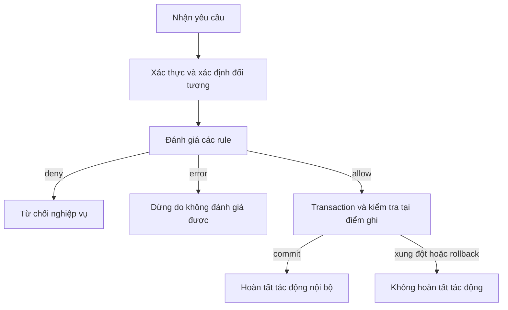

# Rule decision metric: đo quyết định của quy tắc nghiệp vụ

## 1. Metric này trả lời câu hỏi gì?

Trong chương **Observability**, *rule decision metric* là số đo tổng hợp về việc một quy tắc nghiệp vụ đã được đánh giá và cho ra quyết định nào. Nó giúp phát hiện thay đổi trong cách hệ thống cho phép hoặc chặn hoạt động như hoàn tiền vượt hạn mức, bỏ qua phê duyệt, sử dụng giá không hợp lệ hoặc thao tác trên đối tượng không thuộc quyền của người gọi.

Ví dụ, API hoàn tiền trả HTTP 409 cho nhiều nguyên nhân: đơn chưa đủ điều kiện, phiên bản dữ liệu đã thay đổi hoặc idempotency key bị dùng với payload khác. Chỉ nhìn HTTP status không biết quy tắc nào đang chặn yêu cầu. Metric theo rule có thể cho biết số quyết định từ chối của `refund_approval_required` tăng, trong khi `refund_object_access` vẫn ổn định.

Một bộ metric hữu ích cần trả lời được:

- Quy tắc nào đang được đánh giá, trong hoạt động và đường thực thi nào?
- Có bao nhiêu lần cho phép, từ chối và không thể ra quyết định đáng tin cậy?
- Lý do từ chối nào tăng hoặc giảm bất thường?
- Việc đánh giá có chậm đi vì một dependency không?
- Có khoảng cách đáng chú ý giữa quyết định cho phép và kết quả thực hiện nghiệp vụ không?

Metric là tín hiệu vận hành tổng hợp. Nó không tự chứng minh một người dùng đã gian lận, một thao tác đã commit hoặc một bất biến đã được giữ. Cần định nghĩa đúng sự kiện được đếm trước khi dùng số liệu để cảnh báo.

## 2. Định nghĩa hợp đồng đo lường

### 2.1. Một đơn vị đếm là một lần đánh giá kết thúc

Một hợp đồng dễ hiểu là:

> Mỗi lần evaluator của một rule kết thúc bằng một kết quả hoặc ngoại lệ đã phân loại, instrumentation cố gắng ghi một quyết định cho lần đánh giá đó.

Đơn vị này là **evaluation attempt**, không phải người dùng duy nhất, request duy nhất hay giao dịch nghiệp vụ duy nhất.

Ví dụ:

```text
Request A
  → đánh giá quyền trên đối tượng
  → đánh giá trạng thái phê duyệt
  → đánh giá số tiền còn được hoàn

Request A được retry
  → có thể đánh giá lại một hoặc nhiều rule
```

Một request có thể tạo nhiều mẫu đếm thuộc nhiều rule. Retry thực sự đánh giá lại rule tạo thêm evaluation attempt, dù idempotency sau đó ngăn tạo giao dịch hoàn tiền thứ hai.

Nếu luồng short-circuit dừng ở rule đầu tiên bị từ chối, các rule sau chưa chạy thì không có quyết định. Không được ghi `ALLOW` cho một rule chỉ vì evaluator của nó không được gọi.

Mục tiêu ở mức mã là ghi một lần cho mỗi lần đánh giá kết thúc. Tiến trình có thể chết trước khi ghi hoặc trước lần scrape tiếp theo, nên counter trong bộ nhớ không bảo đảm lưu được mọi sự kiện. Nếu cần bằng chứng đầy đủ hoặc đối soát chính xác, dùng dữ liệu giao dịch và cơ chế audit phù hợp.

### 2.2. Tách ALLOW, DENY và ERROR

| Quyết định | Ý nghĩa | Ví dụ |
|---|---|---|
| `allow` | Dữ kiện tại điểm kiểm tra thỏa quy tắc | Số tiền yêu cầu nằm trong phần còn được hoàn |
| `deny` | Đã xác định được điều kiện nghiệp vụ không thỏa | Đơn chưa được phê duyệt hoàn tiền |
| `error` | Không thể đánh giá đáng tin cậy | Kho trạng thái lỗi, timeout hoặc evaluator phát sinh lỗi |

`error` không đồng nghĩa `deny`, dù cả hai có thể làm hệ thống dừng thao tác được bảo vệ. Nếu gom timeout vào từ chối nghiệp vụ, dashboard sẽ che khuất sự cố dependency. Nếu gom từ chối hợp lệ vào lỗi hệ thống, cảnh báo khả dụng sẽ bị nhiễu.

Một dữ kiện “thiếu” cần được hiểu theo hợp đồng rule:

- Đọc thành công và xác định không có phê duyệt bắt buộc: `deny`.
- Không đọc được kho phê duyệt nên chưa biết trạng thái: `error`.
- Request sai cú pháp bị chặn trước evaluator: không tự ghi một quyết định cho rule chưa chạy.

Không gán mặc định `allow` khi không phân loại được kết quả. Chính sách thực thi khi gặp `error` phải rõ ràng; với thao tác cần bảo vệ, thường cần dừng thay vì coi lỗi kiểm tra là sự cho phép.

### 2.3. Reason phải có nghĩa và có giới hạn

Mỗi quyết định đi cùng một reason code thuộc tập đã định nghĩa:

```text
allow: passed

deny: approval_missing
      remaining_exceeded
      ownership_mismatch
      invalid_state

error: dependency_unavailable
       evaluation_timeout
       unexpected_failure
```

Danh sách trên là ví dụ, không phải mọi reason đều hợp lệ cho mọi rule. Rule kiểm tra quyền không nên phát reason `remaining_exceeded`. Bảng ánh xạ rule, quyết định và reason cần thuộc cấu hình hoặc mã do máy chủ quản lý.

Thông điệp lỗi tự do, nội dung request và `exception.getMessage()` không phải reason code. Nếu phát hiện reason ngoài hợp đồng, có thể chuẩn hóa về một mã hữu hạn như `other_denial` trong đúng nhóm quyết định, đồng thời ghi chẩn đoán đã lọc dữ liệu. Không đổi một quyết định từ chối thành cho phép chỉ vì reason chưa được nhận diện.

## 3. Phân biệt quyết định rule với kết quả nghiệp vụ

Một quyết định `allow` có phạm vi tại điểm kiểm tra và trên dữ kiện được dùng ở điểm đó. Nó không tự bảo đảm transaction sau đó sẽ commit.



Ví dụ hai yêu cầu đồng thời cùng đọc phần còn được hoàn là 1.000.000 đồng. Mỗi yêu cầu muốn hoàn 700.000 đồng. Cả hai có thể vượt qua bước kiểm tra sơ bộ, nhưng hệ thống chỉ được commit một yêu cầu nếu tổng hoàn tiền phải không vượt 1.000.000 đồng.

Cần phân biệt ít nhất ba tín hiệu:

| Tín hiệu | Câu hỏi |
|---|---|
| Quyết định evaluator | Rule đã cho phép, từ chối hay không đánh giá được? |
| Xung đột thực thi | Điều kiện tại điểm ghi có còn thỏa không? |
| Kết quả lần thử nghiệp vụ | Lần thử kết thúc bằng commit, từ chối, lỗi, xung đột hay trả kết quả idempotency? |

Nếu cùng một rule được kiểm tra ở nhiều thời điểm, phải định nghĩa cách phân biệt. Có thể dùng nhãn `phase` với tập nhỏ, cố định như `precheck` và `commit`, hoặc dùng rule ID mô tả rõ hai phép kiểm tra khác nhau.

Các ví dụ bên dưới dùng `refund_remaining_precheck` cho phép kiểm tra sơ bộ. Xung đột tại điểm ghi được đo riêng. Không cộng chúng lại rồi gọi là số giao dịch hoàn tiền.

## 4. Thiết kế các metric và nhãn

### 4.1. Một bộ metric khởi đầu

Tên dưới đây là quy ước minh họa, cần thống nhất trong hệ thống trước khi triển khai:

| Metric | Loại | Nhãn ứng dụng | Ý nghĩa |
|---|---|---|---|
| `business_rule_decisions_total` | Counter | `rule`, `operation`, `entrypoint`, `decision`, `reason` | Số lần đánh giá kết thúc theo quyết định |
| `business_rule_evaluation_duration_seconds` | Histogram | `rule`, `operation`, `entrypoint` | Thời gian đánh giá evaluator |
| `business_rule_enforcement_conflicts_total` | Counter | `rule`, `operation`, `reason` | Số lần điều kiện thực thi tại điểm ghi không áp dụng được |
| `business_operation_attempts_total` | Counter | `operation`, `entrypoint`, `outcome` | Số lần thử nghiệp vụ đã kết thúc theo kết quả |

Counter tăng theo sự kiện và có thể trở về đầu khi tiến trình khởi động lại. Dùng hàm xử lý counter khi truy vấn thay vì lấy hiệu tùy ý giữa hai tổng đã cộng nhiều instance.

Histogram đo thời lượng từng evaluation, chẳng hạn từ trước khi evaluator bắt đầu đến khi nó trả kết quả hoặc ném ngoại lệ. Nếu evaluator gọi dependency, thời lượng đó bao gồm thời gian chờ dependency. Nó không phải toàn bộ thời gian request hoặc thời gian chờ trong hàng đợi, trừ khi hợp đồng đo cố ý bao gồm các bước đó.

`entrypoint` nên là tập nhỏ như `api`, `worker`, `batch`. Tên class worker, URL chứa ID và tên tác vụ do người dùng nhập không phù hợp làm giá trị nhãn.

Với `business_operation_attempts_total`, một tập outcome có thể là:

```text
accepted | committed | denied | conflict | error | replay
```

API chỉ nhận và xếp hàng công việc ghi `accepted`, không ghi `committed` cho tác động mà worker chưa thực hiện. Worker ghi kết quả của lần thử xử lý riêng. Một lần trả lại receipt hoặc kết quả idempotency ghi `replay` theo hợp đồng, không giả vờ có thêm một commit mới.

Counter này vẫn là số lần thử đã quan sát được, không phải sổ giao dịch chính xác. Nếu tiến trình chết sau commit nhưng trước khi ghi counter, số liệu có thể thiếu một mẫu.

### 4.2. Ví dụ một mẫu counter

```text
business_rule_decisions_total{
  rule="refund_approval_required",
  operation="refund",
  entrypoint="api",
  decision="deny",
  reason="approval_missing"
} 42
```

Giá trị 42 biểu thị counter của chuỗi thời gian đó tại lần thu thập hiện tại. Nó không có nghĩa là 42 người dùng khác nhau, 42 đơn hàng khác nhau hoặc chắc chắn có 42 sự kiện trong 5 phút vừa qua.

Các nhãn hạ tầng như service, môi trường, instance hoặc vùng triển khai có thể được bổ sung ở tầng thu thập. Cần tính cả chúng khi ước lượng số chuỗi thời gian và chọn phạm vi truy vấn.

### 4.3. Kiểm soát cardinality

Mỗi tổ hợp nhãn khác nhau tạo một chuỗi thời gian riêng. Cardinality cao làm tăng chi phí lưu trữ, bộ nhớ và độ khó truy vấn; kẻ lạm dụng còn có thể gây bùng nổ chuỗi nếu nhãn lấy từ input tùy ý.

| Nên dùng khi có tập giá trị hữu hạn | Tránh dùng làm nhãn metric |
|---|---|
| Rule ID ổn định do máy chủ định nghĩa | `request_id`, `trace_id`, `order_id` |
| Loại thao tác như `refund`, `change_price` | User ID, email, số điện thoại |
| `api`, `worker`, `batch` | URL đầy đủ, query string |
| Decision và reason enum | Nội dung exception hoặc request body |
| Phase nhỏ, được quản lý | Tên rule tùy ý do client gửi |

`tenant_id` cũng có thể tạo số lượng giá trị rất lớn. Không thêm nhãn này theo thói quen. Nếu cần điều tra theo tenant, thường phù hợp hơn khi dùng log có cấu trúc hoặc kho phân tích được kiểm soát; nhu cầu metric theo tenant phải có ngân sách và giới hạn rõ ràng.

Ví dụ một cận trên đơn giản:

```text
30 rule × 4 operation × 3 entrypoint × 3 decision × 10 reason
= 10.800 chuỗi counter trên một instance

10 instance → tối đa 108.000 chuỗi trước các chiều bổ sung khác
```

Đây là tích lý thuyết khi mọi tổ hợp đều tồn tại. Trong thực tế, nhiều tổ hợp không hợp lệ và không nên được khởi tạo. Cần quản lý các tuple hợp lệ thay vì sinh toàn bộ tích Descartes.

Histogram còn có nhiều chuỗi bucket, cùng sum và count. Nếu cấu hình B ranh giới bucket hữu hạn, histogram cổ điển có B + 3 chuỗi cho mỗi tổ hợp nhãn: B bucket hữu hạn, bucket `+Inf`, sum và count. Vì vậy, không sao chép mọi nhãn decision/reason sang histogram nếu không thực sự cần phân tích thời lượng theo những chiều đó.

Chọn bucket theo đơn vị giây và khoảng thời lượng cần quan sát, đặc biệt quanh ngưỡng mục tiêu. Mọi instance được gộp chung phải có ranh giới bucket tương thích.

## 5. Instrumentation trong dịch vụ Java

### 5.1. Đặt ở ranh giới evaluator

Nếu controller tự tăng counter rồi service hoặc worker cũng tăng cùng một counter cho cùng lần đánh giá, số liệu sẽ bị đếm trùng. Đặt instrumentation ở wrapper chung quanh evaluator giúp giữ nhất quán cho các đường gọi.

Rule ID, operation và entrypoint phải bắt nguồn từ mã hoặc ngữ cảnh nội bộ đã kiểm soát. Không lấy nguyên header `X-Rule-Name` hoặc query parameter từ client làm nhãn.

Mã giả Java sau minh họa hợp đồng; các kiểu và recorder là thành phần giả định, không gắn với phiên bản thư viện cụ thể:

```java
public RuleVerdict evaluateRefundRemaining(
        RefundContext context,
        EntryPoint entrypoint) {

    long started = System.nanoTime();
    RuleVerdict observedVerdict = null;

    try {
        RuleVerdict candidate = remainingRule.evaluate(context);

        // Kiểm tra kết quả không null và đúng hợp đồng decision/reason.
        observedVerdict = verdictContract.requireValid(
            RuleId.REFUND_REMAINING_PRECHECK, candidate);
        return observedVerdict;

    } catch (RuleDependencyUnavailable ex) {
        observedVerdict = RuleVerdict.error(
            Reason.DEPENDENCY_UNAVAILABLE);
        throw ex;

    } catch (RuntimeException ex) {
        observedVerdict = RuleVerdict.error(
            Reason.UNEXPECTED_FAILURE);
        throw ex;

    } finally {
        double elapsedSeconds =
            (System.nanoTime() - started) / 1_000_000_000.0;

        if (observedVerdict != null) {
            // Chỉ cập nhật bộ đo cục bộ; không gọi mạng đồng bộ.
            // Hợp đồng của phương thức: lỗi telemetry không ném ra ngoài.
            telemetry.recordLocalNoThrow(
                RuleId.REFUND_REMAINING_PRECHECK,
                Operation.REFUND,
                entrypoint,
                observedVerdict,
                elapsedSeconds);
        }
    }
}
```

Ở ví dụ này, `RuleDependencyUnavailable` là một ngoại lệ runtime được phân loại trước nhánh tổng quát. Một triển khai có thể bổ sung timeout hoặc các lỗi đã biết khác bằng tập reason hữu hạn.

Những điểm cần giữ:

- Tăng counter quyết định tại một điểm duy nhất cho mỗi evaluation kết thúc, thay vì vừa tăng trong `catch` vừa tăng trong `finally`.
- Dùng đồng hồ đơn điệu để đo khoảng thời gian; thời gian hệ thống thay đổi không làm thời lượng âm hoặc nhảy bất thường.
- Giữ nguyên hành vi trả kết quả hoặc ném ngoại lệ của nghiệp vụ. Recorder không được biến lỗi thành `allow`, che lỗi gốc hoặc làm thay đổi giá trị giao dịch.
- Cập nhật metric cục bộ với chi phí giới hạn. Exporter hoặc hệ thống thu thập lỗi không nên làm endpoint hoàn tiền chờ một lời gọi mạng phụ.
- Mã không hứa ghi được metric khi tiến trình bị kill, hết bộ nhớ hoặc gặp lỗi nghiêm trọng trước khi hoàn tất. Cần quan sát sức khỏe telemetry bằng tín hiệu độc lập.

Counter quyết định và histogram không có tính nguyên tử giao dịch với nhau. Nếu recorder chỉ ghi được một phần rồi lỗi, chúng có thể lệch. Đừng dùng yêu cầu “hai metric luôn bằng nhau tuyệt đối” làm bất biến nghiệp vụ.

### 5.2. Kết quả rule vẫn phải được thực thi

Instrumentation không tự chặn yêu cầu. Caller phải xử lý rõ từng nhánh:

```text
allow → tiếp tục đến bước thực thi có kiểm soát
 deny → dừng với lỗi nghiệp vụ phù hợp
error → dừng hoặc xử lý theo chính sách lỗi đã xác định
```

Một lỗi nguy hiểm là tăng counter `deny` rồi vẫn đi tiếp vì thiếu `return`, hoặc chuyển mọi ngoại lệ thành một giá trị mặc định cho phép. Dashboard có thể trông như đang phát hiện vi phạm trong khi tác động thực tế vẫn xảy ra.

Với pipeline nhiều rule, chỉ ghi quyết định của các evaluator đã chạy. Nếu cần quan sát rule bị bỏ qua, dùng tín hiệu riêng với nghĩa `skipped` và lý do hữu hạn; không trộn nó vào `allow` hoặc `deny`.

## 6. Transaction, xung đột và idempotency ảnh hưởng số đếm

### 6.1. Hai lần ALLOW, một lần commit

Với ví dụ hai yêu cầu hoàn tiền 700.000 đồng trên phần còn lại 1.000.000 đồng, điểm ghi có thể dùng khóa hoặc cập nhật có điều kiện để bảo vệ tổng tiền. Một câu lệnh minh họa:

```sql
UPDATE refund_budget
SET refunded_amount = refunded_amount + :requested_amount,
    revision = revision + 1
WHERE tenant_id = :tenant_id
  AND order_id = :order_id
  AND revision = :expected_revision
  AND refund_approved = TRUE
  AND :requested_amount > 0
  AND refunded_amount + :requested_amount <= refundable_amount;
```

Các giá trị tiền phải dùng kiểu và đơn vị chính xác theo thiết kế; không dùng số thực gần đúng để bảo vệ hạn mức. Quyền theo đối tượng và các trạng thái liên quan cũng phải được bảo vệ bằng cơ chế nhất quán nếu chúng có thể thay đổi đồng thời.

Cập nhật budget, ghi bản ghi hoàn tiền và lưu kết quả idempotency cần được phối hợp trong transaction phù hợp. Nếu có gọi hệ thống thanh toán bên ngoài, transaction cục bộ không tự bảo đảm nguyên tử xuyên dịch vụ.

Nếu câu lệnh ảnh hưởng 0 hàng, chỉ biết điều kiện tổng hợp không được áp dụng. Không tự gắn reason `remaining_exceeded`: có thể revision đã đổi, phê duyệt đã bị thu hồi hoặc đối tượng không tồn tại trong phạm vi đó. Dùng reason như `conditional_update_not_applied`, hoặc phân loại bằng một cơ chế đọc/kiểm tra có thẩm quyền phù hợp.

Số liệu cho một lần chạy cạnh tranh có thể là:

| Metric | Mức tăng quan sát được |
|---|---|
| Rule `refund_remaining_precheck`, decision `allow` | +2 |
| Enforcement conflict, reason `conditional_update_not_applied` | +1 |
| Operation attempt, outcome `committed` | +1 |
| Operation attempt, outcome `conflict` | +1 |

Đây không phải nghịch lý. Hai evaluation sơ bộ đã dùng cùng một trạng thái cũ; bất biến tiền được bảo vệ tại điểm ghi. Cần điều tra nếu cả hai transaction cùng commit vượt hạn mức, chứ không chỉ vì có hai mẫu `allow`.

### 6.2. Retry và idempotency

Idempotency giúp một yêu cầu lặp không tạo tác động nghiệp vụ lặp. Nó không làm mọi counter tự trở thành số đếm duy nhất theo thao tác logic.

- Nếu retry đánh giá lại rule, metric evaluation tăng thêm là đúng theo hợp đồng.
- Nếu trả kết quả idempotency trước evaluator, rule không được đếm là đã chạy.
- Nếu cần kiểm tra lại quyền hoặc điều kiện hiện tại trước khi trả dữ liệu cũ, các evaluator thực sự chạy vẫn được đếm.
- Hai consumer nhận cùng thông điệp có thể có nhiều lần thử, nhưng ràng buộc dữ liệu phải ngăn tác động lặp.

Đừng đưa idempotency key vào nhãn để khử trùng metric. Nếu cần biết số thao tác logic đã commit, truy vấn nguồn dữ liệu có định danh duy nhất hoặc xây dựng phép tổng hợp bền vững với hợp đồng chống trùng riêng.

Ghi metric `committed` sau khi biết transaction đã commit; không tăng trước commit rồi cố giảm counter khi rollback. Dù ghi sau commit, vẫn có khoảng trống khi tiến trình chết trước khi counter được cập nhật. Counter chẩn đoán không thay thế sổ giao dịch.

## 7. Truy vấn PromQL theo đúng mẫu số

Các truy vấn dưới đây minh họa mô hình Prometheus. Khi áp dụng, bổ sung selector môi trường/service phù hợp để không vô tình trộn dữ liệu của những hệ thống khác nhau.

Các tỷ lệ giả định những tuple quyết định hợp lệ đã được khởi tạo với giá trị 0, hoặc lớp truy vấn đã xử lý chuỗi tử số còn thiếu theo đúng tập nhãn. Một chuỗi chưa tồn tại không tự được hiểu là giá trị 0.

### 7.1. Lưu lượng đánh giá

```promql
sum by (rule, operation, entrypoint) (
  rate(business_rule_decisions_total[5m])
)
```

Kết quả là số evaluation kết thúc mỗi giây trong cửa sổ quan sát, có xử lý reset counter. Tính `rate` trên từng chuỗi trước rồi mới cộng giúp giữ được thông tin reset của mỗi instance.

### 7.2. Tỷ lệ từ chối trong các lần đánh giá ra quyết định được

```promql
sum by (rule, operation, entrypoint) (
  rate(business_rule_decisions_total{decision="deny"}[5m])
)
/
sum by (rule, operation, entrypoint) (
  rate(business_rule_decisions_total{decision=~"allow|deny"}[5m])
)
```

Mẫu số ở đây là `allow + deny`, không bao gồm `error`. Tên dashboard cần thể hiện rõ ý nghĩa đó. Nếu có 60 allow, 20 deny và 20 error, tỷ lệ từ chối trong các quyết định hợp lệ là 25%, còn tỷ lệ lỗi đánh giá là 20%.

Không chỉ nhìn tỷ lệ deny rồi kết luận hệ thống khỏe; nhiều lỗi có thể làm phần mẫu số hợp lệ nhỏ đi. Luôn hiển thị lưu lượng và tỷ lệ error bên cạnh.

Khi mẫu số bằng 0, tỷ lệ không xác định. Không ép mọi trường hợp không có dữ liệu thành 0% hoặc 100%. Nếu dùng phép `or` để bổ sung tử số 0, cần khớp các nhãn còn lại và vẫn giữ nguyên tình huống không có lưu lượng ở mẫu số.

### 7.3. Tỷ lệ lỗi đánh giá trên tất cả evaluation kết thúc

```promql
sum by (rule, operation, entrypoint) (
  rate(business_rule_decisions_total{decision="error"}[5m])
)
/
sum by (rule, operation, entrypoint) (
  rate(business_rule_decisions_total[5m])
)
```

Tín hiệu này phản ánh khả năng evaluator hoạt động. Nó không thay thế kiểm tra tiến trình bị chết giữa chừng, vì một evaluation chưa ghi được kết quả sẽ không nằm trong cả tử số lẫn mẫu số.

### 7.4. Các lý do từ chối nổi bật

```promql
topk(5,
  sum by (rule, reason) (
    rate(business_rule_decisions_total{decision="deny"}[15m])
  )
)
```

Truy vấn cố ý gộp operation và entrypoint. Khi điều tra, tách lại các chiều đó để tránh nhầm thay đổi cơ cấu lưu lượng với thay đổi hành vi rule. `topk` lúc truy vấn không giảm cardinality đã được ghi vào hệ thống lưu trữ.

### 7.5. Phân vị thời gian đánh giá

Với histogram cổ điển:

```promql
histogram_quantile(0.95,
  sum by (le, rule, operation, entrypoint) (
    rate(business_rule_evaluation_duration_seconds_bucket[5m])
  )
)
```

Cần giữ nhãn `le` để tính phân vị từ bucket. Không lấy trung bình các giá trị p95 của từng instance rồi coi đó là p95 chung.

Phân vị được ước lượng từ bucket và chỉ hữu ích khi có đủ quan sát. Cần xem thêm count, lưu lượng và các bucket gần ngưỡng mục tiêu, nhất là khi rule ít chạy hoặc thời lượng vượt xa bucket hữu hạn lớn nhất.

## 8. Cảnh báo để phát hiện sự cố và lạm dụng

### 8.1. Error tăng có đủ mẫu

Một biểu thức minh họa: tỷ lệ error vượt 2% và có ít nhất 100 evaluation trong 5 phút cho cùng rule, operation và entrypoint:

```promql
(
  sum by (rule, operation, entrypoint) (
    rate(business_rule_decisions_total{decision="error"}[5m])
  )
  /
  sum by (rule, operation, entrypoint) (
    rate(business_rule_decisions_total[5m])
  )
) > 0.02
and on (rule, operation, entrypoint)
(
  sum by (rule, operation, entrypoint) (
    increase(business_rule_decisions_total[5m])
  ) >= 100
)
```

Có thể yêu cầu điều kiện duy trì, chẳng hạn 10 phút, trước khi gửi cảnh báo. Các số trên chỉ là ví dụ; cần chọn theo lưu lượng, mức độ quan trọng và thời gian phản ứng mong muốn.

`increase` trên counter được tính theo dữ liệu scrape và có thể ngoại suy, không phải số sự kiện nguyên chính xác để đối soát. Ngưỡng tối thiểu giúp giảm nhiễu do quá ít mẫu, nhưng cũng có thể bỏ qua một sự cố ở rule hiếm chạy. Với thao tác rất quan trọng, cần tín hiệu audit hoặc cảnh báo riêng phù hợp với lưu lượng thấp.

### 8.2. Deny tăng không tự đồng nghĩa bị tấn công

Deny tăng có thể do:

- Client gửi sai trạng thái sau một thay đổi giao diện.
- Chính sách mới chặn đúng những trường hợp trước đây được cho phép.
- Một job nội bộ đang retry dữ liệu cũ.
- Hành vi dò đối tượng, bỏ qua phê duyệt hoặc thử vượt hạn mức.

Cảnh báo nên kết hợp tỷ lệ, số lượng, reason và ngữ cảnh triển khai. Chẳng hạn `ownership_mismatch` tăng đột biến ở đường API đáng được điều tra khác với `invalid_state` tăng ở batch sau khi đổi quy trình.

Deny là hành vi từ chối có thể hoàn toàn đúng. Không gộp mọi deny vào SLO lỗi hệ thống, và không tự nới rule chỉ để làm biểu đồ deny giảm.

### 8.3. Deny giảm bất thường cũng cần xem xét

Nếu một rule thường chặn một phần lưu lượng bỗng không còn được đánh giá, trong khi thao tác nghiệp vụ vẫn diễn ra, các khả năng gồm:

- Một đường thực thi mới bỏ qua evaluator.
- Instrumentation bị hỏng hoặc rule ID đã bị đổi.
- Cơ cấu traffic thay đổi hợp lệ.
- Luồng short-circuit dừng trước rule đó.

Không thể kết luận bypass chỉ từ một đường biểu đồ. Cần đối chiếu kết quả nghiệp vụ, thay đổi triển khai và log/trace của các nhánh thực thi.

### 8.4. Không có metric khác với không có vi phạm

Cần quan sát riêng sức khỏe scrape, exporter, target và pipeline lưu trữ. Một ví dụ kiểm tra vắng chuỗi cho rule đã biết:

```promql
absent_over_time(
  business_rule_decisions_total{
    rule="refund_remaining_precheck",
    operation="refund",
    entrypoint="api"
  }[10m]
)
```

Chỉ dùng cảnh báo này khi chuỗi đó được kỳ vọng luôn tồn tại, ví dụ đã được khởi tạo khi service khởi động. Với metric chỉ tạo khi có sự kiện, không có traffic cũng có thể làm chuỗi chưa từng tồn tại.

Truy vấn trên phát hiện cả nhóm chuỗi đó vắng dữ liệu; nó không tự phát hiện một instance riêng bị mất nếu instance khác vẫn xuất metric. Cần kết hợp tín hiệu sức khỏe từng target và danh sách target được kỳ vọng.

## 9. Đo độ phủ rule mà không tạo tỷ lệ sai

Một ý tưởng dễ gây nhầm là chia tổng số quyết định rule cho tổng số request rồi mong kết quả bằng 1. Điều đó chỉ đúng nếu đã chứng minh mỗi request trong mẫu số phải đánh giá rule đó đúng một lần.

Các lý do tỷ lệ khác 1 có thể hợp lệ:

- Request sai định dạng bị từ chối trước evaluator.
- Một request batch đánh giá rule cho nhiều đối tượng.
- Một request bị chặn ở rule trước nên rule sau không chạy.
- Retry nội bộ đánh giá lại rule.
- Replay idempotency đi theo nhánh trả kết quả cũ.

Muốn đo độ phủ, cần định nghĩa tập lần thử đủ điều kiện cho một gate cụ thể, đếm ở ranh giới độc lập, rồi xác định chính xác khi nào gate bắt buộc phải chạy. Không để cả “đã đi vào thao tác” và “đã kiểm tra rule” chỉ được tăng trong cùng wrapper; khi wrapper bị bỏ qua, cả hai cùng biến mất và tỷ lệ vẫn trông đẹp.

Nếu bổ sung counter bắt đầu đánh giá hoặc gauge đang xử lý, chúng có thể giúp phát hiện evaluation treo. Tuy nhiên, start và finish không nhất thiết bằng nhau ở một thời điểm: có công việc đang chạy, reset tiến trình và sai khác thời điểm scrape. Cần diễn giải theo cửa sổ và vòng đời, không ép chúng thành một phương trình tuyệt đối.

Metric độ phủ là tín hiệu phát hiện lệch, còn việc mọi đường nghiệp vụ phải giữ bất biến cần được bảo vệ bằng cấu trúc dịch vụ, ràng buộc dữ liệu và kiểm thử các đường vào.

## 10. Nối metric với log, trace và audit

Metric giúp biết “đang có điều gì thay đổi”; log và trace giúp đi đến một lần thực thi cụ thể. Một log quyết định có cấu trúc có thể chứa:

```json
{
  "event": "business_rule_decision",
  "rule": "refund_approval_required",
  "operation": "refund",
  "entrypoint": "api",
  "decision": "deny",
  "reason": "approval_missing",
  "correlationId": "req-801",
  "ruleRevision": "approval-policy-3",
  "durationMs": 4
}
```

`correlationId` và revision chi tiết hữu ích trong log, nhưng không cần trở thành nhãn metric. Cần kiểm soát định dạng, độ dài và nguồn tạo correlation ID; không ghi nguyên giá trị đầu vào tùy ý rồi coi nó là định danh tin cậy.

Log có thể bổ sung định danh đối tượng đã giảm lộ lọt theo nhu cầu điều tra và chính sách truy cập. Không đưa token, mật khẩu, toàn bộ payload, thông tin thanh toán hoặc dữ liệu cá nhân không cần thiết vào log chỉ để giải thích một quyết định.

Một quy trình điều tra ví dụ:

1. Dashboard cho thấy `approval_missing` tăng ở operation `refund`.
2. Tách theo entrypoint để nhận ra chỉ worker bị ảnh hưởng.
3. Đối chiếu thời điểm triển khai và truy vết một số correlation ID phù hợp.
4. Xác định worker mới đã enqueue tác vụ trước bước phê duyệt, hoặc đang retry bản ghi cũ.
5. Kiểm tra dữ liệu nghiệp vụ để xác nhận không có khoản hoàn tiền chưa được phê duyệt đã commit.

Trace có thể bị sampling; log chẩn đoán có thể bị giới hạn tốc độ. Nếu cần bằng chứng truy vết bắt buộc, thiết kế audit bền vững với quyền truy cập và cơ chế giữ dữ liệu riêng. Không coi counter tổng hợp hoặc một trace được lấy mẫu là bản ghi chứng minh đầy đủ cho một khoản hoàn tiền cụ thể.

Nếu sửa đổi chính sách làm thay đổi ý nghĩa rule, cần quản lý khả năng so sánh trước/sau. Có thể chú thích thời điểm triển khai và tra revision trong log thay vì thêm một nhãn phiên bản không giới hạn vào mọi chuỗi metric.

## 11. Bảo vệ chính hệ thống đo lường

Instrumentation có thể trở thành bề mặt lạm dụng nếu đưa dữ liệu không kiểm soát vào nhãn hoặc thực hiện quá nhiều việc trên mỗi yêu cầu bị chặn.

Các ràng buộc nên có:

- Chỉ chấp nhận rule ID, operation, entrypoint và reason từ tập được quản lý.
- Giới hạn số tuple được tạo động; không tạo rule mới theo ID do người dùng gửi.
- Giữ chi phí ghi metric cục bộ nhỏ và ổn định ngay cả khi lưu lượng deny tăng mạnh.
- Kiểm soát truy cập endpoint metric và dashboard vì chúng có thể tiết lộ cấu trúc nghiệp vụ và hoạt động của hệ thống.
- Lọc dữ liệu trong log; tách chính sách sampling chẩn đoán khỏi audit cần độ đầy đủ cao hơn.
- Quan sát sức khỏe thu thập bằng một kênh không phụ thuộc hoàn toàn vào chính recorder đang lỗi.

Không sampling tùy ý counter quyết định rồi vẫn trình bày như số đếm đầy đủ. Nếu phải ước lượng, cần mô tả phương pháp và sai số. Với phần lớn bộ rule có tập nhãn nhỏ, counter tổng hợp trên mỗi evaluation và log/trace có chọn lọc là hai việc khác nhau.

Một tỷ lệ deny cao cũng không đủ để tự khóa mọi người gọi. Quyết định phản ứng tự động cần thêm ngữ cảnh và một chính sách riêng; metric tổng hợp có thể bị tác động bởi việc ai đó cố tình tạo nhiều yêu cầu bị chặn.

## 12. Kiểm thử hợp đồng metric và tình huống tấn công logic

Kiểm thử cần chứng minh cả ý nghĩa metric và tác động nghiệp vụ, không chỉ sự tồn tại của một tên counter.

| Tình huống | Điều cần xác minh |
|---|---|
| Rule cho phép | Một lần đánh giá kết thúc ghi `allow`, reason đúng; chưa tự coi là commit |
| Rule từ chối thiếu phê duyệt | Ghi `deny/approval_missing`; thao tác được bảo vệ không diễn ra |
| Dependency lỗi | Ghi `error` phù hợp; không đổi thành `deny` nghiệp vụ hoặc mặc định `allow` |
| Evaluator trả kết quả không hợp lệ | Dừng an toàn, ghi lỗi theo hợp đồng; không phát nhãn tùy ý |
| Request sai cú pháp trước evaluator | Không tạo quyết định cho rule chưa chạy |
| Rule trước đã deny | Rule sau không được đếm như đã đánh giá |
| Controller và worker gọi cùng wrapper | Mỗi evaluation chỉ được recorder ghi tại một ranh giới |
| Retry thực sự đánh giá lại | Counter evaluation tăng theo số lần chạy, tác động nghiệp vụ vẫn được chống trùng |
| Replay đi tắt không đánh giá | Outcome replay được ghi đúng; không bịa thêm decision |
| Hai yêu cầu đồng thời vượt tổng hạn mức | Phân biệt allow sơ bộ, conflict và commit; dữ liệu không vượt bất biến |
| Transaction rollback | Không ghi một commit chưa xảy ra; decision đã đánh giá vẫn có thể tồn tại |
| Recorder hoặc exporter lỗi | Hành vi nghiệp vụ không bị telemetry làm cho phép sai hoặc che lỗi gốc |
| Client gửi hàng nghìn reason/ID tùy ý | Tập nhãn không nở theo input; định danh nhạy cảm không xuất hiện |
| Tiến trình restart | Dashboard dùng counter đúng cách, không báo tăng âm hoặc spike do phép cộng sai |
| Không có lưu lượng và không có dữ liệu | Hai trường hợp được hiển thị và cảnh báo khác nhau |

Với concurrency, dùng điều phối có kiểm soát giữa hai transaction để tái hiện việc cùng vượt qua precheck rồi tranh chấp tại điểm ghi. Đối chiếu cả counter và dữ liệu bền vững, không coi số `allow` lớn hơn số commit là bằng chứng hệ thống sai.

Với truy vấn dashboard và cảnh báo, dùng dữ liệu mẫu có deny bằng 0, error tăng, mẫu số bằng 0, counter reset và chuỗi bị thiếu. Điều đó giúp phát hiện phép chia sai hoặc biểu thức vô tình biến mất, thay vì chỉ nhìn dashboard khi mọi chuỗi đều có dữ liệu.

## 13. Các câu hỏi cần trả lời trước khi vận hành

1. Một mẫu metric đại diện evaluation attempt, request hay thao tác logic nào?
2. `allow`, `deny`, `error` và từng reason có hợp đồng rõ ràng không?
3. Có rule nào được kiểm tra nhiều phase nhưng đang bị gộp sai nghĩa không?
4. Những nhãn nào do máy chủ kiểm soát, và ngân sách chuỗi thời gian là bao nhiêu?
5. API, worker và batch có cùng ranh giới instrumentation không?
6. Metric cho phép có bị hiểu nhầm thành số transaction commit không?
7. Tỷ lệ deny và error đang dùng đúng mẫu số, đúng phạm vi service và đủ lưu lượng chưa?
8. Có phát hiện được mất telemetry, thay vì diễn giải mất dữ liệu là không có vi phạm không?
9. Khi xuất hiện bất thường, có đường đi từ metric đến dữ kiện điều tra và trạng thái nghiệp vụ không?
10. Hệ thống vẫn giữ bất biến nếu metric bị chậm, mất hoặc recorder gặp lỗi chứ?

Rule decision metric có giá trị khi nó giúp quan sát một hợp đồng nghiệp vụ đã được thực thi rõ ràng. Số đo cần giữ đúng ý nghĩa của lần đánh giá, trong khi transaction, quyền theo đối tượng, state machine và idempotency tiếp tục chịu trách nhiệm ngăn tác động không hợp lệ.
