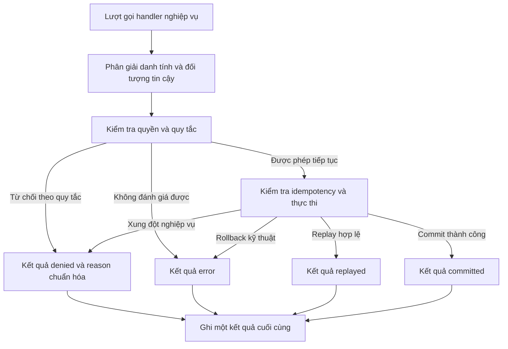

# Denied action metric: Đo lường thao tác nghiệp vụ bị từ chối

Trong chương **Observability**, denied action metric giúp quan sát những thao tác đã bị hệ thống từ chối vì không đáp ứng quyền hoặc quy tắc nghiệp vụ. Chỉ số này có thể cho thấy người dùng đang cố bỏ qua phê duyệt, sửa giá, thao tác trên đối tượng ngoài quyền, chuyển sai trạng thái hoặc dùng lại một khóa idempotency với nội dung khác.

Trong bảo mật logic nghiệp vụ, việc chặn đúng một request và việc nhận ra một chuỗi lạm dụng là hai trách nhiệm liên quan nhưng khác nhau. Invariant, state machine, kiểm tra quyền và transaction thực thi việc ngăn chặn. Metric cung cấp tín hiệu để phát hiện xu hướng, điều tra nguyên nhân và kiểm tra xem các cơ chế đó có đang hoạt động như dự kiến hay không.

Bài học tập trung vào cách định nghĩa phép đo, đặt điểm ghi nhận, kiểm soát cardinality, tính tỷ lệ và kiểm thử tín hiệu từ chối. Không thể kết luận một hành động là tấn công chỉ từ việc bộ đếm tăng.

## 1. “Denied action” phải có nghĩa cụ thể

Một thao tác bị từ chối khi hệ thống đã đưa ra quyết định không cho phép thao tác đó tiếp tục vì một quy tắc quyền hoặc nghiệp vụ xác định. Ví dụ:

- Nhân viên không sở hữu hoặc không được phân công xử lý đối tượng.
- Đơn hàng chưa được phê duyệt nhưng đã có yêu cầu thực hiện bước thanh toán.
- Giá do client gửi không khớp báo giá được máy chủ chấp nhận.
- Một lệnh cố chuyển đối tượng từ trạng thái đã kết thúc sang trạng thái không hợp lệ.
- Cùng idempotency key được dùng cho một payload khác.
- Phiên bản đối tượng trong lệnh đã cũ nên không được phép ghi đè trạng thái mới.

Cần phân biệt với các tình huống khác:

| Tình huống | Phân loại minh họa | Lý do |
| --- | --- | --- |
| Không có quyền hoàn tiền cho giao dịch | `denied` | Có quyết định từ chối theo quy tắc quyền |
| Không thể đọc dịch vụ quyền vì timeout | `error` | Không đủ thông tin để kết luận theo quy tắc; thao tác vẫn có thể bị chặn theo chính sách an toàn |
| JSON không đúng định dạng trước khi vào handler nghiệp vụ | Chỉ số đầu vào không hợp lệ riêng | Chưa đi tới cùng ranh giới quyết định nghiệp vụ |
| Sai thông tin đăng nhập ở gateway | Chỉ số xác thực riêng | Không đồng nghĩa một hành động nghiệp vụ đã được đánh giá |
| Lệnh mới thực hiện và commit thành công | `committed` | Có kết quả nghiệp vụ thành công |
| Retry cùng lệnh, nhận lại kết quả đã lưu | `replayed` | Không thực hiện lại tác động của lệnh |
| Database rollback do lỗi kỹ thuật | `error` | Không được tính là nghiệp vụ đã commit |

HTTP status không đủ để phân loại. Một mã 409 có thể là xung đột phiên bản hợp lệ, một mã 403 có thể được gateway hoặc dịch vụ nghiệp vụ trả về, và một hệ thống có thể đặt mã lỗi nghiệp vụ trong response 200. Nên lấy phân loại từ kết quả có cấu trúc của tầng thực thi quy tắc, không suy đoán bằng cách đếm tất cả response 4xx.

Khi phụ thuộc kỹ thuật không sẵn sàng, hệ thống có thể chặn thao tác để giữ an toàn. Tuy nhiên, cần giữ nguyên sự khác biệt giữa “không được phép theo chính sách” và “chưa đánh giá được vì lỗi kỹ thuật”. Nếu gộp cả hai vào denied, một sự cố hạ tầng dễ bị hiểu nhầm thành tấn công hoặc ngược lại.

## 2. Chọn đơn vị đếm và ranh giới đo

Trước khi đặt tên metric, cần trả lời: một lần tăng bộ đếm đại diện cho điều gì?

Trong bài này, đơn vị đo là **một lượt gọi tới handler thực thi nghiệp vụ có thẩm quyền, sau các bước tiếp nhận đầu vào cơ bản**. Mỗi lượt kết thúc được phân vào một trong bốn kết quả `committed`, `denied`, `error`, `replayed`.

Định nghĩa này có các hệ quả:

1. Cùng một người gửi mười request bị từ chối tạo mười lượt bị từ chối, không phải một người tấn công và cũng không chắc là mười ý định khác nhau.
2. Retry từ client là một lượt gọi mới. Retry kỹ thuật bên trong cùng một lượt gọi chưa kết thúc không tự tạo thêm kết quả cuối cùng.
3. Một request có thể đi qua gateway, controller, bộ kiểm tra quyền và dịch vụ nghiệp vụ, nhưng metric này chỉ có một nơi sở hữu kết quả cuối cùng.
4. Với tác vụ bất đồng bộ, việc nhận message hoặc đưa job vào hàng đợi không tự có nghĩa tác động nghiệp vụ đã commit. Điểm thực thi của worker phải có phép đo phù hợp với chính giai đoạn đó.
5. Một batch có nhiều phần tử cần chỉ rõ metric đếm batch hay từng phần tử. Không cộng hai loại đó dưới cùng một tên rồi tính tỷ lệ chung.

Ví dụ một lệnh hoàn tiền bị chặn vì thiếu phê duyệt. Middleware, bộ kiểm tra vai trò và state machine đều có thể phát hiện vấn đề, nhưng không được tăng cùng bộ đếm denied ba lần cho một lượt xử lý. Có thể ghi span hoặc metric riêng cho từng bước, với ngữ nghĩa khác và tên khác.

Nếu cần đo số lệnh logic duy nhất, phải thiết kế thêm cơ chế tổng hợp dựa trên định danh lệnh và khoảng thời gian lưu phù hợp. Counter theo lượt gọi không tự cung cấp tính duy nhất đó. Không dùng một request ID tùy ý do client gửi để loại trùng tín hiệu an ninh, vì client có thể tái sử dụng nó để làm giảm số đếm.

## 3. Hợp đồng metric và mã lý do

Một họ counter minh họa là:

```text
business_action_outcomes_total{
    action,
    outcome,
    reason,
    entrypoint
}
```

Đây là thiết kế tên và label minh họa, không phụ thuộc một thư viện Java cụ thể. Denied action metric được lấy bằng cách chọn các chuỗi có `outcome = denied`; không bắt buộc tạo thêm một counter denied trùng nội dung.

### 3.1. Các giá trị phải có tập hợp hữu hạn

| Label | Ví dụ giá trị | Quy tắc |
| --- | --- | --- |
| `action` | `APPROVE_ORDER`, `CONFIRM_PAYMENT`, `REFUND_PAYMENT`, `EXPORT_AUDIT` | Lấy từ danh mục hành động của máy chủ |
| `outcome` | `committed`, `denied`, `error`, `replayed` | Một kết quả cuối cùng cho một lượt gọi |
| `reason` | `none`, `approval_required`, `stale_version` | Mã chuẩn hóa, không phải message tùy ý |
| `entrypoint` | `api`, `worker`, `admin` | Nguồn thực thi có phạm vi hữu hạn |

Với `committed` và `replayed`, có thể dùng `reason = none`. Với `error`, dùng tập mã kỹ thuật hữu hạn như `dependency_unavailable`, `transaction_failed`, `internal_error`. Không dùng tên exception động hoặc toàn bộ thông báo lỗi làm label.

Nếu kết quả từ chối chưa được ánh xạ, dùng một giá trị giới hạn như `unclassified_denial` và theo dõi để bổ sung ánh xạ. Không đưa nguyên văn mã lạ do client cung cấp vào label.

### 3.2. Mã lý do cần phản ánh quy tắc bị vi phạm

| Reason minh họa | Quy tắc liên quan | Nguyên nhân hợp lệ cũng có thể xảy ra |
| --- | --- | --- |
| `object_scope_not_allowed` | Quyền theo đối tượng và phạm vi tenant | Người dùng vừa chuyển nhóm hoặc liên kết cũ còn được mở |
| `approval_required` | Không được bỏ qua phê duyệt | Giao diện hiển thị trạng thái chậm |
| `state_transition_not_allowed` | State machine | Hai tab cùng thao tác trên một đơn hàng |
| `client_price_mismatch` | Giá do máy chủ xác định hoặc xác nhận | Báo giá đã thay đổi sau khi mở giỏ hàng |
| `stale_version` | Không ghi đè một phiên bản mới hơn | Cập nhật đồng thời bình thường |
| `idempotency_payload_conflict` | Cùng khóa phải tương ứng cùng lệnh | Client sinh khóa sai hoặc tái sử dụng khóa sau sửa nội dung |
| `quota_exceeded` | Không vượt hạn mức nghiệp vụ | Người dùng thực sự đã dùng hết hạn mức |

Không đặt tên reason là `attacker_detected` chỉ vì giá không khớp hoặc phiên bản bị cũ. Mã lý do mô tả điều hệ thống quan sát và quy tắc đã chặn; ý đồ cần được điều tra thêm.

Một request có thể vi phạm nhiều điều kiện. Nên chọn một reason chính theo thứ tự kiểm tra được định nghĩa rõ và ghi một kết quả cuối cùng. Nếu cần lưu thêm các điều kiện liên quan để điều tra, dùng sự kiện có cấu trúc với kiểm soát dữ liệu thích hợp; đừng tăng denied một lần cho mỗi điều kiện.

Khi thay đổi thứ tự các guard, phân bố reason có thể đổi dù hành vi người dùng không đổi. Cần xem thay đổi này cùng phiên bản triển khai và chính sách trước khi kết luận về xu hướng tấn công.

## 4. Ghi metric ở đúng vị trí của luồng thực thi

Luồng tổng quát có thể được mô tả như sau:



Sơ đồ chỉ mô tả trách nhiệm quan sát. Thứ tự kiểm tra cụ thể phải phù hợp thuật toán nghiệp vụ, chẳng hạn kiểm tra quyền hiện tại trước khi trả receipt và dùng khóa hoặc phiên bản để tránh race condition. Không di chuyển guard chỉ để việc ghi metric thuận tiện hơn.

### 4.1. Mã giả cho một lớp bao ngoài transaction

```text
handleObserved(command, trustedContext):
    labels = resolveBoundedLabels(command, trustedContext)
    terminal = outcome(error, internal_error)

    try:
        result = transactionalHandler.executeAndCompleteCommit(
            command, trustedContext
        )

        if result.isSuccessfulReplay:
            terminal = outcome(replayed, none)
        else:
            terminal = outcome(committed, none)

        return result

    catch BusinessDenied denied:
        terminal = outcome(denied, mapToAllowedReason(denied.code))
        throw denied

    catch TechnicalFailure failure:
        terminal = outcome(error, mapToAllowedError(failure.code))
        throw failure

    finally:
        metrics.recordSafely(labels, terminal)
```

Đây là mã giả; tên hàm `executeAndCompleteCommit` nhấn mạnh rằng lớp bao chỉ nhận kết quả thành công sau khi transaction đã hoàn tất commit. Nếu dùng một cơ chế transaction qua proxy, đoạn `finally` đặt bên trong phương thức nghiệp vụ có thể chạy trước khi proxy commit. Không được tăng `committed` ở vị trí đó rồi bỏ qua lỗi commit xảy ra sau khi phương thức trả về.

Có thể đặt lớp quan sát ở ngoài ranh giới transaction hoặc dùng cơ chế thông báo sau commit phù hợp. Cần kiểm thử ranh giới thực tế của framework được dùng, thay vì cho rằng một annotation tự làm đúng thứ tự phát metric.

### 4.2. Từ chối không được mất dấu chỉ vì transaction rollback

Một quyết định từ chối có thể được biểu diễn bằng exception khiến transaction rollback. Metric theo tiến trình không nên bị ràng buộc vào một bản ghi nằm trong chính transaction sẽ rollback đó.

Ngược lại, không được commit một phần tác động nghiệp vụ chỉ để giữ bản ghi từ chối. Nếu cần dấu vết bền vững cho quyết định bị chặn, thiết kế đường ghi sự kiện riêng với ngữ nghĩa rõ ràng, hoặc cơ chế lưu bền vững phù hợp sau khi transaction nghiệp vụ đã rollback.

Metric và nhật ký kiểm toán không có cùng cam kết lưu trữ. Bộ đếm trong bộ nhớ có thể chưa được thu thập trước khi tiến trình dừng. Nếu một thao tác đã commit nhưng tiến trình crash trước khi tăng counter, metric có thể thiếu lượt đó. Không dùng counter thu thập định kỳ như bằng chứng hoàn chỉnh về mọi quyết định.

Nếu yêu cầu cần tổng hợp đáng tin hơn từ sự kiện bền vững, consumer tổng hợp phải xử lý trùng theo mã sự kiện. Khi đó cần công bố rõ đang đo số sự kiện quyết định duy nhất, thay vì vô tình gọi đó là cùng phép đo theo lượt gọi trực tiếp.

### 4.3. Lỗi quan sát không được đảo ngược quyết định bảo mật

`recordSafely` không được biến thao tác đang bị từ chối thành được phép, hoặc che mất lỗi nghiệp vụ gốc bằng lỗi exporter. Cách xử lý mất telemetry phải được xác định riêng: đệm có giới hạn, báo lỗi pipeline hoặc chặn theo yêu cầu lưu dấu vết của một thao tác đặc biệt.

Một phụ thuộc metric bị lỗi không phải lý do để bỏ qua kiểm tra quyền. Nếu có yêu cầu bắt buộc lưu dấu vết trước khi thực thi, hãy triển khai nó như một điều kiện nghiệp vụ hoặc auditability rõ ràng, không dựa vào giả định rằng một counter luôn được lưu bền vững.

## 5. Retry, idempotency và cạnh tranh làm thay đổi cách đọc số liệu

### 5.1. Retry không đồng nghĩa phát sinh thêm tác động

Giả sử lệnh `CONFIRM_PAYMENT` commit thành công nhưng client không nhận được response. Client gửi lại cùng idempotency key và payload. Hệ thống kiểm tra quyền, trả kết quả đã lưu và không thanh toán thêm lần nữa.

Trong điều kiện tiến trình vẫn hoạt động và ghi metric bình thường:

```text
Lượt đầu: committed += 1
Lượt retry: replayed += 1
Số tác động thanh toán mới: 1
```

Nếu client đổi số tiền nhưng giữ nguyên key, kết quả có thể là:

```text
outcome = denied
reason = idempotency_payload_conflict
```

Đó là một tín hiệu cần chú ý, nhưng có thể do lỗi tích hợp. Không tự động gán ý đồ xấu chỉ từ một trường hợp.

Nếu quyền đã bị thu hồi trước lần retry, một receipt cũ không được tự cấp lại quyền xem kết quả hoặc thực hiện hành động. Lượt retry có thể kết thúc bằng denied theo kiểm tra quyền hiện tại, thay vì replayed.

### 5.2. Phân biệt retry nội bộ và lượt gọi mới

Một transaction có thể được thử lại nội bộ vì deadlock hoặc xung đột kỹ thuật, sau đó commit thành công. Với đơn vị đo đã chọn, kết quả cuối cùng của lượt gọi vẫn chỉ là một `committed`. Nếu cần biết số lần retry kỹ thuật, tạo metric riêng có định nghĩa khác.

Nếu mỗi lần thử nội bộ đều tăng `error` rồi lần cuối tăng `committed`, tổng các outcome không còn bằng số lượt gọi đã kết thúc. Điều này làm mẫu số và cảnh báo khó diễn giải.

### 5.3. Xung đột phiên bản có thể là hành vi bình thường

Hai nhân viên cùng xử lý một đơn hàng có thể cùng gửi `expectedVersion = 7`. Một người cập nhật thành công lên version 8; người còn lại bị chặn bằng `stale_version`. Bộ đếm phản ánh invariant chống ghi đè đã hoạt động.

Cần xem loại hành động, tần suất, đối tượng và chuỗi trước/sau. Một vài xung đột khi nhiều người cùng làm việc khác với hàng nghìn yêu cầu liên tục cố chuyển một đối tượng đã khóa. Metric tổng hợp phát hiện xu hướng; log và trace hỗ trợ phân biệt các tình huống đó.

## 6. Tính số lượng, tốc độ và tỷ lệ đúng mẫu số

Trong một cửa sổ thời gian, gọi:

```text
D = số lượt có outcome denied
C = số lượt có outcome committed
R = số lượt có outcome replayed
E = số lượt có outcome error
```

Một tỷ lệ hữu ích là:

```text
deniedShare = D / (D + C)
```

Tỷ lệ này biểu diễn phần lượt xử lý có kết quả nghiệp vụ bị từ chối trong tập `denied + committed`, đã loại replay thành công và lỗi kỹ thuật. Nó không phải tỷ lệ người dùng xấu, không phải tỷ lệ lệnh duy nhất và cũng không bao gồm mọi request tới hệ thống.

Có thể theo dõi thêm:

```text
errorShare = E / (D + C + R + E)
replayShare = R / (D + C + R + E)
deniedPerSecond = D / độ_dài_cửa_sổ_theo_giây
```

Không gộp lỗi ở gateway hoặc request sai định dạng vào mẫu số trên nếu chúng chưa đi qua cùng ranh giới đo. Muốn đo tỷ lệ trên tổng traffic bên ngoài thì cần một phép đo khác có nguồn và phạm vi tương ứng.

### 6.1. Ví dụ số học

Trong năm phút, một hành động có:

| Kết quả | Số lượt |
| --- | ---: |
| Committed | 1.900 |
| Denied | 100 |
| Replayed | 600 |
| Error | 20 |

Khi đó:

```text
D + C = 2.000
deniedShare = 100 / 2.000 = 5%
tổng lượt có outcome = 2.620
errorShare = 20 / 2.620, xấp xỉ 0,76%
```

Nếu chia denied cho cả replay và error, tỷ lệ thành khoảng 3,82%. Phép chia đó không sai về số học, nhưng trả lời câu hỏi khác. Một đợt retry lớn có thể làm tỷ lệ này giảm dù số lượt vi phạm quy tắc không giảm.

### 6.2. Counter, reset và cửa sổ thời gian

Counter tích lũy không phải số lượt trong năm phút gần nhất. Cần dùng phép tính tăng hoặc tốc độ có xử lý counter reset, restart và các chuỗi theo instance của nền tảng quan sát.

Không lấy hai mẫu tổng đã cộng nhiều instance rồi trừ đơn giản nếu các instance có thể restart hoặc biến mất ở giữa. Thường cần tính mức tăng phù hợp trên từng chuỗi nguồn trước khi tổng hợp. Khoảng mất mẫu, instance sống ngắn và độ trễ thu thập vẫn có thể ảnh hưởng độ chính xác.

Timestamp do client gửi không được quyết định cửa sổ ghi metric. Với counter được thu thập định kỳ, biểu đồ phản ánh các mẫu quan sát, không phải một sổ sự kiện đầy đủ có thời điểm chính xác của từng request.

Khi `D + C = 0`, tỷ lệ denied chưa xác định. Nên hiển thị không có dữ liệu hoặc trạng thái tương đương, thay vì biến thành 0% rồi kết luận mọi thứ an toàn. Cũng cần phân biệt thật sự không có traffic với pipeline metric đã mất dữ liệu.

### 6.3. Tổng hợp đúng trọng số

Không lấy trung bình đơn giản các tỷ lệ theo instance hoặc nhóm để ra tỷ lệ toàn hệ thống. Một nhóm có 1/1 lượt bị chặn và một nhóm có 1/999 lượt bị chặn không tạo ra tỷ lệ toàn hệ thống xấp xỉ 50%.

Với cùng cửa sổ và phạm vi đo:

```text
globalDeniedShare = sum(D) / (sum(D) + sum(C))
```

Sau đó vẫn cần tách theo action hoặc reason để hiểu tác động. Một hành động có traffic rất lớn có thể che khuất bất thường ở hành động nhạy cảm nhưng ít được gọi.

## 7. Kiểm soát cardinality và dữ liệu nhạy cảm

Mỗi tổ hợp label tạo một chuỗi thời gian. Nếu đưa `userId`, `orderId`, `tenantId`, `requestId`, idempotency key hoặc đường dẫn đầy đủ vào label, số chuỗi có thể tăng theo số đối tượng và request.

Hệ quả không chỉ là chi phí lưu trữ. Cardinality không kiểm soát có thể làm chậm truy vấn, mất khả năng thu thập hoặc bị kẻ tấn công khai thác bằng cách tạo nhiều giá trị mới.

| Dữ liệu | Đưa vào label metric? | Nơi phù hợp hơn khi cần điều tra |
| --- | --- | --- |
| Action trong danh mục hữu hạn | Có | Metric và log |
| Reason đã chuẩn hóa | Có | Metric và log |
| Mã người dùng hoặc đơn hàng | Thường không | Log có kiểm soát quyền |
| Idempotency key, request ID | Không | Tham chiếu an toàn trong log hoặc trace |
| URL chứa mã đối tượng | Không | Route mẫu hữu hạn trong metric |
| Nội dung lỗi, body request | Không | Chỉ phần cần thiết đã lọc trong log |
| Trace ID | Không làm label thông thường | Liên kết trace hoặc exemplar nếu nền tảng hỗ trợ |

Hash một user ID không làm giảm số giá trị khác nhau và không tự biến dữ liệu thành ẩn danh. Nếu có một triệu người, một triệu hash vẫn có thể tạo một triệu chuỗi. Nên giữ khả năng điều tra theo người hoặc tenant trong kho sự kiện thích hợp, với quyền truy cập và thời hạn lưu rõ ràng.

Các chiều như môi trường, dịch vụ hoặc vùng triển khai có thể hữu ích nếu được quản lý hữu hạn. Không thêm label chỉ vì nó có sẵn trong request. Ước tính số tổ hợp trước khi phát hành và giám sát sự tăng bất thường của số chuỗi.

## 8. Thiết kế cảnh báo có ngữ cảnh nghiệp vụ

Một cảnh báo tốt cần cả mức tăng và ngữ cảnh. Chỉ dùng “denied lớn hơn 0” thường tạo quá nhiều nhiễu, vì hệ thống đang chủ động từ chối các tình huống bình thường như phiên bản cũ hoặc hạn mức đã hết.

Có thể kết hợp:

- Số denied tối thiểu trong cửa sổ để tránh tỷ lệ cao từ rất ít request.
- Tỷ lệ denied trên mẫu số đã định nghĩa.
- Sự duy trì qua nhiều cửa sổ để giảm phản ứng với một đợt ngắn.
- Action và reason, đặc biệt ở thao tác có tác động lớn.
- Đường cơ sở theo giờ hoạt động, đợt phát hành hoặc chiến dịch của sản phẩm.
- Error và replay để tách lỗi tích hợp, gián đoạn phụ thuộc và dấu hiệu thăm dò.

Ví dụ giả định phục vụ học tập: xem xét cảnh báo khi một action có ít nhất 20 denied trong năm phút, deniedShare trên 10% và điều kiện duy trì qua các cửa sổ tiếp theo. Các số này chỉ minh họa cách kết hợp điều kiện, không phải ngưỡng phù hợp cho mọi hệ thống.

Một action rất ít traffic có thể cần quy tắc riêng. Chẳng hạn một lần cố bỏ qua phê duyệt ở thao tác quản trị nhạy cảm đáng điều tra hơn nhiều lần báo giá đã cũ trong giỏ hàng thông thường.

### 8.1. Diễn giải một số mẫu tín hiệu

| Mẫu quan sát | Giả thuyết cần kiểm tra |
| --- | --- |
| `client_price_mismatch` tăng ngay sau phát hành frontend | Lệch định dạng giá, báo giá hoặc quy tắc làm tròn |
| `object_scope_not_allowed` tăng ở một nguồn truy cập | Liên kết cũ, cấu hình phân quyền sai hoặc dò đối tượng ngoài quyền |
| `approval_required` tăng cùng các lần thử chuyển trạng thái liên tiếp | Client gọi sai luồng hoặc có nỗ lực bỏ qua phê duyệt |
| `idempotency_payload_conflict` tăng sau cập nhật SDK nội bộ | Lỗi sinh khóa, tái sử dụng khóa hoặc thay payload khi retry |
| Denied tăng ít nhưng phân tán trên nhiều danh tính | Có thể là lạm dụng chậm hoặc phân tán; cần dữ liệu sự kiện |
| Denied giảm về 0 trong khi hành động thành công tăng bất thường | Có thể mất telemetry, guard bị bỏ qua hoặc traffic thật sự thay đổi |
| Error tăng mạnh, denied giảm | Chưa chắc an toàn hơn; hệ thống có thể chưa tới được điểm đánh giá quy tắc |

Metric theo tổng số không cho biết một hay nhiều danh tính tạo ra tín hiệu. Muốn phát hiện hành vi chậm và phân tán, cần tổng hợp sự kiện theo mô hình phù hợp. Không giải quyết bằng cách đưa mọi actor vào label metric.

### 8.2. Cảnh báo không tự cấp quyền và không tự chứng minh tấn công

Không tự bỏ qua guard vì tỷ lệ denied cao làm ảnh hưởng chỉ số trải nghiệm. Cũng không tự khóa mọi người dùng của một tenant chỉ vì counter toàn tenant vượt ngưỡng. Kẻ tấn công có thể cố ý tăng số từ chối để gây gián đoạn cho người khác.

Nếu có phản ứng tự động như giới hạn tốc độ hoặc tăng yêu cầu xác minh, cần quy tắc độc lập, có phạm vi, nguồn danh tính tin cậy và khả năng đánh giá tác động. Threshold của dashboard không thay thế thiết kế cơ chế kiểm soát đó.

## 9. Liên kết metric với log, trace và dấu vết nghiệp vụ

Metric trả lời “bao nhiêu, tăng ở đâu, từ khi nào”. Log và trace hỗ trợ trả lời “lượt nào, đối tượng nào, điều kiện nào”. Audit nghiệp vụ chứng minh những thay đổi đã thực sự được áp dụng theo cam kết lưu trữ của nó.

Một sự kiện từ chối có cấu trúc có thể chứa:

```text
serverDecisionId
correlationId
trustedActorReference
trustedTenantReference
action
reasonCode
resourceReference theo mức được phép
policyRevision hoặc ruleVersion
expectedVersion và currentVersion nếu phù hợp
entrypoint
recordedAt
```

Không sao chép token, cookie, thông tin xác thực, toàn bộ body hoặc nội dung nhạy cảm không cần thiết. Idempotency key cũng có thể chứa dữ liệu do tích hợp bên ngoài đặt; cần chính sách lưu tham chiếu an toàn thay vì ghi nguyên trạng mặc định.

Các trường danh tính phải lấy từ ngữ cảnh tin cậy, không từ `actorId` tự khai trong body. Correlation ID hoặc trace context giúp tìm đường đi của request nhưng không phải căn cứ cấp quyền.

Traces có thể bị sampling nên không bảo đảm có trace cho mọi denied. Nếu cần dấu vết đầy đủ hơn cho một nhóm quyết định, phải thiết kế cơ chế lưu tương ứng thay vì suy ra rằng counter tăng thì chắc chắn có một trace để mở.

Quyền truy cập log và trace cũng cần được kiểm soát. Một reason nội bộ có thể tiết lộ tài nguyên tồn tại hoặc quy tắc kiểm tra, dù response ra ngoài đã được chuẩn hóa để tránh lộ thông tin.

### Một chuỗi điều tra minh họa

Giả sử dashboard cho thấy `approval_required` tăng ở `REFUND_PAYMENT`:

1. Xác minh pipeline metric đang hoạt động và mẫu số có đủ dữ liệu.
2. So thời điểm tăng với thay đổi frontend, backend và chính sách phê duyệt.
3. Mở các sự kiện đại diện theo correlation ID, trong đúng phạm vi được phép.
4. Kiểm tra liệu request đang bỏ qua một bước, dùng phiên bản cũ hay đến từ một luồng hợp lệ bị lỗi.
5. Đối chiếu snapshot và lịch sử: các yêu cầu denied có thật sự không tạo hoàn tiền trái phép hay không.
6. Chỉ sau khi có căn cứ mới quyết định sửa lỗi tích hợp, điều chỉnh rule hoặc áp dụng biện pháp chống lạm dụng thích hợp.

Một bộ đếm denied cao có thể cho thấy kiểm soát đang chặn tốt. Nó cũng có thể che một số ít tác động trái phép đã lọt qua. Vì vậy vẫn cần kiểm tra invariant ở dữ liệu kết quả, chẳng hạn tổng tiền đã hoàn không vượt số được phép và không có chuyển trạng thái bỏ qua phê duyệt.

## 10. Kiểm thử phép đo cùng tình huống tấn công logic

Kiểm thử metric cần chứng minh cả ngữ nghĩa số đếm và tính đúng của hành vi nghiệp vụ. Metric tăng đúng nhưng thao tác trái phép vẫn commit là một thất bại bảo mật.

| Tình huống | Kỳ vọng metric | Kỳ vọng nghiệp vụ |
| --- | --- | --- |
| Một request sửa đối tượng ngoài quyền | Một denied với reason phạm vi thích hợp | Không thay đổi đối tượng trái phép |
| Một request bị nhiều guard từ chối | Một kết quả denied chính | Không tạo tác động; reason theo thứ tự quy tắc đã định nghĩa |
| Client gửi giá không được chấp nhận | Denied `client_price_mismatch` | Không dùng giá tùy ý từ client |
| Chưa phê duyệt mà gọi bước thực thi | Denied `approval_required` | Không bỏ qua state machine |
| Hai lệnh cùng expected version | Một committed, một denied do phiên bản cũ trong kịch bản xác định | Chỉ một thay đổi thắng, không ghi đè mù |
| Retry cùng key sau lần thành công | Thêm replayed, không thêm committed cho lần retry | Một tác động nghiệp vụ |
| Cùng key nhưng payload khác | Denied `idempotency_payload_conflict` | Không thực hiện nội dung mới dưới khóa cũ |
| Quyền bị thu hồi trước retry | Denied theo kiểm tra quyền hiện tại | Receipt không cấp lại quyền |
| Phụ thuộc quyền timeout | Error kỹ thuật, không gán thành vi phạm quyền xác định | Chặn hoặc chờ theo chính sách đã định nghĩa |
| Transaction rollback lúc commit | Error, không tăng committed | Không để lại trạng thái đã áp dụng một phần |
| Retry transaction nội bộ rồi thành công | Một outcome committed cuối cùng | Không nhân tác động và không nhân kết quả cuối cùng |
| Gateway cũng có bộ đếm riêng | Không tăng lặp cùng metric nghiệp vụ | Giữ rõ quyền sở hữu điểm ghi |
| Exception message chứa ID hoặc ký tự lạ | Reason vẫn thuộc tập hữu hạn | Không làm label tăng theo dữ liệu client |
| Exporter hoặc collector không sẵn sàng | Hành vi mất dữ liệu được quan sát theo thiết kế | Quyết định từ chối không bị đổi thành cho phép |
| Counter reset hoặc instance restart | Truy vấn cửa sổ xử lý reset và báo khoảng thiếu thích hợp | Không suy ra số âm hoặc 0% an toàn giả |
| Không có D và C trong cửa sổ | Tỷ lệ chưa xác định hoặc không có dữ liệu | Không kết luận không có tấn công chỉ từ khoảng trống |

Khi dùng bộ thu metric trong bộ nhớ để kiểm thử, nên so mức tăng trước và sau hoặc tạo registry riêng cho từng kịch bản để tránh số đếm từ bài kiểm thử khác. Với concurrency, đồng bộ điểm bắt đầu và kiểm tra cả dữ liệu đã commit, thay vì chỉ đếm response.

Cần có kiểm thử cho thứ tự commit của lớp quan sát thực tế. Một bài kiểm thử chỉ gọi trực tiếp phương thức nghiệp vụ mà không đi qua cơ chế transaction đang dùng có thể bỏ sót lỗi tăng committed trước commit.

Các kỳ vọng đếm chính xác trong môi trường kiểm thử giả định tiến trình và nơi ghi metric hoạt động theo thiết lập kiểm thử. Trong vận hành, phải tính đến việc crash hoặc mất mẫu có thể làm thiếu số liệu; không nâng cam kết của counter thành một sổ kiểm toán tuyệt đối.

## 11. Những lỗi thiết kế thường gặp

- **Đếm toàn bộ 4xx thành vi phạm logic:** trộn lỗi xác thực, đầu vào và quyết định nghiệp vụ, khiến reason không còn giúp điều tra.
- **Ghi cùng metric ở nhiều lớp:** một request trở thành nhiều denied, làm cả số lượng lẫn tỷ lệ sai.
- **Tăng committed trước commit:** che khuất các rollback hoặc lỗi commit xảy ra sau khi phương thức trả về.
- **Dùng retry làm mẫu số mà không giải thích:** một đợt phát lại có thể làm tỷ lệ denied có vẻ giảm.
- **Gắn ID vào label:** gây tăng cardinality và có thể đưa dữ liệu nhạy cảm vào hệ thống metric.
- **Xem mọi stale version là tấn công:** bỏ qua cạnh tranh bình thường và các lỗi đồng bộ giao diện.
- **Coi denied bằng 0 là an toàn:** không phát hiện guard bị bỏ qua hoặc pipeline quan sát bị đứt.
- **Chỉ dựa vào metric để điều tra:** thiếu định danh sự kiện, ngữ cảnh quyền và bằng chứng về trạng thái đã commit.
- **Đổi guard để làm đẹp dashboard:** làm giảm số từ chối bằng cách nới kiểm soát thay vì giải quyết nguyên nhân đúng.

## 12. Tiêu chí hoàn thành thiết kế

Một denied action metric có thể được đánh giá bằng các câu hỏi:

- Một lần tăng đại diện cho lượt gọi, lệnh logic hay sự kiện quyết định nào?
- Ai sở hữu điểm ghi cuối cùng và cách nào tránh đếm trùng giữa các lớp?
- Từ chối theo quy tắc, lỗi kỹ thuật, commit và replay được phân biệt thế nào?
- Thành công chỉ được ghi sau đúng ranh giới commit chưa?
- Reason và label có tập giá trị hữu hạn do máy chủ kiểm soát không?
- Mẫu số, cửa sổ thời gian, reset và trường hợp không có dữ liệu được diễn giải rõ chưa?
- Cảnh báo có xét số lượng, tỷ lệ, action, baseline và thay đổi triển khai không?
- Có thể liên kết tín hiệu với log, trace và trạng thái nghiệp vụ mà không làm lộ dữ liệu không cần thiết không?

Một phép đo được định nghĩa rõ giúp nhận ra nơi kiểm soát đang chặn hành vi không hợp lệ, nơi sản phẩm đang gây lỗi cho người dùng và nơi cần điều tra sâu hơn. Giá trị của nó nằm ở khả năng hỗ trợ quyết định dựa trên bằng chứng, đi cùng các invariant và cơ chế thực thi bảo mật đã được bảo vệ đúng.
