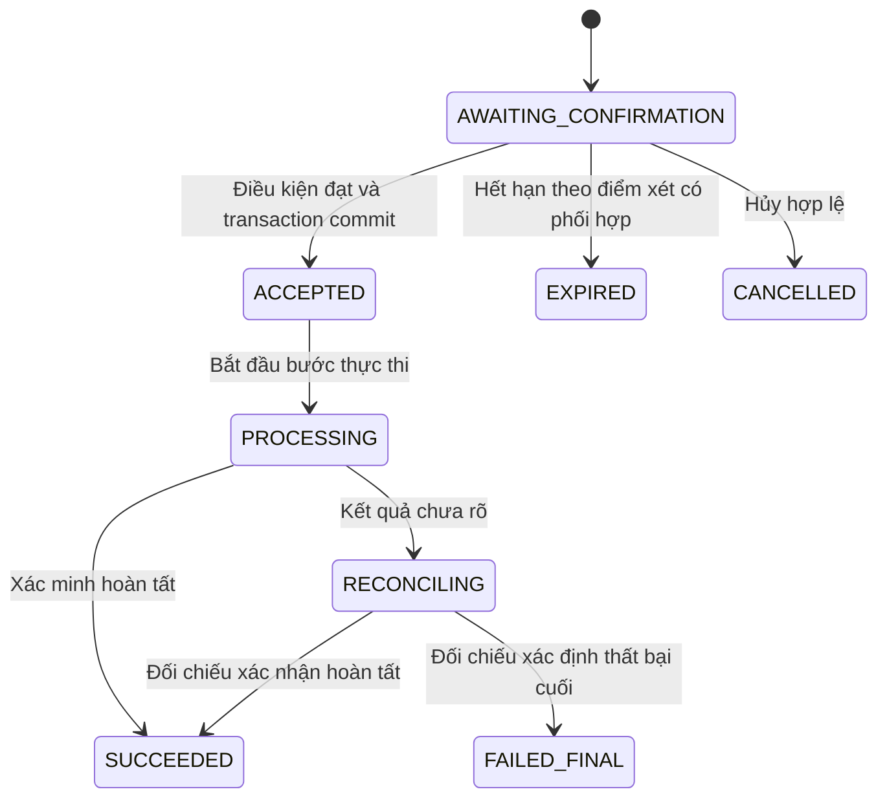

# Expired operation response: Phản hồi khi thao tác nghiệp vụ hết hạn

## 1. Mục tiêu và phạm vi

**Expired operation response** là phản hồi cho biết một thao tác không còn được chấp nhận theo thời hạn nghiệp vụ của nó. Phản hồi đúng phải giải thích đủ để caller phục hồi an toàn, đồng thời không biến việc hết hạn thành đường bỏ qua phê duyệt, thay đổi giá hoặc thực hiện trùng tác động.

Trong chương **Error Semantics** của module `SECURITY_APPLICATION_SECURITY_BUSINESS_LOGIC_SECURITY`, thông báo “đã hết hạn” cần gắn với trạng thái có thẩm quyền, business invariants, quyền theo đối tượng, transaction và idempotency. Một deadline đã qua không tự chứng minh thao tác chưa từng được chấp nhận hoặc chưa tạo tác động.

Ví dụ xuyên suốt là một phiên xác nhận checkout có thời hạn, gắn với đơn hàng, người thực hiện và điều kiện giá đã được máy chủ xác định. Các ID, thời gian, trạng thái và mã lỗi trong bài đều là quy ước minh họa cho thiết kế, không phải chuẩn API bắt buộc.

Sau bài học, bạn cần có khả năng:

- Phân biệt hết hạn nghiệp vụ với hết hạn đăng nhập, timeout và kết quả chưa rõ.
- Xác định thời điểm kiểm tra deadline và nguồn thời gian có thẩm quyền.
- Thiết kế mã lỗi, outcome và hướng phục hồi không gây tác động trùng.
- Giữ đúng state machine khi confirm, expiry worker và retry chạy đồng thời.
- Trả kết quả lịch sử đúng khi một thao tác đã được chấp nhận trước đó.
- Kiểm thử các ranh giới thời gian, lỗi transaction và tình huống lạm dụng.

## 2. Hết hạn cái gì, và có nghĩa là gì?

### 2.1. Không gộp các loại thời hạn

| Thời hạn | Ý nghĩa | Không được tự suy ra |
| --- | --- | --- |
| Phiên xác nhận nghiệp vụ | Hạn để xét chấp nhận một lựa chọn đã được ràng buộc | Hết hạn không có nghĩa phải hoàn tác mọi kết quả trước đó |
| Báo giá | Hạn sử dụng các điều kiện giá theo chính sách | Tạo phiên mới không tự giữ nguyên giá cũ |
| Phê duyệt hoặc challenge một lần | Hạn sử dụng bằng chứng/quyền xác nhận trong đúng ngữ cảnh | Cấp reference mới không thay thế một lần phê duyệt mới nếu chính sách yêu cầu |
| Token đăng nhập | Hạn xác thực theo cơ chế truy cập | Đăng nhập lại không gia hạn thao tác nghiệp vụ |
| Reservation hoặc authorization bên ngoài | Hạn của một tài nguyên/phụ thuộc cụ thể | Phiên checkout còn hạn không bảo đảm phụ thuộc đó vẫn còn hiệu lực |
| Bản ghi idempotency | Thời gian giữ kết quả để nhận diện retry | Bản ghi bị dọn không có nghĩa nghiệp vụ chưa từng xảy ra |
| Timeout chờ response | Giới hạn chờ của caller hoặc hạ tầng | Timeout không chứng minh transaction rollback |

Một giao diện có thể gọi nhiều trường hợp là “phiên đã hết hạn”. Backend vẫn phải giữ các nghĩa riêng để chọn hành vi đúng. Không bắt người dùng tạo command mới chỉ vì caller ngừng chờ response của command cũ.

### 2.2. Deadline cần có ranh giới được định nghĩa

Một hợp đồng minh họa có thể chọn điều kiện:

```text
Đủ điều kiện xét chấp nhận khi:
    operation đang AWAITING_CONFIRMATION
    và decision_time < expires_at

Không đủ điều kiện thời gian khi:
    decision_time >= expires_at
```

`decision_time` là thời gian được lấy từ nguồn đáng tin cậy tại bước xét điều kiện dưới cơ chế phối hợp của thao tác. Nó không phải thời gian trên trình duyệt, lúc mở trang, lúc request vào gateway hoặc lúc transaction bắt đầu từ rất lâu trước khi lấy được khóa.

Phải quy định rõ trường hợp bằng đúng deadline. Trong ví dụ này, khoảng hiệu lực không bao gồm `expires_at`. Độ phân giải thời gian cũng phải được thống nhất; không kiểm tra bằng giây ở một nơi và bằng mili giây ở nơi khác rồi mong các ranh giới giống nhau.

### 2.3. Hạn xét chấp nhận khác với hạn hoàn tất

Bài này chọn chính sách minh họa: điều kiện thời gian được xét tại điểm quyết định có phối hợp; quyết định chỉ được công bố là đã chấp nhận sau khi transaction commit. Chính sách này không hứa commit hoặc tác động ngoài hệ thống luôn hoàn tất trước `expires_at`.

Nếu sản phẩm yêu cầu “phải commit trước hạn” hoặc “nhà cung cấp phải nhận trước hạn”, đó là hợp đồng khác. Không dùng một lần kiểm tra sớm trong transaction rồi tuyên bố đã đáp ứng mọi loại deadline.

Cần xác định điểm quyết định, cơ chế phối hợp và điều kiện của từng phụ thuộc theo chính sách thực tế. Tên trường `expires_at` tự nó không giải thích hết các bảo đảm này.

## 3. State machine phải giữ lịch sử đã xảy ra

### 3.1. Một mô hình trạng thái minh họa

| Trạng thái | Ý nghĩa |
| --- | --- |
| `AWAITING_CONFIRMATION` | Đang chờ lựa chọn; chưa commit quyết định chấp nhận |
| `ACCEPTED` | Quyết định chấp nhận đã commit tại nguồn; công việc tiếp theo có thể còn chờ |
| `PROCESSING` | Đang thực hiện bước tiếp theo, có thể liên quan hệ thống ngoài |
| `SUCCEEDED` | Kết quả hoàn tất đã được xác minh theo hợp đồng |
| `EXPIRED` | Không còn chấp nhận xác nhận mới cho phiên này theo deadline |
| `CANCELLED` | Đã hủy theo một chuyển trạng thái hợp lệ |
| `RECONCILING` | Kết quả một bước chưa rõ, cần đối chiếu trước khi ra quyết định tiếp |
| `FAILED_FINAL` | Đã xác định kết quả thất bại cuối theo hợp đồng của luồng |

Các trạng thái chỉ là mô hình minh họa. `FAILED_FINAL` không tự cho biết mọi tác động phụ đã được hoàn tác; nếu luồng có nhiều tác động, cần lưu kết quả và bước bù tương ứng.



Sơ đồ không liệt kê mọi nhánh lỗi của một sản phẩm. Điều quan trọng là không có cạnh tự động từ `ACCEPTED` hoặc `SUCCEEDED` sang `EXPIRED` chỉ vì đồng hồ đã đi qua deadline xét xác nhận.

### 3.2. State đã được chấp nhận phải thắng phép suy luận từ đồng hồ

Giả sử phiên có deadline 09:10, được chấp nhận hợp lệ lúc xét quyết định trước hạn và đã commit. Client mất response rồi gọi lại lúc 09:12.

Không được chỉ thấy `now > expires_at` rồi trả “chưa thực hiện vì hết hạn”. Máy chủ phải tra kết quả và trạng thái đã lưu. Response có thể là receipt chấp nhận cũ hoặc trạng thái đang xử lý, tùy hợp đồng; nó không tạo một lần chấp nhận mới.

Ngược lại, một phiên thật sự đã `EXPIRED` không được trở lại chờ chỉ vì client thay giờ, đổi idempotency key hoặc gửi lại token có chữ ký còn kiểm tra được.

### 3.3. Không dùng một boolean cho mọi kết quả

Các cờ `expired=true` và `success=false` không đủ nếu không rõ chúng nói về phiên xác nhận, command hiện tại hay tác động bên ngoài. Một phiên đã được chấp nhận có thể đang chờ kết quả thanh toán, trong khi deadline của bước xác nhận đã qua.

Nên biểu diễn trạng thái và outcome theo ranh giới nghiệp vụ. Khi có nhiều deadline, dùng tên và định nghĩa riêng thay vì để một cột `expired` điều khiển toàn bộ luồng.

## 4. Ma trận quyết định phản hồi

### 4.1. Đánh giá sau khi có quyền xem thao tác

| Điều hệ thống đã xác định | Phản hồi có ý nghĩa | Hành vi không được tự làm |
| --- | --- | --- |
| Đang chờ, chưa tới deadline, điều kiện khác đạt | Tiếp tục xét chấp nhận theo transaction | Không bỏ kiểm tra revision, giá hoặc quyền |
| Đang chờ, đã tới deadline, chưa có chấp nhận trước đó | `OPERATION_EXPIRED` cho bước xác nhận | Không enqueue xác nhận hoặc gia hạn từ payload |
| Cùng command đã được chấp nhận | Trả kết quả command đã lưu và ngữ cảnh trạng thái phù hợp | Không thay kết quả cũ thành expired |
| Phiên đã được chấp nhận nhưng caller dùng command mới | Kết quả đã chấp nhận/đã xử lý theo hợp đồng một lần | Không tạo tác động thứ hai |
| Đang processing hoặc reconciling | Trạng thái chờ/đối chiếu với reference được phép | Không khẳng định chưa thực hiện vì deadline đã qua |
| Đã hủy | Kết quả cancelled theo hợp đồng | Không đổi lịch sử hủy thành hết hạn cho tiện |
| Không có đủ lịch sử hoặc nguồn không đọc được | Không xác định hoặc không khả dụng theo hợp đồng | Không tự khẳng định expired và chưa có tác động |
| Caller không có quyền | Lỗi truy cập/không khả dụng theo chính sách che thông tin | Không tiết lộ trạng thái, deadline hoặc receipt |

Nếu nhiều điều kiện cùng không đạt, thứ tự phân loại phải được thiết kế nhất quán. Không để thông báo chi tiết về hạn dùng trở thành một cách dò sự tồn tại của đối tượng ngoài quyền.

### 4.2. Thứ tự ưu tiên cho idempotency

Trong một luồng được phân quyền, trước khi suy ra kết quả chỉ từ deadline, cần tra command theo phạm vi và fingerprint phù hợp:

1. Cùng command và cùng payload đã có kết quả: trả kết quả đã lưu theo hợp đồng.
2. Cùng key nhưng payload quan trọng khác: xử lý xung đột idempotency; không gán kết quả của ý định cũ cho ý định mới.
3. Command đang xử lý hoặc kết quả chưa rõ: trả/tra trạng thái phù hợp, không tự chạy lại như một command mới.
4. Chưa có kết quả áp dụng cho lần gọi này: xét trạng thái thao tác, deadline và các điều kiện nghiệp vụ.

Đây là thứ tự trách nhiệm sau bước kiểm tra quyền, không phải yêu cầu phải tiết lộ một command cũ cho bất kỳ ai biết key.

### 4.3. Không tìm thấy không tự đồng nghĩa hết hạn

Một ID không có bản ghi có thể là ID sai, ngoài phạm vi, dữ liệu đã dọn hoặc lịch sử không còn đủ. Không lấy thời gian có trong một token do caller đưa làm cơ sở duy nhất để khẳng định chưa từng có tác động.

Nếu đã dùng tombstone hoặc dữ liệu lưu tối thiểu để phân biệt thao tác cũ, phải xác định điều nó chứng minh và thời hạn của nó. Không sinh lại cùng ID cho một thao tác mới rồi để retry cũ trỏ sang ý nghĩa mới.

## 5. Thiết kế response có thể phục hồi an toàn

### 5.1. Ví dụ một phiên thật sự hết hạn trước khi được chấp nhận

Giả sử máy chủ đã xác minh caller có quyền, phiên đang chờ, chưa có quyết định chấp nhận, và chuyển phiên sang `EXPIRED` theo transaction. Một error body có thể là:

```json
{
  "error": {
    "code": "OPERATION_EXPIRED",
    "message": "Phiên xác nhận đã hết hạn. Hãy tạo lại phiên để xem điều kiện hiện tại."
  },
  "operation": {
    "ref": "checkout-op-731",
    "state": "EXPIRED",
    "expires_at": "2026-10-05T09:10:00Z",
    "observed_at": "2026-10-05T09:10:02Z"
  },
  "outcome": {
    "scope": "CHECKOUT_CONFIRMATION",
    "status": "NOT_ACCEPTED"
  },
  "recovery": {
    "same_operation_retry": "DO_NOT_RETRY",
    "action": "CREATE_NEW_OPERATION"
  },
  "request_ref": "request-905"
}
```

`NOT_ACCEPTED` chỉ nói về bước xác nhận của phiên này. Nó không khẳng định không hề có reservation tạm, không còn tài nguyên cần dọn hoặc mọi thao tác khác trên đơn đều chưa xảy ra.

Hướng tạo phiên mới chỉ phù hợp vì hệ thống đã xác định bước xác nhận cũ không được chấp nhận. Không trả hướng này như một mặc định cho timeout hay trạng thái reconciling.

### 5.2. Mã lỗi cho máy, thông điệp cho người

Client nên dựa vào mã ổn định và cấu trúc outcome/recovery được tài liệu hóa, không phân tích câu tiếng Việt để quyết định retry. Thông điệp có thể được dịch hoặc chỉnh cách diễn đạt mà không làm thay đổi hợp đồng máy.

Mã trạng thái giao thức cũng phải được chọn và ánh xạ nhất quán theo API. Không coi riêng việc nhận một response lỗi là bằng chứng chắc chắn transaction chưa commit; điều đó phụ thuộc loại lỗi và outcome do hệ thống xác định.

Không dùng cùng một mã “expired” cho token đăng nhập, báo giá, phê duyệt và timeout nếu chúng yêu cầu các cách phục hồi khác nhau. Nếu dùng một nhóm mã chung, phải có phân loại con đủ rõ và được phép công bố.

### 5.3. Một cờ retryable thường thiếu nghĩa

Câu hỏi “có thể retry không?” cần chỉ rõ retry cái gì:

- Gửi lại cùng command với cùng key để lấy kết quả đã có.
- Gửi lại xác nhận trên cùng phiên đã hết hạn.
- Đọc trạng thái để đối soát một kết quả chưa rõ.
- Tạo phiên mới với điều kiện mới.

Các hành động này không tương đương. `DO_NOT_RETRY` trong ví dụ áp dụng cho việc xác nhận lại phiên expired; nó không cấm người dùng đọc receipt hoặc tạo một lựa chọn mới qua đúng quy trình.

Không gửi hướng dẫn chờ vài giây rồi thử cùng phiên nếu deadline nghiệp vụ đã hết và không có cơ chế gia hạn được thiết kế. Backoff không làm một thao tác terminal trở lại hợp lệ.

### 5.4. Chỉ trả dữ liệu phù hợp với quyền và mục đích

Operation reference, deadline và request reference có thể hữu ích cho client đã được phép xem phiên. Không đưa token xác nhận, chữ ký đầy đủ, khóa bí mật, payload riêng tư hoặc stack trace vào error body.

Một thời gian máy chủ được trả để hỗ trợ giao diện vẫn không biến đồng hồ client thành nguồn quyết định. Quyết định cuối nằm tại backend theo state machine và nguồn thời gian của hệ thống.

## 6. Luồng xử lý phía máy chủ

### 6.1. Ràng buộc đầu vào của thao tác

Phiên xác nhận cần gắn với các dữ kiện ảnh hưởng quyết định, chẳng hạn:

- Tenant, đối tượng và chủ thể/actor được phép xác nhận.
- Phạm vi thao tác, phiên bản nội dung hoặc đề xuất được xác nhận.
- Giá, tiền tệ và các điều kiện máy chủ đã chọn theo chính sách.
- Revision/generation cần đối chiếu và deadline do máy chủ phát hành.
- Cơ chế nhận diện command và sử dụng một lần theo hợp đồng.

Client không được đổi `expires_at`, `subject_id`, số tiền hoặc đối tượng rồi giữ nguyên bằng chứng xác nhận cũ. Token có chữ ký chỉ hỗ trợ kiểm tra nguồn/nội dung theo cơ chế đó; nó không tự kiểm tra trạng thái hiện tại, quyền theo đối tượng hay việc đã sử dụng.

### 6.2. Giả mã cho nhánh xác nhận hoặc hết hạn

```text
Xác thực caller và kiểm tra hình dạng request
Xác định tenant từ ngữ cảnh đáng tin cậy

BEGIN TRANSACTION
    Phối hợp trên operation và dữ liệu liên quan theo thiết kế
    Đọc operation trong đúng phạm vi
    Kiểm tra quyền theo đối tượng và ràng buộc actor

    Tra command/key trong đúng phạm vi và đối chiếu fingerprint
    Nếu có kết quả đã lưu:
        chọn kết quả lịch sử theo hợp đồng, không áp dụng lại
    Nếu có xung đột key hoặc kết quả đang chưa rõ:
        chọn kết quả phù hợp, không tạo command thay thế tự động
    Nếu có thể xét command mới:
        kiểm tra trạng thái operation
        nếu đã ACCEPTED/PROCESSING/SUCCEEDED:
            không thực hiện xác nhận lần hai
        nếu đã EXPIRED hoặc CANCELLED:
            chọn kết quả terminal tương ứng
        nếu đang AWAITING_CONFIRMATION:
            decision_time = lấy thời gian tại điểm xét đã định nghĩa
            nếu decision_time >= expires_at:
                chuyển sang EXPIRED theo điều kiện/version
                lưu kết quả NOT_ACCEPTED của bước xác nhận
                ghi bằng chứng cần thiết theo hợp đồng
            nếu decision_time < expires_at:
                kiểm tra revision, đề xuất, giá và invariant còn lại
                chuyển sang ACCEPTED theo điều kiện/version
                lưu kết quả command
                ghi audit/outbox công việc được chấp nhận
COMMIT

Tạo response từ kết quả đã xác định sau commit
```

Giả mã không yêu cầu mọi ứng dụng dùng cùng một cơ chế khóa hoặc schema. Những đường khác, gồm job nền và công cụ quản trị, cũng phải giữ điều kiện trạng thái, generation và các invariant tương ứng.

### 6.3. Không ghi expired rồi vô tình rollback phần cần lưu

Nếu nhánh hết hạn cập nhật state, lưu command result và sau đó ném một exception làm transaction rollback, dữ liệu đánh dấu hết hạn có thể không tồn tại như lập trình viên tưởng.

Với thiết kế chọn lưu kết quả terminal bền vững, cần hoàn tất transaction của quyết định đó rồi ánh xạ sang response lỗi ở tầng phù hợp. Không phát event “đã hết hạn” hoặc khẳng định đã lưu kết quả nếu transaction không commit.

Một số thiết kế suy ra hết hạn khi đọc thay vì lưu state ngay. Khi đó, vẫn phải giữ đúng điều kiện ngăn chấp nhận và công bố rõ giới hạn lưu bằng chứng. Không trộn hai mô hình để vừa cho rằng đã lưu terminal, vừa thực tế chỉ trả một thông điệp tạm.

### 6.4. Không tạo tác động trước khi quyết định chấp nhận được lưu

Nếu hệ thống gửi yêu cầu thanh toán trước rồi mới kiểm tra hạn xác nhận, response expired có thể đi cùng một tác động đã xảy ra. Việc sửa thông báo không chữa được lỗi thứ tự này.

Tách bước chấp nhận bền vững và ý định thực thi phù hợp với transaction/outbox. Tác động bên ngoài có cơ chế idempotency và đối soát riêng; outbox không tự làm mọi hệ thống commit cùng lúc hoặc thực hiện đúng một lần.

## 7. Nguồn thời gian và tranh chấp tại deadline

### 7.1. Thời gian phía client chỉ hỗ trợ giao diện

Máy chủ phát hành deadline theo chính sách và lưu nó cùng operation. Countdown trên trình duyệt có thể hỗ trợ trải nghiệm, nhưng không có quyền gia hạn hoặc xác nhận thay backend.

Caller có thể chỉnh đồng hồ, sửa trường timestamp, dùng lại trang cũ hoặc gọi API trực tiếp. Các thao tác đó không được làm thay đổi điều kiện thời gian và nội dung đã ràng buộc trên phiên.

Lưu thời điểm tuyệt đối với quy ước múi giờ rõ ràng, chẳng hạn UTC. Không so sánh hai chuỗi thời gian theo cách bỏ mất múi giờ hoặc độ phân giải.

### 7.2. Lấy thời gian đúng điểm kiểm tra

Nếu request vào gateway lúc 09:09:59 nhưng phải chờ khóa tới 09:10:02, một deadline 09:10 có thể đã hết theo chính sách kiểm tra tại điểm quyết định của bài. Thời điểm vào gateway không giữ chỗ cho một quyết định chưa được xét.

Ngược lại, nếu chính sách sản phẩm dùng một điểm tiếp nhận khác, phải có bằng chứng tiếp nhận và cơ chế phối hợp tương ứng. Không chọn lại điểm có lợi sau khi nhìn thấy request bị trễ.

Cần hiểu hàm thời gian đang dùng có trả thời điểm thực thi hay một giá trị cố định từ lúc bắt đầu transaction/ngữ cảnh. Một biến `now` lấy trước khi chờ lâu có thể khiến backend chấp nhận phiên theo thời gian đã cũ.

### 7.3. Nhiều node cần một hợp đồng thời gian nhất quán

Nếu một node coi phiên đã hết hạn còn node khác vẫn nhận, caller có thể thử lại trên nhiều node để tìm kết quả có lợi. Cần xác định nguồn thời gian có thẩm quyền, độ lệch được chấp nhận và cách kiểm tra tại điểm quyết định.

Theo dõi sai lệch đồng hồ hoặc vấn đề nguồn thời gian. Khi không đủ căn cứ xác định tính hợp lệ, không tự cấp quyền theo đồng hồ client và không khẳng định expired như một sự kiện đã được chứng minh. Hành vi không xác định phải có chính sách riêng, có thể gồm tạm dừng chấp nhận và đối chiếu.

Trạng thái terminal đã lưu không được tự hồi sinh khi đồng hồ lùi. Các bộ đếm thời gian trong bộ nhớ cũng không tự thay thế được deadline bền vững qua restart hoặc chuyển node.

### 7.4. Expiry worker phải phối hợp với confirm

Một job nền có thể tìm các phiên quá hạn rồi chuyển trạng thái và dọn tài nguyên. Job phải kiểm tra lại điều kiện tại lúc cập nhật, thay vì tin snapshot đã đọc trước đó.

Điều kiện cốt lõi trong mô hình là: chỉ chuyển từ `AWAITING_CONFIRMATION` phù hợp với deadline và version/generation. Nếu confirm đã commit `ACCEPTED`, job cũ không được ghi đè thành expired.

Dùng khóa, cập nhật có điều kiện hoặc cơ chế phối hợp thích hợp để tránh hai quyết định cùng thắng. Nếu cập nhật không thành công, phải đánh giá lại trạng thái theo quyền; không công bố expired chỉ vì job đã chọn ID đó trong một danh sách trước đó.

Job chạy chậm không được làm phiên tự nhiên còn hợp lệ. Luồng confirm vẫn kiểm tra deadline tại điểm quyết định, không chờ cột state được job sửa xong mới từ chối.

## 8. Idempotency và kết quả lịch sử

### 8.1. Retry sau hạn có thể phải trả kết quả chấp nhận cũ

Giả sử command A được chấp nhận hợp lệ, transaction commit nhưng response mất. Khi A được gửi lại sau deadline, kết quả đúng là nhận lại quyết định của A theo hợp đồng, không phải thực hiện một lần mới hoặc phủ nhận lịch sử bằng mã expired.

Có thể trả riêng kết quả gốc và trạng thái hiện tại. Chẳng hạn quyết định gốc là accepted, còn trạng thái hiện tại là processing hoặc succeeded. Cần ghi rõ thời điểm và vai trò của từng phần, không khiến client hiểu receipt lịch sử là kết quả cuối của mọi tác động.

Việc trả kết quả cũ vẫn phải tuân thủ quyền hiện tại và phạm vi dữ liệu. Biết một idempotency key không tạo quyền đọc receipt của người khác.

### 8.2. Đổi key không làm phiên cũ trở thành thao tác mới hợp lệ

Phiên một lần cần có trạng thái hoặc ràng buộc tương ứng ngoài bản ghi key. Nếu A đã được chấp nhận, caller gửi key B cho cùng phiên không được tạo thêm một xác nhận chỉ vì B chưa có trong bảng idempotency.

Nếu phiên đã expired, key mới không gia hạn nó. Backend trả trạng thái terminal theo hợp đồng và không enqueue tác động mới.

Cùng key nhưng thay số tiền, đối tượng hoặc lựa chọn quan trọng là một xung đột khác. Không tự coi đó là retry của payload cũ; cũng không hướng dẫn đổi key để vượt qua việc đối chiếu fingerprint.

### 8.3. Thời hạn idempotency không phải thời hạn nghiệp vụ

Bản ghi idempotency có thể có thời hạn lưu riêng. Nếu nó bị dọn trong khi một tác động đã xảy ra, hệ thống vẫn cần cách giữ invariant một lần, chẳng hạn trạng thái operation, khóa duy nhất nghiệp vụ hoặc dữ liệu đối chiếu phù hợp với hợp đồng lưu giữ.

Không hứa chống replay chỉ bằng key có TTL ngắn trong khi caller có thể gọi lại một operation cũ sau TTL. Phạm vi giữ bằng chứng và trạng thái terminal phải phù hợp với cửa sổ retry và rủi ro của sản phẩm.

Nếu dữ liệu lịch sử không còn đủ để kết luận, phản ánh giới hạn đó. Không tạo một response `NOT_ACCEPTED` chỉ vì không tìm được key, rồi khuyến khích tạo tác động thay thế.

### 8.4. Kết quả hết hạn cũng cần nhất quán

Với thiết kế lưu kết quả terminal, retry cùng command đã bị từ chối do hết hạn không tạo nhiều lần chuyển trạng thái expired. Có thể có nhiều attempt audit, nhưng chỉ có quyết định terminal tương ứng theo state machine.

Khi trả lại một kết quả đã lưu, phân biệt thời điểm quyết định gốc với thời điểm phục vụ response hiện tại. Không cập nhật receipt lịch sử để làm như quyết định đó vừa xảy ra.

## 9. Reservation, tác động ngoài và kết quả chưa rõ

### 9.1. Hết hạn xác nhận không đồng nghĩa mọi tài nguyên đã được dọn

Một phiên đang chờ có thể gắn với giữ hàng tạm hoặc tài nguyên chuẩn bị. Khi hết hạn, bước xác nhận có thể không được chấp nhận nhưng công việc dọn tài nguyên vẫn còn chờ.

Response cần giữ đúng phạm vi: `CHECKOUT_CONFIRMATION=NOT_ACCEPTED` không phải tuyên bố mọi trạng thái ngoài hệ thống đều đã trở về ban đầu. Nếu cần hiển thị cleanup pending, phải có trạng thái được thiết kế, không suy diễn từ một error code.

Dọn tài nguyên phải idempotent và gắn với đúng operation/generation. Một job dọn từ phiên cũ không được giải phóng reservation đã được chuyển hoặc tạo cho một phiên mới theo quy trình hợp lệ.

### 9.2. Đã accepted nhưng chưa gửi tác động

Sau khi accepted, công việc có thể nằm trong outbox. Deadline xác nhận đã qua không tự hủy quyết định đã commit trong mô hình của bài.

Tuy vậy, worker vẫn phải kiểm tra các điều kiện riêng của bước thực thi. Reservation, authorization hoặc quote phụ thuộc có thể có deadline khác. Việc xác nhận checkout hợp lệ không cho phép worker bỏ qua một điều kiện đã mất hiệu lực ở bước tiếp theo.

Nếu không còn đủ điều kiện thực hiện, xử lý theo state machine và chính sách phục hồi/bù tương ứng. Không tự thay bằng một giá mới, một tài nguyên khác hoặc một quyền phê duyệt khác mà không có cơ sở nghiệp vụ.

### 9.3. Mất response từ nhà cung cấp

Worker có thể gửi yêu cầu rồi timeout. Tác động có thể đã xảy ra. Khi đó, deadline của phiên đã qua không phải bằng chứng rằng có thể bỏ qua command cũ và tạo command mới.

Dùng operation/reference bên ngoài và cơ chế đối soát theo hợp đồng của nhà cung cấp. Giữ trạng thái processing hoặc reconciling phù hợp. Không ghi `NOT_ACCEPTED` cho một bước trước đó đã accepted chỉ để giao diện có thông báo đơn giản.

Retry tác động ngoài cần idempotency riêng. Việc retry API xác nhận trả receipt đúng không tự bảo đảm worker không gửi hai yêu cầu cho cùng tác động.

### 9.4. Callback đến muộn

Nếu operation đã accepted và provider xác nhận thành công sau deadline, đánh giá callback theo nguồn, reference, trạng thái và thứ tự của luồng. Không từ chối kết quả hợp lệ chỉ vì thời gian nhận callback nằm sau hạn xác nhận.

Nếu local state là expired nhưng callback khẳng định đã có tác động, đó là mâu thuẫn cần xác minh. Có thể có sự kiện sai, sai liên kết, lỗi thứ tự thực thi hoặc tác động chưa được ghi nhận đúng.

Không tự mở lại operation theo payload callback chưa kiểm chứng. Cũng không bỏ qua một bằng chứng tác động đã được xác minh chỉ vì nó làm lịch sử khó giải thích. Giữ bằng chứng và đưa vào quy trình đối chiếu/sửa sai phù hợp.

## 10. Chống lạm dụng thông qua error semantics

### 10.1. Kiểm tra quyền trước khi tiết lộ chi tiết

Một caller không có quyền có thể dùng các response expired, cancelled hoặc already accepted để dò ID, trạng thái và thời điểm hoạt động của người khác.

Áp dụng chính sách trả lỗi truy cập/không khả dụng nhất quán. Không đưa deadline, giá, actor hoặc receipt vào response trước khi caller có quyền xem chúng. Việc giải thích lỗi không được mở rộng quyền đọc theo đối tượng.

Quy trình tra trạng thái để phục hồi sau timeout cũng phải giữ cùng ràng buộc tenant, chủ thể và quyền đại diện. Endpoint chỉ đọc không có nghĩa được bỏ kiểm tra quyền.

### 10.2. Không cho caller tự gia hạn bằng payload

Các cách sau không được thay thế quyết định máy chủ:

- Sửa `expires_at` thành một thời điểm xa hơn.
- Gửi `force=true` hoặc `ignore_expiry=true` ngoài hợp đồng được cấp quyền.
- Đổi đồng hồ thiết bị hoặc gửi timestamp “đã bấm trước hạn”.
- Tạo key mới hoặc replay token cũ để né state terminal.
- Thay đối tượng, giá hoặc phạm vi nhưng giữ lại bằng chứng xác nhận trước đó.

Nếu sản phẩm có chức năng gia hạn, phải có quyền, điều kiện và audit riêng. Việc cập nhật deadline/generation phải phối hợp với confirm và expiry worker, đồng thời xử lý bằng chứng cũ theo chính sách.

Mô hình mặc định của bài không mở lại một phiên terminal đã expired. Tạo phiên mới là một quyết định mới, với điều kiện và ràng buộc được xác lập lại.

### 10.3. Không biến lỗi hết hạn thành đường bỏ phê duyệt

Một thao tác cần phê duyệt có thể hết hạn ở bước xác nhận. Tạo lại operation không được tự gán `approved=true` vì “trước đó đã từng được duyệt”.

Cần xác định phê duyệt cũ gắn với nội dung/revision nào và có còn dùng được theo chính sách không. Nếu cần một lần duyệt mới, error recovery phải đưa người dùng qua bước đó thay vì âm thầm tái sử dụng dấu duyệt cũ.

Tương tự, báo giá mới phải được tính theo nguồn hiện tại và trình bày những thay đổi cần xác nhận. Không dùng lỗi expired như một lý do để backend chấp nhận một giá cũ không còn hợp lệ.

### 10.4. Error path cũng phải được kiểm soát tác động

Không cho một request expired không được phân quyền kích hoạt việc hủy, giải phóng hoặc sửa dữ liệu của operation khác. Các hành động dọn và bù phải có nguồn lệnh, phạm vi và điều kiện được kiểm chứng.

Lưu lượng gọi lại phiên expired có thể gây tải. Các biện pháp kiểm soát tải phải giữ được invariant và khả năng tra kết quả cần thiết; không tự tạo phiên mới hoặc tài nguyên mới cho mỗi lần gọi lỗi.

## 11. Hành vi phục hồi phía client

### 11.1. Chọn hành động theo kết quả có nghĩa

| Kết quả đã được xác định | Hành động client phù hợp |
| --- | --- |
| Expired và bước xác nhận chưa được chấp nhận | Kết thúc phiên cũ; cho phép tạo phiên mới và xem lại điều kiện |
| Command đã accepted hoặc succeeded | Hiển thị receipt/trạng thái; không gửi một xác nhận thay thế |
| Processing hoặc reconciling | Tra trạng thái/đối chiếu theo hướng dẫn, không tạo tác động mới tự động |
| Hết hạn đăng nhập | Xác thực lại rồi truy vấn kết quả được phép; không coi như gia hạn nghiệp vụ |
| Không đủ dữ liệu xác định kết quả | Giữ reference và đi theo quy trình tra cứu/hỗ trợ, không tự kết luận chưa xảy ra |

Hướng phục hồi có thể khác giữa sản phẩm, nhưng không được dựa vào một câu thông báo mơ hồ như “thử lại sau”.

### 11.2. Tạo phiên mới cần một lựa chọn mới khi điều kiện thay đổi

Với một phiên checkout hết hạn, client có thể yêu cầu backend tạo phiên mới. Backend kiểm tra lại quyền, đối tượng, hạn mức, giá và các điều kiện hiện tại.

Nếu điều kiện thay đổi, hiển thị cho người dùng và yêu cầu xác nhận theo chính sách. Không tự động bấm xác nhận thay người dùng hoặc sao chép payload cũ để tạo một giao dịch mới sau khi họ chỉ chọn “xem lại”.

Command mới có định danh mới theo hợp đồng. Các retry của chính command mới đó vẫn phải giữ quan hệ idempotency đúng. Không tạo key mới ở mọi lần lỗi mạng và làm mất khả năng nhận diện cùng một ý định.

### 11.3. Countdown chỉ là hỗ trợ

Giao diện có thể vô hiệu hóa nút khi đồng hồ hiển thị hết hạn để giảm nhầm lẫn, nhưng backend vẫn phải kiểm tra mọi request. Ngược lại, nút còn sáng không bảo đảm operation còn hợp lệ khi request được xét.

Khi response nói đã hết hạn, dừng việc gửi lại xác nhận cũ theo vòng lặp. Khi response chưa rõ kết quả, không đổi màn hình thành “chắc chắn thất bại” rồi khuyến khích người dùng thực hiện thêm lần nữa.

## 12. Ca minh họa với các ranh giới thời gian

### 12.1. Trường hợp A: quyết định trước hạn, response bị mất

Phiên `checkout-op-731` có `expires_at=09:10:00`. Hệ thống dùng chính sách xét tại điểm quyết định có phối hợp như mục 2.

| Thời điểm | Sự kiện | Kết quả đúng |
| --- | --- | --- |
| 09:09:59 | Confirm giữ quyền phối hợp và xét điều kiện thời gian đạt | Chuẩn bị quyết định accepted trong transaction |
| 09:10:00 | Expiry worker muốn cập nhật cùng operation | Phải phối hợp, không ghi đè bằng snapshot cũ |
| 09:10:01 | Transaction confirm commit | Accepted và kết quả command được lưu; không hứa commit trước deadline |
| Sau commit | Response mất trên đường về client | Không làm mất quyết định đã lưu |
| 09:10:05 | Client retry cùng command và payload | Trả kết quả gốc cùng trạng thái phù hợp, không tạo expired giả |
| Sau đó | Expiry worker đọc trạng thái đã accepted | Không chuyển sang expired |

Lần commit sau deadline là phù hợp chỉ vì hợp đồng minh họa dùng điểm xét điều kiện đã nêu. Không mang kết luận này sang sản phẩm yêu cầu commit trước hạn.

### 12.2. Trường hợp B: request đến sớm nhưng xét điều kiện muộn

Một phiên khác, `checkout-op-732`, cũng có deadline 09:10:00 nhưng chưa có quyết định chấp nhận trước đó.

```text
09:09:59: request vào hạ tầng
09:10:02: có quyền phối hợp, đọc trạng thái và xét deadline
Kết quả: không chấp nhận xác nhận mới; lưu expired theo thiết kế
```

Luồng này không tạo outbox xác nhận mới. Nếu còn reservation tạm, việc dọn tuân theo quy trình riêng. Client chỉ được tạo phiên mới với điều kiện hiện tại sau khi nhận kết quả và thực hiện lựa chọn phù hợp.

### 12.3. Trường hợp C: hệ thống ngoài chưa rõ kết quả

Một operation đã accepted và worker đã gửi yêu cầu ra ngoài. Nhà cung cấp không trả response trong thời gian chờ, còn deadline xác nhận nay đã qua.

Kết quả phù hợp là processing/reconciling hoặc biểu diễn chưa rõ theo hợp đồng, không phải “expired nên chưa thực hiện”. Cần tra operation reference bên ngoài và giữ cơ chế chống trùng trước khi cho phép quyết định tiếp.

Ba trường hợp có thể cùng xảy ra sau 09:10 nhưng yêu cầu ba hành vi khác nhau. So sánh thời gian hiện tại với deadline một mình không đủ để chọn response.

## 13. Kiểm thử tình huống lạm dụng và lỗi hệ thống

| Tình huống | Điều cần kiểm chứng |
| --- | --- |
| Đang chờ, điểm xét ngay trước deadline | Chỉ chấp nhận nếu mọi invariant và quyền khác cũng đạt |
| Điểm xét bằng đúng deadline | Kết quả đúng theo khoảng hiệu lực đã định nghĩa |
| Điểm xét sau deadline | Không chấp nhận command mới hoặc tạo outbox xác nhận trái phép |
| Request vào gateway trước hạn nhưng chờ khóa tới sau hạn | Dùng đúng điểm quyết định, không dùng timestamp cũ cho tiện |
| Client thay giờ, expires_at hoặc force flag | Không gia hạn hoặc bỏ qua kiểm tra từ máy chủ |
| Node dùng thời gian cũ hoặc nguồn thời gian bất ổn | Không cấp quyền từ nguồn không được tin; xử lý không xác định đúng chính sách |
| Expiry worker và confirm chạy đồng thời | Không cùng thắng ở hai trạng thái mâu thuẫn |
| Job đọc snapshot trước khi confirm commit | Không ghi đè accepted bằng expired từ snapshot cũ |
| Job hết hạn chạy chậm | Confirm vẫn tự kiểm tra thời gian, không chấp nhận vì state chưa được job sửa |
| Same command accepted, retry sau hạn | Trả kết quả gốc, không áp dụng lại và không phủ nhận quyết định cũ |
| Cùng key nhưng đổi payload | Không dùng kết quả cũ cho ý định mới, không khuyến khích đổi key để né |
| Key mới cho operation đã accepted | Ràng buộc một lần vẫn ngăn tác động thứ hai |
| Retry cùng command đã nhận expired | Kết quả terminal nhất quán, không tạo lại phiên hoặc tài nguyên |
| Bản ghi idempotency bị dọn | Invariant một lần còn được bảo vệ theo hợp đồng; không suy ra chưa xảy ra |
| Transaction ghi expired rồi gặp lỗi | Không công bố đã lưu terminal nếu transaction rollback |
| Transaction accepted rollback | Không trả receipt accepted hoặc phát công việc như đã commit |
| Commit thành công nhưng client timeout | Tra theo command, không tạo command thay thế tự động |
| Provider timeout sau khi gửi | Không gán expired/not accepted thay cho kết quả chưa rõ |
| Callback thành công đến sau hạn | Kiểm chứng nguồn và trạng thái; không bỏ kết quả hợp lệ chỉ vì đến muộn |
| Callback mâu thuẫn với expired local | Giữ bằng chứng và đối chiếu, không tự mở lại hoặc bỏ qua mâu thuẫn |
| Cleanup của phiên cũ chạy sau khi có phiên mới | Không giải phóng tài nguyên của operation/generation khác |
| Báo giá hoặc nội dung cần duyệt đã đổi | Phiên mới không giữ giá/quyền phê duyệt cũ ngoài chính sách |
| Caller sai tenant hoặc sai chủ thể | Không lộ state, deadline, giá hay receipt |
| Không tìm thấy đủ dữ liệu lịch sử | Không bịa kết quả NOT_ACCEPTED hoặc hướng tạo tác động mới thiếu căn cứ |
| Lỗi serializer hoặc exception trong error path | Không lộ token, raw payload hoặc stack trace nhạy cảm |

Dùng nguồn thời gian có thể điều khiển trong kiểm thử và điểm đồng bộ cho cạnh tranh. Kiểm tra ranh giới ở độ phân giải hệ thống thực sự hỗ trợ; không dựa vào việc đợi đúng một thời điểm trên đồng hồ thật.

Mỗi ca cần kiểm tra dữ liệu cuối, revision/state, kết quả command, audit/outbox và tác động giả lập bên ngoài khi có. Chỉ so mã lỗi hoặc nội dung message không đủ để chứng minh không có charge trùng, phê duyệt sai hoặc cleanup nhầm.

## 14. Quan sát và bằng chứng cho phản hồi hết hạn

Một bản ghi điều tra có thể cần operation reference, command/attempt reference, actor được kiểm chứng, state trước/sau, deadline, decision time và policy version. Phân biệt thời điểm request tới, thời điểm quyết định và thời điểm lưu/phục vụ response.

Chỉ ghi những dữ liệu cần cho mục tiêu đó, theo quyền và thời hạn lưu của sản phẩm. Không log token nguyên giá trị hoặc toàn bộ nội dung riêng tư chỉ để chứng minh phiên hết hạn.

Metric có thể đếm các attempt bị từ chối với reason `operation_expired`, theo một tập operation/reason hữu hạn. Số response lỗi không tự là số operation duy nhất đã chuyển trạng thái expired. Một caller retry nhiều lần có thể tạo nhiều attempt nhưng chỉ một quyết định terminal.

Không đưa operation ID, user ID, token hoặc exception message tự do vào metric labels. Giữ reference chi tiết trong log/audit được kiểm soát để phục vụ đối chiếu.

Các dấu hiệu cần điều tra gồm tỷ lệ hết hạn tăng do độ trễ, nhiều lần cố dùng token cũ, tranh chấp confirm/expiry và trạng thái mâu thuẫn với kết quả nhà cung cấp. Không suy mọi lần hết hạn là tấn công, cũng không sửa chính sách thời hạn chỉ để giảm số lỗi trên biểu đồ.

Nếu telemetry không phát được, không tự thực hiện lại command hoặc thay đổi outcome đã xác định. Audit bền vững bắt buộc, nếu có, phải được giữ theo hợp đồng transaction riêng của luồng.

## 15. Câu hỏi tự kiểm tra

**Deadline đã qua có đủ để trả NOT_ACCEPTED không?**

Không. Phải kiểm tra trạng thái và kết quả đã lưu. Thao tác có thể đã accepted trước đó hoặc đang có kết quả ngoài chưa rõ.

**Client bấm trước hạn thì backend có luôn phải chấp nhận không?**

Không mặc định. Hệ thống phải dùng điểm quyết định và nguồn thời gian đã công bố. Timestamp client không thay thế bằng chứng tiếp nhận hoặc quyết định của máy chủ.

**Retry sau hạn của command đã commit có cần tạo phiên mới không?**

Không chỉ vì thời gian đã qua. Trước hết trả/tra kết quả command cũ theo quyền và idempotency để tránh thực hiện trùng.

**DO_NOT_RETRY có nghĩa người dùng không bao giờ được làm lại nghiệp vụ không?**

Không. Phải chỉ rõ phạm vi. Không gửi lại xác nhận trên cùng phiên expired khác với tạo một phiên mới qua đầy đủ kiểm tra và lựa chọn cần thiết.

**Vì sao error response không nên hứa mọi tài nguyên đã được dọn?**

Vì bước xác nhận không được chấp nhận và công việc dọn reservation là hai kết quả khác nhau. Chỉ khẳng định điều hệ thống đã xác định trong đúng phạm vi.

**Đăng nhập lại hoặc đổi key có làm operation còn hạn không?**

Không. Xác thực, idempotency và thời hạn nghiệp vụ là các kiểm soát khác nhau. Mỗi kiểm soát phải giữ điều kiện riêng và được kết hợp tại backend.

**Provider timeout sau khi gửi có thể được xử lý như expired không?**

Không nếu chưa biết tác động đã xảy ra hay chưa. Cần trạng thái và quy trình đối soát phù hợp trước khi cho phép thực hiện thay thế.

**Khi nào phản hồi hết hạn giúp bảo vệ logic nghiệp vụ?**

Khi nó được quyết định từ trạng thái và thời gian có thẩm quyền, không phủ nhận lịch sử đã commit, không tiết lộ đối tượng ngoài quyền, và hướng caller tới cách phục hồi giữ nguyên invariant, phê duyệt và chống trùng.

