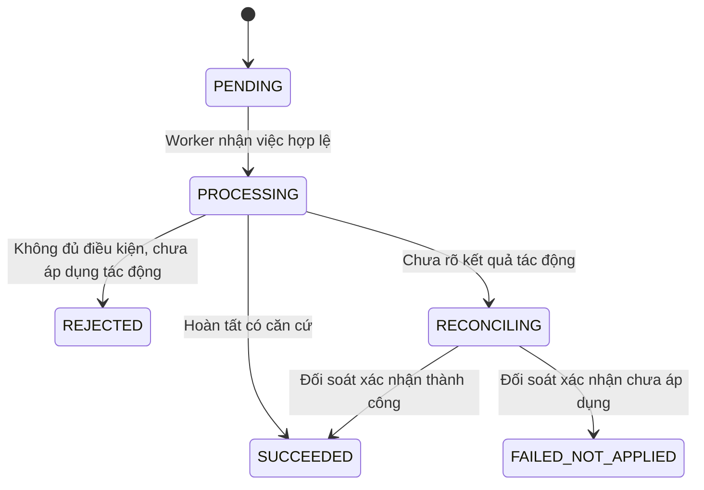

# Duplicate operation response: Phản hồi khi thao tác bị gửi trùng

Trong chương **Error Semantics**, phản hồi cho thao tác trùng giúp client hiểu liệu một lệnh đã hoàn thành, đang xử lý, chưa rõ kết quả hay xung đột với yêu cầu trước. Đây là vấn đề bảo mật logic nghiệp vụ vì một request lặp có thể tạo thêm hoàn tiền, sử dụng ưu đãi nhiều lần hoặc phát lại một bước đã được thực hiện trong quy trình phê duyệt.

Một phản hồi đúng phải đi cùng kiểm soát quyền theo đối tượng, invariant, state machine, transaction và idempotency ở máy chủ. Chỉ trả thông báo “yêu cầu bị trùng” không ngăn được tác động lặp nếu trạng thái đã được cập nhật hai lần.

Bài học tập trung vào cách phân loại các dạng trùng, thiết kế response và xác định hành vi phục hồi an toàn. Cần phân biệt một lượt gửi request với một ý định nghiệp vụ, đồng thời không coi timeout là bằng chứng lệnh chưa được thực hiện.

## 1. Bắt đầu từ một tình huống mất response

Người dùng yêu cầu hoàn một phần tiền của giao dịch. Server đã commit hoàn tiền và lưu kết quả, nhưng kết nối mất trước khi client nhận response. Người dùng bấm lại hoặc ứng dụng tự gửi lại request.

Nếu máy chủ coi lần gửi lại là một lệnh mới, hệ thống có thể hoàn thêm tiền. Nếu máy chủ chỉ trả lỗi chung, giao diện có thể hiển thị “thất bại” dù lần hoàn tiền đầu đã thành công, khiến người dùng tiếp tục thử.

Hành vi mong muốn là:

```text
Lần gửi đầu: thực hiện một tác động và lưu kết quả.
Lần gửi lại cùng lệnh: trả kết quả đã lưu, không tạo tác động mới.
```

Nhưng không phải mọi request trông giống nhau đều là cùng một lệnh. Hai lần mua cùng sản phẩm hoặc hai lần chuyển cùng số tiền có thể là hai ý định hợp lệ. Máy chủ cần căn cứ định danh, không tự suy ra trùng chỉ vì dữ liệu gần giống hoặc thời gian gần nhau.

## 2. Phân loại trước khi chọn response

| Tình huống | Ý nghĩa | Hướng phản hồi |
| --- | --- | --- |
| Cùng idempotency key, cùng nội dung có ý nghĩa, kết quả đã hoàn tất | Phát lại cùng một lệnh | Trả kết quả của lệnh cũ trong quyền hiện tại |
| Cùng key nhưng khác nội dung có ý nghĩa | Xung đột định danh lệnh | Từ chối payload mới, không thực thi lại |
| Cùng key, lệnh đã được tiếp nhận bền vững nhưng chưa xong | Lệnh đang xử lý | Trả trạng thái chờ và tham chiếu tra cứu |
| Khác key nhưng cùng mã ý định nghiệp vụ đã được bảo vệ bằng ràng buộc | Trùng thao tác ở cấp nghiệp vụ | Liên kết tới thao tác đã có hoặc trả xung đột phù hợp |
| Khác key, payload giống nhau, không có căn cứ cùng ý định | Có thể là hai lệnh độc lập | Không tự gộp chỉ vì payload giống |
| Chưa đối soát được lệnh cũ đã commit hay chưa | Kết quả chưa xác định | Không tuyên bố thất bại hoặc khuyên tạo key mới |

“Trùng” không phải một trạng thái thực thi duy nhất. Một thao tác trùng có thể tham chiếu tới lệnh đã thành công, đang chạy hoặc chưa rõ kết quả. Response phải biểu diễn được sự khác biệt đó.

HTTP status cũng không tự giải thích đầy đủ. Một API có thể dùng response thành công cho replay đã hoàn tất, trạng thái tiếp nhận cho công việc đang chờ và mã xung đột cho cùng key khác payload. Không nên biến tất cả thành một lỗi 409 chung rồi để client đoán.

## 3. Xác định đúng phạm vi idempotency

### 3.1. Key nhận diện lệnh, không phải quyền truy cập

Một phạm vi khóa minh họa là:

```text
IdempotencyNamespace = (
    trustedTenantId,
    authenticatedPrincipalId,
    idempotencyKey
)
```

`trustedTenantId` và `authenticatedPrincipalId` phải do máy chủ phân giải từ ngữ cảnh được xác thực. Không lấy chúng nguyên trạng từ body. Cùng một chuỗi key ở hai tenant không được làm lộ receipt của tenant này cho tenant kia.

Danh tính principal nên ổn định cho cùng tác nhân theo mô hình của hệ thống, không mặc định gắn với một access token ngắn hạn. Với dịch vụ thao tác thay người dùng, cần xác định rõ danh tính dịch vụ, người ủy nhiệm và phạm vi; một trường `requesterId` tùy ý không đủ tạo ngữ cảnh tin cậy.

Biết key không có nghĩa được đọc kết quả. Trước khi trả replay, máy chủ vẫn phải kiểm tra quyền hiện tại với lệnh, đối tượng và các trường dữ liệu được công bố.

### 3.2. So sánh fingerprint của ý nghĩa lệnh

Máy chủ có thể lưu fingerprint từ biểu diễn chuẩn:

```text
fingerprint = digest(canonicalize(
    operationType,
    targetResource,
    businessIntentId nếu có,
    amountMinorUnits,
    currency,
    expectedVersion nếu thuộc hợp đồng lệnh,
    các tham số ảnh hưởng tới nghiệp vụ
))
```

Cần bao phủ mọi trường có thể làm thay đổi ý nghĩa lệnh: đối tượng, người nhận, phạm vi, số tiền, loại thao tác, phiên bản được kỳ vọng và các điều kiện liên quan. Không chỉ hash một phần body tiện lấy được.

Chuẩn hóa phải có quy tắc rõ ràng:

- Thứ tự thuộc tính JSON không nên làm hai lệnh tương đương trở thành khác nhau.
- Giá trị mặc định và trường bị bỏ trống cần được diễn giải theo cùng schema của lệnh.
- Tiền được biểu diễn theo quy tắc số chính xác của hệ thống, tránh dùng sai số số thực để xác định tương đương.
- Không tùy ý sắp xếp mảng nếu thứ tự phần tử có ý nghĩa nghiệp vụ.
- Không đưa correlation ID hoặc thời gian tự sinh khác nhau ở mỗi lượt thử vào fingerprint.

Digest giúp so sánh nội dung đã ràng buộc; nó không tự cung cấp quyền, không thay thế unique constraint và không chứng minh lệnh đã commit.

## 4. Phản hồi replay thành công phải rõ là kết quả của lệnh cũ

Giả sử một lệnh hoàn tiền đã thành công. Response cho lần gửi lại có thể là:

```http
HTTP/1.1 200 OK
Content-Type: application/json
Cache-Control: no-store
```

```json
{
  "operationId": "op-refund-71",
  "operationState": "SUCCEEDED",
  "delivery": "REPLAYED",
  "result": {
    "code": "REFUND_COMPLETED",
    "refundId": "refund-482",
    "amountMinorUnits": 50000,
    "currency": "VND",
    "paymentVersionAtCompletion": 8
  },
  "correlationId": "srv-corr-retry-02"
}
```

Tên trường và giá trị ở đây là một hợp đồng minh họa. Cần giữ ba thông tin riêng:

| Thông tin | Ví dụ | Ý nghĩa |
| --- | --- | --- |
| Định danh lệnh | `operationId` | Cùng một lệnh qua các lần gửi |
| Kết quả thực thi | `operationState = SUCCEEDED` | Lệnh đó đã thành công theo kết quả được lưu |
| Cách phục vụ lượt request | `delivery = REPLAYED` | Lượt này không tạo tác động mới |

Trong ví dụ, API có thể trả 201 khi tạo tài nguyên hoàn tiền lần đầu và 200 khi replay. Một API khác có thể giữ status ban đầu. Điều cần công bố là ngữ nghĩa nhất quán; client phải nhận ra kết quả thành công của cùng lệnh thay vì coi replay là một thất bại cần thử lại.

### 4.1. Receipt không phải snapshot hiện tại

`paymentVersionAtCompletion = 8` mô tả thời điểm lệnh hoàn tất. Giao dịch có thể đã thay đổi sau đó. Không đổi trường này thành version hiện tại rồi trình bày như thể đó là kết quả gốc của lệnh.

Nếu client cần số tiền còn được hoàn hoặc trạng thái mới nhất, phải đọc snapshot hiện tại qua một API được kiểm tra quyền. Việc có receipt thành công cũ không cho phép tiếp tục bỏ qua các giới hạn hiện tại.

### 4.2. Không phát lại mù toàn bộ HTTP response

Lưu kết quả nghiệp vụ ổn định không có nghĩa sao chép mọi byte và header của response cũ. Những thành phần cần xét lại theo lượt request hiện tại gồm:

- Correlation ID hoặc thông tin theo dõi request.
- Cookie, header xác thực và các dữ liệu gắn với phiên.
- URL tải tạm thời hoặc thông tin có thời hạn.
- Trường cần lọc theo quyền hiện tại.
- Chỉ dẫn chờ hoặc retry phụ thuộc trạng thái hiện tại.

Nên lưu receipt hoặc hình chiếu kết quả được thiết kế cho replay, sau đó dựng response an toàn. Không biến kho idempotency thành nơi lưu token, bí mật dùng một lần hoặc toàn bộ payload nhạy cảm không cần thiết.

Một correlation ID mới liên kết lần retry hiện tại, còn `operationId` giữ quan hệ với lệnh cũ. Không dùng ID cũ để khiến hệ thống quan sát hiểu nhầm hai request là một lượt duy nhất.

## 5. Cùng key nhưng khác payload là xung đột

Nếu key đã ràng buộc với hoàn 50.000 cho giao dịch A, một request dùng lại key nhưng yêu cầu hoàn 100.000 hoặc chuyển sang giao dịch B không phải replay tương đương.

Một response minh họa:

```http
HTTP/1.1 409 Conflict
Content-Type: application/json
Cache-Control: no-store
```

```json
{
  "code": "IDEMPOTENCY_KEY_CONFLICT",
  "message": "Khóa yêu cầu không khớp với nội dung đã được ràng buộc.",
  "requestOutcome": "REJECTED",
  "recovery": {
    "action": "CHECK_ORIGINAL_OPERATION",
    "automaticRetry": false
  },
  "correlationId": "srv-corr-conflict-03"
}
```

Không cần trả toàn bộ payload gốc để giải thích xung đột. Phản hồi cũng không tuyên bố lệnh gốc chưa được thực hiện. Nó chỉ từ chối dùng định danh đã ràng buộc cho nội dung mới.

Không hướng dẫn tự động “đổi key rồi gửi lại”. Lệnh gốc có thể đã hoàn tất; một key mới có thể tạo thêm tác động. Client cần kiểm tra lệnh cũ và chỉ tạo key mới khi người dùng thực sự có ý định mới hợp lệ, theo đúng quy tắc nghiệp vụ.

Nếu kết quả cũ nằm ngoài quyền hiện tại, response phải giữ hình chiếu công khai an toàn. Xung đột key không phải lý do để tiết lộ người nhận, giá trị, tenant hoặc tài nguyên của lệnh trước.

## 6. Lệnh đang xử lý và kết quả chưa xác định

### 6.1. Chỉ trả trạng thái chờ khi đã biết lệnh được tiếp nhận

Một job bất đồng bộ đã được lưu bền vững có thể trả:

```http
HTTP/1.1 202 Accepted
Content-Type: application/json
Cache-Control: no-store
```

```json
{
  "operationId": "op-export-29",
  "operationState": "PROCESSING",
  "delivery": "EXISTING",
  "recovery": {
    "action": "CHECK_OPERATION_STATUS",
    "automaticRetry": false
  },
  "correlationId": "srv-corr-pending-04"
}
```

Trạng thái này nói rằng hệ thống biết một lệnh đã được tiếp nhận và chưa có kết quả cuối. Retry không tạo job mới. Client có thể tra cứu trạng thái theo nhịp và giới hạn được API công bố; việc không tự gửi lại lệnh không có nghĩa không được theo dõi tiến độ.

Endpoint trạng thái phải kiểm tra tenant, tác nhân và quyền trên operation. Mã operation khó đoán không thay thế kiểm tra quyền.

### 6.2. Không biến thời gian chờ khóa thành bằng chứng chắc chắn

Trong thiết kế đồng bộ, receipt có thể được tạo trong cùng transaction với thay đổi nghiệp vụ. Khi transaction đầu chưa commit, request thứ hai có thể đang chờ ràng buộc duy nhất; nó chưa chắc đọc được một receipt đã commit.

Nếu hết thời gian chờ, không tự bịa trạng thái `PROCESSING` hoặc operation ID mà hệ thống chưa có căn cứ công bố. Có thể phải trả rằng chưa xác định được kết quả hiện tại và yêu cầu kiểm tra hoặc retry cùng key theo hợp đồng.

Transaction đầu cũng có thể vừa commit hoặc rollback sát lúc request thứ hai timeout. Cần đối soát từ nguồn đáng tin trước khi khẳng định kết quả cuối.

### 6.3. Unknown không phải failed

Mất kết nối lúc commit hoặc sau khi gửi lệnh tới bên ngoài có thể dẫn tới:

```text
operationState = UNKNOWN
recovery.action = CHECK_OPERATION_STATUS
```

Không đổi thành `FAILED_NOT_APPLIED` chỉ vì không nhận được response. Client không được tạo key mới để vượt qua sự mơ hồ này.

Nếu client chưa biết operation ID, API cần có cách tra cứu hoặc gửi lại cùng key và payload an toàn trong phạm vi được hỗ trợ. Không để một lần mất response buộc client phải đoán và thực hiện thêm một lệnh không liên quan.

## 7. Khác key nhưng trùng ý định nghiệp vụ

Idempotency key bảo vệ việc gửi lại cùng một định danh lệnh. Kẻ tấn công vẫn có thể gửi nhiều key khác nhau. Vì vậy phải có invariant và định danh nghiệp vụ độc lập khi cần.

Ví dụ một yêu cầu hoàn tiền được phê duyệt có `refundIntentId` do luồng nghiệp vụ quản lý. Có thể bảo vệ:

```text
UNIQUE (tenantId, paymentId, refundIntentId)

Tổng số tiền hoàn đã áp dụng
    <= số tiền được phép hoàn của giao dịch
```

Unique intent ngăn cùng ý định được thực hiện hai lần dù client đổi key. Invariant tổng tiền ngăn người dùng tạo nhiều ý định khác nhau để vượt số được phép hoàn.

Không dùng riêng `paymentId` làm khóa duy nhất nếu nghiệp vụ cho phép nhiều lần hoàn từng phần. Khóa phải phản ánh đúng ý định được phép lặp hoặc không được lặp.

Cũng không tin rằng client tự tạo một `refundIntentId` mới là đã có một yêu cầu được phê duyệt mới. Máy chủ phải xác minh intent, đối tượng, số tiền và trạng thái phê duyệt tương ứng.

### 7.1. Phản hồi theo sự tương đương thực sự

Nếu key mới trỏ đến đúng cùng intent đã hoàn tất, trong quyền hiện tại, hệ thống có thể trả:

```text
operationState = SUCCEEDED
delivery = ALREADY_COMPLETED
operationId = operation đã thực hiện intent đó
```

Nếu cùng intent nhưng các tham số nghiệp vụ xung đột, cần phản hồi xung đột thay vì sao chép kết quả như một replay tương đương.

Response `ALREADY_COMPLETED` biểu diễn trùng ở cấp nghiệp vụ; `REPLAYED` trong hợp đồng minh họa biểu diễn phát lại cùng key và fingerprint. Việc phân biệt này giúp client và người vận hành hiểu cơ chế nào đã ngăn lặp.

Đối với hai request khác key, cùng số tiền và cùng người nhận nhưng không có căn cứ cùng intent, không nên tự gộp theo một cửa sổ thời gian tùy ý. Điều đó có thể làm mất một thao tác hợp lệ. Hệ thống vẫn áp dụng quyền, hạn mức, trạng thái và các invariant cho từng lệnh.

## 8. Transaction phải khớp với điều response khẳng định

### 8.1. Thiết kế đồng bộ trong một cơ sở dữ liệu

Các bản ghi logic có thể gồm:

| Thành phần | Vai trò |
| --- | --- |
| Receipt | Ràng buộc namespace, key, fingerprint, operation ID và kết quả |
| Trạng thái nghiệp vụ | Giao dịch, tổng tiền đã hoàn, phiên bản đối tượng |
| Sự kiện nghiệp vụ | Ghi nhận thay đổi đã áp dụng |
| Outbox | Ghi ý định phát thông điệp sau commit |

Trong đường thành công, receipt, thay đổi nghiệp vụ, sự kiện và outbox phải commit cùng nhau nếu chúng cùng nằm trong phạm vi transaction này. Không cập nhật giao dịch trước rồi lưu receipt ở một transaction khác: crash ở giữa sẽ làm retry không biết tác động đã xảy ra.

Một thuật toán minh họa:

```text
handle(command, trustedContext):
    namespace = resolveTrustedNamespace(trustedContext, command.key)
    normalized = normalizeCommand(command)
    fingerprint = fingerprintOf(normalized)

    authorizeCurrentAccess(trustedContext, normalized.target)

    result = withinTransaction:
        claim = claimUniqueReceipt(namespace, fingerprint)

        if claim.hasExistingCompletedReceipt:
            require claim.fingerprint == fingerprint
            authorizeCurrentResultAccess(trustedContext, claim.receipt)
            return replayProjection(claim.receipt)

        lockBusinessResource(normalized.target)
        checkCurrentPermissionsAndBusinessRules(normalized)
        checkExpectedVersion(normalized)
        enforceBusinessIntentUniqueness(normalized)

        applied = applyBusinessChange(normalized)
        insertBusinessEvent(applied)
        completeReceipt(claim, applied)
        insertOutbox(applied)
        return newResultProjection(applied)

    return result only after commit is confirmed
```

`claimUniqueReceipt` là một thao tác trừu tượng phải dựa trên ràng buộc duy nhất của cơ sở dữ liệu, không phải `if not exists` rồi insert không bảo vệ cạnh tranh. Nếu hai request cùng key, chỉ một request được thực hiện như lệnh mới.

Cách xử lý xung đột insert phụ thuộc cơ chế transaction được dùng. Không bắt một lỗi unique constraint rồi tiếp tục chạy trên transaction đã bị đánh dấu thất bại. Cần nhánh xử lý hợp lệ, có thể phải đọc lại trong transaction khỏe mạnh và kiểm tra đầy đủ fingerprint lẫn quyền.

Không ánh xạ mọi lỗi unique constraint thành “đã thực hiện”. Lỗi có thể thuộc một ràng buộc khác hoặc phản ánh dữ liệu sai. Cần nhận diện chính xác ràng buộc, đọc được thao tác tương ứng trong quyền hiện tại và đối chiếu ngữ nghĩa trước khi trả kết quả cũ.

### 8.2. Receipt phải được tìm trước khi áp dụng lại điều kiện chỉ dành cho thực thi mới

Một lệnh thành công có thể làm expected version của chính request cũ trở nên cũ. Nếu retry bị kiểm tra phiên bản trước khi tìm receipt, hệ thống có thể trả xung đột dù lệnh đó đã thành công đúng một lần.

Cần phân biệt kiểm tra quyền hiện tại với điều kiện thực thi mới. Kiểm tra quyền không được bỏ qua; còn state transition, expected version và giới hạn tác động phải áp dụng khi quyết định thực hiện một lệnh mới, không được dùng để che mất kết quả của một replay hợp lệ.

Thiết kế minh họa ở trên tập trung lưu receipt thành công. Nếu một từ chối làm rollback toàn bộ transaction, receipt mới trong transaction đó cũng rollback. Nếu muốn giữ fingerprint hoặc kết quả từ chối qua rollback, cần thiết kế thêm sổ lệnh bền vững và công bố ngữ nghĩa tương ứng; không giả định chúng tự tồn tại.

### 8.3. Dấu vết thành công chỉ có giá trị sau commit

Nếu framework commit sau khi phương thức nghiệp vụ trả về, lớp dựng response phải quan sát được lỗi commit. Không gửi thành công hoặc tăng số hoàn tiền đã thành công chỉ vì code đã chạy tới dòng cuối trong phương thức.

Nếu kết quả commit chưa rõ, không trả một rejection chắc chắn chưa áp dụng. Response phải chuyển sang nhánh đối soát phù hợp.

## 9. Thiết kế bất đồng bộ và tác động bên ngoài

Với job nền, có thể lưu operation cùng trạng thái tiếp nhận, ràng buộc key và outbox trong một transaction trước khi trả response. Sau đó worker xử lý operation đã lưu.



Đây là mô hình minh họa. Trạng thái `REJECTED` hoặc `FAILED_NOT_APPLIED` chỉ hợp lệ khi có căn cứ không có tác động nghiệp vụ thuộc phạm vi đó. Nếu đã có tác động và cần bù trừ, mô hình phải thể hiện quy trình ấy riêng.

Worker có thể nhận thông điệp trùng. Trạng thái operation, version và cơ chế chiếm quyền xử lý phải ngăn việc hai worker cùng tạo tác động. Nếu dùng lease, lease hết hạn không tự chứng minh worker cũ đã dừng; cần cơ chế điều phối và fencing thực sự được kiểm tra tại nơi có tác động khi yêu cầu đó áp dụng.

Đối với hệ thống ngoài:

- Giữ định danh thao tác bên ngoài ổn định cho cùng một operation.
- Dùng khả năng chống lặp và tra cứu của hệ thống ngoài nếu có, theo hợp đồng thực tế của nó.
- Nếu chưa biết lần gửi cũ có tạo tác động hay chưa, đối soát trước khi tạo một ý định mới.
- Không cho rằng khóa hàng trong database nội bộ tự bảo đảm không có hai lần tác động bên ngoài.

Outbox giúp không mất ý định phát thông điệp giữa database và publisher. Nó không tự bảo đảm mỗi thông điệp chỉ được phát hoặc nhận một lần. Consumer cần loại trùng và giữ invariant riêng; response API cũng phải phản ánh đúng mức hoàn tất thực tế.

## 10. Thời hạn lưu và quyền hiện tại quyết định khả năng replay

### 10.1. Hết hạn body không đồng nghĩa được thực hiện lại

Một hệ thống có thể không giữ mãi toàn bộ response. Nhưng nếu xóa mọi dấu vết key quá sớm, request cũ có thể trông như request mới và được thực hiện lại.

Cần xác định rõ:

- Khoảng thời gian retry được hỗ trợ.
- Thời gian giữ key, fingerprint, operation ID và tham chiếu kết quả.
- Ràng buộc ý định nghiệp vụ có còn hiệu lực sau khi body receipt bị dọn không.
- Phản hồi khi biết key đã hết thời hạn phục vụ kết quả.
- Cách client đối soát khi không còn replay được đầy đủ.

Có thể giữ một bản ghi rút gọn về key đã dùng để ngăn tái thực thi, ngay cả khi đã dọn dữ liệu kết quả chi tiết, nếu phù hợp yêu cầu lưu trữ. Nếu đã xóa sạch dấu vết, hệ thống không thể tự biết một key vắng mặt là key mới hay key cũ đã bị dọn.

Vì vậy, không hứa luôn trả `IDEMPOTENCY_WINDOW_EXPIRED` khi không còn dữ liệu phân biệt. Giới hạn bảo đảm phải được nói rõ, đi cùng invariant và định danh nghiệp vụ cần thiết.

### 10.2. Receipt không phải bộ nhớ quyền vĩnh viễn

Giả sử người dùng có quyền tạo yêu cầu export nhưng sau đó bị thu hồi quyền xem audit. Retry cùng key không được trả lại tệp hoặc dữ liệu ngoài quyền hiện tại chỉ vì đã có receipt.

Kết quả nghiệp vụ có thể vẫn tồn tại và không cần thực hiện lại, trong khi hình chiếu công khai của lần retry bị từ chối hoặc bị giới hạn. Không được biến sự thiếu quyền hiện tại thành lý do chạy lại operation dưới một định danh khác.

URL tải đã hết hạn có thể cần được cấp lại qua một bước kiểm tra quyền mới. Không lưu và phát lại mù URL cũ, cũng không tự nới quyền để làm replay trông giống response ban đầu.

## 11. Client phục hồi theo trạng thái nào?

| Kết quả quan sát | Hành vi client phù hợp |
| --- | --- |
| `SUCCEEDED` và `REPLAYED` | Hiển thị kết quả cùng operation; không tạo thêm tác động |
| `SUCCEEDED` và `ALREADY_COMPLETED` | Liên kết với ý định đã thực hiện, không lặp thao tác |
| `PENDING` hoặc `PROCESSING` đã được xác nhận | Theo dõi operation theo hợp đồng, không tạo job mới |
| `UNKNOWN` hoặc `RECONCILING` | Tra cứu hoặc retry cùng định danh theo hướng dẫn; không đổi key để chạy lại |
| Xung đột key và payload | Kiểm tra ánh xạ key với lệnh gốc; không sửa tự động để vượt lỗi |
| `FAILED_NOT_APPLIED` đã được xác nhận | Phục hồi theo chính sách retry của lệnh, vẫn giữ quyền và invariant |
| Bị từ chối quyền hiện tại | Không dùng receipt hay đường tải cũ để vượt kiểm soát |

Client nên giữ key ổn định cho cùng ý định trong phạm vi hợp đồng. Nếu người dùng thay đổi đối tượng, số tiền hoặc ý định, cần xem đó có phải lệnh mới không; không tự tái sử dụng key đã ràng buộc.

Ngược lại, client không nên sinh key mới cho mỗi lần retry vì timeout. Một thao tác mới phải được phân biệt với việc chưa biết kết quả của thao tác cũ.

Vô hiệu hóa nút gửi giúp trải nghiệm tốt hơn nhưng không thay thế bảo vệ máy chủ. Người dùng có thể mở nhiều tab, client có thể retry tự động và kẻ tấn công có thể gọi API trực tiếp.

Cũng cần gắn response với đúng lượt gửi và operation. Một response “đang xử lý” đến muộn không nên làm giao diện mất kết quả thành công đã được xác nhận cho cùng operation.

## 12. Kiểm thử phản hồi và tác động cùng lúc

| Kịch bản | Kỳ vọng response | Điều phải kiểm chứng |
| --- | --- | --- |
| Cùng key, cùng payload sau thành công | Replay kết quả cùng operation | Không tạo thêm tác động, sự kiện nghiệp vụ hoặc outbox của lần thực thi mới |
| Nhiều request cùng key chạy đồng thời | Các response quy về một operation, hoặc trạng thái chờ hợp lệ | Tối đa một tác động theo thiết kế |
| Cùng key, đổi số tiền hoặc người nhận | Xung đột payload | Không thực hiện nội dung thay đổi |
| Cùng key, khác thứ tự thuộc tính JSON nhưng cùng ngữ nghĩa | Không xung đột giả | Canonicalization đúng theo schema |
| Mảng đổi thứ tự có ý nghĩa | Không coi là tương đương sai | Fingerprint bảo vệ đúng ý nghĩa lệnh |
| Khác key, cùng intent đã hoàn tất | Kết quả đã thực hiện hoặc xung đột theo hợp đồng | Unique intent và invariant ngăn lặp |
| Khác key, payload giống nhưng là hai ý định hợp lệ | Không tự gộp vô căn cứ | Nghiệp vụ xử lý từng ý định trong giới hạn cho phép |
| Client đổi key để vượt giới hạn hoàn tiền | Từ chối theo invariant nếu vượt quyền hoặc hạn mức | Tổng tiền hoàn không vượt số được phép |
| Timeout trước khi biết kết quả commit | Unknown hoặc kết quả sau đối soát | Không khẳng định chưa áp dụng thiếu căn cứ |
| Commit xong nhưng mất response | Retry tìm được kết quả đã lưu | Không tạo tác động lần hai |
| Transaction rollback đã được xác nhận | Phản hồi đúng trạng thái đã biết | Không còn thay đổi một phần hoặc receipt thành công giả |
| Chờ unique constraint bị timeout | Không bịa receipt hoặc operation ID | Kết quả đồng thời được đối soát theo hợp đồng |
| Lỗi unique thuộc ràng buộc khác | Không trả replay sai | Nhận diện đúng nguyên nhân và không che lỗi dữ liệu |
| Worker nhận message trùng | Trạng thái operation nhất quán | Không lặp tác động bên ngoài do xử lý trùng |
| Quyền bị thu hồi trước retry | Không trả dữ liệu cũ ngoài quyền | Kiểm tra quyền hiện tại ở đường replay |
| Key giống nhau ở tenant khác | Không lộ receipt chéo tenant | Namespace và truy vấn giữ đủ ranh giới |
| Body receipt hết hạn nhưng key còn được bảo vệ | Phản hồi theo giới hạn replay đã công bố | Không thực thi lại chỉ vì body đã dọn |
| Response cũ chứa URL hoặc cookie hết hạn | Không phát lại mù | Dựng lại phần động và kiểm tra quyền phù hợp |
| Receipt của version cũ sau khi đối tượng thay đổi | Kết quả lệnh cũ được ghi rõ | Không trình bày receipt như snapshot hiện tại |

Với kiểm thử cạnh tranh, cần rào đồng bộ để request cùng tranh điều kiện ban đầu. Đếm cả thao tác nghiệp vụ, sự kiện, receipt và outbox; chỉ đếm HTTP status không chứng minh không có tác động trùng.

Với kiểm thử lỗi, đặt điểm gián đoạn trước commit, lúc kết quả commit chưa rõ và sau commit nhưng trước response. Nếu có hệ thống ngoài, kiểm thử thêm mất response sau khi bên ngoài đã tiếp nhận. Các ranh giới này cần phản hồi khác nhau.

Kiểm thử quyền phải đi qua cả endpoint thực thi, tra cứu trạng thái, replay và tải kết quả. Một API tạo operation được bảo vệ tốt vẫn có thể bị vượt quyền qua endpoint đọc receipt.

## 13. Tiêu chí hoàn thành hợp đồng duplicate operation

Một thiết kế cần trả lời rõ:

- Căn cứ nào xác định hai request là cùng một lệnh hoặc cùng một ý định nghiệp vụ?
- Key được ràng buộc với tenant, principal và fingerprint như thế nào?
- Replay thành công, xung đột payload, đang xử lý và kết quả chưa rõ khác nhau ở đâu?
- Receipt, trạng thái nghiệp vụ và sự kiện có commit cùng nhau trong phạm vi nào?
- Đổi key có còn bị chặn bởi unique intent, state machine và các invariant không?
- Quyền hiện tại có được xét khi trả kết quả cũ và mở artifact không?
- Khi hết thời hạn lưu hoặc mất kết nối, client có cách đối soát mà không tạo tác động mới không?

Phản hồi cho thao tác trùng phải giúp client tiếp tục đúng một ý định đã có, đồng thời giữ nguyên khả năng từ chối một ý định khác hoặc một lượt truy cập không đủ quyền. Tính đúng của response phụ thuộc vào cùng những ràng buộc dữ liệu và cơ chế thực thi đang bảo vệ nghiệp vụ.
