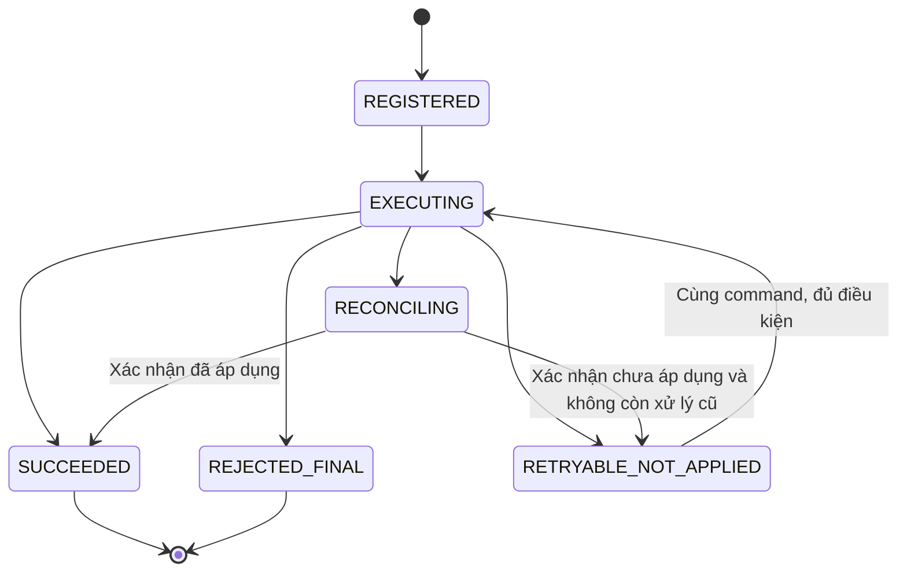

# Retryable failure response

## 1. Phản hồi lỗi có thể thử lại phải nói rõ điều gì?

**Retryable failure response** là phản hồi cho biết một lần xử lý chưa hoàn tất như mong muốn và hướng dẫn phía gọi cách tiếp tục trong những điều kiện được định nghĩa. Nó cần giúp client phân biệt việc gửi lại cùng một command, đọc trạng thái command cũ, sửa yêu cầu sau khi xem xét hoặc dừng hẳn.

Trong chương **Error Semantics** của module bảo vệ logic nghiệp vụ, đây là một phần của hợp đồng an toàn. Một thông điệp “hãy thử lại” thiếu điều kiện có thể khiến client hoàn tiền hai lần, tạo hai đơn hàng, bỏ qua phê duyệt mới hoặc áp dụng một quyết định quyền đã hết hiệu lực.

Ví dụ, client gửi yêu cầu hoàn tiền. Nhà cung cấp có thể đã hoàn tiền, nhưng response bị mất. Nếu client nhận timeout rồi tạo một yêu cầu mới với khóa mới, lần thử sau có thể tạo thêm một hiệu ứng tiền tệ. Việc lỗi truyền thông chỉ cho biết client chưa nhận được kết quả, không chứng minh nghiệp vụ chưa xảy ra.

Vì vậy, cần tách ba nhận định:

- **Nguyên nhân có thể tạm thời:** chờ thêm có thể giúp hạ tầng phục hồi.
- **Cùng command có thể gửi lại an toàn:** hệ thống có cơ chế nhận diện và ngăn tạo hiệu ứng trùng.
- **Client còn được phép tiếp tục:** quyền, trạng thái, phiên bản, phê duyệt và hạn hiệu lực vẫn đáp ứng điều kiện nghiệp vụ.

Một lỗi chỉ nên được hướng dẫn retry tự động khi các điều kiện liên quan đều được thỏa mãn. Dòng chữ thân thiện hoặc một boolean `retryable` không thay thế các bảo đảm ấy.

## 2. Phân loại theo hiệu ứng nghiệp vụ trước khi chọn cách tiếp tục

### 2.1. Xác định phạm vi của lời khẳng định

Trạng thái hiệu ứng phải có phạm vi rõ: một command, một bước workflow hay một hiệu ứng tại nhà cung cấp. Không được dùng việc transaction cục bộ rollback để suy ra nhà cung cấp chưa thực hiện hoàn tiền.

Bài sử dụng các trạng thái minh họa:

| Trạng thái | Ý nghĩa trong phạm vi đã định nghĩa | Hướng xử lý điển hình |
|---|---|---|
| `NOT_APPLIED` | Đã có căn cứ rằng hiệu ứng nghiệp vụ của command chưa được áp dụng và không còn một lần xử lý cũ tiếp tục tạo hiệu ứng ngoài kiểm soát | Có thể xét retry cùng command nếu lỗi tạm thời và còn điều kiện |
| `APPLIED` | Đã có bằng chứng hiệu ứng được áp dụng | Đọc hoặc trả lại kết quả cũ, không thực thi lại như command mới |
| `UNKNOWN` | Chưa đủ căn cứ kết luận hiệu ứng đã xảy ra hay chưa | Đọc trạng thái và đối soát; không mặc định chưa thực hiện |

`NOT_APPLIED` không yêu cầu mọi metadata kỹ thuật đều bất biến. Hệ thống vẫn có thể đã ghi một bản ghi command hoặc audit về lần thử. Nó khẳng định về hiệu ứng nghiệp vụ trong phạm vi hợp đồng, không phải rằng máy chủ chưa làm bất kỳ việc gì.

Một command đang được worker xử lý không được gán `NOT_APPLIED` chỉ vì lúc kiểm tra chưa thấy dòng giao dịch. Worker cũ có thể vẫn đang chạy. Cần biết cơ chế sở hữu xử lý, khóa, lease/fencing hoặc trạng thái bền vững trước khi cho một bên khác thực thi.

Với workflow có nhiều bước, cần biểu diễn tiến độ theo bước hoặc trạng thái saga. Nếu đã giữ chỗ tồn kho nhưng chưa thu tiền, không được mô tả toàn workflow là chưa có hiệu ứng chỉ vì chưa thu tiền.

### 2.2. Bảng quyết định theo ngữ nghĩa

| Tình huống | Điều có thể biết | Lời khuyên phù hợp |
|---|---|---|
| Giới hạn tải chặn trước khi dispatch command | Chưa có hiệu ứng từ lần xử lý đó theo hợp đồng | Chờ rồi gửi lại cùng command nếu còn hạn |
| Transaction cục bộ đã rollback được xác nhận, không có hiệu ứng bên ngoài | Không áp dụng thay đổi nghiệp vụ của transaction | Có thể retry cùng command nếu nguyên nhân được cho phép |
| Mất kết nối khi chờ kết quả commit | Chưa biết commit thành công hay chưa | Tra cứu kết quả command; không gán chắc chắn đã rollback |
| Provider timeout sau khi nhận lệnh có thể gây hiệu ứng | Chưa biết hiệu ứng bên ngoài | Đối soát bằng tham chiếu và khóa ổn định |
| Commit thành công nhưng response bị mất | Hiệu ứng đã được áp dụng | Lấy kết quả đã lưu khi client truy vấn hoặc gửi lại cùng command |
| Sai quyền, tự phê duyệt hoặc số tiền vượt thẩm quyền | Yêu cầu bị chặn bởi quy tắc | Không retry nguyên yêu cầu để tìm cách vượt kiểm soát |
| Phiên bản hồ sơ đã thay đổi | Điều kiện của lệnh cũ không còn đúng | Đọc lại, xem xét và quyết định một hành động mới nếu phù hợp |

Không biến mọi lỗi thành “tạm thời” để giảm số tình huống client phải xử lý. Đặc biệt, lỗi workflow và lỗi phân quyền không nên được biểu diễn như quá tải máy chủ.

### 2.3. HTTP method là một lớp hợp đồng khác

HTTP có khái niệm method idempotent, nhưng một API nghiệp vụ dùng POST vẫn có thể cung cấp cơ chế chống trùng riêng. Ngược lại, đặt tên endpoint là “update” không chứng minh nó không tạo thêm quyền lợi.

RFC 9110 khuyến cáo không tự động gửi lại yêu cầu với method không idempotent nếu chưa biết ngữ nghĩa an toàn hoặc chưa biết yêu cầu trước chưa được áp dụng. Xem [RFC 9110, mục 9.2.2](https://www.rfc-editor.org/rfc/rfc9110.html#section-9.2.2).

Hợp đồng retry của ứng dụng phải dựa trên hành vi thực tế, đặc biệt khi một API gọi tiếp nhà cung cấp, gửi message hoặc tạo công việc nền.

## 3. HTTP status không đủ để quyết định retry

Bảng sau là cách diễn giải cho thiết kế ứng dụng trong bài. Nó không quy định rằng mọi API phải dùng cùng mã lỗi nghiệp vụ hoặc cùng chính sách.

| Nhóm phản hồi | Cách client nên xử lý theo hợp đồng ứng dụng |
|---|---|
| `400` hoặc lỗi dữ liệu không hợp lệ | Sửa dữ liệu theo chỉ dẫn; không gửi nguyên payload trong vòng lặp |
| `401` | Có thể cần xác thực lại; gửi lại không đổi credential thường không giải quyết vấn đề |
| `403` hoặc phản hồi che giấu tài nguyên trái quyền | Dừng hành động không được phép; không đổi actor hoặc tenant để “retry” cùng quyền lợi |
| `409` hoặc `412` cho xung đột/precondition | Phân biệt xung đột trạng thái, sai fingerprint và command đang xử lý; không retry mù |
| `429` | Tôn trọng giới hạn và thời gian chờ; vẫn kiểm tra hợp đồng chống trùng |
| `503` | Có thể là điều kiện tạm thời, nhưng không tự chứng minh command chưa có hiệu ứng |
| `502`, `504` hoặc mất response | Có thể thiếu thông tin về kết quả downstream; dùng cơ chế phục hồi command |
| `500` | Không mặc định retry mọi lỗi; lỗi có thể nằm trước hoặc sau commit |

Nếu API dùng HTTP precondition như `If-Match`, giữ nguyên precondition là một phần của lần gửi lại cùng lệnh. Bỏ precondition hoặc tự thay bằng phiên bản mới để request qua được không còn là retry nguyên command.

RFC 6585 định nghĩa `429 Too Many Requests` và cho phép kèm `Retry-After`. Header đó giúp giãn tải; nó không tự cung cấp idempotency cho hành động gây hiệu ứng. Xem [RFC 6585, mục 4](https://www.rfc-editor.org/rfc/rfc6585.html#section-4).

Cần đọc cả status lẫn error contract được nhận diện. Không dùng quy tắc “mọi 4xx đều vĩnh viễn, mọi 5xx đều được thử lại”. Một `429` có thể cho phép chờ rồi thử, còn một lỗi 5xx sau commit cần đọc kết quả cũ thay vì làm lại.

Gateway có thể trả HTML hoặc một JSON khác hợp đồng của ứng dụng. Trong trường hợp đó, client không được tự bịa trạng thái `NOT_APPLIED` từ status. Phản hồi không nhận diện được phải được xử lý theo quy tắc phục hồi bảo thủ đã định nghĩa cho endpoint.

## 4. Thiết kế hợp đồng phản hồi có thể đọc bằng máy

### 4.1. Dùng mã ổn định thay vì phân tích câu chữ

Một hợp đồng hữu ích cần mô tả tối thiểu:

- Loại lỗi và mã ổn định để máy quyết định.
- Phạm vi và mức chắc chắn về hiệu ứng, nếu có đủ căn cứ để công bố.
- Hành động tiếp theo được cho phép.
- Định danh hoặc cách tra cứu command trong phạm vi đã phân quyền.
- Thời gian chờ và giới hạn áp dụng của lời khuyên retry.
- Thông tin hỗ trợ người dùng vừa đủ, không lộ chi tiết nhạy cảm.

Có thể dùng Problem Details theo RFC 9457, với `application/problem+json`, các trường như `type`, `title`, `status`, `detail`, `instance` và extension của ứng dụng. Client nên dựa vào loại lỗi và extension đã hiểu, không phân tích văn bản `detail` để quyết định retry. Xem [RFC 9457, mục 3](https://www.rfc-editor.org/rfc/rfc9457.html#section-3).

Các trường `code`, `effect` và `nextAction` bên dưới là **thiết kế riêng của bài**, không phải trường retry tiêu chuẩn của RFC.

### 4.2. Ví dụ lỗi tạm thời, biết chắc chưa áp dụng

Giả định hệ thống đã nhận diện command, xác nhận không còn lần thực thi cũ tiếp tục chạy, và đã lưu trạng thái cho phép retry cùng lệnh:

```http
HTTP/1.1 503 Service Unavailable
Content-Type: application/problem+json
Cache-Control: no-store
Retry-After: 2
```

```json
{
  "type": "https://api.example.com/problems/command-temporarily-unavailable",
  "title": "Chưa thể xử lý lệnh vào lúc này",
  "status": 503,
  "detail": "Hãy chờ trước khi gửi lại cùng lệnh và cùng khóa chống trùng.",
  "instance": "/problems/occurrences/err-72",
  "code": "COMMAND_TEMPORARILY_UNAVAILABLE",
  "commandId": "cmd-refund-61",
  "effect": {
    "scope": "refund-command",
    "state": "NOT_APPLIED"
  },
  "nextAction": "RETRY_SAME_COMMAND"
}
```

Thông tin này chỉ được phát ra khi máy chủ có căn cứ cho lời khẳng định. Không chọn `NOT_APPLIED` chỉ vì bắt được một exception tên “timeout” hoặc “connection error”.

URI trong ví dụ là minh họa. `instance` nhận diện lần lỗi, không phải token cấp quyền đọc command. Nếu cung cấp trang hỗ trợ hoặc status endpoint, chúng phải kiểm tra quyền riêng.

### 4.3. Ví dụ chưa biết kết quả bên ngoài

Nếu API đang đóng vai trò gateway và không nhận kịp kết quả của nhà cung cấp, nhưng đã có command bền vững để đối soát, có thể thiết kế phản hồi:

```http
HTTP/1.1 504 Gateway Timeout
Content-Type: application/problem+json
Cache-Control: no-store
```

```json
{
  "type": "https://api.example.com/problems/command-outcome-unknown",
  "title": "Chưa xác định được kết quả lệnh",
  "status": 504,
  "detail": "Lệnh có thể đã được thực hiện. Hãy tra cứu trạng thái lệnh hiện có.",
  "instance": "/problems/occurrences/err-73",
  "code": "COMMAND_OUTCOME_UNKNOWN",
  "commandId": "cmd-refund-61",
  "effect": {
    "scope": "refund-command",
    "state": "UNKNOWN"
  },
  "nextAction": "QUERY_STATUS"
}
```

Đây không phải lời mời gửi một command mới. Nếu lần đầu không có response nào, client phải có cách phục hồi được mô tả trước, chẳng hạn tham chiếu operation ổn định do client gửi và API tra cứu có xác thực. Không thể chỉ trông cậy vào một `commandId` nằm trong response đã bị mất.

Với một công việc đã được nhận bền vững và hệ thống cam kết tiếp tục xử lý, API cũng có thể chọn mô hình bất đồng bộ với `202 Accepted` và tài nguyên trạng thái. Khi đó, phản hồi biểu diễn công việc đã nhận, không được trình bày như hiệu ứng đã hoàn tất. Không dùng `202` để che việc chưa hề lưu công việc.

### 4.4. Tập hành động tiếp theo có giới hạn

| `nextAction` | Ý nghĩa trong hợp đồng minh họa |
|---|---|
| `RETRY_SAME_COMMAND` | Chỉ gửi lại lệnh bất biến với cùng danh tính chống trùng, trong thời gian và giới hạn cho phép |
| `QUERY_STATUS` | Đọc trạng thái/đối soát command cũ; không tạo hiệu ứng mới từ lời khuyên này |
| `REVIEW_REQUEST` | Cần đọc lại hoặc xem xét dữ liệu, quyền, phiên bản; không retry tự động nguyên thao tác |
| `NONE` | Không có hành động tự động được khuyến nghị cho lỗi này |

Không cần thêm boolean `retryable` nếu nó tạo thêm khả năng mâu thuẫn với `nextAction`. Nếu phải giữ để tương thích, cần định nghĩa quan hệ và phiên bản hợp đồng rõ ràng.

Client gặp `nextAction` chưa biết không được coi nó là cho phép retry. Mặc định an toàn là dừng thực thi mới và dùng đường phục hồi phù hợp hợp đồng endpoint.

Problem response cũng không phải nơi lộ stack trace, SQL, tên host nội bộ, access token hoặc dữ liệu của tenant khác. RFC 9457 lưu ý rủi ro lộ thông tin qua chi tiết lỗi; xem [Security Considerations](https://www.rfc-editor.org/rfc/rfc9457.html#section-5).

## 5. Điều kiện phía máy chủ để lời khuyên retry có giá trị

### 5.1. Nhận diện cùng command bằng dữ liệu bền vững

Một cơ chế idempotency cần định nghĩa:

| Thành phần | Trách nhiệm |
|---|---|
| Scope | Ràng buộc khóa với tenant, chủ thể hoặc ngữ cảnh được thiết kế, cùng loại thao tác |
| Fingerprint | Ràng buộc với nội dung nghiệp vụ bất biến: đối tượng, số tiền, tiền tệ, phiên bản, phê duyệt liên quan |
| Ràng buộc duy nhất | Ngăn hai request cạnh tranh cùng nhận quyền xử lý một khóa |
| Trạng thái command | Phân biệt đang xử lý, thành công, từ chối cuối, chưa áp dụng có thể thử lại và đang đối soát |
| Kết quả bền vững | Cho phép trả lại kết quả cũ sau mất response hoặc restart |
| Thời gian giữ | Bao phủ cửa sổ retry và phục hồi đã công bố, cùng nghĩa của khóa khi hết thời gian giữ |

Tên header `Idempotency-Key` có thể được API sử dụng theo hợp đồng của mình. Không được giả định mọi hệ thống dùng tên này đều có cùng scope, TTL, cách giữ lỗi hoặc cách xử lý command đang chạy.

Cùng khóa nhưng đổi số tiền, đối tượng hoặc phiên bản cần bị xử lý như xung đột nội dung. Không lấy body lần sau ghi đè command cũ. Fingerprint nên dựa trên biểu diễn nghiệp vụ có quy tắc, không bao gồm những thứ được phép thay giữa các lần gửi như trace ID hoặc access token mới của cùng chủ thể.

Ngược lại, đổi khóa không được trở thành cách vượt bất biến. Nếu một khoản chỉ được hoàn tối đa số tiền đã thu, kiểm soát đó vẫn phải được thực thi bằng trạng thái và transaction phù hợp, dù client gửi nhiều khóa khác nhau.

### 5.2. Thứ tự xác thực, đọc kết quả cũ và thực thi lại

Không trả dữ liệu từ kho idempotency chỉ vì người gọi biết một khóa. Cần xác thực, xác định scope đáng tin và kiểm tra quyền truy cập command/kết quả trong phạm vi hiện tại.

Với command đã hoàn tất, có thể trả kết quả đã lưu sau khi kiểm tra quyền đọc kết quả hiện tại. Không chạy lại chuyển trạng thái rồi mới nhận ra command cũ đã thành công. Ví dụ, trạng thái hồ sơ đã là `APPROVED` không phải lý do tự thực thi thêm một lần phê duyệt để tái tạo response.

Với command chưa áp dụng và được phép thực thi tiếp, phải kiểm tra lại quyền thực thi, trạng thái, revision và hạn phê duyệt theo chính sách hiện hành. Quyền đọc một kết quả cũ và quyền gây hiệu ứng mới là hai điều khác nhau.

Client có thể cần làm mới credential, nhưng việc đó không cho phép âm thầm đổi sang một chủ thể hoặc tenant khác để thực hiện cùng quyền lợi. Nếu ngữ cảnh thực sự thay đổi, phải xử lý theo một ý định nghiệp vụ được xác định lại, không coi là retry kỹ thuật trong suốt.

### 5.3. Lưu trạng thái và kết quả cùng thay đổi cục bộ

Với command chỉ thay đổi dữ liệu cục bộ, thay đổi nghiệp vụ, trạng thái/kết quả idempotency và audit bắt buộc nên được gắn với cùng transaction thực sự. Nếu commit thành công, lần gửi lại đọc được kết quả. Nếu rollback được xác nhận, không được có một bản ghi thành công độc lập dẫn client đến kết luận sai.

Không gán mọi exception từ transaction thành `NOT_APPLIED`. Lỗi kết nối tại lúc commit có thể để phía gọi không biết kết quả cuối. Cần tra cứu trạng thái bền vững hoặc đối soát trước khi phân loại.

Nếu một lỗi tạm thời đã được lưu, hệ thống phải định nghĩa nó có phải kết quả cuối không. Với trạng thái `RETRYABLE_NOT_APPLIED`, lần gửi lại cùng command có thể được phép giành quyền xử lý lại. Nếu chỉ cache nguyên phản hồi 503 mãi mãi dưới khóa đó, lời khuyên “retry cùng command” sẽ không bao giờ tiến triển.

Các API khác có thể chủ động giữ một số lỗi làm kết quả cuối. Client phải tuân hợp đồng endpoint, không được tự đổi khóa để thoát khỏi kết quả đã lưu.

### 5.4. Không nhầm transaction với hiệu ứng bên ngoài

Rollback cơ sở dữ liệu không tự hoàn tác HTTP request đã đến cổng thanh toán. Nếu có hiệu ứng bên ngoài, cần lưu command bền vững, tham chiếu nhà cung cấp ổn định, chính sách idempotency của nhà cung cấp và tiến trình đối soát.

Một state machine tham chiếu:



Các tên trạng thái do bài đặt. Việc rời `RECONCILING` cần bằng chứng theo hợp đồng tích hợp, không chỉ là chờ đủ lâu.

Một truy vấn trả “không tìm thấy giao dịch” có thể do dữ liệu chưa đồng bộ hoặc tra sai phạm vi. Nó chưa đủ chứng minh lệnh trước không bao giờ có thể tạo hiệu ứng muộn. Tương tự, lease worker hết hạn không tự hủy một request đã gửi ra ngoài.

Hệ thống cần cơ chế ngăn worker cũ và mới cùng tạo hiệu ứng, cùng khả năng khôi phục sau dừng tiến trình. Ràng buộc duy nhất trong cơ sở dữ liệu là một phần của thiết kế; nó không tự tạo bảo đảm exactly-once tại mọi nhà cung cấp.

## 6. Retry-After, backoff, jitter và ngân sách thời gian

### 6.1. Đọc đúng Retry-After

`Retry-After` có thể biểu diễn số giây chờ hoặc một HTTP-date. Với 503, nó mô tả khoảng dự kiến dịch vụ chưa sẵn sàng. Xem [RFC 9110, mục 10.2.3](https://www.rfc-editor.org/rfc/rfc9110.html#section-10.2.3).

Trong hợp đồng minh họa, client không gửi lại trước thời gian máy chủ yêu cầu chờ. Tuy nhiên, hết khoảng chờ không có nghĩa chắc chắn lần sau thành công, vẫn còn quyền thực hiện hoặc chắc chắn chưa có hiệu ứng trước đó.

Cần xử lý các tình huống sau:

- Header vắng: chỉ dùng backoff mặc định nếu endpoint và loại lỗi cho phép retry.
- Giá trị không hợp lệ: không biến thành vòng lặp retry ngay lập tức; áp dụng chính sách bảo thủ đã định nghĩa.
- HTTP-date: cần tính đến đồng hồ và không dùng giá trị âm như chỉ dẫn gửi dồn.
- Thời gian chờ vượt deadline: dừng retry trong phiên hiện tại; không cắt ngắn thời gian máy chủ yêu cầu để cố gửi sớm.
- Thời gian chờ vượt hạn phê duyệt, báo giá hoặc cửa sổ idempotency: không tiếp tục theo giả định cũ.

Không sao chép nguyên thông điệp hoặc chỉ dẫn của upstream ra client nếu nó chứa dữ liệu nội bộ hoặc không phù hợp scope của API đang phục vụ.

### 6.2. Giãn tải có giới hạn

Một công thức minh họa cho lần retry thứ n, bắt đầu n = 0:

```text
localCap_n = min(maxBackoff, baseDelay * 2^n)
localDelay_n = random(0, localCap_n)

wait_n = max(serverMinimumWait, localDelay_n) + random(0, spread)

Chỉ chờ và gửi tiếp nếu:
  còn số attempt được phép
  wait_n và thời gian cho attempt tiếp theo còn trong deadline
  command và cơ chế idempotency còn trong cửa sổ được bảo đảm
  điều kiện nghiệp vụ vẫn cho phép tiếp tục
```

`spread` giúp tránh toàn bộ client cùng thức dậy đúng một mốc máy chủ chỉ định. Đây là một chính sách minh họa, không phải công thức bắt buộc cho mọi SDK.

Backoff có trần không có nghĩa được phép bỏ qua một `Retry-After` dài hơn trần cục bộ. Khi không thể chờ trong ngân sách hiện tại, kết quả đúng là dừng hoặc chuyển sang đường theo dõi trạng thái phù hợp.

AWS Builders' Library nêu rằng timeout không bảo đảm chưa có side effect, retry có thể tăng tải và jitter giúp phân tán các lần gọi lại. Xem [Timeouts, retries, and backoff with jitter](https://aws.amazon.com/builders-library/timeouts-retries-and-backoff-with-jitter/). Công thức và hợp đồng command trong bài là lựa chọn thiết kế riêng.

### 6.3. Một tầng chịu trách nhiệm retry

Nếu client ngoài, API, SDK và worker đều retry ba lần độc lập, số attempt tại dependency có thể tăng mạnh qua từng tầng. Cần chọn nơi chịu trách nhiệm, giới hạn attempt, truyền deadline phù hợp và quan sát retry amplification.

Quy định rõ “tối đa 3 attempt” gồm lần đầu và tối đa 2 lần gửi lại. Không dùng một biến có tên “max retries” mà đội client hiểu là 3 lần tổng, đội backend hiểu là thêm 3 lần nữa.

Deadline nên dùng đồng hồ đơn điệu cho khoảng thời gian chờ trong tiến trình. Hết deadline hoặc client hủy chỉ kết thúc việc chờ/tiếp tục của phía gọi; nó không chứng minh transaction đã rollback hoặc provider đã dừng.

## 7. Ví dụ client xử lý phản hồi trong Java

Đoạn dưới là **mã giả theo cú pháp Java**. Các helper thuộc hợp đồng minh họa, không phải một SDK có thể sao chép để chạy ngay. Mục tiêu là thể hiện rằng command bất biến và đường phục hồi được giữ nguyên qua mọi nhánh.

```java
ClientResult submit(
        ImmutableCommand command,
        EndpointRetryContract contract,
        TimeBudget budget
) {
    int maxAttempts = 3; // gồm lần đầu

    for (int attempt = 1; attempt <= maxAttempts; attempt++) {
        if (!budget.canStartAttempt()) {
            return recovery.queryKnownOperation(command, budget);
        }

        Reply reply;
        try {
            reply = transport.sendOnce(
                    command, newAttemptId(), budget.remaining()
            );
        } catch (TransportFailure failure) {
            // Không nhận được response không có nghĩa chưa có hiệu ứng.
            // Helper này chỉ tra cứu, không phát command mới.
            return recovery.queryKnownOperation(command, budget);
        }

        if (contract.isTerminalSuccess(reply)) {
            return completed(reply);
        }
        if (contract.isAcceptedOrPending(reply)) {
            return pending(reply);
        }

        Advice advice = contract.recognizedAdvice(reply);
        if (advice == null) {
            return recovery.queryKnownOperation(command, budget);
        }

        if (advice.nextAction() == QUERY_STATUS) {
            return recovery.queryKnownOperation(command, budget);
        }
        if (advice.nextAction() == REVIEW_REQUEST) {
            return needsReview(reply);
        }
        if (advice.nextAction() == NONE) {
            return rejected(reply);
        }

        // Chỉ nhánh RETRY_SAME_COMMAND đã được nhận diện mới tới đây.
        if (!contract.allowsSameCommandRetry(command, advice)) {
            return recovery.queryKnownOperation(command, budget);
        }

        Duration wait = backoff.computeWait(reply, attempt);
        if (attempt == maxAttempts
                || !budget.canWaitAndAttempt(wait)
                || !contract.retryWindowCovers(command, wait)) {
            return recovery.queryKnownOperation(command, budget);
        }

        scheduler.waitWithinBudget(wait, budget);
    }

    return recovery.queryKnownOperation(command, budget);
}
```

Các yêu cầu còn nằm trong helper và caller:

- `ImmutableCommand` giữ nguyên idempotency key, tham chiếu operation, đối tượng, số tiền, tiền tệ, phiên bản và bằng chứng phê duyệt. Mỗi lần gọi có attempt ID mới.
- `recognizedAdvice` chỉ chấp nhận hợp đồng/loại lỗi đã biết, enum đúng và tổ hợp trạng thái hợp lệ. Không phân tích câu tiếng Việt trong `detail`.
- Trước lần gửi đầu cũng phải kiểm tra còn ngân sách. `sendOnce` thực thi timeout trong thời gian còn lại; không có lớp retry ẩn làm vượt giới hạn.
- `scheduler` phải hỗ trợ cancellation/deadline. Nếu dừng khi chờ, trả trạng thái chưa hoàn tất hoặc đường phục hồi thích hợp, không tự tạo command mới.
- `queryKnownOperation` dùng tham chiếu ổn định đã có từ trước và có kiểm tra quyền. Nếu chưa thể xác định trạng thái, nó trả kết quả chưa rõ/đang theo dõi, không giả báo thất bại chắc chắn.
- Tra cứu trạng thái có ngân sách riêng hữu hạn và không chứa một vòng retry command bị giấu bên trong.
- Credential có thể được làm mới theo cơ chế xác thực, nhưng không được tự thay ngữ cảnh chủ thể hay nội dung command.
- URI hỗ trợ hoặc trạng thái trong phản hồi chỉ được dùng theo hợp đồng endpoint và kiểm soát đích phù hợp; không chuyển credential đến một URL tùy ý từ nội dung lỗi.

Phương án này chủ động tra cứu khi không có response hoặc phản hồi không nhận diện được. Một API có hợp đồng idempotency đủ mạnh có thể cho phép gửi lại cùng command để lấy lại kết quả hoặc trạng thái. Client phải được cấu hình rõ điều đó, không suy ra từ tên header hoặc một status 5xx.

## 8. Tránh biến retry thành đường lạm dụng

### 8.1. Không cho lỗi tạm thời làm yếu kiểm soát

Nếu dịch vụ quyền không phản hồi, máy chủ có thể trả lỗi tạm thời với điều kiện chưa có thay đổi nghiệp vụ. Điều đó không có nghĩa được phép mặc định `ALLOW` ở lần thử sau.

Tương tự, nguồn giá lỗi không cho phép client tự gửi giá thấp hơn để “tiếp tục giao dịch”, và nguồn chính sách duyệt lỗi không cho phép bỏ bước phê duyệt. Lời khuyên retry phải giữ nguyên bất biến, không tạo một tuyến API ít kiểm soát hơn.

Nếu dùng cache hoặc fallback, chính sách sử dụng phải xác định trước và vẫn kiểm tra scope, hiệu lực, revision và cơ chế thu hồi liên quan. Không kéo dài quyền hoặc phê duyệt chỉ vì hệ thống đang gặp sự cố.

### 8.2. Không dùng phiên bản mới để sửa lệnh cũ trong suốt

Giả sử phê duyệt áp dụng cho giá 100.000 đồng tại phiên bản 6. Sau lỗi mạng, hồ sơ lên phiên bản 7 với giá 150.000 đồng. Client không được tự cập nhật `expectedVersion` rồi gửi lại cùng command như thể ý định phê duyệt ban đầu không đổi.

Khi nội dung hoặc điều kiện quan trọng thay đổi, cần đọc lại và xem xét lại theo workflow. Nếu tạo command mới, phải biết command cũ đã ở trạng thái nào để tránh hai ý định cùng được áp dụng. Không chỉ đổi idempotency key rồi bỏ qua lịch sử.

Với API dùng precondition, lỗi xung đột có thể là một kiểm soát đang hoạt động đúng. Làm request “qua được” bằng cách bỏ precondition có thể chính là bỏ kiểm soát đó.

### 8.3. Không để khóa trở thành năng lực truy cập

Thông báo “khóa này đã được dùng” có thể làm lộ sự tồn tại của command thuộc chủ thể khác nếu tra cứu khóa toàn cục. Scope, phản hồi và quyền đọc phải được thiết kế để không cho người gọi dò dữ liệu ngoài phạm vi.

Tránh gửi lại toàn bộ response cũ trước khi kiểm tra quyền hiện tại. Đặc biệt, kết quả cũ có thể chứa thông tin nhạy cảm mà người gọi không còn được phép đọc sau thay đổi quyền.

Giới hạn kích thước khóa, payload và số command đang chờ theo chính sách. Các trường như `attemptCount`, `retryable` hoặc `skipApproval` do client gửi không phải bằng chứng tin cậy để nới rate limit, bỏ kiểm tra hay quyết định quyền xử lý lại.

### 8.4. Giữ error contract nhất quán giữa các lớp

Controller, middleware, gateway và worker cần có ánh xạ lỗi thống nhất. Một lớp bắt mọi ngoại lệ rồi trả `503 + RETRY_SAME_COMMAND + NOT_APPLIED` có thể ghi đè sự thật rằng tầng dưới đã commit.

Error mapper nên dựa vào kết quả xử lý có kiểu hoặc dữ kiện đã xác minh:

- Phạm vi transaction nào đã kết thúc.
- Kết quả commit được xác nhận hay còn chưa rõ.
- Có lệnh bên ngoài nào đã gửi hoặc còn có thể tạo hiệu ứng.
- Command hiện có chủ sở hữu xử lý nào.
- Có kết quả bền vững nào để trả lại.
- Caller được phép thấy phần thông tin nào.

Không quyết định chỉ từ tên exception. “Database timeout” có thể xảy ra ở các thời điểm với ngữ nghĩa khác nhau; lỗi của một bước cũng không tự chứng minh toàn bộ transaction đã rollback.

Trong hợp đồng ứng dụng, trường `status` trong body phải nhất quán với HTTP status mà handler phát ra. Nếu client gặp status và body mâu thuẫn hoặc kiểu phản hồi không biết, nó nên dùng đường phục hồi bảo thủ, không chọn phần có lời khuyên retry dễ thực hiện hơn.

Header `Cache-Control: no-store` trong các ví dụ hướng tới việc không tái sử dụng phản hồi lỗi theo cách cache HTTP thông thường. Nó không có nghĩa máy chủ được bỏ việc lưu command, kết quả idempotency hoặc audit cần thiết cho phục hồi.

## 9. Minh họa một luồng hoàn tiền có mất phản hồi

Giả sử client gửi một command với các thông tin ổn định:

```json
{
  "clientOperationRef": "op-client-804",
  "refundId": "refund-42",
  "amountMinor": "250000",
  "currency": "VND",
  "expectedVersion": 6,
  "approvalRef": "approval-17"
}
```

Client giữ cùng idempotency key trong mọi lần gửi lại của lệnh này. Máy chủ tự xác định tenant và actor từ ngữ cảnh đáng tin, không lấy quyền sở hữu từ body trên.

### Trường hợp A: bị chặn trước hiệu ứng do quá tải

Admission control từ chối trước khi command được thực thi. Nếu có đủ căn cứ theo hợp đồng, API trả lỗi có thể chờ rồi gửi lại cùng command. Client tôn trọng thời gian chờ và không đổi giá trị hoặc bỏ `expectedVersion`.

Lần gửi sau vẫn phải được kiểm tra quyền, trạng thái, phê duyệt và giới hạn. “Lần trước được bảo hãy thử lại” không cấp trước quyền hoàn tiền cho một thời điểm trong tương lai.

### Trường hợp B: transaction thành công, response bị mất

Máy chủ đã ghi thay đổi cùng kết quả command nhưng client chưa thấy response. Client tra cứu operation bằng tham chiếu có sẵn hoặc dùng cơ chế gửi lại cùng command đã được API cam kết.

Máy chủ tìm kết quả thành công đã lưu, kiểm tra quyền đọc rồi trả kết quả cũ. Không chạy lại bước hoàn tiền và không tính lần trả kết quả cũ là một hiệu ứng tiền tệ mới.

### Trường hợp C: nhà cung cấp có thể đã thực hiện

Máy chủ đã lưu command và gửi request cho nhà cung cấp với khóa ổn định, nhưng kết quả trả về bị timeout. Command chuyển sang đối soát theo thiết kế.

Client nhận `QUERY_STATUS` hoặc trạng thái pending. Bấm gửi lại không được tạo một command mới âm thầm. Worker phục hồi đối soát theo tham chiếu cũ; kết quả có thể là xác nhận thành công, xác nhận chưa áp dụng đủ chắc chắn để tiếp tục theo chính sách, hoặc vẫn chưa xác định.

Nếu hệ thống chưa có bằng chứng để kết luận, phản hồi trung thực là chưa biết. Ghi thất bại chắc chắn để giải phóng giao diện có thể dẫn người dùng tạo thêm một lần hoàn tiền.

### Trường hợp D: phê duyệt hết hạn trong lúc chờ

Lúc retry, `approval-17` không còn hiệu lực. Máy chủ không dùng phê duyệt cũ để cho qua, dù khóa chống trùng vẫn còn được giữ.

Nếu command cũ chắc chắn chưa áp dụng, luồng có thể yêu cầu xem xét/phê duyệt lại theo workflow. Nếu command cũ còn chưa rõ kết quả, phải giải quyết trạng thái đó trước khi tạo ý định mới có thể trùng hiệu ứng.

Các trường hợp trên cho thấy cùng một hành vi nhìn từ giao diện là “thử lại” nhưng có thể cần bốn đường xử lý hoàn toàn khác nhau. Error response cần giúp client chọn đúng đường thay vì tự suy đoán.

## 10. Kiểm thử hợp đồng phản hồi lỗi

Các tiêu chí dưới đây dành cho một triển khai thực tế; chúng không phải tuyên bố rằng mã giả trong bài đã được chạy trên một ứng dụng cụ thể.

| Tình huống | Hành vi cần xác minh |
|---|---|
| Lỗi tạm thời trước dispatch | Chỉ khuyến nghị retry khi biết không còn xử lý cũ có thể tạo hiệu ứng |
| Rollback cục bộ đã xác nhận, không có hiệu ứng ngoài | Phản hồi phù hợp trạng thái chưa áp dụng; retry giữ command và kiểm tra lại điều kiện |
| Mất response sau commit | Tra cứu hoặc replay trả kết quả cũ; chỉ có một hiệu ứng nghiệp vụ |
| Mất kết nối đúng lúc commit | Không gán chắc chắn chưa áp dụng chỉ từ exception |
| Provider đã thực hiện nhưng response mất | Trạng thái chưa rõ dẫn đến đối soát; không tạo khóa mới và hiệu ứng mới |
| Truy vấn provider tạm thời trả “không tìm thấy” | Không coi đó là bằng chứng cuối nếu hợp đồng còn khả năng xử lý muộn |
| Hai request cùng khóa và fingerprint đến đồng thời | Một chủ sở hữu xử lý; request còn lại nhận kết quả hoặc trạng thái phù hợp |
| Cùng khóa nhưng đổi số tiền hoặc đối tượng | Xung đột, không ghi đè command và không lộ kết quả ngoài quyền |
| Nhiều khóa khác nhau cho cùng quyền lợi | Bất biến nghiệp vụ vẫn ngăn hoàn vượt hoặc thực thi trùng |
| Quyền bị thu hồi sau lần đầu | Không retry gây hiệu ứng mới với quyền cũ; đọc kết quả cũ cũng được phân quyền |
| Phiên bản hoặc phê duyệt thay đổi | Không tự bỏ precondition, nâng version hoặc kéo dài hạn để retry |
| Retry-After dài hơn deadline còn lại | Không gửi sớm bằng cách cap xuống một thời gian ngắn hơn |
| Retry-After vắng, sai định dạng hoặc là HTTP-date | Xử lý theo chính sách hữu hạn, không vòng lặp gọi tức thời |
| Cửa sổ idempotency sắp hết hoặc đã hết | Không hứa chống trùng ngoài bảo đảm; không tự đổi khóa để tiếp tục |
| Gateway trả HTML hoặc error contract không biết | Dùng đường phục hồi, không suy ra NOT_APPLIED từ status |
| Worker cũ còn chạy khi lease hết hạn | Không cho worker mới tạo hiệu ứng không kiểm soát; kiểm tra fencing/idempotency phù hợp |
| Client hủy hoặc hết ngân sách retry | Dừng gửi mới; không coi cancellation là bằng chứng hoàn tác |
| Lỗi phân quyền hoặc tự phê duyệt | Không bị mapper đổi thành lỗi tạm thời để thử vô hạn |
| Phản hồi lỗi có dữ liệu nhạy cảm | Không lộ token, stack trace, SQL hoặc dữ liệu tenant khác |
| Nhiều tầng cùng cấu hình retry | Tổng attempt và deadline thực tế vẫn nằm trong hợp đồng đã định nghĩa |

Kiểm thử cần quan sát cả response, trạng thái command, sổ nghiệp vụ, số lần gọi provider và bằng chứng audit. Chỉ kiểm tra “trả 503” hoặc “client gọi lại ba lần” chưa chứng minh không có hiệu ứng trùng.

Các điểm dừng tiến trình hữu ích để kiểm thử phục hồi gồm trước commit, sau commit nhưng trước response, sau gửi request ra ngoài và trước lưu xác nhận provider. Phải kiểm tra cả dữ liệu bền vững sau restart, không chỉ trạng thái trong mock hoặc bộ nhớ.

## 11. Quan sát và quản lý thay đổi hợp đồng

Có thể theo dõi các tín hiệu có tập giá trị hữu hạn:

| Tín hiệu | Mục đích |
|---|---|
| Lỗi theo mã và hành động tiếp theo | Phát hiện mapper đổi sai một nhóm lỗi hoặc tăng retry bất thường |
| Attempt so với command duy nhất | Phát hiện khuếch đại retry; không tính replay là quyền lợi mới |
| Xung đột fingerprint | Phát hiện client gửi lại sai nội dung hoặc hành vi lạm dụng |
| Retry hết ngân sách | Nhận diện thời gian chờ không còn phù hợp hoặc sự cố kéo dài |
| Command chưa rõ kết quả và tuổi chờ | Ưu tiên đối soát thay vì chỉ nhìn HTTP error rate |
| Vi phạm như duplicate effect hoặc bỏ phê duyệt | Phát hiện hậu quả nghiệp vụ, tách khỏi lỗi hạ tầng thông thường |

Command ID, attempt ID và instance lỗi giúp nối bằng chứng nhưng không nên được dùng làm label metric không giới hạn. Audit/trace có phân quyền có thể giữ tham chiếu phù hợp, còn metric dùng mã, operation và nhóm kết quả hữu hạn.

Audit cần phân biệt lần thử, quyết định từ chối, thay đổi đã commit, kết quả replay và xác nhận hiệu ứng bên ngoài. Một response lỗi không xóa sự thật rằng bước trước đó đã commit; một response thành công do replay cũng không tạo thêm một lần thực hiện.

Khi thay đổi hợp đồng:

- Không âm thầm đổi nghĩa `RETRY_SAME_COMMAND` thành cho phép tạo command mới.
- Không thay scope hoặc TTL của khóa mà không đánh giá các client còn đang retry.
- Công bố cách xử lý lỗi tạm thời đã lưu và command đang chạy.
- Giữ tương thích hoặc có phiên bản khi thêm action mới; client cũ phải dừng an toàn khi chưa hiểu.
- Kiểm tra cả gateway, SDK và worker, vì một lớp retry mặc định có thể bỏ qua ý định của API.

## 12. Những sai lầm cần tránh

| Sai lầm | Rủi ro nghiệp vụ |
|---|---|
| Thêm `retryable: true` cho mọi 5xx | Gửi lại hành động đã commit hoặc đã đến nhà cung cấp |
| Xem timeout là rollback | Tạo hiệu ứng trùng khi kết quả chỉ đang chưa rõ |
| Đổi khóa sau mỗi lỗi | Phá khả năng nhận diện cùng command |
| Giữ khóa nhưng thay body để request thành công | Gộp nhiều ý định vào một danh tính chống trùng |
| Bỏ precondition hoặc dùng phê duyệt hết hạn | Retry trở thành đường vượt workflow |
| Cho phép mặc định khi dependency quyền lỗi | Chuyển sự cố availability thành vượt quyền |
| Trả kết quả idempotency trước kiểm tra quyền | Lộ dữ liệu của chủ thể hoặc tenant khác |
| Retry không giới hạn ở nhiều tầng | Khuếch đại tải, trì hoãn phục hồi và giữ tài nguyên |
| Coi 202 hoặc “đã nhận lệnh” là đã hoàn tất | Giao diện và sổ nghiệp vụ hiểu sai hiệu ứng |
| Xóa trạng thái chưa rõ để người dùng làm lại | Làm mất căn cứ ngăn quyền lợi trùng và đối soát |

Phản hồi lỗi có thể thử lại chỉ đáng tin khi nó đi cùng cơ chế thực thi tương ứng: nhận diện command bền vững, phân loại hiệu ứng trung thực, giới hạn retry, kiểm tra lại quyền và trạng thái, cùng đường đối soát cho kết quả chưa xác định.
