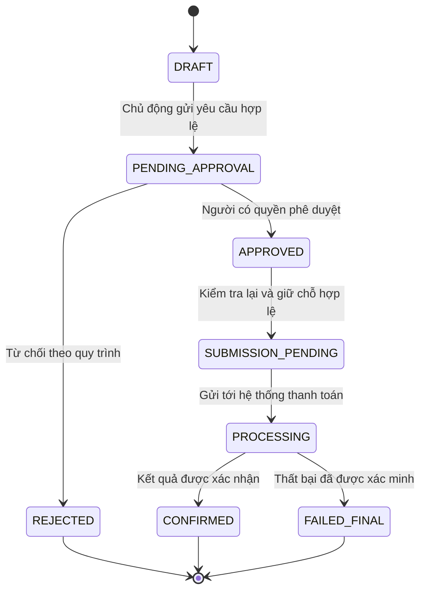

# Hành động mặc định an toàn (Secure default action)

## 1. Mặc định nào giúp người dùng tránh tạo tác động ngoài ý muốn?

Trong chương **User Experience**, secure default action là cách thiết kế để trạng thái ban đầu, lựa chọn được chọn sẵn và hành vi khi chưa có quyết định rõ ràng không tự gây ra một thay đổi nghiệp vụ nhạy cảm. Người dùng cần hiểu họ đang làm gì, trên đối tượng nào và với phạm vi tác động nào trước khi thực hiện hành động đó.

Ví dụ, mở màn hình hoàn tiền không nên tự chọn “hoàn toàn bộ”, đánh dấu “bỏ qua phê duyệt” hoặc lập tức gửi giao dịch khi người dùng nhấn Enter trong ô ghi chú. Một lựa chọn như “Xem lại yêu cầu” hoặc “Lưu nháp” thường phù hợp hơn ở bước đang nhập liệu, nếu đúng với quy trình sản phẩm.

Trong bảo mật logic nghiệp vụ, thiết kế này có hai mục tiêu liên quan:

- Giảm việc người dùng hợp lệ vô tình chọn một hành động có hậu quả lớn hơn ý định.
- Bảo đảm kẻ tấn công không thể biến các giá trị thiếu, lựa chọn mặc định hoặc đường xử lý lỗi thành cách bỏ qua quyền và quy tắc nghiệp vụ.

**Một mặc định an toàn ở giao diện phải đi cùng kiểm soát tại server.** Nút bị ẩn, checkbox chưa được chọn hay một màn hình xác nhận không ngăn được lời gọi API trực tiếp.

### 1.1. An toàn phải xét theo ngữ cảnh

| Tình huống | Mặc định dễ gây rủi ro | Lựa chọn phù hợp hơn trong ngữ cảnh minh họa |
| --- | --- | --- |
| Nhập yêu cầu hoàn tiền | Chọn sẵn hoàn toàn bộ và gửi ngay | Chọn phạm vi rõ ràng, xem lại dữ liệu trước khi gửi |
| Chỉnh sửa giá | Áp dụng giá mới cho mọi đơn liên quan | Chỉ áp dụng cho đối tượng được chọn và trong quyền cho phép |
| Mở hộp thoại phê duyệt | Focus sẵn nút phê duyệt không thể đảo ngược | Ưu tiên đọc thông tin hoặc hành động ít gây hậu quả hơn |
| Đóng màn hình đang chờ xử lý | Tự hủy hoặc tự gửi lại giao dịch | Đóng phần hiển thị; giữ trạng thái thật và cung cấp cách tra cứu |
| Không tải được chính sách | Cho phép để người dùng không bị gián đoạn | Không thực hiện hành động chưa đủ căn cứ; giữ dữ liệu cần thiết và báo trạng thái rõ |
| Thiếu trường `mode` trong API | Hiểu ngầm là `APPROVE_ALL` | Từ chối lệnh mơ hồ hoặc chỉ chấp nhận một endpoint có ý nghĩa cố định |

“Mặc định an toàn” không có nghĩa mọi hệ thống luôn chọn nút Hủy. Hủy một lệnh đã có hiệu lực cũng có thể là hành động nhạy cảm. Giữ chỗ vô thời hạn cũng có thể gây vấn đề vận hành. Cần xác định trạng thái nào được phép giữ nguyên, hành động nào cần chủ thể có quyền và việc hết hạn nào thuộc quy trình tự động đã được thiết kế.

## 2. Phân biệt mặc định UX với quyết định quyền

### 2.1. Giao diện gợi ý, server quyết định

Giao diện có thể chọn sẵn một phương án ít rủi ro để giúp thao tác thuận tiện. Server vẫn cần xác định độc lập:

- Chủ thể đã được xác thực và tenant/phạm vi làm việc thực sự.
- Quyền thực hiện hành động trên đúng đối tượng.
- Trạng thái và phiên bản cho phép chuyển bước.
- Giá, số tiền, tiền tệ, hạn mức và các invariant liên quan.
- Phê duyệt hoặc căn cứ ủy quyền còn hiệu lực, nếu quy trình yêu cầu.
- Ý định đã được xử lý chưa, theo hợp đồng idempotency.

Một trường `approved=false` được gửi mặc định không chứng minh luồng phê duyệt đã an toàn. Nếu kẻ tấn công đổi thành `true` và server tin giá trị đó, lỗi nằm ở việc giao quyết định quyền cho client.

Tương tự, checkbox “Tôi xác nhận” chỉ là dữ liệu đầu vào. Nó không chứng minh người gửi là người có quyền, đã đọc nội dung hoặc được phép thay đổi giá. Nếu sản phẩm cần mức xác nhận mạnh hơn, phải có cơ chế tương ứng với mô hình đe dọa, không chỉ thêm một boolean.

### 2.2. Thiếu dữ liệu không được suy thành quyền rộng hơn

Các giá trị sau cần được phân biệt theo hợp đồng API:

```text
Trường không xuất hiện
Trường có giá trị null
Chuỗi rỗng
Giá trị false hoặc 0
Một lựa chọn hợp lệ được chỉ định rõ
```

Ví dụ, `amount` bị thiếu không được tự hiểu là “hoàn toàn bộ số còn lại”. `approval_required` bị thiếu không được hiểu là “không cần phê duyệt”. Trường này nên do server tính theo chính sách, thay vì để client quyết định.

Một bản nháp có thể cho phép thiếu một số dữ liệu vì chưa được gửi đi. Điều đó không có nghĩa endpoint gửi yêu cầu hoặc thực thi được phép nhận cùng dữ liệu thiếu. Nên có hành động và schema rõ cho từng bước, thay vì một endpoint suy đoán ý định bằng nhiều giá trị mặc định.

Nếu hỗ trợ cập nhật từng phần, cần xác định trường không xuất hiện nghĩa là giữ nguyên hay là lỗi, và trường `null` có được dùng để xóa hay không. Không để cơ chế binding của framework vô tình xóa phạm vi kiểm soát hoặc kích hoạt hành động khác.

## 3. Ví dụ xuyên suốt: gửi yêu cầu hoàn tiền để phê duyệt

Giả sử sản phẩm có quy trình minh họa:

1. Nhân viên tạo bản nháp cho đơn nằm trong phạm vi được giao.
2. Nhân viên nhập số tiền, lý do và bằng chứng theo chính sách.
3. Server cung cấp dữ liệu xem lại được chuẩn hóa.
4. Nhân viên chủ động gửi yêu cầu; trạng thái chuyển sang chờ phê duyệt.
5. Khoản hoàn từ 200.000 VND trở lên cần người có quyền khác phê duyệt. Người yêu cầu không được tự duyệt.
6. Chỉ bước thực thi đã đủ điều kiện mới được giữ chỗ hạn mức và gửi lệnh hoàn tiền theo quy trình thanh toán.

Hạn mức và các vai trò trên chỉ là giả định cho bài học. Một hệ thống khác có thể sử dụng quy tắc khác.

Với yêu cầu 450.000 VND, nút ở cuối màn hình xem lại nên diễn đạt đúng bước đang thực hiện, chẳng hạn **“Gửi yêu cầu phê duyệt 450.000 VND”**. Không dùng “Hoàn tiền thành công” ngay sau khi server mới nhận yêu cầu chờ duyệt.



Màn hình “Xem lại” là trạng thái của trải nghiệm người dùng; không nhất thiết là một trạng thái nghiệp vụ trong sơ đồ. Chỉ mở màn hình đó không tự chuyển bản nháp thành đã gửi, không tạo phê duyệt và không giữ chỗ tiền.

Nếu cổng thanh toán chưa rõ kết quả vì timeout, không tự coi là thất bại cuối rồi tạo khoản hoàn mới. Mặc định ở giao diện lúc đó phải hỗ trợ tra cứu và làm rõ trạng thái theo hợp đồng, không che sự chưa chắc chắn bằng một nút thử lại gây tác dụng phụ mới.

## 4. Thiết kế giá trị ban đầu, phạm vi và nhãn hành động

### 4.1. Đừng chọn sẵn ngoại lệ làm đường đi thuận tiện nhất

Các lựa chọn như “bỏ qua hạn mức”, “áp dụng cho toàn bộ”, “không cần duyệt” hoặc “dùng tài khoản quản trị” không nên là phương án tự động khi người dùng chưa chọn được một phương án hợp lệ.

Nếu có ngoại lệ nghiệp vụ hợp pháp, cần hành động riêng với quyền, điều kiện, lý do và dấu vết tương ứng. Không dùng một checkbox để biến quy trình thường thành quy trình đặc quyền mà server không đánh giá lại.

Tự động hóa theo một chính sách đã được xác định không đồng nghĩa mặc định thiếu an toàn. Ví dụ, server có thể tự định tuyến người duyệt theo nhóm phù hợp. Điều cần tránh là tự phê duyệt hoặc tăng quyền vì không tìm thấy người duyệt, dữ liệu thiếu hay dịch vụ phụ thuộc không hoạt động.

### 4.2. Chọn dữ liệu gợi ý theo mức nhạy cảm

| Thành phần | Cách thiết kế trong ví dụ |
| --- | --- |
| Số tiền hoàn | Không dùng trường trống để ngầm yêu cầu hoàn toàn bộ; giá trị đề xuất phải được giải thích và kiểm tra tại server |
| Tiền tệ | Hiển thị rõ cùng số tiền; kiểm tra khớp đơn phía server |
| Lý do | Có lựa chọn phù hợp hành động; không điền sẵn `OTHER` để vượt trường bắt buộc |
| Người phê duyệt | Theo quyền và tuyến duyệt do server xác định; không mặc định chính người tạo |
| Danh sách đối tượng | Phạm vi rõ, không tự chọn cả các dòng chưa hiển thị hoặc ngoài bộ lọc |
| Lưu lựa chọn cũ | Chỉ tái sử dụng khi còn phù hợp ngữ cảnh; không mang đặc quyền hoặc số tiền từ tenant khác sang |
| Hành động chính | Diễn đạt đúng kết quả ở bước hiện tại, như lưu nháp, xem lại hoặc gửi phê duyệt |

Không phải trường nào cũng phải để trống. Một giá trị mặc định đã được server xác định đúng, ít rủi ro và được trình bày minh bạch có thể giảm lỗi nhập liệu. Quyết định cần dựa vào hậu quả nếu người dùng bỏ qua trường đó, thay vì quy tắc hình thức “mọi thứ đều phải chọn lại”.

### 4.3. Nhãn phải mô tả hành động và hậu quả

“OK”, “Tiếp tục” hoặc “Xác nhận” dễ mơ hồ khi cùng một thao tác có thể là lưu nháp, gửi phê duyệt hoặc thực thi thanh toán. Với hành động nhạy cảm, nên hiển thị động từ và đối tượng, kèm số lượng hoặc giá trị khi cần.

Ví dụ:

```text
Lưu bản nháp
Xem lại yêu cầu
Gửi yêu cầu phê duyệt 450.000 VND
Phê duyệt 3 yêu cầu được chọn
Quay lại chỉnh sửa
```

Không đổi một nút từ “Xem lại” sang “Thực hiện” bất ngờ do dữ liệu tải chậm hoặc do một popup đóng lại trong khi con trỏ vẫn ở cùng vị trí. Thay đổi quan trọng về hành động cần có ngữ cảnh đủ rõ để tránh kích hoạt nhầm.

## 5. Bàn phím, focus và khả năng tiếp cận

### 5.1. Enter không nên vô tình trở thành lệnh thực thi nhạy cảm

HTML có cơ chế gửi form ngầm, chẳng hạn khi nhấn Enter trong một số trường nhập; nút submit mặc định liên quan tới thứ tự các nút trong form. Vì vậy, không chỉ kiểm tra thao tác click bằng chuột. Xem [HTML Standard — Implicit submission](https://html.spec.whatwg.org/multipage/form-control-infrastructure.html#implicit-submission).

Một cấu trúc nút minh họa cho bước nhập yêu cầu:

```html
<form method="post" action="/refund-requests/RFD-42/review">
  <input type="hidden" name="csrf_token" value="SERVER_CSRF_TOKEN">
  <input type="hidden" name="expected_version" value="3">

  <label for="amount">Số tiền đề nghị hoàn, đơn vị VND</label>
  <input id="amount" name="amount_minor" inputmode="numeric" required>

  <label for="reason">Lý do</label>
  <select id="reason" name="reason_code" required>
    <option value="" selected disabled>Chọn lý do phù hợp</option>
    <option value="DAMAGED_ITEM">Sản phẩm hư hỏng</option>
    <option value="MISSING_ITEM">Giao thiếu sản phẩm</option>
  </select>

  <button type="submit">Xem lại yêu cầu</button>
  <button type="button" id="save-draft">Lưu bản nháp</button>
</form>
```

Đây là cấu trúc minh họa, chưa bao gồm toàn bộ xử lý form. Token phải được cơ chế chống CSRF phù hợp của ứng dụng cấp và kiểm tra khi sử dụng xác thực qua cookie. `expected_version` vẫn là đầu vào không tin cậy, phải đối chiếu với dữ liệu server. Các nút không gửi form cần handler riêng nếu có chức năng.

Điểm thiết kế chính là submit của form này chỉ yêu cầu **xem lại**, không hoàn tiền hay tự phê duyệt. Endpoint review vẫn xác thực, phân quyền, kiểm tra và chuẩn hóa dữ liệu; thay đổi thuộc tính HTML hoặc gọi trực tiếp endpoint không làm mất các bước đó.

Ở phần xem lại, hành động gửi thật có thể là một nút riêng với nhãn cụ thể. Không gắn một phím Enter toàn trang để gọi API thực thi ở mọi ngữ cảnh. Đồng thời, không chặn mọi thao tác bàn phím: người dùng bàn phím và công nghệ hỗ trợ vẫn phải chủ động kích hoạt được nút hợp lệ.

Khai báo rõ `type` cho các nút và kiểm tra hành vi khi JavaScript không chạy hoặc chỉ tải được một phần. Một form mất handler không được vô tình gửi sang endpoint nhạy cảm khác. Các đường gọi server cần an toàn ngay cả khi trình duyệt không làm đúng luồng UX mong muốn.

### 5.2. Focus và nút đóng cần theo hậu quả

Với bước cuối khó đảo ngược, hướng dẫn dialog của W3C gợi ý có thể đặt focus ban đầu vào hành động ít phá hủy hơn. Nó cũng mô tả cách dùng Tab, Escape và trả focus khi đóng dialog. Xem [W3C WAI — Dialog (Modal) Pattern](https://www.w3.org/WAI/ARIA/apg/patterns/dialog-modal/).

Áp dụng cho ví dụ, dialog có nhiều thông tin có thể ưu tiên vùng tiêu đề/tóm tắt hoặc nút “Quay lại chỉnh sửa”, thay vì tự focus vào nút gửi nhạy cảm. Việc chọn focus cần xét cấu trúc nội dung và kiểm thử với công nghệ hỗ trợ, không áp dụng máy móc một vị trí cho mọi dialog.

Đóng dialog thường chỉ đóng phần xem lại. Không tự chuyển nó thành lệnh hủy khoản hoàn ở server. Nếu thực sự muốn hủy một yêu cầu đã gửi, cần một hành động hủy riêng, đúng quyền và đúng trạng thái.

Nội dung thông báo nên đọc được bằng công nghệ hỗ trợ, không chỉ biểu diễn bằng màu. Khi hành động chưa thể thực hiện, hiển thị nguyên nhân và bước tiếp theo trong phạm vi thông tin người dùng được phép biết. Không để người dùng phải đoán ý nghĩa của một nút bị vô hiệu hóa mà không có giải thích.

## 6. Xem lại đúng dữ liệu sẽ được gửi

### 6.1. Tóm tắt phải đủ để hiểu quyết định

Ở bước review yêu cầu hoàn tiền, có thể hiển thị:

```text
Đơn hàng: ORD-105
Số tiền đề nghị: 450.000 VND
Lý do: Sản phẩm hư hỏng
Bằng chứng: Hồ sơ trả hàng RET-204, phiên bản 2
Bước tiếp theo: Gửi yêu cầu, chờ người có quyền phê duyệt
Tác động lúc này: Chưa thực hiện hoàn tiền
```

Chỉ hiển thị dữ liệu người dùng được phép xem; không đưa đầy đủ thông tin tài khoản hoặc hồ sơ nhạy cảm nếu không cần. Server cần cung cấp cách diễn giải nhất quán cho tiền tệ, số tiền, phạm vi và bước tiếp theo.

OWASP nhấn mạnh việc người dùng nhận biết dữ liệu giao dịch quan trọng, cùng việc thực thi kiểm soát ở server và bảo vệ dữ liệu khỏi thay đổi giữa các bước. Xem [OWASP Transaction Authorization Cheat Sheet](https://cheatsheetseries.owasp.org/cheatsheets/Transaction_Authorization_Cheat_Sheet.html). Một màn hình review của ứng dụng là một lớp hỗ trợ; nó không tự có mọi bảo đảm của một cơ chế xác nhận giao dịch độc lập.

### 6.2. Ràng buộc review với nội dung và phiên bản

Một cách triển khai là server tạo tham chiếu `review_ref` tới bản chụp nội dung được chuẩn hóa. Trong ví dụ, bản chụp chứa dữ liệu đề nghị gửi, gắn với bản nháp ở phiên bản đang xét. Nó chưa làm bản nháp chuyển sang chờ duyệt.

Tham chiếu có thể liên kết tới:

- Chủ thể và tenant từ ngữ cảnh xác thực.
- Hành động cụ thể, ở đây là gửi yêu cầu phê duyệt.
- ID bản nháp và phiên bản cần khớp khi gửi.
- Số tiền, tiền tệ, lý do và phiên bản bằng chứng đã xem lại.
- Dữ liệu chính sách hoặc giá được dùng để diễn giải, cùng quy tắc xử lý khi chúng thay đổi.
- Thời hạn dùng và trạng thái đã sử dụng theo thiết kế.

Lệnh gửi cuối có thể chỉ mang `review_ref`, ID bản nháp, phiên bản dự kiến và khóa idempotency. Server lấy nội dung từ bản chụp đã lưu, kiểm tra lại điều kiện hiện tại và chỉ commit nội dung đúng phạm vi đó. Không đọc một số tiền mới từ body rồi áp dụng trong khi màn hình trước đó xác nhận số tiền khác.

Nếu dữ liệu quan trọng đổi, nên yêu cầu review lại hoặc áp dụng một chính sách tái xác nhận rõ ràng. Không tự cập nhật số tiền trên server rồi cho nút xác nhận cũ thực hiện một số tiền lớn hơn mà người dùng chưa được giải thích.

### 6.3. Review không chứng minh ý định con người và không cấp quyền

Kẻ tấn công có thể gọi endpoint tạo review rồi gọi endpoint gửi mà không bao giờ nhìn màn hình. Vì vậy, `review_ref` chủ yếu ràng buộc nội dung giữa các bước theo giao thức; nó không chứng minh một con người đã đọc, hiểu hoặc được cấp đặc quyền.

Server vẫn phải kiểm tra quyền theo đối tượng, chính sách, trạng thái và các bước phê duyệt. Nếu cần xác thực tăng cường hoặc cơ chế xác nhận giao dịch mạnh hơn, phải thiết kế riêng theo mức rủi ro. Không coi một token xem lại, một sự kiện click hay `confirmed=true` là quyền thay thế.

Tham chiếu review cũng không phải đường tắt để truy cập dữ liệu của người khác. Khi đổi tài khoản hoặc tenant, không tái sử dụng bản chụp cũ nếu không còn phù hợp phạm vi. Không ghi token hay nội dung nhạy cảm vào URL chia sẻ hoặc log tùy tiện.

## 7. Giữ mặc định an toàn trong transaction phía server

### 7.1. Các endpoint nên có ý nghĩa cụ thể

Có thể tách các hành động của ví dụ thành:

```text
Lưu bản nháp
Tạo nội dung xem lại
Gửi bản nháp đã xem lại để phê duyệt
Phê duyệt yêu cầu
Thực thi yêu cầu đã đủ điều kiện
Hủy theo quy tắc của từng giai đoạn
```

Mỗi hành động có quyền, schema và chuyển trạng thái riêng. Không dùng một trường tùy chọn `mode` rồi mặc định rơi vào hành động có tác động lớn nhất. Nếu vẫn dùng một endpoint nhiều hành động, phải bắt buộc chỉ định hành động hợp lệ và đánh giá quyền tương ứng tại server.

### 7.2. Mã giả theo phong cách Java

Đoạn sau chỉ minh họa ranh giới kiểm tra của bước gửi phê duyệt, không phải mã hoàn chỉnh chạy độc lập.

```java
Receipt submitReviewedRefund(SubmitReviewedRefund command, Principal principal) {
    return tx.required(() -> {
        RefundDraft draft = drafts.lockVisibleFor(
            principal, command.draftId()
        );
        authorization.requireCommandAccess(principal, draft, "REFUND_SUBMIT");

        IdempotencyEntry entry = idempotency.lockOrCreate(
            principal.scope(), "REFUND_SUBMIT", command.key(),
            fingerprints.forReviewedSubmit(command)
        );
        entry.requireSameSemanticRequest(command);
        if (entry.isCompleted()) {
            authorization.requireMayReadReceipt(principal, entry);
            return entry.receipt();
        }

        ReviewSnapshot review = reviews.lockOwnedBy(
            command.reviewRef(), principal
        );
        review.requireAction("REFUND_SUBMIT");
        review.requireTarget(draft.id(), command.expectedVersion());
        review.requireActiveAndUnused(clock.instant());
        draft.requireVersion(review.targetVersion());
        draft.requireState(DraftState.DRAFT);

        SubmissionPolicy policy = policies.forSubmission(principal, draft);
        policy.validate(principal, draft, review.contents());
        RefundRequest request = draft.submitForApproval(
            review.contents(), policy.requiredApprovals(review.contents())
        );

        drafts.save(draft);
        requests.save(request);
        reviews.consume(review, request.id());
        audit.appendSubmittedRequest(principal, request, review);
        outbox.enqueueApprovalRequest(request);

        Receipt receipt = Receipt.pendingApproval(request.id(), request.version());
        idempotency.complete(entry, receipt);
        return receipt;
    });
}
```

Các thành phần trong mã giả phải được triển khai với những bảo đảm sau:

- Phạm vi principal đến từ xác thực đáng tin cậy. Tra cứu trong phạm vi không thay thế mọi kiểm tra quyền hành động và quan hệ đối tượng.
- Khóa idempotency có phạm vi và ràng buộc duy nhất phù hợp; fingerprint do server tính từ nội dung lệnh theo quy tắc chuẩn hóa. Gửi lại cùng khóa với ý nghĩa khác phải bị phát hiện.
- Kiểm tra quyền truy cập command không âm thầm cấp quyền thực thi; policy kiểm tra điều kiện của lần gửi mới. Lần replay hoàn thành vẫn phải kiểm tra quyền đọc receipt hiện tại theo hợp đồng.
- Snapshot gắn đúng chủ thể, tenant, đối tượng, phiên bản và hành động. Không chỉ kiểm tra chuỗi tham chiếu có tồn tại.
- Policy kiểm tra số tiền dương, tiền tệ, phạm vi đơn, lý do, bằng chứng và tuyến phê duyệt từ dữ liệu có thẩm quyền. Không nhận `approved_by`, `skip_approval` hoặc quyền do client tự khai.
- Lưu yêu cầu, tiêu thụ review, audit bắt buộc, outbox và kết quả idempotency cùng tham gia transaction. Thứ tự khóa và quy tắc xử lý tranh chấp phải nhất quán giữa các luồng.
- Lần gửi chỉ chuyển sang chờ phê duyệt. Không gửi tiền chỉ vì phương thức đã trả receipt.

Nếu policy hoặc dữ liệu cần thiết không thể được kiểm tra, không chọn một tuyến mặc định lỏng hơn. Transaction phải dừng theo hợp đồng, và giao diện hiển thị đúng khả năng phục hồi mà không tự nhận đã gửi thành công.

Bước gửi yêu cầu có thể kiểm tra số tiền còn có thể hoàn nhưng chưa giữ chỗ tiền theo mô hình này. Vì các yêu cầu khác có thể phát sinh, bước giữ chỗ/thực thi về sau vẫn phải bảo vệ tổng hạn mức trong transaction của chính bước đó, đồng thời kiểm tra phê duyệt đúng phiên bản. Màn hình review không đóng băng mọi dữ liệu nghiệp vụ cho đến khi thanh toán.

## 8. Gửi lặp, nhiều tab và kết quả chưa xác định

### 8.1. Khóa nút giúp UX, idempotency bảo vệ nghiệp vụ

Sau khi người dùng chủ động gửi, giao diện có thể vô hiệu hóa nút và hiển thị “Đang gửi yêu cầu”. Cách này giảm nhấn nhầm nhưng không ngăn request lặp do nhiều tab, retry mạng hoặc lời gọi API trực tiếp.

Với cùng một ý định đã được gửi, giữ cùng khóa idempotency theo phạm vi đã định nghĩa. Không tự tạo khóa mới ở mỗi lần retry chỉ vì promise trước bị timeout. Nếu người dùng đổi nội dung quan trọng, cần giao thức ý định mới và review lại phù hợp.

Khi tham chiếu review chỉ dùng một lần, server phải nhận diện kết quả idempotency đã hoàn thành trước khi từ chối retry vì review đã dùng hoặc đã hết hạn. Đồng thời, khóa mới không được dùng để tiêu thụ lại snapshot và tạo yêu cầu thứ hai trái state machine.

Không đặt một khóa chung cho mọi người dùng hoặc mọi đối tượng. Khi khôi phục màn hình, cần ràng buộc định danh ý định với đúng tài khoản, tenant và bản nháp; tránh dùng lại nhầm dữ liệu lưu từ phiên làm việc khác.

### 8.2. Phiên bản bảo vệ nhiều màn hình cùng mở

Nếu tab A sửa nội dung khiến bản nháp chuyển từ phiên bản 3 sang 4, tab B không được dùng review cũ của phiên bản 3 để gửi nội dung trái với trạng thái mới. Server cần phát hiện xung đột, giữ dữ liệu thật nhất quán và cho phép người dùng đọc lại trong phạm vi được phép.

Giao diện có thể giữ phần nhập chưa gửi để hỗ trợ chỉnh sửa, nhưng không được âm thầm trộn số tiền mới, lý do cũ và bằng chứng của phiên bản khác rồi coi đó là nội dung đã được xác nhận.

### 8.3. Timeout không phải mặc định thất bại

Khi mất phản hồi sau khi đã gửi, có thể server đã commit. Giao diện nên thông báo rằng chưa xác định được kết quả và cung cấp cách tra cứu hoặc thử lại cùng ý định theo hợp đồng.

Không hiển thị “Chưa có thay đổi nào” chỉ vì nhận lỗi mạng. Không tự gửi một lệnh mới, tự hủy hoặc hoàn tác trên server để làm giao diện trông nhất quán. Trạng thái cần được lấy từ nguồn nghiệp vụ trong phạm vi quyền hợp lệ.

Đóng trình duyệt, quay lại trang trước hoặc đóng hộp thoại không chứng minh request bị hủy. Nếu cần một nút “Hủy yêu cầu”, nó phải mô tả đúng giai đoạn có thể hủy và có kiểm tra quyền, trạng thái, đồng thời và tác dụng phụ riêng.

## 9. Thao tác hàng loạt và lựa chọn được ghi nhớ

### 9.1. Phạm vi mặc định không được âm thầm mở rộng

Trong bảng yêu cầu hoàn tiền, “3 dòng được chọn”, “50 dòng trên trang” và “mọi yêu cầu khớp bộ lọc” là ba phạm vi khác nhau. Không chọn sẵn phạm vi rộng nhất rồi chỉ hiển thị vài dòng khiến người dùng tưởng mình đang duyệt một tập nhỏ.

Khi có thao tác hàng loạt, phần xem lại nên nêu:

- Số đối tượng và hành động sẽ áp dụng.
- Tổng giá trị theo từng tiền tệ, nếu có ý nghĩa; không cộng các tiền tệ như cùng một đơn vị.
- Cách xác định tập đối tượng và mốc dữ liệu được dùng.
- Quy tắc khi một phần tử hết quyền, đổi trạng thái hoặc không còn đáp ứng điều kiện.
- Hành vi toàn bộ hoặc từng phần theo hợp đồng sản phẩm.

Nếu bộ lọc thay đổi hoặc có dữ liệu mới sau review, không tự mở rộng tập thực thi mà không có chính sách rõ. Server có thể dùng tập ID/phiên bản đã chốt hoặc một tham chiếu tập lựa chọn được kiểm soát. Dù dùng cách nào, quyền theo từng đối tượng vẫn phải được kiểm tra tại mốc thực thi phù hợp.

Không được âm thầm bỏ qua phần tử bị cấm rồi hiển thị “Đã duyệt tất cả”. Với kết quả từng phần, thể hiện đúng phần đã xử lý trong phạm vi thông tin được phép công khai và hướng dẫn retry không lặp lại phần đã hoàn thành. Với hành động toàn bộ hoặc không có gì, không để một phần đã commit rồi báo như thể toàn bộ chưa thay đổi.

### 9.2. Ghi nhớ lựa chọn không được ghi nhớ đặc quyền

Một tùy chọn hiển thị như số dòng trên trang có thể được ghi nhớ để tiện sử dụng. Một lựa chọn như “luôn bỏ qua người duyệt”, “dùng toàn bộ hạn mức” hoặc “áp dụng cho mọi tenant” không nên trở thành quyền chỉ vì nó nằm trong cấu hình người dùng.

Khi dùng lại lựa chọn cũ, cần xét:

```text
Có còn đúng tài khoản, tenant và loại hành động không?
Có còn đúng phạm vi đối tượng và chính sách không?
Người dùng có nhìn thấy lựa chọn đã được khôi phục không?
Lựa chọn đó chỉ ảnh hưởng cách hiển thị hay thay đổi quyền và tác dụng phụ?
```

Dữ liệu tự điền, cache của trình duyệt và trạng thái ứng dụng sau đăng nhập lại có thể không còn phù hợp. Server không tin các giá trị đó vì chúng “đã được chọn ở lần trước”. Không tự gửi lại lệnh nhạy cảm chỉ vì trang được khôi phục từ lịch sử.

Lưu nháp cũng là một thao tác lưu dữ liệu, không mặc nhiên vô hại trong mọi ngữ cảnh. Nó vẫn cần quyền theo đối tượng, xử lý phiên bản và chính sách dữ liệu phù hợp. Điểm ít rủi ro hơn trong ví dụ là chưa chuyển sang phê duyệt/thanh toán, không phải được phép lưu mọi nội dung tùy ý.

## 10. Xác nhận có ích, phản hồi rõ và khả năng phục hồi thật

### 10.1. Tập trung ma sát vào nơi có hậu quả

Nếu mọi click nhỏ đều mở hộp thoại “Bạn có chắc không?”, người dùng dễ hình thành thói quen đóng hoặc xác nhận mà không đọc. Khi đến một thao tác thực sự nhạy cảm, hộp thoại giống nhau có thể không còn giúp họ phân biệt.

Nên cân nhắc xác nhận theo độ khó đảo ngược, số lượng đối tượng, giá trị, thay đổi phạm vi và mức bất thường của hành động. Những thao tác như mở trang, lọc danh sách hoặc chỉnh bản nháp thường cần phản hồi trực tiếp hơn là nhiều lớp xác nhận chung chung.

Với hành động nhạy cảm, thông tin hữu ích là hành động, đối tượng, số tiền/phạm vi và bước tiếp theo. Một câu “Tôi đã đọc” không thay thế những thông tin này. Một câu cảnh báo dài nhưng không nêu đang hoàn bao nhiêu tiền cũng không giúp quyết định tốt hơn.

Không dùng cách trình bày khiến lựa chọn có rủi ro trở thành đường duy nhất dễ thấy, còn lựa chọn quay lại bị giấu hoặc có nhãn gây hiểu lầm. Đồng thời, lựa chọn hợp lệ cần thực hiện được hiệu quả bằng chuột, bàn phím và công nghệ hỗ trợ.

### 10.2. Thông điệp phản ánh đúng trạng thái server

| Trạng thái đã biết | Thông điệp phù hợp trong ví dụ | Tránh diễn đạt |
| --- | --- | --- |
| Đã lưu nháp | “Đã lưu bản nháp, chưa gửi phê duyệt.” | “Hoàn tiền thành công.” |
| Đã gửi yêu cầu | “Đã gửi yêu cầu, đang chờ phê duyệt.” | “Tiền đã được hoàn.” |
| Phê duyệt xong nhưng chưa xử lý thanh toán | “Đã phê duyệt, đang chờ bước xử lý tiếp theo.” | “Giao dịch đã hoàn tất.” |
| Mất phản hồi, chưa biết commit | “Chưa xác định được kết quả. Hãy tra cứu trạng thái yêu cầu.” | “Không có thay đổi nào, hãy tạo yêu cầu mới.” |
| Dữ liệu đã đổi sau review | “Thông tin đã thay đổi. Vui lòng xem lại trước khi gửi.” | Tự áp dụng nội dung mới bằng xác nhận cũ |
| Không có quyền | Thông báo theo mức thông tin được phép công khai | Liệt kê dữ liệu đối tượng hoặc đặc quyền của người khác |
| Không kiểm tra được điều kiện bắt buộc | “Chưa thể xử lý lúc này” cùng hướng dẫn phù hợp | Tự bỏ qua kiểm tra hoặc báo đã gửi thành công |

Một trạng thái hiển thị lạc quan có thể phù hợp với thay đổi dễ đảo ngược, nhưng không nên làm người dùng tin khoản tiền đã được hoàn chỉ vì request vừa được gửi. Với tác vụ bất đồng bộ, receipt và trạng thái có thẩm quyền cần quyết định thông điệp cuối.

### 10.3. Không hứa hoàn tác nếu chỉ có thể xử lý bù

Một nút “Hoàn tác” có thể chỉ hợp lệ trước khi lệnh được xử lý. Sau khi tác dụng phụ đã xảy ra, việc đảo ngược có thể cần một quy trình khác, kiểm tra quyền khác và thậm chí không khả thi theo cùng cách.

Vì vậy, cần mô tả đúng mốc có thể hủy, kiểm tra trạng thái tại server và xử lý tranh chấp giữa hủy với thực thi. Đừng để giao diện hứa “có thể hoàn tác bất kỳ lúc nào” rồi dùng lời hứa đó để biện minh cho mặc định gửi tiền ngay.

Các tác vụ hết hạn hoặc giải phóng giữ chỗ tự động có thể là phần cần thiết của quy trình. Chúng phải được quy định trong state machine và chính sách vận hành, không được phát sinh chỉ vì người dùng đóng trang hoặc một bộ đếm UI về 0.

## 11. Kiểm thử mặc định an toàn và tình huống lạm dụng

Kiểm thử cần bao phủ hành vi ban đầu, hành vi khi có lỗi và lời gọi không đi qua giao diện. Chỉ nhìn ảnh chụp thấy nút đúng màu hoặc checkbox chưa chọn là chưa đủ.

| Tình huống | Kết quả cần giữ | Bằng chứng nên kiểm tra |
| --- | --- | --- |
| Mở màn hình lần đầu | Không tự gửi, tự duyệt hoặc thực thi | Không có chuyển trạng thái/outbox nghiệp vụ nhạy cảm ngoài thao tác đã được định nghĩa |
| Nhấn Enter khi đang nhập | Chỉ đi tới hành động mặc định đã công bố, chẳng hạn review | Không gọi nhầm endpoint gửi tiền hoặc phê duyệt |
| Điều hướng bằng bàn phím/công nghệ hỗ trợ | Có thể hiểu thông tin và chủ động chọn hành động hợp lệ | Focus, tên nút và thông báo có ý nghĩa; không mắc kẹt hoặc bị buộc dùng chuột |
| Đóng review bằng nút đóng hoặc Escape | Đóng phần hiển thị theo thiết kế | Không tự hủy yêu cầu đã gửi hoặc tạo request mới |
| JavaScript không chạy hoặc tải thiếu | Không rơi vào tác dụng phụ nhạy cảm khác | Form fallback, action và validation server vẫn giữ bảo đảm |
| Sửa DOM để bật nút bị khóa hoặc chọn `skip_approval` | Không vượt được quyền/quy tắc | Server bỏ qua hoặc từ chối đặc quyền do client tự khai |
| Gửi thiếu, null hoặc rỗng trường hành động/số tiền | Xử lý theo schema cụ thể | Không suy ra hoàn toàn bộ hoặc phê duyệt tất cả |
| Gọi thẳng bước gửi hoặc thực thi | Không bỏ qua điều kiện của bước đó | Quyền, trạng thái, review nếu bắt buộc và phê duyệt được kiểm tra ở server |
| Đổi số tiền, lý do hoặc bằng chứng sau review | Không dùng xác nhận cũ cho nội dung khác | Snapshot, phiên bản và chính sách tái review được giữ đúng |
| Dùng review của người khác hoặc tenant khác | Không được áp dụng hoặc đọc nội dung trái quyền | Ràng buộc chủ thể, đối tượng, tenant và hành động có hiệu lực |
| Hai tab gửi cùng bản nháp | Chỉ một chuyển trạng thái hợp lệ | Phiên bản, marker đã gửi và ràng buộc duy nhất ngăn tạo hai yêu cầu trái quy tắc |
| Double-click hoặc retry cùng ý định | Không có thay đổi nghiệp vụ trùng | Khóa, fingerprint, receipt và sự kiện chỉ phản ánh một lần xử lý |
| Retry sau khi review đã dùng hoặc hết hạn nhưng lệnh trước đã commit | Đọc lại kết quả cũ nếu còn quyền theo hợp đồng | Không thực hiện lại, không buộc tạo khóa mới để khôi phục kết quả |
| Dùng khóa mới với review đã tiêu thụ | Không tạo một yêu cầu thứ hai ngoài ý định | State machine và trạng thái review vẫn ngăn lặp |
| Mất phản hồi sau commit | Không mặc định rằng chưa có gì xảy ra | Tra cứu hoặc retry cùng ý định; giao diện không gợi ý gửi lệnh mới mù quáng |
| Chính sách hoặc tuyến phê duyệt không tải được | Không tự hạ điều kiện kiểm soát | Không tự chuyển sang tự duyệt, quyền quản trị hoặc tuyến không cần duyệt |
| Bộ lọc/tập chọn batch đổi sau review | Không âm thầm tăng phạm vi | Tập đối tượng, phiên bản và tổng giá trị đúng hợp đồng |
| Khôi phục lựa chọn sau đổi tài khoản/tenant | Không mang phạm vi nhạy cảm cũ sang ngữ cảnh mới | Trạng thái UI và dữ liệu server được xác định lại đúng quyền |
| Yêu cầu dùng cookie thiếu bảo vệ CSRF bắt buộc | Không thực hiện thao tác được bảo vệ | Không coi review hay nút xác nhận là thay thế cơ chế chống CSRF |
| Giá hoặc phê duyệt đổi trước thực thi | Không thực hiện trên căn cứ hết hiệu lực trái chính sách | Bước thực thi đánh giá lại, không dựa riêng vào màn hình cũ |

Bằng chứng cần gồm trạng thái dữ liệu, số lần gọi hệ thống bên ngoài, outbox, audit và kết quả hiển thị. Khi kiểm thử nhiều tab hoặc gửi đồng thời, phải tạo tranh chấp thật ở thời điểm đọc/ghi, không chỉ gửi hai request tuần tự.

Trong thiết kế server minh họa, việc đánh dấu bản nháp đã gửi và tạo yêu cầu mới phải được lưu cùng transaction. Có thể thêm ràng buộc duy nhất giữa bản nháp và yêu cầu theo mô hình sản phẩm để bảo vệ cả các đường thực thi khác. Chỉ tiêu thụ review mà không lưu trạng thái bản nháp chưa đủ ngăn một review khác tạo yêu cầu trùng.

Kiểm thử quyền cần dùng nhiều chủ thể và nhiều tenant giả lập, không chỉ một tài khoản quản trị có thể thực hiện mọi thứ. Kiểm thử hiển thị cũng cần người được phép và không được phép xem dữ liệu để kiểm tra thông tin trợ giúp không trở thành kênh rò rỉ.

## 12. Đánh giá hiệu quả của mặc định

Một thay đổi UX nên được đánh giá bằng cả trải nghiệm và độ đúng nghiệp vụ. Các tín hiệu hữu ích gồm số lần gửi trùng bị ngăn, lỗi phiên bản, nội dung đổi sau review, yêu cầu phải sửa do chọn nhầm phạm vi và tỷ lệ hoàn tất hợp lệ.

Không đánh giá mặc định chỉ bằng việc “nhiều người bấm xác nhận hơn”. Tỷ lệ xác nhận tăng có thể do người dùng hiểu quy trình hơn, nhưng cũng có thể do giao diện bỏ mất bước xem lại hoặc chọn sẵn hành động rộng hơn.

Các log/metric cần phân biệt lần thử với thay đổi thật. Nhiều retry không đồng nghĩa nhiều khoản hoàn; nhiều lần review lại cũng không tự chứng minh có tấn công. Khi tìm nguyên nhân, đối chiếu với dữ liệu nghiệp vụ và audit theo quyền, không thu thập tùy tiện nội dung nhạy cảm hoặc mọi thao tác gõ của người dùng.

Một checklist thiết kế trước khi triển khai có thể là:

1. Nếu người dùng mở trang rồi không chọn gì, hệ thống có tự tạo tác động nhạy cảm không?
2. Nếu họ nhấn Enter, đóng dialog, quay lại hoặc tải lại trang, hành động nào thực sự xảy ra?
3. Tên nút, phạm vi và dữ liệu review có khớp lệnh server sẽ thực hiện không?
4. Thiếu trường, lỗi mạng hoặc lỗi phụ thuộc có làm tăng quyền, tăng số tiền hoặc bỏ qua một bước không?
5. Có thể bỏ qua UI bằng API trực tiếp mà vẫn bị chặn đúng tại server không?
6. Retry, nhiều tab, cache và lựa chọn cũ có làm thay đổi ý định hoặc tạo lệnh trùng không?
7. Người dùng bàn phím và công nghệ hỗ trợ có hiểu và thực hiện được quy trình an toàn không?
8. Nếu kết quả chưa biết, giao diện có nói đúng và cung cấp đường khôi phục không tạo tác dụng phụ mới không?

## 13. Nguyên tắc cần giữ

Secure default action giúp người dùng đi theo một con đường rõ ràng, có phạm vi và ít gây hậu quả ngoài ý muốn. Trong bảo mật logic nghiệp vụ, con đường đó chỉ đáng tin khi server bảo vệ cùng ý nghĩa bằng quyền theo đối tượng, state machine, invariant, transaction và idempotency.

- Chọn mặc định theo hậu quả thực tế của từng bước, không theo một quy tắc máy móc rằng luôn gửi hoặc luôn hủy.
- Không biến dữ liệu thiếu, lựa chọn được ghi nhớ hay lỗi phụ thuộc thành quyền rộng hơn.
- Cho xem lại dữ liệu quan trọng và ràng buộc nội dung giữa các bước, nhưng không coi review là bằng chứng tự cấp quyền.
- Phân biệt đóng giao diện với hủy nghiệp vụ; phân biệt tiếp nhận với hoàn tất; phân biệt timeout với chắc chắn thất bại.
- Kiểm thử cả UX và lời gọi trực tiếp để chứng minh không có thay đổi trái quyền, lặp ngoài ý định hoặc phạm vi bị mở rộng âm thầm.
