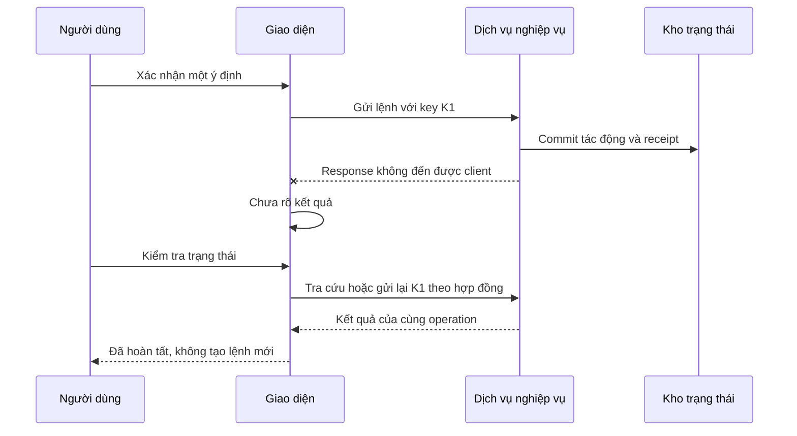
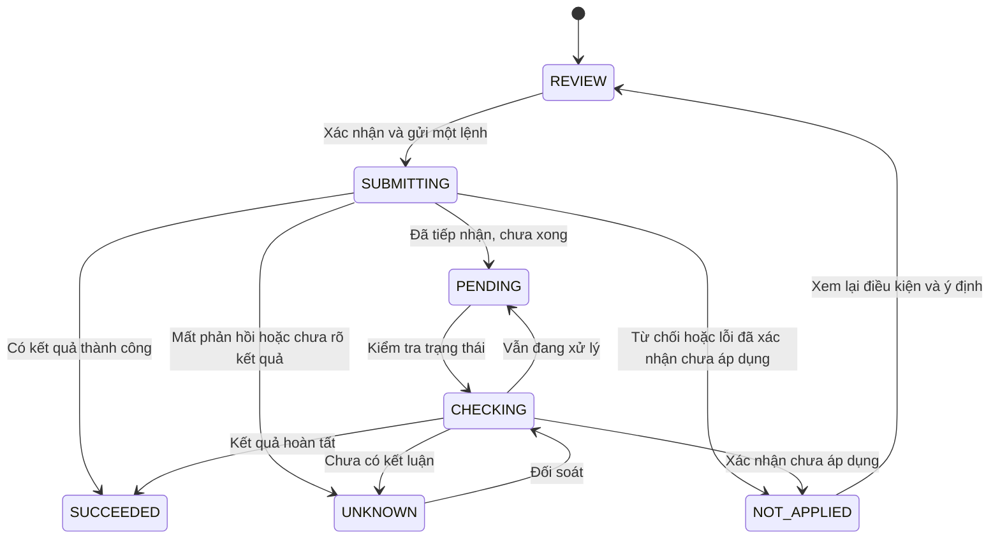

# Safe retry guidance: Hướng dẫn thử lại thao tác an toàn

Trong chương **User Experience**, hướng dẫn retry an toàn giúp người dùng tiếp tục một thao tác khi mất kết nối, timeout hoặc gặp từ chối nghiệp vụ mà không vô tình tạo thêm tác động. Với thanh toán, hoàn tiền, duyệt yêu cầu hoặc sử dụng ưu đãi, một nút “Thử lại” thiếu ngữ nghĩa có thể làm người dùng gửi nhiều lệnh khác nhau trong khi họ chỉ muốn biết kết quả của một lệnh cũ.

Đây là vấn đề bảo mật logic nghiệp vụ. Giao diện cần phản ánh đúng trạng thái mà hệ thống biết, còn máy chủ phải bảo vệ quyền theo đối tượng, invariant, state machine, transaction và idempotency. Việc khóa nút trên màn hình chỉ hỗ trợ trải nghiệm, không thay thế những kiểm soát đó.

Bài học tập trung vào cách xác định lúc nào được retry, retry cái gì, hướng dẫn bằng câu chữ nào và khi nào phải chuyển sang kiểm tra trạng thái hoặc xác nhận lại ý định.

## 1. Người dùng muốn tiếp tục một ý định, không tạo thêm một lệnh

Giả sử người dùng xác nhận thanh toán 250.000 đồng. Server đã thực hiện nhưng response bị mất. Giao diện hiển thị “Có lỗi, thử lại”, đồng thời tạo idempotency key mới mỗi lần bấm. Người dùng có thể bị tính tiền lần nữa dù họ chỉ muốn hoàn thành giao dịch ban đầu.

Một thiết kế an toàn cần phân biệt:

| Khái niệm | Ví dụ | Vòng đời |
| --- | --- | --- |
| Ý định nghiệp vụ | Thanh toán cho một đơn hàng với số tiền đã xác nhận | Giữ nguyên khi chỉ đang tìm kết quả hoặc gửi lại cùng lệnh |
| Lệnh đã gửi | Nội dung bất biến, idempotency key và phạm vi xác định | Không tự sửa giữa các lần thử |
| Lượt gửi | Request ban đầu hoặc một lần retry | Có thể có nhiều lượt cho cùng lệnh |
| Operation phía máy chủ | Bản ghi theo dõi thực thi và kết quả | Là nguồn tra cứu theo hợp đồng của hệ thống |

Một lần bấm lại sau timeout thường vẫn thuộc cùng ý định. Ngược lại, thay người nhận, đổi số tiền hoặc chấp nhận một báo giá mới có thể là ý định khác, cần được xem lại và định danh đúng.

Không tự kết luận hai request là cùng ý định chỉ vì chúng có số tiền giống nhau. Cũng không tự coi mỗi lần bấm là một ý định mới. Sự liên kết phải được thiết kế trong luồng thao tác và được máy chủ kiểm chứng.

## 2. Timeout không có nghĩa thao tác thất bại

Không nhận được response có thể xảy ra tại nhiều thời điểm:



Client không được suy rằng không nhận response thì server chưa làm gì. Tương tự, người dùng đóng trang hoặc client hủy chờ request không có nghĩa máy chủ đã hủy lệnh.

Cần ít nhất các trạng thái phân biệt:

| Trạng thái biết được | Ý nghĩa | Hướng tiếp tục |
| --- | --- | --- |
| Thành công đã xác nhận | Có kết quả hoàn tất đáng tin của lệnh | Hiển thị kết quả, không tạo thêm tác động |
| Đã tiếp nhận, đang xử lý | Có operation nhưng chưa có kết quả cuối | Theo dõi trạng thái |
| Chưa xác định kết quả | Có thể đã hoặc chưa thực hiện | Đối soát hoặc retry cùng lệnh nếu hợp đồng hỗ trợ |
| Bị từ chối, đã xác nhận chưa áp dụng | Điều kiện nghiệp vụ không cho phép | Sửa điều kiện hợp lệ và xem lại ý định |
| Lỗi kỹ thuật, đã xác nhận chưa áp dụng | Không có tác động trong phạm vi đã xác định | Retry theo điều kiện của lệnh |
| Không đủ quyền truy cập | Người gọi không được tiếp tục hoặc xem kết quả | Giữ ranh giới quyền, không đoán kết quả lệnh cũ |

Một phản hồi bị từ chối quyền không chứng minh operation chưa từng thành công. Người dùng có thể vừa mất quyền trong khi lệnh cũ đã hoàn tất. Giao diện không nên chuyển trường hợp này thành lời mời thực hiện lại dưới tài khoản khác.

## 3. Hợp đồng giữa giao diện và máy chủ

Giao diện không thể tự suy ra retry an toàn chỉ từ HTTP status hoặc câu chữ lỗi. Máy chủ nên cung cấp mã ổn định, trạng thái thực thi nếu biết và hướng phục hồi trong phạm vi được phép.

Ví dụ một operation đang chạy:

```json
{
  "code": "OPERATION_RESULT_PENDING",
  "operationId": "op-832",
  "operationState": "PROCESSING",
  "statusVersion": 2,
  "recovery": {
    "action": "CHECK_STATUS",
    "retryMode": "STATUS_ONLY",
    "nextCheckAfterMs": 2000
  },
  "correlationId": "srv-corr-27a"
}
```

Đây là hợp đồng minh họa. `nextCheckAfterMs` là hướng dẫn cho việc kiểm tra trạng thái, không phải quyền thực hiện thêm một lệnh. Nếu server không có operation bền vững hoặc không biết kết quả, không nên bịa operation ID hay trạng thái đang xử lý.

Có thể định nghĩa các chế độ phục hồi hữu hạn:

| Chế độ | Ý nghĩa |
| --- | --- |
| `STATUS_ONLY` | Chỉ tra cứu operation đã có, không gửi thêm lệnh ghi |
| `SAME_COMMAND` | Được gửi lại cùng key và nội dung theo bảo đảm của API |
| `REVIEW_REQUIRED` | Phải đọc lại thông tin và xem lại ý định trước khi tiếp tục |
| `NO_AUTOMATIC_RETRY` | Không có retry tự động được hỗ trợ cho tình huống này |

Các tên trên là lựa chọn thiết kế, không phải chuẩn bắt buộc. Cần công bố rõ ý nghĩa và hành vi khi client gặp mã chưa nhận diện được. Với thao tác nhạy cảm, không nên mặc định mã lạ đồng nghĩa được gửi lại.

`retryMode` cũng không thay thế guard phía máy chủ. Mỗi lượt retry vẫn phải được xác thực, kiểm tra quyền theo đối tượng và giữ các invariant. Một client bị sửa có thể bỏ qua mọi hướng dẫn trên màn hình.

## 4. Bảng quyết định: khi nào thử lại, khi nào kiểm tra trạng thái?

| Tình huống | Hành vi giao diện phù hợp | Điều cần tránh |
| --- | --- | --- |
| Truy vấn chỉ đọc thực sự bị lỗi tạm thời | Có thể retry có giới hạn sau khi xác thực và theo hợp đồng | Không mặc định mọi endpoint dùng GET đều không có tác động |
| Timeout sau khi gửi lệnh ghi | Kiểm tra trạng thái; hoặc gửi lại cùng lệnh nếu API bảo đảm an toàn | Tạo key mới vì chưa thấy response |
| Đã tiếp nhận công việc nền | Theo dõi operation | Hiển thị hoàn tất khi chỉ mới vào hàng đợi |
| Xung đột idempotency key với payload | Dừng gửi tự động, kiểm tra liên kết key và ý định | Đổi key tự động để vượt xung đột |
| Phiên bản đối tượng đã cũ | Đọc lại và yêu cầu xem lại thông tin liên quan | Tự tăng expected version rồi gửi lại thao tác nhạy cảm |
| Báo giá thay đổi | Lấy báo giá mới và cho người dùng xác nhận nếu cần | Tự chấp nhận giá khác với ý định ban đầu |
| Chưa phê duyệt | Hướng tới luồng phê duyệt nếu được phép | Thử endpoint khác hoặc thêm cờ đã duyệt |
| Phiên đăng nhập hết hạn | Xác thực lại, xác minh cùng tài khoản và tenant, sau đó phục hồi theo trạng thái | Gửi lệnh cũ sang một ngữ cảnh danh tính khác |
| Vượt giới hạn tần suất | Chờ theo hướng dẫn rồi tiếp tục trong ngân sách retry | Gửi từ nhiều tab hoặc sinh key mới để né giới hạn |
| Quyền đã bị thu hồi | Thông báo phù hợp và dừng đường truy cập không được phép | Dùng receipt hoặc URL cũ để vượt quyền |
| Đã có receipt thành công | Hiển thị kết quả của operation cũ | Hiểu replay là thất bại và gửi một ý định mới |

HTTP 5xx, 429 hoặc lỗi mạng không tự chứng minh thao tác chưa áp dụng. Ngay cả khi một lượt bị chặn sớm, lệnh tương ứng cũng có thể đã được thực hiện bởi một lượt trước đó. Quyết định cần dựa trên trạng thái operation và hợp đồng của API.

Đối với retry cùng lệnh, kết quả chưa rõ không bắt buộc luôn phải chờ người dùng. Nếu máy chủ có bảo đảm idempotency phù hợp và cho phép, client có thể tự gửi lại cùng key, cùng nội dung với giới hạn rõ ràng. Điều không an toàn là suy đoán bảo đảm đó khi API chưa cung cấp.

## 5. Thiết kế trạng thái giao diện theo bằng chứng

Một mô hình minh họa:



Sơ đồ lược bỏ các nhánh quyền truy cập để dễ đọc. Nếu không được phép xem operation, giao diện cần trạng thái chặn truy cập riêng; không gán nó thành `NOT_APPLIED`.

Một số nguyên tắc quan trọng:

- `SUBMITTING` nghĩa là đang chờ kết quả gửi, không phải đã thành công.
- `PENDING` cần bằng chứng đã tiếp nhận; `UNKNOWN` phản ánh thiếu kết luận.
- `SUCCEEDED` của một lệnh đã hoàn tất không bị một lỗi mạng đến muộn hạ xuống thất bại.
- Người dùng rời trang không tự tạo chuyển tiếp hủy ở máy chủ.
- Tỷ lệ tiến độ chỉ nên xuất hiện khi có nguồn dữ liệu thực tế; spinner không nên bị diễn giải thành phần trăm hoàn thành giả.

### 5.1. Response đến lệch thứ tự

Giả sử lượt gửi đầu đã thành công nhưng response chậm. Lượt kiểm tra tiếp theo timeout và được giao diện xử lý trước. Khi response thành công của lượt đầu đến, đó vẫn có thể là bằng chứng hợp lệ về kết quả operation.

Không dùng riêng số thứ tự request phía client để quyết định response nào phản ánh trạng thái nghiệp vụ mới hơn. Cần đối chiếu operation ID, ngữ cảnh, trạng thái và phiên bản trạng thái do máy chủ cấp nếu có.

Nếu server cung cấp `statusVersion` tăng theo thay đổi operation, client có thể dùng nó theo hợp đồng để tránh áp dụng snapshot cũ. Nếu không có bảo đảm thứ tự như vậy, ít nhất không được hạ một kết quả cuối đã xác nhận thành “chưa rõ” chỉ do một quan sát mạng cũ hoặc kém thông tin hơn.

Snapshot hiện tại của đơn hàng và kết quả của lệnh cũng là hai loại dữ liệu khác nhau. Một lệnh thanh toán thành công trước đó không có nghĩa mọi trường của đơn hàng hiện tại vẫn giống thời điểm thanh toán.

## 6. Giữ nguyên lệnh khi retry

Khi người dùng xác nhận một ý định, client có thể tạo một bản lệnh bất biến:

```text
SubmittedIntent:
    clientIntentReference
    boundAccountContext
    boundTenantContext
    action
    idempotencyKey
    immutableCommand
    localCommandFingerprint
    operationId nếu đã biết
    latestKnownOperationState
    retryBudgetState
```

Đây là mô hình dữ liệu phía client. `localCommandFingerprint` chỉ giúp phát hiện client đã vô tình đổi nội dung; máy chủ phải tự tính fingerprint tin cậy và thực thi ràng buộc của mình.

### 6.1. Một ý định, một key trong phạm vi được hỗ trợ

Mỗi lượt gửi cùng lệnh dùng lại key và nội dung. Correlation ID của từng request có thể mới để phục vụ điều tra, nhưng không biến nó thành một lệnh nghiệp vụ mới.

Nếu sửa số tiền, người nhận, đối tượng hoặc expected version có ý nghĩa, không tiếp tục gửi dưới key đã ràng buộc. Trước hết xác định kết quả ý định cũ và xem thay đổi có phải một ý định mới hợp lệ hay không.

Trong lúc operation cũ chưa rõ kết quả, người dùng có thể được sửa một bản nháp riêng nếu sản phẩm hỗ trợ. Bản nháp không được âm thầm thay thế payload bất biến đang được retry. Việc gửi bản nháp thành lệnh mới cần tuân thủ quy tắc về operation cũ và xác nhận ý định mới.

### 6.2. Reload hoặc đóng ứng dụng không được làm mất khả năng đối soát

Có thể lưu tối thiểu tham chiếu operation, key hoặc dữ liệu liên kết cần thiết để tiếp tục sau reload, phù hợp mức nhạy cảm và chính sách lưu trữ. Không mặc định lưu toàn bộ body thanh toán, dữ liệu cá nhân hay token đăng nhập trong kho lưu client.

Nếu chỉ lưu operation ID, có thể yêu cầu xác thực và đọc lại trạng thái từ máy chủ trước khi phục hồi màn hình. Nếu cần retry lại payload, phải có cách khôi phục chính xác nội dung đã gửi; không ghép lệnh từ các trường form hiện tại đã thay đổi.

Dữ liệu local có thể bị sửa hoặc mất. Nó hỗ trợ trải nghiệm, không phải nguồn cấp quyền hoặc bằng chứng duy nhất một lệnh chưa thực hiện.

### 6.3. Thay tài khoản hoặc tenant phải đổi ngữ cảnh giao diện

Một pending operation của tài khoản A không được tự xuất hiện với đầy đủ dữ liệu khi người dùng đăng nhập tài khoản B. Các tác vụ poll hoặc retry phải dừng hoặc bị tách khỏi ngữ cảnh hiển thị khi đổi tài khoản, tenant hay đăng xuất.

Không gửi lại lệnh của A dưới danh tính B. Namespace idempotency có thể khác, khiến cùng key không còn bảo vệ cùng một operation. Máy chủ vẫn cần invariant nghiệp vụ, nhưng giao diện phải tránh tạo đường sai này ngay từ đầu.

Khi khôi phục đúng ngữ cảnh, cần kiểm tra quyền hiện tại trước khi hiện chi tiết hoặc tiếp tục. Không xem dữ liệu đã cache là quyền đọc vĩnh viễn.

## 7. Hướng dẫn bằng câu chữ và hành động cụ thể

Thông báo nên nói điều đã biết và đưa ra một bước tiếp theo phù hợp. Không đổ lỗi cho người dùng hoặc khẳng định thất bại khi kết quả còn mơ hồ.

| Tình huống | Câu chữ minh họa | Hành động chính |
| --- | --- | --- |
| Chưa rõ kết quả thanh toán | “Chưa xác định được kết quả thanh toán. Hãy kiểm tra trạng thái trước khi gửi lệnh mới.” | Kiểm tra trạng thái |
| Operation đã được tiếp nhận | “Yêu cầu đã được tiếp nhận và đang xử lý.” | Xem tiến độ |
| Retry nhận lại thành công | “Thanh toán đã hoàn tất. Đây là kết quả của yêu cầu trước.” | Xem chi tiết |
| Phiên bản đối tượng thay đổi | “Thông tin đã thay đổi. Hãy xem lại trước khi xác nhận.” | Tải thông tin mới |
| Báo giá không còn hợp lệ | “Báo giá đã thay đổi. Hãy kiểm tra giá mới trước khi tiếp tục.” | Xem báo giá |
| Đã xác nhận chưa thực hiện, được phép retry | “Thao tác chưa được thực hiện. Bạn có thể thử lại cùng yêu cầu.” | Thử lại yêu cầu |
| Chưa có quyền tiếp tục | “Bạn hiện không thể tiếp tục thao tác này.” | Hướng hỗ trợ được phép |

Các câu trên chỉ phù hợp khi máy chủ cung cấp căn cứ tương ứng. Không hiển thị “thao tác chưa được thực hiện” chỉ vì JavaScript nhận một lỗi kết nối.

### 7.1. Nút phải mô tả đúng việc sẽ làm

“Kiểm tra trạng thái” không được âm thầm gọi endpoint tạo thanh toán mới. “Thử lại yêu cầu” phải giữ đúng key và payload khi hợp đồng yêu cầu. “Tạo yêu cầu mới” cần thể hiện rõ đang tạo một ý định khác.

Ở màn hình xem lại, hiển thị đủ đối tượng, số tiền, người nhận hoặc phạm vi cần người dùng xác nhận. Không lấy message lỗi đã dịch rồi phân tích ngược thành số tiền cho request tiếp theo; dữ liệu lệnh phải giữ kiểu và nguồn xác định.

Không cần bắt người dùng xác nhận lại mọi lần truyền lại cùng lệnh đã được bảo đảm idempotency. Xác nhận lại có giá trị khi điều kiện nghiệp vụ hoặc ý định đã thay đổi, thay vì tạo thêm ma sát cho một retry kỹ thuật không đổi nội dung.

### 7.2. Tránh một ngõ cụt khi không thể tự đối soát

Nếu không thể lấy trạng thái, giao diện nên giữ thông tin chưa rõ, cho phép kiểm tra sau và cung cấp mã tham chiếu hỗ trợ an toàn. Không biến việc hết ngân sách retry tự động thành một kết luận thất bại nghiệp vụ.

Hướng hỗ trợ không nên yêu cầu người dùng gửi token, cookie hoặc dữ liệu xác thực. Correlation ID hoặc operation ID là tham chiếu; người hỗ trợ vẫn phải được cấp quyền để đọc thông tin liên quan.

## 8. Giới hạn retry tự động và tải hệ thống

Ngay cả khi retry không tạo tác động trùng, việc gửi quá nhiều vẫn có thể làm quá tải dịch vụ quyền, database và kho receipt. Cần có ngân sách cho số lượt, tổng thời gian và số request đang chạy.

Một công thức backoff minh họa:

```text
cap(k) = min(maxDelay, baseDelay * 2^k)
jitterDelay = random(0, cap(k))
actualDelay = max(serverMinimumWait, jitterDelay)
```

`k` là số lần retry đã lên lịch theo quy ước của client. Jitter giúp nhiều client không cùng gửi lại ở một thời điểm. Nếu thời gian chờ tối thiểu server đưa ra vượt ngân sách tự động còn lại, dừng tự động và thông báo bước tiếp theo; không dùng trần chờ của client để gửi sớm hơn mốc server yêu cầu.

Các giới hạn nên bao gồm:

- Số lượt gửi lại tối đa cho một lệnh theo chính sách client.
- Tổng thời gian phục hồi tự động.
- Tối đa một lượt gửi cùng lệnh đang chờ ở một bộ điều khiển client.
- Nhịp poll trạng thái độc lập với retry lệnh ghi.
- Dừng hoặc tạm hoãn khi offline, đổi ngữ cảnh hoặc hết quyền.
- Chính sách phục hồi khi trở lại online, tránh xả đồng loạt mọi lệnh cũ.

Các giới hạn phía client phục vụ trải nghiệm và giảm tải. Máy chủ vẫn cần rate limit, quota và kiểm soát chống lạm dụng vì client có thể bị sửa hoặc có nhiều thiết bị cùng gửi.

### 8.1. Tránh nhân retry qua nhiều tầng

Nếu giao diện, SDK và gateway mỗi tầng đều tạo tối đa ba lượt gửi cho một lần nhận vào, trường hợp xấu có thể tạo tới 27 lượt ở tầng sau. Dù idempotency chặn tác động lặp, chi phí xử lý vẫn bị nhân lên.

Cần biết tầng nào sở hữu retry, tầng nào chỉ chuyển tiếp lỗi và ngân sách tổng thể là gì. Các retry nội bộ trong một lượt xử lý không nên được trình bày như nhiều ý định mới của người dùng.

### 8.2. Nhiều tab hoặc nhiều thiết bị

Client có thể phối hợp giữa các tab để tránh gửi lặp, nhưng cơ chế này chỉ là hỗ trợ. Tab có thể crash, khóa local có thể hết hạn hoặc thiết bị khác vẫn gửi cùng lúc.

Không dựa vào một biến `isSubmitting` trong trình duyệt để chứng minh thao tác chỉ thực hiện một lần. Ràng buộc key, ý định nghiệp vụ, phiên bản đối tượng và transaction ở máy chủ phải giữ đúng khi nhiều request thật sự chạy đồng thời.

## 9. Một bộ điều khiển retry minh họa

Mã giả dưới đây chỉ mô tả quyết định của client, không phải mã Java hay JavaScript hoàn chỉnh:

```text
onRetryRequested(intent, activeContext):
    require intent.belongsTo(activeContext)

    if intent.latestKnownState == SUCCEEDED:
        showExistingResult(intent)
        return

    if intent.requiresReview:
        openReviewUsingFreshAuthorizedData(intent)
        return

    if intent.hasRequestInFlight:
        showCurrentProgress(intent)
        return

    if intent.recoveryMode == STATUS_ONLY:
        scheduleBoundedStatusCheck(intent)
        return

    if intent.recoveryMode != SAME_COMMAND:
        showReconciliationOrSupport(intent)
        return

    if not withinSupportedRetryWindow(intent):
        showReconciliationOrSupport(intent)
        return

    require immutableCommandStillMatches(intent)
    require retryBudgetAllowsAnotherAttempt(intent)

    send(
        payload = intent.immutableCommand,
        idempotencyKey = intent.originalKey,
        requestCorrelation = newAttemptCorrelation()
    )
```

`immutableCommandStillMatches` chỉ ngăn lỗi client. Nó không làm dữ liệu trở nên tin cậy đối với máy chủ. Request đến nơi vẫn phải được xác thực và kiểm tra lại đầy đủ.

Việc hết hạn retry window phải dựa trên hợp đồng hỗ trợ của server và dữ liệu theo dõi phù hợp. Nếu không biết bảo đảm còn hiệu lực không, không tự coi key là mới để thực hiện lại. Chuyển sang đối soát hoặc hướng hỗ trợ thích hợp.

Khi nhận response, bộ điều khiển cần kiểm tra nó thuộc đúng ngữ cảnh và operation, rồi cập nhật trạng thái theo bằng chứng. Không áp dụng response của tài khoản cũ vào màn hình tài khoản mới. Cũng không bỏ mất một kết quả thành công hợp lệ chỉ vì response đó đến từ lượt gửi có số thứ tự nhỏ hơn.

## 10. Hủy thao tác là một nghiệp vụ riêng

Người dùng có thể muốn dừng chờ, rời trang hoặc hủy operation. Ba hành động này khác nhau:

| Hành động | Điều thực sự được yêu cầu |
| --- | --- |
| Dừng chờ ở client | Không tiếp tục chờ response tại màn hình hiện tại |
| Rời trang | Đóng hoặc đổi giao diện |
| Gửi lệnh hủy | Yêu cầu máy chủ chuyển operation theo quy tắc hủy |

Chỉ hành động thứ ba mới có thể dẫn tới hủy ở hệ thống, nếu operation còn ở trạng thái cho phép. Máy chủ có thể đã qua mốc cam kết hoặc bên ngoài đã tiếp nhận tác động.

Không hiển thị “Đã hủy” ngay khi người dùng đóng hộp thoại đang gửi. Nếu đã gửi lệnh hủy nhưng chưa có kết luận, có thể cần trạng thái “Đã yêu cầu hủy” và tiếp tục tra cứu.

Lệnh hủy cũng cần quyền theo đối tượng, chống lặp và kiểm soát phiên bản thích hợp. Trong race giữa hoàn tất và hủy, response phải phản ánh chuyển tiếp thực tế đã thắng. Không retry lệnh gốc chỉ vì lệnh hủy bị từ chối; trước hết phải xác định trạng thái operation.

Nếu có bù trừ sau một tác động đã xảy ra, giao diện cần mô tả quy trình đó riêng. Đang bù trừ không đồng nghĩa chưa từng thực hiện.

## 11. Khả năng tiếp cận, thông tin nhạy cảm và quan sát

### 11.1. Trạng thái cần hiểu được mà không chỉ dựa vào màu

Hiển thị trạng thái bằng văn bản rõ ràng, có nhãn hành động cụ thể và hỗ trợ cách sử dụng bằng bàn phím. Khi poll cập nhật, tránh liên tục giật focus hoặc lặp thông báo gây khó sử dụng.

Thông báo cho công cụ hỗ trợ cần phản ánh thay đổi có ý nghĩa, chẳng hạn từ đang xử lý sang hoàn tất, thay vì đọc lại cùng một câu mỗi lần poll. Không chỉ dùng màu đỏ hoặc xanh để phân biệt thất bại và thành công.

Ngôn ngữ message có thể thay đổi, nhưng mã trạng thái và logic client phải ổn định theo hợp đồng. Không phân nhánh bằng cách tìm từ “thử lại” trong câu tiếng Việt.

### 11.2. Chỉ hiển thị thông tin trong quyền hiện tại

Màn hình phục hồi không được trở thành đường đọc lại dữ liệu đã mất quyền. Danh sách operation gần đây, thông báo đẩy, bản xem trước và dữ liệu cache đều cần được xét theo ngữ cảnh tài khoản phù hợp.

Operation ID là một tham chiếu, không phải bí mật cấp quyền. Không gắn token đăng nhập vào đường dẫn chia sẻ để người dùng tiện tiếp tục thao tác.

### 11.3. Quan sát trải nghiệm mà không biến metric thành kho định danh

Có thể theo dõi các sự kiện như bắt đầu đối soát, hoàn tất bằng replay, hết ngân sách retry hoặc người dùng rời màn hình khi còn pending. Nhưng “rời màn hình” không được tính là operation đã hủy hay đã thất bại.

Metric nên dùng chiều hữu hạn như action và nhóm trạng thái. Không đưa operation ID, user ID hoặc idempotency key vào label của mọi chuỗi thời gian. Khi cần điều tra một lượt cụ thể, dùng log hoặc trace có phân quyền và dữ liệu tối thiểu.

Phân biệt retry request với số tác động nghiệp vụ thành công. Một operation có năm lượt gửi nhưng chỉ một commit không phải năm giao dịch. Ngược lại, số request ít không chứng minh không có tác động trùng nếu máy chủ xử lý sai.

## 12. Kiểm thử hướng dẫn retry cùng tình huống lạm dụng

| Kịch bản | Kỳ vọng giao diện | Kỳ vọng máy chủ và dữ liệu |
| --- | --- | --- |
| Double-click trên cùng ý định | Không tạo hai ý định ngoài ý muốn | Cùng lệnh không tạo tác động hai lần |
| Commit thành công nhưng response mất | Hiển thị chưa rõ rồi đối soát hoặc replay an toàn | Receipt liên kết tới tác động duy nhất |
| Timeout trước khi biết kết quả | Không tuyên bố chắc chắn thất bại | Không đoán rollback thiếu căn cứ |
| Operation đang chạy | Nút chính kiểm tra trạng thái, không tạo lệnh mới | Retry không nhân job |
| Người dùng sửa form khi lệnh cũ chưa rõ | Tách bản nháp khỏi lệnh đã gửi | Payload retry vẫn đúng fingerprint |
| Báo giá thay đổi | Yêu cầu xem và xác nhận giá mới nếu cần | Không chấp nhận giá client tùy ý |
| Expected version đã cũ | Đọc lại và xem lại ý định | Không tự ghi đè phiên bản mới |
| Chưa đủ phê duyệt | Hướng tới luồng hợp lệ trong quyền hiện tại | Không bỏ qua state machine |
| Key cũ với payload khác | Dừng retry tự động, giải thích xung đột | Không thực hiện payload mới dưới key đã ràng buộc |
| Đăng xuất hoặc đổi tenant khi đang poll | Dừng hoặc tách tác vụ khỏi ngữ cảnh hiện tại | Không đọc hoặc gửi lệnh chéo phạm vi |
| Đăng nhập lại đúng tài khoản nhưng mất quyền | Hiển thị trạng thái truy cập phù hợp | Receipt không cấp lại quyền cũ |
| Reload khi operation pending | Khôi phục tham chiếu rồi đọc trạng thái được phép | Không tạo key mới chỉ vì mất state trong bộ nhớ |
| Response thành công cũ đến sau một timeout mới | Không hạ kết quả đã xác nhận thành thất bại | Đối chiếu đúng operation và phiên bản trạng thái |
| Nhiều tab hoặc thiết bị cùng gửi | Giao diện không khuyến khích tạo thêm lệnh | Invariant và ràng buộc duy nhất vẫn giữ đúng |
| Client offline rồi online | Không xả vô hạn các retry cũ | Quota, quyền và thời hạn vẫn được kiểm tra |
| Server yêu cầu chờ lâu hơn ngân sách tự động | Dừng tự động và chỉ dẫn tiếp theo | Không gửi trước mốc chờ tối thiểu |
| Người dùng đóng trang hoặc hủy chờ | Không tuyên bố đã hủy nghiệp vụ | Operation có thể tiếp tục theo trạng thái thực tế |
| Hủy và hoàn tất chạy đồng thời | Hiển thị kết quả chuyển tiếp đã xác nhận | Không có hai kết luận mâu thuẫn cho cùng phiên bản |
| Receipt vượt thời hạn replay được hỗ trợ | Chuyển sang đối soát, không tự coi là lệnh mới | Không tái thực thi vô căn cứ |

Các kiểm thử mạng nên đặt gián đoạn ở những ranh giới khác nhau: trước khi server nhận, sau khi tiếp nhận, sau commit và trước khi client nhận response. Cùng một biểu hiện timeout trên giao diện có thể tương ứng các kết quả nghiệp vụ khác nhau.

Cần kiểm tra trực tiếp số tác động, receipt, phiên bản và sự kiện nghiệp vụ. Chỉ kiểm tra nút đã bị khóa hoặc một thông báo đã hiện không chứng minh retry an toàn.

Đối với race condition ở UI, kiểm soát thứ tự response để chứng minh không có cập nhật sai ngữ cảnh hoặc hạ trạng thái cuối. Đối với concurrency máy chủ, cho request thực sự tranh cùng điều kiện ban đầu và đối chiếu invariant sau khi hoàn tất.

## 13. Tiêu chí hoàn thành thiết kế

Một hướng dẫn retry an toàn cần trả lời rõ:

- Người dùng đang tiếp tục cùng ý định hay tạo một ý định mới?
- Hệ thống đã biết operation thành công, chưa áp dụng, đang chạy hay chưa rõ kết quả?
- Nút được hiển thị sẽ kiểm tra trạng thái, gửi lại cùng lệnh hay bắt đầu một lệnh khác?
- Key, payload và ngữ cảnh tài khoản có được giữ nhất quán qua reload, nhiều tab và xác thực lại không?
- Khi giá, quyền, phê duyệt hoặc phiên bản thay đổi, có quay về bước xem lại hợp lệ không?
- Retry tự động có giới hạn và có phối hợp với các tầng khác không?
- Hướng dẫn trên giao diện có khớp với bảo đảm idempotency, transaction và invariant thực tế của máy chủ không?

Một trải nghiệm retry tốt giúp người dùng hiểu điều gì đã biết, tiếp tục đúng thao tác và tránh bị buộc phải đoán. Tính an toàn đến từ sự kết hợp giữa hướng dẫn rõ ràng và các ràng buộc nghiệp vụ được thực thi nhất quán ở máy chủ.
